# Questões de DRE

<!-- Todas as questões dos PDFs da Fixação (caderno TecConcursos "DRE - 851", aulas de Igor Cintra e Gilmar Possati), sem repetição.
     O número F0001... é a identidade da questão no site: nunca renumere. F0001 a F0851 seguem a numeração do caderno.
     Resolução: tudo o que vem depois de "- Gabarito:"; "- Resolução: a caminho" enquanto não houver. Comentários dos professores sempre reescritos. -->

## F0001 · FCC · 2026 · MPE SE · ME
- Fontes: TecConcursos 1 (3800511) · Igor Cintra 46
- Prova: FCC - Ana (MPE SE)/MPE SE/Ciências Contábeis/2026
- Grupos: receita-bruta, deducoes, cmv, resultado-bruto, despesas-vendas, resultado-financeiro

A empresa Compra para Revenda S.A. comercializa bens de vestuário e adquiriu mercadorias, em 10/11/2022, nas seguintes condições:

- Valor das mercadorias: R$ 690.000,00
- Prazo para pagamento ao fornecedor: 15 meses
- A taxa de juros implícita embutida na compra a prazo era 15% para o prazo de 15 meses

O valor dos tributos recuperáveis incluído no preço de compra era R$ 50.000,00 e o valor dos tributos não recuperáveis era R$ 20.000,00.

O fornecedor não faz a entrega das mercadorias e a empresa Compra para Revenda S.A. contratou uma transportadora para levar as mercadorias até seu depósito, pagando à vista o valor de R$ 15.000,00.

Em 15/12/2022, a empresa Compra para Revenda S.A. vendeu 80% das mercadorias que havia adquirido em 10/11/2022 pelo valor de R$ 700.000,00, à vista, mas concedeu um desconto comercial de 10% em função da quantidade adquirida por um cliente tradicional. A empresa pagou ainda os seguintes valores:

- R$ 14.000,00 a título de comissão para seus vendedores.
- R$ 5.000,00 para a transportadora que fez a entrega das mercadorias ao seu cliente.

O lucro bruto apurado pela empresa Compra para Revenda S.A., especificamente em relação a esta venda ocorrida em 15/12/2022, foi, em reais,

- A) 159.000,00
- B) 106.000,00
- C) 122.000,00
- D) 164.000,00
- E) 178.000,00
- Gabarito: E
### O que a questão pede
O **lucro bruto** (= resultado bruto, resultado com mercadorias) **só desta venda**: receita líquida da venda − custo das mercadorias que saíram. Tudo o que vem depois do lucro bruto (comissões, frete de entrega, juros) é distração.

### Cálculos prévios
**1) Custo de aquisição das mercadorias** (CPC 16 e CPC 12):

| Passo | Conta | Valor |
|---|---|---|
| a | Preço a prazo | 690.000 |
| b | Tira os juros embutidos (AVP): 690.000 ÷ 1,15 | **600.000** |
| c | (–) tributos recuperáveis (viram "a recuperar", no ativo) | (50.000) |
| d | Tributos não recuperáveis: já estão no preço, ficam no custo | 0 |
| e | (+) frete até o depósito (gasto para trazer o estoque) | 15.000 |
| f | **Custo do lote** | **565.000** |

Os 90.000 de juros (690.000 − 600.000) **não são custo**: viram despesa financeira ao longo dos 15 meses.

**2) CMV desta venda:** saíram 80% do lote → 80% × 565.000 = **452.000**. Os 20% que sobraram (113.000) continuam no estoque.

**3) Receita:** 700.000 de venda bruta − desconto comercial de 10% (70.000) = **630.000** de receita líquida. O desconto é **incondicional** (dado no ato, pela quantidade), então é dedução da receita.

### Passo a passo
```dre
@ Venda (preço cheio) | 700.000 | receita-bruta
@ Desconto comercial 10% | 70.000 | deducoes
@ Custo do lote (após AVP, tributos e frete) | 565.000 | calculo-cmv
@ 80% do lote vendido | 452.000 | cmv
@ Comissão dos vendedores | 14.000 | despesas-vendas
@ Frete de entrega ao cliente | 5.000 | despesas-vendas
@ Juros embutidos na compra (AVP) | 90.000 | resultado-financeiro
@ 20% do lote que ficou no estoque | 113.000 | fora-ativo
> Comece pela venda: o preço cheio é a receita bruta.
+ Receita bruta | 700.000 | Venda (preço cheio)
> O desconto comercial (incondicional, dado na nota por causa da quantidade) é dedução da receita bruta.
+ (–) Descontos incondicionais | (70.000) | Desconto comercial 10%
= Receita líquida | 630.000
> Monte o custo do lote: valor presente (600.000) − tributos recuperáveis (50.000) + frete da compra (15.000) = 565.000. Só 80% saíram: CMV = 452.000. O que ficou é estoque (ativo).
+ (–) CMV | (452.000) | Custo do lote (após AVP, tributos e frete); 80% do lote vendido
! 20% do lote que ficou no estoque
= Lucro bruto | 178.000
> Pare aqui: a pergunta é o lucro bruto. Comissão e frete de entrega são despesas com vendas (abaixo do lucro bruto) e os juros são despesa financeira.
! Comissão dos vendedores; Frete de entrega ao cliente; Juros embutidos na compra (AVP)
```

### O que ignorar e por quê
- **Comissão de 14.000 e frete de entrega de 5.000:** são despesas com vendas, que entram **depois** do lucro bruto.
- **Juros de 90.000 da compra a prazo:** são despesa financeira apropriada ao longo do prazo, não custo.
- **Tributos não recuperáveis de 20.000:** já estão dentro do preço e continuam no custo; não há nada a somar nem a tirar.
- **Os 20% não vendidos:** continuam no estoque e não entram no CMV.

### O que mais poderia estar ali
- **No custo (soma):** seguro e frete da compra, carga e descarga, imposto de importação, tributos não recuperáveis "por fora".
- **No custo (subtrai):** tributos recuperáveis, devoluções e abatimentos sobre compras, descontos comerciais obtidos, AVP de compras.
- **Nas deduções:** devoluções, abatimentos, ICMS, PIS e Cofins sobre vendas e AVP de vendas.

### Pegadinhas
- **A (159.000)** = 178.000 − 14.000 − 5.000: desceu além do lucro bruto e tirou as despesas com vendas.
- **D (164.000)** = 178.000 − 14.000: tirou só a comissão.
- **B (106.000)** esqueceu o AVP: custo = 690.000 − 50.000 + 15.000 = 655.000; 80% = 524.000; 630.000 − 524.000.
- **C (122.000)** esqueceu o AVP e ainda tirou os tributos **não** recuperáveis: 690.000 − 50.000 − 20.000 + 15.000 = 635.000; 80% = 508.000.
- **Desconto comercial × financeiro:** "por causa da quantidade, no ato" é comercial (dedução); "por pagar antes" seria despesa financeira.

### Leve para as próximas
1. Lucro bruto = receita líquida − CMV. Nada abaixo dessa linha entra.
2. Custo de compra = valor presente − tributos recuperáveis + gastos para trazer o estoque.
3. Venda parcial: o CMV é proporcional ao que saiu.
4. Fonte: resolução do professor Igor Cintra, reescrita e ampliada.

## F0002 · FGV · 2026 · PC PI · ME
- Fontes: TecConcursos 2 (3806424) · Igor Cintra 34
- Prova: FGV - Per OC (PC PI)/PC PI/Perito Criminal/Contabilidade ou Economia/2026
- Grupos: receita-bruta, deducoes

Em uma perícia contábil para a verificação das demonstrações contábeis de uma entidade prestadora de serviços, em 31/12/2025, foi verificado que o saldo de tributos incidentes sobre vendas era de R$20.000.

O valor pode ser observado em conta

- A) redutora da receita bruta.
- B) redutora da receita líquida.
- C) integrante da despesa financeira.
- D) integrante da despesa operacional.
- E) integrante do custo das mercadorias vendidas.
- Gabarito: A
### O que a questão pede
Onde fica, na DRE de uma **prestadora de serviços**, o saldo de **tributos incidentes sobre vendas** (ISS, PIS e Cofins sobre o faturamento).

### A regra
Tributos sobre vendas e serviços são **dedução da receita bruta** (Lei 6.404/76, art. 187, I). A receita bruta menos as deduções dá a receita líquida. Gabarito **A**.

### Por que as outras estão erradas
- **B) redutora da receita líquida:** a receita líquida **já é** o resultado depois de tirar os tributos. Abaixo dela vem o custo, não tributo.
- **C) despesa financeira:** é ligada a juros e encargos de dinheiro, não a vendas.
- **D) despesa operacional:** fica abaixo do lucro bruto; os tributos sobre vendas ficam acima.
- **E) CMV:** custo do que se vendeu; além disso, prestadora de serviços tem **custo dos serviços prestados**.

### Pegadinhas
- **Tributo sobre o lucro × tributo sobre a venda:** IR e CSLL ficam depois do LAIR; ICMS, ISS, PIS e Cofins ficam nas deduções.
- **IPI:** sai do faturamento bruto antes de chegar à receita bruta.
- ⚠️ **Reforma Tributária:** pela orientação técnica do CFC, IBS e CBS (que substituirão PIS, Cofins, ICMS e ISS) **não integram** a receita bruta. Acompanhe como as bancas vão cobrar.

### Leve para as próximas
1. Tributo **sobre a venda** = dedução da receita bruta.
2. Fonte: resolução do professor Igor Cintra, reescrita e ampliada.

## F0003 · FGV · 2026 · AMAZUL · ME
- Fontes: TecConcursos 3 (3814597) · Igor Cintra 42
- Prova: FGV - TDTND/AMAZUL/Técnico em Contabilidade/2026
- Grupos: resultado-bruto, despesas-administrativas

Em 01/12/2025, uma sociedade empresária tinha R$80.000 em estoque. No mês de dezembro, todo o estoque foi vendido, à vista, por R$200.000. Além disso, a sociedade empresária reconheceu despesas administrativas de R$40.000 e comerciais de R$20.000.

Na Demonstração do Resultado mensal da sociedade empresária, relativa ao mês de dezembro, o lucro bruto foi de

- A) R$60.000.
- B) R$80.000.
- C) R$100.000.
- D) R$120.000.
- E) R$200.000.
- Gabarito: D
### O que a questão pede
O **lucro bruto** de dezembro: receita − CMV. As despesas administrativas e comerciais estão ali para distrair.

### Cálculos prévios
**CMV:** todo o estoque de 80.000 foi vendido e não houve compras, então CMV = 80.000 (EI 80.000 + compras 0 − EF 0).

### Passo a passo
```dre
@ Vendas à vista | 200.000 | receita-bruta
@ Estoque vendido | 80.000 | cmv
@ Despesas administrativas | 40.000 | despesas-administrativas
@ Despesas comerciais | 20.000 | despesas-vendas
> Sem deduções: a receita de vendas é a própria receita líquida.
+ Receita líquida | 200.000 | Vendas à vista
+ (–) CMV | (80.000) | Estoque vendido
= Lucro bruto | 120.000
> Pare no lucro bruto: as despesas administrativas e comerciais vêm depois.
! Despesas administrativas; Despesas comerciais
```

Gabarito **D (120.000)**.

### Pegadinhas
- **A (60.000)** = 120.000 − 40.000 − 20.000: é o resultado operacional, não o lucro bruto.
- **B (80.000)** = 120.000 − 40.000: tirou só as administrativas.
- **C (100.000)** = 120.000 − 20.000: tirou só as comerciais.
- **E (200.000):** é a receita; esqueceu o CMV.

### Leve para as próximas
1. Lucro bruto = receita líquida − CMV. Despesas, de qualquer tipo, vêm abaixo.
2. Fonte: resolução do professor Igor Cintra, reescrita.

## F0004 · CEBRASPE · 2026 · TCE MG · ME
- Fontes: TecConcursos 4 (3816107)
- Prova: CEBRASPE (CESPE) - ACE (TCE-MG)/TCE MG/Ciências Contábeis/2026
- Grupos: estrutura, equivalencia, fora-pl

Na demonstração de resultado de exercício, contribui(em) para a formação do resultado final do período

- A) o ajuste de avaliação patrimonial de imóvel destinado a investimento.
- B) o custo de produção do período.
- C) os ganhos ou as perdas com equivalência patrimonial no país.
- D) a variação cambial não realizada de investimentos no exterior.
- E) as perdas com benefícios pós-emprego.
- Gabarito: C
### O que a questão pede
Qual item **passa pela DRE** e forma o resultado do período. Os outros vão para o estoque ou para outros resultados abrangentes (patrimônio líquido).

### Alternativa por alternativa
- **A) Ajuste de avaliação patrimonial:** por definição, é conta do patrimônio líquido (Lei 6.404/76, art. 182, § 3º). Não passa pela DRE. Se o imóvel for propriedade para investimento a valor justo, a variação vai ao resultado (CPC 28), mas aí não se chama "ajuste de avaliação patrimonial".
- **B) Custo de produção do período:** vai para o **estoque** de produtos. Só chega à DRE como CPV quando o produto é vendido.
- **C) Ganhos ou perdas com equivalência patrimonial:** entram na DRE. Na Lei, entre as receitas e despesas operacionais; no CPC 26, em linha própria (CPC 18). **Gabarito.**
- **D) Variação cambial de investimento no exterior (conversão):** vai para outros resultados abrangentes (CPC 02), não para a DRE.
- **E) Perdas atuariais com benefícios pós-emprego (remensurações):** vão para outros resultados abrangentes (CPC 33).

### Pegadinhas
"Contribui para o resultado" é diferente de "mexe no patrimônio líquido". Muita coisa altera o PL sem passar pela DRE: ajustes de avaliação patrimonial, conversão de investimento no exterior, remensurações atuariais.

### Leve para as próximas
1. **Na DRE:** receitas, custos, despesas, ganhos e perdas do período, inclusive equivalência patrimonial.
2. **Fora da DRE (outros resultados abrangentes):** ajustes de avaliação patrimonial, variação cambial de conversão, remensurações atuariais.
3. **Custo de produção:** estoque, até a venda.

## F0005 · FCC · 2026 · ARPE · ME
- Fontes: TecConcursos 5 (3820431) · Igor Cintra 78
- Prova: FCC - ARSPD (ARPE)/ARPE/Administração/2026
- Grupos: lucro-liquido, receita-bruta, despesas-administrativas, resultado-financeiro

A empresa Pyche Lida. registrou vendas dos seus serviços em pavimentação de R$ 500.000,00 e custos de R$ 200.000,00, no exercício do primeiro trimestre do ano. Sabe-se também, neste mesmo período, que ela apontou despesas de depreciação de R$ 60.000,00 e despesas de juros de R$ 40.000,00. Sabendo que a sua alíquota tributária de IR é de 15%, o lucro liquido apurado pela empresa foi de, em R$:

- A) 240.000,00.
- B) 170.000,00.
- C) 200.000,00.
- D) 230.000,00.
- E) 150.000,00.
- Gabarito: B
- Resolução: a caminho

## F0006 · FGV · 2026 · ALEGO · ME
- Fontes: TecConcursos 6 (3823063) · Igor Cintra 115
- Prova: FGV - Ana Leg (ALEGO)/ALEGO/Analista de Controle Interno/Contabilidade/2026
- Grupos: receita-bruta

Um escritório de contabilidade iniciou as suas atividades em 01/01/2026 com o oferecimento de um tipo de serviço, cujos honorários são de R$ 500. No mês, prestou serviço a 20 clientes, sendo que metade recebeu um desconto de 10% no início do mês, por serem considerados clientes especiais. No mês, o custo total com os serviços prestados foi de R$ 4.000.

Na Demonstração do Resultado mensal do escritório, em 31/01/2026, houve reconhecimento de

- A) Lucro Bruto de R$ 6.000.
- B) Receita Bruta de R$ 9.500.
- C) Receita Líquida de R$ 9.500.
- D) Despesa financeira de R$ 500.
- E) Despesa operacional de R$ 500.
- Gabarito: C
- Resolução: a caminho

## F0007 · CEBRASPE · 2026 · TELEBRAS · CE
- Fontes: TecConcursos 7 (3830917) · Igor Cintra 80
- Prova: CEBRASPE (CESPE) - Esp GT (TELEBRAS)/TELEBRAS/Analista Superior/Finanças/2026
- Grupos: participacoes

A respeito das demonstrações contábeis, julgue o item que se segue, conforme a legislação societária e os pronunciamentos técnicos do CPC.

Devem ser discriminados, na demonstração de resultados do exercício, os valores referentes às participações dos empregados e dos administradores no resultado do período.

- Gabarito: CERTO
- Resolução: a caminho

## F0008 · FCC · 2026 · SEFAZ SP · ME
- Fontes: TecConcursos 8 (3846655) · Igor Cintra 44
- Prova: FCC - AFRE (SEFAZ SP)/SEFAZ SP/Gestão Tributária/2026
- Grupos: receita-bruta, deducoes, receita-liquida, cmv, resultado-bruto, despesas-vendas

Em 2025, uma determinada empresa comercial vendeu R$ 2.400.000 de seus produtos. Adicionalmente, durante 2025, reconheceu as seguintes operações: devoluções de vendas = R$ 90.000; abatimento sobre vendas = R$ 120.000; comissões sobre as vendas realizadas = R$ 60.000; impostos sobre vendas = R$ 310.000; estimativa para perdas com créditos de liquidação duvidosa = R$ 30.000; fretes sobre vendas = R$ 40.000.

Sabendo que o custo dos produtos vendidos foi R$ 1.350.000, a empresa apurou em 2025 uma receita líquida e um lucro bruto, respectivamente, em reais, de

- A) 1.850.000 e 460.000.
- B) 2.000.000 e 530.000.
- C) 1.880.000 e 530.000.
- D) 1.850.000 e 500.000.
- E) 1.880.000 e 500.000.
- Gabarito: C
### O que a questão pede
Duas linhas: a **receita líquida** e o **lucro bruto**. A armadilha é saber o que é **dedução da receita** e o que é **despesa com vendas**: só as deduções entram antes do lucro bruto.

### Cálculos prévios
Nenhum: a questão já dá o custo dos produtos vendidos (1.350.000). Basta classificar cada valor.

| Valor dado | Onde vai | Entra antes do lucro bruto? |
|---|---|---|
| Vendas 2.400.000 | receita bruta | sim |
| Devoluções 90.000 | dedução | sim |
| Abatimentos 120.000 | dedução | sim |
| Impostos sobre vendas 310.000 | dedução | sim |
| Comissões 60.000 | despesa com vendas | não |
| Perdas estimadas (PECLD) 30.000 | despesa com vendas | não |
| Fretes sobre vendas 40.000 | despesa com vendas | não |
| CPV 1.350.000 | custo | sim |

### Passo a passo
```dre
@ Vendas | 2.400.000 | receita-bruta
@ Devoluções de vendas | 90.000 | deducoes
@ Abatimentos sobre vendas | 120.000 | deducoes
@ Impostos sobre vendas | 310.000 | deducoes
@ Comissões sobre vendas | 60.000 | despesas-vendas
@ Estimativa para perdas (PECLD) | 30.000 | despesas-vendas
@ Fretes sobre vendas | 40.000 | despesas-vendas
@ Custo dos produtos vendidos | 1.350.000 | cmv
> As vendas do período são a receita bruta.
+ Receita bruta | 2.400.000 | Vendas
> Só três itens reduzem a receita: devolução, abatimento e imposto sobre vendas.
+ (–) Devoluções | (90.000) | Devoluções de vendas
+ (–) Abatimentos | (120.000) | Abatimentos sobre vendas
+ (–) Impostos sobre vendas | (310.000) | Impostos sobre vendas
= Receita líquida | 1.880.000
> Tire o custo dos produtos vendidos.
+ (–) CPV | (1.350.000) | Custo dos produtos vendidos
= Lucro bruto | 530.000
> Comissões, PECLD e fretes sobre vendas são despesas com vendas: ficam abaixo do lucro bruto.
! Comissões sobre vendas; Estimativa para perdas (PECLD); Fretes sobre vendas
```

### O que ignorar e por quê
**Comissões, PECLD e frete sobre vendas** são despesas para vender e cobrar, não reduções do preço da venda. Entram depois do lucro bruto, como despesas com vendas.

### O que mais poderia estar ali
- **Nas deduções:** vendas canceladas, descontos incondicionais concedidos, ICMS, PIS, Cofins e ISS, AVP de vendas a prazo.
- **Nas despesas com vendas:** propaganda, salários de vendedores, brindes, garantia de produtos.

### Pegadinhas
- **D (1.850.000 e 500.000) e A:** tratam a PECLD (30.000) como dedução. A PECLD é despesa com vendas, não reduz a receita.
- **E (1.880.000 e 500.000):** acerta a receita líquida, mas tira a PECLD antes do lucro bruto.
- **"Estimativa para perdas com créditos"** soa como "abatimento", mas é a expectativa de calote do cliente: é despesa.

### Leve para as próximas
1. Pergunte sempre: o valor **reduz o preço da venda** (dedução) ou **é um gasto para vender** (despesa)?
2. Só devolução, abatimento, desconto incondicional, tributo sobre venda e AVP reduzem a receita bruta.
3. Fonte: resolução do professor Igor Cintra, reescrita e ampliada.

## F0009 · FCC · 2026 · SEFAZ SP · ME
- Fontes: TecConcursos 9 (3846690)
- Prova: FCC - AFRE (SEFAZ SP)/SEFAZ SP/Gestão Tributária/2026
- Grupos: receita-bruta

A empresa Venda Garantida S.A. iniciou suas atividades em dezembro de 2025 e, de acordo com sua política de vendas, concede aos compradores uma garantia contra defeitos de fabricação de seus produtos pelo prazo de até dois anos após a data da venda. Durante o mês de dezembro de 2025, a empresa vendeu um total de R$ 3.000.000, para serem recebidos durante 2026, e estimou, com a utilização de um modelo estatístico validado e com alto grau de confiabilidade, que os gastos com peças e serviços para fazer frente às garantias concedidas correspondem a 2% do total das vendas realizadas. A empresa estima também que 3% do total das vendas não serão recebidos.

Com base nessas informações, a empresa Venda Garantida S.A. reconheceu na Demonstração do Resultado de 2025,

- A) Receita de vendas de R$ 3.000.000 e Despesa com perda esperada com créditos de liquidação duvidosa de R$ 150.000.
- B) Receita de vendas de R$ 3.000.000, Despesa com provisão para garantia de R$ 60.000 e Despesa com perda esperada com créditos de liquidação duvidosa de R$ 90.000.
- C) Receita de vendas de R$ 2.850.000.
- D) Receita de vendas de R$ 2.940.000.
- E) Receita de vendas de R$ 2.910.000 e Despesa com provisão para garantia de R$ 60.000.
- Gabarito: B
- Resolução: a caminho

## F0010 · FCC · 2026 · MPE AP · ME
- Fontes: TecConcursos 10 (3850887)
- Prova: FCC - Ana Min (MPE AP)/MPE AP/Ciências Contábeis/2026
- Grupos: resultado-bruto, receita-bruta, despesas-vendas

A empresa Import & Sell S.A. não tinha mercadorias em estoque. Em 15/10/2024, comprou um lote de mercadorias de um fornecedor no exterior pelo valor de R$ 6.000.000 e efetuou o pagamento à vista.

A empresa incorreu, adicionalmente, nos seguintes encargos para dispor das mercadorias em seu armazém, todos pagos à vista: - R$ 600.000 de transporte aéreo internacional para trazer a mercadoria até o Brasil. - R$ 300.000 de taxas e tarifas alfandegárias para ingresso das mercadorias no Brasil, incluindo o imposto de importação. - R$ 180.000 de impostos locais que serão compensados com os impostos incidentes quando ocorrer a venda das mercadorias. - R$ 100.000 para transportar a mercadoria do aeroporto até a sede da empresa.

Em novembro de 2024, a Import & Sell S.A. vendeu 80% do estoque pelo valor bruto de R$ 8.500.000, e os impostos incidentes sobre o preço de venda totalizaram R$ 1.020.000. A venda foi realizada à vista e a empresa pagou comissões sobre as vendas no valor de R$ 255.000 e frete para entrega no valor de R$ 85.000. O Resultado Bruto com Mercadorias apurado exclusivamente em relação às mercadorias importadas e vendidas foi, em reais:

- A) 1.736.000.
- B) 1.625.000.
- C) 1.880.000.
- D) 2.680.000.
- E) 1.540.000.
- Gabarito: C
- Resolução: a caminho

## F0011 · FCC · 2026 · ARPE · ME
- Fontes: TecConcursos 11 (3864883)
- Prova: FCC - ARSPD (ARPE)/ARPE/Contabilidade/2026
- Grupos: resultado-bruto

A empresa Comprar para Vender S.A. incorreu nos seguintes gastos para a aquisição de mercadorias para revenda:

Compra realizada no dia 20/10/2022 no valor total de R$ 1.445.400 para pagamento após 18 meses.

Pagamento à vista de frete para transportar as mercadorias do depósito do fornecedor até seu próprio depósito: R$ 30.000.

Nos gastos efetuados pela empresa estão incluídos tributos recuperáveis no valor total de R$ 138.000 e tributos não recuperáveis no valor total de R$ 96.000. No dia 22/12/2022, a empresa vendeu 80% das mercadorias adquiridas. A venda foi efetuada pelo valor de R$ 1.485.000 para ser recebido também após 18 meses. A empresa pagou R$ 30.000 de comissão para seus vendedores e R$ 42.000 para a transportadora que fez a entrega das mercadorias vendidas. A taxa de juros vigente para financiamentos, nas datas de compra e venda das mercadorias, era 10% para o prazo de 18 meses.

O lucro bruto apurado pela empresa Comprar para Vender S.A. na data da venda, especificamente em relação à compra e venda das mercadorias citadas, foi, em reais,

- A) 313.200.
- B) 355.200.
- C) 491.880.
- D) 280.080.
- E) 385.200.
- Gabarito: E
- Resolução: a caminho

## F0012 · FGV · 2026 · ALERO · ME
- Fontes: TecConcursos 12 (3885387) · Igor Cintra 33
- Prova: FGV - Ass Leg (ALERO)/ALERO/Técnico em Contabilidade/2026
- Grupos: receita-bruta, deducoes

Na Demonstração do Resultado de uma entidade do setor varejista, os tributos incidentes sobre as vendas são reconhecidos como

- A) despesa financeira.
- B) despesa comercial.
- C) despesa administrativa.
- D) dedução da receita bruta.
- E) dedução da receita líquida.
- Gabarito: D
- Resolução: a caminho

## F0013 · FGV · 2026 · ALERO · ME
- Fontes: TecConcursos 13 (3885406)
- Prova: FGV - Ass Leg (ALERO)/ALERO/Técnico em Contabilidade/2026
- Grupos: despesas-administrativas

Uma entidade reconheceu as seguintes despesas em 2025: Décimo terceiro salário: R$ 8.000; Gratificações: R$ 28.000; Férias: R$ 40.000; Salários: R$ 120.000. Na Demonstração do Resultado da entidade, em 31/12/2025, as Despesas com Pessoal foram de

- A) R$ 120.000.
- B) R$ 132.000.
- C) R$ 160.000.
- D) R$ 172.000.
- E) R$ 196.000.
- Gabarito: E
- Resolução: a caminho

## F0014 · FGV · 2026 · ALERO · ME
- Fontes: TecConcursos 14 (3885410) · Igor Cintra 54
- Prova: FGV - Ass Leg (ALERO)/ALERO/Técnico em Contabilidade/2026
- Grupos: 

Em 2025, uma entidade gastou R$50.000 com publicidade institucional, para divulgar à população as medidas socioambientais adotadas no ano.

Os gastos são classificados, na Demonstração do Resultado como despesa

- A) comercial.
- B) financeira.
- C) patrimonial.
- D) administrativa.
- E) extraordinária.
- Gabarito: D
- Resolução: a caminho

## F0015 · FGV · 2026 · ALERO · ME
- Fontes: TecConcursos 15 (3885416)
- Prova: FGV - Ass Leg (ALERO)/ALERO/Técnico em Contabilidade/2026
- Grupos: 

Uma entidade iniciou o seu funcionamento em 01/01/2025, quando o seu Balanço Patrimonial apresentava os seguintes saldos: Disponibilidades: R$ 15.000; Capital Social: R$ 15.000.

Ao consultar o Balanço Patrimonial da entidade, em 31/12/2025, é possível visualizar, em relação ao resultado, o lucro obtido

- A) por meio da atividade financeira.
- B) por meio de sua principal operação.
- C) antes da participação em outras entidades.
- D) sem considerar a venda de ativos a terceiros.
- E) após a dedução do imposto de renda e a distribuição aos sócios.
- Gabarito: E
- Resolução: a caminho

## F0016 · FCC · 2026 · SEFAZ GO · ME
- Fontes: TecConcursos 16 (3975832) · Igor Cintra 43
- Prova: FCC - AFRE GO/SEFAZ GO/2026
- Grupos: resultado-bruto, cmv, deducoes, receita-bruta, despesas-vendas

A empresa Vendemos de Tudo S.A. apresentava, no final do ano de 2024, os saldos acumulados de algumas contas de receitas e despesas apresentados a seguir, com os valores expressos em reais:

| Conta | Valor |
|---|---:|
| Abatimentos sobre vendas | 300.000 |
| Custo das mercadorias vendidas | 6.000.000 |
| Despesa com perdas estimadas com créditos de liquidação duvidosa | 60.000 |
| Despesa com fretes sobre vendas | 100.000 |
| Devoluções de vendas | 900.000 |
| Comissões sobre vendas | 480.000 |
| Impostos sobre vendas | 800.000 |
| Receita bruta de vendas | 16.000.000 |
| Despesas com propaganda | 1.600.000 |

O valor do Lucro Bruto evidenciado na Demonstração do Resultado do ano de 2024 pela empresa Vendemos de Tudo S.A. foi, em reais,

- A) 7.900.000
- B) 5.820.000
- C) 8.000.000
- D) 8.300.000
- E) 9.200.000
- Gabarito: C
- Resolução: a caminho

## F0017 · FGV · 2026 · CFC · ME
- Fontes: TecConcursos 17 (3992078)
- Prova: FGV - Bach (CFC)/CFC/1º Exame de Suficiência/2026
- Grupos: ir-csll, deducoes, cmv, receita-bruta, despesas-operacionais, lucro-liquido

Os saldos das contas de resultado do exercício da Cia. “G” S.A. em 31/12/X2 eram os seguintes:

Despesas com tributos sobre o lucro: R$ 510.000,00;

Despesas operacionais: R$ 20.000,00;

Receita bruta de serviços: R$ 1.500.000,00;

Impostos sobre serviços: R$ 40.000,00;

Descontos incondicionais: R$ 30.000,00;

Custo dos serviços prestados: R$ 400.000,00.

Com base nessas informações, é correto afirmar que a Cia. “G” S.A. apurou

- A) um lucro bruto de R$ 1.050.000,00.
- B) uma receita líquida de serviços de R$ 1.030.000,00.
- C) um lucro bruto de R$ 1.010.000,00.
- D) um lucro líquido de R$ 500.000,00.
- Gabarito: D
- Resolução: a caminho

## F0018 · FGV · 2026 · TCE SC · ME
- Fontes: TecConcursos 18 (3994418)
- Prova: FGV - AFCE (TCE-SC)/TCE SC/Ciências Contábeis/2026
- Grupos: resultado-financeiro

Em 2025, uma empresa de consultoria contábil reconheceu receita de R$ 600.000,00 com a prestação de serviços. Além disso, reconheceu R$ 900.000,00 com receita de juros decorrentes de aplicações financeiras.

Na primeira linha da Demonstração do Resultado anual, em 31/12/2025, a empresa apresentou receita de

- A) R$ 125.000,00.
- B) R$ 300.000,00.
- C) R$ 600.000,00.
- D) R$ 900.000,00.
- E) R$ 1.500.000,00.
- Gabarito: C
- Resolução: a caminho

## F0019 · CEBRASPE · 2026 · ANSA · CE
- Fontes: TecConcursos 19 (4021888)
- Prova: CEBRASPE (CESPE) - Prof NS (ANSA)/ANSA/Administração/2026
- Grupos: receita-liquida, cmv, deducoes, receita-bruta, lucro-liquido

Em relação às demonstrações contábeis aplicáveis às entidades comerciais, de serviços e industriais, julgue o item que se segue.

O custo das mercadorias vendidas deve ser reconhecido na demonstração do resultado do exercício como dedução do montante da receita líquida obtida com as vendas de mercadorias.

- Gabarito: CERTO
- Resolução: a caminho

## F0020 · FCC · 2026 · SEFAZ CE · ME
- Fontes: TecConcursos 20 (4122842)
- Prova: FCC - AFFE (SEFAZ CE)/SEFAZ CE/Gestão Fazendária/2026
- Grupos: receita-bruta

No mês de dezembro de 2024, a empresa comercial Vendas Segmentadas S.A. realizou somente as três vendas apresentadas na tabela a seguir:

Data da venda Valores em Reais (R$)

Data de vencimento 01/12/2024 18.200.000 01/06/2026 15/12/2024 3.400.000 À vista 29/12/2024 2.200.000 À vista A taxa de juros praticada pela empresa para as vendas a prazo, em dezembro de 2024, era 1,25% ao mês, que equivalia à taxa de 25% para o período de 01/12/2024 a 01/06/2026.

Na Demonstração do Resultado do ano de 2024, a empresa reconheceu, em relação às vendas realizadas no mês de dezembro de 2024, receita de vendas no valor de:

- A) R$ 20.160.000 e receita financeira no valor de R$ 182.000.
- B) R$ 23.800.000, apenas.
- C) R$ 20.160.000 e receita financeira no valor de R$ 252.000.
- D) R$ 20.160.000, apenas.
- E) R$ 23.800.000 e receita financeira no valor de R$ 3.640.000.
- Gabarito: A
- Resolução: a caminho

## F0021 · CEBRASPE · 2026 · Pref Porto Velho · ME
- Fontes: TecConcursos 21 (4144656)
- Prova: CEBRASPE (CESPE) - Cont (Pref Porto Velho)/Pref Porto Velho/2026
- Grupos: resultado-financeiro, participacoes, lucro-liquido, receita-bruta, deducoes, despesas-vendas, ir-csll

Durante seu último exercício social, uma entidade mercantil contabilizou os seguintes eventos de resultado.

| Conta | Valor |
|---|---:|
| aquisições de mercadorias | R$ 600.000 |
| vendas de mercadorias | R$ 970.000 |
| receitas financeiras | R$ 17.000 |
| despesas financeiras | R$ 60.000 |
| reservas de lucros | R$ 20.000 |
| participações nos resultados | R$ 18.000 |
| tributos sobre os lucros | R$ 30.000 |
| tributos sobre as vendas | R$ 97.000 |
| estoque inicial de mercadorias | R$ 300.000 |
| estoque final de mercadorias | R$ 250.000 |

despesas comerciais e administrativas R$ 80.000 Com base nessas informações, é correto afirmar que o lucro líquido apurado no exercício social em questão foi

- A) inferior a R$ 50.000.
- B) superior a R$ 50.000 e inferior a R$ 75.000.
- C) superior a R$ 75.000 e inferior a R$ 100.000.
- D) superior a R$ 100.000 e inferior a R$ 125.000.
- E) superior a R$ 125.000.
- Gabarito: B
- Resolução: a caminho

## F0022 · CEBRASPE · 2026 · UNEAL · CE
- Fontes: TecConcursos 22 (4146713)
- Prova: CEBRASPE (CESPE) - AAD (UNEAL)/UNEAL/Secretariado/2026
- Grupos: estrutura, lucro-liquido

Julgue o item, referentes à contabilidade gerencial, à estrutura conceitual da contabilidade e a demonstrações contábeis.

A demonstração do resultado do exercício (DRE) destina-se a evidenciar as entradas e saídas de caixa e equivalentes de caixa da entidade.

- Gabarito: ERRADO
- Resolução: a caminho

## F0023 · CEBRASPE · 2026 · Pref Porto Velho · ME
- Fontes: TecConcursos 23 (4147379)
- Prova: CEBRASPE (CESPE) - AFRM (Pref Porto Velho)/Pref Porto Velho/2026
- Grupos: receita-liquida, cmv, resultado-financeiro, lair, ir-csll, receita-bruta, despesas-operacionais, lucro-liquido

Os seguintes dados foram extraídos da demonstração do resultado do exercício (DRE) de uma entidade.

Receita líquida de vendas: R$ 800.000.

Custo das mercadorias vendidas: R$ 500.000.

Despesas operacionais: R$ 180.000.

Receitas financeiras: R$ 20.000.

A partir dessas informações, é correto concluir que o resultado dessa entidade, antes dos tributos sobre o lucro, corresponde a

- A) R$ 100.000.
- B) R$ 120.000.
- C) R$ 140.000.
- D) R$ 300.000.
- E) R$ 320.000.
- Gabarito: C
- Resolução: a caminho

## F0024 · CEBRASPE · 2026 · ARSAL · CE
- Fontes: TecConcursos 24 (4171341)
- Prova: CEBRASPE (CESPE) - Ana Reg (ARSAL)/ARSAL/Ciências Contábeis/2026
- Grupos: receita-bruta, lucro-liquido

Acerca da elaboração de demonstrações contábeis de entidades comerciais, industriais ou de serviços, conforme a legislação societária e as normas brasileiras de contabilidade, julgue o item subsequente.

A demonstração do resultado do exercício é um demonstrativo dedutivo que, a partir da receita bruta de vendas, considera os custos, despesas, encargos e perdas que contribuíram para a formação do resultado do exercício social.

- Gabarito: CERTO
- Resolução: a caminho

## F0025 · CEBRASPE · 2026 · ARSAL · CE
- Fontes: TecConcursos 25 (4172635)
- Prova: CEBRASPE (CESPE) - Ana Reg (ARSAL)/ARSAL/Ciências Contábeis/2026
- Grupos: participacoes, deducoes, fora-destinacao, lucro-liquido

No que diz respeito à destinação de resultado, julgue o item subsequente.

As participações estatutárias de empregados de uma sociedade por ações têm, como base de cálculo, o valor do resultado do exercício apurado antes da dedução dos prejuízos acumulados e da provisão para o imposto sobre a renda, consideradas eventuais participações anteriormente calculadas.

- Gabarito: ERRADO
- Resolução: a caminho

## F0026 · CEBRASPE · 2026 · FAPEAL · CE
- Fontes: TecConcursos 26 (4184470)
- Prova: CEBRASPE (CESPE) - GECT (FAPEAL)/FAPEAL/Administração/2026
- Grupos: lucro-liquido

Julgue o item a seguir, relativo a balanços e demonstrações financeiras.

A demonstração do resultado do exercício (DRE) evidencia o lucro ou prejuízo apurado em determinado período, e o balanço patrimonial apresenta a posição patrimonial e financeira da entidade em uma data específica.

- Gabarito: CERTO
- Resolução: a caminho

## F0027 · CEBRASPE · 2026 · FAPEAL · CE
- Fontes: TecConcursos 27 (4184653)
- Prova: CEBRASPE (CESPE) - GECT (FAPEAL)/FAPEAL/Contabilidade/2026
- Grupos: fora-destinacao

Julgue o item seguinte, de acordo com o disposto pelo Comitê de Pronunciamentos Contábeis.

É na demonstração das mutações do patrimônio líquido que deve ser apresentado pelas sociedades por ações o montante dos dividendos por tipo de ação.

- Gabarito: ERRADO
- Resolução: a caminho

## F0028 · CEBRASPE · 2026 · ALPREV · CE
- Fontes: TecConcursos 28 (4262042)
- Prova: CEBRASPE (CESPE) - Ana Prev (ALPREV)/ALPREV/Contábil/2026
- Grupos: lucro-liquido

Acerca da demonstração de resultado do exercício (DRE), julgue o item subsecutivo.

A DRE constitui-se em demonstração de caráter dedutivo que, de modo resumido, demonstra como o resultado societário foi obtido no período representado.

- Gabarito: CERTO
- Resolução: a caminho

## F0029 · CEBRASPE · 2025 · PC DF · CE
- Fontes: TecConcursos 29 (3240916)
- Prova: CEBRASPE (CESPE) - GAAPC (PC DF)/PC DF/Contador/2025
- Grupos: cmv, despesas-administrativas, lucro-liquido

Uma companhia adquiriu uma máquina destinada à fabricação de peças automotivas, comprometendo-se a efetuar o pagamento ao fornecedor, no prazo de seis meses, por um valor superior ao preço que pagaria se a transação tivesse sido realizada à vista. A vida útil estimada da máquina é de cinco anos, podendo ela, ao final desse período, ser negociada no mercado por um valor estimado equivalente a 30% do seu preço na data de aquisição.

Com base nessa situação hipotética, julgue o item a seguir, considerando o disposto na legislação societária e no pronunciamento técnico do Comitê de Pronunciamentos Contábeis (CPC) que trata dos critérios de reconhecimento e mensuração aplicáveis a bens da espécie.

Na demonstração do resultado do exercício, o valor da depreciação da máquina será contemplado no custo do produto vendido e provocará redução do lucro auferido pela companhia apenas quando houver a venda das peças automotivas fabricadas com o uso da máquina.

- Gabarito: CERTO
- Resolução: a caminho

## F0030 · FGV · 2025 · TCE RR · ME
- Fontes: TecConcursos 30 (3257514) · Igor Cintra 21
- Prova: FGV - ACE (TCE RR)/TCE RR/Ciências Contábeis/2025
- Grupos: lucro-liquido, estrutura

Leia o fragmento a seguir.

De acordo com a estrutura da Lei 6.404/76 e alterações, na Demonstração do Resultado do Exercício, a apuração do lucro líquido é realizada após                 , mas antes                     .

Assinale a opção que completa corretamente as lacunas do fragmento acima.

- A) a distribuição do resultado / da incorporação da reserva de lucros
- B) o reconhecimento do imposto de renda / da distribuição do resultado
- C) a distribuição do resultado / do reconhecimento do aumento de capital social
- D) o reconhecimento do imposto de renda / do reconhecimento de perda por recuperabilidade dos ativos
- E) o reconhecimento do imposto de renda / do reconhecimento de despesas com a constituição de provisões
- Gabarito: B
- Resolução: a caminho

## F0031 · CEBRASPE · 2025 · TRF 6 · CE
- Fontes: TecConcursos 31 (3259146)
- Prova: CEBRASPE (CESPE) - TJ TRF6/TRF 6/Apoio Especializado/Contabilidade/2025
- Grupos: lucro-liquido, receita-bruta

Em relação ao balanço patrimonial e à demonstração de resultado do exercício (DRE), julgue o item a seguir.

A DRE é composta por despesas, por receitas e pelo custo dos produtos e mercadorias vendidas e serviços prestados, que é uma categoria de custo de produção, compra ou prestação de serviço.

- Gabarito: CERTO
- Resolução: a caminho

## F0032 · CEBRASPE · 2025 · TRF 6 · CE
- Fontes: TecConcursos 32 (3259149) · Igor Cintra 16 · Possati 1
- Prova: CEBRASPE (CESPE) - TJ TRF6/TRF 6/Apoio Especializado/Contabilidade/2025
- Grupos: lucro-liquido

Em relação ao balanço patrimonial e à demonstração de resultado do exercício (DRE), julgue o item a seguir.

A DRE é uma demonstração dinâmica que relata, de forma dedutiva, como o resultado do exercício foi obtido.

- Gabarito: CERTO
- Resolução: a caminho

## F0033 · CEBRASPE · 2025 · InoversaSul · CE
- Fontes: TecConcursos 33 (3296058) · Igor Cintra 18
- Prova: CEBRASPE (CESPE) - Ana (InoversaSul)/InoversaSul/Patrimônio/2025
- Grupos: lucro-liquido

Julgue o próximo item, a respeito de contabilização e análise de demonstrações contábeis.

Na demonstração do resultado do exercício, os elementos diretamente relacionados com a mensuração do desempenho são as receitas e as despesas.

- Gabarito: CERTO
- Resolução: a caminho

## F0034 · CEBRASPE · 2025 · ANM · CE
- Fontes: TecConcursos 34 (3320266)
- Prova: CEBRASPE (CESPE) - ERM (ANM)/ANM/Economia ou Contabilidade/2025
- Grupos: lucro-liquido

Julgue o item a seguir, relativo à elaboração de demonstrações contábeis, conforme os pronunciamentos do Comitê de Pronunciamentos Contábeis.

A demonstração do resultado do exercício é composta exclusivamente por receitas e despesas.

- Gabarito: CERTO
- Resolução: a caminho

## F0035 · FGV · 2025 · CFC · ME
- Fontes: TecConcursos 35 (3349500)
- Prova: FGV - Bach (CFC)/CFC/1º Exame de Suficiência/2025
- Grupos: 

A Cia Lua atua no setor de comércio de relógios e tem 20 empregados. Todos os anos, na primeira semana de janeiro, a empresa contrata uma equipe de médicos para ir ao escritório realizar exames de rotina em seus empregados.

Em janeiro de 2025, os gastos com os médicos foram de R$ 6.000,00. Do valor, 20% são pagos pelos empregados, enquanto o restante é pago pela empresa.

O impacto do atendimento médico na Demonstração do Resultado da Cia Lua em janeiro de 2025, de acordo com o Regime de Competência, foi de

- A) -R$ 400,00.
- B) -R$ 500,00.
- C) -R$ 4.800,00.
- D) -R$ 6.000,00.
- Gabarito: C
- Resolução: a caminho

## F0036 · FCC · 2025 · TRT 15 · ME
- Fontes: TecConcursos 36 (3367470)
- Prova: FCC - AJ TRT15/TRT 15/Administrativa/Contabilidade/2025
- Grupos: resultado-bruto

Em 03/11/2021 uma empresa adquiriu mercadorias e pagou os seguintes valores: - R$ 2.628.000 para o fornecedor das mercadorias - R$ 60.000 para o transporte dessas mercadorias até seu depósito O valor total dos tributos recuperáveis incluídos nos valores pagos foi R$ 276.000 e dos tributos não recuperáveis foi R$ 192.000.

Em 22/12/2021, a empresa vendeu todas essas mercadorias compradas em 03/11/2021 pelo valor de R$ 5.400.000, mas, em função da quantidade adquirida pelo comprador, concedeu um desconto comercial de 10%. A empresa pagou o valor de R$ 54.000 por comissão para seus vendedores e R$ 84.000 para a transportadora que transportou as mercadorias vendidas.

O Lucro Bruto apurado pela empresa, em relação à compra e venda das mercadorias citadas, foi, em reais.

- A) 2.172.000.
- B) 2.448.000.
- C) 2.640.000.
- D) 2.394.000.
- E) 2.310.000.
- Gabarito: B
- Resolução: a caminho

## F0037 · CEBRASPE · 2025 · MPE CE · CE
- Fontes: TecConcursos 37 (3373171) · Igor Cintra 23
- Prova: CEBRASPE (CESPE) - Ana Min (MPE CE)/MPE CE/Ciências Contábeis/2025
- Grupos: resultado-bruto, receita-liquida, receita-bruta, lucro-liquido

Em relação a demonstrações contábeis previstas na legislação societária e(ou) na normatização contábil brasileira, julgue o item subsecutivo.

Por força de lei, a demonstração do resultado do exercício deve ser iniciada pela receita líquida de vendas, apresentando-se, na sequência, os custos incorridos para a geração dessa receita, o que resulta no lucro bruto.

- Gabarito: ERRADO
- Resolução: a caminho

## F0038 · FGV · 2025 · TRT 24 · ME
- Fontes: TecConcursos 38 (3395878)
- Prova: FGV - AJ TRT24/TRT 24/Administrativa/Contabilidade/2025
- Grupos: 

O diretor de uma entidade do setor alimentício desejava efetuar uma análise do montante incorrido de juros em um determinado exercício, a partir de uma demonstração contábil e das notas explicativas que dizem respeito a ela.

Assinale a opção que indica a demonstração mais apropriada para a obtenção da informação.

- A) Balanço patrimonial.
- B) Demonstração dos fluxos de caixa.
- C) Demonstração do resultado do exercício.
- D) Demonstração de outros resultados abrangentes.
- E) Demonstração das mutações do patrimônio líquido.
- Gabarito: C
- Resolução: a caminho

## F0039 · FGV · 2025 · TRT 24 · ME
- Fontes: TecConcursos 39 (3395881) · Igor Cintra 25
- Prova: FGV - AJ TRT24/TRT 24/Administrativa/Contabilidade/2025
- Grupos: receita-bruta

Uma loja tem como atividade fim a venda de carros novos. Em março de 2025, a loja vendeu 5 carros, por R$ 60.000 cada um.

No mesmo mês, a loja vendeu o carro que era utilizado por seu presidente por R$ 15.000, após quatro anos de uso.

Ainda, em março, sorteou um carro, cujo valor de venda era de R$ 40.000, entre os seus funcionários, em uma atividade interna motivacional.

Assinale a opção que indica o montante contabilizado como Receita de Vendas da loja, em sua Demonstração do Resultado, em março.

- A) R$ 15.000.
- B) R$ 300.000.
- C) R$ 315.000.
- D) R$ 340.000.
- E) R$ 355.000.
- Gabarito: B
- Resolução: a caminho

## F0040 · FGV · 2025 · CFC · ME
- Fontes: TecConcursos 40 (3412214)
- Prova: FGV - Per Cont (CFC)/CFC/2025
- Grupos: 

Em 1/1/20X1 uma empresa captou - via debêntures - R$ 10.000.000,00, com taxa de juros anual contratada de 8,0% e prazo de 10 anos. Houve mais demanda pela compra do que a oferta de títulos oferecidos, configurando emissão de título de dívida com prêmio. O valor do prêmio foi de R$ 300.000,00, enquanto os custos de transação da operação foram de R$ 100.000,00.

Um perito contábil, ao examinar a documentação e analisar a situação apresentada, constatou que essa debênture gera anualmente uma prestação de R$ 1.490.295,00 e que, no primeiro ano, há prêmios de emissão de R$ 42.662,00 e custos de transação de competência de R$ 14.120,00.

Nesse caso, o resultado na DRE do primeiro ano é

- A) R$ 42.662,00.
- B) R$ 14.120,00.
- C) R$ 800.000,00.
- D) R$ 28.542,00.
- E) R$ 771.458,00.
- Gabarito: E
- Resolução: a caminho

## F0041 · CEBRASPE · 2025 · EMBRAPA · CE
- Fontes: TecConcursos 41 (3437495)
- Prova: CEBRASPE (CESPE) - Ana (EMBRAPA)/EMBRAPA/Suprimento, Manutenção e Serviços/Administrativo, Suprimento, Manutenção e Serviços/2025
- Grupos: lucro-liquido

Julgue o item a seguir, a respeito da administração financeira e orçamentária nas organizações públicas.

A demonstração do resultado do exercício projetada é uma ferramenta estratégica que ajuda a identificar problemas financeiros, estabelecer metas realistas e melhorar a gestão do negócio.

- Gabarito: CERTO
- Resolução: a caminho

## F0042 · FGV · 2025 · DPE RO · ME
- Fontes: TecConcursos 42 (3440828) · Igor Cintra 55
- Prova: FGV - ADP (DPE RO)/DPE RO/Contábil/2025
- Grupos: receita-bruta

No primeiro trimestre de 2025, uma loja de roupas reconheceu receita de vendas de R$500.000, para recebimento a partir do segundo trimestre. A loja estima inadimplência de 2%.

Na demonstração do resultado da loja, a estimativa com a inadimplência deve ser reconhecida como

- A) despesa financeira.
- B) despesa operacional.
- C) conta redutora da receita bruta.
- D) conta redutora da receita líquida.
- E) não há reconhecimento.
- Gabarito: B
- Resolução: a caminho

## F0043 · CEBRASPE · 2025 · STM · CE
- Fontes: TecConcursos 43 (3446257)
- Prova: CEBRASPE (CESPE) - AJ (STM)/STM/Apoio Especializado/Contabilidade/2025
- Grupos: lucro-liquido

Julgue o item subsequente, no que se refere à elaboração de demonstrações contábeis, segundo a legislação e os normativos vigentes no País.

Na demonstração do resultado do exercício, rubrica própria deve evidenciar a perda por redução ao valor recuperável de ativos.

- Gabarito: CERTO
- Resolução: a caminho

## F0044 · FCC · 2025 · TRT 1 · ME
- Fontes: TecConcursos 44 (3448129) · Igor Cintra 47
- Prova: FCC - AJ TRT1/TRT 1/Administrativa/Contabilidade/2025
- Grupos: resultado-bruto, cmv, deducoes, receita-bruta, despesas-vendas

Os saldos acumulados de algumas contas de receitas e despesas da empresa Tudo Complicado S.A., durante o ano de 2022, são apresentados a seguir com os valores expressos em reais (R$):

| Conta | Valor |
|---|---:|
| Abatimentos sobre vendas | 75.000,00 |
| Custo das mercadorias vendidas | 1.500.000,00 |
| Despesa com créditos de liquidação duvidosa | 15.000,00 |
| Despesa com fretes sobre vendas | 25.000,00 |
| Devoluções de vendas | 50.000,00 |
| Impostos sobre vendas | 200.000,00 |
| Receita bruta de vendas | 4.000.000,00 |

O valor do Lucro Bruto apurado pela Tudo Complicado S.A., em 2022, foi:

- A) R$ 2.135.000,00
- B) R$ 2.250.000,00
- C) R$ 2.300.000,00
- D) R$ 2.150.000,00
- E) R$ 2.175.000,00
- Gabarito: E
- Resolução: a caminho

## F0045 · FCC · 2025 · TRT 1 · ME
- Fontes: TecConcursos 45 (3448143)
- Prova: FCC - AJ TRT1/TRT 1/Administrativa/Contabilidade/2025
- Grupos: receita-bruta

Uma empresa realizou, no dia 01/12/2023, as seguintes vendas de mercadorias, com os valores expressos em reais (R$): – Vendas à vista: 1.000.000,00 – Vendas a prazo: 1.232.000,00 As vendas a prazo serão recebidas integralmente em 01/12/2025 e a empresa estava praticando para suas vendas a prazo, na data da venda, a taxa de juros de 0,949% ao mês, equivalente a 12% em dois anos e a 5,83% ao ano.

Na Demonstração do Resultado do ano de 2023, a empresa reconheceu, com os valores em reais e exclusivamente em relação às vendas efetuadas em 01/12/2023:

- A) Receita de Vendas no valor de R$ 2.232.000,00 e Receita Financeira no valor de R$ 21.181,68.
- B) Receita de Vendas no valor de R$ 2.232.000,00, apenas.
- C) Receita de Vendas no valor de R$ 2.100.000,00, apenas.
- D) Receita de Vendas no valor de R$ 2.084.160,00 e Receita Financeira no valor de R$ 10.288,68.
- E) Receita de Vendas no valor de R$ 2.100.000,00 e Receita Financeira no valor de R$ 10.439,00.
- Gabarito: E
- Resolução: a caminho

## F0046 · CEBRASPE · 2025 · CAESB · ME
- Fontes: TecConcursos 46 (3474838)
- Prova: CEBRASPE (CESPE) - Ana SN (CAESB)/CAESB/Contador/2025
- Grupos: 

A demonstração contábil que contenha transações e outros eventos que não tenham derivado de transações com os sócios da entidade na sua qualidade de proprietários e que tenham provocado mutações no patrimônio líquido durante determinado período denomina-se

- A) demonstração de mutações do patrimônio líquido.
- B) demonstração do resultado do exercício.
- C) demonstração de valor adicionado.
- D) demonstração de fluxos de caixa.
- E) balanço patrimonial.
- Gabarito: B
- Resolução: a caminho

## F0047 · CEBRASPE · 2025 · FUB · CE
- Fontes: TecConcursos 47 (3504328)
- Prova: CEBRASPE (CESPE) - Tec (FUB)/FUB/Contabilidade/2025
- Grupos: receita-bruta, deducoes

Em relação à contabilização dos tributos incidentes nas operações de empresas, julgue o item a seguir.

O ICMS sobre vendas deve ser reconhecido como despesa operacional da empresa.

- Gabarito: ERRADO
- Resolução: a caminho

## F0048 · CEBRASPE · 2025 · FUB · CE
- Fontes: TecConcursos 48 (3504344)
- Prova: CEBRASPE (CESPE) - Tec (FUB)/FUB/Contabilidade/2025
- Grupos: 

No que se refere à demonstração de resultado de exercício (DRE), julgue o item a seguir.

Todas as receitas e despesas que não constituam outros resultados abrangentes devem ser inseridas na DRE, salvo disposição normativa em contrário.

- Gabarito: CERTO
- Resolução: a caminho

## F0049 · CEBRASPE · 2025 · FUB · CE
- Fontes: TecConcursos 49 (3504345)
- Prova: CEBRASPE (CESPE) - Tec (FUB)/FUB/Contabilidade/2025
- Grupos: lucro-liquido

No que se refere à demonstração de resultado de exercício (DRE), julgue o item a seguir.

Ganhos e perdas extraordinários devem ser apresentados em linhas próprias da DRE, evidenciado o seu resultado líquido em linha de subtotal.

- Gabarito: ERRADO
- Resolução: a caminho

## F0050 · CEBRASPE · 2025 · FUB · CE
- Fontes: TecConcursos 50 (3504346)
- Prova: CEBRASPE (CESPE) - Tec (FUB)/FUB/Contabilidade/2025
- Grupos: 

No que se refere à demonstração de resultado de exercício (DRE), julgue o item a seguir.

Ganhos ou perdas pelo desreconhecimento de ativos financeiros mensurados pelo custo amortizado devem ser apresentados em rubrica própria da DRE.

- Gabarito: CERTO
- Resolução: a caminho

## F0051 · CEBRASPE · 2025 · FUB · CE
- Fontes: TecConcursos 51 (3504347) · Igor Cintra 86
- Prova: CEBRASPE (CESPE) - Tec (FUB)/FUB/Contabilidade/2025
- Grupos: participacoes

No que se refere à demonstração de resultado de exercício (DRE), julgue o item a seguir.

As participações de debenturistas e de empregados devem ser evidenciadas na DRE.

- Gabarito: CERTO
- Resolução: a caminho

## F0052 · CEBRASPE · 2025 · PF · CE
- Fontes: TecConcursos 52 (3553350)
- Prova: CEBRASPE (CESPE) - APF/PF/2025
- Grupos: despesas-administrativas, receita-bruta

conta saldo (R$)

| Conta | Valor |
|---|---:|
| bancos | 95.000 |
| materiais de consumo | 4.000 |
| máquinas | 9.000 |
| contas a pagar | 5.700 |
| capital | 100.000 |
| receita de serviços | 7.000 |
| despesas com taxas | 1.500 |
| despesa com pró-labore | 2.000 |
| despesa antecipada | 1.200 |

Com base nos dados precedentes, relativos ao conjunto completo de saldos contábeis extraídos do balancete de uma empresa em 31/12 de determinado ano, julgue o item que se segue.

O lucro apurado no exercício é de R$ 3.500.

- Gabarito: CERTO
- Resolução: a caminho

## F0053 · CEBRASPE · 2025 · PF · CE
- Fontes: TecConcursos 53 (3553356)
- Prova: CEBRASPE (CESPE) - APF/PF/2025
- Grupos: receita-liquida, deducoes, receita-bruta, lucro-liquido

Julgue o item a seguir, no que se refere a balancete de verificação contábil, balanço patrimonial e demonstração de resultado do exercício.

Na demonstração de resultados do exercício, a receita líquida corresponde à receita bruta menos as deduções, tais como devoluções de venda, impostos sobre vendas e descontos comerciais.

- Gabarito: CERTO
- Resolução: a caminho

## F0054 · FCC · 2025 · TRT 2 · ME
- Fontes: TecConcursos 54 (3567620)
- Prova: FCC - AJ TRT2/TRT 2/Administrativa/Contabilidade/2025
- Grupos: resultado-bruto, receita-bruta

Em 20/10/2021, a empresa Negociamos Qualquer Coisa S.A. adquiriu mercadorias para revenda e pagou os seguintes valores:

| Conta | Valor |
|---|---:|
| • Para o vendedor das mercadorias | R$ 650.000,00 |
| • Para a transportadora que levou as mercadorias até seu depósito | R$  30.000,00 |

O valor total dos tributos recuperáveis incluídos nos valores pagos era R$ 80.000,00 e dos tributos não recuperáveis era R$ 50.000,00.

Em 22/12/2021, a empresa vendeu 90% das mercadorias que haviam sido adquiridas em 20/10/2021, nas seguintes condições:

| Conta | Valor |
|---|---:|
| •  Vendas à vista | R$ 700.000,00 |
| •  Vendas a prazo | R$ 600.000,00 |
| • Prazo para recebimento das vendas a prazo em uma única parcela | 24 meses |

A empresa praticava, na data da venda, a taxa de juros de 0,736% ao mês, que equivale a 20% no prazo de 2 anos. Os impostos incidentes sobre a venda total foram R$ 180.000,00.

A empresa pagou R$ 13.500,00 de comissão para seus vendedores e R$ 21.000,00 para a transportadora que fez a entrega das mercadorias vendidas aos seus clientes. O lucro bruto apurado pela empresa Negociamos Qualquer Coisa S.A. especificamente em relação à compra e venda das mercadorias citadas, foi, em reais,

- A) 445.500,00.
- B) 580.000,00.
- C) 480.000,00.
- D) 525.000,00.
- E) 466.500,00.
- Gabarito: C
- Resolução: a caminho

## F0055 · FGV · 2025 · Pref SJC · ME
- Fontes: TecConcursos 55 (3584453)
- Prova: FGV - Ana GM (Pref SJC)/Pref SJC/Ciências Contábeis/2025
- Grupos: participacoes, receita-bruta, despesas-administrativas, lucro-liquido, outras-receitas-despesas

Uma sociedade empresária trabalhava com a venda de material de escritório a terceiros. Em 2024, a sociedade empresária reconheceu as seguintes receitas:

- Venda de participação em empresa controlada: R$ 150.000,00;
- Venda de móveis que eram utilizados na empresa: R$ 200.000,00;
- Venda de terreno que era destinado à valorização: R$ 400.000,00;
- Venda de estoque: R$ 800.000,00.

O valor contabilizado como “Receita de vendas” na Demonstração do Resultado do Exercício da sociedade empresária em 31/12/2024 é de

- A) R$ 800.000,00.
- B) R$ 1.000.000,00.
- C) R$ 1.200.000,00.
- D) R$ 1.400.000,00.
- E) R$ 1.750.000,00.
- Gabarito: A
- Resolução: a caminho

## F0056 · FGV · 2025 · CFC · ME
- Fontes: TecConcursos 56 (3607275)
- Prova: FGV - Bach (CFC)/CFC/2º Exame de Suficiência/2025
- Grupos: equivalencia, lucro-liquido

Em junho de 2025, uma companhia aérea reconheceu as seguintes receitas:

- com a marcação de assentos: R$ 150.000,00;
- com equivalência patrimonial: R$ 200.000,00;
- com a venda de passagens: R$ 900.000,00.

Nesse mês, a companhia aérea reconheceu como Receita, na primeira linha da Demonstração do Resultado do Exercício, o seguinte montante:

- A) R$ 900.000,00.
- B) R$ 1.050.000,00.
- C) R$ 1.100.000,00.
- D) R$ 1.250.000,00.
- Gabarito: B
- Resolução: a caminho

## F0057 · FGV · 2025 · CFC · ME
- Fontes: TecConcursos 57 (3607314)
- Prova: FGV - Bach (CFC)/CFC/2º Exame de Suficiência/2025
- Grupos: receita-liquida, receita-bruta, resultado-financeiro

No planejamento orçamentário, a projeção da receita líquida de vendas é fundamental para estimar os resultados financeiros do período. Para isso, devem ser consideradas as quantidades a serem vendidas, o preço unitário e eventuais descontos concedidos.

Uma empresa projeta vender 4.000 unidades de seu produto no próximo trimestre. O preço de venda unitário é de R$ 120,00, e a empresa oferece um desconto comercial de 5% sobre o valor total.

Considerando essas premissas, o valor estimado da receita líquida de vendas no orçamento trimestral será de

- A) R$ 456.000,00.
- B) R$ 480.000,00.
- C) R$ 484.000,00.
- D) R$ 504.000,00.
- Gabarito: A
- Resolução: a caminho

## F0058 · FGV · 2025 · AgSUS · ME
- Fontes: TecConcursos 58 (3655237)
- Prova: FGV - Ana Gest (AgSUS)/AgSUS/Contabilidade/2025
- Grupos: 

Um escritório de contabilidade recebeu, em agosto de 2025, uma empresa especializada para se preparar para a inspeção anual da equipe concessionária do serviço de gás no imóvel.

Os honorários da empresa foram de R$ 2.000, enquanto o material utilizado custou R$ 800.

Assinale a opção que indica o reconhecimento contábil dos gastos nas demonstrações contábeis do escritório.

- A) R$ 2.800 como ativo circulante, no Balanço Patrimonial.
- B) R$ 2.800 como ativo imobilizado, no Balanço Patrimonial.
- C) R$ 2.800 como despesa, na Demonstração do Resultado.
- D) R$ 800 como ativo imobilizado, no Balanço Patrimonial, e R$ 2.000 como despesa, na Demonstração do Resultado.
- E) R$ 800 como despesa, na Demonstração do Resultado e R$ 2.000 como ativo imobilizado, no Balanço Patrimonial.
- Gabarito: C
- Resolução: a caminho

## F0059 · FGV · 2025 · CPRM · ME
- Fontes: TecConcursos 59 (3730606)
- Prova: FGV - Ana Geo (CPRM)/CPRM/Contabilidade/2025
- Grupos: lucro-liquido

A Cia W trabalha com a prestação de serviços de auditoria.

Ao realizar a análise horizontal da Demonstração do Resultado da empresa, um analista verificou que a receita com a prestação de serviços era igual em dois exercícios. No entanto, o Lucro Líquido aumentou de um ano para o outro.

Assinale a opção que indica uma possível causa para este aumento.

- A) integralização de capital social.
- B) aumento em despesas operacionais.
- C) ausência de distribuição de dividendos.
- D) incorporação de reservas ao resultado.
- E) reversão de perda por recuperabilidade de ativo.
- Gabarito: E
- Resolução: a caminho

## F0060 · FGV · 2025 · CPRM · ME
- Fontes: TecConcursos 60 (3730608)
- Prova: FGV - Ana Geo (CPRM)/CPRM/Contabilidade/2025
- Grupos: 

Uma sociedade empresária possui uma aplicação financeira que é atualizada periodicamente, de acordo com um parâmetro diretamente vinculado a um índice inflacionário.

Em determinado ano, a inflação foi de 5%.

O reconhecimento do efeito da inflação deve ser apresentado pela sociedade empresária na Demonstração do Resultado junto com

- A) as despesas financeiras.
- B) as despesas operacionais
- C) as receitas financeiras.
- D) as outras receitas operacionais.
- E) os ajustes de avaliação patrimonial.
- Gabarito: C
- Resolução: a caminho

## F0061 · CEBRASPE · 2025 · ENADE · ME
- Fontes: TecConcursos 61 (4047955)
- Prova: CEBRASPE (CESPE) - Part (ENADE)/ENADE/Gestão Comercial/Tecnólogo/2025
- Grupos: resultado-bruto, receita-liquida, cmv, resultado-operacional, lucro-liquido, receita-bruta, despesas-administrativas, outras-receitas-despesas

A Demonstração do Resultado do Exercício (DRE) tem como objetivo demonstrar o resultado da empresa em determinado período, ou seja, compreender a diferença entre as receitas auferidas e todos os gastos incorridos (custos/despesas).

FURNAUX, A. Contabilidade gerencial: instrumento de estratégia, responsabilidade corporativa e tomada de decisão. 2. ed. Rio de Janeiro: Freitas Bastos, 2024 (adaptado). Neste contexto, apresenta-se a seguinte DRE simplificada:

Demonstração do Resultado do Exercício (DRE) – 2024

| Conta | Valor |
|---|---:|
| Receita líquida de vendas | R$ 800 000,00 |
| (−) Custo das mercadorias vendidas (CMV) | R$ 400 000,00 |
| (=) Lucro bruto | ? |
| (−) Despesas com pessoal | R$ 120 000,00 |
| (−) Despesas com tecnologia | R$ 50 000,00 |
| (−) Despesas com higiene e limpeza | R$ 10 000,00 |
| (−) Despesas com transporte e viagens | R$ 20 000,00 |
| (=) Resultado operacional | ? |
| (−) Outras despesas | R$ 10 000,00 |
| (=) Lucro líquido do exercício | ? |

Com base na DRE, o lucro líquido do exercício e a lucratividade líquida, são respectivamente:

- A) R$ 160 000,00 e 20%
- B) R$ 180 000,00 e 22,5%
- C) R$ 190 000,00 e 23,75%
- D) R$ 200 000,00 e 25%
- Gabarito: C
- Resolução: a caminho

## F0062 · FGV · 2024 · Pref SJC · ME
- Fontes: TecConcursos 62 (2774243)
- Prova: FGV - Ana GM (Pref SJC)/Pref SJC/Ciências Contábeis/2024
- Grupos: resultado-bruto

Em 02/01/23, uma loja de aparelhos eletrônicos adquiriu celulares para revenda por R$50.000. O valor foi pago à vista. Na data, a loja pagou R$1.000 pelo frete e R$3.000 pelo seguro do transporte dos celulares.

No mês de janeiro, metade do estoque foi vendido por R$100.000, para recebimento em fevereiro. A loja estima inadimplência de 4%.

O lucro bruto contabilizado pela loja em 31/01/2023, sem considerar a incidência de impostos, foi de

- A) R$69.000.
- B) R$71.000.
- C) R$73.000.
- D) R$74.500.
- E) R$75.000.
- Gabarito: C
- Resolução: a caminho

## F0063 · FGV · 2024 · Pref SJC · ME
- Fontes: TecConcursos 63 (2774247) · Igor Cintra 110
- Prova: FGV - Ana GM (Pref SJC)/Pref SJC/Ciências Contábeis/2024
- Grupos: deducoes, receita-bruta, resultado-financeiro

Em relação à contabilização de valores como redutores da receita bruta, avalie se os itens a seguir são contabilizados como deduções da receita de venda:

I. Abatimentos de preço.<br>
II. Descontos no preço de venda concedidos incondicionalmente.<br>
III. Descontos concedidos a clientes por pagamentos antecipados de duplicatas.<br>

Está correto o que se indica em

- A) I, somente.
- B) I e II, somente.
- C) I e III, somente.
- D) II e III, somente.
- E) I, II e III.
- Gabarito: B
- Resolução: a caminho

## F0064 · CEBRASPE · 2024 · CNPq · CE
- Fontes: TecConcursos 64 (2777029) · Possati 53
- Prova: CEBRASPE (CESPE) - Ana CT I (CNPq)/CNPq/Gestão Orçamentária, Financeira e Contábil/2024
- Grupos: lucro-liquido

Com relação ao balanço patrimonial (BP) e à demonstração do resultado do exercício (DRE), julgue o item que se segue.

É vedada, nos termos da legislação brasileira, a divulgação de resultados abrangentes atribuíveis a não controladores na DRE.

- Gabarito: CERTO
- Resolução: a caminho

## F0065 · CEBRASPE · 2024 · CAU BR · CE
- Fontes: TecConcursos 65 (2781620) · Igor Cintra 19 · Possati 2
- Prova: CEBRASPE (CESPE) - Ana (CAU BR)/CAU BR/Técnico/2024
- Grupos: lucro-liquido

A respeito de gestão patrimonial, julgue o item a seguir.

Na demonstração do resultado do exercício, são listados todos os ativos (direitos) e os passivos (obrigações) da organização.

- Gabarito: ERRADO
- Resolução: a caminho

## F0066 · CEBRASPE · 2024 · CAU BR · CE
- Fontes: TecConcursos 66 (2782148) · Igor Cintra 107 · Possati 14
- Prova: CEBRASPE (CESPE) - Cont (CAU BR)/CAU BR/2024
- Grupos: receita-bruta, lucro-liquido

Com referência à demonstração do resultado do exercício (DRE), considerando a legislação societária e os pronunciamentos do CPC, julgue o item subsequente. Conforme a legislação societária, a evidenciação da receita bruta na DRE, mesmo que inclua valores não pertencentes à entidade, é obrigatória.

- Gabarito: CERTO
- Resolução: a caminho

## F0067 · CEBRASPE · 2024 · CAU BR · CE
- Fontes: TecConcursos 67 (2783949) · Possati 3
- Prova: CEBRASPE (CESPE) - Ass (CAU BR)/CAU BR/Técnico-Financeiro/2024
- Grupos: lucro-liquido

Acerca das demonstrações contábeis, julgue o item a seguir.

A demonstração do resultado do exercício é uma demonstração dinâmica, que se apresenta de forma dedutiva e tem por finalidade permitir a análise do desempenho de uma entidade em determinado período de tempo.

- Gabarito: CERTO
- Resolução: a caminho

## F0068 · CEBRASPE · 2024 · CAU BR · CE
- Fontes: TecConcursos 68 (2783950) · Igor Cintra 143 · Possati 41
- Prova: CEBRASPE (CESPE) - Ass (CAU BR)/CAU BR/Técnico-Financeiro/2024
- Grupos: participacoes, lucro-liquido

Acerca das demonstrações contábeis, julgue o item a seguir.

Na demonstração do resultado do exercício, o valor da participação de terceiros no resultado de uma empresa é obtido com base no valor do lucro líquido apurado ao final do período contábil.

- Gabarito: ERRADO
- Resolução: a caminho

## F0069 · CEBRASPE · 2024 · CAU BR · CE
- Fontes: TecConcursos 69 (2783953) · Igor Cintra 64 · Possati 34
- Prova: CEBRASPE (CESPE) - Ass (CAU BR)/CAU BR/Técnico-Financeiro/2024
- Grupos: resultado-financeiro, lucro-liquido, outras-receitas-despesas

Acerca das demonstrações contábeis, julgue o item a seguir.

Na demonstração do resultado do exercício, as despesas financeiras devem ser classificadas como despesas não operacionais.

- Gabarito: ERRADO
- Resolução: a caminho

## F0070 · FGV · 2024 · CGE PB · ME
- Fontes: TecConcursos 70 (2792304)
- Prova: FGV - ACP (CGE PB)/CGE PB/Auditoria Contábil e Finanças Públicas/2024
- Grupos: lair, lucro-liquido, despesas-administrativas, outras-receitas-despesas

Uma empresa comercial apresentou a seguinte Demonstração do Resultado do Exercício (DRE) de 20X3.

Descrição Valor Receitas R$ 100.000 Outras receitas R$ 20.000 Variação do estoque de produtos

| Conta | Valor |
|---|---:|
| acabados | R$ 40.000 |
| Consumo de matérias-primas e materiais | R$ 10.000 |
| Despesa com benefícios a empregados | R$ 5.000 |
| Depreciações e amortizações | R$ 20.000 |
| Outras despesas | R$ 2.000 |
| Total da despesa | R$ 77.000 |
| Resultado antes dos tributos | R$ 43.000 |
| Impostos | R$ 10.750 |
| Lucro líquido | R$ 32.250 |

As despesas apresentadas estão subclassificadas a fim de destacar os componentes do desempenho. Considerando-se a forma apresentada na DRE, observa-se o método da despesa por:

- A) função;
- B) operação;
- C) natureza;
- D) utilidade;
- E) atividade.
- Gabarito: C
- Resolução: a caminho

## F0071 · CEBRASPE · 2024 · PC PE · ME
- Fontes: TecConcursos 71 (2796036)
- Prova: CEBRASPE (CESPE) - Ag Pol (PC PE)/PC PE/2024
- Grupos: estrutura, lucro-liquido, descontinuadas, outras-receitas-despesas, lucro-por-acao

De acordo com as Normas Brasileiras de Contabilidade, a demonstração de resultado do exercício deve apresentar

- A) os resultados empresariais organizados por critérios que excluam a segregação em operacionais e não operacionais.
- B) os resultados de negócios empresarias em continuidade, deixando de evidenciar operações descontinuadas.
- C) os dividendos por ação tanto dos acionistas majoritários quanto dos minoritários.
- D) todos os custos, operacionais ou não, inclusive os custos de oportunidade.
- E) contas de resultados abrangentes que tenham afetado a posição patrimonial dos sócios ou acionistas.
- Gabarito: E
### O que a questão pede
O que a DRE **deve** apresentar segundo as normas brasileiras (Lei 6.404/76 e CPC 26 (R1)). Questão teórica, com a resposta mais aceitável para a CEBRASPE.

### A regra
- A DRE mostra as receitas, despesas, ganhos e perdas que formam o resultado do período, que **altera o patrimônio líquido**, isto é, a posição dos sócios (Lei 6.404/76, art. 187; CPC 26 (R1), item 82).
- Os **outros resultados abrangentes** (ajustes de avaliação patrimonial, variação cambial de conversão, remensurações atuariais) também afetam o PL, mas, no Brasil, ficam na **demonstração do resultado abrangente** (DRA), separada da DRE.

A alternativa **E** usa "resultados abrangentes" no sentido amplo: o que afetou a posição patrimonial dos sócios no período. É a mesma ideia que a CEBRASPE deu como certa em 2023 (F0131: a DRE apresenta resultados abrangentes que afetaram a posição patrimonial dos sócios). Gabarito **E**.

⚠️ **Ressalva técnica:** em sentido estrito, os **outros** resultados abrangentes não entram na DRE; vão para a DRA (CPC 26 (R1), itens 81A e 82A). Se a banca escrevesse "outros resultados abrangentes", a alternativa estaria errada. Leia o adjetivo.

### Por que as outras estão erradas
- **A:** a Lei ainda separa o resultado operacional das outras receitas e outras despesas (art. 187, IV, com a redação da Lei 11.941/2009). Nenhuma norma manda **excluir** essa segregação; o que acabou foi o nome "não operacional".
- **B:** o contrário. A DRE **deve** evidenciar o resultado das operações descontinuadas, em linha própria e líquido de tributos (CPC 26 (R1), item 82(ea); CPC 31, item 33).
- **C:** a DRE mostra o **lucro por ação** (CPC 41), não dividendos por ação. Dividendos por ação ficam na DMPL ou nas notas (CPC 26 (R1), item 107), e não há separação entre majoritários e minoritários (a DRE consolidada separa o resultado entre controladores e **não controladores**, que é outra coisa).
- **D:** custo de oportunidade não é registrado pela contabilidade financeira: não houve transação nem consumo de recursos da entidade.

### Pegadinhas
- **"Resultados abrangentes" × "outros resultados abrangentes":** o primeiro (sentido amplo) inclui o resultado do período; o segundo é só o que vai direto ao PL, fora da DRE.
- **Não controladores ≠ minoritários de dividendos:** a DRE consolidada atribui o lucro a controladores e não controladores (CPC 26 (R1), item 81B).

### Leve para as próximas
1. DRE: resultado do período (receitas, despesas, ganhos e perdas), com operações continuadas e descontinuadas, até o lucro líquido e o lucro por ação.
2. Outros resultados abrangentes: DRA. Dividendos por ação: DMPL ou notas.
3. Na CEBRASPE, "a DRE apresenta resultados (abrangentes) que afetaram a posição patrimonial dos sócios" costuma ser dado como certo.

## F0072 · CEBRASPE · 2024 · MPE TO · CE
- Fontes: TecConcursos 72 (2843228) · Igor Cintra 70
- Prova: CEBRASPE (CESPE) - Ana Min (MPE TO)/MPE TO/Especializado/Ciências Contábeis/2024
- Grupos: lucro-liquido, despesas-administrativas, despesas-vendas

A empresa Alfa Ltda. começou suas atividades em novembro/20X3. A seguir, são apresentados o balancete de verificação antes dos ajustes do primeiro mês de funcionamento e informações adicionais da empresa.

Alfa Ltda. balancete de verificação 30/novembro/20X3 (valores em R$)

débito crédito caixa e equivalentes 5.000

seguros antecipados 3.600

material de consumo 5.200

terrenos 30.000

edifícios 140.000

equipamentos 33.600

fornecedores

9.400 receita antecipada

6.600 empréstimos

72.000 capital social

120.000 receita de serviço

18.000 despesa de salários 6.000

despesa de utilidades 1.600

despesa de propaganda 1.000

226.000 226.000 Informações adicionais:

- valor dos seguros na conta de resultado de R$ 900 por mês;
- contagem física do material de consumo apresentou um valor de R$ 2.100;
- valor da depreciação mensal de R$ 600 para edifícios e de R$ 500 para equipamentos;
- empréstimo com taxa de juros de 1% ao mês;
- valor da receita antecipada realizada de R$ 5.000 no mês;
- valor de salários de R$ 1.800 do mês, que serão pagos no mês de dezembro/20X3.

Com base nessas informações, julgue o item que se segue, a respeito das demonstrações contábeis de Alfa Ltda.

O valor do lucro líquido do exercício é de R$ 6.780.

- Gabarito: CERTO
- Resolução: a caminho

## F0073 · CEBRASPE · 2024 · MPE TO · CE
- Fontes: TecConcursos 73 (2843231)
- Prova: CEBRASPE (CESPE) - Ana Min (MPE TO)/MPE TO/Especializado/Ciências Contábeis/2024
- Grupos: despesas-administrativas, lucro-liquido, despesas-vendas

A empresa Alfa Ltda. começou suas atividades em novembro/20X3. A seguir, são apresentados o balancete de verificação antes dos ajustes do primeiro mês de funcionamento e informações adicionais da empresa.

Alfa Ltda. balancete de verificação 30/novembro/20X3 (valores em R$)

débito crédito caixa e equivalentes 5.000

seguros antecipados 3.600

material de consumo 5.200

terrenos 30.000

edifícios 140.000

equipamentos 33.600

fornecedores

9.400 receita antecipada

6.600 empréstimos

72.000 capital social

120.000 receita de serviço

18.000 despesa de salários 6.000

despesa de utilidades 1.600

despesa de propaganda 1.000

226.000 226.000 Informações adicionais:

- valor dos seguros na conta de resultado de R$ 900 por mês;
- contagem física do material de consumo apresentou um valor de R$ 2.100;
- valor da depreciação mensal de R$ 600 para edifícios e de R$ 500 para equipamentos;
- empréstimo com taxa de juros de 1% ao mês;
- valor da receita antecipada realizada de R$ 5.000 no mês;
- valor de salários de R$ 1.800 do mês, que serão pagos no mês de dezembro/20X3.

Com base nessas informações, julgue o item que se segue, a respeito das demonstrações contábeis de Alfa Ltda.

O valor total das despesas na demonstração de resultado do exercício em 30/11/20X3 é de R$ 15.120.

- Gabarito: ERRADO
- Resolução: a caminho

## F0074 · CEBRASPE · 2024 · MPE TO · CE
- Fontes: TecConcursos 74 (2847738) · Igor Cintra 17 · Possati 4
- Prova: CEBRASPE (CESPE) - Tec Min (MPE TO)/MPE TO/Especializado/Técnico em Contabilidade/2024
- Grupos: fora-destinacao, lucro-liquido

Com relação à demonstração do resultado do exercício, julgue o item subsequente.

A demonstração do resultado do exercício permite a avaliação do desempenho de uma entidade, evidenciando os elementos que contribuíram para a formação do resultado do período, assim como a destinação do lucro em conformidade com a proposta dos órgãos da administração.

- Gabarito: ERRADO
- Resolução: a caminho

## F0075 · CEBRASPE · 2024 · MPE TO · CE
- Fontes: TecConcursos 75 (2847739) · Igor Cintra 129 · Possati 15
- Prova: CEBRASPE (CESPE) - Tec Min (MPE TO)/MPE TO/Especializado/Técnico em Contabilidade/2024
- Grupos: deducoes, receita-bruta, lucro-liquido, despesas-vendas

Com relação à demonstração do resultado do exercício, julgue o item subsequente.

As comissões sobre vendas representam ajustes na receita bruta, devendo ser evidenciadas como deduções de venda na demonstração do resultado do exercício.

- Gabarito: ERRADO
- Resolução: a caminho

## F0076 · FGV · 2024 · CAM DEP · ME
- Fontes: TecConcursos 76 (2849350) · Igor Cintra 141
- Prova: FGV - AL (CAM DEP)/CAM DEP/Consultor Legislativo/Área IV/2024
- Grupos: resultado-bruto, cmv, deducoes, receita-bruta, despesas-administrativas, lucro-liquido, despesas-vendas

Uma loja de roupas apresentava os seguintes saldos em sua demonstração do resultado do exercício em 31/12/2023:

| Conta | Valor |
|---|---:|
| Receita Bruta de Vendas: | R$600.000 |
| Custo das Mercadorias Vendidas: | R$210.000 |
| Salário dos vendedores: | R$70.000 |
| Comissão dos vendedores: | R$50.000 |
| Tributos incidentes sobre as vendas: | R$90.000 |
| Propaganda das roupas à venda: | R$30.000 |
| Abatimentos concedidos após a entrega das roupas, por defeitos oriundos do transporte: | R$40.000 |
| Aluguel da loja: | R$60.000 |
| Depreciação dos ativos imobilizados: | R$20.000 |

Assinale a opção que indica o lucro bruto apresentado na demonstração do resultado do exercício em 31/12/2023.

- A) R$210.000.
- B) R$250.000.
- C) R$260.000.
- D) R$350.000.
- E) R$470.000.
- Gabarito: C
- Resolução: a caminho

## F0077 · CEBRASPE · 2024 · ANTT · CE
- Fontes: TecConcursos 77 (2854494) · Igor Cintra 15 · Possati 5
- Prova: CEBRASPE (CESPE) - ERSTT (ANTT)/ANTT/"Sem Área"/2024
- Grupos: lucro-liquido

Acerca da demonstração do resultado do exercício (DRE), julgue o item seguinte.

A DRE é uma demonstração construída de forma dedutiva e tem caráter dinâmico, diferentemente do balanço patrimonial.

- Gabarito: CERTO
- Resolução: a caminho

## F0078 · CEBRASPE · 2024 · ANTT · CE
- Fontes: TecConcursos 78 (2854496) · Igor Cintra 20 · Possati 10
- Prova: CEBRASPE (CESPE) - ERSTT (ANTT)/ANTT/"Sem Área"/2024
- Grupos: lucro-liquido

Acerca da demonstração do resultado do exercício (DRE), julgue o item seguinte.

A DRE é composta, em sentido estrito, apenas por receitas e ganhos, despesas e perdas e itens de custos.

- Gabarito: ERRADO
- Resolução: a caminho

## F0079 · CEBRASPE · 2024 · PETROBRAS · CE
- Fontes: TecConcursos 79 (2874351) · Possati 24
- Prova: CEBRASPE (CESPE) - PPNT (PETROBRAS)/PETROBRAS/Suprimento de Bens e Serviços/Administração/2024
- Grupos: resultado-bruto

Julgue o item a seguir, a respeito de receitas, despesas, custos e resultados.

Considere que uma empresa, ao realizar a venda de um produto ou uma mercadoria, tenha-se deparado com dois fatos contraditórios: por um lado, a necessidade de arcar com gastos para realizar a venda, entre eles o custo da mercadoria; por outro lado, o benefício do recurso que a venda trará para a entidade. Nesse caso, do confronto desses dois fatos decorre o resultado com mercadorias ou produtos.

- Gabarito: CERTO
- Resolução: a caminho

## F0080 · FGV · 2024 · ALEP · ME
- Fontes: TecConcursos 80 (2890212) · Igor Cintra 61
- Prova: FGV - Ana Leg (ALEP)/ALEP/Contador/2024
- Grupos: resultado-financeiro

Uma sociedade empresária apresentava os seguintes saldos em 31/12/2023:

Variação monetária de obrigações R$200.000 Receita de títulos vinculados ao mercado aberto R$180.000 Perdas estimadas em contas a receber de liquidação duvidosa R$150.000 Juros auferidos R$120.000 Investimento em títulos vinculados ao mercado aberto R$100.000 Assinale a opção que indica o resultado financeiro líquido da sociedade empresária.

- A) R$100.000.
- B) R$120.000.
- C) R$200.000.
- D) R$300.000.
- E) R$500.000.
- Gabarito: A
- Resolução: a caminho

## F0081 · FGV · 2024 · ALEP · ME
- Fontes: TecConcursos 81 (2890223) · Igor Cintra 53
- Prova: FGV - Ana Leg (ALEP)/ALEP/Contador/2024
- Grupos: despesas-administrativas, lucro-liquido, despesas-vendas

A Cia Beauty vende roupas. Em 2023, o salário mensal de seus vendedores era de R$300.000. Em dezembro, a loja contratou vendedores terceirizados. O salário mensal destes era de R$100.000.

Assinale a opção que indica a classificação das despesas com os salários dos vendedores contratados e com os salários dos vendedores terceirizados, respectivamente, na Demonstração do Resultado do Exercício da loja.

- A) Despesas de vendas; outras despesas.
- B) Despesas de vendas; despesa de vendas.
- C) Despesas de vendas; despesa administrativas.
- D) Despesas administrativas; despesas de vendas.
- E) Despesas administrativas, despesas administrativas.
- Gabarito: B
- Resolução: a caminho

## F0082 · FGV · 2024 · ALEP · ME
- Fontes: TecConcursos 82 (2890234)
- Prova: FGV - Ana Leg (ALEP)/ALEP/Contador/2024
- Grupos: receita-bruta, lucro-liquido

Em 01/01/2023, uma loja de brinquedos apresentava os seguintes saldos em seu balanço patrimonial: Estoques: R$200.000; Capital Social: R$200.000.

Em 2023, a loja vendeu todo o seu estoque por R$600.000. Do valor, metade foi recebido em 2023, e o restante deverá ser recebido em 2024. A loja estimava inadimplência de 4%. Além disso, paga aos seus vendedores comissão de 5% sobre as vendas realizadas.

Assinale a opção correta em relação à Demonstração do Resultado do Exercício da loja de brinquedos em 31/12/2023.

- A) O lucro bruto era de R$400.000.
- B) A receita bruta era de R$540.000
- C) A receita líquida era de R$588.000.
- D) O lucro operacional era de R$316.000.
- E) O custo das mercadorias vendidas era de R$100.000.
- Gabarito: A
- Resolução: a caminho

## F0083 · FGV · 2024 · ALEP · ME
- Fontes: TecConcursos 83 (2893604) · Igor Cintra 50
- Prova: FGV - Tec Leg (ALEP)/ALEP/Técnico em Contabilidade/2024
- Grupos: despesas-administrativas, lucro-liquido

Assinale a opção que indica somente despesas classificadas como Despesas Administrativas na Demonstração do Resultado do Exercício de uma entidade.

- A) Utilidades e serviços, despesas gerais e de marketing.
- B) Despesas legais e judiciais, material de escritório e comissão de vendas.
- C) Honorários da administração, material de escritório e despesas com provisões para contingências.
- D) Despesas com provisões, legais e judiciais e perdas estimadas com crédito de liquidação duvidosa.
- E) Comissão de vendas, propaganda e publicidade e perdas estimadas com crédito de liquidação duvidosa.
- Gabarito: C
- Resolução: a caminho

## F0084 · FGV · 2024 · ALETO · ME
- Fontes: TecConcursos 84 (2903820) · Igor Cintra 52
- Prova: FGV - Ana Leg (ALETO)/ALETO/Ciências Contábeis/2024
- Grupos: receita-bruta, despesas-vendas

Uma loja vendeu R$100.000 em estoques em janeiro de 2024. Para a realização da venda, incorreu nos seguintes desembolsos:

| Conta | Valor |
|---|---:|
| Comissão dos vendedores: | R$10.000; |
| Frete para entrega: | R$5.000; |
| Embalagem para presente: | R$2.000. |

Assinale a opção que indica o valor contabilizado como Despesas de Vendas em janeiro de 2024.

- A) R$5.000.
- B) R$10.000.
- C) R$12.000.
- D) R$15.000.
- E) R$17.000.
- Gabarito: E
- Resolução: a caminho

## F0085 · FGV · 2024 · Pref Caraguatatuba · ME
- Fontes: TecConcursos 85 (2915786)
- Prova: FGV - CInt (Pref Caraguatatuba)/Pref Caraguatatuba/2024
- Grupos: lucro-liquido

Na Demonstração do Resultado do Exercício, as receitas geram aumentos nos ativos, ou reduções nos passivos, que resultam em aumento no patrimônio líquido, exceto aqueles referentes

- A) ao resultado positivo apresentado por sociedade investida.
- B) à prestação de serviços cuja remuneração é recebida a prazo.
- C) a contribuições de detentores de direitos sobre o patrimônio.
- D) à venda de ativo imobilizado, que não representa a atividade fim.
- E) a juros sobre investimentos que não são imediatamente adicionados ao caixa.
- Gabarito: C
- Resolução: a caminho

## F0086 · FGV · 2024 · Pref Caraguatatuba · ME
- Fontes: TecConcursos 86 (2915801) · Igor Cintra 72
- Prova: FGV - CInt (Pref Caraguatatuba)/Pref Caraguatatuba/2024
- Grupos: lair, ir-csll, despesas-administrativas, receita-bruta

Um consultório médico atende apenas clientes particulares e recebe à vista pelas consultas realizadas.

Os seguintes fatos aconteceram no consultório no ano de 2023: 01/01: Pagamento de R$48.000 a título de aluguel antecipado de dois anos do consultório, para uso imediato, apropriado mensalmente de forma linear. 02/01: Pagamento de R$15.000 referente à dívida com fornecedor, por compra realizada e recebida no ano anterior. 31/12: Constatação de que a receita com atendimentos no ano foi de R$500.000. Os custos com os serviços prestados foram de R$120.000.

Assinale a opção que indica o resultado antes do imposto de renda apurado pelo consultório, em relação ao ano de 2023, sem considerar a incidência de impostos:

- A) R$317.000.
- B) R$332.000.
- C) R$341.000.
- D) R$356.000.
- E) R$380.000.
- Gabarito: D
- Resolução: a caminho

## F0087 · FGV · 2024 · STN · ME
- Fontes: TecConcursos 87 (3026139)
- Prova: FGV - AFFC (STN)/STN/Contábil/2024
- Grupos: lucro-liquido

Uma companhia aérea distribui gratuitamente, aos passageiros, uma revista de publicação mensal. Deste modo, no primeiro dia de cada mês, as revistas são recolhidas e substituídas por uma nova edição. As revistas antigas são doadas a asilos.

O custo para a elaboração de cada edição da revista é de R$30.000, enquanto a receita com a publicidade que aparece exclusivamente na revista é de R$35.000. Além disso, é estimado que a companhia aérea consiga vender R$50.000 em passagens mensais por conta da divulgação de seus voos na revista.

Assinale a opção que indica a contabilização da receita relacionada à revista na Demonstração do Resultado do Exercício da companhia aérea.

- A) Receita de vendas de R$5.000.
- B) Outras receitas de R$35.000.
- C) Receita de vendas de R$35.000.
- D) Outras receitas de R$55.000.
- E) Receita de vendas de R$35.000 e outras receitas de R$50.000.
- Gabarito: B
- Resolução: a caminho

## F0088 · FGV · 2024 · TCE PA · ME
- Fontes: TecConcursos 88 (3043697) · Igor Cintra 27
- Prova: FGV - Aud CE (TCE-PA)/TCE PA/Fiscalização/Contabilidade/2024
- Grupos: receita-liquida, cmv, deducoes, receita-bruta, despesas-operacionais, lucro-liquido

Uma loja de roupas apresentava os seguintes saldos em sua Demonstração do Resultado do Exercício em 31/12/2023:

| Conta | Valor |
|---|---:|
| Receita Bruta de Vendas: | R$60.000; |
| Custo das mercadorias vendidas: | R$25.000; |
| Despesas Operacionais: | R$18.000. |

No ano, não houve devoluções de vendas e nem perda por inadimplência.

Assinale a opção que indica a Receita Líquida de Vendas da loja em 31/12/2023, desconsiderando os tributos incidentes:

- A) R$17.000.
- B) R$35.000.
- C) R$42.000.
- D) R$60.000.
- E) R$85.000.
- Gabarito: D
- Resolução: a caminho

## F0089 · CEBRASPE · 2024 · TCE PR · ME
- Fontes: TecConcursos 89 (3046961) · Igor Cintra 35 · Possati 16
- Prova: CEBRASPE (CESPE) - ACE (TCE PR)/TCE PR/Contábil/2024
- Grupos: deducoes, estrutura, lucro-liquido

Na estrutura da demonstração do resultado do exercício definida pela legislação societária, os abatimentos concedidos aos clientes, decorrentes da existência de pequenos defeitos nas mercadorias vendidas, devem ser

- A) deduzidos do valor da receita líquida de vendas para fins de cálculo do lucro bruto.
- B) deduzidos do valor da receita bruta de vendas para fins de cálculo do valor da receita líquida de vendas.
- C) classificados como despesas com as vendas.
- D) classificados como despesas financeiras.
- E) computados no cálculo do custo das mercadorias vendidas.
- Gabarito: B
- Resolução: a caminho

## F0090 · CEBRASPE · 2024 · TCE PR · ME
- Fontes: TecConcursos 90 (3047377) · Igor Cintra 69 · Possati 52
- Prova: CEBRASPE (CESPE) - ACE (TCE PR)/TCE PR/Econômica/2024
- Grupos: receita-bruta, deducoes, cmv, resultado-bruto, despesas-administrativas, despesas-vendas, resultado-operacional, outras-receitas-despesas, lair, ir-csll, lucro-liquido

Uma empresa apresentou a seguinte demonstração do resultado do exercício (DRE) para o ano de 2023. componente $ receita bruta de vendas 600.000 deduções e abatimentos 50.000 custo das mercadorias vendidas (CMV) 300.000

| Conta | Valor |
|---|---:|
| despesas operacionais | — |
| despesas administrativas | 80.000 |
| despesas de vendas | 40.000 |
| outras receitas | 15.000 |
| outras despesas | 5.000 |

Com base nas informações apresentadas e considerando-se que as alíquotas de imposto de renda (IR) e contribuição social sobre o lucro líquido (CSLL) somadas sejam de 10%, é correto concluir que o lucro líquido dessa empresa hipotética no ano de 2023 foi igual a

- A) $ 156.000.
- B) $ 116.000.
- C) $ 146.000.
- D) $ 126.000.
- E) $ 136.000.
- Gabarito: D
### O que a questão pede
O **lucro líquido**: DRE completa, com IR e CSLL de 10% sobre o lucro antes dos tributos.

### Cálculos prévios
IR e CSLL = 10% × LAIR. Calcule o LAIR primeiro; o tributo depende dele.

### Passo a passo
```dre
@ Receita bruta de vendas | 600.000 | receita-bruta
@ Deduções e abatimentos | 50.000 | deducoes
@ CMV | 300.000 | cmv
@ Despesas administrativas | 80.000 | despesas-administrativas
@ Despesas de vendas | 40.000 | despesas-vendas
@ Outras receitas | 15.000 | outras-receitas-despesas
@ Outras despesas | 5.000 | outras-receitas-despesas
> Receita bruta menos deduções dá a receita líquida.
+ Receita bruta | 600.000 | Receita bruta de vendas
+ (–) Deduções e abatimentos | (50.000) | Deduções e abatimentos
= Receita líquida | 550.000
+ (–) CMV | (300.000) | CMV
= Lucro bruto | 250.000
> Despesas operacionais: vendas e administrativas.
+ (–) Despesas de vendas | (40.000) | Despesas de vendas
+ (–) Despesas administrativas | (80.000) | Despesas administrativas
= Lucro operacional (Lei) | 130.000
> Pela Lei (art. 187, IV), "outras receitas" e "outras despesas" vêm depois do resultado operacional. Pelo CPC entrariam antes, mas o LAIR é o mesmo.
+ (+) Outras receitas | 15.000 | Outras receitas
+ (–) Outras despesas | (5.000) | Outras despesas
= LAIR | 140.000
> IR e CSLL: 10% × 140.000.
+ (–) IR e CSLL | (14.000) |
= Lucro líquido | 126.000
```

**Gabarito D (126.000).**

### O que ignorar e por quê
A linha "despesas operacionais —" é só o **título** do bloco, sem valor próprio. Não some nada por ela.

### O que mais poderia estar ali
- **Outras receitas e despesas:** ganho ou perda na venda de imobilizado, de investimentos ou de intangível.
- **Despesas operacionais:** despesas financeiras líquidas (na Lei) e equivalência patrimonial.

### Pegadinhas
- Aplicar os 10% sobre o lucro operacional (130.000 → 13.000), esquecendo as outras receitas e despesas.
- Achar que "outras receitas" ficam fora da DRE: elas entram, só que depois do resultado operacional (Lei) ou dentro dele (CPC).

### Leve para as próximas
1. IR e CSLL incidem sobre o **LAIR**, com tudo o que vem antes dele, inclusive outras receitas e despesas.
2. Lei: … resultado operacional → ± outras receitas/despesas → LAIR.
3. Fonte: resoluções dos professores Igor Cintra e Gilmar Possati, reescritas.

## F0091 · CEBRASPE · 2024 · TCE PR · ME
- Fontes: TecConcursos 91 (3047385) · Igor Cintra 125 · Possati 35
- Prova: CEBRASPE (CESPE) - ACE (TCE PR)/TCE PR/Econômica/2024
- Grupos: receita-liquida, cmv, deducoes, receita-bruta, despesas-administrativas, despesas-vendas, despesas-operacionais, outras-operacionais, outras-receitas-despesas

Uma empresa está analisando suas demonstrações financeiras para o ano de 2024, as quais são explicitadas na tabela a seguir, e deseja entender melhor seus custos e despesas operacionais. componente $

| Conta | Valor |
|---|---:|
| receita bruta de vendas | 800.000 |
| devoluções e abatimentos | 50.000 |
| receita líquida de vendas | 750.000 |

custo das mercadorias vendidas (CMV) 400.000

| Conta | Valor |
|---|---:|
| despesas administrativas | 60.000 |
| despesas de vendas | 40.000 |
| despesas com marketing | 30.000 |
| outras despesas operacionais | 20.000 |

Com base nas informações apresentadas, assinale a opção em que é corretamente apresentado o valor total dos custos e despesas operacionais da empresa.

- A) $ 400.000
- B) $ 450.000
- C) $ 500.000
- D) $ 550.000
- E) $ 600.000
- Gabarito: D
- Resolução: a caminho

## F0092 · FGV · 2024 · TCE PA · ME
- Fontes: TecConcursos 92 (3048182)
- Prova: FGV - Aud CE (TCE-PA)/TCE PA/Administrativa/Contabilidade/2024
- Grupos: resultado-bruto

Uma loja vende mochilas personalizadas.

Em 02/01/2024, seu estoque tinha a seguinte composição.

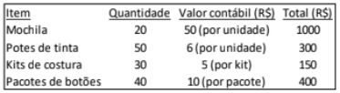{largura=35%}

Cada pacote de botões continha 20 botões.

Para personalizar uma mochila eram necessários, além da mochila, 2 potes e meio de tinta, 1 kit de costura e 30 botões. Depois que o material tinha sido utilizado, os botões que sobravam poderiam ser aproveitados para a personalização de outra mochila, mas o pote com a tinta que sobrava era jogado fora.

Cada mochila personalizada era vendida por R$120.

O lucro bruto com a venda de cada mochila era de

- A) R$27.
- B) R$30.
- C) R$32.
- D) R$35.
- E) R$70.
- Gabarito: C
- Resolução: a caminho

## F0093 · FGV · 2024 · TCE PA · ME
- Fontes: TecConcursos 93 (3048256) · Igor Cintra 51
- Prova: FGV - Aud CE (TCE-PA)/TCE PA/Administrativa/Contabilidade/2024
- Grupos: despesas-administrativas, lucro-liquido

Uma sociedade empresária presta serviços de consultoria ambiental.

Em julho de 2024, a sociedade empresária reconheceu R$340.000 a título de salários, do seguinte modo: Jurídico: R$15.000; Secretárias: R$20.000; Auditoria Interna: R$30.000; Recursos Humanos: R$35.000; Contadores: R$40.000; Consultores ambientais : R$200.000.

A sociedade empresária elabora a sua Demonstração do Resultado do Exercício de acordo com o método da função da despesa.

Assinale a opção que indica as despesas de salários reconhecidas como Despesas Gerais e Administrativas no mês.

- A) R$35.000.
- B) R$65.000.
- C) R$100.000.
- D) R$140.000.
- E) R$340.000.
- Gabarito: D
- Resolução: a caminho

## F0094 · FGV · 2024 · CFC · ME
- Fontes: TecConcursos 94 (3056452) · Igor Cintra 41
- Prova: FGV - Bach (CFC)/CFC/1º Exame de Suficiência/2024
- Grupos: resultado-bruto, receita-liquida, lucro-liquido

Em 2023, a Demonstração do Resultado do Exercício de uma entidade apresentou Receita Líquida de R$200.000 e Lucro Bruto de R$150.000. Pode-se constatar que, na demonstração, a seguinte conta apresenta saldo de R$50.000:

- A) despesas de vendas.
- B) despesas operacionais.
- C) deduções da receita.
- D) custo das mercadorias vendidas.
- Gabarito: D
- Resolução: a caminho

## F0095 · CEBRASPE · 2024 · TCE AC · CE
- Fontes: TecConcursos 95 (3075496) · Igor Cintra 102
- Prova: CEBRASPE (CESPE) - Ana Adm (TCE AC)/TCE AC/Contabilidade/2024
- Grupos: 

A respeito da demonstração de resultados do exercício (DRE), julgue o item a seguir.

Para que da DRE seja possível concluir se houve lucro ou prejuízo em determinado período de tempo, bem como analisar detalhadamente a parte econômica do negócio, deve-se adotar o regime de caixa.

- Gabarito: ERRADO
- Resolução: a caminho

## F0096 · CEBRASPE · 2024 · TCE AC · CE
- Fontes: TecConcursos 96 (3075498) · Igor Cintra 99 · Possati 6
- Prova: CEBRASPE (CESPE) - Ana Adm (TCE AC)/TCE AC/Contabilidade/2024
- Grupos: lucro-liquido

A respeito da demonstração de resultados do exercício (DRE), julgue o item a seguir.

A DRE consiste na apresentação, em forma resumida, das receitas e despesas decorrentes das operações realizadas pela empresa durante o exercício social, com o objetivo de demonstrar a formação do resultado líquido do período.

- Gabarito: CERTO
- Resolução: a caminho

## F0097 · CEBRASPE · 2024 · TCE AC · CE
- Fontes: TecConcursos 97 (3075499) · Possati 20
- Prova: CEBRASPE (CESPE) - Ana Adm (TCE AC)/TCE AC/Contabilidade/2024
- Grupos: receita-liquida, lucro-liquido, receita-bruta

A respeito da demonstração de resultados do exercício (DRE), julgue o item a seguir.

Da receita líquida deduz-se o custo total correspondente a vendas e serviços e obtém-se o resultado líquido.

- Gabarito: ERRADO
- Resolução: a caminho

## F0098 · CEBRASPE · 2024 · TCE AC · CE
- Fontes: TecConcursos 98 (3075500) · Possati 37
- Prova: CEBRASPE (CESPE) - Ana Adm (TCE AC)/TCE AC/Contabilidade/2024
- Grupos: resultado-operacional, resultado-financeiro

A respeito da demonstração de resultados do exercício (DRE), julgue o item a seguir.

As despesas financeiras devem ser tratadas como resultado operacional.

- Gabarito: ERRADO
- Resolução: a caminho

## F0099 · CEBRASPE · 2024 · TCE AC · CE
- Fontes: TecConcursos 99 (3075510) · Possati 7
- Prova: CEBRASPE (CESPE) - Ana Adm (TCE AC)/TCE AC/Contabilidade/2024
- Grupos: 

No que se refere ao conceito de receita, para fins da elaboração da DRE, julgue o item a seguir.

Usualmente, adota-se o método dedutivo na apresentação das receitas, apresentando-se incialmente as receitas da entidade e, posteriormente, as despesas.

- Gabarito: CERTO
- Resolução: a caminho

## F0100 · FGV · 2024 · EPE · ME
- Fontes: TecConcursos 100 (3092736) · Igor Cintra 123
- Prova: FGV - AGC (EPE)/EPE/Contabilidade/2024
- Grupos: resultado-bruto, receita-bruta, lucro-liquido

Em 31/12/2023, uma loja de roupas tinha seu estoque contabilizado por R$500.000.

Em janeiro de 2024, a loja vendeu 80% do estoque por R$700.000, com o recebimento previsto para o mês seguinte. A loja estimava inadimplência de 5% e pagou aos vendedores uma comissão de 10% sobre o preço da venda. Ainda, para concretizar as vendas, a loja incorreu em gastos com a entrega de R$20.000.

Assinale a opção que indica o lucro bruto apresentado na Demonstração do Resultado do Exercício da loja, em 31/01/2024.

- A) R$200.000.
- B) R$245.000.
- C) R$265.000.
- D) R$280.000.
- E) R$300.000.
- Gabarito: E
- Resolução: a caminho

## F0101 · FGV · 2024 · Pref Nova Iguaçu · ME
- Fontes: TecConcursos 101 (3093968) · Igor Cintra 32
- Prova: FGV - Cont (Pref Nova Iguaçu)/Pref Nova Iguaçu/2024
- Grupos: receita-liquida, lucro-liquido

Em 01/01/2024, uma loja adquiriu estoque para revenda por R$20.000, pagos à vista. Em 20/01/2024, a loja vendeu metade desse estoque por R$30.000, com recebimento previsto para 30 dias. No mês não houve descontos e devoluções.

Considerando que a alíquota do ICMS era de 18%, assinale a opção que indica a receita líquida apresentada na demonstração do resultado do exercício mensal da loja, em 31/01/2024.

- A) R$16.400.
- B) R$18.200.
- C) R$24.600.
- D) R$26.400.
- E) R$28.200.
- Gabarito: C
- Resolução: a caminho

## F0102 · FCC · 2024 · Pref J Guararapes · ME
- Fontes: TecConcursos 102 (3114432) · Igor Cintra 139
- Prova: FCC - AGR (Pref J Guararapes)/Pref J Guararapes/2024
- Grupos: resultado-bruto, receita-liquida, cmv, resultado-operacional, resultado-financeiro, fora-destinacao, receita-bruta, despesas-administrativas, lucro-liquido

Atenção: Para responder a questão a seguir considere as demonstrações financeiras de 30/11/2022 da empresa Santo Antônio Ltda. e as informações apresentadas a seguir BALANÇO PATRIMONIAL Empresa Santo Antônio Ltda . - 01/01/2022 a 30/11/2022

| Conta | Valor |
|---|---:|
| ATIVO CIRCULANTE | R$ 165.000,00 |
| PASSIVO CIRCULANTE | R$ 190.000,00 |
| Caixa e equivalentes de caixa | R$ 30.000,00 |
| Fornecedores | R$ 60.000,00 |
| Estoques | R$ 60.000,00 |
| Salários a pagar | R$ 35.000,00 |
| Clientes | R$ 100.000,00 |
| Dividendos a pagar | R$ 45.000,00 |
| (-) PECLD* | -R& 25.000,00 |
| Impostos a pagar | R$ 50.000,00 |

| Conta | Valor |
|---|---:|
| ATIVO NÃO CIRCULANTE | R$ 375.000,00 |
| PASSIVO NÃO CIRCULANTE | R$ 95.000,00 |
| Propriedade para investimento | R$ 200.000,00 |
| Empréstimos | R$ 95.000,00 |
| Ativo imobilizado | R$ 150.000,00 |

| Conta | Valor |
|---|---:|
| (-) Depreciação acumulada | -R$ 50.000,00 |
| PATRIMÔNIO LÍQUIDO | R$ 255.000,00 |
| Ativo intangível | R$ 90.000,00 |
| Capital Social | R$ 180.000,00 |
| (-) Amortização acumulada | -R$ 15.000,00 |
| Reserva Legal | R$ 25.000,00 |

Lucro Acumulado Rã 50.000,00 Total do Ativo R$ 540.000,00 Total do Passivo + PL R$ 540.000,00 *PECLD — Perdas Estimadas com Créditos de Liquidação Duvidosa.

DEMONSTRAÇÃO DO RESULTADO DO EXERCÍCIO Empresa Santo Antônio Ltda . - 01/01/2022 a 30/11/2022

Total

| Conta | Valor |
|---|---:|
| Receita Liquida de Venda | R$ 300.000,00 |
| (-) Custo das Mercadorias Vendidas (CMV) | -R$ 150.000,00 |
| (=) Lucro Bruto | R$ 150.000,00 |
| (=) Despesas Gerais | -R$ 97.000,00 |
| (-) Depreciação (imobilizado) | R$ 22.000,00 |
| (-) Amortização (intangível) | -R$ 15.000,00 |
| (-) Administrativas e Comerciais | R$ 60.000,00 |
| (-/+) Despesas/Receitas Financeiras | -R$ 3.000,00 |
| (-) Despesas Financeiras | -R$ 3.000,00 |
| (=) Resultado Operacional | R$ 50.000,00 |

Durante o mês de dezembro, a empresa Santo Antônio Ltda. registrou as seguintes transações: - Venda de mercadorias à vista no valor de R$ 70.000,00, cujo CMV correspondente foi no valor de R$ 30.000,00; - Pagamento de parte do saldo da conta de fornecedores no valor de R$ 25.000,00; - Reconhecimento de depreciação mensal de imobilizado no valor de R$ 3.000,00 e de amortização mensal de intangível no valor de R$ 1.500,00; - Reconhecimento de juros sobre empréstimos no valor de R$ 3.000,00; - Recebimento de parte do saldo da conta de clientes no valor de RS 18.000,00.

A Demonstração do Resultado do Exercício da empresa Santo Antônio Ltda., em 31/12/2022, apresentou resultado operacional de, em reais,

- A) 42.500,00
- B) 112.500,00
- C) 82.500,00
- D) 87.000,00
- E) 85.500,00
- Gabarito: C
### O que a questão pede
O **resultado operacional** da DRE do **ano inteiro** (01/01 a 31/12/2022). A DRE dada vai só até 30/11; é preciso somar os efeitos de dezembro. Como a pergunta usa "resultado operacional", a referência é a **Lei 6.404/76 (art. 187, IV)**: as despesas financeiras ficam **dentro** do bloco operacional.

### Cálculos prévios
**1) Leia a DRE de janeiro a novembro sem se perder nos sinais.** A tabela está mal formatada: a depreciação (22.000) e as administrativas (60.000) aparecem sem o sinal de menos. Confira pela soma:

| Linha | Valor |
|---|---|
| Receita líquida | 300.000 |
| (–) CMV | (150.000) |
| = Lucro bruto | 150.000 |
| (–) Despesas gerais: depreciação 22.000 + amortização 15.000 + administrativas e comerciais 60.000 | (97.000) |
| (–) Despesas financeiras | (3.000) |
| = Resultado operacional até 30/11 | **50.000** |

A soma fecha (150.000 − 97.000 − 3.000 = 50.000). Isso confirma que todas são despesas, mesmo sem o sinal.

**2) Separe os fatos de dezembro em "mexe no resultado" e "não mexe":**

| Fato de dezembro | Efeito no resultado |
|---|---|
| Venda à vista 70.000, CMV 30.000 | +70.000 de receita e −30.000 de CMV |
| Pagamento a fornecedores 25.000 | nenhum (caixa ↓, passivo ↓) |
| Depreciação 3.000 e amortização 1.500 | −4.500 |
| Juros sobre empréstimos 3.000 | −3.000 (despesa financeira, mesmo sem pagamento) |
| Recebimento de clientes 18.000 | nenhum (caixa ↑, clientes ↓) |

### Passo a passo
```dre
@ Receita líquida jan–nov | 300.000 | receita-liquida
@ Venda de dezembro | 70.000 | receita-liquida
@ CMV jan–nov | 150.000 | cmv
@ CMV de dezembro | 30.000 | cmv
@ Depreciação jan–nov | 22.000 | despesas-administrativas
@ Depreciação de dezembro | 3.000 | despesas-administrativas
@ Amortização jan–nov | 15.000 | despesas-administrativas
@ Amortização de dezembro | 1.500 | despesas-administrativas
@ Administrativas e comerciais | 60.000 | despesas-administrativas
@ Despesas financeiras jan–nov | 3.000 | resultado-financeiro
@ Juros de dezembro | 3.000 | resultado-financeiro
@ Pagamento a fornecedores | 25.000 | fora-outros
@ Recebimento de clientes | 18.000 | fora-outros
@ Balanço patrimonial de 30/11 | 540.000 | fora-ativo
> Pagamentos, recebimentos e o balanço inteiro não passam pela DRE: risque-os antes de começar.
! Pagamento a fornecedores; Recebimento de clientes; Balanço patrimonial de 30/11
> A DRE é do ano: some a receita de dezembro à de janeiro a novembro.
+ Receita líquida | 370.000 | Receita líquida jan–nov; Venda de dezembro
+ (–) CMV | (180.000) | CMV jan–nov; CMV de dezembro
= Lucro bruto | 190.000
> Depreciação e amortização dos onze meses mais as de dezembro; as administrativas e comerciais não mudaram.
+ (–) Depreciação | (25.000) | Depreciação jan–nov; Depreciação de dezembro
+ (–) Amortização | (16.500) | Amortização jan–nov; Amortização de dezembro
+ (–) Administrativas e comerciais | (60.000) | Administrativas e comerciais
> Pela Lei, a despesa financeira entra antes do resultado operacional. Os juros de dezembro contam por competência, pagos ou não.
+ (–) Despesas financeiras | (6.000) | Despesas financeiras jan–nov; Juros de dezembro
= Resultado operacional | 82.500
```

**Atalho:** 50.000 (até novembro) + 40.000 (venda − CMV) − 4.500 (depreciação e amortização) − 3.000 (juros) = **82.500**. Gabarito **C**.

### O que ignorar e por quê
- **Pagamento a fornecedores (25.000) e recebimento de clientes (18.000):** só trocam um ativo por outro ou reduzem ativo e passivo juntos. Não há receita nem despesa.
- **O balanço patrimonial inteiro** (PECLD, dividendos a pagar, propriedade para investimento, reserva legal…): é foto do patrimônio, não fluxo do resultado. O "lucro acumulado de 50.000" só confirma o resultado até novembro.
- **Dividendos a pagar (45.000):** destinação do lucro, nunca despesa.

### O que mais poderia estar ali
- **Fatos de dezembro que mexeriam no resultado:** despesa com PECLD, perda de estoque, receita de aluguel da propriedade para investimento, salários do mês (despesa mesmo sem pagamento).
- **Fatos que não mexeriam:** compra de estoque, aquisição de imobilizado, integralização de capital, captação ou amortização do principal de empréstimos, declaração de dividendos.

### Pegadinhas
- **A (42.500)** = 50.000 − 4.500 − 3.000: esqueceu a venda de dezembro.
- **B (112.500)** = 50.000 + 70.000 − 4.500 − 3.000: somou a venda e esqueceu o CMV de 30.000.
- **D (87.000)** = 50.000 + 40.000 − 3.000: esqueceu a depreciação e a amortização (despesas sem saída de caixa).
- **E (85.500)** = 50.000 + 40.000 − 4.500: esqueceu os juros, talvez por não terem sido pagos.
- **Resultado operacional × CPC:** se a pergunta fosse o "resultado antes do resultado financeiro" (CPC 26), seriam 88.500, porque os 6.000 de juros sairiam do bloco.

### Leve para as próximas
1. "DRE de 31/12" com dados até novembro: **acumule**, não calcule só dezembro.
2. Para cada fato novo, pergunte: muda o PL por receita ou despesa? Se só mexe em caixa, clientes ou fornecedores, fica fora.
3. Depreciação, amortização e juros apropriados são despesa por competência, mesmo sem pagamento.
4. Resultado operacional (Lei) inclui as despesas financeiras.
5. Fonte: resolução do professor Igor Cintra, reescrita e ampliada.

## F0103 · CEBRASPE · 2024 · CODEVASF · CE
- Fontes: TecConcursos 103 (3142934) · Igor Cintra 101 · Possati 8
- Prova: CEBRASPE (CESPE) - AnDR (CODEVASF)/CODEVASF/Administração/2024
- Grupos: 

Julgue o item que se segue, relativo a projetos e suas etapas, gestão de processos BPM, alavancagem operacional e demonstrações financeiras.

A verificação específica da situação financeira de uma empresa no que se refere ao lucro ou prejuízo resultante do exercício é feita por meio do balanço patrimonial.

- Gabarito: ERRADO
- Resolução: a caminho

## F0104 · CEBRASPE · 2024 · CODEVASF · CE
- Fontes: TecConcursos 104 (3144010) · Igor Cintra 60 · Possati 36
- Prova: CEBRASPE (CESPE) - AnDR (CODEVASF)/CODEVASF/Contabilidade/2024
- Grupos: lucro-liquido, resultado-financeiro

No que se refere ao uso e à elaboração do balancete de verificação contábil, do balanço patrimonial e da demonstração de resultado do exercício, julgue o item subsequente.

Para fins de levantamento da demonstração do resultado do exercício, contas de despesa, como juros incorridos e descontos concedidos, e contas de receita, como prêmios de resgate de títulos e debêntures e receitas de outros investimentos temporários, devem ser apresentadas como outros resultados operacionais.

- Gabarito: ERRADO
- Resolução: a caminho

## F0105 · FCC · 2024 · CETESB · ME
- Fontes: TecConcursos 105 (3149140) · Igor Cintra 73
- Prova: FCC - Ana Adm (CETESB)/CETESB/Contabilidade/2024
- Grupos: resultado-bruto, cmv, fora-destinacao, receita-bruta, despesas-administrativas, despesas-vendas, lucro-liquido, resultado-financeiro

A empresa Só Paz S.A. apresentou, em 30/11/20X0, as demonstrações financeiras a seguir:

BALANÇO PATRIMONIAL Empresa Só Paz S.A. - 01/01/20X0 a 30/11/20X0 Ativo Circulante R$ 109.200 Passivo Circulante R$ 66.250,00 Caixa e Equivalentes

| Conta | Valor |
|---|---:|
| de Caixa | R$ 18.500,00 |
| Fornecedores | R$ 35.000,00 |
| Contas a Receber | R$ 52.500,00 |
| Salários a Pagar | R$ 12.750,000 |
| Estoques | R$ 38.200,00 |
| Impostos a Pagar | R$ 18.500,00 |

Ativo Não Circulante R$ 110.670,00 Passivo não Circulante R$ 50.000,00 Propriedade para

| Conta | Valor |
|---|---:|
| Investimento | R$ 41.750,00 |
| Empréstimos | R$ 50.000,00 |
| Imobilizado | R$ 56.000,00 |
| patrimônio Líquido | R$ 103.620,00 |
| Depreciação | (R$ 19.200,00) |
| Capital Social | R$ 48.000,00 |
| Intangível | R$ 44.000 |
| Reserva Legal | R$ 6.750,00 |
| Amortização | (R$ 11.880,00) |

Reserva de Contingência R$ 7.120,00

| Conta | Valor |
|---|---:|
| Lucros Acumulados | R$ 41.750,00 |
| Total do Ativo | R$ 219.870,00 |
| Total do Passivo + PL | R$ 219.870,00 |

DEMONSTRAÇÃO DE RESULTADO DO EXCERCÍCIO Empresa Só Paz S.A. - 01/01/20X0 a 30/11/20X0

| Conta | Valor |
|---|---:|
| Receita de Vendas | R$ 140.000,00 |
| (-) Custo das Mercadorias Vendidas | (R$ 50.000,00) |
| Lucro Bruto | R$ 90.000,00 |
| (-) Depreciação( | (R$ 4.800,00) |
| (-) Amortização | (R$ 3.960,00) |

(-)

Despesas de Vendas e

| Conta | Valor |
|---|---:|
| administrativas | (R$ 24.240,00) |
| (-) Despesa de juros | (R$ 2.500,00) |
| (-) Salários e encargos sociais | (R$ 12.750,00) |
| Resultado do Exercício | R$ 41.750,00 |

Durante o mês de dezembro, ocorreram as seguintes transações: 1. Venda de mercadorias a prazo por R$ 36.000,00, sendo que o custo da mercadoria vendida correspondente foi de R$ 10.200,00; 2. Aquisição de mercadorias a prazo por R$ 25.000,00, sendo que a entidade também incorreu em gastos de transporte, seguro e manuseio no valor total de R$ 5.000,00, que também serão pagos a prazo; 3. Integralização de capital pelos sócios no valor de R$ 12.000,00 à vista; 4. Pagamento de parte do saldo de Fornecedores no valor de R$ 15.000,00; 5. Reconhecimento de despesa de depreciação no valor de R$ 400,00 e de despesa de amortização no valor de R$ 330,00; 6. Distribuição de R$ 10.000,00 em dividendos, a ser pago em março de 20X1.

Com base apenas nas informações fornecidas e após o lançamento das transações realizadas em dezembro, a Demonstração do Resultado do Exercício da empresa Só Paz S.A., concernente ao período de 01/01/20X0 a 31/12/20X0, apresentará resultado do exercício no valor de

- A) R$ 56.820,00
- B) R$ 67.550,00
- C) R$ 61.820,00
- D) R$ 78.820,00
- E) R$ 66.820,00
- Gabarito: E
### O que a questão pede
O **resultado do exercício** (lucro líquido) de 01/01 a 31/12/20X0. A DRE dada vai até 30/11 (resultado de 41.750); some os efeitos dos seis fatos de dezembro, separando os que passam pela DRE dos que são só patrimoniais.

### Cálculos prévios
**1) Confira a DRE até novembro:** 140.000 − 50.000 = 90.000 de lucro bruto; − 4.800 − 3.960 − 24.240 − 2.500 − 12.750 = **41.750**. O "lucros acumulados" do balanço tem o mesmo valor.

**2) Classifique os fatos de dezembro:**

| Fato | Passa pela DRE? | Efeito |
|---|---|---|
| 1. Venda a prazo 36.000, CMV 10.200 | Sim | +36.000 e −10.200 |
| 2. Compra a prazo 25.000 + transporte, seguro e manuseio 5.000 | Não | Estoque ↑ 30.000 e fornecedores ↑ 30.000. Os gastos acessórios **entram no custo do estoque** (CPC 16, item 11), não são despesa |
| 3. Integralização de capital 12.000 | Não | Caixa ↑ e capital social ↑ (PL, sem resultado) |
| 4. Pagamento a fornecedores 15.000 | Não | Caixa ↓ e fornecedores ↓ |
| 5. Depreciação 400 e amortização 330 | Sim | −730 |
| 6. Dividendos 10.000 | Não | Destinação do lucro: reduz lucros acumulados e cria dividendos a pagar |

### Passo a passo
```dre
@ Receita de vendas jan–nov | 140.000 | receita-bruta
@ Venda de dezembro | 36.000 | receita-bruta
@ CMV jan–nov | 50.000 | cmv
@ CMV de dezembro | 10.200 | cmv
@ Depreciação jan–nov | 4.800 | despesas-administrativas
@ Depreciação de dezembro | 400 | despesas-administrativas
@ Amortização jan–nov | 3.960 | despesas-administrativas
@ Amortização de dezembro | 330 | despesas-administrativas
@ Despesas de vendas e administrativas | 24.240 | despesas-vendas
@ Salários e encargos sociais | 12.750 | despesas-administrativas
@ Despesa de juros | 2.500 | resultado-financeiro
@ Compra de mercadorias + gastos acessórios | 30.000 | fora-ativo
@ Integralização de capital | 12.000 | fora-pl
@ Pagamento a fornecedores | 15.000 | fora-outros
@ Dividendos distribuídos | 10.000 | fora-destinacao
> Primeiro, risque o que não é receita nem despesa: compra (vira estoque), integralização (PL), pagamento (caixa) e dividendos (destinação do lucro).
! Compra de mercadorias + gastos acessórios; Integralização de capital; Pagamento a fornecedores; Dividendos distribuídos
> Receita do ano: onze meses mais a venda de dezembro (a prazo, mas a receita é por competência).
+ Receita de vendas | 176.000 | Receita de vendas jan–nov; Venda de dezembro
+ (–) CMV | (60.200) | CMV jan–nov; CMV de dezembro
= Lucro bruto | 115.800
> Despesas operacionais: some às de novembro a depreciação e a amortização de dezembro.
+ (–) Depreciação | (5.200) | Depreciação jan–nov; Depreciação de dezembro
+ (–) Amortização | (4.290) | Amortização jan–nov; Amortização de dezembro
+ (–) Despesas de vendas e administrativas | (24.240) | Despesas de vendas e administrativas
+ (–) Salários e encargos sociais | (12.750) | Salários e encargos sociais
+ (–) Despesa de juros | (2.500) | Despesa de juros
= Resultado do exercício | 66.820
```

**Atalho:** 41.750 + 25.800 (36.000 − 10.200) − 730 = **66.820**. Gabarito **E**.

### O que ignorar e por quê
- **Gastos de transporte, seguro e manuseio (5.000):** são custo de aquisição. Vão para o estoque e só virarão CMV quando essas mercadorias forem vendidas.
- **Compra de 25.000:** estoque (ativo). Compra não é despesa; despesa é o custo do que **saiu**.
- **Integralização (12.000):** aumento de capital. Dinheiro dos sócios não é receita.
- **Dividendos (10.000):** distribuição do lucro, que aparece na DLPA ou na DMPL, nunca na DRE.
- **O balanço de 30/11:** a propriedade para investimento tem o mesmo valor do lucro (41.750) por coincidência; é ativo e não entra.

### O que mais poderia estar ali
- **Iria para o custo do estoque, e não para a DRE:** frete, seguro e carga e descarga na compra, tributos não recuperáveis, imposto de importação.
- **Também ficaria fora:** aumento de capital com reservas, constituição de reservas, juros sobre capital próprio tratados como distribuição (ver a divergência no grupo de participações).

### Pegadinhas
- **A (56.820)** = 66.820 − 10.000: tratou os dividendos como despesa.
- **B (67.550)** = 66.820 + 730: esqueceu a depreciação e a amortização de dezembro.
- **C (61.820)** = 66.820 − 5.000: lançou o transporte, o seguro e o manuseio da compra como despesa.
- **D (78.820)** = 66.820 + 12.000: tratou a integralização de capital como receita.
- Cada distrator testa **um** fato patrimonial. Classificar fato a fato, como na tabela, evita todos.

### Leve para as próximas
1. Fato novo? Pergunte: é receita ou despesa (muda o PL pelo resultado)? Compra, pagamento, recebimento, aporte e dividendo não são.
2. Gastos para trazer a mercadoria até o depósito vão para o estoque; gastos para levar a mercadoria ao cliente são despesa com vendas.
3. Dividendos saem do lucro **depois** de apurado: nunca reduzem o resultado do exercício.
4. Fonte: resolução do professor Igor Cintra, reescrita e ampliada.

## F0106 · FGV · 2024 · MACAEPREV · ME
- Fontes: TecConcursos 106 (3153310)
- Prova: FGV - Ana Prev (MACAEPREV)/MACAEPREV/Contabilidade/2024
- Grupos: resultado-bruto, resultado-financeiro, lucro-liquido, despesas-vendas

Uma sociedade empresária reconheceu, em 2024, reversão das perdas estimadas com crédito de liquidação duvidosa de R$10.000. Em relação à Demonstração do Resultado do Exercício, avalie se os seguintes resultados são impactados pela reversão:

I. Resultado Bruto<br>
II. Resultado antes do Resultado Financeiro<br>
III. Resultado Líquido<br>

É(São) de fato impactado(s) pela reversão

- A) I, somente.
- B) II, somente.
- C) III, somente.
- D) I e III.
- E) II e III.
- Gabarito: E
- Resolução: a caminho

## F0107 · FGV · 2024 · MACAEPREV · ME
- Fontes: TecConcursos 107 (3153318)
- Prova: FGV - Ana Prev (MACAEPREV)/MACAEPREV/Contabilidade/2024
- Grupos: 

Em 2023, uma sociedade empresária teve o seu patrimônio líquido aumentado pelos seguintes motivos:

Ajustes de exercícios anteriores: R$30.000 Doações e subvenções para investimentos recebidos: R$50.000 Prêmio recebido na emissão de debêntures: R$80.000 Subscrição e integralização de capital social: R$150.000 Assinale a opção que indica o montante que transitou pelo resultado da sociedade empresária.

- A) R$50.000
- B) R$80.000
- C) R$110.000
- D) R$130.000
- E) R$180.000 ∙ ∙ ∙ ∙
- Gabarito: D
- Resolução: a caminho

## F0108 · FGV · 2024 · MACAEPREV · ME
- Fontes: TecConcursos 108 (3153339)
- Prova: FGV - Ana Prev (MACAEPREV)/MACAEPREV/Contabilidade/2024
- Grupos: resultado-bruto, receita-bruta, lucro-liquido

Ao realizar a análise horizontal da Demonstração do Resultado do Exercício da Cia Bela em 31/12/2022 e em 31/12/2023, um analista constatou que o lucro bruto aumentou, enquanto a receita de vendas diminuiu.

Assinale a opção que indica um fato que pode ter acontecido em 2023 para justificar tais variações.

- A) Uma parte das mercadorias vendidas foi devolvida.
- B) Uma despesa reconhecida no ano anterior foi revertida.
- C) As despesas operacionais diminuíram ainda mais do que a receita de vendas.
- D) As receitas financeiras aumentaram ainda mais do que as receitas de vendas.
- E) O custo das mercadorias vendidas diminuiu ainda mais do que a receita de vendas.
- Gabarito: E
- Resolução: a caminho

## F0109 · FGV · 2024 · Pref Macaé · ME
- Fontes: TecConcursos 109 (3158493) · Igor Cintra 24
- Prova: FGV - Cont (Pref Macaé)/Pref Macaé/2024
- Grupos: receita-bruta

Uma livraria vendia livros de contabilidade e de direito. Os livros de contabilidade eram vendidos por R$200 e os de direito por R$160.

Em setembro de 2024, a livraria fez uma ação promocional, de modo que quando um cliente adquirisse um livro de contabilidade, poderia comprar um livro de direito por R$80.

Neste mês, cem clientes participaram da promoção e compraram os dois livros. Além disso, 50 clientes compraram apenas o livro de contabilidade e 50 compraram apenas o livro de direito.

Assinale a opção que indica a Receita Bruta da livraria em 30/09/2024.

- A) R$28.000.
- B) R$42.000.
- C) R$46.000.
- D) R$54.000.
- E) R$56.000.
- Gabarito: C
- Resolução: a caminho

## F0110 · FGV · 2024 · Pref Macaé · ME
- Fontes: TecConcursos 110 (3158500)
- Prova: FGV - Cont (Pref Macaé)/Pref Macaé/2024
- Grupos: lucro-liquido

Em julho de 2024, uma loja de eletrodomésticos vendeu 16 geladeiras, cada uma por R$3.000. A loja fornecia uma garantia de um ano para defeitos normais. A loja estimava que 25% das geladeiras vendidas poderiam utilizar essa cláusula de garantia. Os gastos estimados com a garantia eram de R$12.000.

Em 31/07/2024, a venda das geladeiras foi reconhecida do seguinte modo na Demonstração do Resultado do Exercício:

- A) Receita de R$36.000, apenas.
- B) Receita de R$48.000, apenas.
- C) Receita de R$36.000 e despesa de R$12.000.
- D) Receita de R$48.000 e despesa de R$12.000.
- E) Receita de R$48.000 e redução da receita de R$12.000.
- Gabarito: D
- Resolução: a caminho

## F0111 · FGV · 2024 · TJ RR · ME
- Fontes: TecConcursos 111 (3166721) · Igor Cintra 58
- Prova: FGV - AJ (TJ RR)/TJ RR/Contabilidade/2024
- Grupos: resultado-bruto, receita-liquida, cmv, resultado-financeiro, lair, ir-csll, deducoes, receita-bruta, despesas-administrativas, despesas-vendas, lucro-liquido

Em 31/12/2023, uma loja de roupas apresentava os seguintes saldos em sua Demonstração do Resultado do Exercício: Custo das mercadorias vendidas: R$40.000; Despesa com crédito de liquidação duvidosa: R$2.000; Despesa de salários: R$20.000; Despesa de depreciação: R$10.000; Despesas financeiras: R$14.000; Devolução de vendas: R$8.000; Receita de vendas: R$100.000; Receitas financeiras: R$35.000.

Em relação à Demonstração do Resultado do Exercício em 31/12/2023, analise as afirmações a seguir:

I. A Receita Bruta de Vendas era de R$92.000.<br>
II. A Receita Líquida de Vendas era de R$90.000.<br>
III. O Lucro Bruto era de R$50.000.<br>
IV. O Lucro antes do imposto de renda e contribuição social era de R$41.000.<br>

Está correto o que se afirma em

- A) III, somente.
- B) IV, somente.
- C) I e II, somente.
- D) II e III, somente.
- E) III e IV, somente.
- Gabarito: B
- Resolução: a caminho

## F0112 · FGV · 2024 · TJ RR · ME
- Fontes: TecConcursos 112 (3166742)
- Prova: FGV - AJ (TJ RR)/TJ RR/Contabilidade/2024
- Grupos: resultado-operacional, despesas-administrativas, lucro-liquido

Uma loja oferece a seus clientes 10% do valor gasto a cada compra para ser utilizado como desconto na compra seguinte, quando realizada em até 30 dias, o que a loja denomina “cash back”.

Em agosto de 2024, a loja vendeu todo o seu estoque, que era de R$60.000, por R$200.000. A loja estima que 40% dos clientes que receberam o benefício do desconto irão utilizá-lo. Além disso, a loja incorreu em despesas gerais de R$50.000.

Assinale a opção que indica o lucro operacional reconhecido na Demonstração do Resultado do Exercício mensal da loja em 31/08/2024.

- A) R$70.000.
- B) R$82.000.
- C) R$84.400.
- D) R$87.600.
- E) R$90.000
- Gabarito: B
- Resolução: a caminho

## F0113 · FGV · 2024 · DATAPREV · ME
- Fontes: TecConcursos 113 (3172633) · Igor Cintra 40
- Prova: FGV - Ana TI (DATAPREV)/DATAPREV/Gestão Econômico-Financeira/2024
- Grupos: receita-bruta, despesas-administrativas, cmv, lucro-liquido

A Demonstração do Resultado do Exercício (DRE) é o relatório contábil que apura se a empresa obteve lucro ou prejuízo ao final de cada exercício social. A diferença entre a Venda de Mercadorias e o Custo da Mercadoria Vendida, desconsiderando as despesas administrativas, de vendas e financeiras, é o lucro

- A) real.
- B) bruto.
- C) presumido.
- D) fiscal.
- E) tributário.
- Gabarito: B
- Resolução: a caminho

## F0114 · FGV · 2024 · Pref Vitória · ME
- Fontes: TecConcursos 114 (3176865)
- Prova: FGV - AGP (Pref Vitória)/Pref Vitória/Contador/2024
- Grupos: receita-bruta

Uma loja de roupas registrou o seguinte faturamento no primeiro trimestre de 2024:

- Janeiro: R$600.000
- Fevereiro: R$800.000
- Março: R$700.000

Das vendas, 90% foram realizadas por cartão de crédito, para recebimento previsto no mês seguinte, enquanto 10% foram recebidas à vista. Além disso, a loja paga no mês das vendas uma comissão de 5% aos seus vendedores.

A Receita Bruta de Vendas em fevereiro, considerando que a loja utiliza o Regime de Competência, foi de

- A) R$540.000.
- B) R$580.000.
- C) R$620.000.
- D) R$760.000.
- E) R$800.000.
- Gabarito: E
- Resolução: a caminho

## F0115 · FGV · 2024 · Pref Vitória · ME
- Fontes: TecConcursos 115 (3176871)
- Prova: FGV - AGP (Pref Vitória)/Pref Vitória/Contador/2024
- Grupos: resultado-bruto, lucro-liquido, outras-receitas-despesas

Na Demonstração do Resultado do Exercício, após calculado o Resultado Bruto, são apresentadas as despesas necessárias ao desenvolvimento das atividades da empresa e outras receitas complementares ao negócio e segregadas por subtotais, conforme a sua função.

Assinale a opção que não indica uma dessas despesas.

- A) Despesas com vendas.
- B) Despesas gerais e administrativas.
- C) Despesas com juros de capital próprio.
- D) Outras despesas e receitas operacionais.
- E) Despesas financeiras deduzidas das receitas financeiras.
- Gabarito: C
- Resolução: a caminho

## F0116 · FGV · 2024 · TJ MT · ME
- Fontes: TecConcursos 116 (3201291)
- Prova: FGV - AJ (TJ MT)/TJ MT/Ciências Contábeis/2024
- Grupos: lucro-liquido

Em 02/01/2024, um escritório de consultoria jurídica adquiriu equipamentos de informática para serem utilizados em sua atividade por R$ 40.000. A vida útil foi estimada em cinco anos. Além disso, o escritório estimou que a manutenção anual dos aparelhos seria de R$ 3.000 ao ano.

Assinale a afirmativa correta acerca do reconhecimento na Demonstração do Resultado do Exercício em 02/01/2024.

- A) Despesa operacional de R$3.000.
- B) Despesa operacional de R$15.000
- C) Despesa antecipada de R$3.000
- D) Despesa antecipada de R$15.000.
- E) Não há reconhecimento.
- Gabarito: E
- Resolução: a caminho

## F0117 · FGV · 2024 · TJ MT · ME
- Fontes: TecConcursos 117 (3201292) · Igor Cintra 106
- Prova: FGV - AJ (TJ MT)/TJ MT/Ciências Contábeis/2024
- Grupos: receita-bruta, despesas-vendas, lucro-liquido

Uma loja de material de construção realiza apenas vendas a prazo, para recebimento em 90 dias. A loja considera perdas estimadas com crédito de liquidação duvidosa de 2%. Em 01/10/2024, havia R$ 50.000 em estoque.

Em 20/10/2024, a loja vendeu metade de seu estoque por R$ 40.000. Na data, a loja considerava provável que o restante do estoque seria vendido por R$ 50.000 ainda no mês.

A receita de vendas mensal da loja na Demonstração do Resultado do Exercício em outubro de 2024 é de

- A) R$ 39.200.
- B) R$ 40.000.
- C) R$ 78.400.
- D) R$ 80.000.
- E) R$ 90.000.
- Gabarito: B
- Resolução: a caminho

## F0118 · FCC · 2024 · CETESB · ME
- Fontes: TecConcursos 118 (3551274)
- Prova: FCC - Ana Adm (CETESB)/CETESB/Administração/2024
- Grupos: participacoes, lucro-liquido, fora-destinacao

Suponha que, ao final de determinado exercício financeiro, a CETESB tenha apresentado suas demonstrações financeiras com a apuração de lucro, e o Estado, na condição de acionista controlador da companhia, tenha manifestado a expectativa de participação nos resultados com o recebimento dos dividendos mínimos obrigatórios previstos na legislação societária. Em tal cenário, tem-se que o lucro líquido

- A) decorre do saldo apurado no balanço patrimonial, considerando a evolução dos ativos e passivos verificada no período.
- B) é determinado após deduzidos os prejuízos acumulados e a provisão para imposto de renda, sendo que a participação dos acionistas se dá após a constituição da reserva legal.
- C) é apurado após a constituição da reserva legal de, no mínimo, 25% sobre o capital social subscrito ou resultado apurado, o que for maior.
- D) deve ser integralmente distribuído aos acionistas, salvo na hipótese de insuficiência de caixa que possa comprometer as atividades da companhia.
- E) somente poderá ser retido em reserva legal, se assim recomendar a auditoria independente em face da existência de passivos contingentes.
- Gabarito: B
- Resolução: a caminho

## F0119 · FGV · 2023 · SEF MG · ME
- Fontes: TecConcursos 119 (2266741)
- Prova: FGV - AFRE MG/SEF MG/Auditoria e Fiscalização/2023
- Grupos: resultado-bruto, despesas-administrativas, lucro-liquido

Em 01/01/X0, uma entidade de incorporação imobiliária iniciou a construção de um prédio. Foi estimado que todos os apartamentos estariam prontos em 31/12/X3. O custo total estimado para cada apartamento era de R$ 500.000, sendo gastos do seguinte modo: em X0: R$ 100.000; em X1: R$ 120.000; em X2: R$ 200.000; e em X3: R$ 80.000.

Ainda, a construtora incorre em despesas gerais de R$ 180.000 ao ano.

Em 01/01/X0 foram vendidos três apartamentos por R$ 800.000 cada, à vista.

Assinale a opção que indica o lucro bruto relacionado à venda destes três apartamentos, reconhecido na Demonstração do Resultado do Exercício da construtora em 31/12/X2, considerando que os valores reais foram iguais aos estimados.

- A) Zero.
- B) R$ 180.000.
- C) R$ 216.000.
- D) R$ 360.000.
- E) R$ 756.000.
- Gabarito: D
- Resolução: a caminho

## F0120 · CEBRASPE · 2023 · POLC AL · CE
- Fontes: TecConcursos 120 (2339070)
- Prova: CEBRASPE (CESPE) - Per Crim (POLC AL)/POLC AL/Ciências Contábeis, Ciências Econômicas ou Administração/2023
- Grupos: descontinuadas, continuadas, estrutura

No que se refere à elaboração de demonstrações contábeis pela legislação societária e pelos pronunciamentos técnicos do Comitê de Pronunciamentos Contábeis (CPC), julgue o item que se segue.

Havendo resultado de operações descontinuadas a reconhecer na demonstração do resultado do exercício, isso deve ser feito de forma detalhada, evidenciando os ganhos e as perdas envolvidas.

- Gabarito: ERRADO
### O que a questão pede
Como o resultado das **operações descontinuadas** aparece na DRE: em valor detalhado (ganhos e perdas abertos) ou em montante único.

### A regra
O CPC 31, item 33(a), exige na DRE um **montante único**: o resultado líquido de tributos das operações descontinuadas, somado ao ganho ou à perda (também líquidos de tributos) na mensuração a valor justo menos despesas de venda ou na baixa dos ativos do grupo.

A **abertura** desse valor (receitas, despesas, resultado antes dos tributos, tributos, ganho ou perda na mensuração) é exigida pelo item 33(b), mas pode ficar nas **notas explicativas** ou na própria demonstração, à escolha da entidade. Se vier na DRE, aparece numa seção identificada como operações descontinuadas, separada das continuadas.

| O que | Onde |
|---|---|
| Linha única, líquida de tributos | DRE, depois do resultado das operações continuadas (CPC 26 (R1), item 82(ea)) |
| Análise do montante (receitas, despesas, tributos, ganho ou perda) | Notas explicativas **ou** DRE (CPC 31, item 33(b)) |

O item diz que o reconhecimento "deve ser feito de forma detalhada" na DRE. A norma pede o contrário: **valor único** na face da DRE, com o detalhe opcionalmente nas notas. Gabarito **ERRADO**.

### Pegadinhas
- **"Deve" × "pode":** o detalhamento na própria DRE é permitido, não obrigatório. A CEBRASPE gosta de transformar uma faculdade em dever.
- **Valor líquido de tributos:** o resultado das descontinuadas vem **depois** do IR e da CSLL, nunca misturado ao LAIR.
- **Venda de um imobilizado isolado** não é operação descontinuada: o ganho vai para outras receitas. Descontinuada é um componente (linha de negócio ou área geográfica importante).

### Leve para as próximas
1. Operações descontinuadas: **uma linha**, líquida de tributos, depois do resultado das operações continuadas.
2. A abertura do valor vai para as notas ou para a DRE, à escolha da entidade (CPC 31, item 33(b)).
3. A Lei 6.404/76 não trata do tema: a base é o CPC 26 (R1), item 82(ea), e o CPC 31.

## F0121 · FGV · 2023 · SRFB · ME
- Fontes: TecConcursos 121 (2346652)
- Prova: FGV - ATRFB/SRFB/Geral/2023
- Grupos: resultado-bruto, lucro-liquido, receita-bruta

Em 02/01/X1, uma entidade adquiriu computadores, para utilizar em sua área administrativa, por R$50.000, para pagamento em 31/12/X1. Se os computadores tivessem sido adquiridos à vista, o custo seria de R$45.000. O prazo de pagamento excede os prazos normais de crédito da entidade e o valor da compra é considerado material.

A vida útil estimada dos computadores era de 5 anos. A entidade depreciava os seus ativos imobilizados de acordo com o método da linha reta e não considerava valor residual.

No ano de X1, a entidade contabilizou receita com a prestação de serviços de R$200.0000. Os custos com os serviços prestados foram de R$80.000.

Além do lucro bruto de R$120.000, assinale a opção que indica os valores das contas apresentadas na Demonstração do Resultado do Exercício da entidade em 31/12/X1, sem considerar a incidência de impostos.

- A) Despesa de depreciação: R$9.000, apenas.
- B) Despesa de depreciação: R$10.000, apenas.
- C) Despesa de depreciação: R$9.000 e Despesa financeira: R$5.000, apenas.
- D) Despesa de depreciação: R$10.000 e Despesa financeira: R$5.000, apenas.
- E) Despesa de depreciação: R$10.000 e Receita financeira: R$5.000, apenas.
- Gabarito: C
- Resolução: a caminho

## F0122 · FGV · 2023 · BANESTES · ME
- Fontes: TecConcursos 122 (2355213)
- Prova: FGV - Ana EF (BANESTES)/BANESTES/Gestão Contábil/2023
- Grupos: resultado-bruto, cmv, deducoes, receita-bruta, despesas-administrativas, lucro-liquido, resultado-financeiro

Uma sociedade empresária que atua na compra e venda de mercadorias apresentou os seguintes saldos em sua Demonstração do Resultado do Exercício no ano de X0:

Receita bruta de vendas: R$250.000; devolução de vendas: R$20.000; custo das mercadorias vendidas: R$100.000; despesa de depreciação: R$25.000; despesa de salários: R$30.000; despesa de juros: R$15.000; despesa de aluguel: R$24.000.

Assinale a opção que indica o resultado bruto da sociedade empresária em 31/12/X0.

- A) R$36.000.
- B) R$51.000.
- C) R$130.000.
- D) R$150.000.
- E) R$230.000.
- Gabarito: C
- Resolução: a caminho

## F0123 · FGV · 2023 · AGENERSA · ME
- Fontes: TecConcursos 123 (2371661) · Igor Cintra 108
- Prova: FGV - ATR (AGENERSA)/AGENERSA/2023
- Grupos: receita-bruta, despesas-operacionais

Em janeiro de X0, uma entidade vendeu 1.000 unidades do produto X, por R$50 cada. O custo de cada unidade foi de R$20. Além disso, a entidade pagava a seus vendedores uma comissão de 20% sobre o preço de venda. Ainda, a entidade incorreu em despesas operacionais no valor de R$5.000.

Assinale a opção que indica a receita bruta da entidade, em janeiro de X0.

- A) R$20.000.
- B) R$25.000.
- C) R$30.000.
- D) R$40.000.
- E) R$50.000.
- Gabarito: E
- Resolução: a caminho

## F0124 · CEBRASPE · 2023 · TJ ES · CE
- Fontes: TecConcursos 124 (2400532)
- Prova: CEBRASPE (CESPE) - AJE (TJ ES)/TJ ES/Judiciária/Contador/2023
- Grupos: resultado-operacional, outras-receitas-despesas

O método das partidas dobradas é que suporta à aplicação prática da ciência contábil de interesse das aziendas. Relativamente às técnicas desenvolvidas, julgue o item seguinte.

Por força da harmonização com as normas internacionais — para garantir a convergência quanto à separação do resultado das atividades continuadas do resultado das atividades não continuadas — as entidades devem apresentar as “outras receitas/despesas” recorrentes após a linha de “resultados das atividades continuadas”, o antigo “resultado operacional”.

- Gabarito: ERRADO
- Resolução: a caminho

## F0125 · CEBRASPE · 2023 · PETROBRAS · CE
- Fontes: TecConcursos 125 (2451733)
- Prova: CEBRASPE (CESPE) - PPNT (PETROBRAS)/PETROBRAS/Suprimento de Bens e Serviços/Administração/2023
- Grupos: 

Em relação a receitas, despesas, custos e resultados contábeis, julgue o item subsequente.

Receita é definida como o aumento em uma conta patrimonial ativa que não provoca um aumento correspondente em uma conta patrimonial passiva.

- Gabarito: ERRADO
- Resolução: a caminho

## F0126 · CEBRASPE · 2023 · PETROBRAS · CE
- Fontes: TecConcursos 126 (2451734)
- Prova: CEBRASPE (CESPE) - PPNT (PETROBRAS)/PETROBRAS/Suprimento de Bens e Serviços/Administração/2023
- Grupos: 

Em relação a receitas, despesas, custos e resultados contábeis, julgue o item subsequente.

Verifica-se lucro contábil quando a soma de saldos credores em contas de resultado supera a soma de saldos devedores.

- Gabarito: CERTO
- Resolução: a caminho

## F0127 · FGV · 2023 · ALEMA · ME
- Fontes: TecConcursos 127 (2620930)
- Prova: FGV - TecGes Admin (ALEMA)/ALEMA/Contador/"Sem Especialidade"/2023
- Grupos: despesas-administrativas, despesas-vendas, lucro-liquido

As despesas com propaganda podem ser contabilizadas, na Demonstração do Resultado do Exercício, como despesas de venda ou como despesas administrativas. Em relação à diferenciação na contabilização, assinale a afirmativa correta.

- A) Quando a propaganda é de um produto, será despesa de venda, quando diz respeito a vários produtos, será despesa administrativa.
- B) Quando a propaganda é vinculada a um exercício social, será despesa de venda, quando a mais de um exercício, será despesa administrativa.
- C) Quando a propaganda é direcionada a um meio de comunicação, será despesa de venda, quando a vários meios digitais , será despesa administrativa.
- D) Quando a propaganda é vinculada à promoção de vendas de produtos será despesa de venda, quando representa propaganda institucional, será despesa administrativa.
- E) Quando a propaganda é realizada após do lançamento do produto, será despesa de venda , quando é realizada antes do lançamento do produto, é despesa administrativa.
- Gabarito: D
- Resolução: a caminho

## F0128 · CEBRASPE · 2023 · DATAPREV · CE
- Fontes: TecConcursos 128 (2638616)
- Prova: CEBRASPE (CESPE) - Ana TI (DATAPREV)/DATAPREV/Contabilidade/2023
- Grupos: lucro-liquido

Com relação a algumas das demonstrações contábeis previstas na legislação e nas normas brasileiras, bem como a pronunciamentos do Comitê de Pronunciamentos Contábeis (CPC), julgue  o item a seguir.

Na demonstração do resultado do exercício, as receitas com juros devem ser segregadas das demais receitas para fins de evidenciação.

- Gabarito: CERTO
- Resolução: a caminho

## F0129 · CEBRASPE · 2023 · DATAPREV · CE
- Fontes: TecConcursos 129 (2638619)
- Prova: CEBRASPE (CESPE) - Ana TI (DATAPREV)/DATAPREV/Contabilidade/2023
- Grupos: lucro-liquido, outras-receitas-despesas

Com relação a algumas das demonstrações contábeis previstas na legislação e nas normas brasileiras, bem como a pronunciamentos do Comitê de Pronunciamentos Contábeis (CPC), julgue  o item a seguir.

Conforme o CPC 26, o resultado da venda de bens do ativo imobilizado é evidenciado, na demonstração do resultado do exercício, como resultado não operacional

- Gabarito: ERRADO
- Resolução: a caminho

## F0130 · CEBRASPE · 2023 · MRE · ME
- Fontes: TecConcursos 130 (2726946)
- Prova: CEBRASPE (CESPE) - OF CHAN (MRE)/MRE/2023
- Grupos: resultado-bruto, lucro-liquido

Assinale a opção em que é indicado o componente da demonstração do resultado do exercício de uma empresa comercial cujo montante deve ser deduzido das receitas líquidas para que se obtenha o valor do lucro bruto do período.

- A) custo das mercadorias vendidas
- B) despesas com as vendas
- C) impostos incidentes sobre as vendas
- D) despesas operacionais
- E) descontos comerciais e abatimentos concedidos
- Gabarito: A
- Resolução: a caminho

## F0131 · CEBRASPE · 2023 · TBG · CE
- Fontes: TecConcursos 131 (2759351)
- Prova: CEBRASPE (CESPE) - Ana Jr (TBG)/TBG/Auditoria e Compliance/2023
- Grupos: lucro-liquido

Julgue o item que se segue, relativo ao conceito, ao objetivo, à periodicidade e à elaboração das principais demonstrações contábeis previstas na legislação societária e nas normas contábeis brasileiras.

A demonstração do resultado do exercício, elaborada de forma dedutiva, apresenta resultados abrangentes que afetaram a posição patrimonial dos sócios durante o respectivo exercício.

- Gabarito: CERTO
- Resolução: a caminho

## F0132 · CEBRASPE · 2023 · TBG · CE
- Fontes: TecConcursos 132 (2759762)
- Prova: CEBRASPE (CESPE) - Ana Jr (TBG)/TBG/Contábil/2023
- Grupos: lucro-liquido, fora-destinacao

Com relação à destinação do resultado de sociedades anônimas, julgue o item que se segue.

A destinação do lucro líquido do exercício deve ser registrada nas demonstrações financeiras antes de sua aprovação pela assembleia geral

- Gabarito: CERTO
- Resolução: a caminho

## F0133 · FGV · 2023 · Pref BH · ME
- Fontes: TecConcursos 133 (2769531)
- Prova: FGV - APGG (Pref BH)/Pref BH/Ciências Contábeis/2023
- Grupos: despesas-administrativas, lucro-liquido

As despesas listadas a seguir são contabilizadas na Demonstração do Resultado do Exercício como Despesas com Pessoal, à exceção de uma. Assinale-a.

- A) Férias.
- B) Assistência Médica.
- C) Comissões de Venda.
- D) Gratificações aos empregados.
- Gabarito: C
- Resolução: a caminho

## F0134 · FGV · 2023 · Pref BH · ME
- Fontes: TecConcursos 134 (2769542)
- Prova: FGV - APGG (Pref BH)/Pref BH/Ciências Contábeis/2023
- Grupos: 

Em janeiro de 2022, foi constituída uma sociedade empresária. Os gastos pré-operacionais com o projeto econômico-financeiro até o início de suas atividades devem ser contabilizados como

- A) ativo diferido, no Balanço Patrimonial.
- B) investimentos, no Balanço Patrimonial.
- C) outras despesas, na Demonstração do Resultado do Exercício.
- D) despesas operacionais, na Demonstração do Resultado do Exercício.
- Gabarito: D
- Resolução: a caminho

## F0135 · FGV · 2023 · CAM DEP · ME
- Fontes: TecConcursos 135 (2816400)
- Prova: FGV - AL (CAM DEP)/CAM DEP/Consultor Legislativo/Área IV/2023
- Grupos: lair, ir-csll, despesas-administrativas, lucro-liquido

Uma sociedade empresária apresentava o seguinte balanço patrimonial em 01/12/2022:

| Conta | Valor |
|---|---:|
| Ativo Circulante | 80.000 |
| Passivo Circulante | 12.000 |
| Disponibilidades | 40.000 |
| Salários a pagar | 12.000 |
| Estoque | 30.000 |

Clientes 10.000

Ativo não Circulante 25.000 Patrimônio Liquido 93.000 Imobilizado

| Conta | Valor |
|---|---:|
| Capital Social | 85.000 |
| Computadores | 25.000 |
| Lucros Acumulados | 8.000 |
| Ativo Total | 105.000 |
| Passivo + PL | 105.000 |

Os computadores foram comprados por R$27.000 e têm vida útil estimada em 9 anos.

Os seguintes fatos aconteceram em dezembro de 2022:

- Recebimento do saldo de clientes.
- Venda de todo o estoque por R$80.000 à vista.
- Reconhecimento da depreciação dos computadores.
- Pagamento dos salários contabilizados como "salários a pagar" e reconhecimento dos salários de dezembro, que eram de R$15.000.
- Distribuição de R$12.500 aos sócios.

Assinale a opção que indica o lucro antes do imposto de renda apresentado na Demonstração do Resultado do Exercício do mês de dezembro da sociedade empresária em 31/12/2022.

- A) R$ 22.250.
- B) R$ 25.269.
- C) R$ 34.750.
- D) R$ 37.769.
- E) R$ 42.750.
- Gabarito: A
- Resolução: a caminho

## F0136 · FCC · 2023 · TRT 15 · ME
- Fontes: TecConcursos 136 (2857666)
- Prova: FCC - AJ TRT15/TRT 15/Administrativa/Contabilidade/2023
- Grupos: resultado-bruto, receita-bruta

A empresa Revenda Completa S.A. atua na compra e venda de mercadorias e, em 20/10/2021, adquiriu diversas mercadorias pagando os seguintes valores: - Para o vendedor das mercadorias: R$ 657.000,00. - Para a empresa que transportou as mercadorias até seu depósito: R$ 15.000,00.

Nos valores pagos pela empresa estão incluídos tributos recuperáveis no valor total de R$ 69.000,00 e tributos não recuperáveis no valor total de R$ 48.000,00. As mercadorias foram totalmente vendidas em 22/12/2021 pelo valor de R$ 1.350.000,00, mas foi concedido um desconto comercial de 10% em função da quantidade adquirida pelo comprador. A empresa pagou R$ 13.500,00 de comissão para seus vendedores e R$ 21.000,00 para a transportadora que fez a entrega das mercadorias vendidas. O lucro bruto apurado pela empresa Revenda Completa S.A., especificamente em relação à compra e à venda das mercadorias citadas, foi de

- A) R$ 577.500,00
- B) R$ 543.000,00
- C) R$ 660.000,00
- D) R$ 598.500,00
- E) R$ 612.000,00
- Gabarito: E
- Resolução: a caminho

## F0137 · FGV · 2022 · SEFAZ ES · ME
- Fontes: TecConcursos 137 (1889258) · Igor Cintra 109
- Prova: FGV - Cons TE (SEFAZ ES)/SEFAZ ES/Ciências Contábeis/2022
- Grupos: deducoes, receita-bruta, lucro-liquido

Assinale a opção que indica apenas os tributos que incidem sobre as vendas e que são contabilizados como dedução da Receita Bruta na Demonstração do Resultado do Exercício.

- A) PIS e CSLL.
- B) IPI e IR.
- C) ICMS e ISS.
- D) ISS e CSLL.
- E) IR e ICMS.
- Gabarito: C
- Resolução: a caminho

## F0138 · CEBRASPE · 2022 · DPE RO · ME
- Fontes: TecConcursos 138 (1916775)
- Prova: CEBRASPE (CESPE) - TDP (DPE RO)/DPE RO/Técnico em Contabilidade/2022
- Grupos: 

A respeito das contas de receitas e despesas, assinale a opção correta.

- A) Receitas representam o reconhecimento de um passivo, com o aumento de obrigações a serem cumpridas para com os clientes.
- B) Despesa representa a entrada de elementos no ativo, sob a forma de dinheiro ou de direitos a receber.
- C) As contas de receitas e despesas, denominadas contas patrimoniais, são encerradas no final do período, para a apuração do resultado.
- D) As contas de despesas são de natureza credora e as contas de receita são de natureza devedora.
- E) As contas de receitas e de despesas são contas de resultado, também denominadas de contas temporárias, pois seus saldos são encerrados para apurar o resultado da entidade.
- Gabarito: E
- Resolução: a caminho

## F0139 · CEBRASPE · 2022 · SEFAZ SE · ME
- Fontes: TecConcursos 139 (1942526) · Igor Cintra 81
- Prova: CEBRASPE (CESPE) - AFT (SEFAZ SE)/SEFAZ SE/Geral/2022
- Grupos: participacoes

A legislação societária estabelece que as participações de terceiros no lucro das sociedades por ações sejam determinadas sucessivamente, seguindo uma determinada ordem, de modo que alguns beneficiários tenham a sua participação calculada com base nos lucros que remanescerem depois de deduzida a participação anteriormente calculada para outros beneficiários. Nesse sentido, considerando o disposto na legislação societária, entre os beneficiários apresentados nas opções a seguir, aquele que detém a prioridade no cálculo do valor da sua participação no lucro gerado por uma sociedade por ações é

- A) o administrador.
- B) a parte beneficiária.
- C) o fundo de assistência ou previdência de empregados.
- D) o acionista minoritário.
- E) o empregado.
- Gabarito: E
- Resolução: a caminho

## F0140 · CEBRASPE · 2022 · DP DF · CE
- Fontes: TecConcursos 140 (1970234) · Igor Cintra 155
- Prova: CEBRASPE (CESPE) - AAAJ (DP DF)/DP DF/Contabilidade/2022
- Grupos: participacoes, deducoes

Considerando que uma companhia aberta tenha alienado partes beneficiárias, garantindo ao comprador o direito de participação nos seus lucros anuais, julgue o item subsequente, relativo aos efeitos contábeis decorrentes dessa situação hipotética.

A parcela do lucro que caberá aos detentores das partes beneficiárias, calculada com base no lucro que remanescer após as deduções das participações estatutárias de empregados e administradores, deve ter o seu registro a débito da conta prejuízos acumulados.

- Gabarito: ERRADO
- Resolução: a caminho

## F0141 · CEBRASPE · 2022 · TELEBRAS · CE
- Fontes: TecConcursos 141 (1974970)
- Prova: CEBRASPE (CESPE) - Esp GT (TELEBRAS)/TELEBRAS/Auditoria/2022
- Grupos: 

No que se refere a receitas e despesas, julgue o item subsequente.

Devolução de mercadorias vendidas em exercício anterior deve ser registrada como despesa operacional.

- Gabarito: CERTO
- Resolução: a caminho

## F0142 · CEBRASPE · 2022 · TELEBRAS · CE
- Fontes: TecConcursos 142 (1974979)
- Prova: CEBRASPE (CESPE) - Esp GT (TELEBRAS)/TELEBRAS/Auditoria/2022
- Grupos: resultado-financeiro, receita-bruta

No que se refere a receitas e despesas, julgue o item subsequente.

Descontos condicionais concedidos na venda de produtos e serviços configuram despesa financeira e devem ser contabilizados no momento do recebimento.

- Gabarito: CERTO
- Resolução: a caminho

## F0143 · FGV · 2022 · PC AM · ME
- Fontes: TecConcursos 143 (1975513)
- Prova: FGV - Inv Pol (PC AM)/PC AM/4ª Classe/2022
- Grupos: lucro-liquido, resultado-financeiro

Uma entidade que presta serviços de consultoria incorreu em R$ 20.000 referentes a despesa de juros sobre empréstimos bancários.

Assinale a opção que indica o reconhecimento contábil dessa despesa na Demonstração do Resultado do Exercício.

- A) Despesas Operacionais.
- B) Outras Despesas Operacionais.
- C) Despesas Financeiras.
- D) Distribuição do lucro.
- E) Dedução da receita.
- Gabarito: C
- Resolução: a caminho

## F0144 · CEBRASPE · 2022 · TELEBRAS · CE
- Fontes: TecConcursos 144 (1980188)
- Prova: CEBRASPE (CESPE) - Esp GT (TELEBRAS)/TELEBRAS/Contador/2022
- Grupos: lucro-liquido

Acerca da elaboração das demonstrações contábeis conforme legislação societária e pronunciamentos técnicos do Comitê de Pronunciamentos Contábeis (CPC), julgue o item a seguir.

A demonstração do resultado do exercício (DRE) deve apresentar o conjunto de receitas e despesas, realizadas ou não, que tenham provocado impacto sobre o patrimônio líquido durante o exercício contábil.

- Gabarito: ERRADO
- Resolução: a caminho

## F0145 · CEBRASPE · 2022 · TELEBRAS · CE
- Fontes: TecConcursos 145 (1982130)
- Prova: CEBRASPE (CESPE) - Tec GT (TELEBRAS)/TELEBRAS/Assistente Administrativo/2022
- Grupos: resultado-financeiro

Em relação à administração financeira de empresas, julgue o item subsequente.

O pagamento antecipado a fornecedores em troca de desconto financeiro é uma situação em que a empresa obtém receitas financeiras.

- Gabarito: CERTO
- Resolução: a caminho

## F0146 · CEBRASPE · 2022 · PGE RJ · CE
- Fontes: TecConcursos 146 (1990132)
- Prova: CEBRASPE (CESPE) - Ana (PGE RJ)/PGE RJ/Contábil/2022
- Grupos: resultado-bruto, deducoes

Com referência às características e às metodologias de cálculo de tributos diversos, julgue o item Situação hipotética: Determinada entidade comercial desembolsou R$ 1.050 na aquisição de mercadorias para revenda. Os tributos não recuperáveis incidentes na compra somaram R$ 100 e houve um desconto incondicional de R$ 50 concedido pelo fornecedor. Essas mesmas mercadorias foram revendidas por R$ 1.500. A alíquota de ICMS, tanto na compra quanto na venda, foi de 12%. Assertiva: Nessa situação, o lucro bruto apurado na operação foi de R$ 390.

- Gabarito: ERRADO
- Resolução: a caminho

## F0147 · FGV · 2022 · SEFAZ AM · ME
- Fontes: TecConcursos 147 (1990322) · Igor Cintra 128
- Prova: FGV - TAFE (Sefaz AM)/SEFAZ AM/2022
- Grupos: lucro-liquido

Uma indústria vendeu uma de suas máquinas por R$50.000, com o intuito de adquirir maquinário mais moderno.

Assinale a opção que indica a contabilização da receita com a venda na Demonstração do Resultado do Exercício da indústria.

- A) Receitas comerciais.
- B) Receitas financeiras.
- C) Receitas operacionais.
- D) Outras receitas operacionais.
- E) Receitas não operacionais.
- Gabarito: D
- Resolução: a caminho

## F0148 · FGV · 2022 · SEFAZ AM · ME
- Fontes: TecConcursos 148 (1990325)
- Prova: FGV - TAFE (Sefaz AM)/SEFAZ AM/2022
- Grupos: 

Uma sociedade empresária reconheceu de modo equivocado a baixa de estoque no ano de X0. No ano, todo o estoque foi vendido, no entanto, só metade do valor foi baixado de seu ativo.

Assinale a opção que indica o efeito do erro nas demonstrações contábeis da sociedade empresária.

- A) Subavaliação do ativo.
- B) Subavaliação do patrimônio líquido.
- C) Superavaliação das receitas de venda.
- D) Superavaliação das despesas operacionais.
- E) Superavaliação da despesa com imposto sobre a renda.
- Gabarito: E
- Resolução: a caminho

## F0149 · FGV · 2022 · SEFAZ AM · ME
- Fontes: TecConcursos 149 (1990594)
- Prova: FGV - AFCTE (Sefaz AM)/SEFAZ AM/2022
- Grupos: lair, despesas-administrativas, ir-csll

Uma sociedade empresária apresentava o seguinte balanço patrimonial, em 31/12/X0.

| Conta | Valor |
|---|---:|
| Ativo Circulante | 102.000 |
| Passivo Circulante | 8.000 |
| Caixa | 50.000 |
| Salários a pagar | 8.000 |
| Estoques | 20.000 |

Passivo não Circulante 30.000 Despesas

| Conta | Valor |
|---|---:|
| antecipadas | 12.000 |
| Empréstimos | 30.000 |
| Clientes | 20.000 |

Ativo não Circulante 42.000 Patrimônio Líquido 106.000 Realizável a Longo Prazo

Capital Social 100.000 Despesas antecipadas 12.000 Reserva de Lucros 6.000 Imobilizado

Veículos 50.000

Depreciação Acumulada - 20.000

Ativo Total 144.000 Passivo + PL 144.000 As despesas antecipadas dizem respeito ao aluguel de uma sala comercial durante o ano e abrangem o período de doze meses.

Os veículos têm vida útil estimada em 5 anos e valor residual zero.

Em janeiro de X1, aconteceram os seguintes eventos:

Pagamento dos salários do período anterior;

Recebimento do saldo com clientes;

Venda de todo o estoque por R$50.000, sendo metade à vista e metade com recebimento em 60 dias. A inadimplência é estimada em 3%;

Reconhecimento de despesas gerais, no valor de R$5.000;

Reconhecimento da despesa de depreciação e do aluguel.

Assinale a opção que indica o lucro antes do imposto sobre a renda e da contribuição social da sociedade empresária, em 31/01/X1.

- A) R$12.167.
- B) R$22.417.
- C) R$22.750.
- D) R$23.167.
- E) R$23.500.
- Gabarito: B
- Resolução: a caminho

## F0150 · FGV · 2022 · SEFAZ AM · ME
- Fontes: TecConcursos 150 (1990619) · Igor Cintra 134
- Prova: FGV - AFCTE (Sefaz AM)/SEFAZ AM/2022
- Grupos: resultado-financeiro, equivalencia, deducoes, despesas-administrativas, cmv, lucro-liquido, despesas-vendas, receita-bruta

Uma sociedade empresária, que presta serviços de consultoria, apresentou os seguintes saldos em sua Demonstração do Resultado do Exercício, em 31/12/X0: Receita de serviços: R$500.000;

Descontos concedidos: R$15.000;

Abatimentos: R$10.000;

Juros auferidos: R$50.000;

Prêmio de resgate de debêntures: R$16.000;

Receita com equivalência patrimonial: R$20.000;

Receita de títulos vinculados ao mercado aberto: R$21.000;

Custo dos Serviços Prestados: R$200.000;

Despesas gerais: R$80.000;

Comissões e despesas bancárias: R$8.000; e Variações monetárias das obrigações: R$18.000.

Assinale a opção que indica o resultado financeiro da sociedade empresária, em 31/12/X0.

- A) R$9.000.
- B) R$32.000.
- C) R$38.000.
- D) R$46.000.
- E) R$54.000.
- Gabarito: D
- Resolução: a caminho

## F0151 · FGV · 2022 · MPE GO · ME
- Fontes: TecConcursos 151 (2013480)
- Prova: FGV - Ana MP (MPE GO)/MPE GO/Analista Contábil/2022
- Grupos: resultado-bruto, cmv, receita-bruta, deducoes, despesas-vendas, lucro-liquido, outras-receitas-despesas

Uma padaria apresentou os seguintes saldos em 31/12/X0:

Receita de Vendas: R$100.000; Perdas estimadas com crédito de liquidação duvidosa: R$3.000; vendas canceladas: R$10.000; custo das mercadorias vendidas: R$50.000; Receita com a venda de veículo que era utilizado para entregas: R$40.000; custo do veículo vendido: R$30.000; impostos incidentes sobre as vendas de produtos: R$15.000.

Assinale a opção que indica o lucro bruto da padaria em 31/12/X0, evidenciado em sua Demonstração do Resultado do Exercício.

- A) R$22.000.
- B) R$25.000.
- C) R$35.000.
- D) R$40.000.
- E) R$50.000.
- Gabarito: B
- Resolução: a caminho

## F0152 · FGV · 2022 · MPE GO · ME
- Fontes: TecConcursos 152 (2013483)
- Prova: FGV - Ana MP (MPE GO)/MPE GO/Analista Contábil/2022
- Grupos: despesas-administrativas, despesas-operacionais, lucro-liquido

Uma sociedade empresária apresentava o seguinte balanço patrimonial em 31/12/X0:

Caixa 800.000           Capital Social 800.000 No ano de X1 aconteceram os seguintes fatos: - Pagamento de dois anos de aluguel antecipado, apropriado mensalmente de forma linear a partir de 01/03/X1 por R$48.000. - Compra à vista de estoque por R$400.000. - Compra à vista de terreno por R$80.000. - Venda de todo o estoque por R$600.000 para recebimento em X2. A inadimplência é estimada em 4%. - Contração de empréstimo bancário no valor de R$50.000 e pagamento de R$5.000 a título de encargos. - Reconhecimento e pagamento de despesa de salários no valor de R$40.000. - Constatação, no teste de recuperabilidade do terreno, que este poderia trazer benefícios de R$77.000.

Assinale a opção que indica o valor total das despesas operacionais contabilizadas na Demonstração do Resultado do Exercício da sociedade empresária em 31/12/X1.

- A) R$63.000.
- B) R$84.000.
- C) R$87.000.
- D) R$91.000.
- E) R$92.000.
- Gabarito: C
- Resolução: a caminho

## F0153 · FCC · 2022 · PGE AM · ME
- Fontes: TecConcursos 153 (2022064)
- Prova: FCC - Tec GP (PGE AM)/PGE AM/Contabilidade/2022
- Grupos: resultado-bruto, lair, ir-csll, lucro-liquido, receita-bruta, despesas-administrativas, cmv, outras-receitas-despesas, despesas-vendas

Na tabela abaixo, são apresentadas informações retiradas da Demonstração do resultado do exercício (elaborada conforme as normas brasileiras de contabilidade) da empresa ShowDeBola, uma fabricante de bolas esportivas. Os valores (em milhares de Reais) referem-se ao encerramento dos anos fiscais 1 e 2, findos em 31 de dezembro.

Ano 1 Ano 2 Despesas administrativas e de vendas R$ 1.033 R$ 1.103 Despesa com imposto de renda R$ 26 R$ 47 Lucro líquido ?

R$ 484 Despesas com publicidade e propaganda R$ 488 R$ 595 Lucro bruto ? ?

Despesa com pesquisa e desenvolvimento R$ 196 R$ 229 Outras receitas/(despesas)* R$ 18 ?

Custo da mercadoria vendida R$ 12.091 R$ 13.901 Lucro antes do imposto de renda ? ?

Receita de vendas R$ 13.978 R$ 16.351 *Observação: valor positivo nessa conta representa uma receita, e valores negativos reportados nessa conta representam despesas.

Indicam os valores referentes ao “lucro líquido” para o ano 1, e a “outras receitas/(despesas)” para o ano 2, respectivamente,

- A) R$ 188 e R$ 2.450
- B) R$ 170 e R$ 595
- C) R$ 1.887 e R$ 484
- D) R$ 162 e R$ 8
- E) R$ 488 e R$ 531
- Gabarito: D
- Resolução: a caminho

## F0154 · CEBRASPE · 2022 · FUB · CE
- Fontes: TecConcursos 154 (2036193)
- Prova: CEBRASPE (CESPE) - Tec (FUB)/FUB/Contabilidade/2022
- Grupos: resultado-financeiro, lucro-liquido

Julgue o seguinte item, a respeito da contabilização de operações contábeis diversas.

A variação cambial correspondente ao ajuste do saldo em moeda nacional à nova taxa de câmbio deverá ser lançada, em resultado do exercício, no grupo de despesas e receitas financeiras, no período posterior subsequente ao que surgirem.

- Gabarito: ERRADO
- Resolução: a caminho

## F0155 · CEBRASPE · 2022 · FUB · CE
- Fontes: TecConcursos 155 (2036206)
- Prova: CEBRASPE (CESPE) - Tec (FUB)/FUB/Contabilidade/2022
- Grupos: deducoes, receita-bruta, despesas-vendas

| Conta | Valor |
|---|---:|
| abatimento de venda | 3.500 |
| compras de estoque | 63.000 |
| descontos comerciais de compra | 9.000 |
| descontos comerciais de venda | 2.750 |
| despesa com transporte de vendas | 4.850 |
| devolução e abatimento de compras | 3.500 |
| estoque final | 16.400 |
| estoque inicial | 22.270 |
| pedágio sobre transporte de compras | 595 |
| receita de vendas | 102.000 |
| transporte de compras | 1.405 |

A partir dessas informações, julgue o item a seguir.

O valor das compras líquidas é de R$ 52.500.

- Gabarito: CERTO
- Resolução: a caminho

## F0156 · CEBRASPE · 2022 · FUB · CE
- Fontes: TecConcursos 156 (2036209)
- Prova: CEBRASPE (CESPE) - Tec (FUB)/FUB/Contabilidade/2022
- Grupos: cmv, deducoes, receita-bruta, despesas-vendas

| Conta | Valor |
|---|---:|
| abatimento de venda | 3.500 |
| compras de estoque | 63.000 |
| descontos comerciais de compra | 9.000 |
| descontos comerciais de venda | 2.750 |
| despesa com transporte de vendas | 4.850 |
| devolução e abatimento de compras | 3.500 |
| estoque final | 16.400 |
| estoque inicial | 22.270 |
| pedágio sobre transporte de compras | 595 |
| receita de vendas | 102.000 |
| transporte de compras | 1.405 |

A partir dessas informações, julgue o item a seguir.

O custo das mercadorias vendidas é de R$ 58.370.

- Gabarito: CERTO
- Resolução: a caminho

## F0157 · CEBRASPE · 2022 · FUB · CE
- Fontes: TecConcursos 157 (2036213)
- Prova: CEBRASPE (CESPE) - Tec (FUB)/FUB/Contabilidade/2022
- Grupos: resultado-bruto, deducoes, receita-bruta, despesas-vendas

| Conta | Valor |
|---|---:|
| abatimento de venda | 3.500 |
| compras de estoque | 63.000 |
| descontos comerciais de compra | 9.000 |
| descontos comerciais de venda | 2.750 |
| despesa com transporte de vendas | 4.850 |
| devolução e abatimento de compras | 3.500 |
| estoque final | 16.400 |
| estoque inicial | 22.270 |
| pedágio sobre transporte de compras | 595 |
| receita de vendas | 102.000 |
| transporte de compras | 1.405 |

A partir dessas informações, julgue o item a seguir.

É de R$ 37.380 o valor do lucro bruto.

- Gabarito: CERTO
- Resolução: a caminho

## F0158 · CEBRASPE · 2022 · FUB · CE
- Fontes: TecConcursos 158 (2036216)
- Prova: CEBRASPE (CESPE) - Tec (FUB)/FUB/Contabilidade/2022
- Grupos: receita-liquida, deducoes, receita-bruta, despesas-vendas

| Conta | Valor |
|---|---:|
| abatimento de venda | 3.500 |
| compras de estoque | 63.000 |
| descontos comerciais de compra | 9.000 |
| descontos comerciais de venda | 2.750 |
| despesa com transporte de vendas | 4.850 |
| devolução e abatimento de compras | 3.500 |
| estoque final | 16.400 |
| estoque inicial | 22.270 |
| pedágio sobre transporte de compras | 595 |
| receita de vendas | 102.000 |
| transporte de compras | 1.405 |

A partir dessas informações, julgue o item a seguir.

O valor da receita líquida de vendas é R$ 95.750.

- Gabarito: CERTO
- Resolução: a caminho

## F0159 · CEBRASPE · 2022 · FUB · CE
- Fontes: TecConcursos 159 (2036235)
- Prova: CEBRASPE (CESPE) - Tec (FUB)/FUB/Contabilidade/2022
- Grupos: lucro-liquido, despesas-administrativas, receita-bruta

A empresa de publicidade ABC Ltda. apresentou um balancete em 30/11/20X0 com os saldos conforme a tabela que se segue, cujos valores estão em reais.

| Conta | Valor |
|---|---:|
| caixa | 5.400 |
| bancos | 2.800 |
| clientes | 20.000 |
| estoques | 37.000 |
| contas a pagar | 1.000 |
| promissórias a pagar | 3.000 |
| capital social | 70.000 |
| prejuízos acumulados | 8.800 |

Durante o mês de dezembro/20X0, ocorreram os seguintes eventos:

- aumento do capital, sendo em dinheiro R$ 8.000 e em veículos, R$ 20.000;
- aquisição de equipamentos, no valor de R$ 10.000, em dinheiro;
- compra de estoques a prazo, R$ 400;
- recebimento de um cheque de R$ 5.000, por serviços prestados;
- pagamento de salários do mês com cheque de R$ 2.000;
- pagamento de R$ 1.000, das notas promissórias, com uma transferência bancária;
- prestação de serviços, que serão recebidos em janeiro de 20X1, R$ 7.800;
- pagamento de aluguéis, por R$ 600, em dinheiro;
- clientes anteciparam valores, depositando R$ 16.000 na conta corrente da empresa;
- pagamento de pró-labore ao proprietário com um cheque de R$ 8.000.

Considerando as informações da situação hipotética anterior, julgue o item subsequente que versam acerca da posição das contas em 31/12/20X1.

O resultado líquido do exercício é de R$ 2.200.

- Gabarito: CERTO
- Resolução: a caminho

## F0160 · CEBRASPE · 2022 · FUB · CE
- Fontes: TecConcursos 160 (2036276)
- Prova: CEBRASPE (CESPE) - Tec (FUB)/FUB/Contabilidade/2022
- Grupos: lucro-liquido, despesas-administrativas, despesas-vendas

A Boa Viagem Hotel começou a operar em novembro de 20X8; na tabela, é apresentado o balancete de verificação da empresa, antes dos ajustes do primeiro mês de funcionamento, no dia 30 de novembro.

débito crédito caixa e equivalentes 5.000

seguros antecipados 3.600

material de consumo 5.200

terrenos 30.000

edifícios 140.000

equipamentos 33.600

fornecedores

9.400 receita antecipada

6.600 empréstimos

72.000 capital social

120.000 receita de serviço

18.000 despesa de salários 6.000

despesa de utilidades 1.600

despesa de propaganda 1.000

A seguir, encontram-se informações adicionais relativas a essa situação.

- Os seguros são levados a resultado em um valor de R$ 900 por mês.
- O levantamento físico do material de consumo mostrou um valor de R$ 2.100.
- Depreciação mensal de R$ 600 para edifícios e de R$ 500 para equipamentos.
- O empréstimo possui uma taxa de juros de 1% ao mês e ainda está no período de carência.
- Da receita antecipada, R$ 5.000 foram realizadas no mês.
- Existem salários de R$ 1.800, do mês, que serão pagos no mês de dezembro.

A partir dessas informações, julgue o item subsecutivo.

O valor do lucro líquido do exercício é de R$ 6.780.

- Gabarito: CERTO
- Resolução: a caminho

## F0161 · FGV · 2022 · MPE SC · ME
- Fontes: TecConcursos 161 (2060035)
- Prova: FGV - Ana (MPE SC)/MPE SC/Contabilidade/2022
- Grupos: resultado-bruto, deducoes

A Cia. Beta é uma revendedora de artigos esportivos que utiliza o método da média móvel ponderada para avaliar seu estoque de mercadorias. Durante o ano de 20X1, a empresa realizou as seguintes operações: 1. Compra de 1.000 mercadorias por R$ 150.000,00, com pagamento de R$ 200,00 de frete sobre a compra; 2. Venda de 40% da quantidade de mercadorias em estoque por R$ 300,00/unidade. O frete dessa venda, no valor total de R$ 150,00, ficou por conta da Cia. Beta; 3. Devolução de 50% das mercadorias vendidas na operação 2, por estarem em desconformidade com o pedido realizado pelo cliente; 4. Compra de 850 mercadorias pelo valor total de R$ 119.000,00; 5. Recebimento de um abatimento de R$ 570,00 sobre a compra da operação 4; 6. Venda de 20% da quantidade de mercadorias em estoque, por R$ 250,00/unidade. A empresa pagou comissão sobre essa venda no valor de R$ 2,00 por unidade vendida.

Com base nessas operações e desconsiderando qualquer efeito tributário relacionado, é correto afirmar que os valores do Lucro Bruto e do estoque final de mercadorias, ao término do exercício de 20X1, são, respectivamente:

- A) R$ 64.742,00 e R$ 190.872,00;
- B) R$ 64.700,00 e R$ 191.200,00;
- C) R$ 64.628,00 e R$ 191.328,00;
- D) R$ 63.932,00 e R$ 190.872,00;
- E) R$ 63.890,00 e R$ 191.200,00.
- Gabarito: A
- Resolução: a caminho

## F0162 · FCC · 2022 · TRT 4 · ME
- Fontes: TecConcursos 162 (2113060)
- Prova: FCC - AJ TRT4/TRT 4/Administrativa/Contabilidade/2022
- Grupos: receita-bruta, despesas-administrativas, lucro-liquido

Durante a primeira quinzena do mês de setembro do ano 20X9, as seguintes transações aconteceram no supermercado ABC:

I. 02/09: Vendas feitas no caixa do supermercado no valor de R$ 15.000,00. Os clientes pagaram 40% desse valor a vista, e o restante será recebido apenas em<br>

01/10.

II. 04/09: Perdas nos estoques devido a um incêndio no almoxarifado da empresa. Estima-se que o valor da perda é de R$ 2.500,00.<br>
III. 08/09: Venda de veículo de uso da empresa totalizando R$ 20.000,00 (a vista). O valor contábil do imobilizado líquido de depreciação e perdas por impairment<br>

acumuladas era R$ 8.000,00.

IV. 10/09: Estima-se que a ABC não irá receber 1% do saldo de contas a receber referentes às vendas a prazo de 02/09, visto que um dos clientes declarou<br>

falência.

V. 15/09: A empresa recebeu uma intimação de processo trabalhista. Os advogados da empresa estimam que a obrigação tem risco possível, com uma estimativa<br>

de desembolso de R$ 30.000,00.

As transações que afetam o resultado do exercício da empresa são as que constam nos itens

- A) I, II, III, IV e V.
- B) I, II, III e IV, apenas.
- C) II, III e V, apenas.
- D) I, IV e V, apenas.
- E) I e IV, apenas.
- Gabarito: B
- Resolução: a caminho

## F0163 · FCC · 2022 · TRT 22 · ME
- Fontes: TecConcursos 163 (2159129)
- Prova: FCC - AJ TRT22/TRT 22/Área Administrativa/Contabilidade/2022
- Grupos: 

Um lote de mercadorias para revenda foi adquirido, em 25/04/2019, pelo valor à vista de R$ 1.500.000,00. A empresa compradora responsabilizou-se pela retirada das mercadorias no depósito do fornecedor e pagou R$ 30.000,00 de frete para transportar essas mercadorias até seu depósito e, também, o valor de R$ 15.000,00 por um seguro contra roubo das mercadorias durante esse transporte.

Em 25/05/2019, a empresa vendeu todo lote de mercadorias que havia comprado pelo valor de R$2.100.000,00.

Assumindo que não há incidência de qualquer imposto na compra e na venda das mercadorias, a empresa evidenciou na Demonstração do Resultado de 2019, em relação exclusivamente à compra e à venda das mercadorias, os seguintes efeitos em reais:

- A) Resultado Bruto com Vendas = 600.000,00; Despesa com Frete = 30.000,00; Despesa com Seguro = 15.000,00.
- B) Resultado Bruto com Vendas = 570.000,00; Despesa com Seguro = 15.000,00.
- C) Resultado Bruto com Vendas = 555.000,00, somente.
- D) Resultado Bruto com Vendas = 585.000,00; Despesa com Frete = 30.000,00.
- E) Resultado Bruto com Vendas = 600.000,00, Despesas antecipadas = 45.000,00.
- Gabarito: C
- Resolução: a caminho

## F0164 · FCC · 2022 · SEFAZ AP · ME
- Fontes: TecConcursos 164 (2163345) · Igor Cintra 140
- Prova: FCC - ARE (SEFAZ AP)/SEFAZ AP/2022
- Grupos: receita-bruta

A tabela a seguir apresenta as informações sobre as vendas realizadas por uma empresa durante o mês de dezembro de 2018:

Data Valor (R$) Data de vencimento 01/12/2018 2.220.600,00 01/03/2020 15/12/2018 1.600.000,00 À vista 22/12/2018 1.400.000,00 À vista A empresa praticava em dezembro de 2018 a taxa de juros de 0,7% ao mês para as vendas a prazo, sendo que a taxa equivalente para o período de 01/12/2018 a 01/03/2020 era 11,03%.

Os efeitos evidenciados na Demonstração do Resultado do ano de 2018 da empresa, decorrentes especificamente das vendas efetuadas durante o mês de dezembro de 2018, foram:

- A) Receita de Vendas = R$ 5.220.600,00, apenas.
- B) Receita de Vendas = R$ 5.000.000,00, apenas.
- C) Receita de Vendas = R$ 5.000.000,00 e Receita Financeira = R$ 14.000,00.
- D) Receita de Vendas = R$ 3.000.000,00 e Receita Financeira = R$ 220.600,00.
- E) Receita de Vendas = R$ 5.000.000,00 e Receita Financeira = R$ 220.600,00.
- Gabarito: C
- Resolução: a caminho

## F0165 · FCC · 2022 · SEFAZ AP · ME
- Fontes: TecConcursos 165 (2163354) · Igor Cintra 120
- Prova: FCC - ARE (SEFAZ AP)/SEFAZ AP/2022
- Grupos: resultado-bruto

Uma mercadoria importada é comercializada por uma empresa nacional. A empresa adquiriu um único lote de um fornecedor no exterior e arcou com os seguintes gastos:

− R$ 4.000.000,00 que foram pagos ao fornecedor da mercadoria − R$ 400.000,00 de transporte aéreo para trazer a mercadoria para o Brasil − R$ 40.000,00 de imposto de importação não recuperável − R$ 160.000,00 de taxas e tarifas para ingresso das mercadorias no País − R$ 60.000,00 de impostos nacionais que serão compensados com os impostos devidos que incidem no momento da venda − R$ 100.000,00 para transporte da mercadoria do aeroporto até a sede da empresa A empresa não tinha saldo de estoque dessa mercadoria antes desta compra e vendeu, à vista, 90% do lote adquirido pelo valor líquido de R$ 5.000.000,00. O Lucro Bruto apurado, exclusivamente em relação ao lote vendido, foi, em reais,

- A) 1.400.000,00
- B) 716.000,00
- C) 770.000,00
- D) 806.000,00
- E) 1.166.000,00
- Gabarito: C
- Resolução: a caminho

## F0166 · FCC · 2022 · SEFAZ AP · ME
- Fontes: TecConcursos 166 (2163613) · Igor Cintra 121
- Prova: FCC - FRE (SEFAZ AP)/SEFAZ AP/2022
- Grupos: resultado-bruto, cmv, deducoes, receita-bruta

A empresa Vende & Revende S.A. adquiriu mercadorias para revenda e incorreu nos seguintes gastos durante o ano de 2021: − Pagamento aos fornecedores das mercadorias: R$ 780.000,00 − Valor do frete para transporte das mercadorias até a empresa: R$ 50.000,00 que foram pagos após 30 dias da data da compra − Pagamento de seguro para transporte das mercadorias até a empresa: R$ 30.000,00 A empresa obteve durante o ano abatimentos sobre as compras efetuadas no valor de R$ 20.000,00 e sabe-se que o valor dos tributos recuperáveis era R$ 90.000,00 e dos tributos não recuperáveis totalizavam R$ 44.000,00 Sabe-se que a empresa detinha, no início do ano, estoque inicial de mercadorias no valor de R$ 250.000,00 e que, no final do ano, o saldo apresentado era R$ 325.000,00 O valor total das mercadorias vendidas em 2021 foi R$ 1.400.000,00, mas a empresa concedeu desconto de 5% em função dos pagamentos terem sido efetuados à vista. Os tributos incidentes sobre as vendas realizadas totalizaram o valor de R$ 120.000,00 e, adicionalmente, a empresa incorreu nos seguintes gastos relacionados com as vendas efetuadas: − Pagamento de frete no valor de R$ 10.000,00 para a entrega das mercadorias vendidas − Pagamento de comissão para os vendedores no valor de R$ 28.000,0 Considerando as informações apresentadas anteriormente, o Custo das Mercadorias Vendidas (CMV) e o valor do Resultado Bruto com Vendas (Lucro bruto) decorrentes das transações de compra e venda de mercadorias no ano de 2021 foram, respectivamente, em reais,

- A) 750.000,00 e 460.000,00.
- B) 675.000,00 e 535.000,00.
- C) 695.000,00 e 495.000,00.
- D) 675.000,00 e 525.000,00.
- E) 675.000,00 e 497.000,00.
- Gabarito: B
- Resolução: a caminho

## F0167 · CEBRASPE · 2022 · PC RO · ME
- Fontes: TecConcursos 167 (2206670)
- Prova: CEBRASPE (CESPE) - Ag Pol (PC RO)/PC RO/2022
- Grupos: receita-bruta, despesas-administrativas

Os seguintes eventos foram contabilizados na demonstração de resultado da empresa Y em determinado exercício financeiro: 1 receita de vendas R$ 40.000,00; 2 despesas de pessoal R$ 32.000,00; 3 descontos recebidos R$ 2.000,00; 4 recebimento de bem em doação R$ 28.000,00; 5 despesas de água, luz e telefone R$ 6.000,00; e 6 baixa de bem inservível R$ 14.000,00.

Nessa situação, o resultado no referido exercício indica

- A) prejuízo de R$ 10.000,00.
- B) lucro de R$ 2.000,00.
- C) lucro de R$ 4.000,00.
- D) lucro de R$ 8.000,00.
- E) lucro de R$ 18.000,00.
- Gabarito: E
- Resolução: a caminho

## F0168 · CEBRASPE · 2022 · PC RO · ME
- Fontes: TecConcursos 168 (2207982)
- Prova: CEBRASPE (CESPE) - Esc Pol (PC RO)/PC RO/2022
- Grupos: receita-bruta, resultado-financeiro

Os seguintes eventos foram contabilizados na demonstração de resultado da empresa X em determinado exercício financeiro: 1 receita de vendas R$ 60.000,00; 2 despesas de água, luz e telefone R$ 22.000,00; 3 descontos concedidos R$ 3.000,00; 4 reversão de saldos de provisões anteriormente constituídas R$ 4.200,00; 5 despesas com manutenção R$ 1.450,00; e 6 perdas de estoque R$ 2.300,00.

Com base nessas informações, é correto afirmar que o resultado apresentado no exercício indica lucro de

- A) R$ 27.050,00.
- B) R$ 33.050,00.
- C) R$ 34.250,00.
- D) R$ 35.450,00.
- E) R$ 41.450,00.
- Gabarito: D
- Resolução: a caminho

## F0169 · FGV · 2022 · TRT 16 · ME
- Fontes: TecConcursos 169 (2212157)
- Prova: FGV - AJ TRT16/TRT 16/Administrativa/Contabilidade/2022
- Grupos: lucro-liquido

Uma entidade desenvolve e veicula uma campanha institucional em diferentes meios de comunicação, com o objetivo de melhorar a imagem da entidade para o público em geral.

Na Demonstração do Resultado do Exercício da entidade, os gastos relacionados à campanha são contabilizados como

- A) despesas gerais.
- B) despesas de vendas.
- C) despesas financeiras.
- D) despesas administrativas.
- E) outras despesas operacionais.
- Gabarito: D
- Resolução: a caminho

## F0170 · FGV · 2022 · SEN · ME
- Fontes: TecConcursos 170 (2217539) · Igor Cintra 135
- Prova: FGV - AL (SEN)/SEN/Contabilidade/2022
- Grupos: resultado-financeiro, lucro-liquido, deducoes

Em 31/12/X0, uma sociedade empresária apresentava os seguintes saldos em suas demonstrações contábeis:

Juros incorridos de financiamentos: R$12.000;

Juros recebidos por atraso de pagamento de seus clientes: R$16.000;

Descontos concedidos incondicionalmente sobre o preço de venda: R$5.000;

Descontos concedidos a clientes por pagamentos antecipados de duplicatas: R$8.000;

Descontos obtidos por pagamento antecipado de duplicatas: R$7.000;

Despesas financeiras nominais de valores prefixados: R$14.000;

Prêmio de resgate de títulos e debêntures emitidos: R$24.000;

Receitas de títulos vinculados ao mercado aberto: R$15.000.

Assinale a opção que indica o resultado financeiro contabilizado na Demonstração do Resultado do Exercício da sociedade empresária em 31/12/X0.

- A) R$11.000.
- B) R$21.000.
- C) R$27.000.
- D) R$28.000.
- E) R$29.000.
- Gabarito: D
- Resolução: a caminho

## F0171 · FCC · 2022 · TCE GO · ME
- Fontes: TecConcursos 171 (2223562)
- Prova: FCC - ACE (TCE-GO)/TCE GO/Contabilidade/2022
- Grupos: resultado-bruto, receita-liquida, cmv, resultado-financeiro, lair, ir-csll, equivalencia, receita-bruta, despesas-administrativas

Atenção: Para responder à questão considere as informações a seguir:

A Demonstração do Resultado da Empresa Calopsita S.A., referente ao ano de 20X2, é apresentada a seguir:

Empresa Calopsita S.A. Demonstração do Resultado − 20X2 Valores em R$ Receita líquida 2.954.700 (−) Custo das mercadorias vendidas (=) Lucro bruto (−) Despesas administrativas e de vendas (+) Resultado de equivalência patrimonial (=) Lucro antes do resultado financeiro (−) Resultado financeiro (2.177.000) 777.700 (555.800) 700 222.600 (30.100) (=) Resultado antes do imposto de renda 192.500 A seguir são apresentadas algumas transações e os respectivos tratamentos contábeis adotados pelo contador da Empresa Calopsita S.A.:

I. Em agosto de 20X2, a Empresa Calopsita S.A. gastou R$ 1.200,00 na tentativa de desenvolvimento de um novo produto, mas ainda sem expectativa de sucesso. O<br>

contador reconheceu esse valor como produto em desenvolvimento no ativo intangível e definiu o prazo de amortização em 60 meses a partir de setembro de 20X2.

II. Em setembro de 20X2, a Empresa Calopsita S.A. assinou um contrato de compra de insumos para escritório. O valor total foi R$ 10.000,00, sendo que metade do<br>

valor foi pago no momento da assinatura e o restante na data da entrega da mercadoria que ocorreu em outubro do mesmo ano. Sabe-se que apenas 10% do valor total de aquisição foi consumido pela área administrativa da empresa até o final de 20X2. O contador da empresa considerou os pagamentos realizados como despesa administrativa do ano de 20X2.

III. Em dezembro de 20X2, a Empresa Calopsita S.A. assinou um contrato para entrega de 5.000 unidades do produto que comercializa, pelo preço unitário líquido de R$<br>

100,00, reconhecendo o valor total como receita de vendas no momento da assinatura do contrato. O custo unitário médio do estoque era R$ 40,00, e o custo das mercadorias vendidas foi também reconhecido integralmente no resultado. A entrega das mercadorias pela empresa ocorrerá durante os três primeiros meses de 20X3, assim como o recebimento do valor da venda.

O resultado correto que deveria ser evidenciado pela Empresa Calopsita S.A., para o exercício de 20X2, considerando os registros adequados para as transações I, II e III, é:

- A) Prejuízo de R$ 117.620,00.
- B) Prejuízo de R$ 99.620,00.
- C) Prejuízo de R$ 98.500,00.
- D) Lucro de R$ 182.380,00.
- E) Prejuízo de R$ 116.500,00.
- Gabarito: B
- Resolução: a caminho

## F0172 · FGV · 2022 · TRT 13 · ME
- Fontes: TecConcursos 172 (2230988) · Igor Cintra 48
- Prova: FGV - AJ TRT13/TRT 13/Administrativa/Contabilidade/2022
- Grupos: resultado-bruto, deducoes, despesas-administrativas

No ano de X1, uma sociedade empresária vendeu R$200.000 de seu estoque por R$500.000, sendo que houve um abatimento de 10% do valor por conta de problemas ocorridos na entrega dos produtos.

Da receita, metade do valor foi recebida em X1, enquanto o restante deverá ser recebido em X2. A sociedade empresária estima inadimplência de 2%.

Ainda, a sociedade empresária paga a seus vendedores, no momento da venda, comissão de 5% sobre o preço.

No ano, também foram reconhecidas despesas administrativas de R$80.000.

Assinale a opção que indica o Lucro Bruto da sociedade empresária contabilizado em 31/12/X1.

- A) R$223.000.
- B) R$250.000.
- C) R$423.000.
- D) R$427.500.
- E) R$450.000.
- Gabarito: B
- Resolução: a caminho

## F0173 · FGV · 2022 · TRT 13 · ME
- Fontes: TecConcursos 173 (2231032)
- Prova: FGV - AJ TRT13/TRT 13/Administrativa/Contabilidade/2022
- Grupos: lucro-liquido

Uma entidade apresenta uma análise das despesas em sua Demonstração do Resultado do Exercício utilizando uma classificação baseada na sua natureza, uma vez que acredita que este critério oferece informação confiável e mais relevante.

Assinale a opção que indica um item apresentado na demonstração do resultado de acordo com o método da natureza do gasto.

- A) Despesas de vendas.
- B) Despesas administrativas.
- C) Despesas operacionais.
- D) Custo dos produtos e serviços vendidos.
- E) Despesa com benefícios a empregados.
- Gabarito: E
- Resolução: a caminho

## F0174 · FGV · 2022 · CM Taubaté · ME
- Fontes: TecConcursos 174 (2232342) · Igor Cintra 131
- Prova: FGV - ContLeg (CM Taubaté)/CM Taubaté/2022
- Grupos: lucro-liquido, resultado-financeiro

Uma entidade investiu R$100.000 em uma aplicação financeira. No ano de X1, a entidade reconheceu R$8.000 a título de juros.

Assinale a opção que indica a classificação contábil da receita de juros na Demonstração do Resultado do Exercício da entidade.

- A) Ganhos.
- B) Receita financeira.
- C) Receita operacional.
- D) Outras receitas operacionais.
- E) Receita recebida em transferência.
- Gabarito: B
- Resolução: a caminho

## F0175 · FGV · 2022 · CM Taubaté · ME
- Fontes: TecConcursos 175 (2232352)
- Prova: FGV - ContLeg (CM Taubaté)/CM Taubaté/2022
- Grupos: resultado-bruto, cmv, resultado-financeiro, ir-csll, receita-bruta, despesas-operacionais, outras-operacionais, outras-receitas-despesas

Uma entidade apresentava os seguintes saldos em 31/12/X0:

Receita de vendas: R$80.000; Receitas financeiras: R$30.000; Custo das mercadorias vendidas: R$15.000; Despesas financeiras: R$12.000; Despesas operacionais: R$35.000; Outras receitas e despesas operacionais: R$28.000; Imposto de renda e contribuição social: R$25.840.

Assinale a opção que indica o lucro bruto da entidade na data.

- A) R$30.000.
- B) R$50.160.
- C) R$58.000.
- D) R$65.000.
- E) R$76.000.
- Gabarito: D
- Resolução: a caminho

## F0176 · FCC · 2022 · SEFAZ PE · ME
- Fontes: TecConcursos 176 (2235719)
- Prova: FCC - AFTE (SEFAZ PE)/SEFAZ PE/2022
- Grupos: receita-bruta

No dia 01/12/ 2021, a empresa Vendo o que tiver S.A. efetuou as seguintes transações de vendas de mercadorias: − Vendas a prazo no valor nominal de R$ 805.000,00, com vencimento integral em 01/03/2023. − Venda à vista no valor de R$ 800.000,00.

A taxa de juros praticada pela empresa nas vendas a prazo é 0,94% ao mês e equivale a 15% no prazo de recebimento da venda a prazo.

A empresa Vendo o que tiver S.A. reconheceu na Demonstração do Resultado de 2021, especificamente com relação às vendas efetuadas no dia 01/12/2021:

- A) Receita de Vendas − R$ 1.605.000,00.
- B) Receita de Vendas − R$ 1.500.000,00, apenas.
- C) Receita de Vendas − R$ 1.500.000,00 e Receita Financeira − R$ 7.000,00.
- D) Receita de Vendas − R$ 800.000,00 e Receita Financeira − R$ 105.000,00.
- E) Receita de Vendas − R$ 1.500.000,00 e Receita Financeira − R$ 6.580,00.
- Gabarito: E
- Resolução: a caminho

## F0177 · CEBRASPE · 2021 · CODEVASF · CE
- Fontes: TecConcursos 177 (1503580)
- Prova: CEBRASPE (CESPE) - AnDR (CODEVASF)/CODEVASF/Administração/2021
- Grupos: resultado-operacional, receita-bruta

No que diz respeito à administração financeira, julgue o item a seguir.

O relatório financeiro que computa vendas brutas e subtrai custos dos produtos vendidos, apresentando o lucro operacional, é a demonstração de resultados.

- Gabarito: CERTO
- Resolução: a caminho

## F0178 · CEBRASPE · 2021 · TCE RJ · CE
- Fontes: TecConcursos 178 (1509527) · Igor Cintra 119
- Prova: CEBRASPE (CESPE) - ACE (TCE RJ)/TCE RJ/Controle Externo/Ciências Contábeis/2021
- Grupos: resultado-bruto, deducoes, receita-bruta, lucro-liquido

A respeito dos procedimentos estabelecidos pela legislação societária e pelo Comitê de Pronunciamentos Contábeis (CPC) em relação às demonstrações contábeis, julgue o item a seguir.

Na demonstração do resultado do exercício de uma empresa comercial, o lucro bruto representa a diferença entre a receita bruta das vendas e o somatório dos seguintes eventos: deduções das vendas, abatimentos e impostos.

- Gabarito: ERRADO
- Resolução: a caminho

## F0179 · CEBRASPE · 2021 · PF · CE
- Fontes: TecConcursos 179 (1625813) · Igor Cintra 114
- Prova: CEBRASPE (CESPE) - APF/PF/2021
- Grupos: deducoes, receita-bruta, lucro-liquido

Com relação à demonstração do resultado do exercício, julgue o item subsecutivo.

Deduções sobre vendas são todas as despesas que incidem diretamente sobre a receita bruta de vendas.

- Gabarito: ERRADO
- Resolução: a caminho

## F0180 · CEBRASPE · 2021 · PF · CE
- Fontes: TecConcursos 180 (1625814) · Igor Cintra 118
- Prova: CEBRASPE (CESPE) - APF/PF/2021
- Grupos: cmv, receita-bruta, lucro-liquido

Com relação à demonstração do resultado do exercício, julgue o item subsecutivo.

Nas empresas do setor industrial, o custo das vendas recebe o nome de custo do produto vendido (CPV).

- Gabarito: CERTO
- Resolução: a caminho

## F0181 · FGV · 2021 · PC RN · ME
- Fontes: TecConcursos 181 (1656089) · Igor Cintra 45
- Prova: FGV - Ag Pol (RN)/PC RN/2021
- Grupos: resultado-bruto

Na apresentação da Demonstração de Resultado de Exercício (DRE), o Resultado Bruto é apurado pela subtração entre:

- A) receita bruta e custo das mercadorias vendidas;
- B) receita bruta e deduções da receita;
- C) receita bruta e despesas operacionais;
- D) receita líquida e custo das mercadorias vendidas;
- E) receita líquida e despesas operacionais.
- Gabarito: D
- Resolução: a caminho

## F0182 · FGV · 2021 · IMBEL · ME
- Fontes: TecConcursos 182 (1658914) · Igor Cintra 116
- Prova: FGV - Ana Esp (IMBEL)/IMBEL/Analista Contábil/2021
- Grupos: receita-bruta

Assinale a opção que indica a correta contabilização da conta “ICMS sobre o faturamento” nas Demonstrações Contábeis de uma empresa.

- A) Ativo Circulante no Balanço Patrimonial.
- B) Passivo Circulante no Balanço Patrimonial.
- C) Despesa operacional na Demonstração do Resultado do Exercício.
- D) Despesa financeira na Demonstração do Resultado do Exercício.
- E) Dedução da receita de vendas na Demonstração do Resultado do Exercício.
- Gabarito: E
- Resolução: a caminho

## F0183 · FGV · 2021 · TCE AM · ME
- Fontes: TecConcursos 183 (1691456)
- Prova: FGV - ATCE (TCE-AM)/TCE AM/Auditoria Governamental/2021
- Grupos: estrutura, despesas-operacionais, lucro-liquido

Na estrutura de apresentação da Demonstração do Resultado do Exercício (DRE) há uma série de gastos que devem ser classificados como despesas operacionais. Um exemplo de item classificável nesse grupo é:

- A) custo dos serviços prestados;
- B) devoluções e abatimentos;
- C) mão de obra operacional;
- D) pesquisa e publicidade;
- E) variações monetárias e cambiais.
- Gabarito: D
- Resolução: a caminho

## F0184 · FGV · 2021 · TCE PI · ME
- Fontes: TecConcursos 184 (1695162) · Igor Cintra 22
- Prova: FGV - Ass Adm (TCE-PI)/TCE PI/2021
- Grupos: estrutura, resultado-financeiro, resultado-operacional, lair

Na apresentação da Demonstração de Resultados do Exercício, o resultado financeiro:

- A) compõe o custo das vendas ou dos serviços prestados;
- B) compõe o resultado antes do IR/CSLL;
- C) constitui uma dedução das receitas de vendas;
- D) é apresentado logo após o resultado bruto;
- E) integra o cálculo do resultado operacional.
- Gabarito: B
### O que a questão pede
Onde fica o **resultado financeiro** na DRE. A questão não diz se é pela Lei ou pelo CPC.

### A regra
- **Lei 6.404/76, art. 187, III:** as despesas financeiras, deduzidas das receitas, ficam entre as despesas operacionais. O resultado financeiro **integra** o resultado operacional.
- **CPC 26:** o resultado financeiro aparece **separado**, depois do "resultado antes do resultado financeiro" e antes do resultado antes dos tributos.

Pela Lei, D e E seriam defensáveis ao mesmo tempo, e só pode haver uma resposta. A FGV usou o CPC 26: **o resultado financeiro compõe o resultado antes do IR/CSLL**.

### Alternativa por alternativa
- **A)** Errada: o custo das vendas é só o custo das mercadorias, produtos ou serviços vendidos.
- **B)** Certa: pelas duas estruturas, o resultado financeiro está antes do LAIR e o compõe. É a única certa em qualquer leitura.
- **C)** Errada: as deduções são devoluções, abatimentos, descontos incondicionais, tributos sobre vendas e AVP.
- **D)** Errada pelo CPC: logo depois do resultado bruto vêm as despesas com vendas e administrativas.
- **E)** Pela Lei estaria certa; pelo CPC, não (o CPC nem apresenta "resultado operacional").

### Pegadinhas
Diante de duas alternativas possíveis, escolha a que vale **nas duas estruturas** (aqui, B).

### Leve para as próximas
1. FGV tende a cobrar o CPC 26.
2. Se a questão citar "lucro operacional", pense na Lei; se citar "resultado antes do resultado financeiro", pense no CPC.
3. Fonte: resolução do professor Igor Cintra, reescrita.

## F0185 · CEBRASPE · 2021 · PG DF · CE
- Fontes: TecConcursos 185 (1704582)
- Prova: CEBRASPE (CESPE) - AJ (PGDF)/PG DF/Administração/2021
- Grupos: 

No que se refere à gestão financeira e sua aplicação às organizações, julgue o item subsecutivo.

O Demonstrativo de Lucros e Perdas (L&P) pode ser utilizado para comparar projeções realizadas e resultados efetivamente auferidos pela organização.

- Gabarito: CERTO
- Resolução: a caminho

## F0186 · CEBRASPE · 2021 · SEFAZ CE · CE
- Fontes: TecConcursos 186 (1718374)
- Prova: CEBRASPE (CESPE) - AFFE (SEFAZ CE)/SEFAZ CE/Gestão Fazendária/2021
- Grupos: lucro-liquido

A respeito das demonstrações contábeis, julgue o item subsequente.

Apesar de a apresentação funcional ser a mais utilizada pelas organizações na elaboração da demonstração de resultado do exercício, a apresentação por natureza da despesa é a incentivada pelas normas contábeis.

- Gabarito: CERTO
- Resolução: a caminho

## F0187 · CEBRASPE · 2021 · PC SE · CE
- Fontes: TecConcursos 187 (1796725)
- Prova: CEBRASPE (CESPE) - Ag PJ (PC SE)/PC SE/2021
- Grupos: 

Com relação à contabilização de operações diversas, sua expressão em demonstrações contábeis e à base legal e normativa que a disciplina, julgue o item subsequente.

A demonstração de resultados do exercício é o relatório contábil que apresenta o conjunto de contas que impactaram na situação patrimonial líquida da empresa, aumentando ou diminuindo o patrimônio líquido.

- Gabarito: ERRADO
- Resolução: a caminho

## F0188 · FGV · 2021 · FunSaúde CE · ME
- Fontes: TecConcursos 188 (1804927)
- Prova: FGV - AnA (FunSaúde CE)/FunSaúde CE/Contabilidade/2021
- Grupos: receita-bruta, despesas-administrativas, despesas-vendas, despesas-operacionais, lucro-liquido

Na demonstração do resultado do exercício de uma entidade, as despesas operacionais incluem despesas de vendas e despesas administrativas.

Assinale a opção que indica uma despesa administrativa.

- A) Propaganda e publicidade.
- B) Honorários da auditoria externa.
- C) Perdas estimadas com crédito de liquidação duvidosa.
- D) Com juros.
- E) Com comissões.
- Gabarito: B
- Resolução: a caminho

## F0189 · FGV · 2021 · FunSaúde CE · ME
- Fontes: TecConcursos 189 (1807987) · Igor Cintra 113
- Prova: FGV - Tec (FunSaúde CE)/FunSaúde CE/Contabilidade/2021
- Grupos: receita-bruta, lucro-liquido, resultado-financeiro

Em relação aos descontos concedidos a clientes que são deduzidos da receita bruta na Demonstração do Resultado do Exercício, analise as afirmativas a seguir.

I. São concedidos no momento da venda por pagamento antecipado.<br>
II. São concedidos no momento da venda a clientes especiais por compras em grandes volumes.<br>
III. São concedidos posteriormente à entrega dos produtos por defeitos de qualidade apresentados nos produtos entregues.<br>

Está correto o que se afirma em

- A) I, apenas.
- B) II, apenas.
- C) III, apenas.
- D) I e II, apenas.
- E) II e III, apenas.
- Gabarito: E
- Resolução: a caminho

## F0190 · FGV · 2021 · FunSaúde CE · ME
- Fontes: TecConcursos 190 (1807998) · Igor Cintra 137
- Prova: FGV - Tec (FunSaúde CE)/FunSaúde CE/Contabilidade/2021
- Grupos: cmv, resultado-financeiro, ir-csll, receita-bruta, despesas-administrativas, despesas-vendas, lucro-liquido, outras-receitas-despesas

Uma sociedade empresária apresentou os seguintes saldos em relação ao exercício de X0: · Receita de Vendas: R$ 500.000; · Despesa com Perdas estimadas com crédito de liquidação duvidosa: R$ 10.000; · Receita Financeira: R$ 40.000; · Receita com a Venda de Ativo Imobilizado: R$ 70.000; · Custo das Mercadorias Vendidas: R$ 200.000; · Custo do Ativo Imobilizado vendido: R$ 85.000; · Despesa de Salários: R$ 140.000; · Despesa de aluguel: R$ 120.000; · Despesa com Imposto de Renda e Contribuição Social: R$18.700.

Em relação à Demonstração do Resultado do Exercício da sociedade empresária, em 31/12/X0, assinale a afirmativa correta.

- A) A receita líquida de vendas é de R$ 490.000.
- B) O lucro bruto é de R$ 290.000.
- C) A receita antes do resultado financeiro é de R$ 100.000.
- D) O lucro antes do imposto sobre a renda é de R$ 55.000.
- E) O lucro líquido é de R$ 51.300.
- Gabarito: D
- Resolução: a caminho

## F0191 · FGV · 2021 · FunSaúde CE · ME
- Fontes: TecConcursos 191 (1808006)
- Prova: FGV - Tec (FunSaúde CE)/FunSaúde CE/Contabilidade/2021
- Grupos: lucro-liquido

Assinale a opção que indica a contabilização na Demonstração do Resultado do Exercício que foi instituída a partir das alterações da Lei nº 6.404/1976.

- A) Contabilização das perdas estimadas com crédito de liquidação duvidosa como “Dedução da Receita Bruta”.
- B) Contabilização da despesa de depreciação como “Despesas Operacionais”.
- C) Contabilização da venda do ativo imobilizado como “Outras receitas operacionais”.
- D) Contabilização da receita de aluguel como “Receitas Financeiras”.
- E) Contabilização da distribuição dos dividendos como “Despesas não Operacionais”.
- Gabarito: C
- Resolução: a caminho

## F0192 · FGV · 2021 · CM Aracaju · ME
- Fontes: TecConcursos 192 (1864284)
- Prova: FGV - Cont (CM Aracaju)/CM Aracaju/2021
- Grupos: receita-liquida, deducoes, receita-bruta, lucro-liquido

Quando a Demonstração do Resultado do Exercício é apresentada iniciando-se com a Receita Bruta do Período, para apurar a receita líquida são subtraídas as deduções.

Na apuração da receita líquida, todos os itens a seguir constituem deduções, EXCETO:

- A) abatimentos;
- B) descontos incondicionais;
- C) despesas financeiras;
- D) devolução de vendas;
- E) impostos sobre as vendas.
- Gabarito: C
- Resolução: a caminho

## F0193 · CEBRASPE · 2021 · ALECE · ME
- Fontes: TecConcursos 193 (1870510)
- Prova: CEBRASPE (CESPE) - Ana Leg (ALECE)/ALECE/Ciências Contábeis/2021
- Grupos: 

Uma companhia aberta vendeu mercadorias a prazo por R$ 100.000,00, com vencimento em parcela única para daqui a cinco anos. Se a venda fosse à vista, o valor das mercadorias teria sido de R$ 62.092,13, o que equivale a um custo financeiro anual de 10%.

O registro que reflete todos os efeitos contábeis dessa transação hipotética nas receitas da companhia, na data em que a venda foi efetivada, é de

- A) R$ 100.000,00, a crédito de receitas de vendas, retificado por um registro de R$ 37.907,87, a débito de deduções sobre vendas.
- B) R$ 62.092,13, a crédito de receitas de vendas.
- C) R$ 62.092,13, a crédito de receitas de vendas, e R$ 37.907,87, a crédito de receitas financeiras.
- D) R$ 62.092,13, a crédito de receitas de vendas, e R$ 37.907,87, a crédito de receitas não operacionais.
- E) R$ 100.000,00, a crédito de receitas de vendas.
- Gabarito: B
- Resolução: a caminho

## F0194 · CEBRASPE · 2021 · ALECE · ME
- Fontes: TecConcursos 194 (1870511)
- Prova: CEBRASPE (CESPE) - Ana Leg (ALECE)/ALECE/Ciências Contábeis/2021
- Grupos: lucro-liquido

O evento que afeta diretamente o valor do lucro líquido apresentado na demonstração do resultado do exercício (DRE) de uma sociedade anônima é

- A) a alienação de partes beneficiárias.
- B) a declaração de dividendos a serem pagos aos acionistas.
- C) a participação de empregados no lucro da entidade.
- D) o adiantamento concedido a terceiros em razão de um serviço que será prestado no mês seguinte à entidade.
- E) a amortização de parcela do saldo devedor de um empréstimo obtido de um banco.
- Gabarito: C
- Resolução: a caminho

## F0195 · CEBRASPE · 2021 · MJSP · CE
- Fontes: TecConcursos 195 (1896407)
- Prova: CEBRASPE (CESPE) - ATCG (MJSP)/MJSP/Técnico Especializado em Gestão de Ativos e Parcerias/2021
- Grupos: despesas-administrativas, resultado-financeiro

Uma entidade contábil que segue rigorosamente as normas e os procedimentos contábeis vigentes apresentou, ao final de seu primeiro exercício social, os seguintes saldos contábeis, cujos valores estão em reais.

| Conta | Valor |
|---|---:|
| caixa e seus equivalentes | 12.000 |
| estoques de mercadorias | 37.000 |
| contas a receber | 22.000 |
| duplicatas descontadas | 4.000 |
| móveis e instalações | 24.000 |
| depreciação | 2.000 |
| fornecedores | 18.000 |
| salários e encargos sociais a pagar | 6.000 |
| impostos a recolher | 3.000 |
| outras obrigações a pagar | 5.000 |
| juros passivos a transcorrer | 1.000 |
| capital social | 55.000 |
| lucro acumulado | 3.000 |

Considerando essas informações, julgue o item que se seguem.

O total de receitas da entidade superou o total de suas despesas.

- Gabarito: CERTO
- Resolução: a caminho

## F0196 · FCC · 2021 · MANAUSPREV · ME
- Fontes: TecConcursos 196 (1896552)
- Prova: FCC - AP (MANAUSPREV)/MANAUSPREV/Administração/2021
- Grupos: resultado-bruto, receita-bruta, deducoes

Uma empresa adquiriu produtos para revenda e pagou os seguintes valores: − Valor total pago ao fornecedor dos produtos: R$ 460.000,00 − Valor pago por um seguro para transportar os produtos até a empresa: R$ 12.000,00 − No valor total pago ao fornecedor dos produtos adquiridos estavam incluídos os seguintes tributos: − Tributos recuperáveis: R$ 64.000,00 − Tributos não recuperáveis: R$ 36.000,00 Todos os produtos adquiridos foram vendidos por R$ 1.000.000,00 à vista, tendo sido concedido um desconto de 10% no momento da venda. Sobre o valor líquido da venda houve a incidência de impostos sobre vendas no valor de R$ 106.000,00 e a empresa pagou R$ 24.000,00 de comissão para seus vendedores.

O valor do lucro bruto apurado pela empresa, relacionado apenas com estas transações de compra e venda foi, em reais,

- A) 492.000,00
- B) 322.000,00
- C) 386.000,00
- D) 362.000,00
- E) 358.000,00
- Gabarito: C
- Resolução: a caminho

## F0197 · FGV · 2021 · IMBEL · ME
- Fontes: TecConcursos 197 (1936757) · Igor Cintra 132
- Prova: FGV - Sup (IMBEL)/IMBEL/Contador/2021
- Grupos: lucro-liquido

Uma entidade comercial possui aplicações financeiras em títulos e valores mobiliários.

Assinale a opção que indica a contabilização da receita auferida com a diferença entre o valor de resgate e o da aplicação na Demonstração do Resultado do Exercício da entidade.

- A) Receita de equivalência patrimonial.
- B) Outras receitas operacionais.
- C) Receita operacional.
- D) Receita financeira.
- E) Receita líquida.
- Gabarito: D
- Resolução: a caminho

## F0198 · FGV · 2021 · IMBEL · ME
- Fontes: TecConcursos 198 (1936758)
- Prova: FGV - Sup (IMBEL)/IMBEL/Contador/2021
- Grupos: deducoes, receita-bruta, lucro-liquido

As opções a seguir apresentam deduções da receita bruta de vendas quando da elaboração da Demonstração do Resultado do Exercício, com exceção de uma.

Assinale-a.

- A) Devoluções.
- B) Abatimentos.
- C) Vendas canceladas.
- D) Impostos incidentes sobre vendas.
- E) Perdas estimadas com crédito de liquidação duvidosa.
- Gabarito: E
- Resolução: a caminho

## F0199 · CEBRASPE · 2020 · TJ PA · ME
- Fontes: TecConcursos 199 (1120531)
- Prova: CEBRASPE (CESPE) - AJ (TJ PA)/TJ PA/Ciências Contábeis/2020
- Grupos: resultado-financeiro, lucro-liquido, deducoes, receita-bruta, cmv, despesas-vendas, outras-receitas-despesas

Tabela 5A1-I A tabela a seguir apresenta informações a respeito de determinada empresa. data informação 1.º/11/2019 saldo do disponível igual a R$ 14.507,00 saldo do estoque de mercadorias para revenda igual a R$ 48,00 quantidade de mercadorias em estoque para revenda igual a 6 unidades saldo da conta fornecedores do passivo circulante igual a R$ 1.457,00 5/11/2019 compra de 10 unidades de mercadoria para revenda, a prazo, por R$ 9,00 cada pagamento destacado de frete sobre compra realizada na data, no valor de R$ 38,00 08/11/2019 venda de 4 unidades à vista por R$ 25,00 cada, com pagamento de frete sobre vendas no valor de R$ 20,00 14/11/2019 devolução, em dinheiro, do valor escriturado das cotas de um dos sócios que saiu da sociedade, no montante de R$ 2.000,00 15/11/2019 aquisição de veículos financiados no valor de R$ 50.000,00 17/11/2019 compra de 8 unidades de mercadoria para revenda à vista no valor de R$ 13,00 cada 20/11/2019 venda de 12 unidades por R$ 30,00 cada, com recebimento à vista 21/11/2019 cliente devolveu 3 unidades da operação do dia 20/11/2019 e obteve abatimento de R$ 60,00 sobre o valor total 22/11/2019 ressarcimento de R$ 230,00 de despesas a funcionário que representou a empresa em um evento 23/11/2019 aquisição de 4 unidades de mercadorias por R$ 14,25 cada, à vista 28/11/2019 outras receitas financeiras recebidas no período iguais a R$ 20,00 outras despesas financeiras pagas no período iguais a R$ 80,00 Se a empresa a que se refere a tabela 5A1-I adotar o custo da mercadoria vendida no valor de R$150,20, nesse caso, desconsiderando-se tributos, o resultado líquido auferido corresponderá a um prejuízo de

- A) R$ 90,20.
- B) R$ 150,20.
- C) R$ 128,20.
- D) R$ 68,20.
- E) R$ 38,20.
- Gabarito: B
- Resolução: a caminho

## F0200 · FCC · 2020 · ALAP · ME
- Fontes: TecConcursos 200 (1239405)
- Prova: FCC - Ana Leg (ALAP)/ALAP/Atividade Orçamentária e Financeira e de Controle Interno/Contador/2020
- Grupos: resultado-bruto

A Cia. Negocia Tudo adquiriu, em 01/10/2018, produtos para serem revendidos. Os produtos foram adquiridos à vista por R$ 210.000,00, sendo que neste valor estavam incluídos tributos recuperáveis no valor de R$ 33.000,00 e tributos não recuperáveis no valor de R$ 22.000,00. Adicionalmente, a Cia. contratou e pagou frete e seguro, exclusivamente para transporte dos produtos adquiridos até seu depósito, no valor total de R$ 10.000,00, sendo que neste valor estavam incluídos tributos recuperáveis no valor de R$ 1.000,00.

Em 25/10/2018, a Cia. revendeu todos estes produtos por R$ 400.000,00, à vista, sendo que o valor dos tributos incidentes sobre a venda foi R$ 70.000,00. O valor do lucro bruto apurado pela Cia. Negocia Tudo no mês de outubro de 2018 foi, em reais,

- A) 144.000,00.
- B) 166.000,00.
- C) 132.000,00.
- D) 153.000,00.
- E) 190.000,00.
- Gabarito: A
- Resolução: a caminho

## F0201 · FCC · 2020 · ALAP · ME
- Fontes: TecConcursos 201 (1241389)
- Prova: FCC - Ass Leg (ALAP)/ALAP/Atividade Orçamentária e Financeira/Assistente de Contabilidade/2020
- Grupos: receita-bruta, cmv, resultado-bruto, despesas-vendas, despesas-administrativas, resultado-financeiro, lair, ir-csll, lucro-liquido

A empresa Só Fitness é uma franquia de revenda de materiais esportivos. Para o exercício fiscal de X0, ela reportou o seguinte Balancete de Verificação, com valores em reais:

| Conta | Valor |
|---|---:|
| Aluguéis antecipados | 1.800,00 |
| Amortização acumulada | 756,00 |
| Caixa | 14.400,00 |
| Capital social | 360.000,00 |
| Contas a receber | 45.000,00 |
| Custo das mercadorias vendidas | 50.400,00 |
| Despesa com aluguel da loja | 3.780,00 |

Despesa com amortização de direito de

| Conta | Valor |
|---|---:|
| uso de marca | 252,00 |
| Despesas com comissões de vendedores | 4.140,00 |
| Despesas com energia elétrica | 54.000,00 |
| Despesas com propaganda | 900,00 |
| Despesas de juros | 828,00 |
| Estoques | 403.200,00 |
| Fornecedores | 54.000,00 |
| Imposto de renda a pagar | 8.280,00 |
| Imposto de renda de X0 | 19.440,00 |
| Marcas e patentes | 2.520,00 |
| Receitas antecipadas | 3.600,00 |
| Receita de vendas | 327.600,00 |
| Reserva de lucros | 39.594,00 |
| Salário do gerente da loja | 9.000,00 |
| Salários a pagar | 720,00 |
| Salários dos vendedores | 99.000,00 |

O resultado do exercício reconhecido em X0 pela SóFitness é, em reais,

- A) 39.564,00.
- B) 105.300,00.
- C) 89.640,00.
- D) 198.000,00.
- E) 85.860,00.
- Gabarito: E
### O que a questão pede
O **resultado do exercício** (= lucro líquido). É preciso montar a DRE inteira a partir de um balancete que mistura contas do balanço com contas de resultado.

### Cálculos prévios
**Separe o balancete em dois grupos antes de qualquer conta.**
- **Patrimoniais (fora da DRE):**
  - Ativo: caixa, contas a receber, estoques, marcas e patentes, aluguéis antecipados (despesa paga antes: ativo), amortização acumulada (retificadora).
  - Passivo: fornecedores, salários a pagar, IR a pagar, receitas antecipadas (recebidas e ainda não ganhas).
  - Patrimônio líquido: capital social, reserva de lucros.
- **De resultado:** receita de vendas, CMV, todas as "despesas" e o "imposto de renda de X0".

### Passo a passo
```dre
@ Receita de vendas | 327.600 | receita-bruta
@ Custo das mercadorias vendidas | 50.400 | cmv
@ Salários dos vendedores | 99.000 | despesas-vendas
@ Despesas com comissões de vendedores | 4.140 | despesas-vendas
@ Despesas com propaganda | 900 | despesas-vendas
@ Despesa com aluguel da loja | 3.780 | despesas-vendas
@ Salário do gerente da loja | 9.000 | despesas-administrativas
@ Despesas com energia elétrica | 54.000 | despesas-administrativas
@ Amortização do direito de uso de marca | 252 | despesas-administrativas
@ Despesas de juros | 828 | resultado-financeiro
@ Imposto de renda de X0 | 19.440 | ir-csll
@ Caixa | 14.400 | fora-ativo
@ Contas a receber | 45.000 | fora-ativo
@ Estoques | 403.200 | fora-ativo
@ Aluguéis antecipados | 1.800 | fora-ativo
@ Marcas e patentes | 2.520 | fora-ativo
@ Amortização acumulada | 756 | fora-ativo
@ Fornecedores | 54.000 | fora-passivo
@ Salários a pagar | 720 | fora-passivo
@ Imposto de renda a pagar | 8.280 | fora-passivo
@ Receitas antecipadas | 3.600 | fora-passivo
@ Capital social | 360.000 | fora-pl
@ Reserva de lucros | 39.594 | fora-pl
> Risque tudo o que é do balanço. Cuidado com os nomes enganosos: "receitas antecipadas" é passivo, "aluguéis antecipados" é ativo, "amortização acumulada" é retificadora e "IR a pagar" é passivo.
! Caixa; Contas a receber; Estoques; Aluguéis antecipados; Marcas e patentes; Amortização acumulada; Fornecedores; Salários a pagar; Imposto de renda a pagar; Receitas antecipadas; Capital social; Reserva de lucros
> Não há deduções: a receita de vendas é a receita líquida. Tire o CMV.
+ Receita líquida | 327.600 | Receita de vendas
+ (–) CMV | (50.400) | Custo das mercadorias vendidas
= Lucro bruto | 277.200
> Despesas com vendas: tudo o que serve para vender (vendedores, comissões, propaganda e a loja).
+ (–) Despesas com vendas | (107.820) | Salários dos vendedores; Despesas com comissões de vendedores; Despesas com propaganda; Despesa com aluguel da loja
> Despesas administrativas: gerente, energia e a amortização da marca.
+ (–) Despesas administrativas | (63.252) | Salário do gerente da loja; Despesas com energia elétrica; Amortização do direito de uso de marca
> Juros de dívida são despesa financeira.
+ (–) Despesas financeiras | (828) | Despesas de juros
= LAIR | 105.300
> A despesa de IR do ano ("imposto de renda de X0") sai do LAIR. O "IR a pagar" é passivo e já foi riscado.
+ (–) IR | (19.440) | Imposto de renda de X0
= Lucro líquido | 85.860
```

**Gabarito E (85.860).**

Se você puser o aluguel da loja e o gerente em outro grupo operacional, o total operacional (171.072) e o lucro não mudam. A banca só cobra o total.

### O que ignorar e por quê
- **IR a pagar (8.280):** é o saldo da dívida com o fisco (passivo), não a despesa do ano.
- **Receitas antecipadas (3.600):** dinheiro recebido por algo ainda não entregue. É passivo, e não receita.
- **Aluguéis antecipados (1.800):** aluguel pago e ainda não usado. É ativo; a parte já usada é que vira despesa.
- **Amortização acumulada (756):** retificadora do ativo. A despesa do ano é a "amortização do direito de uso de marca" (252).
- **Estoques (403.200):** é o estoque final (ativo). O CMV já veio pronto.

### O que mais poderia estar ali
- **Despesas com vendas:** fretes sobre vendas, despesa com PECLD, brindes.
- **Administrativas:** depreciação de móveis do escritório, material de expediente consumido, seguros apropriados, IPTU.
- **Financeiras:** despesas bancárias, descontos condicionais concedidos, IOF.

### Pegadinhas
- **B (105.300)** é o LAIR: parou antes do IR.
- Confundir "imposto de renda **de X0**" (despesa) com "imposto de renda **a pagar**" (passivo).
- Somar "receitas antecipadas" como receita.

### Leve para as próximas
1. Em balancete, primeiro **risque o patrimonial** e só depois monte a DRE.
2. "A pagar", "a recolher" e "antecipada (recebida)" são passivo. "Antecipada (paga)" e "acumulada" ficam no ativo.
3. O IR da DRE é a despesa do período, nunca o saldo a pagar.

## F0202 · FCC · 2019 · AFAP · ME
- Fontes: TecConcursos 202 (789081)
- Prova: FCC - Ana Fom (AFAP)/AFAP/Contador/2019
- Grupos: 

A empresa Inovação S.A. comercializa fertilizantes e registrou em sua contabilidade ganho com a venda de máquinas e equipamentos no valor de R$1.000.000,00, à vista. Esse valor deve ser contabilizado como

- A) ganho não operacional.
- B) receita diferida operacional.
- C) receita de vendas.
- D) receitas extraordinárias.
- E) outras receitas operacionais.
- Gabarito: E
- Resolução: a caminho

## F0203 · FCC · 2019 · Pref Manaus · ME
- Fontes: TecConcursos 203 (866955)
- Prova: FCC - AFTM (Pref Manaus)/Pref Manaus/2019
- Grupos: resultado-bruto, despesas-vendas

No dia 31/10/2018 a empresa Tecnologia de Revenda S.A. adquiriu mercadorias para revenda, tendo pago os seguintes valores: − Fornecedor: R$109.500,00 − Frete para transporte das mercadorias até a empresa: R$ 2.500,00 No valor pago ao fornecedor estavam incluídos tributos recuperáveis no valor de R$ 11.500,00 e tributos não recuperáveis no valor de R$ 8.000,00.

Todas estas mercadorias foram negociadas em 18/12/2018 pelo valor de R$ 225.000,00, mas foram vendidas com um desconto comercial de 10% em função da quantidade. A empresa pagou R$ 2.250,00 de comissão para os vendedores e R$ 3.500,00 de frete para entrega das mercadorias vendidas. O lucro bruto apurado pela empresa Tecnologia de Revenda S.A., especificamente em relação à compra e venda das mercadorias, foi, em reais,

- A) 124.500,00.
- B) 102.000,00.
- C) 99.750,00.
- D) 96.250,00.
- E) 90.500,00.
- Gabarito: B
- Resolução: a caminho

## F0204 · FCC · 2019 · SANASA · ME
- Fontes: TecConcursos 204 (984393)
- Prova: FCC - Ana Adm (SANASA)/SANASA/Contabilidade/2019
- Grupos: resultado-operacional, lair, ir-csll, deducoes, receita-bruta, cmv, despesas-administrativas, despesas-vendas, resultado-financeiro

A empresa Santo Caos Ltda apresentou as seguintes contas no período de 01/01/X1 a 31/12/X1.

Contas Valores em R$

| Conta | Valor |
|---|---:|
| Juros Ativos | 500,00 |
| Material de limpeza | 720,00 |
| Água e Esgoto | 960,00 |
| Juros Passivos | 1.200,00 |
| Material de escritório | 1.320,00 |
| Despesas Bancárias | 1.800,00 |
| Fretes e Carretos | 2.800,00 |
| Energia elétrica | 4.320,00 |
| Telefone e Internet | 4.560,00 |
| Publicidade e Propaganda | 5.700,00 |
| Comissões | 19.978,00 |
| Contribuições previdenciárias | 26.928,00 |
| Devolução de Vendas | 28.540,00 |
| Salários e ordenados | 122.400,00 |
| Tributos sobre vendas | 142.700,00 |
| Custo da Mercadoria Vendida | 199.780,00 |
| Vendas Brutas | 570.800,00 |

Com base nos dados apresentados, o Resultado Operacional Bruto e o Resultado antes do Imposto de Renda e da Contribuição Social são, respectivamente:

- A) R$ 399.560,00 e R$ 7.594,00.
- B) R$ 199.780,00 e R$ 6.594,00.
- C) R$ 199.780,00 e R$ 7.594,00.
- D) R$ 399.560,00 e R$ 6.594,00.
- E) R$ 271.130,00 e R$ 7.594,00.
- Gabarito: C
- Resolução: a caminho

## F0205 · FCC · 2019 · TJ MA · ME
- Fontes: TecConcursos 205 (1010021)
- Prova: FCC - TJ (TJ MA)/TJ MA/Técnico em Contabilidade/2019
- Grupos: resultado-bruto, cmv, deducoes, receita-bruta, despesas-vendas

A Cia. Tudo Azul apresentava, em 31/12/2018, as seguintes informações sobre algumas de suas contas de receitas e despesas acumuladas no ano de 2018, com os valores expressos em reais:

| Conta | Valor |
|---|---:|
| Receita bruta de vendas | 800.000,00 |
| Custo das mercadorias vendidas | 300.000,00 |
| Devoluções de vendas | 10.000,00 |
| Impostos sobre vendas | 40.000,00 |
| Despesa com fretes sobre vendas | 5.000,00 |
| Abatimentos sobre vendas | 15.000,00 |
| Despesa com créditos de liquidação duvidosa | 3.000,00 |

O valor do Lucro Bruto apurado pela Cia. Tudo Azul em 2018, em reais, foi de

- A) 450.000,00.
- B) 460.000,00.
- C) 430.000,00.
- D) 435.000,00.
- E) 427.000,00.
- Gabarito: D
- Resolução: a caminho

## F0206 · CEBRASPE · 2019 · TJ AM · CE
- Fontes: TecConcursos 206 (1043768) · Igor Cintra 31
- Prova: CEBRASPE (CESPE) - AJ (TJ AM)/TJ AM/Contabilidade/2019
- Grupos: deducoes, receita-bruta, lucro-liquido

Com relação a operações que envolvem resultado do exercício e a métodos de custeio das entidades comerciais, julgue o item que se segue.

Vendas canceladas representam deduções da receita bruta.

- Gabarito: CERTO
- Resolução: a caminho

## F0207 · CEBRASPE · 2019 · TJ AM · CE
- Fontes: TecConcursos 207 (1043769)
- Prova: CEBRASPE (CESPE) - AJ (TJ AM)/TJ AM/Contabilidade/2019
- Grupos: despesas-operacionais, lucro-liquido

Com relação a operações que envolvem resultado do exercício e a métodos de custeio das entidades comerciais, julgue o item que se segue.

As despesas operacionais são obtidas pela análise da demonstração dos fluxos de caixa.

- Gabarito: ERRADO
- Resolução: a caminho

## F0208 · FGV · 2018 · SEFIN RO · ME
- Fontes: TecConcursos 208 (573450) · Igor Cintra 30
- Prova: FGV - ATRE (SEFIN RO)/SEFIN RO/2018
- Grupos: receita-liquida, cmv, deducoes, receita-bruta, despesas-administrativas, despesas-vendas, outras-operacionais

A Cia. X vende roupas. A sociedade empresária não é contribuinte do IPI, mas é contribuinte dos impostos estaduais e municipais.

Em 31/12/2017, ela apresentava os seguintes saldos:

- vendas brutas de vendas: R$ 200.000;
- comissão de vendas: R$ 20.000;
- devolução de vendas: R$ 10.000;
- custo das mercadorias vendidas: R$ 120.000;
- devolução de compras: R$ 15.000;
- ajuste a valor presente de contas a pagar: R$ 5.000;
- ajuste a valor presente de clientes: R$ 12.000;
- ICMS sobre vendas: R$ 40.000;
- IPI nas compras: R$ 30.000;
- despesas com salários: R$ 35.000;
- perdas estimadas para créditos de liquidação duvidosa: R$ 10.000;
- perdas com a redução do valor dos estoques: R$ 4.000.

Com base nos dados acima, assinale a opção que indica o valor da Receita Líquida de Vendas da Cia. X, em 31/12/2017.

- A) R$ 18.000.
- B) R$ 70.000.
- C) R$ 118.000.
- D) R$ 138.000.
- E) R$ 150.000.
- Gabarito: D
- Resolução: a caminho

## F0209 · FGV · 2018 · SEFIN RO · ME
- Fontes: TecConcursos 209 (573487)
- Prova: FGV - ATRE (SEFIN RO)/SEFIN RO/2018
- Grupos: lucro-liquido

A Cia. LOL elaborou sua Demonstração do Resultado do Exercício pelo método da natureza da despesa.

Assinale a opção que contém apenas as contas classificadas de acordo com esse método.

- A) Despesa com Benefícios a Empregados e Despesas Comerciais.
- B) Variação do Estoque e Custo dos Produtos Vendidos.
- C) Despesa de Depreciação e Consumo de Matéria Prima.
- D) Despesa de Vendas e Despesas Administrativas.
- E) Despesas Administrativas e Despesa de Amortização.
- Gabarito: C
- Resolução: a caminho

## F0210 · CEBRASPE · 2018 · STM · CE
- Fontes: TecConcursos 210 (595483) · Possati 54
- Prova: CEBRASPE (CESPE) - AJ (STM)/STM/Apoio Especializado/Contabilidade/2018
- Grupos: 

Tendo como referência a legislação societária e os pronunciamentos do Comitê de Pronunciamentos Contábeis, julgue o item a seguir, relativo à elaboração de demonstrações contábeis.

Na demonstração de resultado, apesar de a legislação societária induzir a apresentação da despesa por função, ela também poderá ser apresentada de acordo com a sua natureza.

- Gabarito: CERTO
- Resolução: a caminho

## F0211 · FCC · 2018 · DPE AM · ME
- Fontes: TecConcursos 211 (606280)
- Prova: FCC - Ana G (DPE AM)/DPE AM/Especializado de Defensoria/Ciências Contábeis/2018
- Grupos: resultado-bruto, cmv, resultado-financeiro, deducoes, receita-bruta, despesas-vendas

A Cia. Bana & Lara apresentava, em 31/12/2016, os seguintes saldos em algumas contas contábeis, com valores em reais:

| Conta | Valor |
|---|---:|
| Compras de mercadorias | 15.000,00 |
| Estoque inicial de mercadorias | 35.000,00 |
| Receita de vendas | 64.000,00 |
| Devolução de vendas | 4.500,00 |
| Estoque final de mercadorias | 20.500,00 |
| Comissões de vendas | 7.000,00 |
| Devolução de compras | 4.000,00 |
| Despesas financeiras | 2.000,00 |
| Impostos sobre vendas | 9.000,00 |
| Frete sobre vendas | 3.000,00 |

Com base nestas informações, o custo das mercadorias vendidas e o lucro bruto foram, respectivamente, em reais,

- A) 25.500,00 e 18.000,00.
- B) 25.500,00 e 25.000,00.
- C) 28.500,00 e 25.000,00.
- D) 28.500,00 e 18.000,00.
- E) 25.500,00 e 15.000,00.
- Gabarito: B
- Resolução: a caminho

## F0212 · CEBRASPE · 2018 · ABIN · CE
- Fontes: TecConcursos 212 (616165) · Igor Cintra 151 · Possati 44
- Prova: CEBRASPE (CESPE) - Of Tec Int (ABIN)/ABIN/Área 1/2018
- Grupos: participacoes, ir-csll, fora-destinacao, lucro-liquido

De acordo com dispositivos da Lei n.º 6.404/1976 e de legislação complementar, julgue o item a seguir.

Para fins de apuração da base de cálculo das participações estatutárias, o prejuízo acumulado e a provisão para o imposto de renda são deduzidos do resultado do exercício. Obrigatoriamente, a absorção do prejuízo deverá obedecer à seguinte ordem: lucros acumulados, reserva legal e reserva de lucros.

- Gabarito: ERRADO
- Resolução: a caminho

## F0213 · CEBRASPE · 2018 · ABIN · CE
- Fontes: TecConcursos 213 (616171) · Possati 55
- Prova: CEBRASPE (CESPE) - Of Tec Int (ABIN)/ABIN/Área 1/2018
- Grupos: lucro-liquido

De acordo com as normas contidas nas legislações de contabilidade aplicáveis às demonstrações contábeis, julgue o item que se segue.

Na demonstração de resultado do exercício (DRE), as despesas devem ser subclassificadas. A escolha da classificação dos gastos pela função da despesa ou pelos gastos por natureza está baseada na capacidade de o método proporcionar informação mais confiável e mais relevante à entidade, cumpridas as determinações legais.

- Gabarito: CERTO
- Resolução: a caminho

## F0214 · CEBRASPE · 2018 · TCM BA · ME
- Fontes: TecConcursos 214 (621206) · Igor Cintra 153
- Prova: CEBRASPE (CESPE) - Aud Est (TCM-BA)/TCM BA/Controle Externo/2018
- Grupos: participacoes, lucro-liquido

Conforme o disposto na Lei n.º 6.404/1976, a participação de empregados no resultado líquido da empresa será efetivada se houver

- A) saldo positivo após a dedução de prejuízos e imposto sobre a renda.
- B) constituição de reserva de lucros anterior à referida participação.
- C) proposta de distribuição de resultado líquido do exercício.
- D) constituição de reserva de legal anteriormente à referida participação.
- E) constituição de reserva para contingências anteriormente à referida participação.
- Gabarito: A
- Resolução: a caminho

## F0215 · CEBRASPE · 2018 · TCM BA · ME
- Fontes: TecConcursos 215 (621207) · Igor Cintra 146
- Prova: CEBRASPE (CESPE) - Aud Est (TCM-BA)/TCM BA/Controle Externo/2018
- Grupos: lair, ir-csll, antes-participacoes, participacoes

A empresa Catex S.A., quando da finalização de seu resultado ao final do ano, apresentava lucro de R$ 288.500, antes do imposto sobre a renda, o qual seria de R$ 43.275. Na empresa, há acordo de participação nos resultados para empregados e diretores nos percentuais de 10% e 5%, respectivamente.

Nessa situação hipotética, considerando-se o disposto na Lei n.º 6.404/1976, o valor total a ser distribuído aos diretores é igual a

- A) R$ 11.035,13.
- B) R$ 14.425,00.
- C) R$ 12.261,25.
- D) R$ 24.522,50.
- E) R$ 28.850,00.
- Gabarito: A
### O que a questão pede
Só a **participação dos diretores** (= administradores), calculada pela Lei 6.404/76.

### Cálculos prévios
**Regras (arts. 189 e 190):**
1. **Antes** de qualquer participação, tire os prejuízos acumulados (não há) e o imposto de renda.
2. Calcule as participações **na ordem** debêntures → empregados → administradores → partes beneficiárias → fundos (DEAPI).
3. Cada uma incide sobre o que **sobrou** depois da anterior.

### Passo a passo
```dre
@ Lucro antes do IR | 288.500 | lair
@ Imposto de renda | 43.275 | ir-csll
@ Participação dos empregados (10%) | 24.522,50 | participacoes
@ Participação dos diretores (5%) | 11.035,13 | participacoes
> Parta do lucro antes do IR e tire o imposto (art. 189).
+ Lucro antes do IR | 288.500 | Lucro antes do IR
+ (–) Imposto de renda | (43.275) | Imposto de renda
= Base das participações | 245.225
> Empregados vêm antes dos administradores: 10% × 245.225 = 24.522,50.
+ (–) Participação dos empregados | (24.522,50) | Participação dos empregados (10%)
= Base dos administradores | 220.702,50
> Diretores: 5% sobre o que sobrou, 5% × 220.702,50 = 11.035,13.
+ (–) Participação dos diretores | (11.035,13) | Participação dos diretores (5%)
= Lucro líquido | 209.667,37
```

**Gabarito A (11.035,13).**

### O que ignorar e por quê
Nada a ignorar. A dificuldade é a **ordem** e a **base** de cálculo.

### O que mais poderia estar ali
- **Participações de debenturistas:** a primeira da fila.
- **Partes beneficiárias e fundos de assistência ou previdência de empregados:** depois dos administradores.
- **Prejuízos acumulados:** reduziriam a base antes da primeira participação, sem aparecer na DRE.

### Pegadinhas
- **B (14.425)** = 5% × 288.500: esqueceu de tirar o IR e o que coube aos empregados.
- **C (12.261,25)** = 5% × 245.225: tirou o IR, mas não a participação dos empregados.
- **D (24.522,50)** é a participação dos **empregados**.
- **E (28.850)** = 10% × 288.500.
- "Diretores" é o mesmo que administradores.

### Leve para as próximas
1. Base = LAIR − IR e CSLL − prejuízos acumulados.
2. Calcule em cascata, na ordem DEAPI, sempre sobre o que sobrou.
3. Fonte: resolução do professor Igor Cintra, reescrita e ampliada.

## F0216 · FGV · 2018 · Pref Niterói · ME
- Fontes: TecConcursos 216 (632517)
- Prova: FGV - AMCI (CGM Niterói)/Pref Niterói/Ciências Contábeis/2018
- Grupos: resultado-bruto, cmv, resultado-financeiro, equivalencia, deducoes, receita-bruta, despesas-administrativas, despesas-vendas, outras-receitas-despesas

A Cia. ABC é contribuinte dos impostos estaduais e municipais. A sociedade empresária apresentou os saldos a seguir, em 31/12/2017.

| Conta | Valor |
|---|---:|
| Vendas brutas: | R$ 200.000 |
| Abatimentos: | R$ 10.000 |
| Descontos: | R$ 12.000 |
| Cancelamento de vendas: | R$ 30.000 |
| Devoluções de vendas: | R$ 15.000 |
| Comissão de vendas: | R$ 4.000 |
| ICMS sobre as vendas: | R$ 36.000 |
| Receita com equivalência patrimonial: | R$ 40.000 |
| Custo das Mercadorias Vendidas: | R$ 60.000 |
| Despesas administrativas: | R$ 30.000 |
| Receita financeira: | R$ 22.000 |

Receita com a venda de ativo imobilizado: R$ 70.000 Custo do ativo imobilizado vendido:

R$ 55.000 Com base nas informações acima, assinale a opção que indica o resultado bruto da Cia. ABC, em 31/12/2017.

- A) R$ 37.000.
- B) R$ 45.000.
- C) R$ 49.000.
- D) R$ 85.000.
- E) R$ 109.000.
- Gabarito: C
- Resolução: a caminho

## F0217 · FGV · 2018 · BANESTES · ME
- Fontes: TecConcursos 217 (635673)
- Prova: FGV - Ana EF (BANESTES)/BANESTES/Gestão Financeira/2018
- Grupos: lucro-liquido

O elevado nível da competição empresarial contemporânea implica uma grande preocupação, por parte dos gestores, com o total de despesas incorridas pela empresa que administram.

Ao analisar a Demonstração de Resultado do Exercício – DRE de uma empresa em um determinado ano, um gestor jamais encontrará como despesa:

- A) a depreciação de um ativo imobilizado;
- B) a amortização financeira de um empréstimo;
- C) o salário de um profissional da empresa;
- D) gastos com propaganda;
- E) gastos com manutenção preventiva.
- Gabarito: B
- Resolução: a caminho

## F0218 · FCC · 2018 · ALESE · ME
- Fontes: TecConcursos 218 (640087)
- Prova: FCC - Ana Leg (ALESE)/ALESE/Apoio Técnico Administrativo/Contabilidade/2018
- Grupos: resultado-bruto, deducoes, receita-bruta, despesas-vendas, resultado-financeiro

Durante o ano de 2017 a Cia. Carnavalesca realizou algumas transações com mercadorias e o seu Balancete de verificação apresentava, em 31/12/2017, os saldos das seguintes contas, entre outras, em reais:

| Conta | Valor |
|---|---:|
| Receita Bruta de Vendas | 500.000,00 |
| Impostos sobre Vendas | 80.000,00 |
| Descontos Financeiros Concedidos | 10.000,00 |
| Comissões sobre Vendas | 15.000,00 |
| Devolução de Vendas | 25.000,00 |
| Abatimentos sobre Vendas | 8.000,00 |
| Fretes sobre Vendas | 35.000,00 |

O valor das compras de estoque realizadas no ano de 2017 foi R$ 220.000,00, o valor dos estoques de produtos, em 31/12/2016, era R$ 50.000,00 e, em 31/12/2017, o saldo de estoque apresentava o valor de R$ 40.000,00.

Com base nestas informações, o Lucro Bruto apurado pela Cia. Carnavalesca no ano de 2017 foi, em reais,

- A) 157.000,00.
- B) 190.000,00.
- C) 177.000,00.
- D) 122.000,00.
- E) 107.000,00.
- Gabarito: A
- Resolução: a caminho

## F0219 · FCC · 2018 · SABESP · ME
- Fontes: TecConcursos 219 (645569)
- Prova: FCC - Ana (SABESP)/SABESP/Gestão/Contabilidade/2018
- Grupos: resultado-bruto, resultado-operacional, resultado-financeiro, ir-csll, deducoes, receita-bruta, despesas-administrativas, despesas-vendas

O Balancete da empresa Produtos Simplex S.A. apresentava, em 31/12/2017, os saldos das seguintes contas, entre outras:

Nome da conta Saldo em R$ Nome da conta Saldo em R$ Receita Bruta de Vendas 1.800.000 Despesa de Depreciação 80.000 Despesas com salários 60.000 Despesa com Comissões sobre Vendas 40.000 Despesas com propaganda 20.000 Devolução de Vendas 100.000 Impostos sobre Vendas 320.000 Abatimentos sobre Vendas 32.000 Descontos Financeiros Concedidos 40.000 Fretes sobre Vendas 148.000 Receita Financeira 280.000 Despesa com Imposto de Renda 36.000 Sabe-se que o valor das compras de estoque, no ano de 2017, foi R$ 880.000,00, que o saldo dos estoques existente em 31/12/2016 era R$ 200.000,00 e que no final de 2017 o saldo remanescente em estoque era R$ 160.000,00. Com base nestas informações, o Resultado Bruto com Vendas (Lucro Bruto) e o Resultado Operacional apurados pela empresa Produtos Simplex S.A. no ano de 2017 foram, respectivamente, em reais,

- A) 280.000 e 80.000.
- B) 280.000 e 320.000.
- C) 428.000 e 80.000.
- D) 428.000 e 320.000.
- E) 240.000 e 44.000.
- Gabarito: C
- Resolução: a caminho

## F0220 · CEBRASPE · 2018 · HU Brasil · CE
- Fontes: TecConcursos 220 (647913)
- Prova: CEBRASPE (CESPE) - Tec (EBSERH)/HU Brasil/Contabilidade/2018
- Grupos: receita-bruta, lucro-liquido

Julgue o próximo item, a respeito das demonstrações financeiras.

O imposto sobre produtos industrializados integra a receita bruta apurada na demonstração do resultado do exercício.

- Gabarito: ERRADO
- Resolução: a caminho

## F0221 · CEBRASPE · 2018 · HU Brasil · CE
- Fontes: TecConcursos 221 (647914)
- Prova: CEBRASPE (CESPE) - Tec (EBSERH)/HU Brasil/Contabilidade/2018
- Grupos: deducoes, despesas-operacionais, lucro-liquido

Julgue o próximo item, a respeito das demonstrações financeiras.

Os descontos e abatimentos incondicionais concedidos constituem montante destacado das despesas operacionais na demonstração do resultado do exercício.

- Gabarito: CERTO
- Resolução: a caminho

## F0222 · FCC · 2018 · SEGEP MA · ME
- Fontes: TecConcursos 222 (655298)
- Prova: FCC - Ana Exec (SEGEP MA)/SEGEP MA/Contador/2018
- Grupos: resultado-bruto, cmv, deducoes, receita-bruta, despesas-administrativas

A empresa Produção S.A. apresentou, no final de um determinado período, saldos nas seguintes contas: − Compra de mercadorias realizada no período no valor de R$ 450.000,00. − Estoque final de mercadorias no valor de R$ 150.000,00. − Receita de Vendas de mercadorias no valor de R$ 600.000,00. − Estoque inicial de mercadorias no valor de R$ 200.000,00. − Abatimento sobre compras no valor de R$ 10.000,00. − Devolução de compras no valor de R$ 50.000,00. − Despesas gerais no valor de R$ 20.000,00.

Considerando as informações prestadas, o Custo das Mercadorias Vendidas (CMV) e o valor do lucro bruto são, respectivamente, em reais,

- A) 500.000,00 e 100.000,00.
- B) 440.000,00 e 140.000,00.
- C) 450.000,00 e 120.000,00.
- D) 440.000,00 e 160.000,00.
- E) 500.000,00 e 20.000,00.
- Gabarito: D
- Resolução: a caminho

## F0223 · FCC · 2018 · Pref São Luís · ME
- Fontes: TecConcursos 223 (660106)
- Prova: FCC - AFT I (Pref São Luís)/Pref São Luís/Abrangência Geral/2018
- Grupos: resultado-bruto, despesas-vendas

A Cia. Comercial Corujão adquiriu produtos para revenda e desembolsou os seguintes valores:

| Conta | Valor |
|---|---:|
| − Valor total dos produtos adquiridos: | R$ 420.000,00 |
| − Valor total do seguro para transporte dos produtos adquiridos até a empresa: | R$ 10.000,00 |

No valor total dos produtos adquiridos estavam inclusos:

| Conta | Valor |
|---|---:|
| − Tributos recuperáveis: | R$ 52.000,00 |
| − Tributos não recuperáveis: | R$ 23.000,00 |

A Cia. Comercial Corujão revendeu todos os produtos adquiridos por R$ 800.000,00, concedendo 5% de desconto pelo pagamento à vista. Sobre o valor da venda houve a incidência de ICMS no valor de R$ 92.000,00, a Cia. pagou comissão para os vendedores no valor de R$ 8.000,00 e arcou com o pagamento do frete para entrega dos produtos vendidos no valor de R$ 12.000,00. Com base nessas informações, o valor do lucro bruto apurado pela Cia. Comercial Corujão, em relação à transação realizada foi, em reais,

- A) 278.000,00
- B) 290.000,00
- C) 270.000,00
- D) 261.000,00
- E) 382.000,00
- Gabarito: B
- Resolução: a caminho

## F0224 · CEBRASPE · 2018 · EMAP · CE
- Fontes: TecConcursos 224 (665120)
- Prova: CEBRASPE (CESPE) - Ana Port II (EMAP)/EMAP/Financeira e Auditoria Interna/2018
- Grupos: resultado-bruto, deducoes, receita-bruta

Em 2017, a empresa Z vendeu mercadorias a prazo no valor de R$ 100.000, com abatimento de R$ 1.000 — o custo era de R$ 30.000 e o frete da venda, R$ 200. Houve, ainda, a devolução de mercadorias vendidas, no valor de R$ 14.000, com custo de R$ 4.200.

Considerando essas informações, julgue o item seguinte a respeito de receitas de vendas de produtos e serviços.

Em 2017, o lucro bruto da empresa Z foi de R$ 59.000.

- Gabarito: ERRADO
- Resolução: a caminho

## F0225 · CEBRASPE · 2018 · EMAP · CE
- Fontes: TecConcursos 225 (665129)
- Prova: CEBRASPE (CESPE) - Ana Port II (EMAP)/EMAP/Financeira e Auditoria Interna/2018
- Grupos: lair, ir-csll, lucro-liquido

O estatuto social da empresa W determina o direito a 10% do lucro líquido do exercício para debêntures, empregados, administradores e partes beneficiárias. Em 2017, o lucro antes do imposto de renda e a contribuição social foi de R$ 300.000; o imposto de renda e a contribuição social a pagar somaram R$ 60.000. A empresa apresentava ainda um saldo de prejuízo acumulado de R$ 50.000.

Com base nessas informações, julgue o item a seguir.

Em 2017, o lucro líquido da empresa W foi de R$ 124.659.

- Gabarito: CERTO
- Resolução: a caminho

## F0226 · FGV · 2018 · MPE AL · ME
- Fontes: TecConcursos 226 (670929)
- Prova: FGV - Aud (MPE AL)/MPE AL/2018
- Grupos: resultado-financeiro, lucro-liquido

As contas listadas a seguir podem ser classificadas como Receitas Financeiras na elaboração da Demonstração do Resultado do Exercício, à exceção de uma. Assinale-a.

- A) Descontos obtidos.
- B) Receitas de títulos vinculados ao mercado aberto.
- C) Receitas sobre outros investimentos temporários.
- D) Prêmio de resgate de títulos.
- E) Receita com equivalência patrimonial.
- Gabarito: E
- Resolução: a caminho

## F0227 · FGV · 2018 · MPE AL · ME
- Fontes: TecConcursos 227 (670996)
- Prova: FGV - Aud (MPE AL)/MPE AL/2018
- Grupos: receita-bruta, calculo-cmv, cmv, resultado-bruto, despesas-administrativas, despesas-vendas, outras-receitas-despesas, resultado-financeiro, lair, ir-csll, lucro-liquido, fora-destinacao

Uma entidade apresentou os seguintes saldos em seu balancete de 31/12/2017:

| Conta | Valor |
|---|---:|
| Vendas de mercadorias | R$ 500.000 |
| Estoque final de mercadorias | R$ 100.000 |
| Estoque inicial de mercadorias | R$ 150.000 |
| Venda de ativo imobilizado | R$ 100.000 |
| Compras de mercadorias | R$ 300.000 |
| Custo do ativo imobilizado vendido | R$ 70.000 |
| Despesas administrativas | R$ 50.000 |
| Despesas comerciais | R$ 40.000 |
| Dividendos | R$ 10.000 |
| Despesa financeira | R$ 30.000 |
| Reserva para contingências | R$ 12.000 |

Imposto sobre a renda e contribuição social: 34% sobre o lucro antes do imposto sobre a renda e contribuição social.

Assinale a opção que indica o lucro líquido apresentado pela entidade, em 31/12/2017, dado que todas as receitas são tributáveis e todas as despesas são dedutíveis.

- A) R$ 29.600,00.
- B) R$ 31.680,00.
- C) R$ 33.000,00.
- D) R$ 39.600,00.
- E) R$ 59.400,00.
- Gabarito: D
### O que a questão pede
O **lucro líquido** de 2017, com IR e CSLL de 34% sobre o LAIR. Tudo é tributável e dedutível: não há ajuste fiscal, é só aplicar 34%.

### Cálculos prévios
**1) CMV pelo inventário:** EI + compras − EF = 150.000 + 300.000 − 100.000 = **350.000**. Repare na ordem: o balancete traz o estoque **final** antes do **inicial**.

**2) Venda de imobilizado:** não é receita de vendas. Só o **ganho** entra: 100.000 (preço) − 70.000 (custo do bem vendido) = **30.000** de outras receitas.

**3) IR e CSLL:** 34% × LAIR.

### Passo a passo
```dre
@ Vendas de mercadorias | 500.000 | receita-bruta
@ Estoque inicial de mercadorias | 150.000 | calculo-cmv
@ Compras de mercadorias | 300.000 | calculo-cmv
@ Estoque final de mercadorias | 100.000 | calculo-cmv
@ Despesas administrativas | 50.000 | despesas-administrativas
@ Despesas comerciais | 40.000 | despesas-vendas
@ Venda de ativo imobilizado | 100.000 | outras-receitas-despesas
@ Custo do ativo imobilizado vendido | 70.000 | outras-receitas-despesas
@ Despesa financeira | 30.000 | resultado-financeiro
@ Dividendos | 10.000 | fora-destinacao
@ Reserva para contingências | 12.000 | fora-destinacao
> Dividendos e reserva para contingências são destinação do lucro: ficam fora.
! Dividendos; Reserva para contingências
> CMV = estoque inicial + compras − estoque final.
+ Vendas de mercadorias | 500.000 | Vendas de mercadorias
+ (–) CMV | (350.000) | Estoque inicial de mercadorias; Compras de mercadorias; Estoque final de mercadorias
= Lucro bruto | 150.000
+ (–) Despesas administrativas | (50.000) | Despesas administrativas
+ (–) Despesas comerciais | (40.000) | Despesas comerciais
+ (–) Despesa financeira | (30.000) | Despesa financeira
= Resultado operacional (Lei) | 30.000
> Venda do imobilizado: entra só o ganho (100.000 − 70.000), como outras receitas.
+ (+) Ganho na venda de imobilizado | 30.000 | Venda de ativo imobilizado; Custo do ativo imobilizado vendido
= LAIR | 60.000
> IR e CSLL: 34% × 60.000 = 20.400.
+ (–) IR e CSLL (34%) | (20.400) |
= Lucro líquido | 39.600
```

Gabarito **D (39.600)**.

### O que ignorar e por quê
- **Dividendos (10.000):** distribuição do lucro, depois de apurado.
- **Reserva para contingências (12.000):** retenção do lucro no PL (art. 195 da Lei 6.404/76), também destinação.
- Nenhuma das duas reduz o LAIR nem o lucro líquido.

### O que mais poderia estar ali
- **Também destinação:** reserva legal, reserva estatutária, reserva de lucros a realizar, retenção de lucros, JCP tratados como distribuição.
- **Também outras receitas e despesas:** perda na venda de investimentos ou de intangível, baixa de imobilizado por sinistro.

### Pegadinhas
- **A (29.600)** = 39.600 − 10.000: tirou os dividendos depois do IR.
- **B (31.680)** = 66% × 48.000: tirou a reserva para contingências antes do IR (60.000 − 12.000).
- **C (33.000)** = 66% × 50.000: tirou os dividendos antes do IR (60.000 − 10.000).
- **E (59.400)** = 66% × 90.000: esqueceu a despesa financeira de 30.000.
- **Venda de imobilizado como receita bruta:** quem soma 100.000 às vendas e esquece o custo do bem infla o lucro.
- **Estoque final listado antes do inicial:** troque e o CMV vira 250.000 (errado).

### Leve para as próximas
1. LL = LAIR × (1 − alíquota) quando tudo é tributável e dedutível: 60.000 × 0,66.
2. Venda de ativo não circulante: só o **resultado** (preço − valor contábil) entra na DRE.
3. Dividendos e reservas nunca entram no cálculo do LAIR nem do IR.

## F0228 · FGV · 2018 · MPE AL · ME
- Fontes: TecConcursos 228 (671488)
- Prova: FGV - Cont (MPE AL)/MPE AL/2018
- Grupos: lucro-liquido, despesas-vendas, resultado-financeiro

Na elaboração da Demonstração do Resultado do Exercício de uma entidade, as comissões e despesas bancárias cobradas pelos bancos nas operações de desconto, de concessão de crédito e de comissões em repasses, devem ser contabilizadas como

- A) despesas operacionais.
- B) outras despesas operacionais.
- C) despesas financeiras.
- D) retificadores da receita operacional.
- E) retificadores da receita financeira.
- Gabarito: C
### O que a questão pede
Onde entram, na DRE, as **comissões e despesas bancárias** de operações de desconto de títulos, concessão de crédito e repasses.

### A regra
São **custos de obter dinheiro emprestado**: remuneram o banco pela operação de crédito, como os juros. Por isso são **despesas financeiras**. A doutrina (Manual de Contabilidade Societária, Fipecafi) lista na despesa financeira, além dos juros, os descontos concedidos, as comissões e despesas bancárias e as variações monetárias passivas.

Gabarito **C**.

### Por que as outras estão erradas
- **A) despesas operacionais:** genérico demais. Pela Lei, as financeiras até ficam dentro do bloco operacional, mas a classificação específica pedida é despesa financeira.
- **B) outras despesas operacionais:** é o grupo residual das operacionais (por exemplo, perdas de estoque). Não acolhe encargos de crédito.
- **D) retificadores da receita operacional:** as deduções da receita são devoluções, abatimentos, descontos incondicionais e tributos sobre vendas, todos ligados à venda e não a empréstimos.
- **E) retificadores da receita financeira:** a receita financeira não se apresenta líquida dessas despesas; elas são despesa financeira própria. O que a Lei permite é mostrar as despesas financeiras "deduzidas das receitas" em um resultado financeiro líquido (art. 187, III).

### O que mais poderia estar ali (despesas financeiras)
Juros passivos, IOF de empréstimos, descontos financeiros concedidos a clientes por pagamento antecipado, variações monetárias e cambiais passivas, apropriação do AVP de compras a prazo.

### Pegadinhas
- **Desconto financeiro concedido** (por pagamento antecipado) é despesa financeira; **desconto comercial** (incondicional, na nota) é dedução da receita.
- **Tarifas de manutenção de conta** e serviços bancários sem relação com crédito têm tratamento discutido; muitos autores as põem em despesas administrativas. A questão fala em operações de crédito: financeira, sem dúvida.

### Leve para as próximas
1. Custa para captar ou manter dinheiro de terceiros? Despesa financeira.
2. Está ligado à venda (preço, nota, devolução)? Dedução da receita.

## F0229 · CEBRASPE · 2018 · PF · CE
- Fontes: TecConcursos 229 (686550)
- Prova: CEBRASPE (CESPE) - APF/PF/2018
- Grupos: resultado-bruto, cmv, resultado-financeiro, ir-csll, receita-bruta, despesas-administrativas, despesas-vendas, outras-receitas-despesas

Considere os dados da tabela a seguir, retidos da contabilidade de determinada sociedade empresarial, com valores em reais (R$).

| Conta | Valor |
|---|---:|
| caixa e equivalentes | 10.000 |
| duplicatas a receber | 80.000 |
| estoques | 50.000 |
| máquinas | 100.000 |
| terrenos | 160.000 |
| marcas e patentes | 100.000 |
| fornecedores | 200.000 |
| duplicatas descontadas | 40.000 |
| salários e encargos a pagar | 200.000 |
| capital social | 150.000 |
| vendas de mercadorias | 1.000.000 |
| custo das mercadorias vendidas | 600.000 |
| despesas administrativas | 90.000 |
| despesas comerciais | 160.000 |
| despesas financeiras | 33.000 |
| outras despesas | 41.000 |
| IR e CSLL | 26.000 |

Com base nessas informações, julgue o item que se segue.

O lucro bruto do exercício da referida empresa foi de R$ 50.000.

- Gabarito: ERRADO
- Resolução: a caminho

## F0230 · CEBRASPE · 2018 · PF · CE
- Fontes: TecConcursos 230 (686802)
- Prova: CEBRASPE (CESPE) - EPF/PF/2018
- Grupos: resultado-operacional, ir-csll, estrutura, lucro-liquido

Previstas na Lei n.º 6.404/1976, as demonstrações contábeis obrigatórias para sociedades anônimas incluem o balanço patrimonial (BP) e a demonstração do resultado do exercício (DRE). Acerca desses demonstrativos, julgue o item seguinte.

A estrutura da DRE é delineada a partir da apresentação das receitas brutas, que, deduzidas de impostos, inclusive de imposto de renda, determinam o lucro operacional da entidade.

- Gabarito: ERRADO
- Resolução: a caminho

## F0231 · FCC · 2018 · TRT 2 · ME
- Fontes: TecConcursos 231 (686804)
- Prova: FCC - AJ TRT2/TRT 2/Administrativa/Contabilidade/2018
- Grupos: resultado-bruto, despesas-vendas

A empresa Trabalhos Manuais S.A., ao adquirir mercadorias para revenda, em 30/03/2017, pagou os seguintes valores: − Fornecedor: R$ 180.000,00 (valor líquido, sem tributos). − Seguro para transporte das mercadorias até a empresa: R$ 5.000,00 − Tributos recuperáveis: R$ 23.000,00 − Tributos não recuperáveis: R$ 16.000,00 Em 16/4/2017, a empresa revendeu todas estas mercadorias por R$ 450.000,00, concedendo um desconto comercial de 10%, pagou R$ 4.500,00 de comissão para os vendedores e R$ 7.000,00 de frete para entrega das mercadorias vendidas. Com base nestas informações, o lucro bruto apurado pela empresa Trabalhos Manuais S.A., especificamente em relação à compra e venda das mercadorias, foi, em reais,

- A) 249.000,00
- B) 204.000,00
- C) 181.000,00
- D) 192.500,00
- E) 199.500,00
- Gabarito: B
- Resolução: a caminho

## F0232 · FGV · 2018 · ALERO · ME
- Fontes: TecConcursos 232 (693925)
- Prova: FGV - Ass Leg (ALERO)/ALERO/Técnico em Contabilidade/2018
- Grupos: cmv, lair, receita-bruta, despesas-administrativas, despesas-vendas, outras-receitas-despesas

Uma entidade apresentava os seguintes saldos, em 31/12/2017:

Receita de vendas (a prazo): R$ 100.000;

Custo das mercadorias vendidas: R$ 40.000;

Receita com a venda de ativo imobilizado (à vista): R$ 50.000;

Baixa de ativo imobilizado: R$ 30.000;

Perdas estimadas com crédito de liquidação duvidosa: R$ 5.000; Despesas gerais: R$ 15.000.

Assinale a opção que indica o valor do lucro antes do imposto sobre a renda (LAIR), em 31/12/2017, com base nas informações acima e considerando a alíquota do ICMS de 18%.

- A) R$ 33.000.
- B) R$ 42.000.
- C) R$ 42.900.
- D) R$ 49.200.
- E) R$ 60.000.
- Gabarito: B
- Resolução: a caminho

## F0233 · FGV · 2018 · ALERO · ME
- Fontes: TecConcursos 233 (693988)
- Prova: FGV - Ass Leg (ALERO)/ALERO/Técnico em Contabilidade/2018
- Grupos: lucro-liquido

As opções a seguir trazem exemplos de informações que são apresentadas na Demonstração do Resultado do Exercício de uma entidade, à exceção de uma.

Assinale-a:

- A) Devolução de vendas.
- B) Provisão para imposto sobre a renda.
- C) Resultado de operações descontinuadas.
- D) Variação cambial.
- E) Distribuição de dividendos.
- Gabarito: E
- Resolução: a caminho

## F0234 · FCC · 2018 · CL DF · ME
- Fontes: TecConcursos 234 (697310)
- Prova: FCC - Con Tec Leg (CL DF)/CL DF/Economista/2018
- Grupos: cmv, receita-bruta, despesas-administrativas

Atenção: Utilize as informações abaixo para responder à questão.

A Cia. Compra & Vende apresentou em 31/12/2017 a seguinte situação patrimonial:

| Conta | Valor |
|---|---:|
| Caixa e Equivalentes de Caixa | . |
| Duplicatas a Receber | . |
| Adiantamento a Fornecedores (Fornecedor Gama) | . |
| Adiantamento de Clientes (Cliente Alfredo) | . |
| Salários a Pagar | . |
| Capital Social | . |

R$   50.000,00 R$   70.000,00 R$   12.000,00 R$   17.000,00 R$   15.000,00 R$ 100.000,00 Durante o mês de janeiro de 2018, a Cia. Compra & Vende realizou as seguintes operações:

Data Operação 05/01/2018 Pagamento de R$ 15.000,00, referentes aos salários de dezembro de 2017. 08/01/2018 Recebimento antecipado de R$ 50.000,00 do Cliente St. Geraldo, para que a Cia. lhe entregue mercadorias em 09/03/2018. 12/01/2018 Recebimento das mercadorias que haviam sido pagas anteriormente ao Fornecedor Gama no valor de R$ 12.000,00. 15/01/2018 Venda de mercadorias por R$ 35.000,00, recebendo 60% à vista e o restante para ser recebido em 13/02/2018. O custo das mercadorias vendidas foi de R$ 10.000,00 e os tributos incidentes sobre a venda foram de R$ 4.000,00. Os tributos seriam pagos em 12/02/2018. 18/01/2018 Compra de mercadorias no valor de R$ 20.000,00, à vista. 22/01/2018 Aumento de capital no valor de R$ 25.000,00, com um terreno. 29/01/2018 Entrega das mercadorias ao Cliente Alfredo, referentes ao valor de R$ 17.000,00 que havia sido recebido anteriormente. O custo das mercadorias entregues foi R$ 5.000,00. 30/01/2018 Recebimento de Duplicatas a Receber no valor de R$ 30.000,00. 31/01/2018 Reconhecimento de uma Provisão, em função de um processo trabalhista cuja perda é considerada provável, no valor de R$ 15.000,00. O processo se encontra em uma fase inicial de julgamento.

Após o registro das operações acima, o resultado apurado pela Cia. Compra & Vende no mês de janeiro de 2018 foi, em reais,

- A) 21.000,00, positivo.
- B) 18.000,00, positivo.
- C) 16.000,00, positivo.
- D) 1.000,00, positivo.
- E) 13.000,00, negativo.
- Gabarito: B
- Resolução: a caminho

## F0235 · FGV · 2018 · COMPESA · ME
- Fontes: TecConcursos 235 (710320)
- Prova: FGV - Ass SG (COMPESA)/COMPESA/Técnico em Contabilidade/2018
- Grupos: lair, receita-bruta, despesas-administrativas, despesas-vendas

Uma entidade apresentava o seguinte balanço patrimonial em 31/12/2016:

No ano de 2017, aconteceram os seguintes fatos:

Pagamento das despesas de 2016;

Venda à vista de todo o estoque, por R$ 350.000;

Reconhecimento e pagamento de despesas gerais, no valor de R$ 50.000.

Assinale a opção que indica o valor do lucro antes do imposto sobre a renda (LAIR), em 31/12/2017, considerando alíquota do ICMS de 18%.

- A) R$ 37.000.
- B) R$ 73.000.
- C) R$ 87.000.
- D) R$ 97.000.
- E) R$ 100.000.
- Gabarito: A
- Resolução: a caminho

## F0236 · FGV · 2018 · COMPESA · ME
- Fontes: TecConcursos 236 (710340)
- Prova: FGV - Ass SG (COMPESA)/COMPESA/Técnico em Contabilidade/2018
- Grupos: lucro-liquido

Assinale a opção que indica o que é evidenciado pela Demonstração do Resultado do Exercício.

- A) A riqueza gerada pela entidade e pertencente ao acionista.
- B) A riqueza gerada pela entidade e pertencente à sociedade.
- C) As aplicações e as origens dos recursos da entidade.
- D) A movimentação ocorrida nas contas pertencentes aos sócios da entidade.
- E) A parte dos recursos financeiros gerada internamente pela entidade.
- Gabarito: A
- Resolução: a caminho

## F0237 · FCC · 2018 · SEF SC · ME
- Fontes: TecConcursos 237 (719224)
- Prova: FCC - AFRE (SEF SC)/SEF SC/Auditoria e Fiscalização/2018
- Grupos: resultado-bruto, receita-liquida, cmv, deducoes, receita-bruta, despesas-vendas

A Cia. Negociante reconheceu, durante o ano de 2017, vendas brutas no valor total de R$ 2.000.000,00. As seguintes informações adicionais são conhecidas sobre fatos ocorridos no mesmo ano:

| Conta | Valor |
|---|---:|
| − Devoluções de vendas | R$ 240.000,00 |
| − Abatimentos sobre vendas | R$ 150.000,00 |
| − Comissões sobre as vendas realizadas | R$ 50.000,00 |
| − Frete para entrega das vendas realizadas | R$ 20.000,00 |
| − Impostos sobre vendas | R$ 370.000,00 |
| − Estimativa para perdas com créditos de liquidação duvidosa | R$ 60.000,00 |
| − Recuperação de créditos com clientes | R$ 10.000,00 |

Sabendo que o custo das mercadorias vendidas foi R$ 800.000,00, a Receita Líquida de vendas e o Lucro Bruto (Resultado com Mercadorias) apurados pela Cia. Negociante, no ano de 2017, foram, respectivamente, em reais,

- A) 1.240.000,00 e 320.000,00.
- B) 1.220.000,00 e 420.000,00.
- C) 1.240.000,00 e 440.000,00.
- D) 1.240.000,00 e 420.000,00.
- E) 1.220.000,00 e 370.000,00.
- Gabarito: C
- Resolução: a caminho

## F0238 · CEBRASPE · 2018 · TCE MG · ME
- Fontes: TecConcursos 238 (724677)
- Prova: CEBRASPE (CESPE) - ACE (TCE-MG)/TCE MG/Administração/2018
- Grupos: receita-liquida, cmv, deducoes, receita-bruta, lucro-liquido, resultado-financeiro

A tabela seguinte apresenta dados, em reais, retirados da demonstração do resultado do exercício de uma companhia no período de 20XX. receita de vendas de mercadorias 800.000

| Conta | Valor |
|---|---:|
| devolução de vendas | 50.000 |
| descontos condicionais concedidos | 40.000 |
| impostos sobre vendas | 200.000 |
| custo das mercadorias vendidas | 350.000 |

Considerando-se essa tabela, o valor da receita líquida relativo ao período em questão é igual a

- A) R$ 560.000.
- B) R$ 200.000.
- C) R$ 550.000.
- D) R$ 160.000.
- E) R$ 510.000.
- Gabarito: C
- Resolução: a caminho

## F0239 · CEBRASPE · 2018 · SEFAZ RS · ME
- Fontes: TecConcursos 239 (731800)
- Prova: CEBRASPE (CESPE) - ATRE (SEFAZ RS)/SEFAZ RS/2018
- Grupos: 

Chuvas intensas na região oeste do Rio Grande do Sul causaram perdas em uma propriedade rural que cultiva e armazena grãos de soja. No ano, entre os gastos adicionais da propriedade inclui-se o gasto com a contratação de serviço de consultoria administrativa para definir ações de mitigação de risco do negócio. Nas demonstrações contábeis da propriedade, o referido gasto deverá ser registrado na conta de

- A) despesa antecipada.
- B) despesa do exercício.
- C) perdas e danos.
- D) produtos em elaboração.
- E) direitos a receber.
- Gabarito: B
- Resolução: a caminho

## F0240 · CEBRASPE · 2018 · FUB · CE
- Fontes: TecConcursos 240 (770845)
- Prova: CEBRASPE (CESPE) - Tec (FUB)/FUB/Contabilidade/2018
- Grupos: receita-bruta, lucro-liquido

A respeito da demonstração do resultado do exercício, julgue o item que se segue.

Se uma entidade obtiver receitas provenientes de vendas de mercadorias, de serviços e de produtos de sua fabricação, ela deverá elaborar uma demonstração de resultados distinta para cada atividade.

- Gabarito: ERRADO
- Resolução: a caminho

## F0241 · CEBRASPE · 2018 · FUB · CE
- Fontes: TecConcursos 241 (770848)
- Prova: CEBRASPE (CESPE) - Tec (FUB)/FUB/Contabilidade/2018
- Grupos: receita-liquida, deducoes, receita-bruta, lucro-liquido

A respeito da demonstração do resultado do exercício, julgue o item que se segue.

As vendas anuladas e os descontos incondicionais concedidos devem ser abatidos da receita operacional bruta de vendas para cálculo da receita operacional líquida, nos termos da legislação societária vigente.

- Gabarito: CERTO
- Resolução: a caminho

## F0242 · CEBRASPE · 2018 · FUB · CE
- Fontes: TecConcursos 242 (770850)
- Prova: CEBRASPE (CESPE) - Tec (FUB)/FUB/Contabilidade/2018
- Grupos: resultado-bruto, receita-liquida, cmv, lucro-liquido, receita-bruta, deducoes, ir-csll

A respeito da demonstração do resultado do exercício, julgue o item que se segue.

Situação hipotética: A tabela a seguir apresenta os valores, em reais, constantes dos registros contábeis de uma empresa ao final de determinado período.

| Conta | Valor |
|---|---:|
| ICMS sobre venda | 1.000 |
| PIS sobre o faturamento | 500 |
| COFINS sobre o faturamento | 500 |
| contribuição social sobre o lucro líquido | 500 |
| vendas líquidas | 10.000 |
| lucro bruto | 2.000 |

Assertiva: Nessa situação, a receita bruta é igual a R$ 12.500, e o custo das mercadorias vendidas é igual a R$ 8.000.

- Gabarito: ERRADO
- Resolução: a caminho

## F0243 · CEBRASPE · 2018 · FUB · CE
- Fontes: TecConcursos 243 (770866)
- Prova: CEBRASPE (CESPE) - Tec (FUB)/FUB/Contabilidade/2018
- Grupos: lair, participacoes, ir-csll, lucro-liquido

A respeito da demonstração do resultado do exercício, julgue o item que se segue.

Situação hipotética: A tabela a seguir apresenta os valores, em reais, constantes dos registros contábeis de uma empresa ao final de certo período.

| Conta | Valor |
|---|---:|
| tributos sobre o lucro líquido | 1.500 |
| participações de debenturistas | 1.000 |
| participações de empregados | 500 |
| participações de administradores | 500 |
| participações de partes beneficiárias | 500 |
| quantidade de ações | 1.000 |
| lucro líquido por ação | 10 |

Assertiva: Nessa situação, o resultado antes dos tributos sobre o lucro líquido e das participações é igual a R$ 14.000, e o lucro após os tributos sobre o lucro líquido é igual a R$ 12.500.

- Gabarito: CERTO
- Resolução: a caminho

## F0244 · CEBRASPE · 2018 · FUB · CE
- Fontes: TecConcursos 244 (770871)
- Prova: CEBRASPE (CESPE) - Tec (FUB)/FUB/Contabilidade/2018
- Grupos: resultado-bruto, resultado-operacional, resultado-financeiro, receita-bruta, despesas-administrativas, lucro-liquido, despesas-vendas

A respeito da demonstração do resultado do exercício, julgue o item que se segue.

Situação hipotética: A tabela a seguir apresenta os valores, em reais, constantes dos registros contábeis de uma empresa ao final do período.

| Conta | Valor |
|---|---:|
| comissões de vendas | 1.000 |
| despesas financeiras | 10.000 |
| despesas financeiras líquidas | 8.000 |
| despesas gerais e administrativas | 1.500 |
| prejuízo operacional | 2.500 |

Assertiva: Nessa situação, o lucro operacional bruto é igual a R$ 2.000.

- Gabarito: ERRADO
- Resolução: a caminho

## F0245 · FCC · 2017 · ARTESP · ME
- Fontes: TecConcursos 245 (488354)
- Prova: FCC - Ag FRT (ARTESP)/ARTESP/Técnico em Contabilidade - Administração/2017
- Grupos: resultado-bruto, receita-liquida, cmv, deducoes, receita-bruta, despesas-vendas

Determinada empresa realizou, durante o ano de 2016, R$ 700.000,00 em vendas. Durante este ano, reconheceu, adicionalmente, as seguintes operações: abatimento sobre vendas de R$ 35.000,00, devoluções de vendas de R$ 14.000,00, custo das mercadorias vendidas de R$ 385.000,00, comissões sobre vendas de R$ 5.000, impostos sobre vendas de R$ 85.000,00 e estimativa para perdas com créditos de liquidação duvidosa de R$ 8.000,00. Com base nessas informações, a empresa apurou ao final de 2016 uma Receita Líquida e um Lucro Bruto, respectivamente, em reais, de

- A) 615.000,00 e 181.000,00.
- B) 566.000,00 e 176.000,00.
- C) 615.000,00 e 176.000,00.
- D) 566.000,00 e 181.000,00.
- E) 580.000,00 e 173.000,00.
- Gabarito: D
- Resolução: a caminho

## F0246 · FCC · 2017 · ARTESP · ME
- Fontes: TecConcursos 246 (489928)
- Prova: FCC - Esp RT (ARTESP)/ARTESP/Ciências Contábeis/2017
- Grupos: resultado-bruto, cmv, resultado-financeiro, ir-csll, receita-bruta, despesas-administrativas, deducoes, despesas-vendas, outras-receitas-despesas

Considere as contas extraídas da Demonstração do Resultado da Little Gremlins Produtos e Serviços Ltda, apresentadas abaixo:

Conta Valores em R$

| Conta | Valor |
|---|---:|
| Comissões dos Vendedores | 45.000,00 |
| Despesa com Salários | 264.000,00 |
| Despesa de Depreciação | 99.000,00 |
| ICMS sobre Vendas | 60.000,00 |
| Despesas Financeiras | 65.000,00 |
| Despesa com Aluguel | 100.000,00 |
| Receita Bruta de Vendas | 1.000.000,00 |
| Custo dos Serviços Prestados | 156.000,00 |
| Resultado na Venda de Imobilizado (credor) | 60.000,00 |
| Receita de Serviços Prestados | 300.000,00 |
| Custo das Mercadorias Vendidas | 214.000,00 |
| ISS sobre os Serviços Prestados | 9.000,00 |
| Imposto de Renda sobre o Lucro | 152.800,00 |

O Lucro Bruto apurado em 31/12/2016 pela Little Gremlins Produtos e Serviços Ltda. foi, em reais,

- A) 816.000,00.
- B) 195.200,00.
- C) 861.000,00.
- D) 930.000,00.
- E) 885.000,00.
- Gabarito: C
- Resolução: a caminho

## F0247 · CEBRASPE · 2017 · TRE BA · ME
- Fontes: TecConcursos 247 (512275)
- Prova: CEBRASPE (CESPE) - AJ (TRE BA)/TRE BA/Administrativa/Contabilidade/2017
- Grupos: resultado-financeiro, deducoes, receita-bruta, cmv, despesas-administrativas

balancete de verificação de uma entidade comercial datado de 31/12/2016 (valores em R$) conta saldo devedor saldo credor despesas com pessoal 79.000

despesa com depreciação 11.000

impostos a pagar

6.000 receitas de vendas

340.000 duplicatas a pagar

15.000 reserva de lucros

12.000 duplicatas a receber 48.000

despesas financeiras 27.000

estoques de mercadorias 103.000

fornecedores

25.000 veículos 55.000

capital social

100.000 financiamento de longo prazo

40.000 encargos financeiros a transcorrer 4.000

bancos 32.000

custo de mercadoria vendida 180.000

devolução de vendas 10.000

depreciação acumulada

11.000

549.000 549.000 Ainda com base na análise dos dados da tabela,  conclui-se que

- A) o lucro bruto foi de R$ 160.000.
- B) o lucro operacional foi de R$ 150.000.
- C) o valor total da despesa operacional foi de R$ 270.000.
- D) o lucro obtido antes da declaração do imposto de renda foi de R$ 44.000.
- E) o lucro líquido do exercício foi de R$ 33.000.
- Gabarito: E
- Resolução: a caminho

## F0248 · CEBRASPE · 2017 · TRE BA · ME
- Fontes: TecConcursos 248 (512854)
- Prova: CEBRASPE (CESPE) - TJ (TRE BA)/TRE BA/Administrativa/Contabilidade/2017
- Grupos: cmv, participacoes, ir-csll, receita-bruta, despesas-administrativas, deducoes, despesas-vendas, lucro-liquido

O livro-razão de determinada empresa apresentou, ao final do exercício, as informações a seguir.

valor em R$

| Conta | Valor |
|---|---:|
| receita operacional bruta | 500.000 |
| vendas anuladas | 5.000 |
| ICMS sobre vendas | 30.000 |
| PIS sobre faturamento | 5.000 |
| COFINS sobre faturamento | 15.000 |
| custo das mercadorias vendidas | 245.000 |
| despesas com vendas | 20.000 |
| despesas gerais e administrativas | 30.000 |
| imposto de renda | 15.000 |
| contribuição social sobre o lucro | 15.000 |
| participações | 12.000 |

Considerando-se essas informações, no que se refere à elaboração da demonstração do resultado do exercício, é correto afirmar que

- A) o lucro operacional foi de R$ 120.000.
- B) o resultado antes das participações foi igual a R$ 132.000.
- C) o resultado antes do imposto de renda e da contribuição social sobre o lucro foi de R$ 180.000.
- D) o lucro operacional bruto foi de R$ 200.000.
- E) a receita operacional líquida foi igual a R$ 440.000.
- Gabarito: D
- Resolução: a caminho

## F0249 · FCC · 2017 · TRE PR · ME
- Fontes: TecConcursos 249 (527154)
- Prova: FCC - AJ TRE PR/TRE PR/Apoio Especializado/Contabilidade/2017
- Grupos: resultado-bruto, receita-bruta

Uma empresa comercializa mercadorias importadas do continente asiático e não tinha nenhum estoque inicial. No mês de novembro de 2014 adquiriu um grande lote do fornecedor, incorrendo nos seguintes gastos para dispor das mercadorias em condições de venda: − O valor pago ao fornecedor no exterior foi R$ 12.000.000,00. − Pagamento de R$ 800.000,00 para o transporte das mercadorias até o Brasil. − Pagamento de R$ 450.000,00 de taxas e tarifas alfandegárias para ingresso das mercadorias no País. − Pagamento de R$ 50.000,00 para transporte das mercadorias do aeroporto até a sede da empresa. − Pagamento de R$ 950.000,00 correspondente aos seguintes impostos: − R$ 400.000,00 a título de imposto de importação não recuperável. − R$ 550.000,00 a título de outros impostos locais que podem ser compensados com os impostos incidentes no momento da venda das mercadorias.

Em dezembro de 2014, a empresa vendeu 80% das mercadorias que haviam sido importadas em novembro de 2014 pelo valor bruto de R$ 18.000.000,00 e os impostos incidentes sobre estas vendas totalizaram R$ 2.000.000,00. O Resultado Bruto com Mercadorias (Lucro Bruto) apurado pela empresa no ano de 2014, exclusivamente em relação às mercadorias importadas em novembro e vendidas em dezembro, foi, em reais,

- A) 8.400.000,00.
- B) 4.600.000,00.
- C) 5.040.000,00.
- D) 5.360.000,00.
- E) 5.590.000,00.
- Gabarito: C
- Resolução: a caminho

## F0250 · FGV · 2017 · SEPOG RO · ME
- Fontes: TecConcursos 250 (538268)
- Prova: FGV - APF (SEPOG RO)/SEPOG RO/2017
- Grupos: resultado-bruto, deducoes, receita-bruta, despesas-administrativas, despesas-vendas, resultado-financeiro

Uma sociedade empresária apresentava em suas contas, em 31/12/2016, os saldos listados a seguir.

- Vendas Brutas: R$ 400.000;
- Compras de mercadorias: R$ 100.000;
- Abatimentos concedidos: R$ 20.000;
- Descontos financeiros obtidos: R$ 22.000;
- Descontos financeiros concedidos: R$ 28.000;
- Devolução de vendas: R$ 15.000;
- Devolução de compras: R$ 10.000;
- Saldo inicial do estoque de mercadorias: R$ 25.000;
- Saldo final do estoque de mercadorias: R$ 5.000;
- Despesas comerciais: R$ 60.000;
- Despesas administrativas: R$ 65.000;
- Provisão para crédito de liquidação duvidosa: R$ 8.000.

Considerando apenas as informações acima e desconsiderando a incidência de impostos, o valor do lucro bruto da sociedade empresária, em 31/12/2016, era de

- A) R$ 187.000.
- B) R$ 227.000.
- C) R$ 247.000.
- D) R$ 255.000.
- E) R$ 280.000.
- Gabarito: D
- Resolução: a caminho

## F0251 · FCC · 2017 · DPE RS · ME
- Fontes: TecConcursos 251 (540181)
- Prova: FCC - Ana (DPE RS)/DPE RS/Apoio Especializado/Contabilidade/2017
- Grupos: resultado-bruto

A Cia. Compra & Vende adquiriu produtos para revenda e desembolsou os seguintes valores:

| Conta | Valor |
|---|---:|
| Valor pago ao fornecedor dos produtos adquiridos | R$ 230.000,00 |
| Valor pago por um seguro para transportar os produtos até a empresa | R$     6.000,00 |

No valor total pago ao fornecedor dos produtos adquiridos estavam incluídos os seguintes tributos:

| Conta | Valor |
|---|---:|
| Tributos recuperáveis | R$ 32.000,00 |
| Tributos não recuperáveis | R$ 18.000,00 |

A Cia. Compra & Vende revendeu todos os produtos adquiridos por R$ 500.000,00 à vista, mas concedeu um desconto de 10% no momento da venda. Sobre o valor da venda houve a incidência de ICMS no valor de R$ 53.000,00 e pagamento de comissão para os vendedores no valor de R$ 12.000,00. O lucro bruto apurado pela Cia. Compra & Vende, em relação à esta transação foi, em reais,

- A) 161.000,00
- B) 143.000,00
- C) 193.000,00
- D) 181.000,00
- E) 179.000,00
- Gabarito: C
- Resolução: a caminho

## F0252 · FCC · 2017 · TRF 5 · ME
- Fontes: TecConcursos 252 (584696)
- Prova: FCC - AJ TRF5/TRF 5/Apoio Especializado/Contabilidade/2017
- Grupos: resultado-bruto, receita-liquida, cmv, equivalencia, deducoes, receita-bruta, despesas-administrativas, despesas-vendas, resultado-financeiro

A Empresa XYZ realizou, durante o ano de 2016, transações que resultaram no saldo apresentado nas seguintes contas (valores em reais):

| Conta | Valor |
|---|---:|
| Perda em instrumentos financeiros derivativos | 2.500,00 |
| Comissões sobre vendas | 1.500,00 |
| Desconto financeiro concedido | 1.500,00 |
| Receita bruta de vendas | 60.000,00 |
| Despesa com pesquisa e desenvolvimento | 1.000,00 |
| Receita de equivalência patrimonial | 2.000,00 |
| Despesas com fretes sobre vendas | 5.000,00 |
| Devolução de vendas | 5.000,00 |
| Abatimento sobre vendas | 1.000,00 |
| Despesas administrativas | 4.000,00 |
| Impostos sobre vendas | 3.500,00 |
| Custo das mercadorias vendidas | 25.000,00 |

O valor da receita líquida e do lucro bruto apurado no ano de 2016 foram, respectivamente, em reais,

- A) 56.500,00 e 31.500,00.
- B) 51.500,00 e 26.500,00.
- C) 50.500,00 e 25.500,00.
- D) 51.500,00 e 25.000,00.
- E) 50.500,00 e 24.000,00.
- Gabarito: C
- Resolução: a caminho

## F0253 · FGV · 2017 · Pref Salvador · ME
- Fontes: TecConcursos 253 (643383)
- Prova: FGV - Tec NS (Pref Salvador)/Pref Salvador/Suporte Administrativo/Ciências Contábeis/2017
- Grupos: resultado-bruto, resultado-financeiro, deducoes, receita-bruta, despesas-operacionais, lucro-liquido

Uma sociedade empresária apresentava as seguintes contas em sua Demonstração do Resultado do exercício de 31/12/2016:

Compras de estoque: R$ 100.000;

Estoque inicial: R$ 30.000;

Estoque final: R$ 40.000;

Devolução de compras: R$ 20.000;

Devolução de vendas: R$ 15.000;

Vendas brutas: R$ 400.000;

Descontos financeiros concedidos: R$ 25.000;

Abatimentos concedidos: R$ 10.000;

Despesas operacionais: R$ 60.000;

Receitas financeiras: R$ 100.000.

Assinale a opção que indica o lucro bruto da empresa em 31/12/2016.

- A) R$ 280.000
- B) R$ 285.000
- C) R$ 305.000
- D) R$ 330.000
- E) R$ 345.000
- Gabarito: C
- Resolução: a caminho

## F0254 · CEBRASPE · 2016 · TCE PR · ME
- Fontes: TecConcursos 254 (325820)
- Prova: CEBRASPE (CESPE) - Aud (TCE PR)/TCE PR/2016
- Grupos: estrutura

Acerca da estrutura, das características e das formas de elaboração e apresentação das principais demonstrações contábeis, assinale a opção correta.

- A) Deve-se evitar a evidenciação de mutações em reservas na demonstração de lucros e prejuízos acumulados.
- B) Uma aplicação financeira destinada a cobrir compromissos de curtíssimo prazo que apresente significativo risco de variação de valor é, ainda assim, considerada equivalente de caixa.
- C) Devem ser avaliadas a valor justo as transações que impliquem transferência de itens patrimoniais, ativos ou passivos, entre uma empresa controladora e a sua controlada.
- D) O montante da reserva de lucros a realizar constituída em exercícios passados deve ser revertido contra a conta de lucros e prejuízos acumulados, quando os lucros respectivos já tiverem sido financeiramente realizados.
- E) Conforme o CPCt, na demonstração do resultado do exercício, são gerenciais as finalidades da separação entre perdas e despesas.
- Gabarito: E
- Resolução: a caminho

## F0255 · FGV · 2016 · Pref Cuiabá · ME
- Fontes: TecConcursos 255 (337262)
- Prova: FGV - AFTRM (Pref Cuiabá)/Pref Cuiabá/Gestão Tributária/2016
- Grupos: resultado-bruto, deducoes, receita-bruta, despesas-administrativas, lucro-liquido

Em 31/12/2015, uma empresa apresentava os seguintes saldos em suas contas:

| Conta | Valor |
|---|---:|
| Venda de produtos: | R$ 400.000,00 |
| Devoluções e abatimentos sobre vendas: | R$ 30.000,00 |
| Estoque inicial de mercadorias: | R$ 50.000,00 |
| Estoque final de mercadorias: | R$ 30.000,00 |
| Compras de mercadorias: | R$ 200.000,00 |
| PIS e COFINS sobre vendas: | R$ 37.000,00 |
| ICMS a recuperar: | R$ 21.000,00 |
| ICMS sobre vendas: | R$ 48.000,00 |
| Despesas Administrativas: | R$ 40.000,00 |

Considerando apenas esses fatos, assinale a opção que indica o valor do resultado bruto na Demonstração do Resultado do Exercício, em 31/12/2015.

- A) R$ 25.000,00.
- B) R$ 65.000,00.
- C) R$ 86.000,00.
- D) R$ 102.000,00.
- E) R$ 150.000,00.
- Gabarito: B
- Resolução: a caminho

## F0256 · CEBRASPE · 2016 · PCie PE · ME
- Fontes: TecConcursos 256 (368561)
- Prova: CEBRASPE (CESPE) - Per Crim (PCie PE)/PCie PE/Ciências Contábeis/2016
- Grupos: receita-liquida, receita-bruta

Em 2016, uma concessionária de veículos iniciou o mês de janeiro com três veículos em estoque, cada um dos quais tendo custado R$ 50.000. Ainda em janeiro, a empresa adquiriu mais dois veículos por R$ 40.000 cada um e, em fevereiro, vendeu três veículos, obtendo uma receita líquida de vendas de R$ 180.000.

Nessa situação hipotética, considerando que a empresa adote o método do custo específico e que apenas um dos veículos vendidos tenha sido adquirido em janeiro de 2016,

- A) o valor total de veículos em estoque no final do mês de janeiro foi inferior a R$ 225.000.
- B) o lucro bruto auferido pela concessionária foi superior a 19% da receita líquida de vendas.
- C) o valor do estoque final no mês de fevereiro ficou abaixo de R$ 88.000.
- D) o custo das mercadorias vendidas no período foi obtido pelo valor das mercadorias que permaneceram em estoque no final de fevereiro.
- E) o custo dos veículos vendidos é superior a R$ 142.000.
- Gabarito: B
- Resolução: a caminho

## F0257 · CEBRASPE · 2016 · TCE PA · CE
- Fontes: TecConcursos 257 (387116)
- Prova: CEBRASPE (CESPE) - Aud CE (TCE-PA)/TCE PA/Administrativa/Contabilidade/2016
- Grupos: receita-liquida, deducoes, receita-bruta, lucro-liquido

Com base na legislação societária e nos pronunciamentos do Comitê de Pronunciamentos Contábeis, julgue o item subsequentes, a respeito das demonstrações contábeis.

O modelo de demonstração do resultado do exercício previsto na Lei n.º 6.404/1976 inicia-se pela receita bruta, apurando-se a receita líquida a partir das deduções de impostos sobre vendas, devoluções e outras deduções sobre a receita bruta.

- Gabarito: CERTO
- Resolução: a caminho

## F0258 · CEBRASPE · 2016 · TCE PA · CE
- Fontes: TecConcursos 258 (388832)
- Prova: CEBRASPE (CESPE) - Aud CE (TCE-PA)/TCE PA/Fiscalização/Ciências Atuariais/2016
- Grupos: lucro-liquido, outras-receitas-despesas

A respeito da classificação de contas nas demonstrações contábeis, julgue o item que se segue.

A variação cambial decorrente de uma obrigação em moeda estrangeira é apresentada como resultado não operacional na demonstração do resultado do exercício.

- Gabarito: ERRADO
- Resolução: a caminho

## F0259 · CEBRASPE · 2016 · TCE PA · CE
- Fontes: TecConcursos 259 (388977)
- Prova: CEBRASPE (CESPE) - Aud CE (TCE-PA)/TCE PA/Fiscalização/Contabilidade/2016
- Grupos: despesas-administrativas, lucro-liquido

contas (em R$)

| Conta | Valor |
|---|---:|
| capital social | 2.000 |
| veículos | 4.000 |
| móveis e utensílios | 2.000 |
| máquinas e equipamentos | 1.000 |
| caixa | 1.000 |
| promissórias a pagar | 2.000 |
| duplicadas a pagar | 7.000 |
| impostos a pagar | 5.000 |
| títulos a receber | 500 |
| aluguéis a receber | 500 |
| receitas | 15.000 |
| custos e despesas | 14.500 |
| lucros ou prejuízos acumulados | ? |

Considerando que a tabela precedente apresenta as únicas contas relevantes para fins de levantamento do balancete e para a apuração do resultado do exercício de determinada entidade, julgue o item a seguir.

No rol de contas apresentado, há apenas duas contas de resultado.

- Gabarito: CERTO
- Resolução: a caminho

## F0260 · CEBRASPE · 2016 · TCE PA · CE
- Fontes: TecConcursos 260 (388979)
- Prova: CEBRASPE (CESPE) - Aud CE (TCE-PA)/TCE PA/Fiscalização/Contabilidade/2016
- Grupos: despesas-administrativas, lucro-liquido

contas (em R$)

| Conta | Valor |
|---|---:|
| capital social | 2.000 |
| veículos | 4.000 |
| móveis e utensílios | 2.000 |
| máquinas e equipamentos | 1.000 |
| caixa | 1.000 |
| promissórias a pagar | 2.000 |
| duplicadas a pagar | 7.000 |
| impostos a pagar | 5.000 |
| títulos a receber | 500 |
| aluguéis a receber | 500 |
| receitas | 15.000 |
| custos e despesas | 14.500 |
| lucros ou prejuízos acumulados | ? |

Considerando que a tabela precedente apresenta as únicas contas relevantes para fins de levantamento do balancete e para a apuração do resultado do exercício de determinada entidade, julgue o item a seguir.

O resultado da entidade no exercício foi deficitário.

- Gabarito: ERRADO
- Resolução: a caminho

## F0261 · CEBRASPE · 2016 · TCE PA · CE
- Fontes: TecConcursos 261 (388983)
- Prova: CEBRASPE (CESPE) - Aud CE (TCE-PA)/TCE PA/Fiscalização/Contabilidade/2016
- Grupos: lucro-liquido

No que se refere às principais demonstrações contábeis previstas em lei, julgue o item que se segue.

Para a apuração do resultado do exercício e o levantamento da demonstração do resultado, devem-se considerar as receitas — independentemente de seu efetivo recebimento — e a totalidade das despesas e custos — independentemente de já terem gerado receitas.

- Gabarito: ERRADO
- Resolução: a caminho

## F0262 · FGV · 2016 · Pref Paulínia · ME
- Fontes: TecConcursos 262 (392233)
- Prova: FGV - Cont (Pref Paulínia)/Pref Paulínia/2016
- Grupos: lucro-liquido

Assinale a opção que indica a correta contabilização na Demonstração do Resultado do Exercício, de acordo com a Lei n.º 11.638/07.

- A) As compras de ativo imobilizado são contabilizadas como Outras Despesas Operacionais.
- B) As vendas de ativo imobilizado são contabilizadas como Receitas não Operacionais.
- C) O resultado negativo com equivalência patrimonial é contabilizado como Outras Receitas Operacionais.
- D) Os abatimentos concedidos devem ser reconhecidos como Despesa Financeira.
- E) Os salários dos funcionários que trabalham na parte administrativa são contabilizados como Despesa Operacional.
- Gabarito: E
- Resolução: a caminho

## F0263 · CEBRASPE · 2016 · TCE PR · ME
- Fontes: TecConcursos 263 (395057)
- Prova: CEBRASPE (CESPE) - ACE (TCE PR)/TCE PR/Atuarial/2016
- Grupos: receita-liquida, cmv, resultado-financeiro, ir-csll, lucro-liquido, equivalencia, fora-destinacao, receita-bruta, despesas-administrativas

Texto 3A3AAA contas saldo (em R$ mil)

| Conta | Valor |
|---|---:|
| imóveis | 6.000 |
| caixa e equivalentes | 100 |
| créditos contra clientes | 2.500 |
| duplicatas descontadas | 1.000 |
| capital social | 4.000 |
| estoques para revenda | 1.800 |
| prêmios de seguros a apropriar | 60 |
| investimentos em coligadas | 300 |
| empréstimos e financiamentos de longo prazo a pagar | 3.000 |
| móveis e instalações | 1.500 |
| reserva estatutária | 300 |
| ações em tesouraria | 300 |
| receita líquida de vendas | 15.000 |
| custo das mercadorias vendidas | 8.000 |
| imposto de renda e contribuição sobre o lucro líquido | 790 |
| fornecedores | 2.000 |
| salários e encargos a pagar | 420 |
| despesas gerais | 4.000 |
| despesas financeiras | 750 |
| seguros a pagar | 15 |
| resultado positivo de equivalência patrimonial | 75 |
| outros valores a pagar | 100 |
| reserva legal | 400 |
| marcas e patentes | 1.000 |

No último balancete de encerramento de determinado exercício, uma empresa apresentou rol de contas patrimoniais e de resultados, com os respectivos saldos em milhares de reais, conforme mostrado na tabela precedente.

Com base nas contas apresentadas no texto 3A3AAA, é correto afirmar que o lucro líquido do exercício foi igual a

- A) R$ 2.250.000.
- B) R$ 1.535.000.
- C) R$ 7.000.000.
- D) R$ 3.000.000.
- E) R$ 2.325.000.
- Gabarito: B
- Resolução: a caminho

## F0264 · FCC · 2016 · SEFAZ MA · ME
- Fontes: TecConcursos 264 (400615)
- Prova: FCC - TRE (SEFAZ MA)/SEFAZ MA/Arrecadação e Fiscalização de Mercadorias em Trânsito/2016
- Grupos: receita-liquida, cmv, deducoes, receita-bruta, despesas-vendas

Considere os dados extraídos do Sistema de Informação Contábil da Comercial Eixo S.A. referentes ao mês de julho de 2015:

| Conta | Valor |
|---|---:|
| Receita Bruta de Vendas | R$ 980.000,00 |
| Comissões sobre Vendas | R$ 49.000,00 |
| Custo das Mercadorias Vendidas | R$ 290.000,00 |
| Tributos sobre Vendas | R$ 205.000,00 |
| Abatimentos sobre Vendas | R$ 40.000,00 |
| Devoluções de Vendas | R$ 25.000,00 |

Descontos Comerciais Concedidos R$ 110.000,00 Com base nessas informações, a Receita Líquida de Vendas do mês de julho de 2015 foi, em reais, de

- A) 600.000,00.
- B) 661.000,00.
- C) 775.000,00.
- D) 710.000,00.
- E) 420.000,00.
- Gabarito: D
- Resolução: a caminho

## F0265 · FCC · 2016 · SEFAZ MA · ME
- Fontes: TecConcursos 265 (400716)
- Prova: FCC - TRE (SEFAZ MA)/SEFAZ MA/Tecnologia da Informação/2016
- Grupos: resultado-bruto, cmv, deducoes, receita-bruta, despesas-vendas

A Cia. Vende Tudo apresentava em seu Balancete de 31/12/2015 as seguintes contas de resultado com os respectivos saldos: Receita Bruta de Vendas: R$ 740.000,00; Devolução de Vendas: R$ 25.000,00; Abatimento sobre Vendas: R$ 10.000,00; Frete sobre Vendas: R$ 6.000,00; Custo das Mercadorias Vendidas: R$ 340.000,00; Comissões sobre Vendas: R$ 14.000,00; Impostos sobre Vendas: R$ 130.000,00; Despesa com Estimativa para Créditos de Liquidação Duvidosa: R$ 5.000,00. Com base nessas informações, o Lucro Bruto que a Cia. Vende Tudo apurou em 2015, foi, em reais, de

- A) 270.000,00.
- B) 400.000,00.
- C) 365.000,00.
- D) 235.000,00.
- E) 340.000,00.
- Gabarito: D
- Resolução: a caminho

## F0266 · FCC · 2016 · Pref Teresina · ME
- Fontes: TecConcursos 266 (410490)
- Prova: FCC - TNS (Pref Teresina)/Pref Teresina/Contador/2016
- Grupos: resultado-bruto

A Cia. Comércio Marítimo incorreu nos seguintes gastos ao adquirir mercadorias para revenda em 05/06/2016: − Mercadorias: R$ 220.000,00, valor este líquido de tributos − Seguro para o transporte das mercadorias até a empresa: R$ 8.000,00 − Impostos recuperáveis: R$ 32.000,00 − Impostos não recuperáveis: R$ 22.000,00 Em 10/06/2016, a Cia. revendeu todas estas mercadorias por R$ 400.000,00, com 10% de desconto concedido no momento da realização da venda. O Lucro Bruto apurado pela Cia. Comércio Marítimo referente a venda destas mercadorias em junho de 2016 foi, em reais,

- A) 150.000,00.
- B) 110.000,00.
- C) 132.000,00.
- D) 100.000,00.
- E) 78.000,00.
- Gabarito: B
- Resolução: a caminho

## F0267 · FCC · 2016 · TRT 20 · ME
- Fontes: TecConcursos 267 (438262)
- Prova: FCC - AJ TRT20/TRT 20/Administrativa/Contabilidade/2016
- Grupos: participacoes

A empresa Capital S.A. obteve lucros no exercício de 2016. Antes de realizar qualquer participação deve

- A) somar os lucros acumulados e distribuir até o montante do capital social.
- B) compensar as reservas de lucros a realizar e os dividendos propostos.
- C) reduzir as reservas para contingências e distribuir os dividendos mínimos.
- D) calcular a reserva legal e o dividendo mínimo.
- E) deduzir os prejuízos acumulados e a provisão para o imposto de renda.
- Gabarito: E
- Resolução: a caminho

## F0268 · FGV · 2016 · COMPESA · ME
- Fontes: TecConcursos 268 (438422)
- Prova: FGV - Ana Gest (COMPESA)/COMPESA/Contador/2016
- Grupos: resultado-bruto, resultado-financeiro, despesas-administrativas

Uma sociedade empresária apresentava, em 01/06/2015, o seguinte balanço patrimonial:

Ativo Passivo + PL Caixa 100.000 Estoques 40.000 Capital Social 140.000 Ativo Total 140.000 Passivo+ PL 140.000

Em 30/06/2015, a sociedade empresária vendeu 90% de seu estoque por R$ 70.000,00 em duas parcelas iguais. A primeira será recebida dentro de 30 dias e a segunda em 60 dias. A sociedade empresária considera a taxa de desconto de 3% ao mês, para desconto a valor presente.

Além disso, a sociedade empresária incorreu em despesa de aluguel de R$ 10.000,00 e despesa financeira de R$ 5.000,00.

Com base nas informações acima, considerando que a sociedade empresária considera os efeitos relevantes e efetua os ajustes a valor presente, assinale a opção que indica o lucro bruto obtido em 31/12/2015.

- A) R$ 19.000,00.
- B) R$ 24.000,00.
- C) R$ 30.971,00.
- D) R$ 32.981,00.
- E) R$ 34.000,00.
- Gabarito: C
- Resolução: a caminho

## F0269 · FGV · 2016 · CODEBA · ME
- Fontes: TecConcursos 269 (487339)
- Prova: FGV - Ana Por (CODEBA)/CODEBA/Contador/2016
- Grupos: resultado-financeiro, despesas-administrativas

Uma sociedade empresária é fabricante de equipamentos de grande porte que possuem um ciclo de produção de três anos.

Em 01/01/2015, a sociedade empresária vendeu um equipamento por R$ 10.000.000, recebendo 50% do valor antecipadamente.

O custo total orçado para a fabricação é de R$ 8.000.000, sendo que em 2015 foram realizados R$ 3.200.000 destes. A sociedade empresária incorreu, ainda, em despesas administrativas no valor de R$ 120.000, a serem pagas no ano seguinte e recebeu R$ 50.000 de receitas financeiras.

Assinale a opção que indica o luro bruto da empresa, sem considerar os efeitos dos impostos.

- A) Zero.
- B) R$ 680.000.
- C) R$ 730.000.
- D) R$ 800.000.
- E) R$ 1.000.000.
- Gabarito: D
- Resolução: a caminho

## F0270 · FGV · 2016 · CODEBA · ME
- Fontes: TecConcursos 270 (488054)
- Prova: FGV - Ana Por (CODEBA)/CODEBA/Gestão Portuária/2016
- Grupos: receita-liquida, resultado-financeiro, equivalencia, fora-destinacao, receita-bruta, despesas-administrativas, lucro-liquido, outras-receitas-despesas

Uma empresa apresentou os seguintes saldos em 31/12/2015:

Vendas líquidas:

R$ 600.000;

Venda de ativo imobilizado:

R$ 300.000;

Estoque inicial de mercadorias:

R$ 80.000;

Compra de mercadorias:

R$ 350.000;

Estoque final de mercadorias:

R$ 20.000;

Custo do ativo imobilizado:

R$ 120.000;

Dividendos:

R$ 40.000;

Juros sobre capital próprio:

R$ 50.000 Parcela dos resultados de empresas investidas reconhecida por meio do método de equivalência patrimonial: R$ 100.000;

Despesas diversas:

R$ 170.000;

Despesas financeiras:

R$ 80.000;

Assinale a opção que indica o resultado do exercício antes dos impostos e contribuições apresentado na Demonstração do Resultado do Exercício da empresa, em 31/12/2015, considerando que as receitas e as despesas referem-se exclusivamente ao ano de 2015.

- A) R$ 120.000.
- B) R$ 130.000.
- C) R$ 170.000.
- D) R$ 220.000.
- E) R$ 280.000.
- Gabarito: D
- Resolução: a caminho

## F0271 · CEBRASPE · 2016 · FUNPRESP-JUD · CE
- Fontes: TecConcursos 271 (1250957)
- Prova: CEBRASPE (CESPE) - Ana (FUNPRESP-JUD)/FUNPRESP-JUD/Administrativa/Contabilidade/2016
- Grupos: receita-liquida, receita-bruta

Acerca da apuração de resultados, julgue o item subsequente.

A receita líquida com a venda de produtos corresponde à diferença entre a receita bruta da venda dos produtos e o custo da sua produção.

- Gabarito: ERRADO
- Resolução: a caminho

## F0272 · CEBRASPE · 2016 · FUNPRESP-JUD · CE
- Fontes: TecConcursos 272 (1253162)
- Prova: CEBRASPE (CESPE) - Ass (FUNPRESP-JUD)/FUNPRESP-JUD/Administrativa/Contabilidade/2016
- Grupos: receita-liquida, cmv, deducoes, receita-bruta, despesas-administrativas, despesas-vendas, resultado-financeiro

A tabela seguinte mostra os saldos contábeis, em reais, de determinada empresa, em 31/7/20X6. contas saldos

| Conta | Valor |
|---|---:|
| abatimentos sobre vendas | 30.000 |
| banco conta movimento | 280.000 |
| capital a integralizar | 30.000 |
| capital subscrito | 294.000 |
| COFINS a recuperar | 6.000 |
| COFINS sobre faturamento | 95.760 |
| comissões de vendedores | 54.000 |
| contas a receber | 259.500 |
| custo das mercadorias vendidas | 510.000 |
| despesas com salários | 96.000 |
| despesas de juros | 5.100 |
| duplicatas a pagar | 210.000 |
| debêntures perpétuas | 160.000 |
| estoque de mercadorias | 270.000 |
| ICMS a recuperar | 60.000 |
| ICMS sobre vendas | 214.200 |
| imóveis de uso | 225.000 |
| PIS a recuperar | 1.500 |
| PIS sobre faturamento | 20.790 |
| receita bruta de vendas | 1.260.000 |
| receitas de juros | 7.800 |
| reserva de lucros | 90.000 |
| seguros pagos antecipadamente | 13.950 |
| empréstimos e financiamentos | 150.000 |

Tendo como referência essas informações, julgue o próximo item.

O valor da receita líquida de vendas obtido a partir das contas apresentadas é superior a R$ 900.000,00.

- Gabarito: ERRADO
- Resolução: a caminho

## F0273 · CEBRASPE · 2016 · FUNPRESP-JUD · CE
- Fontes: TecConcursos 273 (1253213)
- Prova: CEBRASPE (CESPE) - Ass (FUNPRESP-JUD)/FUNPRESP-JUD/Administrativa/Contabilidade/2016
- Grupos: cmv, deducoes, receita-bruta, despesas-administrativas, lucro-liquido, despesas-vendas, resultado-financeiro

A tabela seguinte mostra os saldos contábeis, em reais, de determinada empresa, em 31/7/20X6.

contas saldos

| Conta | Valor |
|---|---:|
| abatimentos sobre vendas | 30.000 |
| banco conta movimento | 280.000 |
| capital a integralizar | 30.000 |
| capital subscrito | 294.000 |
| COFINS a recuperar | 6.000 |
| COFINS sobre faturamento | 95.760 |
| comissões de vendedores | 54.000 |
| contas a receber | 259.500 |
| custo das mercadorias vendidas | 510.000 |
| despesas com salários | 96.000 |
| despesas de juros | 5.100 |
| duplicatas a pagar | 210.000 |
| debêntures perpétuas | 160.000 |
| estoque de mercadorias | 270.000 |
| ICMS a recuperar | 60.000 |
| ICMS sobre vendas | 214.200 |
| imóveis de uso | 225.000 |
| PIS a recuperar | 1.500 |
| PIS sobre faturamento | 20.790 |
| receita bruta de vendas | 1.260.000 |
| receitas de juros | 7.800 |
| reserva de lucros | 90.000 |
| seguros pagos antecipadamente | 13.950 |
| empréstimos e financiamentos | 150.000 |

Tendo como referência essas informações, julgue o próximo item.

Debitando-se todas as contas de receita, em contrapartida à conta de apuração do resultado do exercício (ARE), e creditando-se todas as contas de despesas, também em contrapartida à conta de ARE, constata-se que a conta de ARE apresenta um saldo credor superior a R$ 240.000,00, que equivale ao lucro apurado no exercício.

- Gabarito: CERTO
- Resolução: a caminho

## F0274 · FCC · 2015 · CNMP · ME
- Fontes: TecConcursos 274 (259035)
- Prova: FCC - Ana (CNMP)/CNMP/Apoio Técnico Especializado/Contabilidade/2015
- Grupos: resultado-bruto

Durante o ano de 2013 uma empresa adquiriu mercadorias para revenda no valor total de R$ 600.000,00, efetuando o pagamento à vista. No valor total da compra estavam incluídos tributos recuperáveis no valor de R$ 90.000,00 e tributos não recuperáveis no valor de R$ 69.000,00. A empresa pagou também o valor total de R$ 24.000,00 pelo transporte destas mercadorias até o seu depósito e neste valor estavam incluídos tributos recuperáveis no valor de R$ 3.000,00. A empresa vendeu todos estes produtos pelo valor bruto de R$1.260.000,00, à vista, e os impostos incidentes sobre a venda totalizaram R$ 189.000,00. Sabendo-se que a empresa não tinha estoques no início de 2013, o lucro bruto apurado em 2013 foi, em reais,

- A) 471.000,00.
- B) 561.000,00.
- C) 540.000,00.
- D) 660.000,00.
- E) 447.000,00.
- Gabarito: C
- Resolução: a caminho

## F0275 · CEBRASPE · 2015 · CGE PI · CE
- Fontes: TecConcursos 275 (259832)
- Prova: CEBRASPE (CESPE) - Aud Gov (CGE PI)/CGE PI/Geral/2015
- Grupos: ir-csll, deducoes, outras-receitas-despesas, resultado-operacional

De acordo com a Lei n.º 6.404/1976, julgue o próximo item, a respeito da elaboração e apresentação das principais demonstrações contábeis.

O lucro anterior ao imposto de renda é obtido mediante dedução das despesas não operacionais e acréscimo das receitas não operacionais, com inclusão de resultados financeiros sobre o lucro ou prejuízo operacional.

- Gabarito: ERRADO
- Resolução: a caminho

## F0276 · FGV · 2015 · DPE MT · ME
- Fontes: TecConcursos 276 (280159)
- Prova: FGV - Ana (DPE MT)/DPE MT/Contador/2015
- Grupos: receita-liquida, deducoes, receita-bruta, lucro-liquido, ir-csll

Em 31/12/2014 uma empresa apresentava os seguintes saldos:

Vendas de Produtos: R$ 70.000,00; ICMS sobre vendas: 13.000; ICMS a recuperar R$ 6.000,00; Devoluções e abatimentos sobre vendas: R$ 8.000; COFINS sobre vendas: R$ 2.000,00; Contribuição social: 15.000.

Considerando apenas esses fatos, o valor das vendas líquidas na Demonstração do Resultado do Exercício da empresa, em 31/12/2014, era de

- A) R$ 38.000,00.
- B) R$ 47.000,00.
- C) R$ 49.000,00.
- D) R$ 53.000,00.
- E) R$ 62.000,00.
- Gabarito: B
- Resolução: a caminho

## F0277 · FCC · 2015 · TCE CE · ME
- Fontes: TecConcursos 277 (282450)
- Prova: FCC - ACE (TCE-CE)/TCE CE/Controle Externo/Auditoria Governamental/2015
- Grupos: resultado-bruto, receita-bruta

Um lote de determinada mercadoria foi adquirida por R$ 2.000.000,00 à vista. A empresa compradora retirou a mercadoria no depósito do fornecedor e gastou R$ 40.000,00 para fazer o transporte desta mercadoria até o seu depósito.

A compra ocorreu em 15/05/2014 e até 15/11/2014 a empresa vendeu 80% deste lote pelo valor de R$ 1.900.000,00. Sabendo-se que não há incidência de qualquer tributo na compra e na venda das mercadorias e que a empresa não tinha estoque anterior, a Demonstração do Resultado de 2014, em relação exclusivamente à compra e à venda das mercadorias descritas, evidenciará Resultado Bruto com Vendas no valor de

- A) R$ 268.000,00.
- B) R$ 300.000,00.
- C) R$ 300.000,00 e Despesa com frete no valor de R$ 40.000,00.
- D) R$ 268.000,00 e Despesa com frete no valor de R$ 40.000,00.
- E) R$ 260.000,00.
- Gabarito: A
- Resolução: a caminho

## F0278 · CEBRASPE · 2015 · TCU · CE
- Fontes: TecConcursos 278 (284550) · Possati 25
- Prova: CEBRASPE (CESPE) - AUFC (TCU)/TCU/Controle Externo/Auditoria Governamental/2015
- Grupos: resultado-bruto, resultado-financeiro, ir-csll, deducoes, receita-bruta, despesas-administrativas, cmv, despesas-vendas, lucro-liquido

Em relação ao reconhecimento, à mensuração e à evidenciação dos fatos contábeis, julgue o item a seguir.

Situação hipotética: As seguintes informações constam da demonstração do resultado do exercício da empresa XYZ S.A. referente ao exercício de 2014. descrição valor em R$

| Conta | Valor |
|---|---:|
| custo do produto vendido | 2.678.380,00 |
| despesas administrativas | 209.190,00 |
| despesas comerciais | 150.340,00 |
| despesas financeiras | 921.580,00 |
| descontos de abatimentos de vendas | 7.300,00 |
| devoluções e cancelamentos de vendas | 76.300,00 |
| impostos sobre vendas | 479.300,00 |
| receita bruta de venda | 4.196.300,00 |
| receitas financeiras | 144.300,00 |

Assertiva: De acordo com esses dados, ao final do exercício de 2014, o lucro bruto apurado pela companhia foi superior a R$ 1.000.000,00 e o resultado anterior aos tributos sobre o lucro correspondeu a um prejuízo superior a R$ 200.000,00.

- Gabarito: ERRADO
- Resolução: a caminho

## F0279 · CEBRASPE · 2015 · FUB · CE
- Fontes: TecConcursos 279 (291558)
- Prova: CEBRASPE (CESPE) - Tecno (FUB)/FUB/Negócios Imobiliários/2015
- Grupos: 

A respeito dos conceitos e técnicas utilizados na análise de custos, julgue o item que se segue.

A receita de uma firma é igual à soma dos lucros e dos custos.

- Gabarito: CERTO
- Resolução: a caminho

## F0280 · FCC · 2015 · TRT 3 · ME
- Fontes: TecConcursos 280 (292419)
- Prova: FCC - TJ TRT3/TRT 3/Apoio Especializado/Contabilidade/2015
- Grupos: resultado-bruto, cmv, deducoes, receita-bruta, despesas-vendas, resultado-financeiro

Considere os dados extraídos do Sistema de Informação Contábil da Comercial Agix S.A, referentes ao mês de abril de 2015:

| Conta | Valor |
|---|---:|
| Receita Bruta de Vendas: | R$ 120.000,00 |
| Comissões sobre Vendas: | R$ 3.000,00 |
| Custo das Mercadorias Vendidas: | R$ 47.000,00 |
| Descontos Financeiros Concedidos: | R$ 1.500,00 |
| Tributos sobre Vendas: | R$ 14.000,00 |
| Abatimentos sobre Vendas: | R$ 1.000,00 |

Com base nestas informações, o lucro bruto de abril de 2015 foi, em reais,

- A) 59.000,00
- B) 56.500,00
- C) 72.000,00
- D) 55.000,00
- E) 58.000,00
- Gabarito: E
- Resolução: a caminho

## F0281 · FCC · 2015 · TRT 3 · ME
- Fontes: TecConcursos 281 (292426)
- Prova: FCC - TJ TRT3/TRT 3/Apoio Especializado/Contabilidade/2015
- Grupos: resultado-bruto, receita-liquida, cmv, receita-bruta, deducoes, despesas-administrativas, lucro-liquido

Considere as informações extraídas do Balanço Patrimonial e da Demonstração do Resultado do Exercício da empresa Horizonte, empresa comercial, referentes ao exercício de X2:

Cia. Horizonte Balanço Patrimonial − Exercício Findo em 31/12/X2 − Em R$ (mil)

ATIVO 31/12/X1 31/12/X2 PASSIVO 31/12/X1 31/12/X2 Circulante

| Conta | Débito | Crédito |
|---|---:|---:|
| Disponível | 35.000,00 | 30.000,00 |
| Fornecedores | 100.000,00 | 87.500,00 |
| Clientes | 110.000,00 | 140.000,00 |
| Salários a Pagar | 27.500,00 | 32.500,00 |
| Estoques | 75.000,00 | 55.000,00 |

Total do Circulante 220.000,00 225.000,00 Total do Circulante 127.500,00 120.000,00 Cia. Horizonte Demonstração do Resultado do Exercício de X2 − Em R$ (mil)

Receita Bruta de Vendas Impostos sobre Vendas Receita Líquida de Venda CMV Lucro Bruto 900.000,00 (223.000,00) 677.000,00 (340.000,00) 337.000,00 Com base nestas informações, o valor recebido de clientes em X2 foi, em milhares de reais,

- A) 870.000,00
- B) 930.000,00
- C) 900.000,00
- D) 875.000,00
- E) 547.000,00
- Gabarito: A
- Resolução: a caminho

## F0282 · FCC · 2015 · TRT 3 · ME
- Fontes: TecConcursos 282 (293063)
- Prova: FCC - AJ TRT3/TRT 3/Administrativa/Contabilidade/2015
- Grupos: resultado-bruto, deducoes

Em 01/05/2015, a Cia. Bom Preço, empresa comercial, adquiriu um lote de mercadorias pelo valor de R$ 300.000,00 à vista, sendo que neste valor está incluído ICMS − Imposto sobre Operações relativas à Circulação de Mercadorias e sobre Prestações de Serviços de Transporte Interestadual e Intermunicipal e de Comunicação − de R$ 54.000,00. Em 15/05/2015, a Cia. Bom Preço vendeu 50% deste lote de mercadorias, à vista, pelo valor líquido de tributos de R$ 270.000,00. A comissão sobre a venda foi R$ 5.200,00. No dia 18/05/2015, foi concedido um abatimento ao cliente no valor de R$ 10.000,00 porque alguns itens apresentaram problemas quanto à especificação. Com base nestas informações, o lucro bruto que a Cia. Bom Preço apurou com a venda de 50% do lote de mercadorias foi, em reais, de

- A) 110.000,00
- B) 131.800,00
- C) 137.000,00
- D) 104.800,00
- E) 147.000,00
- Gabarito: C
- Resolução: a caminho

## F0283 · FGV · 2015 · CM Caruaru · ME
- Fontes: TecConcursos 283 (293667)
- Prova: FGV - AL (CM Caruaru)/CM Caruaru/Contabilidade/2015
- Grupos: resultado-financeiro, lair, ir-csll, equivalencia, deducoes, receita-bruta, despesas-administrativas, despesas-vendas, lucro-liquido

A Cia. M apresentava os seguintes saldos em suas contas em 31/12/2014:

| Conta | Valor |
|---|---:|
| Vendas de Produtos: | R$ 350.000,00 |
| ICMS sobre vendas: | R$ 36.000,00 |
| ICMS a recuperar: | R$ 8.000,00 |
| Devoluções e abatimentos sobre vendas: | R$ 12.000,00 |
| COFINS sobre vendas: | R$ 6.000,00 |
| Estoque Inicial de Mercadorias: | R$ 10.000,00 |
| Despesas Administrativas: | R$ 50.000,00 |
| Compras de Mercadorias: | R$ 300.000,00 |
| Estoque Final de Mercadorias: | R$ 200.000,00 |
| Despesas Comerciais: | R$ 34.000,00 |
| Receita Financeira: | R$ 25.000,00 |
| Despesas Financeiras: | R$ 40.000,00 |

Parcela do lucro de empresas investidas reconhecidas por meio do método de equivalência patrimonial:

R$ 80.000,00.

O resultado do exercício, antes do imposto de renda e da contribuição social, em 31/12/2014, considerando que as receitas e despesas são exclusivamente referentes ao ano de 2014, foi de

- A) R$ 167.000,00.
- B) R$ 173.000,00.
- C) R$ 175.000,00.
- D) R$ 177.000,00.
- E) R$ 185.000,00.
- Gabarito: A
- Resolução: a caminho

## F0284 · FGV · 2015 · TCM SP · ME
- Fontes: TecConcursos 284 (296507)
- Prova: FGV - ACE (TCM SP)/TCM SP/Engenharia Civil/2015
- Grupos: receita-liquida, receita-bruta, despesas-administrativas, deducoes, outras-receitas-despesas, despesas-vendas

Uma empresa industrial realizou vendas no período de 1.000 itens do seu estoque, por R$180,00 cada um, para pagamento em 30 dias. Ao cliente foi concedido um desconto de 1,5%, na nota fiscal e o frete, no valor de R$2.250,00, é de responsabilidade da empresa.

Dados adicionais: - o cliente terá um desconto de R$1.800,00 no pagamento dentro do prazo; - o custo de cada produto vendido é de R$90,00; - no mesmo período foram registrados: salários dos vendedores no valor de R$4.200,00, outras despesas no valor de R$1.350,00; - ICMS no valor de R$34.200; - IPI no valor R$9.000,00; - PIS no valor de R$1.170,00; - COFINS no valor de R$5.400,00.

Com base nas informações anteriores e nos dados acima, é possível determinar que a receita líquida é:

- A) R$46.530;
- B) R$129.680;
- C) R$136.530;
- D) R$138.680;
- E) R$139.230.
- Gabarito: C
- Resolução: a caminho

## F0285 · CEBRASPE · 2015 · STJ · CE
- Fontes: TecConcursos 285 (307418)
- Prova: CEBRASPE (CESPE) - AJ STJ/STJ/Apoio Especializado/Contadoria/2015
- Grupos: resultado-bruto, receita-liquida, lucro-liquido

Com relação às demonstrações contábeis de companhias abertas, julgue o item a seguir.

Na demonstração do resultado do exercício, o lucro bruto representa a diferença entre a receita líquida e o custo dos produtos, das mercadorias ou dos serviços vendidos.

- Gabarito: CERTO
- Resolução: a caminho

## F0286 · CEBRASPE · 2015 · MPO · CE
- Fontes: TecConcursos 286 (312547)
- Prova: CEBRASPE (CESPE) - Cont (MPOG)/MPO/"PGCE"/2015
- Grupos: lucro-liquido

Com relação ao balanço patrimonial e à demonstração do resultado do exercício, julgue o item subsequente.

A demonstração de resultado do exercício (DRE), confronta receitas, custos e despesas, incorridos pela empresa, para apresentar os resultados (lucro ou prejuízo) auferidos em determinado exercício social, os quais são contabilmente transferidos para as contas do patrimônio líquido, o que zera os saldos das contas de origem.

- Gabarito: CERTO
- Resolução: a caminho

## F0287 · CEBRASPE · 2015 · TRE MT · ME
- Fontes: TecConcursos 287 (316388)
- Prova: CEBRASPE (CESPE) - AJ TRE MT/TRE MT/Administrativa/Contabilidade/2015
- Grupos: receita-liquida, cmv, resultado-financeiro, ir-csll, fora-destinacao, receita-bruta, despesas-administrativas, deducoes, lucro-liquido, outras-receitas-despesas

Tabela para a próxima questão. posições contábeis R$

| Conta | Valor |
|---|---:|
| integralização de capital em espécie | 100.000 |
| vendas líquidas | 400.000 |
| impostos sobre vendas | 120.000 |
| custo das mercadorias vendidas | 200.000 |
| despesa de depreciação | 15.000 |
| despesas administrativas e comerciais | 140.000 |
| lucro na venda de imobilizado | 30.000 |
| imposto de renda e contribuição social sobre o lucro | 13.000 |
| receitas financeiras (efetivamente recebidas) | 3.000 |
| despesas financeiras (efetivamente pagas) | 10.000 |
| dividendos pagos | 15.000 |
| despesas diversas | 6.000 |

despesa com perdas em créditos de liquidação duvidosa 10.000

| Conta | Valor |
|---|---:|
| recebimento por imobilizado alienado | 150.000 |
| recebimentos de clientes | 295.000 |
| pagamento por compra de imobilizado | 20.000 |
| desconto de duplicatas | 50.000 |
| pagamentos de fornecedores, impostos e salários | 330.000 |
| despesas pagas antecipadamente | 26.000 |
| aumento do saldo de empréstimos de curto prazo | 100.000 |

A tabela acima contém informações relativas às posições contábeis, com valores em reais, de determinada empresa em certo exercício social.

Tendo como referência as informações da tabela e assuntos a ela correlatos, assinale a opção correta a respeito da demonstração do resultado do exercício.

- A) O lucro antes do imposto de renda e da CSLL somou R$ 52.000.
- B) As outras receitas e despesas somam R$ 7.000.
- C) A demonstração apurada segundo a Lei das Sociedades por Ações inicia-se com as vendas líquidas.
- D) O lucro bruto somou R$ 80.000.
- E) O lucro líquido do exercício totalizou R$ 13.000.
- Gabarito: A
- Resolução: a caminho

## F0288 · FCC · 2015 · DPE RR · ME
- Fontes: TecConcursos 288 (325173)
- Prova: FCC - Téc Cont (DPE RR)/DPE RR/2015
- Grupos: resultado-bruto, receita-bruta, deducoes

Atenção: Para responder à questão, considere as informações abaixo.

Uma empresa adquiriu, durante o ano de 2013, mercadorias para revenda pelo valor total de R$ 4.000.000,00, sendo que está incluído neste total o valor de R$ 600.000,00 de impostos que serão compensáveis com os impostos incidentes sobre o valor das vendas efetuadas pela empresa. As mercadorias foram retiradas no depósito do fornecedor e a empresa compradora pagou o frete no valor total de R$ 100.000,00. Sabe-se que a empresa não tinha estoque no início de 2013 e que vendeu 90% do total das mercadorias adquiridas neste ano pelo valor total de R$ 6.000.000,00. No valor total das vendas está incluído o valor de R$ 900.000,00 de impostos incidentes sobre vendas.

O Resultado Bruto com Mercadorias evidenciado na Demonstração do Resultado do ano de 2013 foi, em reais,

- A) 2.400.000,00.
- B) 1.950.000,00.
- C) 2.040.000,00.
- D) 2.850.000,00.
- E) 960.000,00.
- Gabarito: B
- Resolução: a caminho

## F0289 · FCC · 2015 · DPE RR · ME
- Fontes: TecConcursos 289 (325267)
- Prova: FCC - Téc Cont (DPE RR)/DPE RR/2015
- Grupos: receita-bruta, calculo-cmv, cmv, resultado-bruto, fora-ativo, fora-passivo, fora-pl, fora-outros

Atenção: Para responder à questão, considere as informações abaixo.

O Balanço Patrimonial da empresa Brasil Comércio S.A., em 31/12/2013, é apresentado a seguir:

| ATIVO | R$ | PASSIVO E PATRIMÔNIO LÍQUIDO | R$ |
|---|---:|---|---:|
| **Ativo Circulante** | | **Passivo Circulante** | |
| Caixa e Equivalentes de Caixa | 100.000,00 | Fornecedores | 60.000,00 |
| Estoques | 80.000,00 | Adiantamentos de Clientes | 70.000,00 |
| Valores a Receber de Clientes | 120.000,00 | **Passivo Não Circulante** | |
| Adiantamentos aos Fornecedores | 25.000,00 | Provisão para Riscos Trabalhistas | 30.000,00 |
| **Ativo Não Circulante** | | **Patrimônio Líquido** | |
| Outros valores a receber | 20.000,00 | Capital Social | 200.000,00 |
| Imobilizado | 55.000,00 | Reservas de Lucros | 40.000,00 |
| **Total do Ativo** | **400.000,00** | **Total do Passivo e Patrimônio Líquido** | **400.000,00** |

A empresa atua exclusivamente na compra e venda de mercadorias e, durante o ano de 2014, as seguintes operações foram contabilizadas pela Brasil Comércio S.A.:

| Data | Operação |
|---|---|
| 03/07/14 | Recebimento de todas as mercadorias correspondentes aos adiantamentos que haviam sido feitos aos fornecedores. |
| 31/07/14 | Recebimento do saldo de Valores a Receber de Clientes existente no Balanço Patrimonial de 31/12/2013. |
| 22/08/14 | Compra adicional de mercadorias pelo valor de R$ 15.000,00, tendo efetuado o pagamento à vista. |
| 24/09/14 | Entrega das mercadorias aos clientes que haviam efetuado adiantamentos para a empresa. |
| 10/10/14 | Pagamento de todo o saldo da conta Fornecedores. |
| 07/11/14 | Venda das mercadorias remanescentes no estoque por R$ 200.000,00, tendo recebido 90% do valor total das vendas no próprio ano de 2014. O saldo remanescente será recebido durante o ano 2015. |

Considere que não há incidência de qualquer tributo nas transações de compras e vendas efetuadas pela empresa e que é adotado o sistema de Inventário Periódico para avaliação do estoque.

Após o registro das operações, o resultado bruto evidenciado na Demonstração do Resultado de 2014 pela empresa Brasil Comércio S.A. foi, em reais,

- A) 270.000,00.
- B) 175.000,00.
- C) 80.000,00.
- D) 150.000,00.
- E) 105.000,00.
- Gabarito: D
### O que a questão pede
O **resultado bruto** (lucro bruto) de 2014 de uma empresa comercial, sem tributos, com **inventário periódico**. Resultado bruto = receita − CMV. O balanço de 2013 não é "enfeite": dele saem o estoque inicial, os adiantamentos a fornecedores (que viram estoque) e os adiantamentos de clientes (que viram receita).

### Cálculos prévios
**1) Classifique as seis operações de 2014:**

| Data | Operação | Efeito no resultado bruto |
|---|---|---|
| 03/07 | Chegam as mercadorias pagas antes (adiantamento a fornecedores) | **Estoque +25.000** (sai o adiantamento do ativo, entra estoque) |
| 31/07 | Recebimento dos 120.000 de clientes | nenhum (caixa ↑, clientes ↓) |
| 22/08 | Compra à vista | **Compras +15.000** |
| 24/09 | Entrega aos clientes que tinham adiantado | **Receita +70.000** (o passivo "adiantamentos de clientes" vira receita na entrega, CPC 47) |
| 10/10 | Pagamento dos 60.000 a fornecedores | nenhum (caixa ↓, passivo ↓) |
| 07/11 | Venda de todo o estoque restante por 200.000 | **Receita +200.000** (a parte a receber em 2015 também é receita de 2014) |

**2) CMV pelo inventário periódico:** a última operação vende **todas** as mercadorias que sobraram, então o estoque final é **zero**.

| Item | Valor |
|---|---:|
| Estoque inicial (balanço de 2013) | 80.000 |
| (+) Mercadorias recebidas pelos adiantamentos a fornecedores | 25.000 |
| (+) Compra de 22/08 | 15.000 |
| (–) Estoque final | 0 |
| **CMV** | **120.000** |

### Passo a passo
```dre
@ Entrega aos clientes que tinham adiantado (24/09) | 70.000 | receita-bruta
@ Venda das mercadorias remanescentes (07/11) | 200.000 | receita-bruta
@ Estoque inicial | 80.000 | calculo-cmv
@ Mercadorias recebidas dos adiantamentos a fornecedores | 25.000 | calculo-cmv
@ Compra à vista de 22/08 | 15.000 | calculo-cmv
@ Estoque final | 0 | calculo-cmv
@ Recebimento de clientes (31/07) | 120.000 | fora-outros
@ Pagamento a fornecedores (10/10) | 60.000 | fora-outros
@ Parcela da venda a receber em 2015 | 20.000 | fora-ativo
@ Provisão para riscos trabalhistas | 30.000 | fora-passivo
@ Capital social e reservas de lucros | 240.000 | fora-pl
> Recebimentos e pagamentos só mexem no caixa. A parcela a receber em 2015 é saldo de clientes, mas a venda inteira já é receita de 2014. Provisão e PL ficam no balanço.
! Recebimento de clientes (31/07); Pagamento a fornecedores (10/10); Parcela da venda a receber em 2015; Provisão para riscos trabalhistas; Capital social e reservas de lucros
> Receita: a entrega das mercadorias adiantadas (o passivo vira receita) mais a venda de 07/11 pelo valor total, recebido ou não.
+ Receita de vendas | 270.000 | Entrega aos clientes que tinham adiantado (24/09); Venda das mercadorias remanescentes (07/11)
> CMV: tudo o que estava disponível para venda saiu, porque o estoque final é zero.
+ (–) CMV | (120.000) | Estoque inicial; Mercadorias recebidas dos adiantamentos a fornecedores; Compra à vista de 22/08; Estoque final
= Resultado bruto | 150.000
```

Gabarito **D (150.000)**.

### O que ignorar e por quê
- **Recebimento dos 120.000 de clientes e pagamento dos 60.000 a fornecedores:** regime de competência; caixa não é receita nem despesa.
- **Os 10% da venda que só serão recebidos em 2015:** o prazo de recebimento não adia a receita. A venda inteira (200.000) é de 2014.
- **Provisão para riscos trabalhistas, capital e reservas:** saldos do balanço. Uma eventual **variação** da provisão seria despesa operacional, abaixo do resultado bruto.
- **Imobilizado e outros valores a receber:** não mudam no ano e não entram no lucro bruto.

### O que mais poderia estar ali
- **Na receita:** qualquer passivo de contrato que se realiza (adiantamento de clientes, assinaturas, serviços pagos antes) vira receita na entrega.
- **No CMV:** adiantamento a fornecedores só entra quando a mercadoria chega; frete e seguro na compra e tributos não recuperáveis também compõem o custo.
- **Abaixo do resultado bruto** (fora desta pergunta): despesas com pessoal, provisões, depreciação do imobilizado.

### Pegadinhas
- **A (270.000):** é a receita; esqueceu o CMV.
- **B (175.000)** = 270.000 − 80.000 − 15.000: esqueceu que os **25.000 adiantados a fornecedores viraram estoque** e foram vendidos.
- **C (80.000)** = 200.000 − 120.000: esqueceu a receita dos **70.000 adiantados pelos clientes**.
- **E (105.000)** = 200.000 − 80.000 − 15.000: ignorou os dois adiantamentos (o de clientes na receita e o de fornecedores no custo).
- **Adiantamento de cliente não é receita no recebimento**, e adiantamento a fornecedor não é estoque no pagamento: os dois só mudam de natureza com a **entrega** da mercadoria.

### Leve para as próximas
1. Balanço inicial + operações do ano: procure as contas que "viram" resultado (adiantamentos de clientes → receita; adiantamentos a fornecedores → estoque → CMV).
2. Inventário periódico: CMV = EI + compras − EF. "Vendeu as mercadorias remanescentes" = EF zero.
3. Receita a prazo é receita do período da venda; o recebimento futuro só gera saldo de clientes.

## F0290 · CEBRASPE · 2015 · TELEBRAS · CE
- Fontes: TecConcursos 290 (340669)
- Prova: CEBRASPE (CESPE) - Esp GT (TELEBRAS)/TELEBRAS/Contador/2015
- Grupos: receita-liquida, ir-csll, lucro-liquido, deducoes, receita-bruta

A respeito da elaboração do balanço patrimonial, da demonstração do resultado do exercício, da demonstração do resultado abrangente e de operações a elas relacionadas, julgue o item subsequente.

Na demonstração do resultado do exercício, a receita líquida de vendas é obtida por meio da dedução das despesas de IRPJ (imposto de renda pessoa jurídica) e CSLL (contribuição social sobre o lucro líquido) da receita bruta de vendas.

- Gabarito: ERRADO
- Resolução: a caminho

## F0291 · CEBRASPE · 2015 · TELEBRAS · CE
- Fontes: TecConcursos 291 (340670)
- Prova: CEBRASPE (CESPE) - Esp GT (TELEBRAS)/TELEBRAS/Contador/2015
- Grupos: lair, ir-csll, lucro-liquido, outras-receitas-despesas

A respeito da elaboração do balanço patrimonial, da demonstração do resultado do exercício, da demonstração do resultado abrangente e de operações a elas relacionadas, julgue o item subsequente.

Para obtenção do lucro antes do imposto de renda, receitas e despesas não operacionais são deduzidas dos resultados operacionais.

- Gabarito: ERRADO
- Resolução: a caminho

## F0292 · CEBRASPE · 2015 · TELEBRAS · CE
- Fontes: TecConcursos 292 (341566)
- Prova: CEBRASPE (CESPE) - Esp GT (TELEBRAS)/TELEBRAS/Analista Superior/Finanças/2015
- Grupos: deducoes, receita-bruta, lucro-liquido

No que se refere à demonstração do resultado do exercício (DRE), julgue o item subsecutivo.

Em regra, os tributos incidentes sobre as vendas e os serviços que se configuram como deduções da receita bruta são: o ICMS, o ISS, o PIS, a COFINS e o imposto sobre importação.

- Gabarito: ERRADO
- Resolução: a caminho

## F0293 · CEBRASPE · 2015 · TELEBRAS · CE
- Fontes: TecConcursos 293 (341568)
- Prova: CEBRASPE (CESPE) - Esp GT (TELEBRAS)/TELEBRAS/Analista Superior/Finanças/2015
- Grupos: deducoes, receita-bruta, lucro-liquido

No que se refere à demonstração do resultado do exercício (DRE), julgue o item subsecutivo.

O desconto comercial é uma redução do preço concedida no ato da venda, ao passo que o desconto financeiro é disponibilizado sob o compromisso de o cliente pagar a dívida até determinada data. Na DRE, o desconto comercial é dedução da receita bruta; por sua vez, o desconto financeiro é despesa operacional financeira.

- Gabarito: CERTO
- Resolução: a caminho

## F0294 · CEBRASPE · 2014 · SUFRAMA · CE
- Fontes: TecConcursos 294 (165489)
- Prova: CEBRASPE (CESPE) - Cont (SUFRAMA)/SUFRAMA/2014
- Grupos: lair, ir-csll

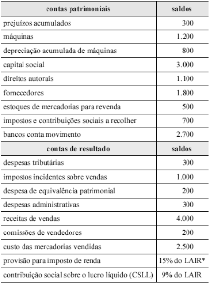{largura=35%}

* LAIR = lucro antes do imposto de renda e da CSLL Com base na tabela acima, que apresenta os saldos, em reais, das contas contábeis da Cia. ABC S/A, ainda não encerrados contabilmente, referentes ao exercício findo em 31/12/2013, julgue o item a seguir.

A existência de impostos e contribuições a recolher é indicativa de lucro no exercício de 2013.

- Gabarito: ERRADO
- Resolução: a caminho

## F0295 · CEBRASPE · 2014 · SUFRAMA · CE
- Fontes: TecConcursos 295 (165503) · Possati 18
- Prova: CEBRASPE (CESPE) - Cont (SUFRAMA)/SUFRAMA/2014
- Grupos: resultado-bruto, cmv, deducoes, receita-bruta

Com relação ao reconhecimento, à mensuração e à apresentação das contas patrimoniais e de resultado, julgue o item que se segue.

Na DRE de uma empresa comercial, para a apuração do lucro bruto operacional, as deduções das vendas e o custo das mercadorias vendidas são subtraídos diretamente da receita bruta de vendas.

- Gabarito: ERRADO
- Resolução: a caminho

## F0296 · CEBRASPE · 2014 · SUFRAMA · CE
- Fontes: TecConcursos 296 (166201) · Possati 31
- Prova: CEBRASPE (CESPE) - Téc Cont (SUFRAMA)/SUFRAMA/2014
- Grupos: resultado-bruto, cmv, resultado-financeiro, equivalencia, receita-bruta, despesas-administrativas, deducoes, despesas-vendas, lucro-liquido, outras-receitas-despesas

contas da demonstração do resultado do exercício (DRE) valores (em milhões de reais)

| Conta | Valor |
|---|---:|
| receita de vendas | 1.879,4 |
| tributos sobre vendas | 300 |
| custo dos produtos vendidos | 820 |
| despesas com vendas | 180 |
| despesas administrativas | 125 |
| receita de equivalência patrimonial | 35 |
| receitas financeiras | 93 |
| despesas financeiras | 124,5 |
| ganhos de capital | 5 |

A partir da tabela acima, julgue os itens que se seguem, com base na legislação societária e nos critérios de elaboração da DRE.

O lucro bruto da empresa é superior a R$ 750 milhões.

- Gabarito: CERTO
### O que a questão pede
O **lucro bruto** (= resultado bruto) e se ele passa de R$ 750 milhões. Valores em milhões.

### Cálculos prévios
"Receita de vendas" aqui é a receita **bruta**: há tributos sobre vendas a deduzir. Nenhum cálculo prévio além disso.

### Passo a passo
```dre
@ receita de vendas | 1.879,4 | receita-bruta
@ tributos sobre vendas | 300 | deducoes
@ custo dos produtos vendidos | 820 | cmv
@ despesas com vendas | 180 | despesas-vendas
@ despesas administrativas | 125 | despesas-administrativas
@ receita de equivalência patrimonial | 35 | equivalencia
@ receitas financeiras | 93 | resultado-financeiro
@ despesas financeiras | 124,5 | resultado-financeiro
@ ganhos de capital | 5 | outras-receitas-despesas
> Receita bruta menos os tributos sobre vendas.
+ Receita de vendas | 1.879,4 | receita de vendas
+ (–) Tributos sobre vendas | (300) | tributos sobre vendas
= Receita líquida | 1.579,4
> Indústria: o custo é o dos produtos vendidos (CPV), no mesmo lugar do CMV.
+ (–) Custo dos produtos vendidos | (820) | custo dos produtos vendidos
= Lucro bruto | 759,4
> 759,4 > 750: o item está CERTO. O resto da tabela fica abaixo do lucro bruto.
! despesas com vendas; despesas administrativas; receita de equivalência patrimonial; receitas financeiras; despesas financeiras; ganhos de capital
```

Gabarito **CERTO** (759,4 milhões).

### O que ignorar e por quê
Despesas com vendas e administrativas, equivalência, receitas e despesas financeiras e ganhos de capital: todas vêm depois do lucro bruto.

### O que mais poderia estar ali
- **Custo:** CMV (comércio), CPV (indústria) ou CSP (serviços), todos na mesma linha.
- **Deduções:** devoluções, abatimentos, descontos incondicionais.

### Pegadinhas
- Esquecer os tributos sobre vendas: 1.879,4 − 820 = 1.059,4. O item continuaria certo, mas outro item do mesmo bloco (a F0938) cobra o efeito disso.
- O valor fica **perto** do limite (759,4 × 750) de propósito: confira a conta antes de marcar.

### Leve para as próximas
1. Lucro bruto = receita bruta − deduções − custo das vendas.
2. CMV, CPV e CSP ocupam a mesma linha da DRE.
3. Fonte: resolução do professor Gilmar Possati, reescrita.

## F0297 · CEBRASPE · 2014 · SUFRAMA · CE
- Fontes: TecConcursos 297 (166203)
- Prova: CEBRASPE (CESPE) - Téc Cont (SUFRAMA)/SUFRAMA/2014
- Grupos: cmv, resultado-financeiro, equivalencia, receita-bruta, despesas-administrativas, deducoes, despesas-vendas, despesas-operacionais, lucro-liquido, outras-receitas-despesas

contas da demonstração do resultado do exercício (DRE) valores (em milhões de reais)

| Conta | Valor |
|---|---:|
| receita de vendas | 1.879,4 |
| tributos sobre vendas | 300 |
| custo dos produtos vendidos | 820 |
| despesas com vendas | 180 |
| despesas administrativas | 125 |
| receita de equivalência patrimonial | 35 |
| receitas financeiras | 93 |
| despesas financeiras | 124,5 |
| ganhos de capital | 5 |

A partir da tabela acima, julgue os itens que se seguem, com base na legislação societária e nos critérios de elaboração da DRE.

O conjunto de despesas administrativas e de vendas é também denominado despesas operacionais.

- Gabarito: CERTO
### O que a questão pede
Se "despesas operacionais" é também o nome do conjunto de despesas administrativas e de vendas. É teoria; a tabela é só o contexto.

### A regra
A Lei 6.404/76, art. 187, III, chama de **despesas operacionais** o bloco entre o lucro bruto e o resultado operacional: despesas com vendas, despesas financeiras líquidas das receitas financeiras, despesas gerais e administrativas e outras despesas operacionais.

Vendas e administrativas são o **núcleo** desse bloco, e a doutrina e as bancas chamam esse conjunto de despesas operacionais. Por isso o item está certo, embora a Lei inclua mais coisas.

| Pela Lei, dentro de "despesas operacionais" | Pelo CPC 26 |
|---|---|
| Vendas, gerais e administrativas, outras operacionais | Iguais |
| Despesas financeiras líquidas | Saem do bloco: vão para o resultado financeiro, abaixo |
| Equivalência patrimonial | Linha própria, antes do resultado financeiro |

Gabarito **CERTO**.

### Pegadinhas
- **Item incompleto não é item errado** na CEBRASPE: o conjunto de vendas e administrativas é chamado de despesas operacionais, ainda que não seja o conjunto **inteiro**. Ficaria errado se dissesse "**somente** as despesas administrativas e de vendas são operacionais".
- **CMV não é despesa operacional:** ele fica acima do lucro bruto.

### Leve para as próximas
1. Despesas operacionais = tudo entre o lucro bruto e o resultado operacional (Lei).
2. Na Lei, as financeiras estão dentro; no CPC 26, fora do bloco operacional.

## F0298 · FCC · 2014 · TRF 3 · ME
- Fontes: TecConcursos 298 (171832)
- Prova: FCC - AJ TRF3/TRF 3/Apoio Especializado/Contadoria/2014
- Grupos: resultado-bruto, cmv

Em 01/12/2012, uma empresa efetuou uma venda pelo valor de R$ 500.000,00 para ser recebido em 30/10/2014. Na data da venda, o valor presente desta venda era R$ 465.000,00 e, em 31/12/2012, o valor presente era R$ 468.000,00. O Custo da Mercadoria Vendida foi apurado em R$ 430.000,00. De acordo com a regulamentação vigente, o efeito total no resultado da empresa em 2012, relacionado com a venda efetuada foi, em R$, um Resultado Bruto igual a

- A) 70.000,00.
- B) 35.000,00 e uma Receita Financeira igual a R$ 35.000,00.
- C) 38.000,00.
- D) 35.000,00 e uma Receita Financeira igual a R$ 3.000,00.
- E) 70.000,00 e uma Receita Financeira igual a R$ 3.000,00.
- Gabarito: D
### O que a questão pede
O efeito em **2012** de uma venda a prazo (recebimento em 30/10/2014) feita em 01/12/2012: quanto vai para o **resultado bruto** e quanto para a **receita financeira**. O tema é o ajuste a valor presente (AVP) de vendas a prazo longo.

### Cálculos prévios
**1) A receita de vendas é o valor presente na data da venda:** 465.000 (CPC 12 e CPC 47). Os 35.000 restantes (500.000 − 465.000) são juros embutidos, que **não são receita de venda**: viram receita financeira ao longo do prazo.

**2) Resultado bruto:** 465.000 − 430.000 (CMV) = **35.000**.

**3) Receita financeira de 2012:** a parte dos juros que transcorreu em dezembro. É a variação do valor presente: 468.000 − 465.000 = **3.000**. Os 32.000 restantes serão apropriados em 2013 e 2014.

### Passo a passo
```dre
@ Venda a prazo (valor nominal) | 500.000 | receita-bruta
@ AVP da venda (juros embutidos) | 35.000 | deducoes
@ CMV | 430.000 | cmv
@ Juros apropriados em dezembro | 3.000 | resultado-financeiro
@ Juros a apropriar em 2013 e 2014 | 32.000 | fora-ativo
> A receita bruta pode aparecer pelo valor nominal, com o AVP como dedução, ou já pelo valor presente. O resultado bruto é o mesmo.
+ Receita bruta de vendas | 500.000 | Venda a prazo (valor nominal)
+ (–) AVP sobre vendas | (35.000) | AVP da venda (juros embutidos)
= Receita líquida | 465.000
+ (–) CMV | (430.000) | CMV
= Resultado bruto | 35.000
> Em dezembro passou um mês: o valor presente subiu de 465.000 para 468.000. Essa diferença é receita financeira de 2012.
+ (+) Receita financeira (AVP apropriado) | 3.000 | Juros apropriados em dezembro
> Os 32.000 de juros que ainda vão transcorrer ficam como redutora de clientes, no ativo, até 2013 e 2014.
! Juros a apropriar em 2013 e 2014
```

Gabarito **D** (resultado bruto 35.000 e receita financeira 3.000).

### O que ignorar e por quê
Nada a ignorar, mas cuidado com o **momento**: os 35.000 de juros não são receita de 2012 inteira, só a parte que transcorreu em dezembro.

### O que mais poderia estar ali
- **Dedução da receita:** devoluções, abatimentos, tributos sobre vendas.
- **Outras apropriações financeiras:** AVP de compras a prazo (despesa financeira), juros sobre clientes em atraso.

### Pegadinhas
- **A (70.000)** = 500.000 − 430.000: ignorou o AVP.
- **E (70.000 e 3.000):** ignorou o AVP na receita e ainda reconheceu a receita financeira, contando os juros duas vezes.
- **B (35.000 e 35.000):** jogou todos os juros como receita financeira em 2012, sem respeitar a competência.
- **C (38.000):** somou a receita financeira dentro do resultado bruto. A receita financeira vem **depois** do resultado bruto.

### Leve para as próximas
1. Venda a prazo longo (ou relevante): receita = valor presente; a diferença vira receita financeira com o tempo (Lei 6.404/76, art. 183, VIII; CPC 12).
2. Receita financeira do período = valor presente no fim − valor presente no início.
3. AVP de vendas aparece como dedução da receita bruta, ao lado das devoluções e dos tributos.

## F0299 · FCC · 2014 · TRF 3 · ME
- Fontes: TecConcursos 299 (171834)
- Prova: FCC - AJ TRF3/TRF 3/Apoio Especializado/Contadoria/2014
- Grupos: resultado-bruto

Uma empresa adquiriu um estoque de mercadorias para revenda no valor de R$ 520.000,00. A compra foi realizada no dia 30/11/2011, o prazo para pagamento, concedido pelo fornecedor, foi de 400 dias e sabe-se que o preço das mercadorias seria R$ 425.000,00 se a compra tivesse sido efetuada com pagamento à vista. A empresa ficou responsável pela retirada das mercadorias na fábrica da empresa vendedora e efetuou o pagamento do frete no valor de R$ 2.000,00. As mercadorias foram vendidas, em dezembro de 2011, por R$ 600.000,00 para recebimento em 390 dias, e se a venda fosse à vista o preço praticado seria R$ 510.000,00. O valor do Resultado Bruto da venda das mercadorias apurado pela empresa foi, em reais, igual a

- A) 80.000,00.
- B) 78.000,00.
- C) 173.000,00.
- D) 85.000,00.
- E) 83.000,00.
- Gabarito: E
### O que a questão pede
O **resultado bruto** de uma compra e de uma venda, as duas a prazo, com o preço à vista informado. É AVP nas duas pontas, mais um frete de compra.

### Cálculos prévios
**1) Custo do estoque:**
- preço à vista da compra: 425.000 (CPC 16, item 18: a diferença para o preço a prazo é despesa de juros, não custo);
- frete pago pela empresa para retirar a mercadoria: + 2.000;
- **custo = 427.000**.

**2) Receita da venda:** preço à vista, 510.000. A diferença para os 600.000 é receita financeira ao longo de 390 dias.

**3) Resultado bruto:** 510.000 − 427.000 = **83.000**.

### Passo a passo
```dre
@ Venda a prazo (nominal) | 600.000 | receita-bruta
@ AVP da venda | 90.000 | deducoes
@ Compra a prazo (nominal) | 520.000 | calculo-cmv
@ AVP da compra | 95.000 | calculo-cmv
@ Frete da compra | 2.000 | calculo-cmv
@ Juros da compra (ao longo de 400 dias) | 95.000 | resultado-financeiro
@ Juros da venda (ao longo de 390 dias) | 90.000 | resultado-financeiro
> Receita: o valor nominal menos os juros embutidos dá o valor à vista.
+ Receita bruta | 600.000 | Venda a prazo (nominal)
+ (–) AVP sobre vendas | (90.000) | AVP da venda
= Receita líquida | 510.000
> Custo: preço à vista da compra (520.000 − 95.000 de juros) + frete para trazer a mercadoria.
+ (–) CMV | (427.000) | Compra a prazo (nominal); AVP da compra; Frete da compra
= Resultado bruto | 83.000
> Os juros das duas pontas são resultado financeiro, apropriado ao longo dos prazos. Não entram no resultado bruto.
! Juros da compra (ao longo de 400 dias); Juros da venda (ao longo de 390 dias)
```

Gabarito **E (83.000)**.

### O que ignorar e por quê
- **Os 95.000 de juros da compra e os 90.000 da venda:** são despesa e receita financeiras, apropriadas ao longo do tempo, abaixo do resultado bruto.
- **Os prazos (400 e 390 dias):** só servem para a apropriação dos juros; não mudam o resultado bruto.

### O que mais poderia estar ali
- **No custo:** seguro do transporte, carga e descarga, tributos não recuperáveis.
- **Fora do custo:** frete para entregar ao cliente (despesa com vendas), armazenagem depois da compra (despesa), tributos recuperáveis (ativo).

### Pegadinhas
- **A (80.000)** = 600.000 − 520.000: ignorou o AVP e o frete.
- **B (78.000)** = 600.000 − 522.000: considerou o frete, mas ignorou o AVP.
- **C (173.000)** = 600.000 − 427.000: fez o AVP só na compra.
- **D (85.000)** = 510.000 − 425.000: esqueceu o frete da compra.
- Cada distrator erra **uma** das três peças: AVP da venda, AVP da compra ou frete.

### Leve para as próximas
1. Compra a prazo: estoque pelo preço à vista; venda a prazo: receita pelo preço à vista.
2. Frete de compra pago pelo comprador entra no custo; frete de venda é despesa com vendas.
3. Monte as três peças separadas (receita, custo, juros) antes de responder.

## F0300 · FCC · 2014 · TRF 3 · ME
- Fontes: TecConcursos 300 (172528)
- Prova: FCC - TJ TRF3/TRF 3/Apoio Especializado/Contabilidade/2014
- Grupos: resultado-bruto, cmv, resultado-financeiro, ir-csll, equivalencia, deducoes, fora-destinacao, receita-bruta, despesas-administrativas, despesas-vendas, outras-receitas-despesas

Atenção: Para responder à questão, considere as informações a seguir.

A Cia. Especial S.A. apresentou, em 31/12/12, os saldos das seguintes contas:

R$

| Conta | Valor |
|---|---:|
| Contas a Pagar (vencimento em 45 dias) | 19.000 |
| Clientes (vencimento em 100 dias) | 150.000 |
| Empréstimos Bancários Obtidos (vencimento em 31/12/2016) | 85.000 |
| Estoques de Mercadorias | 45.000 |
| Disponibilidades | 88.000 |
| Receita Bruta de Vendas | 550.000 |
| Capital Social | 200.000 |
| Custo das Mercadorias Vendidas | 230.000 |
| Impostos sobre Vendas | 44.000 |
| Despesa com Salários | 22.000 |
| Reserva Legal | 10.000 |
| Depreciação Acumulada (referente às máquinas e equipamentos) | 20.000 |
| Seguros Pagos Antecipadamente (vencimento em 7 meses) | 14.000 |
| Investimentos na Coligada Cia. Investida | 43.000 |
| Salários a Pagar (em 15 dias) | 13.000 |
| Impostos a Recolher (em 60 dias) | 7.000 |
| Lucro na venda de Imóvel | 12.000 |
| Despesa de Depreciação (referente às máquinas e equipamentos) | 15.000 |
| Máquinas e equipamentos (usados na atividade da empresa) | 150.000 |
| Despesa com Estimativa de perdas com Créditos de Liquidação Duvidosa | 2.000 |
| Reserva de Incentivos Fiscais | 4.000 |
| Resultado de Equivalência Patrimonial (negativo) | 3.000 |
| Estimativa de perdas com Créditos de Liquidação Duvidosa | 6.000 |
| Ações em Tesouraria | 5.000 |
| Devolução de vendas | 30.000 |
| Abatimentos sobre vendas | 4.000 |
| Despesa com Imposto de Renda e CSLL | 5.000 |
| Despesa Financeira | 2.000 |
| Marca (adquirida) | 24.000 |
| Despesa com Vendas | 15.000 |
| Contas a Receber (vencimento em 02/01/2015) | 35.000 |

O Lucro Bruto apurado pela Cia. Especial, em 2012, foi, em R$,

- A) 242.000,00.
- B) 276.000,00.
- C) 225.000,00.
- D) 320.000,00.
- E) 472.000,00.
- Gabarito: A
### O que a questão pede
O **lucro bruto** de 2012 a partir de um balancete que mistura contas de resultado com contas de ativo, passivo e PL. Lucro bruto = receita bruta − deduções − CMV.

### Cálculos prévios
**Triagem do balancete.** Só três tipos de conta chegam ao lucro bruto:
- **Receita bruta:** Receita bruta de vendas (550.000).
- **Deduções:** Impostos sobre vendas (44.000), Devolução de vendas (30.000), Abatimentos sobre vendas (4.000). Total: 78.000.
- **Custo:** CMV (230.000).

Todo o resto é despesa abaixo do lucro bruto ou conta patrimonial.

### Passo a passo
```dre
@ Receita Bruta de Vendas | 550.000 | receita-bruta
@ Impostos sobre Vendas | 44.000 | deducoes
@ Devolução de vendas | 30.000 | deducoes
@ Abatimentos sobre vendas | 4.000 | deducoes
@ Custo das Mercadorias Vendidas | 230.000 | cmv
@ Despesa com Salários | 22.000 | despesas-administrativas
@ Despesa de Depreciação | 15.000 | despesas-administrativas
@ Despesa com Estimativa de perdas com CLD | 2.000 | despesas-vendas
@ Despesa com Vendas | 15.000 | despesas-vendas
@ Resultado de Equivalência Patrimonial (negativo) | 3.000 | equivalencia
@ Despesa Financeira | 2.000 | resultado-financeiro
@ Lucro na venda de Imóvel | 12.000 | outras-receitas-despesas
@ Despesa com Imposto de Renda e CSLL | 5.000 | ir-csll
@ Disponibilidades, Clientes, Estoques e demais ativos | — | fora-ativo
@ Contas a pagar, Empréstimos, Salários e Impostos a recolher | — | fora-passivo
@ Capital, Reservas e Ações em Tesouraria | — | fora-pl
> Separe as contas patrimoniais (ativo, passivo e PL): não entram na DRE.
! Disponibilidades, Clientes, Estoques e demais ativos; Contas a pagar, Empréstimos, Salários e Impostos a recolher; Capital, Reservas e Ações em Tesouraria
> Receita bruta menos as três deduções: tributos sobre vendas, devoluções e abatimentos.
+ Receita bruta de vendas | 550.000 | Receita Bruta de Vendas
+ (–) Impostos sobre vendas | (44.000) | Impostos sobre Vendas
+ (–) Devoluções de vendas | (30.000) | Devolução de vendas
+ (–) Abatimentos sobre vendas | (4.000) | Abatimentos sobre vendas
= Receita líquida | 472.000
+ (–) CMV | (230.000) | Custo das Mercadorias Vendidas
= Lucro bruto | 242.000
> Pare aqui. As despesas operacionais, a equivalência, o resultado financeiro, o ganho na venda do imóvel e o IR ficam abaixo do lucro bruto.
! Despesa com Salários; Despesa de Depreciação; Despesa com Estimativa de perdas com CLD; Despesa com Vendas; Resultado de Equivalência Patrimonial (negativo); Despesa Financeira; Lucro na venda de Imóvel; Despesa com Imposto de Renda e CSLL
```

Gabarito **A (242.000)**.

### O que ignorar e por quê
- **Estoques (45.000):** saldo final, ativo. O CMV já foi dado pronto; o estoque só serviria para calcular o CMV pela fórmula (EI + compras − EF).
- **Estimativa de perdas com CLD (6.000):** é o **saldo** retificador de clientes (ativo). A **despesa** do ano é a de 2.000. Não confunda saldo com despesa.
- **Seguros pagos antecipadamente (14.000):** despesa antecipada, ativo. Só vira despesa com o passar do prazo.
- **Investimentos na coligada (43.000), Marca (24.000), Máquinas (150.000) e depreciação acumulada (20.000):** ativo não circulante.
- **Ações em tesouraria (5.000), Reservas e Capital:** PL.

### O que mais poderia estar ali
- **Nas deduções:** vendas canceladas, descontos incondicionais, ICMS, PIS, Cofins e ISS sobre vendas, AVP de vendas a prazo.
- **No custo:** custo dos produtos vendidos (indústria) ou dos serviços prestados.

### Pegadinhas
- **E (472.000):** é a receita líquida; esqueceu o CMV.
- **D (320.000)** = 550.000 − 230.000: esqueceu todas as deduções.
- **B (276.000)** = 550.000 − 44.000 − 230.000: tirou só os impostos e esqueceu devoluções e abatimentos.
- **C (225.000)** = 242.000 − 15.000 − 2.000: desceu além do lucro bruto e tirou despesas com vendas.
- **Abatimento sobre vendas × abatimento sobre compras:** o de vendas reduz a receita; o de compras reduz o custo do estoque.

### Leve para as próximas
1. Balancete misturado: **primeiro a triagem** (resultado × patrimonial), depois a montagem.
2. Lucro bruto = receita bruta − (tributos sobre vendas + devoluções + abatimentos + descontos incondicionais) − CMV.
3. "Estimativa de perdas" sem a palavra "despesa" é saldo do ativo; "Despesa com estimativa" é a despesa do período.

## F0301 · FCC · 2014 · TRF 3 · ME
- Fontes: TecConcursos 301 (172530)
- Prova: FCC - TJ TRF3/TRF 3/Apoio Especializado/Contabilidade/2014
- Grupos: cmv, resultado-financeiro, ir-csll, lucro-liquido, equivalencia, deducoes, fora-destinacao, receita-bruta, despesas-administrativas, despesas-vendas, outras-receitas-despesas

Atenção: Para responder à questão, considere as informações a seguir.

A Cia. Especial S.A. apresentou, em 31/12/12, os saldos das seguintes contas:

R$

| Conta | Valor |
|---|---:|
| Contas a Pagar (vencimento em 45 dias) | 19.000 |
| Clientes (vencimento em 100 dias) | 150.000 |
| Empréstimos Bancários Obtidos (vencimento em 31/12/2016) | 85.000 |
| Estoques de Mercadorias | 45.000 |
| Disponibilidades | 88.000 |
| Receita Bruta de Vendas | 550.000 |
| Capital Social | 200.000 |
| Custo das Mercadorias Vendidas | 230.000 |
| Impostos sobre Vendas | 44.000 |
| Despesa com Salários | 22.000 |
| Reserva Legal | 10.000 |
| Depreciação Acumulada (referente às máquinas e equipamentos) | 20.000 |
| Seguros Pagos Antecipadamente (vencimento em 7 meses) | 14.000 |
| Investimentos na Coligada Cia. Investida | 43.000 |
| Salários a Pagar (em 15 dias) | 13.000 |
| Impostos a Recolher (em 60 dias) | 7.000 |
| Lucro na venda de Imóvel | 12.000 |
| Despesa de Depreciação (referente às máquinas e equipamentos) | 15.000 |
| Máquinas e equipamentos (usados na atividade da empresa) | 150.000 |
| Despesa com Estimativa de perdas com Créditos de Liquidação Duvidosa | 2.000 |
| Reserva de Incentivos Fiscais | 4.000 |
| Resultado de Equivalência Patrimonial (negativo) | 3.000 |
| Estimativa de perdas com Créditos de Liquidação Duvidosa | 6.000 |
| Ações em Tesouraria | 5.000 |
| Devolução de vendas | 30.000 |
| Abatimentos sobre vendas | 4.000 |
| Despesa com Imposto de Renda e CSLL | 5.000 |
| Despesa Financeira | 2.000 |
| Marca (adquirida) | 24.000 |
| Despesa com Vendas | 15.000 |
| Contas a Receber (vencimento em 02/01/2015) | 35.000 |

O Lucro Líquido apurado pela Cia. Especial, em 2012, foi, em R$,

- A) 193.000,00.
- B) 190.000,00.
- C) 196.000,00.
- D) 176.000,00.
- E) 234.000,00.
- Gabarito: B
### O que a questão pede
O **lucro líquido** de 2012, a partir do mesmo balancete da questão anterior (F0300). Parte do lucro bruto de 242.000 e desce a DRE até o fim.

### Cálculos prévios
- **Lucro bruto:** 550.000 − 44.000 − 30.000 − 4.000 − 230.000 = **242.000** (ver a F0300).
- **Despesas operacionais:**
  - com vendas: 15.000 + 2.000 de PECLD = 17.000;
  - administrativas e gerais: salários 22.000 + depreciação 15.000 = 37.000.
- **Equivalência negativa (3.000):** é despesa (perda) do investimento na coligada.
- **IR e CSLL:** já vêm prontos (5.000). Não recalcule.

### Passo a passo
```dre
@ Receita Bruta de Vendas | 550.000 | receita-bruta
@ Impostos sobre Vendas | 44.000 | deducoes
@ Devolução de vendas | 30.000 | deducoes
@ Abatimentos sobre vendas | 4.000 | deducoes
@ Custo das Mercadorias Vendidas | 230.000 | cmv
@ Despesa com Vendas | 15.000 | despesas-vendas
@ Despesa com Estimativa de perdas com CLD | 2.000 | despesas-vendas
@ Despesa com Salários | 22.000 | despesas-administrativas
@ Despesa de Depreciação | 15.000 | despesas-administrativas
@ Resultado de Equivalência Patrimonial (negativo) | 3.000 | equivalencia
@ Despesa Financeira | 2.000 | resultado-financeiro
@ Lucro na venda de Imóvel | 12.000 | outras-receitas-despesas
@ Despesa com Imposto de Renda e CSLL | 5.000 | ir-csll
@ Estimativa de perdas com CLD (saldo) | 6.000 | fora-ativo
@ Seguros Pagos Antecipadamente | 14.000 | fora-ativo
@ Demais contas de ativo, passivo e PL | — | fora-outros
> Risque o patrimonial. Atenção a dois "falsos amigos": o saldo da estimativa de perdas (6.000, ativo) e os seguros antecipados (14.000, ativo).
! Estimativa de perdas com CLD (saldo); Seguros Pagos Antecipadamente; Demais contas de ativo, passivo e PL
> Até o lucro bruto, igual à F0300.
+ Receita bruta | 550.000 | Receita Bruta de Vendas
+ (–) Deduções | (78.000) | Impostos sobre Vendas; Devolução de vendas; Abatimentos sobre vendas
= Receita líquida | 472.000
+ (–) CMV | (230.000) | Custo das Mercadorias Vendidas
= Lucro bruto | 242.000
> Despesas operacionais. Pela Lei, a equivalência e o resultado financeiro também ficam dentro do bloco operacional.
+ (–) Despesas com vendas | (17.000) | Despesa com Vendas; Despesa com Estimativa de perdas com CLD
+ (–) Despesas administrativas | (37.000) | Despesa com Salários; Despesa de Depreciação
+ (–) Equivalência patrimonial negativa | (3.000) | Resultado de Equivalência Patrimonial (negativo)
+ (–) Despesa financeira | (2.000) | Despesa Financeira
= Resultado operacional (Lei) | 183.000
> Pela Lei, o lucro na venda do imóvel é "outras receitas", depois do resultado operacional. Pelo CPC entraria antes, mas o LAIR é o mesmo.
+ (+) Lucro na venda de imóvel | 12.000 | Lucro na venda de Imóvel
= LAIR | 195.000
+ (–) IR e CSLL | (5.000) | Despesa com Imposto de Renda e CSLL
= Lucro líquido | 190.000
```

Gabarito **B (190.000)**.

### O que ignorar e por quê
- **Saldo da estimativa de perdas (6.000):** retificadora de clientes. A despesa do ano é só a de 2.000.
- **Seguros pagos antecipadamente (14.000):** ainda não viraram despesa (vencem em 7 meses).
- **Ações em tesouraria (5.000):** redução do PL, não despesa.
- **Reserva de incentivos fiscais (4.000) e reserva legal (10.000):** destinação ou retenção do lucro, no PL.
- **Depreciação acumulada (20.000):** saldo retificador do imobilizado; a despesa do ano é a de 15.000.

### O que mais poderia estar ali
- **Outras receitas e despesas:** perda na venda de imobilizado, baixa de intangível, ganho na venda de investimentos.
- **Despesas com vendas:** comissões, propaganda, frete de entrega.
- **Depois do LAIR:** participações (debêntures, empregados, administradores, partes beneficiárias), na ordem DEAPI.

### Pegadinhas
- **A (193.000)** = 190.000 + 3.000: ignorou a equivalência negativa.
- **C (196.000)** = 190.000 + 6.000: somou a equivalência como receita (+3.000 em vez de −3.000).
- **D (176.000)** = 190.000 − 14.000: tratou os seguros antecipados como despesa.
- **E (234.000)** = 190.000 + 44.000: esqueceu os impostos sobre vendas.
- **"(negativo)" no nome da conta** muda o sinal: equivalência negativa é perda.

### Leve para as próximas
1. Lucro líquido pela Lei: LB − despesas operacionais (vendas, administrativas, equivalência, financeiras) = resultado operacional ± outras receitas e despesas = LAIR − IR e CSLL − participações.
2. Saldo de conta retificadora ≠ despesa do período (PECLD e depreciação acumulada).
3. Despesa antecipada é ativo até o período a que se refere.

## F0302 · CEBRASPE · 2014 · TC DF · CE
- Fontes: TecConcursos 302 (183635)
- Prova: CEBRASPE (CESPE) - ACE (TC DF)/TC DF/Auditoria/2014
- Grupos: ir-csll, lucro-liquido, fora-destinacao, despesas-administrativas, resultado-financeiro

Tabela para o item

contas ano 1 (em R$) ano 2 (em R$) duplicatas descontadas 20 20 dividendos a pagar 30 27 imposto de renda e contribuição social apurada 30 25 capital social integralizado em moeda 380 400 lucro líquido do exercício 100 80 despesa com ajuste de

| Conta | Débito | Crédito |
|---|---:|---:|
| instrumentos financeiros | 5 | 3 |
| juros ativos | 3 | 1 |
| gastos na emissão de ações | 2 | 0 |
| depreciação acumulada | 6 | 8 |

ajustes de instrumentos financeiros 2 3 A tabela na coluna anterior apresenta um rol de contas e saldos que podem compor diferentes demonstrações contábeis e não constituem a forma completa de uma demonstração contábil. Com base nessas informações, julgue o item subsequente, considerando que o ano 1 seja anterior ao ano 2.

No rol de contas apresentado, há apenas uma conta que diminui e uma conta que aumenta o resultado líquido do exercício.

- Gabarito: ERRADO
- Resolução: a caminho

## F0303 · CEBRASPE · 2014 · PF · CE
- Fontes: TecConcursos 303 (186291) · Possati 47
- Prova: CEBRASPE (CESPE) - Cont (PF)/PF/2014
- Grupos: participacoes, lucro-liquido

Acerca da legislação societária, julgue o item subsequente.

Os prejuízos acumulados e a provisão para o imposto sobre a renda constituída no exercício devem ser deduzidos do resultado do exercício para fins de cálculo das participações estatutárias de empregados.

- Gabarito: CERTO
- Resolução: a caminho

## F0304 · FCC · 2014 · TRT 16 · ME
- Fontes: TecConcursos 304 (201045)
- Prova: FCC - AJ TRT16/TRT 16/Administrativa/Contabilidade/2014
- Grupos: resultado-bruto, receita-liquida, cmv, deducoes, receita-bruta, despesas-vendas

A Cia. Compra & Vende reconheceu, durante o ano de 2013, R$ 5.000.000,00 em vendas realizadas. Adicionalmente, durante 2013,  reconheceu as seguintes operações: devoluções de vendas de R$ 250.000,00; abatimento sobre vendas de R$ 100.000,00; impostos sobre vendas de R$ 950.000,00; comissões sobre as vendas realizadas de R$ 150.000,00; frete sobre as vendas realizadas de R$ 70.000,00; estimativa para perdas com créditos de liquidação duvidosa de R$ 90.000,00; salário dos administradores de R$ 360.000,00. Sabendo que o custo das mercadorias vendidas foi R$ 2.720.000,00, é correto afirmar que a receita líquida e o lucro bruto apurados pela Cia. Compra & Venda, no ano de 2013, foram, respectivamente,

- A) R$ 3.700.000,00 e R$ 310.000,00.
- B) R$ 4.050.000,00 e R$ 980.000,00.
- C) R$ 3.700.000,00 e R$ 760.000,00.
- D) R$ 4.050.000,00 e R$ 760.000,00.
- E) R$ 3.700.000,00 e R$ 980.000,00.
- Gabarito: E
- Resolução: a caminho

## F0305 · FCC · 2014 · TRF 4 · ME
- Fontes: TecConcursos 305 (212117)
- Prova: FCC - TJ TRF4/TRF 4/Apoio Especializado/Contabilidade/2014
- Grupos: cmv, resultado-financeiro, ir-csll, lucro-liquido, equivalencia, deducoes, fora-destinacao, receita-bruta, despesas-administrativas, despesas-vendas, outras-receitas-despesas

Atenção: Para responder à questão, considere as informações abaixo.

O Balancete da empresa Reforma & Cia. apresentava em, 31/12/2013, os saldos das seguintes contas:

Nome da conta R$

| Conta | Valor |
|---|---:|
| Caixa e Equivalente de Caixa | 50.000 |
| Duplicatas a Receber de Clientes (recebimento em até 180 dias) | 120.000 |
| Fornecedores | 60.000 |
| Adiantamentos de Clientes (entrega em até 90 dias) | 30.00 |
| Despesas Financeiras | 15.000 |
| Aplicações Financeiras (vencimento em 31/07/2015) | 75.000 |
| Tributos a Pagar | 23.000 |
| Reserva Estatutária | 25.000 |
| Despesas Pagas Antecipadamente (utilização até 220 dias) | 12.000 |
| Despesas Administrativas | 20.000 |
| Estoque de Mercadorias (prazo médio de renovação de 80 dias) | 90.000 |
| Estimativa para Perdas com Créditos de Liquidação Duvidosa | 6.000 |
| Despesa com Imposto de Renda | 34.000 |
| Receitas Financeiras | 2.000 |
| Custo das Mercadorias Vendidas | 290.000 |
| Adiantamento a Fornecedores (recebimento em 110 dias) | 15.000 |
| Marcas e Patentes | 40.000 |
| Devoluções de Vendas | 4.000 |
| Capital Social | 200.000 |
| Terrenos | 45.000 |
| Reserva Legal | 20.000 |
| Resultado de Equivalência Patrimonial (positivo) | 8.000 |
| Empréstimos Obtidos (vencimento integral após 360 dias) | 80.000 |
| Receita Bruta de Vendas | 585.000 |
| Reserva de Capital | 6.000 |
| Depreciação Acumulada de Imóveis | 18.000 |
| Lucro na Venda de Terrenos | 10.000 |
| Imóveis | 180.000 |
| Despesa com Estimativa para Perdas com Créditos de Liquidação Duvidosa | 4.000 |
| Investimentos em Controladas | 70.000 |
| Despesa de Depreciação de Imóveis | 9.000 |

O Lucro Líquido apurado pela empresa Reforma & Cia., em 2013, foi, em reais,

- A) 229.000,00.
- B) 209.000,00.
- C) 217.000,00.
- D) 211.000,00.
- E) 221.000,00.
- Gabarito: A
- Resolução: a caminho

## F0306 · FCC · 2014 · TRF 4 · ME
- Fontes: TecConcursos 306 (212123)
- Prova: FCC - TJ TRF4/TRF 4/Apoio Especializado/Contabilidade/2014
- Grupos: receita-liquida, cmv, deducoes, receita-bruta, despesas-vendas

Atenção: Para responder à questão, considere as informações abaixo.

A Cia. Holandesa reconheceu, durante o ano de 2013, os seguintes eventos: receita bruta de vendas R$ 380.000,00; abatimentos sobre vendas R$ 6.000,00; custo das mercadorias vendidas R$ 130.000,00; comissões sobre vendas R$ 4.500,00; impostos sobre vendas R$ 42.000,00; estimativa para perdas com créditos de liquidação duvidosa R$ 7.500,00; devoluções de vendas R$ 15.000,00; fretes sobre vendas R$ 2.000,00 e perdas com créditos incobráveis R$ 3.500,00.

A Cia. Holandesa apurou, em 2013, uma receita líquida de vendas, em reais, de

- A) 229.000,00.
- B) 338.000,00.
- C) 317.000,00.
- D) 307.500,00.
- E) 359.000,00.
- Gabarito: C
- Resolução: a caminho

## F0307 · FCC · 2014 · TRF 4 · ME
- Fontes: TecConcursos 307 (212125)
- Prova: FCC - TJ TRF4/TRF 4/Apoio Especializado/Contabilidade/2014
- Grupos: resultado-bruto, cmv, deducoes, receita-bruta, despesas-vendas

Atenção: Para responder à questão, considere as informações abaixo.

A Cia. Holandesa reconheceu, durante o ano de 2013, os seguintes eventos: receita bruta de vendas R$ 380.000,00; abatimentos sobre vendas R$ 6.000,00; custo das mercadorias vendidas R$ 130.000,00; comissões sobre vendas R$ 4.500,00; impostos sobre vendas R$ 42.000,00; estimativa para perdas com créditos de liquidação duvidosa R$ 7.500,00; devoluções de vendas R$ 15.000,00; fretes sobre vendas R$ 2.000,00 e perdas com créditos incobráveis R$ 3.500,00.

A Cia. Holandesa apurou, em 2013, um Resultado Bruto com Vendas, em reais, de

- A) 250.000,00.
- B) 177.500,00.
- C) 185.000,00.
- D) 219.500,00.
- E) 187.000,00.
- Gabarito: E
- Resolução: a caminho

## F0308 · FGV · 2014 · DPE RJ · ME
- Fontes: TecConcursos 308 (215900)
- Prova: FGV - TSE (DPE RJ)/DPE RJ/Ciências Contábeis/2014
- Grupos: cmv, resultado-financeiro, lair, ir-csll, equivalencia, deducoes, receita-bruta, despesas-administrativas, despesas-vendas, despesas-operacionais, outras-operacionais, receita-liquida, outras-receitas-despesas

Considere os dados abaixo:

| Conta | Valor |
|---|---:|
| Custo das mercadorias vendidas | 50.000,00 |
| Despesas administrativas | 20.000,00 |
| Despesas comerciais | 30.000,00 |
| Devoluções de vendas | 5.000,00 |
| Imposto de renda e contribuição social | 7.000,00 |
| Outras despesas operacionais | 10.000,00 |
| Receita de equivalência patrimonial | 15.000,00 |
| Receita financeira | 10.000,00 |
| Receitas líquidas de vendas | 100.000,00 |

O resultado antes dos tributos sobre lucro é

- A) 15.000
- B) 10.000
- C) 8.000
- D) 3.000
- E) (5.000)
- Gabarito: A
- Resolução: a caminho

## F0309 · FCC · 2014 · TRT 13 · ME
- Fontes: TecConcursos 309 (216147)
- Prova: FCC - AJ TRT13/TRT 13/Administrativa/Contabilidade/2014
- Grupos: resultado-bruto, cmv, resultado-financeiro, participacoes, ir-csll, deducoes, receita-bruta, despesas-administrativas, despesas-vendas, outras-receitas-despesas

O balancete de verificação da Empresa Vende Tudo S.A., em 31/12/2012, era composto das seguintes contas:

R$

| Conta | Valor |
|---|---:|
| Estoques | 45.000,00 |
| Contas a Pagar (que se vencem em até 180 dias) | 19.000,00 |
| Clientes (para receber em até 120 dias) | 150.000,00 |
| Empréstimos a Pagar | 85.000,00 |
| Caixa e Equivalentes de Caixa | 88.000,00 |
| Receita Bruta de Vendas | 585.000,00 |
| Capital Social | 195.000,00 |
| Custo das Mercadorias Vendidas | 230.000,00 |
| Despesas com Salários | 22.000,00 |
| Reservas de Lucros | 14.000,00 |
| Despesas Antecipadas | 14.000,00 |
| Investimentos em Coligadas | 43.000,00 |
| Devoluções de Vendas | 28.000,00 |
| Salários a Pagar | 13.000,00 |
| Despesas com Impostos sobre Vendas | 75.000,00 |
| Impostos a Recolher (que se vencem em até 60 dias) | 7.000,00 |
| Lucro na Venda de Imóvel | 9.000,00 |
| Despesa de Depreciação | 15.000,00 |
| Máquinas e Equipamentos | 130.000,00 |
| Despesas com Estimativa de Perdas com Créditos de Liquidação Duvidosa | 2.000,00 |
| Estimativa de perdas com Créditos de Liquidação Duvidosa | 6.000,00 |
| Despesas com Imposto de Renda e Contribuição Social | 5.000,00 |
| Despesa Financeira | 2.000,00 |
| Intangíveis | 24.000,00 |
| Despesas com Comissão sobre Vendas | 15.000,00 |
| Contas a Receber (para receber em 2015) | 35.000,00 |
| Despesas com Propaganda e Publicidade | 10.000,00 |

O Resultado Bruto com Vendas e o Resultado antes dos Impostos e Participações, apurado pela Empresa Vende Tudo S.A., em 2012, foram, respectivamente, em reais,

- A) 252.000,00 e 195.000,00.
- B) 237.000,00 e 195.000,00.
- C) 252.000,00 e 190.000,00.
- D) 235.000,00 e 195.000,00.
- E) 237.000,00 e 190.000,00.
- Gabarito: A
- Resolução: a caminho

## F0310 · FGV · 2014 · ALBA · ME
- Fontes: TecConcursos 310 (216975)
- Prova: FGV - Aud (ALBA)/ALBA/Auditoria/2014
- Grupos: cmv, resultado-financeiro, equivalencia, receita-bruta, despesas-administrativas, despesas-vendas, outras-receitas-despesas

A Cia. Y apresentou os seguintes saldos, referentes ao ano de 2013.

| Conta | Valor |
|---|---:|
| Venda de ativo imobilizado | R$ 200.000,00 |
| Vendas de mercadorias | R$ 400.000,00 |
| Receitas Financeiras | R$ 70.000,00 |

Parcela dos resultados de empresas investidas reconhecida por meio do método

| Conta | Valor |
|---|---:|
| de equivalência patrimonial | R$ 60.000,00 |
| Despesas de propaganda | R$ 30.000,00 |
| Despesas gerais | R$ 40.000,00 |
| Despesas financeiras | R$ 50.000,00 |
| Despesas administrativas | R$ 15.000,00 |
| Custo das mercadorias vendidas | R$ 100.000,00 |
| Custo do imobilizado | R$ 120.000,00 |

Reversão da provisão para créditos de liquidação duvidosa R$ 3.000,00 Juros sobre capital próprio R$ 55.000,00 Com base apenas nos saldos acima, o resultado antes das receitas e despesas financeiras da Cia. Y, no ano de 2013, foi

- A) R$ 278.000,00.
- B) R$ 298.000,00.
- C) R$ 303.000,00.
- D) R$ 352.000,00.
- E) R$ 358.000,00.
- Gabarito: E
- Resolução: a caminho

## F0311 · FGV · 2014 · ALBA · ME
- Fontes: TecConcursos 311 (217362)
- Prova: FGV - TNS (ALBA)/ALBA/Ciências Contábeis/2014
- Grupos: receita-liquida, calculo-cmv, cmv, resultado-bruto, despesas-administrativas, despesas-vendas, outras-receitas-despesas, equivalencia, resultado-antes-financeiro, resultado-financeiro, lair, fora-destinacao

Em 31/12/2013 uma empresa apresentava os seguintes saldos em suas contas:

| Conta | Valor |
|---|---:|
| Vendas líquidas | R$ 400.000,00 |
| Estoque inicial de mercadorias | zero |
| Estoque final de mercadorias | R$ 10.000,00 |
| Compras de mercadorias | R$ 150.000,00 |
| Dividendos pagos | R$ 30.000,00 |
| Receitas financeiras | R$ 120.000,00 |
| Despesas financeiras | R$ 50.000,00 |
| Juros sobre capital próprio | R$ 30.000,00 |
| Despesas administrativas | R$ 45.000,00 |
| Despesas gerais | R$ 65.000,00 |
| Despesa com a provisão para créditos de liquidação duvidosa | R$ 8.000,00 |
| Venda de ativo imobilizado | R$ 200.000,00 |
| Parcela dos resultados de empresas investidas reconhecida por meio do método de equivalência patrimonial | R$ 60.000,00 |
| Custo do ativo imobilizado | R$ 100.000.00 |

Considerando que as receitas e as despesas se referem, exclusivamente, ao ano de 2013, o resultado do exercício, antes dos impostos e contribuições, apresentado na Demonstração do Resultado do Exercício da empresa, em 31/12/2013. foi de

- A) R$ 272.000,00.
- B) R$ 312.000,00.
- C) R$ 342.000,00.
- D) R$ 362.000,00.
- E) R$ 372.000,00.
- Gabarito: E
### O que a questão pede
O **resultado antes dos impostos e contribuições** (LAIR) de 2013. Três pontos decidem a questão: o CMV pelo inventário, o **ganho** (e não o preço) na venda do imobilizado e o tratamento dos **juros sobre capital próprio**.

### Cálculos prévios
- **CMV:** estoque inicial 0 + compras 150.000 − estoque final 10.000 = **140.000**.
- **Ganho na venda do imobilizado:** preço 200.000 − custo 100.000 = **100.000**. O enunciado não informa depreciação acumulada; o "custo do ativo imobilizado" é tratado como o valor contábil baixado.
- **Resultado financeiro:** 120.000 − 50.000 = **+70.000**.
- **JCP (30.000) e dividendos pagos (30.000):** remuneração dos sócios. Pela ICPC 08 (R1), vão direto ao PL; **não** entram na DRE.

### Passo a passo
```dre
@ Vendas líquidas | 400.000 | receita-liquida
@ Estoque inicial de mercadorias | 0 | calculo-cmv
@ Compras de mercadorias | 150.000 | calculo-cmv
@ Estoque final de mercadorias | 10.000 | calculo-cmv
@ Despesas administrativas | 45.000 | despesas-administrativas
@ Despesas gerais | 65.000 | despesas-administrativas
@ Despesa com a provisão para créditos de liquidação duvidosa | 8.000 | despesas-vendas
@ Venda de ativo imobilizado | 200.000 | outras-receitas-despesas
@ Custo do ativo imobilizado | 100.000 | outras-receitas-despesas
@ Equivalência patrimonial (parcela dos resultados das investidas) | 60.000 | equivalencia
@ Receitas financeiras | 120.000 | resultado-financeiro
@ Despesas financeiras | 50.000 | resultado-financeiro
@ Juros sobre capital próprio | 30.000 | fora-destinacao
@ Dividendos pagos | 30.000 | fora-destinacao
> JCP e dividendos remuneram os sócios: saem do lucro, não o formam (ICPC 08).
! Juros sobre capital próprio; Dividendos pagos
+ Vendas líquidas | 400.000 | Vendas líquidas
+ (–) CMV | (140.000) | Estoque inicial de mercadorias; Compras de mercadorias; Estoque final de mercadorias
= Lucro bruto | 260.000
+ (–) Despesas administrativas e gerais | (110.000) | Despesas administrativas; Despesas gerais
+ (–) Despesa com PCLD | (8.000) | Despesa com a provisão para créditos de liquidação duvidosa
> Na DRE entra o ganho (preço − valor contábil), não o preço de venda.
+ Outras receitas (ganho na venda do imobilizado) | 100.000 | Venda de ativo imobilizado; Custo do ativo imobilizado
+ Resultado de equivalência patrimonial | 60.000 | Equivalência patrimonial (parcela dos resultados das investidas)
= Resultado antes do resultado financeiro | 302.000
+ Resultado financeiro | 70.000 | Receitas financeiras; Despesas financeiras
= Resultado antes dos tributos sobre o lucro | 372.000
```

Gabarito **E (372.000)**.

### O que ignorar e por quê
- **Dividendos pagos:** destinação do lucro (DLPA ou DMPL).
- **JCP:** para a FGV, aqui, também é destinação. Veja a divergência nas pegadinhas.
- **O preço de venda do imobilizado (200.000) inteiro:** só o ganho passa pela DRE.

### O que mais poderia estar ali
- **Outras receitas e despesas:** perda na baixa de imobilizado, ganho na venda de investimentos.
- **Equivalência negativa:** perda que reduziria o resultado.

### Pegadinhas
- **C (342.000)** = 372.000 − 30.000: tratou o **JCP como despesa financeira** (ou os dividendos pagos como despesa; o efeito numérico é o mesmo).
- **B (312.000)** = 372.000 − 60.000: esqueceu a equivalência patrimonial.
- **A (272.000)** = 372.000 − 100.000: esqueceu o ganho na venda do imobilizado.
- **D (362.000)** = 372.000 − 10.000: não descontou o estoque final (usou as compras de 150.000 como CMV).
- **JCP — divergência:** para o **fisco**, é despesa financeira dedutível (Lei 9.249/95, art. 9º), e parte da doutrina o mostra assim; pela **ICPC 08 (R1)**, contabilmente, é distribuição de resultado, lançada direto no PL. A FGV seguiu a ICPC 08. A empresa que o lança como despesa para fins fiscais deve revertê-lo na DRE societária.
- **Ganho na venda do imobilizado:** pela Lei, "outras receitas" vêm depois do resultado operacional; pelo CPC 26, ficam no bloco operacional. Para o LAIR, o lugar não muda o total.

### Leve para as próximas
1. Venda de imobilizado: na DRE vai o **ganho ou a perda** (preço − valor contábil).
2. JCP: leia a banca e o comando. Contabilmente (ICPC 08), não é despesa; fiscalmente, é dedutível.
3. Equivalência positiva soma; negativa subtrai. No CPC 26, ambas ficam antes do resultado financeiro.

## F0312 · FGV · 2014 · Pref Recife · ME
- Fontes: TecConcursos 312 (221106)
- Prova: FGV - ATM (Pref Recife)/Pref Recife/2014
- Grupos: lucro-liquido

De acordo com a Lei nº 6.404/76, a Demonstração do Resultado do Exercício deve discriminar as informações listadas a seguir, à exceção de uma. Assinale-a.

- A) Participações de debêntures, empregados, administradores e partes beneficiárias.
- B) Lucro ou prejuízo líquido do exercício e seu montante por ação do capital social.
- C) Receita bruta das vendas e serviços, deduções das vendas, abatimentos e impostos.
- D) Receita líquida das vendas e serviços, custo das mercadorias e serviços vendidos e lucro bruto.
- E) Dividendo mínimo obrigatório e adicional proposto.
- Gabarito: E
- Resolução: a caminho

## F0313 · FCC · 2014 · TCE GO · ME
- Fontes: TecConcursos 313 (227904)
- Prova: FCC - ACE (TCE-GO)/TCE GO/Contabilidade/2014
- Grupos: 

A empresa Robalo S.A. realizou a venda de um automóvel utilizado pela sua diretoria. A venda foi realizada com lucro. Dessa forma, esse evento deve ser apresentado, na Demonstração do Resultado de Exercícios, em

- A) Receitas Não Operacionais.
- B) Receitas Operacionais.
- C) Receitas Financeiras.
- D) Outras Receitas Operacionais.
- E) Resultado Não Operacional.
- Gabarito: D
- Resolução: a caminho

## F0314 · FCC · 2014 · TCE GO · ME
- Fontes: TecConcursos 314 (228380)
- Prova: FCC - ACE (TCE-GO)/TCE GO/Orçamento e Finanças/2014
- Grupos: receita-bruta, cmv, resultado-bruto, despesas-vendas, despesas-administrativas, resultado-financeiro, equivalencia, outras-receitas-despesas, lair, ir-csll, participacoes, lucro-liquido, fora-ativo, fora-passivo, fora-pl, fora-destinacao

Atenção: Considere as informações abaixo, para responder à questão.

Os Balancetes de Verificação da Cia. Forte apresentavam, no período 2009/2010, os saldos a seguir (Valores em reais):

Cia. Forte − Balancete de Verificação

| Saldos Devedores | 2009 | 2010 |
|---|---:|---:|
| Aplicações Financeiras (1) (2) | 5.000 | 0 |
| Capital a Realizar | 10.000 | 0 |
| Clientes | 32.000 | 38.500 |
| CMV | 28.000 | 34.000 |
| Depreciação | 1.000 | 4.500 |
| Despesas com Créditos de Liquidação Duvidosa | 200 | 500 |
| Despesas de Pessoal | 20.000 | 38.000 |
| Despesas de Vendas | 26.400 | 20.000 |
| Despesas Financeiras | 3.800 | 1.960 |
| Disponibilidades | 4.000 | 1.000 |
| Equipamentos | 15.000 | 15.000 |
| Estoques | 1.960 | 4.500 |
| Imóveis (3) | 22.000 | 27.000 |
| Participações Societárias | 4.240 | 5.000 |
| Perdas com Clientes | 0 | 900 |
| Veículos (3) | 20.000 | 45.000 |
| **Total de Saldo Devedor** | **193.600** | **235.860** |

| Saldos Credores | 2009 | 2010 |
|---|---:|---:|
| Capital Social | 50.000 | 60.000 |
| Contas a Pagar | 13.000 | 12.050 |
| Depreciação Acumulada | 12.000 | 5.500 |
| Empréstimos a Pagar (5) | 0 | 15.000 |
| Financiamentos a Pagar (6) | 16.000 | 17.000 |
| Fornecedores | 8.000 | 15.950 |
| Notas Promissórias a Pagar (4) | 9.000 | 0 |
| Provisão para Crédito de Liquidação Duvidosa (PCLD) | 200 | 500 |
| Receitas de Aplicações Financeiras | 10.200 | 600 |
| Reservas de Lucros (7) | 2.000 | 0 |
| Reservas Legais (7) | 4.000 | 0 |
| Resultado da Venda de Imobilizado | 0 | 4.000 |
| Resultado de Equivalência Patrimonial | 1.200 | 760 |
| Vendas | 68.000 | 104.500 |
| **Total de Saldo Credor** | **193.600** | **235.860** |

A empresa forneceu, ainda, as informações complementares abaixo:

(1) Os saldos apresentados correspondem aos saldos finais das contas listadas. Apenas os resultados dos exercícios não estão apurados. (2) A conta de Aplicações Financeiras constituíam-se em aplicações em quotas de Fundo de Investimento, resgatáveis em quatro anos. Ao final de 2010, a empresa resgata antecipadamente o investimento, auferindo um rendimento de R$ 600,00. (3) Ao final do segundo exercício, a direção da empresa opta por renovar integralmente a sua frota de veículos que acumulava depreciações, até a data da baixa, de 55%. No mesmo período, a empresa adquire uma nova frota de veículos, no valor R$ 45.000,00 e adquire novos imóveis. (4) Título vencível em 90 dias. (5) Empréstimos contraídos ao final do exercício de 2010, contratados com prazo de cinco anos e juros contratuais de 1,5% a.a. pagáveis mensalmente no ultimo dia útil do mês. (6) A empresa renegocia com a instituição financeira parte do saldo de seus financiamentos quitando R$ 13.000,00 repactuando o restante da dívida juntamente com novos financiamentos a taxas mais vantajosas e prazo de quitação para 60 meses, com carência de dois anos. (7) No início de 2010, a empresa integraliza totalmente o Capital a Realizar e aumenta o Capital Social, utilizando todo o saldo inicial de Reserva Legal e de Reservas nos Lucros. Na mesma ocasião, os sócios subscrevem e integralizam em moeda corrente parcela do capital. (8) Dos resultados finais apurados, quando positivos, a empresa provisiona 20% para o Imposto de Renda e Contribuições, 10% para Participação nos Lucros para os Administradores e 10% para Participação nos Lucros aos Empregados. Distribuindo o Lucro Líquido 5% para Reserva Legal, 50% para Dividendos e o restante para Reservas de Lucros.

O Resultado Líquido apurado em 2010 foi um

- A) lucro de R$ 6.480,00
- B) prejuízo de R$ 6.500,00
- C) lucro de R$ 7.280,00
- D) prejuízo de R$ 8.000,00
- E) lucro de R$ 10.000,00
- Gabarito: A
### O que a questão pede
O **lucro líquido de 2010** a partir de um balancete com dois anos lado a lado. É preciso montar a DRE até o LAIR, tirar o IR e depois as **participações** de empregados e administradores, cada uma sobre o que sobra da anterior (Lei 6.404/76, arts. 189 e 190).

### Cálculos prévios
**1) Leia só a coluna 2010** e separe as contas de resultado. O lado do saldo diz o sinal: saldo **devedor** é despesa; **credor** é receita ou ganho.

| Conta de resultado de 2010 | Lado | Valor |
|---|---|---:|
| Vendas | credor | 104.500 |
| CMV | devedor | 34.000 |
| Depreciação | devedor | 4.500 |
| Despesas com créditos de liquidação duvidosa | devedor | 500 |
| Despesas de pessoal | devedor | 38.000 |
| Despesas de vendas | devedor | 20.000 |
| Perdas com clientes | devedor | 900 |
| Despesas financeiras | devedor | 1.960 |
| Receitas de aplicações financeiras | credor | 600 |
| Resultado de equivalência patrimonial | credor | 760 |
| Resultado da venda de imobilizado | credor | 4.000 |

**2) Tributos e participações** (nota 8: 20% de IR e contribuições; 10% para empregados e 10% para administradores):

| Etapa | Base | Valor |
|---|---:|---:|
| LAIR | | 10.000 |
| (–) IR e contribuições (20%) | 10.000 | (2.000) |
| = Resultado antes das participações | | 8.000 |
| (–) Empregados (10%) | 8.000 | (800) |
| (–) Administradores (10%) | 8.000 − 800 = 7.200 | (720) |
| **= Lucro líquido** | | **6.480** |

A ordem é a do art. 190: **empregados antes dos administradores**, mesmo que o enunciado cite os administradores primeiro.

### Passo a passo
```dre
@ Vendas | 104.500 | receita-bruta
@ CMV | 34.000 | cmv
@ Despesas de Vendas | 20.000 | despesas-vendas
@ Despesas com Créditos de Liquidação Duvidosa | 500 | despesas-vendas
@ Perdas com Clientes | 900 | despesas-vendas
@ Despesas de Pessoal | 38.000 | despesas-administrativas
@ Depreciação | 4.500 | despesas-administrativas
@ Despesas Financeiras | 1.960 | resultado-financeiro
@ Receitas de Aplicações Financeiras | 600 | resultado-financeiro
@ Resultado de Equivalência Patrimonial | 760 | equivalencia
@ Resultado da Venda de Imobilizado | 4.000 | outras-receitas-despesas
@ IR e contribuições (20% do LAIR) | 2.000 | ir-csll
@ Participação dos empregados (10%) | 800 | participacoes
@ Participação dos administradores (10%) | 720 | participacoes
@ Clientes, estoques, aplicações, imobilizado e participações societárias | — | fora-ativo
@ Contas a pagar, fornecedores, empréstimos e financiamentos | — | fora-passivo
@ Capital social e reservas | — | fora-pl
@ Reserva legal (5%) e dividendos (50%) | — | fora-destinacao
> Use só a coluna de 2010 e risque o que é balanço. A destinação (reserva legal e dividendos) vem depois do lucro líquido.
! Clientes, estoques, aplicações, imobilizado e participações societárias; Contas a pagar, fornecedores, empréstimos e financiamentos; Capital social e reservas; Reserva legal (5%) e dividendos (50%)
+ Vendas | 104.500 | Vendas
+ (–) CMV | (34.000) | CMV
= Lucro bruto | 70.500
> Despesas operacionais: as de vendas levam a despesa com PCLD e as perdas com clientes; as administrativas levam pessoal e depreciação.
+ (–) Despesas com vendas | (21.400) | Despesas de Vendas; Despesas com Créditos de Liquidação Duvidosa; Perdas com Clientes
+ (–) Despesas administrativas | (42.500) | Despesas de Pessoal; Depreciação
> Pela Lei, o resultado financeiro líquido e a equivalência ficam no bloco operacional; o ganho na venda do imobilizado vem depois do resultado operacional.
+ (–) Despesas financeiras líquidas | (1.360) | Despesas Financeiras; Receitas de Aplicações Financeiras
+ Resultado de equivalência patrimonial | 760 | Resultado de Equivalência Patrimonial
= Resultado operacional | 6.000
+ Outras receitas (ganho na venda de imobilizado) | 4.000 | Resultado da Venda de Imobilizado
= LAIR | 10.000
+ (–) IR e contribuições | (2.000) | IR e contribuições (20% do LAIR)
= Resultado antes das participações | 8.000
> Participações em sequência (art. 190): empregados sobre 8.000; administradores sobre o que sobrou (7.200).
+ (–) Participação dos empregados | (800) | Participação dos empregados (10%)
+ (–) Participação dos administradores | (720) | Participação dos administradores (10%)
= Lucro líquido | 6.480
```

Gabarito **A (lucro de 6.480)**.

### O que ignorar e por quê
- **A coluna de 2009:** é outro exercício. Ela só serve para conferir movimentos (a depreciação acumulada caiu de 12.000 para 5.500 porque os veículos velhos, com 11.000 acumulados — 55% de 20.000 —, foram baixados: 12.000 + 4.500 − 11.000 = 5.500).
- **Notas (2) a (7):** resgate de aplicação, compra de veículos e imóveis, empréstimo novo, renegociação de financiamentos e aumento de capital são fatos patrimoniais. O rendimento do resgate (600) e o ganho na venda dos veículos (4.000) **já estão** no balancete; não os some de novo.
- **Juros contratuais do empréstimo novo (nota 5):** contraído no fim de 2010, não gerou juros no ano.
- **PCLD (500, credor):** saldo retificador de clientes. A despesa é a conta "Despesas com créditos de liquidação duvidosa".
- **Reserva legal (5%) e dividendos (50%):** destinação do lucro líquido, na DLPA ou na DMPL.

### O que mais poderia estar ali
- **Nas participações:** debêntures (antes dos empregados), partes beneficiárias e fundos de assistência a empregados (depois dos administradores). Prejuízos acumulados reduziriam a base.
- **Nas outras receitas e despesas:** ganho ou perda na baixa de investimentos e intangíveis.
- **No resultado financeiro:** descontos condicionais, variações monetárias, juros de mora.

### Pegadinhas
- **E (10.000):** é o LAIR; parou antes do IR e das participações.
- **C (7.280)** = 8.000 − 720: tirou só a participação dos administradores e esqueceu a dos empregados.
- **Participações pela mesma base:** 10% de 8.000 para cada uma daria 6.400, que não está entre as alternativas, mas é o erro clássico. Cada participação usa o saldo que restou da anterior.
- **Ordem do enunciado × ordem da Lei:** o enunciado cita administradores antes de empregados; o cálculo segue o art. 190 (empregados primeiro). Aqui, como as duas taxas são iguais, a ordem não muda o total, mas muda quanto cabe a cada um.
- **Saldo credor de equivalência e de venda de imobilizado:** são **ganhos**. Tratá-los como perdas derruba o resultado.
- ⚠️ **Participação de empregados — divergência:** pela Lei (art. 187, VI), vem depois do IR; pelo CPC 33, a participação dos empregados nos lucros é despesa operacional. Em questão com percentuais "depois do IR", siga a Lei.

### Leve para as próximas
1. Balancete com dois anos: trabalhe só na coluna pedida e use a outra para entender os movimentos.
2. Saldo devedor = despesa; saldo credor = receita ou ganho (inclusive equivalência e resultado na venda de bens).
3. IR primeiro; depois as participações, cada uma sobre o que sobrou da anterior, na ordem debêntures → empregados → administradores → partes beneficiárias → fundos (arts. 189 e 190).
4. Destinação (reservas e dividendos) nunca entra na DRE.

## F0315 · CEBRASPE · 2014 · PF · CE
- Fontes: TecConcursos 315 (243295)
- Prova: CEBRASPE (CESPE) - APF/PF/2014
- Grupos: despesas-operacionais, lucro-liquido, despesas-vendas

Para que se demonstre com fidelidade a situação patrimonial de determinada entidade, faz-se necessária a observância de normas técnicas e legais de elaboração das demonstrações contábeis. Com relação a esse tema, julgue o próximo item.

As comissões pagas a vendedores devem ser incluídas nas despesas operacionais da demonstração do resultado do exercício, entre as despesas classificadas como administrativas ou gerenciais.

- Gabarito: ERRADO
- Resolução: a caminho

## F0316 · FCC · 2014 · SABESP · ME
- Fontes: TecConcursos 316 (269322)
- Prova: FCC - Ana (SABESP)/SABESP/Gestão/Contabilidade/2014
- Grupos: resultado-bruto

Atenção: Para responder à questão, utilize as informações abaixo.

O balancete de verificação da Empresa Comunicativa S.A., em 31/12/2012, era composto das seguintes contas:

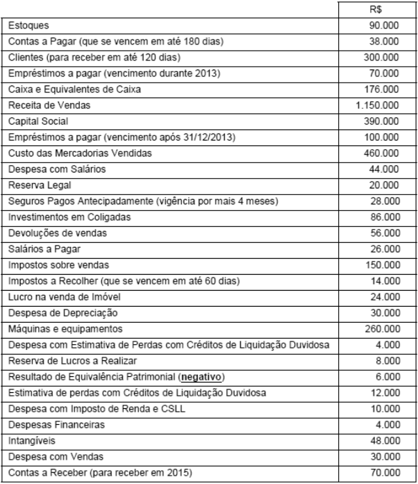{largura=48%}

O Resultado Bruto com Mercadorias apurado pela Empresa Comunicativa S.A., em 2012, foi, em R$,

- A) 484.000.
- B) 690.000.
- C) 634.000.
- D) 540.000.
- E) 454.000.
- Gabarito: A
- Resolução: a caminho

## F0317 · FCC · 2014 · METRO SP · ME
- Fontes: TecConcursos 317 (271319)
- Prova: FCC - ADG Jr (METRO SP)/METRO SP/Administração de Empresas/2014
- Grupos: receita-bruta

Em 01/10/2012 uma empresa recebeu R$ 24.000,00 de um cliente para a entrega de mercadorias até 30/09/2013. A empresa entregou, até 31/12/2012, mercadorias que correspondiam a 40% do total negociado. O valor da Receita de Vendas apresentado na Demonstração do Resultado do ano de 2012 correspondente a esta operação foi, em reais,

- A) 9.600,00.
- B) 6.000,00.
- C) 0,00.
- D) 24.000,00.
- E) 12.000,00.
- Gabarito: A
- Resolução: a caminho

## F0318 · FCC · 2014 · METRO SP · ME
- Fontes: TecConcursos 318 (271322)
- Prova: FCC - ADG Jr (METRO SP)/METRO SP/Administração de Empresas/2014
- Grupos: resultado-bruto, cmv, ir-csll, lucro-liquido, receita-bruta, despesas-administrativas, despesas-vendas

O Balancete de Verificação de uma empresa, em 31/12/2013, apresentava o saldo das seguintes contas:

Nome da conta Saldo em R$ Nome da conta Saldo em R$ Veículos 1.000,00 Receitas de Vendas 2.500,00 Fornecedores 300,00 Caixa e Equivalentes de Caixa 100,00 Depreciação Acumulada 400,00 Despesas Comerciais 200,00 Máquinas e Equipamentos 2.000,00 Despesas Administrativas 500,00 Receitas Antecipadas 100,00 Despesa com Imposto de Renda 100,00 Capital 3.000,00 Custo das Mercadorias Vendidas 1.500,00 Impostos a Pagar 100,00 Despesas Antecipadas 800,00 Reservas de Lucros 300,00 Estoques 500,00 Os valores correspondentes ao Lucro Bruto e Lucro Líquido apresentados na Demonstração do Resultado do ano de 2013 são, respectivamente,

- A) R$ 300,00 (positivo) e R$ 200,00 (positivo).
- B) R$ 1.000,00 (positivo) e R$ 600,00 (negativo).
- C) R$ 1.000,00 (positivo) e R$ 300,00 (positivo).
- D) R$ 400,00 (positivo) e R$ 500,00 (negativo).
- E) R$ 1.000,00 (positivo) e R$ 200,00 (positivo).
- Gabarito: E
- Resolução: a caminho

## F0319 · FCC · 2014 · METRO SP · ME
- Fontes: TecConcursos 319 (271556)
- Prova: FCC - ADG Jr (METRO SP)/METRO SP/Economia/2014
- Grupos: resultado-bruto, cmv, ir-csll, lucro-liquido, receita-bruta, despesas-administrativas, despesas-vendas

O Balancete de Verificação de uma empresa, em 31/12/2013, apresentava o saldo das seguintes contas:

Nome da conta Saldo em R$ Nome da conta Saldo em R$ Veículos 3.000,00 Receitas de Vendas 7.500,00 Fornecedores 900,00 Caixa e Equivalentes de Caixa 300,00 Depreciação Acumulada 1.200,00 Despesas Comerciais 600,00 Máquinas e Equipamentos 6.000,00 Despesas Administrativas 1.500,00 Receitas Antecipadas 300,00 Despesa com Imposto de Renda 300,00 Capital 9.000,00 Custo das Mercadorias Vendidas 4.500,00 Impostos a Pagar 300,00 Despesas Antecipadas 2.400,00 Reservas de Lucros 9.000,00 Estoques 1.500,00 Os valores correspondentes ao Lucro Bruto e ao Lucro Líquido apresentados na Demonstração do Resultado do ano de 2013 são, respectivamente,

- A) R$ 900,00 (positivo) e R$ 600,00 (positivo).
- B) R$ 3.000,00 (positivo) e R$ 1.800,00 (negativo).
- C) R$ 3.000,00 (positivo) e R$ 900,00 (positivo).
- D) R$ 3.000,00 (positivo) e R$ 600,00 (positivo).
- E) R$ 1.200,00 (positivo) e R$ 1.500,00 (negativo).
- Gabarito: D
- Resolução: a caminho

## F0320 · FCC · 2014 · METRO SP · ME
- Fontes: TecConcursos 320 (271557)
- Prova: FCC - ADG Jr (METRO SP)/METRO SP/Economia/2014
- Grupos: receita-bruta

Em 01/08/2012 uma empresa recebeu R$ 24.000,00 de um cliente para a entrega de mercadorias até 31/07/2013. A empresa entregou, até 31/12/2012, mercadorias que correspondiam a 70% do total negociado. O valor da Receita de Vendas apresentado na Demonstração do Resultado do ano de 2012 correspondente a esta operação foi, em reais, de

- A) 24.000,00.
- B) 16.800,00.
- C) zero.
- D) 10.000,00.
- E) 12.000,00.
- Gabarito: B
- Resolução: a caminho

## F0321 · FGV · 2014 · Pref Osasco · ME
- Fontes: TecConcursos 321 (283246)
- Prova: FGV - Fisc Trib (Pref Osasco)/Pref Osasco/2014
- Grupos: despesas-vendas

A empresa Capa Bacana investiu $ 1.000 em propaganda e publicidade em uma campanha para mudar a sua marca. O contador deve classificar esse desembolso como:

- A) intangível;
- B) investimentos;
- C) despesas pagas antecipadamente;
- D) ativo diferido;
- E) despesas operacionais.
- Gabarito: E
- Resolução: a caminho

## F0322 · FGV · 2014 · Pref Osasco · ME
- Fontes: TecConcursos 322 (283248)
- Prova: FGV - Fisc Trib (Pref Osasco)/Pref Osasco/2014
- Grupos: resultado-bruto, receita-liquida, resultado-financeiro, lair, ir-csll, deducoes, receita-bruta, despesas-administrativas, despesas-vendas, despesas-operacionais, outras-operacionais, outras-receitas-despesas

O contador da empresa Semdinheiro pediu para o estagiário levantar o “resultado antes dos tributos sobre o lucro” para que ele pudesse calcular o imposto de renda e a contribuição social.

Observe os saldos a seguir.

Conta Saldo

| Conta | Valor |
|---|---:|
| Despesas administrativas | - 20.000,00 |
| Despesas comerciais | - 25.000,00 |
| Devoluções de vendas | - 30.000,00 |

Impostos de renda e contribuição social - 18.000,00

| Conta | Valor |
|---|---:|
| Impostos sobre venda | - 20.000,00 |
| Lucro bruto | 80.000,00 |
| Outras despesas operacionais | - 5.000,00 |
| Receita Líquida de Vendas | 300.000,00 |
| Resultado financeiro | 30.000,00 |

o saldo correto pedido pelo contador da empresa é:

- A) $ 60.000,00
- B) $ 45.000,00
- C) $ 42.000,00
- D) $ 10.000,00
- E) $ - 8.000,00
- Gabarito: A
- Resolução: a caminho

## F0323 · CEBRASPE · 2014 · TJ SE · CE
- Fontes: TecConcursos 323 (319438) · Possati 26
- Prova: CEBRASPE (CESPE) - AJ (TJ SE)/TJ SE/Contabilidade/2014
- Grupos: receita-bruta, deducoes, receita-liquida, cmv, resultado-bruto

Consoante o disposto na legislação societária, os princípios de contabilidade e os pronunciamentos técnicos do CPC, julgue o item, relativo à elaboração de demonstrações contábeis.

Considerando-se os dados apresentados na tabela abaixo, relativos a uma empresa comercial, é correto afirmar que a demonstração do resultado do período apresentará lucro bruto superior a R$ 300.000,00.

dados valores (em R$)

| Conta | Valor |
|---|---:|
| abatimentos de vendas | 5.500 |
| compras a prazo | 100.000 |
| compras à vista | 20.000 |
| despesas financeiras | 9.500 |
| despesas operacionais | 73.000 |
| devolução de compras | 14.000 |
| devolução de vendas | 10.800 |
| estoque final | 6.500 |
| estoque inicial | 32.000 |
| faturamento | 543.200 |
| ICMS sobre vendas | 43.400 |
| IPI no faturamento | 27.000 |

- Gabarito: CERTO
### O que a questão pede
Julgar se o **lucro bruto** passa de 300.000. É preciso partir do faturamento e montar o CMV pelo inventário.

### Cálculos prévios
**1) Faturamento × receita bruta:** o IPI está dentro do faturamento, mas não é receita.
Receita bruta = 543.200 − 27.000 = **516.200**.

**2) CMV pelo inventário:** CMV = EI + compras líquidas − EF.
- Compras = à vista 20.000 + a prazo 100.000 = 120.000. A forma de pagamento não importa.
- Compras líquidas = 120.000 − devolução de compras 14.000 = **106.000**.
- CMV = 32.000 + 106.000 − 6.500 = **131.500**.

### Passo a passo
```dre
@ Faturamento | 543.200 | receita-bruta
@ IPI no faturamento | 27.000 | receita-bruta
@ Devolução de vendas | 10.800 | deducoes
@ ICMS sobre vendas | 43.400 | deducoes
@ Abatimentos de vendas | 5.500 | deducoes
@ Estoque inicial | 32.000 | calculo-cmv
@ Compras à vista | 20.000 | calculo-cmv
@ Compras a prazo | 100.000 | calculo-cmv
@ Devolução de compras | 14.000 | calculo-cmv
@ Estoque final | 6.500 | calculo-cmv
@ Despesas operacionais | 73.000 | ignora
@ Despesas financeiras | 9.500 | ignora
> Tire o IPI do faturamento: ele é "por fora" e não é receita (nem dedução).
+ Faturamento bruto | 543.200 | Faturamento
+ (–) IPI faturado | (27.000) | IPI no faturamento
= Receita bruta | 516.200
> Deduções: devolução de vendas, ICMS sobre vendas e abatimentos.
+ (–) Devoluções de vendas | (10.800) | Devolução de vendas
+ (–) ICMS sobre vendas | (43.400) | ICMS sobre vendas
+ (–) Abatimentos | (5.500) | Abatimentos de vendas
= Receita líquida | 456.500
> CMV = EI 32.000 + compras líquidas (20.000 + 100.000 − 14.000) − EF 6.500 = 131.500.
+ (–) CMV | (131.500) | Estoque inicial; Compras à vista; Compras a prazo; Devolução de compras; Estoque final
= Lucro bruto | 325.000
> 325.000 > 300.000: item CERTO. As despesas operacionais e financeiras ficam abaixo do lucro bruto.
! Despesas operacionais; Despesas financeiras
```

### O que ignorar e por quê
**Despesas operacionais (73.000) e financeiras (9.500):** vêm depois do lucro bruto, e a pergunta para no lucro bruto.

### O que mais poderia estar ali
- **Compras líquidas (somam):** fretes e seguros sobre compras, tributos não recuperáveis.
- **Compras líquidas (subtraem):** abatimentos sobre compras, descontos comerciais obtidos, ICMS recuperável.
- **Deduções:** PIS e Cofins sobre faturamento, descontos incondicionais, vendas canceladas.

### Pegadinhas
- Tirar o IPI como "dedução" depois da receita bruta: o número final até coincide, mas conceitualmente ele nem entra na receita bruta.
- Confundir **devolução de compras** (reduz o CMV) com **devolução de vendas** (reduz a receita).
- Esquecer as compras à vista ou as a prazo: as duas são compras.

### Leve para as próximas
1. Faturamento − IPI = receita bruta.
2. CMV = EI + (compras + fretes − devoluções − abatimentos − tributos recuperáveis) − EF.
3. Fonte: resolução do professor Gilmar Possati, reescrita e ampliada.

## F0324 · FGV · 2014 · COMPESA · ME
- Fontes: TecConcursos 324 (327454)
- Prova: FGV - Ass SG (COMPESA)/COMPESA/Técnico de Contabilidade/2014
- Grupos: receita-liquida, deducoes, receita-bruta, despesas-vendas, resultado-financeiro

Uma empresa apresentou os seguintes saldos em 31/12/2013:

| Conta | Valor |
|---|---:|
| Vendas brutas: | R$ 40.000,00; |
| Comissão de vendas: | R$ 4.000,00; |
| Devolução de vendas: | R$ 3.000,00; |
| Impostos sobre operações financeiras: | R$ 6.000,00; |
| Imposto predial da fábrica: | R$ 10.000,00; |
| Devolução de compras: | R$ 8.000,00; |
| IPI nas compras: | R$ 5.000,00; |
| ICMS sobre vendas: | R$ 7.200,00. |

Considerando que a empresa é contribuinte dos impostos estaduais e municipais, mas não é contribuinte do IPI, o valor da Receita Líquida apurada, em 31/12/2013, é de

- A) R$ 32.800,00.
- B) R$ 29.800,00.
- C) R$ 25.800,00.
- D) R$ 24.800,00.
- E) R$ 19.800,00.
- Gabarito: B
- Resolução: a caminho

## F0325 · FGV · 2014 · COMPESA · ME
- Fontes: TecConcursos 325 (327455)
- Prova: FGV - Ass SG (COMPESA)/COMPESA/Técnico de Contabilidade/2014
- Grupos: resultado-bruto, deducoes, receita-bruta, despesas-administrativas

Uma empresa efetuou as seguintes operações no mês de setembro de 2013:

| Conta | Valor |
|---|---:|
| Vendas brutas: | R$ 200.000,00; |
| Devolução de vendas: | R$ 20.000,00; |
| Abatimento sobre compras: | R$ 10.000,00; |
| Despesa com o aluguel da loja: | R$ 50.000,00. |

Na ocasião, a empresa apurou o custo de R$ 80.000,00 com mercadorias vendidas.

Considerando que a empresa utiliza inventário permanente, o lucro bruto nas vendas, em setembro de 2013, foi

- A) R$ 120.000,00.
- B) R$ 100.000,00.
- C) R$ 90.000,00.
- D) R$ 50.000,00.
- E) R$ 40.000,00.
- Gabarito: B
- Resolução: a caminho

## F0326 · FGV · 2014 · COMPESA · ME
- Fontes: TecConcursos 326 (327470)
- Prova: FGV - Ass SG (COMPESA)/COMPESA/Técnico de Contabilidade/2014
- Grupos: cmv, resultado-financeiro, lair, ir-csll, lucro-liquido, equivalencia, fora-destinacao, receita-bruta, despesas-administrativas

Em 31/12/2013, uma empresa apresentou os seguintes saldos:

| Conta | Valor |
|---|---:|
| Compra de ativo imobilizado: | R$ 60.000,00 |
| Receita de Vendas: | R$ 500.000,00 |
| Custo das mercadorias vendidas: | R$ 270.000,00 |
| Despesas Financeiras: | R$ 100.000,00 |
| Despesas Administrativas: | R$ 80.000,00 |
| Dividendos: | R$ 30.000,00 |
| Reserva de Contingências: | R$ 70.000,00 |
| Receitas Financeiras: | R$ 60.000,00 |

Reversão para Créditos de Liquidação Duvidosa:

R$ 4.000,00 Parcela dos resultados de empresas investidas reconhecidas por meio do método de equivalência patrimonial:

R$ 120.000,00 Com base apenas nas informações acima, o lucro líquido, antes do imposto de renda e contribuição social na Demonstração do Resultado do Exercício de 31/12/2013, era de

- A) R$ 114.000,00.
- B) R$ 204.000,00.
- C) R$ 226.000,00.
- D) R$ 234.000,00.
- E) R$ 314.000,00.
- Gabarito: D
- Resolução: a caminho

## F0327 · CEBRASPE · 2014 · MEC · CE
- Fontes: TecConcursos 327 (1295739) · Possati 29
- Prova: CEBRASPE (CESPE) - ATCInt (MEC)/MEC/Analista Contábil/2014
- Grupos: resultado-bruto, resultado-financeiro, lucro-liquido, receita-bruta

Julgue o item, relativo às demonstrações contábeis previstas na legislação em vigor.

Lucro bruto é a diferença entre a receita de vendas líquida e o custo dos produtos e mercadorias vendidos e(ou) dos serviços prestados. Lucro líquido operacional é o valor do lucro antes de computados os resultados não operacionais e as despesas financeiras.

- Gabarito: ERRADO
- Resolução: a caminho

## F0328 · CEBRASPE · 2014 · MEC · CE
- Fontes: TecConcursos 328 (1298077)
- Prova: CEBRASPE (CESPE) - ATCInt (MEC)/MEC/Analista Processual/"Sem Especialidade"/2014
- Grupos: cmv, resultado-financeiro, participacoes, equivalencia, fora-destinacao, receita-bruta, despesas-administrativas, deducoes, despesas-vendas, lucro-liquido

contas contábeis valores (em R$)

| Conta | Valor |
|---|---:|
| prejuízo do exercício | 500 |
| seguros a apropriar | 200 |
| títulos a pagar | 300 |
| capital social | 1.000 |
| reserva de capital | 100 |
| participações em empresas controladas | 200 |
| terrenos | 200 |
| veículos | 200 |
| bancos | 100 |
| fundo de comércio adquirido | 200 |
| amortização do intangível | 100 |
| fornecedores | 400 |
| clientes | 200 |

ajuste de avaliação patrimonial (saldo credor) 200

| Conta | Valor |
|---|---:|
| ações em tesouraria | 1.000 |
| empréstimos a coligadas | 100 |
| depreciação acumulada | 100 |
| receita de vendas | 9.000 |
| despesas de salários | 1.000 |
| despesas administrativas | 600 |
| despesas financeiras diversas | 500 |
| impostos incidentes sobre vendas | 500 |
| custo das mercadorias vendidas | 6.000 |
| aplicações financeiras em conta poupança | 100 |
| estoque de mercadorias para revenda | 200 |
| estoque de material de consumo | 100 |
| impostos a recolher | 400 |
| prejuízos acumulados | 500 |
| reserva legal | 200 |
| despesas de vendas | 1.000 |
| comissões de vendas a pagar | 300 |
| salários a pagar | 400 |
| dividendos a pagar | 300 |

resultado positivo da equivalência patrimonial 100 Com base na tabela acima, que mostra a situação contábil da Cia. ABC Ltda. após a apuração e antes da distribuição do resultado do exercício findo em 31/12/2013, julgue o próximo item.

A Cia. ABC Ltda. não poderá compensar os prejuízos acumulados com o resultado do exercício.

- Gabarito: CERTO
- Resolução: a caminho

## F0329 · CEBRASPE · 2014 · MEC · CE
- Fontes: TecConcursos 329 (1298090)
- Prova: CEBRASPE (CESPE) - ATCInt (MEC)/MEC/Analista Processual/"Sem Especialidade"/2014
- Grupos: cmv, resultado-financeiro, participacoes, ir-csll, equivalencia, fora-destinacao, receita-bruta, despesas-administrativas, deducoes, despesas-vendas, lucro-liquido

contas contábeis valores (em R$)

| Conta | Valor |
|---|---:|
| prejuízo do exercício | 500 |
| seguros a apropriar | 200 |
| títulos a pagar | 300 |
| capital social | 1.000 |
| reserva de capital | 100 |
| participações em empresas controladas | 200 |
| terrenos | 200 |
| veículos | 200 |
| bancos | 100 |
| fundo de comércio adquirido | 200 |
| amortização do intangível | 100 |
| fornecedores | 400 |
| clientes | 200 |

ajuste de avaliação patrimonial (saldo credor) 200

| Conta | Valor |
|---|---:|
| ações em tesouraria | 1.000 |
| empréstimos a coligadas | 100 |
| depreciação acumulada | 100 |
| receita de vendas | 9.000 |
| despesas de salários | 1.000 |
| despesas administrativas | 600 |
| despesas financeiras diversas | 500 |
| impostos incidentes sobre vendas | 500 |
| custo das mercadorias vendidas | 6.000 |
| aplicações financeiras em conta poupança | 100 |
| estoque de mercadorias para revenda | 200 |
| estoque de material de consumo | 100 |
| impostos a recolher | 400 |
| prejuízos acumulados | 500 |
| reserva legal | 200 |
| despesas de vendas | 1.000 |
| comissões de vendas a pagar | 300 |
| salários a pagar | 400 |
| dividendos a pagar | 300 |

resultado positivo da equivalência patrimonial 100 Com base na tabela acima, que mostra a situação contábil da Cia. ABC Ltda. após a apuração e antes da distribuição do resultado do exercício findo em 31/12/2013, julgue o próximo item.

O balancete de verificação elaborado com base na demonstração do resultado do exercício apresentará resultado igual a zero antes da tributação do imposto de renda e da contribuição social sobre o lucro.

- Gabarito: ERRADO
- Resolução: a caminho

## F0330 · CEBRASPE · 2014 · MEC · CE
- Fontes: TecConcursos 330 (1298109)
- Prova: CEBRASPE (CESPE) - ATCInt (MEC)/MEC/Analista Processual/"Sem Especialidade"/2014
- Grupos: resultado-bruto, receita-liquida, cmv, resultado-operacional, deducoes, receita-bruta, lucro-liquido

No que se refere às demonstrações contábeis e a seus componentes, julgue o item que se segue.

Para a apuração do lucro operacional bruto, na demonstração do resultado do exercício, as deduções de impostos incidentes sobre vendas, como o ICMS e a COFINS, bem como o custo das mercadorias vendidas são considerados após a receita líquida de vendas.

- Gabarito: ERRADO
- Resolução: a caminho

## F0331 · FGV · 2014 · SEDUC AM · ME
- Fontes: TecConcursos 331 (1319688)
- Prova: FGV - PNS (SEDUC AM)/SEDUC AM/Contador/2014
- Grupos: cmv, resultado-financeiro, lair, lucro-liquido, fora-destinacao, receita-bruta, despesas-administrativas, despesas-vendas, ir-csll

Determinada entidade apresentou os seguintes saldos referentes ao ano de 2013.

| Conta | Valor |
|---|---:|
| Despesas Financeiras: | R$ 60.000,00 |
| Receitas Financeiras: | R$ 100.000,00 |
| Receita de Vendas: | R$ 420.000,00 |
| Compra de Ativo Imobilizado: | R$ 100.000,00 |
| Custo das Mercadorias Vendidas: | R$ 210.000,00 |
| Dividendos: | R$ 30.000,00 |
| Reserva de Contingências: | R$ 40.000,00 |

Reversão da Provisão para Créditos de

| Conta | Valor |
|---|---:|
| Liquidação Duvidosa: | R$ 12.000,00 |
| Despesa de depreciação: | R$ 55.000,00 |
| Despesa de salários: | R$ 60.000,00 |

Despesa com redução do valor recuperável de ativos:

R$ 36.000,00 O lucro líquido, antes do imposto sobre a renda e da contribuição social, apresentado por essa entidade, em 31/12/2013, foi de

- A) R$ 11.000,00.
- B) R$ 71.000,00.
- C) R$ 81.000,00.
- D) R$ 87.000,00.
- E) R$ 111.000,00.
- Gabarito: E
- Resolução: a caminho

## F0332 · FGV · 2014 · SUSAM · ME
- Fontes: TecConcursos 332 (1690435)
- Prova: FGV - Cont (SUSAM)/SUSAM/2014
- Grupos: lair, ir-csll

A Cia. A apresentou os seguintes saldos em relação ao ano de 2013:

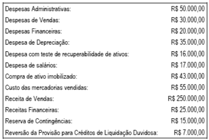{largura=35%}

Considerando apenas as informações acima, o resultado antes dos tributos sobre o lucro da Cia. A em 2013 foi de

- A) R$ 16.000,00.
- B) R$ 44.000,00.
- C) R$ 45.000,00.
- D) R$ 52.000,00.
- E) R$ 59.000,00.
- Gabarito: E
- Resolução: a caminho

## F0333 · FGV · 2014 · SUSAM · ME
- Fontes: TecConcursos 333 (1690436)
- Prova: FGV - Cont (SUSAM)/SUSAM/2014
- Grupos: lucro-liquido

Conforme a opção do Pronunciamento CPC 26‐ Apresentação das Demonstrações Contábeis, a Cia B irá apresentar sua Demonstração do Resultado do Exercício pelo método da natureza da despesa.

Assinale a opção que inclui apenas gastos por natureza é

- A) despesa de transporte, despesa de depreciação e despesas operacionais.
- B) materiais consumidos, despesas comerciais e despesa com benefícios para os empregados.
- C) despesa de depreciação, materiais consumidos e despesas de propaganda.
- D) custo dos produtos vendidos, despesas administrativas e despesas de transporte.
- E) materiais consumidos, custos dos produtos vendidos e imposto de renda e contribuição social.
- Gabarito: C
- Resolução: a caminho

## F0334 · FCC · 2014 · TJ AP · ME
- Fontes: TecConcursos 334 (2635927)
- Prova: FCC - AJ (TJ AP)/TJ AP/Apoio Especializado/Contabilidade/2014
- Grupos: 

A Empresa Concentrada S.A. adquiriu em 25/04/2012 um lote de mercadorias para revenda pelo valor de R$ 500.000,00, efetuando o pagamento à vista. Por condições negociais, ficou definido que a compradora (Empresa Concentrada S.A.) ficaria responsável pela retirada das mercadorias no depósito do fornecedor e, para transportar estas mercadorias até o seu depósito, foram pagos R$ 10.000,00 de frete. A empresa compradora pagou, também, o valor de R$ 5.000,00 por um seguro contra roubo das mercadorias durante o transporte do depósito do fornecedor até o seu depósito.

A Empresa Concentrada S.A. vendeu em 25/05/2012 todo lote de mercadorias que havia comprado pelo valor de R$ 700.000,00 à vista. Suponha que não há incidência de qualquer imposto na compra e na venda das mercadorias.

A Empresa Concentrada S.A. apresentou na Demonstração do Resultado de 2012, em relação exclusivamente à compra e à venda das mercadorias, os seguintes efeitos:

- A) Resultado Bruto com Vendas = R$ 200.000,00; Despesa com frete = R$ 10.000,00; Despesa com Seguro = R$ 5.000,00.
- B) Resultado Bruto com Vendas = R$ 190.000,00; Despesa com Seguro = R$ 5.000,00.
- C) Resultado Bruto com Vendas = R$ 195.000,00; Despesa com Frete = R$ 10.000,00.
- D) Resultado Bruto com Vendas = R$ 185.000,00.
- E) Resultado Bruto com Vendas = R$ 200.000,00; Despesa com vendas = R$ 15.000,00.
- Gabarito: D
- Resolução: a caminho

## F0335 · CEBRASPE · 2014 · FUB · CE
- Fontes: TecConcursos 335 (3949424)
- Prova: CEBRASPE (CESPE) - Tec (FUB)/FUB/Contabilidade/2014
- Grupos: equivalencia, lucro-liquido

De acordo com os pronunciamentos técnicos do CPC, julgue o item seguinte, relativo à apresentação das demonstrações contábeis.

Os resultados de equivalência patrimonial, caso existam, devem ser apresentados na demonstração do resultado do exercício de forma destacada.

- Gabarito: CERTO
- Resolução: a caminho

## F0336 · CEBRASPE · 2014 · FUB · CE
- Fontes: TecConcursos 336 (3949427) · Possati 57
- Prova: CEBRASPE (CESPE) - Tec (FUB)/FUB/Contabilidade/2014
- Grupos: receita-liquida, deducoes, receita-bruta, lucro-liquido

De acordo com os pronunciamentos técnicos do CPC, julgue o item seguinte, relativo à apresentação das demonstrações contábeis.

A demonstração do resultado do exercício (DRE) inicia-se pela receita líquida de vendas e não apresenta a receita bruta e as deduções da receita.

- Gabarito: CERTO
- Resolução: a caminho

## F0337 · CEBRASPE · 2014 · FUB · CE
- Fontes: TecConcursos 337 (3949429) · Possati 9
- Prova: CEBRASPE (CESPE) - Tec (FUB)/FUB/Contabilidade/2014
- Grupos: estrutura

Com base nas disposições da Lei n.º 6.404/1976 e suas alterações, julgue o próximo item, relativo à DRE.

O objetivo da DRE é evidenciar o desempenho da entidade. Essa demonstração é uma representação estruturada do total das receitas deduzidas as despesas e também abrange os ganhos e as perdas do período

- Gabarito: CERTO
- Resolução: a caminho

## F0338 · CEBRASPE · 2014 · FUB · CE
- Fontes: TecConcursos 338 (3949431) · Possati 50
- Prova: CEBRASPE (CESPE) - Tec (FUB)/FUB/Contabilidade/2014
- Grupos: participacoes, lucro-liquido

Com base nas disposições da Lei n.º 6.404/1976 e suas alterações, julgue o próximo item, relativo à DRE.

Se uma entidade distribuir lucros aos empregados e administradores, antes de apurar o lucro líquido do exercício, será necessário deduzir as participações de empregados e administradores, sucessivamente e nessa ordem.

- Gabarito: CERTO
- Resolução: a caminho

## F0339 · CEBRASPE · 2013 · TRE MS · ME
- Fontes: TecConcursos 339 (96023)
- Prova: CEBRASPE (CESPE) - TJ TRE MS/TRE MS/Administrativa/Contabilidade/2013
- Grupos: receita-liquida, ir-csll, lucro-liquido, deducoes, receita-bruta, despesas-operacionais, outras-receitas-despesas

R$

| Conta | Valor |
|---|---:|
| despesa não operacional | 500,00 |
| devolução de vendas | 1.000,00 |
| devolução de compras | 2.000,00 |
| estoque inicial | 5.000,00 |

lucro líquido antes IR e CSLL 10.000,00

| Conta | Valor |
|---|---:|
| despesas operacionais | 28.000,00 |
| compras do período | 32.000,00 |
| receita líquida | 70.500,00 |

De acordo com dados da tabela acima, levantados para a elaboração de uma demonstração de resultado de determinada empresa, o valor do

- A) lucro bruto é de R$ 49.500,00.
- B) estoque final é de R$ 3.000,00.
- C) estoque final é de R$ 5.000,00.
- D) custo da mercadoria vendida é de R$ 35.000,00.
- E) custo da mercadoria vendida é de R$ 37.000,00.
- Gabarito: B
- Resolução: a caminho

## F0340 · CEBRASPE · 2013 · TRE MS · ME
- Fontes: TecConcursos 340 (96025)
- Prova: CEBRASPE (CESPE) - TJ TRE MS/TRE MS/Administrativa/Contabilidade/2013
- Grupos: 

No mês de dezembro de 2012, em uma empresa hipotética, ocorreram os fatos descritos a seguir. despesa de janeiro de 2013, paga em dezembro de 2012 = R$ 1.000,00; despesa de dezembro de 2012, a ser paga em janeiro de 2013 = R$ 2.000,00; despesa de dezembro de 2012, paga em novembro de 2012 = R$ 4.000,00; receita de janeiro de 2013, recebida em dezembro de 2012 = R$ 5.000,00; receita de dezembro de 2012, a ser recebida em janeiro de 2013 = R$ 6.000,00; receita de dezembro de 2012, recebida em dezembro de 2012 = R$ 8.000,00.

De acordo com os princípios de contabilidade, na situação hipotética acima descrita, o resultado da empresa em dezembro de 2012 foi igual a

- A) R$ 12.000,00.
- B) R$ 14.000,00.
- C) R$ 6.000,00.
- D) R$ 8.000,00.
- E) R$ 10.000,00.
- Gabarito: D
- Resolução: a caminho

## F0341 · FCC · 2013 · SEFAZ SP · ME
- Fontes: TecConcursos 341 (97282)
- Prova: FCC - AFRE (SEFAZ SP)/SEFAZ SP/Tecnologia da Informação/2013
- Grupos: resultado-bruto, cmv, deducoes, receita-bruta, despesas-administrativas, despesas-vendas, lucro-liquido

A Cia. Comércio & Comércio apresentava em 31/12/2012, em seu Balancete, antes da apuração do resultado do exercício, as seguintes contas de resultado: Receita Bruta R$ 85.000,00; Impostos sobre Vendas R$ 15.000,00; Devolução de Vendas R$ 6.000,00; Estimativa de Perdas com Créditos de Liquidação Duvidosa R$ 3.000,00; Depreciação dos Veículos usados na entrega das Vendas R$ 10.000,00; Abatimentos sobre Vendas R$ 2.000,00; Fretes sobre Vendas R$ 4.000,00; Custo das Mercadorias Vendidas R$ 28.000,00; Comissões dos Vendedores R$ 7.000,00. Com base nessas informações, o Lucro Bruto do exercício de 2012 apurado pela Cia. Comércio & Comércio foi

- A) R$ 42.000,00.
- B) R$ 36.000,00.
- C) R$ 27.000,00.
- D) R$ 34.000,00.
- E) R$ 24.000,00.
- Gabarito: D
- Resolução: a caminho

## F0342 · FCC · 2013 · SEFAZ SP · ME
- Fontes: TecConcursos 342 (97356)
- Prova: FCC - AFRE (SEFAZ SP)/SEFAZ SP/Gestão Tributária/2013
- Grupos: resultado-bruto, cmv, resultado-financeiro, receita-bruta, deducoes

A Empresa Comercial Jacob & Frères vendeu mercadorias a prazo por R$ 200 milhões, sendo que o valor da venda à vista das mercadorias seria de R$ 175 milhões (valor justo). O custo das mercadorias vendidas foi R$ 130 milhões. Nesta operação, há, apenas, a incidência de 18% de ICMS sobre as vendas. Considerando que o financiamento das vendas a prazo não é prática usual da empresa e que a mesma utiliza ICMS com segregação entre a parcela sobre venda e a parcela sobre receita financeira, o valor do lucro bruto na operação foi, em milhões de reais,

- A) 9,00.
- B) 13,50.
- C) 32,40.
- D) 34,00.
- E) 38,50.
- Gabarito: B
- Resolução: a caminho

## F0343 · FCC · 2013 · TCE SP · ME
- Fontes: TecConcursos 343 (105518)
- Prova: FCC - Cons Sub Aud (TCE SP)/TCE SP/2013
- Grupos: receita-bruta, lucro-liquido

Uma empresa adquiriu, em 31/12/2010, um equipamento por R$ 220.000,00, à vista. A vida útil econômica estimada deste equipamento na  data de aquisição foi de 8 anos e o valor residual de R$ 20.000,00. Em 31/12/2011, após um ano de uso, a empresa vendeu este equipamento, à vista, por um preço líquido de vendas de R$ 200.000,00. Com base nestas informações, o resultado obtido com a venda deste equipamento,  apresentado na Demonstração do Resultado do Exercício, foi, em reais,

- A) 0 (zero).
- B) 25.000, evidenciado em Outras Receitas Operacionais.
- C) 20.000, evidenciado em Outras Despesas Operacionais.
- D) 7.500, evidenciado em Outras Receitas com Vendas.
- E) 5.000, evidenciado em Outras Receitas Operacionais.
- Gabarito: E
- Resolução: a caminho

## F0344 · FCC · 2013 · DPE SP · ME
- Fontes: TecConcursos 344 (126868)
- Prova: FCC - AgDP (DPE SP)/DPE SP/Contador/2013
- Grupos: lair, ir-csll, lucro-liquido, fora-destinacao

Em 31/12/X1, a empresa WMG, sociedade anônima de capital aberto, faltava analisar e realizar os registros contábeis, quando necessários, dos seguintes itens: − Pagamento a fornecedores no valor de R$ 20.000,00. − A empresa possuía aplicações financeiras, em 01/12/X1, no valor de R$ 50.000,00 com taxa de juros contratuais de 2% ao mês. No final de dezembro, o valor justo destas aplicações financeiras era de R$ 51.500,00 e a empresa as classificava como mantidas até o vencimento. Nenhuma alteração havia sido reconhecida no valor das aplicações financeiras no mês de dezembro. − Em 31/12/X1, houve a emissão de debêntures no valor de R$ 100.000,00 com prêmio de R$ 2.000,00. Os custos de transação na emissão de debêntures foram R$ 1.500,00. − Em 31/12/X1, a empresa realizou o teste de impairment de um ativo intangível com vida útil indefinida, cujo valor contábil era R$ 30.000,00 e o valor recuperável era R$ 31.000,00. − A empresa recebeu dividendos de uma empresa controlada no montante de R$ 1.200,00 em 31/12/X1. − A empresa recebeu R$ 25.000,00 de seus clientes em 31/12/X1.

Após o registro destes eventos, é correto afirmar que houve um aumento no Lucro Antes do Imposto de Renda e da Contribuição Social sobre o Lucro Líquido, em reais, de

- A) 1.000.
- B) 2.200.
- C) 2.700.
- D) 3.200.
- E) 7.700.
- Gabarito: A
- Resolução: a caminho

## F0345 · CEBRASPE · 2013 · TCU · CE
- Fontes: TecConcursos 345 (134043) · Possati 33
- Prova: CEBRASPE (CESPE) - AUFC (TCU)/TCU/Controle Externo/Auditoria Governamental/2013
- Grupos: resultado-bruto, cmv, deducoes, receita-bruta, despesas-vendas

Em relação à apuração de resultados, controle de estoque e custo das vendas, julgue o próximo item.

Determinada empresa comercial levantou, ao final do mês, os saldos contábeis apresentados a seguir, cujos valores estão em reais. Nesse caso, o custo da mercadoria vendida no mês é superior a R$ 4.300 e o lucro bruto é inferior a R$ 3.000.

| Conta | Valor |
|---|---:|
| abatimento sobre compras | 100 |
| compras de mercadorias | 5.000 |
| devolução de compras | 300 |
| devolução de vendas | 400 |
| estoque saldo final do mês | 1.000 |
| estoque saldo início do mês | 1.000 |
| frete sobre vendas | 200 |
| ICMS a recolher | 2.000 |
| ICMS a recuperar | 850 |
| ICMS sobre vendas | 1.500 |
| vendas de mercadorias | 9.200 |

- Gabarito: CERTO
### O que a questão pede
Duas afirmações, e as duas precisam estar certas:
1. **CMV > 4.300**;
2. **lucro bruto < 3.000**.

O CMV sai pela fórmula do inventário periódico.

### Cálculos prévios
**1) Compras líquidas:** compras − devoluções de compras − abatimentos sobre compras = 5.000 − 300 − 100 = **4.600**.

**2) CMV = EI + compras líquidas − EF** = 1.000 + 4.600 − 1.000 = **4.600** (> 4.300 ✔).

**3) Receita líquida:** vendas 9.200 − devoluções de vendas 400 − ICMS sobre vendas 1.500 = **7.300**.

**4) Lucro bruto:** 7.300 − 4.600 = **2.700** (< 3.000 ✔).

### Passo a passo
```dre
@ estoque saldo início do mês | 1.000 | calculo-cmv
@ compras de mercadorias | 5.000 | calculo-cmv
@ devolução de compras | 300 | calculo-cmv
@ abatimento sobre compras | 100 | calculo-cmv
@ estoque saldo final do mês | 1.000 | calculo-cmv
@ vendas de mercadorias | 9.200 | receita-bruta
@ devolução de vendas | 400 | deducoes
@ ICMS sobre vendas | 1.500 | deducoes
@ frete sobre vendas | 200 | despesas-vendas
@ ICMS a recolher | 2.000 | fora-passivo
@ ICMS a recuperar | 850 | fora-ativo
> Os saldos de ICMS a recolher (passivo) e a recuperar (ativo) são patrimoniais: fora.
! ICMS a recolher; ICMS a recuperar
> CMV pelo inventário: estoque inicial + compras líquidas (compras − devoluções − abatimentos) − estoque final.
+ Estoque inicial | 1.000 | estoque saldo início do mês
+ (+) Compras líquidas | 4.600 | compras de mercadorias; devolução de compras; abatimento sobre compras
+ (–) Estoque final | (1.000) | estoque saldo final do mês
= CMV | 4.600
> Agora a receita: vendas − devoluções de vendas − ICMS sobre vendas.
+ Vendas de mercadorias | 9.200 | vendas de mercadorias
+ (–) Devoluções de vendas | (400) | devolução de vendas
+ (–) ICMS sobre vendas | (1.500) | ICMS sobre vendas
= Receita líquida | 7.300
+ (–) CMV | (4.600) |
= Lucro bruto | 2.700
> O frete sobre vendas é despesa com vendas, abaixo do lucro bruto.
! frete sobre vendas
```

Gabarito **CERTO** (CMV 4.600 > 4.300 e lucro bruto 2.700 < 3.000).

### O que ignorar e por quê
- **ICMS a recuperar (850):** é o saldo do **direito** contra o fisco (ativo). Quando a compra foi registrada, o ICMS recuperável já foi separado para essa conta; por isso "compras de mercadorias" já está **líquida** do imposto e não se tira de novo.
- **ICMS a recolher (2.000):** saldo da **obrigação** (passivo), resultado do ICMS sobre vendas menos o compensado. A dedução da receita é a conta "ICMS sobre vendas" (1.500), não o saldo a recolher.
- **Frete sobre vendas (200):** despesa com vendas (leva a mercadoria ao cliente), abaixo do lucro bruto.

### O que mais poderia estar ali
- **Somam no custo das compras:** frete e seguro sobre compras, tributos não recuperáveis.
- **Subtraem:** descontos incondicionais obtidos, ICMS, PIS e Cofins recuperáveis.
- **Nas deduções da receita:** abatimentos sobre vendas, descontos incondicionais concedidos, PIS e Cofins sobre faturamento.

### Pegadinhas
- **Tirar o ICMS a recuperar das compras:** o CMV cairia para 3.750 (< 4.300) e você marcaria errado.
- **Usar o ICMS a recolher como dedução:** lucro bruto = 2.200. Por sorte a conclusão não muda aqui, mas o raciocínio está errado.
- **Frete sobre vendas no CMV:** confunde "sobre vendas" com "sobre compras".
- **Devolução de compras × devolução de vendas:** a primeira reduz o custo; a segunda reduz a receita.

### Leve para as próximas
1. CMV = EI + (compras − devoluções − abatimentos − tributos recuperáveis + fretes e seguros da compra) − EF.
2. Contas "a recolher" e "a recuperar" são saldos patrimoniais; a DRE usa as contas "sobre vendas" e "sobre compras".
3. Item com duas afirmações ligadas por "e": as duas precisam estar certas.
4. Fonte: resolução do professor Gilmar Possati, reescrita e ampliada.

## F0346 · CEBRASPE · 2013 · SEFAZ ES · ME
- Fontes: TecConcursos 346 (134649)
- Prova: CEBRASPE (CESPE) - AFRE ES/SEFAZ ES/2013
- Grupos: receita-bruta, cmv, resultado-bruto, despesas-administrativas, outras-receitas-despesas, lucro-liquido, fora-ativo, fora-passivo, fora-pl

Situação hipotética para a questão.

Determinada empresa apresentou o saldo, em reais, de suas contas contábeis em 31/12/X1 conforme a tabela abaixo.

| Conta | Valor |
|---|---:|
| receita antecipada | 3.000 |
| capital social | 25.000 |
| receita de vendas | 10.000 |
| aplicações financeiras com disponibilidade imediata | 3.000 |
| salários a pagar | 1.000 |
| estoque de material consumo | 2.000 |
| empréstimos a pagar a longo prazo | 5.000 |
| debêntures exigíveis a longo prazo | 6.000 |
| despesas com alimentação | 5.000 |
| ações em tesouraria | 3.000 |
| custo da mercadoria vendida | 4.000 |
| participações em controladas | 5.000 |
| contas a pagar | 2.000 |
| despesas salários | 1.000 |
| ajustes de avaliação patrimonial | 2.000 |
| máquinas e equipamentos | 6.000 |
| despesas com seguros | 3.000 |
| reservas de capital | 7.000 |
| marcas e patentes | 10.000 |
| receitas não operacionais | 6.000 |
| pesquisa e desenvolvimento de novos produtos (viáveis) | 9.000 |
| caixa | 10.000 |
| reservas de lucros | 9.000 |
| impostos a recolher | 4.000 |
| clientes | 1.000 |
| edificações | 7.000 |
| empréstimos concedidos a longo prazo | 8.000 |

Em relação à demonstração do resultado do exercício, assinale a opção correta com base na situação hipotética apresentada.

- A) A margem bruta corresponde à receita líquida de venda deduzida dos custos das mercadorias vendidas e, para esta empresa, a margem bruta representa 69% da receita líquida apurada no exercício.
- B) A receita efetiva, aquela cujo fato gerado aconteceu, corresponde a R$ 13.000,00.
- C) Se a empresa não tivesse apurado uma receita não operacional com vendas, o resultado seria um prejuízo de R$ 3.000,00 no exercício.
- D) As despesas com seguros são diferidas, portanto não constam da apuração do exercício e da demonstração do resultado do exercício.
- E) Na demonstração do resultado do exercício, a referida empresa deve apresentar todos os itens de receitas e despesas realizados no período, portanto, o lucro do exercício apurado em 31/12/X1 corresponde a R$ 6.000,00.
- Gabarito: C
### O que a questão pede
Julgar cinco afirmações sobre a DRE de um balancete de 2013. Antes de ler as alternativas, monte a DRE: elas cobram a margem bruta, a receita do período, o resultado com e sem a receita não operacional e a natureza das despesas com seguros.

### Cálculos prévios
- **Receita de vendas:** 10.000 (sem deduções no balancete, então é também a receita líquida).
- **Lucro bruto:** 10.000 − 4.000 = **6.000** (margem bruta de **60%**).
- **Despesas operacionais:** alimentação 5.000 + salários 1.000 + seguros 3.000 = **9.000**.
- **Resultado operacional:** 6.000 − 9.000 = **prejuízo de 3.000**.
- **Receitas não operacionais:** 6.000. **Lucro do exercício:** **3.000**.

### Passo a passo
```dre
@ receita de vendas | 10.000 | receita-bruta
@ custo da mercadoria vendida | 4.000 | cmv
@ despesas com alimentação | 5.000 | despesas-administrativas
@ despesas salários | 1.000 | despesas-administrativas
@ despesas com seguros | 3.000 | despesas-administrativas
@ receitas não operacionais | 6.000 | outras-receitas-despesas
@ receita antecipada | 3.000 | fora-passivo
@ pesquisa e desenvolvimento de novos produtos (viáveis) | 9.000 | fora-ativo
@ estoque de material consumo | 2.000 | fora-ativo
@ ações em tesouraria, reservas e ajustes de avaliação patrimonial | — | fora-pl
@ demais contas de ativo e passivo | — | fora-outros
> Triagem: a receita antecipada ainda não foi ganha (passivo); o desenvolvimento viável é intangível; o material de consumo em estoque é ativo.
! receita antecipada; pesquisa e desenvolvimento de novos produtos (viáveis); estoque de material consumo; ações em tesouraria, reservas e ajustes de avaliação patrimonial; demais contas de ativo e passivo
+ Receita de vendas | 10.000 | receita de vendas
+ (–) CMV | (4.000) | custo da mercadoria vendida
= Lucro bruto | 6.000
+ (–) Despesas operacionais | (9.000) | despesas com alimentação; despesas salários; despesas com seguros
= Resultado operacional | (3.000)
> Sem a receita não operacional, o resultado seria esse prejuízo de 3.000 (alternativa C).
+ Receitas não operacionais | 6.000 | receitas não operacionais
= Lucro do exercício | 3.000
```

Gabarito **C**.

### Por que as outras estão erradas
- **A:** a definição de margem bruta está certa, mas o percentual não: 6.000 ÷ 10.000 = **60%**, não 69%.
- **B:** a receita do período é 10.000 (mais 6.000 de não operacional). Os 3.000 de **receita antecipada** são passivo: o fato gerador (a entrega) ainda não aconteceu. Somar 10.000 + 3.000 é justamente o erro.
- **D:** "despesas com seguros" já é a despesa apropriada no período. Seguro diferido seria "seguros a apropriar" ou "despesas antecipadas" (ativo).
- **E:** o lucro é 3.000. Os 6.000 da alternativa coincidem com o lucro bruto e com a receita não operacional, não com o resultado.

### O que ignorar e por quê
- **Pesquisa e desenvolvimento (viáveis), 9.000:** o desenvolvimento de produto viável é ativo intangível (CPC 04 (R1), item 57). ⚠️ A fase de **pesquisa** é sempre despesa (item 54); o enunciado agrupa as duas, mas o adjetivo "viáveis" aponta para a parte capitalizável.
- **Participações em controladas, marcas, edificações, empréstimos concedidos:** ativo não circulante.
- **Ações em tesouraria, AAP e reservas:** PL.

### Pegadinhas
- ⚠️ **"Receitas não operacionais":** expressão extinta pela Lei 11.941/2009. Hoje o ganho na venda de bens do ativo não circulante é **outras receitas**. A CEBRASPE ainda usava o nome antigo em 2013; pelo CPC 26 esse ganho fica dentro do bloco operacional ("outras receitas e despesas").
- **Receita antecipada não é receita do período**, por mais que o nome tenha "receita".
- **Margem bruta** se calcula sobre a **receita líquida**.

### Leve para as próximas
1. Em ME de "assinale a correta" com balancete, monte a DRE inteira antes de ler as alternativas.
2. Receita antecipada = passivo; despesa antecipada = ativo.
3. Ganho na venda de imobilizado: "outras receitas" (Lei 6.404/76, art. 187, IV, pela Lei 11.941/2009); "não operacional" é o nome antigo.

## F0347 · CEBRASPE · 2013 · MJSP · CE
- Fontes: TecConcursos 347 (135504)
- Prova: CEBRASPE (CESPE) - Cont (MJSP)/MJSP/2013
- Grupos: participacoes, ir-csll, deducoes, fora-destinacao

Com relação à destinação de resultados de uma sociedade anônima, julgue o item que se segue.

Os prejuízos acumulados e a provisão para imposto de renda serão excluídos da base de cálculo das participações estatutárias de empregados, administradores e partes beneficiárias, devendo esses valores ser determinados, sucessivamente e nessa ordem, com base nos lucros remanescentes após a dedução da participação anteriormente calculada.

- Gabarito: CERTO
- Resolução: a caminho

## F0348 · FGV · 2013 · ALEMA · ME
- Fontes: TecConcursos 348 (136869)
- Prova: FGV - TecGes Admin (ALEMA)/ALEMA/Contador/2013
- Grupos: lucro-liquido

Quanto à interligação das contas da Demonstração do Resultado do Exercício e do Balanço Patrimonial de uma sociedade por ações, assinale a afirmativa correta.

- A) O lucro líquido do exercício é encontrado após a dedução do imposto de renda e da contribuição social sobre o lucro líquido, das participações no resultado e da reserva legal constantes da demonstração do resultado do exercício, em que todas as contas constarão do balanço patrimonial sendo divididas em passivo circulante e patrimônio líquido.
- B) O balanço patrimonial recebe diretamente da demonstração do resultado do exercício os valores das contas da provisão do imposto de renda e da contribuição social sobre o lucro líquido no passivo circulante e do lucro líquido do exercício no patrimônio líquido.
- C) Após apurar o lucro líquido do exercício na demonstração do resultado do exercício, a empresa deverá destinar, em demonstração própria, parte desse lucro para as reservas de lucro e parte para os dividendos, sendo que os valores reservados comporão o patrimônio liquido e o valor dos dividendos o passivo circulante, todos no balanço patrimonial.
- D) O valor da receita bruta de venda constante da demonstração do resultado do exercício estará, integralmente, na disponibilidade do ativo circulante, independente da operação ter sido à vista ou a prazo, enquanto os valores dos custos e das despesas constarão do passivo circulante desde que tenham sido provisionadas ou oriundas de operações a prazo.
- E) Todas as receitas, custos e despesas constantes da demonstração do resultado do exercício, em atendimento aos princípios da continuidade, prudência e competência, devem apresentar, como contrapartida, contas do ativo circulante ou do passivo circulante do balanço patrimonial, mesmo que as operações tenham sido à vista ou a curto prazo.
- Gabarito: C
- Resolução: a caminho

## F0349 · FGV · 2013 · ALEMA · ME
- Fontes: TecConcursos 349 (136900)
- Prova: FGV - TecGes Admin (ALEMA)/ALEMA/Contador/2013
- Grupos: resultado-operacional, receita-bruta, cmv, despesas-administrativas

Observe a relação de contas abaixo de uma empresa prestadora de serviços e responda à questão.

Caixa 10.000 Adiantamento de salários 20.000 Debêntures emitidas para 36 meses 20.000 Capital Social 50.000 Investimentos em coligadas 30.000 Máquinas para uso 40.000 Receita de vendas 60.000 Custo de vendas 40.000 Despesas regulares 10.000 Estoque de mercadorias 10.000 Veículos para renda 30.000 Financiamento para 24 meses 30.000 Empréstimos bancários para 30 dias 10.000 Fornecedores para 180 dias 20.000 Empréstimos à Coligada 10.000 Adiantamento a Clientes 10.000 O valor do resultado operacional do exercício é de

- A) lucro de 10.000
- B) lucro de 20.000
- C) resultado nulo
- D) prejuízo de 10.000
- E) prejuízo de 20.000
- Gabarito: A
- Resolução: a caminho

## F0350 · FCC · 2013 · TRT 5 · ME
- Fontes: TecConcursos 350 (172595)
- Prova: FCC - AJ TRT5/TRT 5/Apoio Especializado/Contabilidade/2013
- Grupos: resultado-bruto, receita-liquida, cmv, deducoes, receita-bruta, despesas-vendas

A Cia. Negócios & Negócios reconheceu, durante o ano de 2012, R$ 2.000.000,00 em vendas realizadas. Adicionalmente, durante 2012, reconheceu as seguintes operações: devoluções de vendas de R$ 60.000,00; abatimento sobre vendas de R$ 40.000,00; comissões sobre as vendas realizadas de R$ 30.000,00; impostos sobre vendas de R$ 360.000,00; estimativa para perdas com créditos de liquidação duvidosa de R$ 6.000,00. Sabendo que o custo das mercadorias vendidas foi de R$ 1.180.000,00, a Cia. Negócios & Negócios apurou, em 2012, uma receita líquida e um lucro bruto, respectivamente, de

- A) R$ 1.540.000,00 e R$ 360.000,00.
- B) R$ 1.510.000,00 e R$ 330.000,00.
- C) R$ 1.504.000,00 e R$ 324.000,00.
- D) R$ 1.640.000,00 e R$ 460.000,00.
- E) R$ 1.510.000,00 e R$ 324.000,00.
- Gabarito: A
- Resolução: a caminho

## F0351 · FCC · 2013 · TRT 15 · ME
- Fontes: TecConcursos 351 (190225)
- Prova: FCC - AJ TRT15/TRT 15/Administrativa/Contabilidade/2013
- Grupos: cmv, resultado-financeiro, participacoes, ir-csll, lucro-liquido, equivalencia, fora-destinacao, receita-bruta, despesas-administrativas, despesas-vendas

Atenção: Para responder à questão, considere abaixo os saldos finais das contas no biênio 2011/2012 da Cia Interplanetária.

| Conta | Débito | Crédito |
|---|---:|---:|
| Contas | 2011 2012 |  |
| Aplicações Financeiras de Longo Prazo | 1.000 1.800 |  |
| Capital Social | 2.400 4.100 |  |
| Clientes | 2.300 4.000 |  |
| CMV | 1.200 2.900 |  |
| Depreciações Acumuladas | 100 | 200 |
| Despesas Administrativas | 300 | 650 |
| Despesas de Depreciações | 100 | 100 |
| Despesas de Vendas | 160 | 490 |
| Despesas Financeiras | 140 | 360 |
| Disponibilidades | 1.500 1.800 |  |
| Dividendos a Pagar | 600 | 750 |
| Duplicatas Descontadas | 1.400 1.900 |  |

Provisões para Contingências Judiciais de Longo

| Conta | Débito | Crédito |
|---|---:|---:|
| Prazo | 1.400 1.600 |  |
| Estoques | 800 1.900 |  |
| Fornecedores | 1.200 2.800 |  |
| Imobilizados | 2.100 2.400 |  |
| Impostos e Contribuições a Pagar | 400 | 500 |
| Participações Societárias Permanentes | 500 1.500 |  |

Provisão p/ Créditos de Liquidação Duvidosa

| Conta | Débito | Crédito |
|---|---:|---:|
| – PCLD | 100 | 200 |
| Provisão p/ Imposto de Renda e Contribuições | 400 | 500 |
| Reservas | 600 1.350 |  |

Resultado com Participações Societárias Avaliadas por Equivalência Patrimonial 0 500 Vendas 3.500 6.000 O Resultado Líquido do exercício de 2011 corresponde a

- A) R$ 1.200.
- B) R$ 1.500.
- C) R$ 1.600.
- D) R$ 1.800.
- E) R$ 2.000.
- Gabarito: A
- Resolução: a caminho

## F0352 · FGV · 2013 · TCE BA · ME
- Fontes: TecConcursos 352 (195826)
- Prova: FGV - AFCE (TCE-BA)/TCE BA/2013
- Grupos: lucro-liquido, fora-destinacao, receita-bruta

Quanto às demonstrações contábeis de uma empresa de economia mista, analise as afirmativas a seguir.

I. O lucro liquido do exercício de operações de vendas à vista e em curto prazo estará integralmente evidenciado na demonstração do resultado do exercício, bem<br>

como na demonstração do fluxo de caixa do mesmo período, enquanto a parte à vista estará no subgrupo disponibilidades e a parte em curto prazo no subgrupo de direitos de curto prazo, ambos do ativo circulante do balanço patrimonial.

II. O lucro líquido do exercício, apurado na demonstração do resultado do exercício do ano findo de 2012, deve ser destinado à formação de reservas de lucros e à<br>

declaração dos dividendos a pagar na demonstração das mutações do patrimônio líquido para, em seguida, ser evidenciado parte no passivo circulante e parte no patrimônio líquido do balanço patrimonial.

III. A nota explicativa é um tipo de informação complementar em caráter facultativo que evidencia os aspectos qualitativos dos fenômenos patrimoniais com<br>

destaque para a destinação do lucro que é evidenciada tanto na demonstração do resultado do exercício quanto na demonstração das mutações do patrimônio líquido.

Assinale:

- A) se somente a afirmativa I estiver correta.
- B) se somente a afirmativa II estiver correta.
- C) se somente a afirmativa III estiver correta.
- D) se somente as afirmativas I e II estiverem corretas.
- E) se somente as afirmativas I e III estiverem corretas.
- Gabarito: B
- Resolução: a caminho

## F0353 · FCC · 2013 · TRT 18 · ME
- Fontes: TecConcursos 353 (205795)
- Prova: FCC - AJ TRT18/TRT 18/Administrativa/Contabilidade/2013
- Grupos: resultado-bruto, resultado-financeiro, deducoes, receita-bruta, despesas-vendas

No final do primeiro trimestre de 2013, o Balancete da Cia. Água & Água apresentava as seguintes contas com os respectivos saldos: Receita Bruta de Vendas R$ 55.000,00; Devolução de Vendas R$ 2.500,00; Impostos Sobre as Vendas R$ 9.500,00; Despesas Financeiras R$ 2.500,00; Comissões dos Vendedores R$ 3.000,00. Sabendo que o valor das compras reconhecidas como Estoque de mercadorias durante o primeiro trimestre de 2013 foi R$ 20.000,00 e que o estoque inicial e final de mercadorias para comercialização, no primeiro trimestre de 2013, eram, respectivamente, R$ 15.000,00 e R$ 14.000,00, o Lucro Bruto apurado pela Cia. Água & Água no primeiro trimestre de 2013 foi

- A) R$ 31.000,00.
- B) R$ 34.000,00.
- C) R$ 24.500,00.
- D) R$ 22.000,00.
- E) R$ 19.000,00.
- Gabarito: D
- Resolução: a caminho

## F0354 · FGV · 2013 · SUDENE · ME
- Fontes: TecConcursos 354 (217637)
- Prova: FGV - Cont (SUDENE)/SUDENE/2013
- Grupos: cmv, ir-csll, receita-bruta, despesas-administrativas, lucro-liquido, despesas-vendas, resultado-financeiro

Analise as contas a seguir que foram extraídas da contabilidade de uma  empresa  comercial,  apure o  resultado do  exercício no ano findo e responda à questão.

Receita de venda 300 Empréstimos a Controladas 90 Alugueis passivos 40 Impostos a recolher 100 Capital social 100 Imobilizado 300 Financiamento de longo prazo 120 CMV 120 Juros ativos 20 Direitos de curto prazo 50 Intangível 140 Salários 30 Debêntures Emitidas de longo prazo 70 Comissão de vendas 30 Disponibilidades 10 Estoque 100 Fornecedores 200

O valor apurado do  lucro antes dos  juros e do  imposto de renda (LAJIR) é de

- A) 180.
- B) 120.
- C) 100.
- D) 80.
- E) 60.
- Gabarito: D
- Resolução: a caminho

## F0355 · FGV · 2013 · SUDENE · ME
- Fontes: TecConcursos 355 (217638)
- Prova: FGV - Cont (SUDENE)/SUDENE/2013
- Grupos: cmv, resultado-operacional, ir-csll, lucro-liquido, receita-bruta, despesas-administrativas, despesas-vendas, resultado-financeiro

Analise as contas a seguir que foram extraídas da contabilidade de uma  empresa  comercial,  apure o  resultado do  exercício no ano findo e responda à questão.

Receita de venda 300 Empréstimos a Controladas 90 Alugueis passivos 40 Impostos a recolher 100 Capital social 100 Imobilizado 300 Financiamento de longo prazo 120 CMV 120 Juros ativos 20 Direitos de curto prazo 50 Intangível 140 Salários 30 Debêntures Emitidas de longo prazo 70 Comissão de vendas 30 Disponibilidades 10 Estoque 100 Fornecedores 200

Considerando  a  alíquota  de  Imposto  de  Renda  e  Contribuição Social  de  30%  sobre  o  lucro  operacional  líquido  sem  ajuste  no LALUR, o valor do lucro líquido do exercício é de

- A) 98.
- B) 84.
- C) 70.
- D) 56.
- E) 42.
- Gabarito: C
- Resolução: a caminho

## F0356 · CEBRASPE · 2013 · MPU · CE
- Fontes: TecConcursos 356 (230312) · Possati 39
- Prova: CEBRASPE (CESPE) - Ana MPU/MPU/Perito/Contabilidade/2013
- Grupos: lucro-liquido, outras-receitas-despesas

A respeito da demonstração do resultado do exercício (DRE), conforme normatização contábil em vigor, julgue o seguinte item.

Se uma empresa vender um ativo imobilizado, ela deverá reconhecer seu resultado — ganho ou perda — como resultado não operacional.

- Gabarito: ERRADO
- Resolução: a caminho

## F0357 · CEBRASPE · 2013 · MPU · CE
- Fontes: TecConcursos 357 (230313)
- Prova: CEBRASPE (CESPE) - Ana MPU/MPU/Perito/Contabilidade/2013
- Grupos: participacoes, ir-csll, lucro-liquido

A respeito da demonstração do resultado do exercício (DRE), conforme normatização contábil em vigor, julgue o seguinte item.

As participações de debêntures e administradores devem ser calculadas após a provisão para o imposto de renda; no entanto, a participação dos empregados, que é uma despesa operacional, deverá ser calculada antes dessa provisão.

- Gabarito: ERRADO
- Resolução: a caminho

## F0358 · CEBRASPE · 2013 · FUB · CE
- Fontes: TecConcursos 358 (346925)
- Prova: CEBRASPE (CESPE) - Cont (FUB)/FUB/2013
- Grupos: receita-bruta, lucro-liquido

Acerca das demonstrações contábeis, julgue o item que segue de acordo com a normatização pertinente.

As sociedades por ações de capital aberto deverão iniciar sua demonstração do resultado do exercício pela receita bruta.

- Gabarito: ERRADO
- Resolução: a caminho

## F0359 · CEBRASPE · 2013 · SERPRO · CE
- Fontes: TecConcursos 359 (438101)
- Prova: CEBRASPE (CESPE) - Ana (SERPRO)/SERPRO/Gestão Financeira/2013
- Grupos: lucro-liquido

Julgue o item a seguir, a respeito das normas brasileiras de contabilidade (Resolução CFC n.º 1.156/2009); do balanço patrimonial e demonstração do resultado do exercício; da demonstração do valor adicionado e demonstração das mutações do patrimônio líquido.

A aplicação e a finalidade da demonstração do resultado do exercício e da demonstração do valor adicionado são convergentes, uma vez que ambas evidenciam a distribuição do resultado líquido aferido pela empresa no período.

- Gabarito: ERRADO
- Resolução: a caminho

## F0360 · FGV · 2013 · CONDER (BA) · ME
- Fontes: TecConcursos 360 (486113)
- Prova: FGV - Tec DUO (CONDER)/CONDER (BA)/Administrativa/Técnico em Contabilidade/2013
- Grupos: lucro-liquido

Analise as afirmativas a seguir.

I.   O saldo final positivo da demonstração do fluxo de caixa sempre será igual ao lucro líquido do exercício apresentado na demonstração de resultado.<br>
II.   O lucro líquido do exercício é a única conta transferida da demonstração do resultado para o balanço patrimonial no procedimento de encerramento do<br>

exercício fiscal.

III.   A demonstração do resultado do exercício refere‐se à dinâmica patrimonial, enquanto o balanço patrimonial referese à estática patrimonial.<br>

Assinale:

- A) se somente a afirmativa I estiver correta.
- B) se somente a afirmativa II estiver correta.
- C) se somente a afirmativa III estiver correta.
- D) se somente as afirmativas I e II estiverem corretas.
- E) se somente as afirmativas I e III estiverem corretas.
- Gabarito: C
- Resolução: a caminho

## F0361 · FGV · 2013 · AL MT · ME
- Fontes: TecConcursos 361 (649807)
- Prova: FGV - Cont (AL MT)/AL MT/2013
- Grupos: ir-csll, lucro-liquido, receita-bruta, despesas-administrativas, cmv, despesas-vendas, outras-operacionais, resultado-financeiro, outras-receitas-despesas

Observe as contas a seguir de uma empresa comercial e responda à questão.

Contas Valor R$

| Conta | Valor |
|---|---:|
| Adiantamento de Clientes | 80 |
| Salários do mês | 50 |
| Contas a pagar em 180 dias | 120 |
| Veículos para uso | 500 |
| Fretes e carretos na venda | 100 |
| Empréstimos de sócios | 70 |
| Ganho na alienação de bens de uso | 100 |
| Capital social | 1.000 |
| Ações de empresas coligadas | 100 |
| Juros passivos | 50 |
| Despesas com comissão | 100 |
| Veículos para renda | 150 |
| Adiantamento a fornecedores | 300 |
| Venda de mercadorias | 1.000 |
| Juros a pagar | 10 |
| Impostos a recuperar | 120 |
| Vales concedidos a funcionários | 20 |
| Despesas administrativas | 50 |
| Veículos para venda | 800 |
| Financiamentos a pagar de longo prazo | 400 |
| Reservas de lucros | 200 |
| Perdas eventuais | 30 |
| Custo de mercadorias vendidas | 600 |
| Aluguéis pagos antecipadamente | 10 |

Desconsiderando os impostos diretos da receita de vendas e considerando uma alíquota de 30% de imposto de renda e contribuição social sobre o lucro líquido do exercício sem ajuste no LALUR, o valor do lucro líquido do exercício é

- A) 63.
- B) 70.
- C) 77.
- D) 84.
- E) 119.
- Gabarito: D
- Resolução: a caminho

## F0362 · CEBRASPE · 2013 · TELEBRAS · CE
- Fontes: TecConcursos 362 (1302165)
- Prova: CEBRASPE (CESPE) - Esp GT (TELEBRAS)/TELEBRAS/Analista Superior/Finanças/2013
- Grupos: receita-liquida, resultado-financeiro, ir-csll, equivalencia, despesas-administrativas, cmv, despesas-vendas, lucro-liquido, receita-bruta

informações contábeis R$ custo dos serviços prestados e mercadorias vendidas 11.390.000

| Conta | Valor |
|---|---:|
| despesas com comercialização dos serviços | 3.796.000 |
| despesas gerais e administrativas | 1.130.000 |
| imposto de renda e contribuição social sobre o lucro | 278.000 |
| receita operacional líquida | 19.322.000 |
| resultado financeiro líquido (negativo) | 110.500 |
| resultado positivo de equivalência patrimonial | 3.001.000 |

A tabela acima apresenta informações contábeis que serão utilizadas para elaborar a demonstração do resultado do exercício, em conformidade com o pronunciamento n.º 26 do CPC. Com base nesse conjunto de informações, julgue o item que se segue.

A margem operacional bruta é inferior a 40%.

- Gabarito: ERRADO
- Resolução: a caminho

## F0363 · CEBRASPE · 2013 · TELEBRAS · CE
- Fontes: TecConcursos 363 (1302166)
- Prova: CEBRASPE (CESPE) - Esp GT (TELEBRAS)/TELEBRAS/Analista Superior/Finanças/2013
- Grupos: receita-liquida, resultado-financeiro, ir-csll, lucro-liquido, equivalencia, despesas-administrativas, cmv, despesas-vendas, receita-bruta

informações contábeis R$ custo dos serviços prestados e mercadorias vendidas 11.390.000

| Conta | Valor |
|---|---:|
| despesas com comercialização dos serviços | 3.796.000 |
| despesas gerais e administrativas | 1.130.000 |
| imposto de renda e contribuição social sobre o lucro | 278.000 |
| receita operacional líquida | 19.322.000 |
| resultado financeiro líquido (negativo) | 110.500 |
| resultado positivo de equivalência patrimonial | 3.001.000 |

A tabela acima apresenta informações contábeis que serão utilizadas para elaborar a demonstração do resultado do exercício, em conformidade com o pronunciamento n.º 26 do CPC. Com base nesse conjunto de informações, julgue o item que se segue.

O lucro líquido do período, a ser evidenciado na demonstração do resultado do exercício, é de R$ 5.897.000,00.

- Gabarito: ERRADO
- Resolução: a caminho

## F0364 · CEBRASPE · 2013 · TELEBRAS · CE
- Fontes: TecConcursos 364 (1302583)
- Prova: CEBRASPE (CESPE) - Esp GT (TELEBRAS)/TELEBRAS/Contador/2013
- Grupos: lucro-liquido

Com base nas Leis n.º 6.404/1976, n.º 11.638/2007 e n.º 11.941/2009, julgue o item que se segue.

Na determinação do resultado do exercício, deverão ser computadas as receitas e os rendimentos adquiridos no período, mas não os custos, as despesas, os encargos e as perdas, pagos ou incorridos, correspondentes a essas receitas e rendimentos.

- Gabarito: ERRADO
- Resolução: a caminho

## F0365 · CEBRASPE · 2013 · TELEBRAS · CE
- Fontes: TecConcursos 365 (1302607)
- Prova: CEBRASPE (CESPE) - Esp GT (TELEBRAS)/TELEBRAS/Contador/2013
- Grupos: despesas-administrativas, receita-bruta

Considere que determinada companhia tenha informado, em reais, os saldos das contas, conforme mostrados na tabela abaixo.

| Conta | Valor |
|---|---:|
| despesas gerais | 1.000 |
| despesas antecipadas de seguros | 3.000 |
| despesas de salários | 2.000 |
| bancos | 5.000 |
| clientes | 6.000 |
| material de escritório | 4.000 |
| equipamentos | 10.000 |
| receita de serviços | 10.000 |
| fornecedores | 1.000 |
| capital | 20.000 |

Com base nos dados acima apresentados, julgue o item a seguir.

Após a apuração do resultado, a empresa apresentou lucro de R$ 4.000,00.

- Gabarito: ERRADO
- Resolução: a caminho

## F0366 · CEBRASPE · 2013 · UNIPAMPA · CE
- Fontes: TecConcursos 366 (1515134)
- Prova: CEBRASPE (CESPE) - Tec (UNIPAMPA)/UNIPAMPA/Contabilidade/2013
- Grupos: resultado-bruto, deducoes, receita-bruta

No que diz respeito aos padrões de contabilização de operações contábeis diversas, julgue o item a seguir.

As deduções de vendas representam descontos que, considerados custos das vendas, são somados aos demais custos das mercadorias vendidas para a apuração do lucro bruto.

- Gabarito: ERRADO
- Resolução: a caminho

## F0367 · CEBRASPE · 2013 · UNIPAMPA · CE
- Fontes: TecConcursos 367 (1515159)
- Prova: CEBRASPE (CESPE) - Tec (UNIPAMPA)/UNIPAMPA/Contabilidade/2013
- Grupos: deducoes, receita-bruta, lucro-liquido

Julgue o item a seguir, que se referem a componentes da demonstração do resultado do exercício.

Os cancelamentos de vendas representam deduções da receita de vendas, não sendo necessários nem o seu registro nem a criação de conta específica de saldo devedor.

- Gabarito: ERRADO
- Resolução: a caminho

## F0368 · CEBRASPE · 2013 · UNIPAMPA · CE
- Fontes: TecConcursos 368 (1515161)
- Prova: CEBRASPE (CESPE) - Tec (UNIPAMPA)/UNIPAMPA/Contabilidade/2013
- Grupos: receita-liquida, receita-bruta, lucro-liquido, resultado-financeiro

Julgue o item a seguir, que se referem a componentes da demonstração do resultado do exercício.

Para a apuração da receita líquida de vendas, subtraem-se da receita bruta os descontos concedidos condicionalmente e os cancelamentos de vendas.

- Gabarito: ERRADO
- Resolução: a caminho

## F0369 · CEBRASPE · 2013 · MCom · CE
- Fontes: TecConcursos 369 (1767351)
- Prova: CEBRASPE (CESPE) - ATS (MCom)/MCom/Ciências Contábeis/2013
- Grupos: lucro-liquido

Com relação à elaboração de demonstrações contábeis pela legislação societária, aos princípios fundamentais da contabilidade e aos pronunciamentos contábeis do Comitê de Pronunciamentos Contábeis (CPC), julgue o item que se segue.

A demonstração do resultado do exercício (DRE) é a exposição ordenada, de forma dedutiva, do resultado das operações da empresa durante um determinado período, de forma a destacar o resultado líquido do período. A DRE engloba todas as receitas, despesas, ganhos e perdas do exercício, devidamente pagos e recebidos, em virtude do regime de competência.

- Gabarito: ERRADO
- Resolução: a caminho

## F0370 · FGV · 2013 · Pró-Sangue · ME
- Fontes: TecConcursos 370 (3153674)
- Prova: FGV - Aud (Pró-Sangue)/Pró-Sangue/2013
- Grupos: resultado-operacional, ir-csll, lucro-liquido, equivalencia, despesas-administrativas, cmv, receita-bruta, despesas-vendas

Observe as contas a seguir extraídas de uma empresa prestadora de serviços de economia mista.

Capital Social 1.500 Ganho por equivalência patrimonial 100 Seguros pagos antecipadamente em um ano 180 Propaganda consumida 200 Custo dos serviços prestados 300 Tributos parcelados em longo prazo 400 Reservas de lucros 90 Empréstimos bancários 100 Contas a pagar de curto prazo 110 Clientes de curto prazo 400 Empréstimos a diretores 200 Gastos administrativos 100 Investimentos em controladas 400 Disponibilidades 100 Imobilizado para uso 500 Impostos a recuperar 20 Financiamento contraído de longo prazo 200 Adiantamentos de salários 400 Serviços prestados 800 Intangível 500 Considerando uma alíquota única de Imposto de Renda e Contribuição Social de 30% sobre o lucro operacional líquido sem o ajuste no LALUR, o valor do lucro líquido do exercício é

- A) $400
- B) $300
- C) $280
- D) $210
- E) $120
- Gabarito: D
- Resolução: a caminho

## F0371 · CEBRASPE · 2013 · CPRM · CE
- Fontes: TecConcursos 371 (3602794)
- Prova: CEBRASPE (CESPE) - Ana Geo (CPRM)/CPRM/Contabilidade/2013
- Grupos: resultado-financeiro, despesas-administrativas, lucro-liquido

demonstração do fluxo de caixa (em mil reais) mês “M” receita recebida . . . . . . . . . . . . . . . . . . . . . . . . . . . . . . . . R$ 100 (!) despesas diversas pagas . . . . . . . . . . . . . . . . . . . . . . . R$ 83 lucro (aumento de caixa) . . . . . . . . . . . . . . . . . . . . . . . . . . R$ 17

demonstração do resultado do exercício (em mil reais) mês “X” receita . . . . . . . . . . . . . . . . . . . . . . . . . . . . . . . . . . . . . . . . . . R$ 100 (!) despesas: financiamento: . . . . . . . . . . . . . . . . . . . . . . . . . . . . . . . . . . R$ 50 salários . . . . . . . . . . . . . . . . . . . . . . . . . . . . . . . . . . . . . . . . R$ 20 água, luz, telefone e impostos . . . . . . . . . . . . . . . . . . . . . . R$ 13 (!) despesas de depreciação . . . . . . . . . . . . . . . . . . . . . . . . . . R$ 16 lucro . . . . . . . . . . . . . . . . . . . . . . . . . . . . . . . . . . . . . . . . . . . . . R$ 1 A tabela acima apresenta os registros contábeis de uma empresa prestadora de serviços de limpeza urbana. A frota dessa empresa, constituída por seis caminhões financiados junto a um banco e avaliada em R$ 480 mil, será descartada como sucata após trinta meses de vida útil.

Considerando essas informações, julgue o item subsequente.

O resultado financeiro da empresa foi de R$ 1.000, e o resultado econômico, de R$ 17.000.

- Gabarito: ERRADO
- Resolução: a caminho

## F0372 · FCC · 2012 · Pref SP · ME
- Fontes: TecConcursos 372 (59133)
- Prova: FCC - AFTM SP/Pref SP/Tecnologia da Informação/2012
- Grupos: 

Na Demonstração de Resultados do Exercício,

- A) o custo dos produtos vendidos contém o valor da depreciação de máquinas da fábrica alocado à produção vendida no período.
- B) o Imposto Predial e Territorial Urbano é classificado como Despesas Financeiras.
- C) os custos de transação da emissão de ações subscritas e integralizadas reduzem o resultado do exercício.
- D) o Imposto sobre Produtos Industrializados é classificado como Despesas com Vendas.
- E) o valor da receita bruta corresponde à entrada de caixa referente às vendas da empresa no período.
- Gabarito: A
- Resolução: a caminho

## F0373 · CEBRASPE · 2012 · PF · CE
- Fontes: TecConcursos 373 (61903)
- Prova: CEBRASPE (CESPE) - APF/PF/2012
- Grupos: lucro-liquido

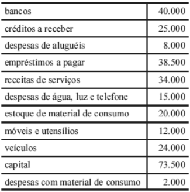{largura=35%}

Considerando que os dados acima, em reais, correspondem ao encerramento do primeiro exercício financeiro de determinada entidade, julgue o item consecutivo, acerca da composição do balanço patrimonial e da demonstração do resultado do exercício dessa entidade.

A demonstração do resultado do exercício apresentou prejuízo de R$ 11.000,00.

- Gabarito: ERRADO
- Resolução: a caminho

## F0374 · FCC · 2012 · TRE SP · ME
- Fontes: TecConcursos 374 (64272)
- Prova: FCC - AJ TRE SP/TRE SP/Administrativa/Contabilidade/2012
- Grupos: resultado-bruto, cmv, deducoes

Instruções: Utilize as informações a seguir para responder à questão.

A Cia. Mamoré, que adota o inventário permanente de estoques, vendeu 180.000 unidades de um produto de sua fabricação ao preço unitário de R$ 10,00. Na operação, houve a incidência dos seguintes impostos: − ICMS à alíquota de 18%; − PIS (incidência cumulativa) à alíquota de 0,65%; e − COFINS (incidência cumulativa) à alíquota de 3%.

O preço de custo das mercadorias vendidas correspondeu a 60% do preço unitário de venda.

O lucro bruto auferido pela companhia nessa operação foi, em reais, de

- A) 384.300,00.
- B) 396.000,00.
- C) 720.000,00.
- D) 330.300,00.
- E) 108.000,00.
- Gabarito: D
- Resolução: a caminho

## F0375 · FCC · 2012 · TRE SP · ME
- Fontes: TecConcursos 375 (64274)
- Prova: FCC - AJ TRE SP/TRE SP/Administrativa/Contabilidade/2012
- Grupos: participacoes, ir-csll, lucro-liquido

A Cia. Fernandópolis paga, em função de dispositivo estatutário, 5% do lucro líquido, depois dos tributos sobre o lucro, para seus empregados e 2% para seus administradores. A companhia não tem prejuízos a compensar de períodos anteriores e obteve em 2011 um lucro líquido, depois dos tributos, equivalente a R$ 960.000,00. Observando-se a fórmula de cálculo extracontábil das participações prescrita pela legislação societária, o valor a ser pago aos administradores montou, em reais, a

- A) 18.600,00.
- B) 19.200,00.
- C) 18.240,00.
- D) 18.840,00.
- E) 19.000,00.
- Gabarito: C
- Resolução: a caminho

## F0376 · FCC · 2012 · TST · ME
- Fontes: TecConcursos 376 (90202)
- Prova: FCC - AJ TST/TST/Apoio Especializado/Contabilidade/2012
- Grupos: resultado-bruto, receita-liquida, cmv, deducoes, receita-bruta, despesas-vendas

Determinada empresa reconheceu, durante o ano de 2011, R$ 500.000,00 em vendas realizadas. Durante este ano, reconheceu, adicionalmente, os seguintes itens: abatimento sobre vendas de R$ 16.000,00; devoluções de vendas de R$ 10.000,00; custo das mercadorias vendidas de R$ 260.000,00; comissões sobre vendas de R$ 7.500,00; impostos sobre vendas de R$ 90.000,00 e estimativa para perdas com créditos de liquidação duvidosa de R$ 5.000,00. Com base nessas informações, a empresa apurou em 2011 uma receita líquida e um lucro bruto, respectivamente, de

- A) R$ 384.000,00 e R$ 124.000,00.
- B) R$ 461.500,00 e R$ 201.500,00.
- C) R$ 474.000,00 e R$ 214.000,00.
- D) R$ 376.500,00 e R$ 116.500,00.
- E) R$ 371.500,00 e R$ 111.500,00.
- Gabarito: A
- Resolução: a caminho

## F0377 · CEBRASPE · 2012 · TCE ES · CE
- Fontes: TecConcursos 377 (143956)
- Prova: CEBRASPE (CESPE) - ACE (TCE ES)/TCE ES/Ciências Contábeis/2012
- Grupos: lucro-liquido, receita-bruta, cmv, despesas-administrativas, deducoes, despesas-operacionais

| Conta | Valor |
|---|---:|
| caixa e equivalentes de caixa | 100 |
| duplicatas a receber | 100 |
| duplicatas descontadas | 40 |
| estoques | 300 |
| instalações e equipamentos | 200 |
| depreciação acumulada | 50 |
| fornecedores | 180 |
| empréstimos bancários circulantes | 90 |
| tributos a recolher | 100 |
| financiamentos de longo prazo | 210 |
| vendas brutas | 1.000 |
| impostos sobre vendas | 260 |
| custo da mercadoria vendida | 300 |
| despesas operacionais | 180 |

Considerando a tabela acima, em que são apresentados os dados hipotéticos, em $, de determinada empresa, e que a alíquota do IR e a contribuição sobre o lucro líquido dessa empresa sejam de 34%, sendo estes os únicos dados significativos para fins de levantamento de balanço e apuração do resultado do exercício, julgue o item seguinte.

O lucro líquido do exercício é superior a 15% do valor das vendas brutas.

- Gabarito: CERTO
- Resolução: a caminho

## F0378 · CEBRASPE · 2012 · ANAC · CE
- Fontes: TecConcursos 378 (168941) · Possati 22
- Prova: CEBRASPE (CESPE) - ERAC (ANAC)/ANAC/Contabilidade/2012
- Grupos: receita-liquida, receita-bruta, despesas-operacionais

No exercício da atividade de registro e controle do patrimônio, o contabilista depara-se com uma série de eventos que suscitam o registro por meio de lançamentos típicos. A respeito desse assunto, julgue o item subsequente.

A receita líquida é calculada pela subtração das despesas operacionais na receita bruta.

- Gabarito: ERRADO
- Resolução: a caminho

## F0379 · CEBRASPE · 2012 · ANAC · CE
- Fontes: TecConcursos 379 (168945) · Possati 19
- Prova: CEBRASPE (CESPE) - ERAC (ANAC)/ANAC/Contabilidade/2012
- Grupos: receita-bruta, lucro-liquido, resultado-financeiro

Com relação aos demonstrativos que devem ser elaborados no final do exercício financeiro, julgue o item a seguir.

Suponha que determinada empresa ofereça um desconto de 6% sobre o valor das vendas realizadas a crédito caso seus clientes paguem suas parcelas com até dez dias de antecipação em relação ao vencimento. Nessa situação, ao elaborar a demonstração do resultado do exercício, a empresa deve deduzir o valor dos descontos concedidos da receita bruta.

- Gabarito: ERRADO
- Resolução: a caminho

## F0380 · FCC · 2012 · TRE PR · ME
- Fontes: TecConcursos 380 (225465)
- Prova: FCC - AJ TRE PR/TRE PR/Administrativa/Contabilidade/2012
- Grupos: lucro-liquido

Um item que afeta a apuração do resultado do exercício é

- A) a distribuição de dividendos por controladas.
- B) a compra financiada de um terreno em 36 meses.
- C) o prêmio na emissão de debêntures.
- D) os custos de transação na emissão de ações subscritas e integralizadas.
- E) a reversão de perda por impairment.
- Gabarito: E
- Resolução: a caminho

## F0381 · FCC · 2012 · TRE PR · ME
- Fontes: TecConcursos 381 (225466)
- Prova: FCC - AJ TRE PR/TRE PR/Administrativa/Contabilidade/2012
- Grupos: lucro-liquido

Sobre as demonstrações contábeis das empresas, considere:

I. O lucro ou prejuízo líquido do exercício e o seu montante por ação do capital social é evidenciado na demonstração de resultados do exercício.<br>
II. A demonstração do valor adicionado deve evidenciar o valor da riqueza gerada pela companhia, a sua distribuição entre os elementos que contribuíram para a<br>

geração dessa riqueza, bem como a parcela da riqueza não distribuída.

III. A demonstração do valor adicionado é obrigatória para as companhias fechadas e abertas, cujo capital social seja superior a R$ 1.000.000,00.<br>
IV. Os pequenos saldos, nas demonstrações contábeis, poderão ser agregados, desde que indicada a sua natureza e não ultrapassem 5% (cinco por cento) do<br>

valor do respectivo grupo de contas.

Está correto o que se afirma APENAS em

- A) I e II.
- B) I e IV.
- C) II e III.
- D) II e IV.
- E) III e IV.
- Gabarito: A
- Resolução: a caminho

## F0382 · FCC · 2012 · TRE CE · ME
- Fontes: TecConcursos 382 (377137)
- Prova: FCC - AJ (TRE CE)/TRE CE/Administrativa/Contabilidade/2012
- Grupos: receita-liquida, receita-bruta

Na apuração da receita líquida de vendas são computados os valores dos seguintes itens:

- A) as vendas devolvidas, os desembolsos com transportes de mercadorias e os abatimentos recebido pela empresa.
- B) os impostos diretos sobre as vendas, as devoluções de mercadorias vendidas e abatimentos sobre as vendas.
- C) o custo da mercadoria vendida, os impostos diretos, os descontos comerciais concedidos e os fretes e despachos sobre as vendas.
- D) as devoluções de vendas, os descontos comerciais recebidos e os descontos financeiros concedidos aos clientes.
- E) os gastos com transporte das mercadorias vendidas, o custo das mercadorias vendidas e os descontos financeiros concedidos.
- Gabarito: B
- Resolução: a caminho

## F0383 · FCC · 2012 · TRE CE · ME
- Fontes: TecConcursos 383 (377139)
- Prova: FCC - AJ (TRE CE)/TRE CE/Administrativa/Contabilidade/2012
- Grupos: cmv, resultado-financeiro, participacoes, lucro-liquido, fora-destinacao, receita-bruta, despesas-administrativas, despesas-vendas, ir-csll, outras-operacionais

Atenção: A questão refere-se aos livros contábeis da Cia. Iracema das quais foram extraídas as contas abaixo.

Contas Saldos Finais em 31.12.2010 R$

| Conta | Valor |
|---|---:|
| Custo das Mercadorias Vendidas | 6.300,00 |
| Despesas Administrativas | 600,00 |
| Despesas de Pessoal | 1.200,00 |
| Despesas de Aluguéis | 700,00 |
| Despesas Financeiras | 1.200,00 |
| Despesas de Depreciação | 300,00 |
| Despesas Tributárias | 800,00 |
| Provisão p/Crédito de Liquidação Duvidosa − PCLD | 200,00 |
| Receitas Financeiras | 2.000,00 |
| Recuperação de Clientes | 1.500,00 |
| Reversão de PCLD − Provisão p/Crédito de Liquidação Duvidosa | 160,00 |
| Despesas Serviços de Terceiros | 500,00 |
| Vendas | 10.640,00 |

Considerando ainda que:

I. A empresa iniciou suas atividades em janeiro de 2010, com um Capital Social totalmente integralizado no valor de R$ 100.000,00.<br>
II. Sua política contábil estabelece que na existência de saldo positivo do exercício a empresa deverá provisionar e distribuir o seu resultado utilizando os seguintes<br>

percentuais:

Itens Percentual

| Conta | Valor |
|---|---:|
| Provisão p/IR e Contribuição Social | 20% |
| Provisão p/Participação dos Empregados nos lucros da Sociedade | 20% |
| Provisão p/Participação dos Administradores nos lucros da Sociedade | 15% |
| Reserva Legal | 5% |
| Dividendos | 30% |
| Reserva Estatuárias | 10% |

III. Havendo ainda saldo de resultado líquido este deverá ser retido, nos termos da proposta de retenção de lucro aprovada pela Assembleia Geral e constante no<br>

orçamento de capital para os próximos quatro anos.

O resultado líquido do exercício é

- A) R$ 2.500,00.
- B) R$ 2.160,00.
- C) R$ 2.000,00.
- D) R$ 1.600,00.
- E) R$ 1.360,00.
- Gabarito: E
- Resolução: a caminho

## F0384 · FCC · 2012 · TRE CE · ME
- Fontes: TecConcursos 384 (377157)
- Prova: FCC - AJ (TRE CE)/TRE CE/Administrativa/Contabilidade/2012
- Grupos: cmv, resultado-financeiro, participacoes, lucro-liquido, fora-destinacao, receita-bruta, despesas-administrativas, despesas-vendas, ir-csll, outras-operacionais

Atenção: A questão refere-se aos livros contábeis da Cia. Iracema das quais foram extraídas as contas abaixo.

Contas Saldos Finais em 31.12.2010 R$

| Conta | Valor |
|---|---:|
| Custo das Mercadorias Vendidas | 6.300,00 |
| Despesas Administrativas | 600,00 |
| Despesas de Pessoal | 1.200,00 |
| Despesas de Aluguéis | 700,00 |
| Despesas Financeiras | 1.200,00 |
| Despesas de Depreciação | 300,00 |
| Despesas Tributárias | 800,00 |
| Provisão p/Crédito de Liquidação Duvidosa − PCLD | 200,00 |
| Receitas Financeiras | 2.000,00 |
| Recuperação de Clientes | 1.500,00 |
| Reversão de PCLD − Provisão p/Crédito de Liquidação Duvidosa | 160,00 |
| Despesas Serviços de Terceiros | 500,00 |
| Vendas | 10.640,00 |

Considerando ainda que:

I. A empresa iniciou suas atividades em janeiro de 2010, com um Capital Social totalmente integralizado no valor de R$ 100.000,00.<br>
II. Sua política contábil estabelece que na existência de saldo positivo do exercício a empresa deverá provisionar e distribuir o seu resultado utilizando os seguintes<br>

percentuais:

Itens Percentual

| Conta | Valor |
|---|---:|
| Provisão p/IR e Contribuição Social | 20% |
| Provisão p/Participação dos Empregados nos lucros da Sociedade | 20% |
| Provisão p/Participação dos Administradores nos lucros da Sociedade | 15% |
| Reserva Legal | 5% |
| Dividendos | 30% |
| Reserva Estatuárias | 10% |

III. Havendo ainda saldo de resultado líquido este deverá ser retido, nos termos da proposta de retenção de lucro aprovada pela Assembleia Geral e constante no<br>

orçamento de capital para os próximos quatro anos.

O resultado antes dos impostos, contribuições e participações é

- A) R$ 2.500,00.
- B) R$ 2.160,00.
- C) R$ 2.000,00.
- D) R$ 1.600,00.
- E) R$ 1.360,00.
- Gabarito: A
- Resolução: a caminho

## F0385 · FCC · 2012 · TRE CE · ME
- Fontes: TecConcursos 385 (377158)
- Prova: FCC - AJ (TRE CE)/TRE CE/Administrativa/Contabilidade/2012
- Grupos: cmv, resultado-financeiro, participacoes, lucro-liquido, fora-destinacao, receita-bruta, despesas-administrativas, despesas-vendas, ir-csll, outras-operacionais

Atenção: A questão refere-se aos livros contábeis da Cia. Iracema das quais foram extraídas as contas abaixo.

Contas Saldos Finais em 31.12.2010 R$

| Conta | Valor |
|---|---:|
| Custo das Mercadorias Vendidas | 6.300,00 |
| Despesas Administrativas | 600,00 |
| Despesas de Pessoal | 1.200,00 |
| Despesas de Aluguéis | 700,00 |
| Despesas Financeiras | 1.200,00 |
| Despesas de Depreciação | 300,00 |
| Despesas Tributárias | 800,00 |
| Provisão p/Crédito de Liquidação Duvidosa − PCLD | 200,00 |
| Receitas Financeiras | 2.000,00 |
| Recuperação de Clientes | 1.500,00 |
| Reversão de PCLD − Provisão p/Crédito de Liquidação Duvidosa | 160,00 |
| Despesas Serviços de Terceiros | 500,00 |
| Vendas | 10.640,00 |

Considerando ainda que:

I. A empresa iniciou suas atividades em janeiro de 2010, com um Capital Social totalmente integralizado no valor de R$ 100.000,00.<br>
II. Sua política contábil estabelece que na existência de saldo positivo do exercício a empresa deverá provisionar e distribuir o seu resultado utilizando os seguintes<br>

percentuais:

Itens Percentual

| Conta | Valor |
|---|---:|
| Provisão p/IR e Contribuição Social | 20% |
| Provisão p/Participação dos Empregados nos lucros da Sociedade | 20% |
| Provisão p/Participação dos Administradores nos lucros da Sociedade | 15% |
| Reserva Legal | 5% |
| Dividendos | 30% |
| Reserva Estatuárias | 10% |

III. Havendo ainda saldo de resultado líquido este deverá ser retido, nos termos da proposta de retenção de lucro aprovada pela Assembleia Geral e constante no<br>

orçamento de capital para os próximos quatro anos.

O valor residual do lucro a ser inscrito como Lucros Retidos é

- A) R$ 136,00.
- B) R$ 168,00.
- C) R$ 408,00.
- D) R$ 612,00.
- E) R$ 748,00.
- Gabarito: E
- Resolução: a caminho

## F0386 · FCC · 2012 · TRE CE · ME
- Fontes: TecConcursos 386 (377160)
- Prova: FCC - AJ (TRE CE)/TRE CE/Administrativa/Contabilidade/2012
- Grupos: cmv, resultado-financeiro, participacoes, lucro-liquido, fora-destinacao, receita-bruta, despesas-administrativas, despesas-vendas, ir-csll, outras-operacionais

Atenção: A questão refere-se aos livros contábeis da Cia. Iracema das quais foram extraídas as contas abaixo.

Contas Saldos Finais em 31.12.2010 R$

| Conta | Valor |
|---|---:|
| Custo das Mercadorias Vendidas | 6.300,00 |
| Despesas Administrativas | 600,00 |
| Despesas de Pessoal | 1.200,00 |
| Despesas de Aluguéis | 700,00 |
| Despesas Financeiras | 1.200,00 |
| Despesas de Depreciação | 300,00 |
| Despesas Tributárias | 800,00 |
| Provisão p/Crédito de Liquidação Duvidosa − PCLD | 200,00 |
| Receitas Financeiras | 2.000,00 |
| Recuperação de Clientes | 1.500,00 |
| Reversão de PCLD − Provisão p/Crédito de Liquidação Duvidosa | 160,00 |
| Despesas Serviços de Terceiros | 500,00 |
| Vendas | 10.640,00 |

Considerando ainda que:

I. A empresa iniciou suas atividades em janeiro de 2010, com um Capital Social totalmente integralizado no valor de R$ 100.000,00.<br>
II. Sua política contábil estabelece que na existência de saldo positivo do exercício a empresa deverá provisionar e distribuir o seu resultado utilizando os seguintes<br>

percentuais:

Itens Percentual

| Conta | Valor |
|---|---:|
| Provisão p/IR e Contribuição Social | 20% |
| Provisão p/Participação dos Empregados nos lucros da Sociedade | 20% |
| Provisão p/Participação dos Administradores nos lucros da Sociedade | 15% |
| Reserva Legal | 5% |
| Dividendos | 30% |
| Reserva Estatuárias | 10% |

III. Havendo ainda saldo de resultado líquido este deverá ser retido, nos termos da proposta de retenção de lucro aprovada pela Assembleia Geral e constante no<br>

orçamento de capital para os próximos quatro anos.

O valor destinado a dividendos é

- A) R$ 136,00.
- B) R$ 168,00.
- C) R$ 408,00.
- D) R$ 612,00.
- E) R$ 748,00.
- Gabarito: C
- Resolução: a caminho

## F0387 · FCC · 2012 · MPE RN · ME
- Fontes: TecConcursos 387 (443654)
- Prova: FCC - Ana (MPE RN)/MPE RN/Contabilidade/2012
- Grupos: 

Os itens evidenciados na Demonstração de Resultado de Exercício são:

- A) a reserva legal e as participações de debêntures.
- B) o lucro líquido do exercício e as retenções de reservas de capital.
- C) as retenções dos lucros e as participações dos empregados nos lucros.
- D) o lucro ou prejuízo líquido do exercício e o seu montante por ação do capital social.
- E) a reserva de incentivos fiscais e as receitas realizadas e as despesas incorridas no período.
- Gabarito: D
- Resolução: a caminho

## F0388 · CEBRASPE · 2012 · TJ AC · CE
- Fontes: TecConcursos 388 (551957)
- Prova: CEBRASPE (CESPE) - AJ (TJ AC)/TJ AC/Contador/2012
- Grupos: resultado-financeiro, ir-csll, lucro-liquido, receita-bruta, despesas-administrativas, deducoes, despesas-vendas, despesas-operacionais, outras-operacionais, outras-receitas-despesas

A tabela a seguir apresenta as contas de resultado de uma empresa comercial e os respectivos saldos, em reais, sem, contudo, indicar a natureza (débito ou crédito).

| Conta | Valor |
|---|---:|
| custo de mercadorias e serviços | 38.000 |
| depreciação e amortização | 2.500 |
| despesa financeira | 2.700 |
| despesas com vendas | 18.000 |
| despesas gerais e administrativas | 3.100 |
| devoluções de venda | 2.000 |
| imposto de renda | 12.000 |
| impostos sobre vendas | 11.000 |
| outras despesas operacionais | 4.000 |
| receita bruta | 85.000 |
| receita financeira | 1.000 |

Com base nessas informações, julgue o próximo item relativo à elaboração da demonstração do resultado do exercício (dre).

A apuração do resultado mostra um prejuízo líquido de R$ 1.200,00.

- Gabarito: ERRADO
- Resolução: a caminho

## F0389 · CEBRASPE · 2012 · TJ AC · CE
- Fontes: TecConcursos 389 (551976)
- Prova: CEBRASPE (CESPE) - AJ (TJ AC)/TJ AC/Contador/2012
- Grupos: resultado-bruto, resultado-financeiro, ir-csll, receita-bruta, despesas-administrativas, deducoes, despesas-vendas, despesas-operacionais, lucro-liquido, outras-operacionais, outras-receitas-despesas

A tabela a seguir apresenta as contas de resultado de uma empresa comercial e os respectivos saldos, em reais, sem, contudo, indicar a natureza (débito ou crédito).

| Conta | Valor |
|---|---:|
| custo de mercadorias e serviços | 38.000 |
| depreciação e amortização | 2.500 |
| despesa financeira | 2.700 |
| despesas com vendas | 18.000 |
| despesas gerais e administrativas | 3.100 |
| devoluções de venda | 2.000 |
| imposto de renda | 12.000 |
| impostos sobre vendas | 11.000 |
| outras despesas operacionais | 4.000 |
| receita bruta | 85.000 |
| receita financeira | 1.000 |

Com base nessas informações, julgue o próximo item relativo à elaboração da demonstração do resultado do exercício (dre).

O lucro bruto é superior a R$ 43.000,00.

- Gabarito: ERRADO
- Resolução: a caminho

## F0390 · CEBRASPE · 2012 · TJ AC · CE
- Fontes: TecConcursos 390 (552082)
- Prova: CEBRASPE (CESPE) - AJ (TJ AC)/TJ AC/Contador/2012
- Grupos: receita-liquida

Julgue o item seguinte, referente a orçamento empresarial, mercados de capitais e informações gerenciais para a tomada de decisões no ambiente empresarial. A estimativa da receita líquida pode ser obtida pela soma de todos os custos e despesas com a margem de lucro desejada.

- Gabarito: CERTO
- Resolução: a caminho

## F0391 · FCC · 2012 · MPE PE · ME
- Fontes: TecConcursos 391 (684773)
- Prova: FCC - Ana Min (MPE PE)/MPE PE/Ciências Contábeis/2012
- Grupos: cmv, resultado-financeiro, participacoes, ir-csll, lucro-liquido, equivalencia, receita-bruta, despesas-administrativas, outras-operacionais

BALANCETE DE VERIFICAÇÃO − CIA. GAMA − 31-12-2011 − EM R$

Contas Saldos devedores Saldos credores

Disponível 350.000,00

Duplicatas a Receber 400.000,00

Duplicatas Descontadas

250.000,00 Estoques 450.000,00

Seguros a Vencer 50.000,00

Impostos a Recuperar 90.000,00

Fornecedores

397.000,00 Impostos a recolher

160.000,00 Empréstimos a Longo Prazo 193.000,00 Empréstimos a Coligadas 100.000,00

Participação Societária − Cia. B 200.000,00

Participação Societária − Cia. C 180.000,00

Capital

850.000,00 Imobilizado 900.000,00

CSLL a Pagar

28.000,00 Imposto de Renda a Pagar

45.000,00 Depreciação Acumulada

360.000,00 Ajustes de Avaliação Patrimonial

70.000,00 Receita de Vendas

640.000,00 Despesas Administrativas 207.000,00

Despesas Financeiras 40.000,00

Custo das Mercadorias Vendidas 190.000,00

Resultado da Equivalência Patrimonial

160.000,00 Reversão de Provisões

20.000,00 Receitas Financeiras

57.000,00 Despesas com tributos sobre o lucro 73.000,00

TOTAL 3.230.000,00 3.230.000,00 O lucro líquido do exercício, constante da Demonstração do Resultado do Exercício da Cia Gama em 2011 foi igual, em R$, a:

- A) 437.000,00
- B) 322.000,00
- C) 297.000,00
- D) 397.000,00
- E) 367.000,00
- Gabarito: E
- Resolução: a caminho

## F0392 · FCC · 2012 · MPE PE · ME
- Fontes: TecConcursos 392 (687506)
- Prova: FCC - Tec Min (MPE PE)/MPE PE/Apoio Especializado/Contabilidade/2012
- Grupos: 

É o nome de uma conta de resultado:

- A) Reversão de Provisões.
- B) Receitas a Apropriar.
- C) Reserva Legal.
- D) Despesas Antecipadas.
- E) Receitas Diferidas.
- Gabarito: A
- Resolução: a caminho

## F0393 · FCC · 2012 · ARCE · ME
- Fontes: TecConcursos 393 (2244608)
- Prova: FCC - Ana Reg (ARCE)/ARCE/Especialista em Gestão Governamental e Administração Pública/2012
- Grupos: 

A síntese financeira dos resultados operacionais da organização durante certo período é fornecida por demonstração financeira conhecida como

- A) Demonstração do Resultado do Exercício.
- B) Demonstração do Lucro Retido.
- C) Balanço Patrimonial.
- D) Demonstração de Fluxos de Caixa.
- E) Balanço Social.
- Gabarito: A
- Resolução: a caminho

## F0394 · CEBRASPE · 2012 · TJ RO · ME
- Fontes: TecConcursos 394 (2757778)
- Prova: CEBRASPE (CESPE) - AJ (TJ RO)/TJ RO/Contador/2012
- Grupos: 

De acordo com a legislação societária, com os pronunciamentos do CPC e com as práticas contábeis, assinale a opção em que todas as contas mostradas sejam exclusivamente de resultado.

- A) depreciação acumulada de veículos / despesas de comissões
- B) ICMS a recolher / despesas gerais
- C) IPI a compensar / despesas com energia elétrica
- D) despesas com pessoal / salários a pagar
- E) custo das mercadorias vendidas / reversão de perdas estimadas nos estoques
- Gabarito: E
- Resolução: a caminho

## F0395 · FCC · 2012 · METRO SP · ME
- Fontes: TecConcursos 395 (3773549)
- Prova: FCC - ADG Jr (METRO SP)/METRO SP/Administração de Empresas/2012
- Grupos: 

As contas de resultado dividem-se em

- A) contas de despesas e obrigações.
- B) contas de despesas e de receitas.
- C) receitas e caixa líquido.
- D) despesas e patrimônio líquido.
- E) caixa e direitos a receber.
- Gabarito: B
- Resolução: a caminho

## F0396 · FGV · 2011 · CGE RJ · ME
- Fontes: TecConcursos 396 (46472)
- Prova: FGV - Aud Est (CGE RJ)/CGE RJ/2011
- Grupos: resultado-bruto, cmv, resultado-financeiro, deducoes, fora-destinacao, receita-bruta, despesas-administrativas, despesas-vendas, outras-receitas-despesas

A Cia. CSD apresentou os seguintes saldos referentes ao ano de 2010:

Receitas Financeiras: R$ 40.000; Receita de vendas de mercadorias: R$ 500.000; Receita com venda de ativo imobilizado: R$ 60.000; Custo das mercadorias vendidas: R$ 380.000; Despesas Financeiras: R$ 30.000; Dividendos: R$ 12.000; Devolução de vendas: R$ 15.000; Abatimentos: R$ 18.000; Reversão da provisão para créditos de liquidação duvidosa: R$ 30.000; Despesa de depreciação: R$ 7.000; Custo do imobilizado vendido: R$ 23.000; Compra de ativo imobilizado: R$ 30.000.

Qual foi o lucro bruto apresentado pela Cia. CSD em 2010?

- A) R$ 30.000.
- B) R$ 87.000.
- C) R$ 124.000.
- D) R$ 117.000.
- E) R$ 97.000.
- Gabarito: B
- Resolução: a caminho

## F0397 · CEBRASPE · 2011 · TRE ES · CE
- Fontes: TecConcursos 397 (65508)
- Prova: CEBRASPE (CESPE) - TJ TRE ES/TRE ES/Administrativa/Contabilidade/2011
- Grupos: receita-liquida, receita-bruta

No item, é apresentada uma situação hipotética, seguida de uma assertiva a ser julgada.

No final do período contábil, após os lançamentos de ajustes, uma entidade obteve os seguintes saldos contábeis.

Nessa situação, as vendas líquidas do período somaram R$ 25.000,00.

- Gabarito: ERRADO
- Resolução: a caminho

## F0398 · CEBRASPE · 2011 · TRE ES · CE
- Fontes: TecConcursos 398 (65963) · Possati 45
- Prova: CEBRASPE (CESPE) - AJ TRE ES/TRE ES/Administrativa/Contabilidade/2011
- Grupos: participacoes, lucro-liquido

Em relação ao encerramento do exercício social e às normas legais aplicáveis à contabilidade, julgue o próximo item.

A demonstração do resultado do exercício não abrange a forma como o lucro eventualmente apurado será distribuído, mas inclui as participações de debêntures, empregados, administradores e partes beneficiárias.

- Gabarito: CERTO
- Resolução: a caminho

## F0399 · CEBRASPE · 2011 · TRE ES · CE
- Fontes: TecConcursos 399 (65964) · Possati 40
- Prova: CEBRASPE (CESPE) - AJ TRE ES/TRE ES/Administrativa/Contabilidade/2011
- Grupos: participacoes, ir-csll

Em relação ao encerramento do exercício social e às normas legais aplicáveis à contabilidade, julgue o próximo item.

Se determinada empresa apresentou lucro no final do exercício, a provisão para o imposto de renda somente deverá ser constituída após o pagamento das participações estatutárias.

- Gabarito: ERRADO
- Resolução: a caminho

## F0400 · CEBRASPE · 2011 · PREVIC · CE
- Fontes: TecConcursos 400 (108500)
- Prova: CEBRASPE (CESPE) - TA (PREVIC)/PREVIC/2011
- Grupos: 

A companhia Alfa foi constituída em 1.º de abril de 2010 mediante captação de recursos totais de R$ 80.000,00, dos quais R$ 50.000,00 foram captados dos sócios, sob a forma de capital subscrito e integralizado no ato. O restante é oriundo de terceiros, 30% a título de empréstimos de longo prazo e 70%, de curto prazo. Nesse mesmo mês, um cliente fez um adiantamento correspondente a dois quintos do capital próprio. No mês da constituição da empresa, foram realizados os seguintes investimentos: R$ 22.000,00 em máquinas e equipamentos, sendo 50% à vista e o restante financiado em 16 parcelas iguais; R$ 12.000,00 em ações para especulação; R$ 32.000,00 em mercadorias para revenda; R$ 20.000,00 de empréstimos de curto prazo concedidos a terceiros; e o restante em despesas.

Com base na situação hipotética apresentada acima, julgue o item que se segue.

Se, em abril de 2010, a companhia Alfa tiver prestado serviços a prazo para um cliente no valor de R$ 30.000,00, então ela terá auferido prejuízo de R$ 5.000,00.

- Gabarito: ERRADO
- Resolução: a caminho

## F0401 · CEBRASPE · 2011 · PREVIC · CE
- Fontes: TecConcursos 401 (108502)
- Prova: CEBRASPE (CESPE) - TA (PREVIC)/PREVIC/2011
- Grupos: lucro-liquido

Julgue o item a seguir, a respeito de reservas, provisões, contas patrimoniais e contas de resultado.

O encerramento das contas de resultado tem como finalidade a determinação do lucro líquido.

- Gabarito: ERRADO
- Resolução: a caminho

## F0402 · CEBRASPE · 2011 · PREVIC · CE
- Fontes: TecConcursos 402 (108682)
- Prova: CEBRASPE (CESPE) - AA (PREVIC)/PREVIC/Contábil/2011
- Grupos: resultado-bruto, lucro-liquido

A elaboração dos demonstrativos contábeis obedece a regras estabelecidas nas normas legais e técnicas. Acerca desse assunto, julgue o item subsequente. O lucro bruto calculado na demonstração do resultado do exercício inclui as receitas decorrentes de aplicações no mercado de títulos mobiliários, independentemente da natureza da entidade.

- Gabarito: ERRADO
- Resolução: a caminho

## F0403 · CEBRASPE · 2011 · PREVIC · CE
- Fontes: TecConcursos 403 (108683) · Possati 48
- Prova: CEBRASPE (CESPE) - EPC (PREVIC)/PREVIC/Finanças e Contábil/2011
- Grupos: participacoes

A elaboração dos demonstrativos contábeis obedece a regras estabelecidas nas normas legais e técnicas. Acerca desse assunto, julgue o item subsequente. Quando há previsão no estatuto de determinada companhia para a participação dos empregados no lucro apurado, essa participação deve ser paga obrigatoriamente antes das parcelas relativas a administradores e partes beneficiárias.

- Gabarito: CERTO
- Resolução: a caminho

## F0404 · CEBRASPE · 2011 · STM · CE
- Fontes: TecConcursos 404 (476052)
- Prova: CEBRASPE (CESPE) - AJ (STM)/STM/Apoio Especializado/Contabilidade/2011
- Grupos: lucro-liquido

Acerca das demonstrações contábeis obrigatórias previstas na Lei n.º 6.404/1976, julgue o item a seguir.

Para determinação do resultado do exercício, as receitas e os rendimentos recebidos no período devem ser confrontados com seus custos, despesas e encargos efetivamente desembolsados.

- Gabarito: ERRADO
- Resolução: a caminho

## F0405 · CEBRASPE · 2011 · STM · CE
- Fontes: TecConcursos 405 (476056)
- Prova: CEBRASPE (CESPE) - AJ (STM)/STM/Apoio Especializado/Contabilidade/2011
- Grupos: resultado-bruto, deducoes, receita-bruta, lucro-liquido

Acerca das demonstrações contábeis obrigatórias previstas na Lei n.º 6.404/1976, julgue o item a seguir.

Na demonstração do resultado do exercício, o lucro bruto é resultado da dedução dos custos dos produtos, mercadorias ou serviços da receita de vendas ou prestação de serviços, descontadas as devoluções, abatimentos e impostos sobre vendas.

- Gabarito: CERTO
- Resolução: a caminho

## F0406 · CEBRASPE · 2011 · PC ES · CE
- Fontes: TecConcursos 406 (846454)
- Prova: CEBRASPE (CESPE) - Per Of Crim (PC ES)/PC ES/"Antiga Carreira"/"Sem Área"/2011
- Grupos: resultado-bruto, receita-bruta

Acerca das demonstrações contábeis previstas na legislação societária brasileira, julgue o item seguinte.

Para apuração do lucro bruto, deve-se deduzir das receitas líquidas o custo dos produtos ou mercadorias vendidas e dos serviços prestados.

- Gabarito: CERTO
- Resolução: a caminho

## F0407 · CEBRASPE · 2011 · PC ES · CE
- Fontes: TecConcursos 407 (846455)
- Prova: CEBRASPE (CESPE) - Per Of Crim (PC ES)/PC ES/"Antiga Carreira"/"Sem Área"/2011
- Grupos: lucro-liquido

Acerca das demonstrações contábeis previstas na legislação societária brasileira, julgue o item seguinte.

As operações realizadas pela entidade em determinado exercício social, incluindo receitas, custos e despesas, são representadas em uma demonstração estática denominada demonstração do resultado do exercício.

- Gabarito: ERRADO
- Resolução: a caminho

## F0408 · CEBRASPE · 2011 · SESA ES · CE
- Fontes: TecConcursos 408 (1318390)
- Prova: CEBRASPE (CESPE) - EGRVS (SESA ES)/SESA ES/Contador/Auditoria/2011
- Grupos: 

Com relação aos conceitos relacionados a patrimônio das entidades, julgue o item.

Considerando-se determinados conceitos de manutenção de capital, os aumentos e as diminuições do patrimônio líquido decorrentes de reavaliações ou de atualizações de ativos e passivos enquadram-se nas definições de receita e de despesa; por isso, devem ser incluídos na demonstração de resultados.

- Gabarito: ERRADO
- Resolução: a caminho

## F0409 · CEBRASPE · 2011 · SESA ES · CE
- Fontes: TecConcursos 409 (1318395)
- Prova: CEBRASPE (CESPE) - EGRVS (SESA ES)/SESA ES/Contador/Auditoria/2011
- Grupos: participacoes

No que se refere à Lei n.º 6.404/1976, e alterações posteriores, julgue o item seguinte.

As participações estatutárias de empregados, administradores e partes beneficiárias devem ser determinadas, sucessivamente e nessa ordem, com base nos lucros que remanescerem depois de deduzida a participação anteriormente calculada.

- Gabarito: CERTO
- Resolução: a caminho

## F0410 · CEBRASPE · 2011 · TJ ES · CE
- Fontes: TecConcursos 410 (1347995)
- Prova: CEBRASPE (CESPE) - AJ 02 (TJ ES)/TJ ES/Apoio Especializado/Contabilidade/2011
- Grupos: receita-liquida, receita-bruta, deducoes, despesas-vendas, resultado-financeiro

Suponha que uma empresa comercial tenha apresentado, ao final do exercício, entre outros, os seguintes saldos (em R$ 1.000,00):

- vendas de mercadorias: 2.500 *
- receita de prestação de serviços: 800 *
- descontos concedidos a grandes clientes: 100
- descontos por pagamentos antecipados: 75
- IPI sobre vendas: 180
- ICMS sobre vendas: 240
- ISS sobre serviços prestados: 40
- comissões sobre vendas: 125

* Incluídos os impostos calculados “por dentro”.

Considerando os dados acima, julgue o item sequente.

A receita líquida das vendas de mercadorias e das prestações de serviços foi de R$ 2.920.000,00.

- Gabarito: CERTO
- Resolução: a caminho

## F0411 · CEBRASPE · 2011 · TJ ES · CE
- Fontes: TecConcursos 411 (1347996)
- Prova: CEBRASPE (CESPE) - AJ 02 (TJ ES)/TJ ES/Apoio Especializado/Contabilidade/2011
- Grupos: receita-bruta, deducoes, despesas-vendas, resultado-financeiro

Suponha que uma empresa comercial tenha apresentado, ao final do exercício, entre outros, os seguintes saldos (em R$ 1.000,00):

- vendas de mercadorias: 2.500 *
- receita de prestação de serviços: 800 *
- descontos concedidos a grandes clientes: 100
- descontos por pagamentos antecipados: 75
- IPI sobre vendas: 180
- ICMS sobre vendas: 240
- ISS sobre serviços prestados: 40
- comissões sobre vendas: 125

* Incluídos os impostos calculados “por dentro”.

Considerando os dados acima, julgue o item sequente.

O faturamento bruto da empresa foi de R$ 3.300.000,00.

- Gabarito: ERRADO
- Resolução: a caminho

## F0412 · CEBRASPE · 2011 · TJ ES · CE
- Fontes: TecConcursos 412 (1351028)
- Prova: CEBRASPE (CESPE) - AJ 01 (TJ ES)/TJ ES/Apoio Especializado/Técnico em Contabilidade/2011
- Grupos: cmv, participacoes, ir-csll, deducoes, fora-destinacao, receita-bruta, despesas-administrativas, despesas-vendas, lucro-liquido

Considere que o sistema contábil da empresa comercial Zeta S.A. tenha se extraviado logo no primeiro exercício de constituição da empresa, fundada em 1.º de março de x10, e que as seguintes informações tenham sido recuperadas para a reconstituição do balancete de verificação e elaboração das demonstrações contábeis a serem levantadas em 31/12/x10. conta saldo (em R$)

| Conta | Valor |
|---|---:|
| caixa | 15.000 |
| estoques | 40.000 |
| capital social | 50.000 |
| veículos | ? |
| títulos a pagar | 9.000 |
| depreciação acumulada – veículos | 4.000 |
| bancos conta movimento | 9.000 |
| clientes | 8.000 |
| fornecedores | 14.000 |
| receita de vendas | 23.000 |
| custo das vendas | 13.000 |
| despesas de vendas | 1.000 |
| lucros do exercício | 4.700 |
| despesas gerais | 2.000 |
| imposto de renda e contribuição social sobre o lucro a recolher | 2.300 |

Sabendo que não foram consideradas possíveis participações ou destinações para o lucro, julgue o item com base nas informações acima.

O resultado antes da dedução do imposto de renda e da contribuição social sobre o lucro é igual a R$ 7.000.

- Gabarito: CERTO
- Resolução: a caminho

## F0413 · CEBRASPE · 2011 · TJ ES · CE
- Fontes: TecConcursos 413 (1351038)
- Prova: CEBRASPE (CESPE) - AJ 01 (TJ ES)/TJ ES/Apoio Especializado/Técnico em Contabilidade/2011
- Grupos: cmv, participacoes, ir-csll, fora-destinacao, receita-bruta, despesas-administrativas, despesas-vendas, lucro-liquido

Considere que o sistema contábil da empresa comercial Zeta S.A. tenha se extraviado logo no primeiro exercício de constituição da empresa, fundada em 1.º de março de x10, e que as seguintes informações tenham sido recuperadas para a reconstituição do balancete de verificação e elaboração das demonstrações contábeis a serem levantadas em 31/12/x10. conta saldo (em R$)

| Conta | Valor |
|---|---:|
| caixa | 15.000 |
| estoques | 40.000 |
| capital social | 50.000 |
| veículos | ? |
| títulos a pagar | 9.000 |
| depreciação acumulada – veículos | 4.000 |
| bancos conta movimento | 9.000 |
| clientes | 8.000 |
| fornecedores | 14.000 |
| receita de vendas | 23.000 |
| custo das vendas | 13.000 |
| despesas de vendas | 1.000 |
| lucros do exercício | 4.700 |
| despesas gerais | 2.000 |
| imposto de renda e contribuição social sobre o lucro a recolher | 2.300 |

Sabendo que não foram consideradas possíveis participações ou destinações para o lucro, julgue o item com base nas informações acima.

A soma dos saldos das contas de resultado no início do exercício seguinte deverá ser de R$ 4.700.

- Gabarito: ERRADO
- Resolução: a caminho

## F0414 · CEBRASPE · 2011 · TJ ES · CE
- Fontes: TecConcursos 414 (1351060)
- Prova: CEBRASPE (CESPE) - AJ 01 (TJ ES)/TJ ES/Apoio Especializado/Técnico em Contabilidade/2011
- Grupos: resultado-bruto, despesas-administrativas

Com base na Lei n.º 6.404/1976 e em alterações posteriores, julgue o item subsequente.

A demonstração do resultado de exercício evidencia que, para a apuração do lucro bruto, deve-se fazer a subtração das despesas gerais e administrativas.

- Gabarito: ERRADO
- Resolução: a caminho

## F0415 · FCC · 2011 · COPERGÁS · ME
- Fontes: TecConcursos 415 (2308017)
- Prova: FCC - Ana (COPERGÁS)/COPERGÁS/Contador/2011
- Grupos: resultado-bruto, receita-liquida, receita-bruta

A Cia. Comercial 7 de Setembro adota o sistema de inventário periódico para avaliar seus estoques.

No final do exercício, as contas listadas a seguir apresentaram os seguintes saldos em R$:

| Conta | Valor |
|---|---:|
| Estoque inicial de mercadorias | 125.800,00 |
| Compras Líquidas | 350.350,00 |
| Receita Líquida de Vendas | 728.420,00 |

Procedeu-se ao inventário do estoque no último dia útil do exercício e as mercadorias existentes foram avaliadas em R$ 137.660,00. O lucro bruto auferido pela companhia nesse exercício correspondeu a, em R$,

- A) 389.930,00.
- B) 376.210,00.
- C) 390.630,00.
- D) 375.210,00.
- E) 382.530,00.
- Gabarito: A
- Resolução: a caminho

## F0416 · FCC · 2011 · INFRAERO · ME
- Fontes: TecConcursos 416 (2583732)
- Prova: FCC - PST (INFRAERO)/INFRAERO/Técnico em Contabilidade/2011
- Grupos: receita-liquida, cmv, deducoes, receita-bruta, despesas-vendas

Determinada empresa reconheceu, durante o ano de X0, as seguintes operações: fretes sobre vendas de $ 12.000,00; devoluções de vendas de $ 10.000,00; abatimentos sobre vendas de $ 4.200,00; custo das mercadorias vendidas de $ 230.000,00; impostos sobre vendas de $ 88.200,00; estimativa para perdas com créditos de liquidação duvidosa de $ 14.700,00 e recuperação de perdas com créditos de $ 5.000,00.

Sabendo-se que no ano de X0 as vendas brutas realizadas pela empresa foram de $ 500.000,00, a receita líquida apurada foi, em $,

- A) 401.800,00.
- B) 397.600,00.
- C) 385.600,00.
- D) 171.800,00.
- E) 150.100,00.
- Gabarito: B
- Resolução: a caminho

## F0417 · CEBRASPE · 2011 · ECT · CE
- Fontes: TecConcursos 417 (3012318)
- Prova: CEBRASPE (CESPE) - AC (ECT)/ECT/Contador/2011
- Grupos: lair, outras-receitas-despesas

Considerando que determinada empresa tenha vendido, à vista, um bem de seu ativo imobilizado por R$ 34.500,00, e sabendo que esse bem, quando adquirido, há três anos e sete meses, possuía vida útil remanescente de dez anos e foi registrado pelo custo de R$ 54.000,00, julgue o item que se segue.

Na demonstração de resultados do exercício, segundo previsão da Lei n.º 6.404/1976 (Lei das Sociedades por Ações) e suas atualizações, o resultado obtido na alienação do imobilizado deverá ser registrado como outras receitas e servirá de base para a apuração do resultado antes dos tributos.

- Gabarito: ERRADO
- Resolução: a caminho

## F0418 · FCC · 2011 · DESENVOLVE SP · ME
- Fontes: TecConcursos 418 (3163182)
- Prova: FCC - Cont (DESENVOLVE SP)/DESENVOLVE SP/2011
- Grupos: resultado-bruto, receita-bruta, deducoes

A Cia. Diamantina adquiriu uma mercadoria para revenda. O total da nota fiscal foi de R$ 1.100,00, sendo R$ 100,00 o valor correspondente ao Imposto sobre Produtos Industrializados. Dos tributos incidentes sobre as compras, apenas o ICMS, que foi cobrado com alíquota de 18%, é recuperável. Posteriormente, a companhia revendeu a mercadoria para terceiros pelo valor de R$ 1.800,00. Sabe-se que o valor total de PIS e COFINS pagos pela Companhia sobre essa receita foi de R$ 65,70 e que o ICMS incidiu na operação com alíquota de 18%. Se essa tivesse sido a única operação de vendas efetuada pela Companhia, no exercício, ela teria auferido um Lucro Bruto nessa operação, em R$, de

- A) 914,30.
- B) 590,30.
- C) 410,30.
- D) 570,30.
- E) 490,30.
- Gabarito: E
- Resolução: a caminho

## F0419 · FCC · 2011 · TRT 24 · ME
- Fontes: TecConcursos 419 (3350896)
- Prova: FCC - AJ TRT24/TRT 24/Administrativa/Contabilidade/2011
- Grupos: 

Relata efetivamente o desempenho, em termos de lucro ou prejuízo apurado pela companhia durante o exercício social:

- A) Demonstração do Fluxo de Caixa.
- B) Demonstração de Lucros ou Prejuízos Acumulados.
- C) Demonstração do Valor Adicionado.
- D) Demonstração do Resultado do Exercício.
- E) Balanço Patrimonial.
- Gabarito: D
- Resolução: a caminho

## F0420 · CEBRASPE · 2010 · ABIN · CE
- Fontes: TecConcursos 420 (19310) · Possati 46
- Prova: CEBRASPE (CESPE) - Of Tec Int (ABIN)/ABIN/Ciências Contábeis/2010
- Grupos: participacoes, lucro-liquido

Em relação às demonstrações contábeis, julgue o item com base na Lei n.o 6.404/1976 e suas alterações.

A demonstração do resultado do exercício deve discriminar, entre outros itens, as participações de debêntures, empregados, administradores e partes beneficiárias, mesmo na forma de instrumentos financeiros, e de instituições ou fundos de assistência ou previdência de empregados, que não se caracterizem como despesa.

- Gabarito: CERTO
- Resolução: a caminho

## F0421 · CEBRASPE · 2010 · SEFAZ ES · CE
- Fontes: TecConcursos 421 (44114)
- Prova: CEBRASPE (CESPE) - Cons TE (SEFAZ ES)/SEFAZ ES/Ciências Contábeis/2010
- Grupos: cmv, lucro-liquido, despesas-administrativas

No item, sempre que utilizadas, as siglas subsequentes devem ser interpretadas com a significação associada a cada uma delas: CFC = Conselho Federal de Contabilidade; CMV = custo das mercadorias vendidas; DFC = demonstração dos fluxos de caixa; DMPL = demonstração das mutações do patrimônio líquido; DVA = demonstração do valor agregado; UEPS = último que entra, primeiro que sai.

Determinada empresa de serviços iniciou suas atividades em 1/12/x1 com a integralização de capital em dinheiro no valor de R$ 50.000,00. No dia 10/12, foi adquirido, com metade dos recursos, um veículo para uso nas atividades da empresa.

Com base nessa situação hipotética e considerando, ainda, que o referido veículo não sofreu depreciação e que no dia 10 ainda houve prestação de serviços pela empresa, com recebimento à vista e em dinheiro, no valor de R$ 50.000,00, julgue o item seguinte.

O lucro líquido do período foi de R$ 50.000,00.

- Gabarito: CERTO
- Resolução: a caminho

## F0422 · CEBRASPE · 2010 · SEFAZ ES · CE
- Fontes: TecConcursos 422 (44116) · Possati 21
- Prova: CEBRASPE (CESPE) - Cons TE (SEFAZ ES)/SEFAZ ES/Ciências Contábeis/2010
- Grupos: receita-liquida, cmv, deducoes, receita-bruta, lucro-liquido

No item, sempre que utilizadas, as siglas subsequentes devem ser interpretadas com a significação associada a cada uma delas: CFC = Conselho Federal de Contabilidade; CMV = custo das mercadorias vendidas; DFC = demonstração dos fluxos de caixa; DMPL = demonstração das mutações do patrimônio líquido; DVA = demonstração do valor agregado; UEPS = último que entra, primeiro que sai.

Julgue o item a seguir, acerca da forma de apresentação da demonstração do resultado do exercício pelas companhias.

O valor da receita líquida é apurado deduzindo-se do valor da receita bruta das vendas e serviços os valores das deduções das vendas, dos abatimentos e dos impostos.

- Gabarito: CERTO
- Resolução: a caminho

## F0423 · CEBRASPE · 2010 · SEFAZ ES · CE
- Fontes: TecConcursos 423 (44117) · Possati 12
- Prova: CEBRASPE (CESPE) - Cons TE (SEFAZ ES)/SEFAZ ES/Ciências Contábeis/2010
- Grupos: cmv, lucro-liquido

No item, sempre que utilizadas, as siglas subsequentes devem ser interpretadas com a significação associada a cada uma delas: CFC = Conselho Federal de Contabilidade; CMV = custo das mercadorias vendidas; DFC = demonstração dos fluxos de caixa; DMPL = demonstração das mutações do patrimônio líquido; DVA = demonstração do valor agregado; UEPS = último que entra, primeiro que sai.

Julgue o item a seguir, acerca da forma de apresentação da demonstração do resultado do exercício pelas companhias.

Na determinação do resultado do exercício, os valores das receitas e dos rendimentos ganhos no período somente serão computados quando forem realizados.

- Gabarito: ERRADO
- Resolução: a caminho

## F0424 · CEBRASPE · 2010 · SEFAZ ES · CE
- Fontes: TecConcursos 424 (44118) · Possati 27
- Prova: CEBRASPE (CESPE) - Cons TE (SEFAZ ES)/SEFAZ ES/Ciências Contábeis/2010
- Grupos: resultado-bruto, receita-liquida, cmv, deducoes, lucro-liquido

No item, sempre que utilizadas, as siglas subsequentes devem ser interpretadas com a significação associada a cada uma delas: CFC = Conselho Federal de Contabilidade; CMV = custo das mercadorias vendidas; DFC = demonstração dos fluxos de caixa; DMPL = demonstração das mutações do patrimônio líquido; DVA = demonstração do valor agregado; UEPS = último que entra, primeiro que sai.

Julgue o item a seguir, acerca da forma de apresentação da demonstração do resultado do exercício pelas companhias.

O valor do lucro bruto é determinado por meio da dedução do valor do custo das mercadorias e serviços do valor da receita líquida do período.

- Gabarito: CERTO
- Resolução: a caminho

## F0425 · CEBRASPE · 2010 · MPU · CE
- Fontes: TecConcursos 425 (71594)
- Prova: CEBRASPE (CESPE) - Ana MPU/MPU/Perito/Contabilidade/2010
- Grupos: ir-csll

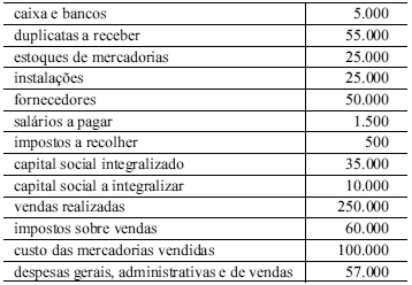{largura=35%}

O quadro acima apresenta, em reais, o balancete de verificação de determinada empresa referente ao mês de dezembro. Considere que, após o levantamento desse balancete, e antes do encerramento do referido mês, essa empresa realizou, ainda, as seguintes transações:

I aquisição de um veículo, para transporte de mercadorias, no valor de R$ 45.000,00, financiado em 24 meses, com juros totais de R$ 11.000,00;

II desconto de R$ 15.000,00 em duplicatas no banco, pelo qual a empresa recebeu crédito de R$ 14.500,00 para reforçar seu caixa;

III integralização do capital restante em mercadorias pelos sócios da empresa.

Com base nessas informações, julgue o item a seguir.

O resultado apurado no mês de dezembro, após as transações I, II e III, e antes do recolhimento do imposto de renda, é de R$ 32.500,00.

- Gabarito: CERTO
- Resolução: a caminho

## F0426 · CEBRASPE · 2010 · MPU · CE
- Fontes: TecConcursos 426 (71624) · Possati 17
- Prova: CEBRASPE (CESPE) - Ana MPU/MPU/Controle Interno/2010
- Grupos: deducoes, receita-bruta

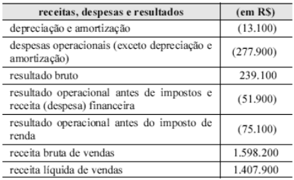{largura=35%}

Considerando as informações acima, extraídas da demonstração do resultado ao final do exercício social de determinada empresa comercial, julgue o item subsequente. As deduções da receita (vendas canceladas, abatimentos e impostos incidentes sobre vendas) são inferiores a R$ 200.000,00.

- Gabarito: CERTO
- Resolução: a caminho

## F0427 · CEBRASPE · 2010 · MPU · CE
- Fontes: TecConcursos 427 (71639) · Possati 51
- Prova: CEBRASPE (CESPE) - Ana MPU/MPU/Controle Interno/2010
- Grupos: participacoes, ir-csll

O estatuto social de determinada empresa define que administradores, debenturistas, empregados e partes beneficiárias têm direito, cada um, a 10% do lucro do exercício. Em determinado exercício, o lucro da empresa, após os descontos de imposto de renda e contribuição social, foi de R$ 485.000,00, e o prejuízo acumulado, de R$ 155.000,00.

Considerando a situação hipotética acima apresentada, é correto afirmar que o valor da participação dos debenturistas é R$ 33.000,00.

- Gabarito: CERTO
- Resolução: a caminho

## F0428 · CEBRASPE · 2010 · MPU · CE
- Fontes: TecConcursos 428 (71640) · Possati 49
- Prova: CEBRASPE (CESPE) - Ana MPU/MPU/Controle Interno/2010
- Grupos: participacoes, ir-csll

O estatuto social de determinada empresa define que administradores, debenturistas, empregados e partes beneficiárias têm direito, cada um, a 10% do lucro do exercício. Em determinado exercício, o lucro da empresa, após os descontos de imposto de renda e contribuição social, foi de R$ 485.000,00, e o prejuízo acumulado, de R$ 155.000,00.

Considerando a situação hipotética acima apresentada, é correto afirmar que o valor da participação dos administradores é R$ 26.730,00.

- Gabarito: CERTO
- Resolução: a caminho

## F0429 · FCC · 2010 · TRF 4 · ME
- Fontes: TecConcursos 429 (128569)
- Prova: FCC - TJ TRF4/TRF 4/Apoio Especializado/Contabilidade/2010
- Grupos: resultado-bruto, cmv, deducoes, receita-bruta, despesas-vendas, resultado-financeiro

Dados extraídos da Demonstração de Resultado da Cia. Costa do Marfim, relativa ao exercício encerrado em 31/12/2009 (em R$):

| Conta | Valor |
|---|---:|
| Receita Bruta de Vendas | 650.000,00 |
| Descontos incondicionais concedidos a terceiros | 30.000,00 |
| Descontos financeiros por antecipação de pagamento | 40.000,00 |
| Despesas com vendas | 35.000,00 |
| Custo das Mercadorias Vendidas | 320.000,00 |
| Tributos incidentes sobre vendas | 120.000,00 |

O lucro bruto do período, em R$, foi igual a

- A) 140.000,00.
- B) 145.000,00.
- C) 210.000,00.
- D) 180.000,00.
- E) 195.000,00.
- Gabarito: D
- Resolução: a caminho

## F0430 · FCC · 2010 · TRF 4 · ME
- Fontes: TecConcursos 430 (129024)
- Prova: FCC - AJ TRF4/TRF 4/Apoio Especializado/Contabilidade/2010
- Grupos: lucro-liquido

Na Demonstração do Resultado do Exercício de uma companhia, antes das novas normas instituídas pelas Leis no 11.638/2007 e no 11.941/2009, era classificada como não operacional a receita

- A) de dividendos de investimentos avaliados pelo custo.
- B) financeira de aplicações de renda fixa.
- C) da equivalência patrimonial.
- D) de alienação de bens do ativo imobilizado.
- E) de aluguéis de imóveis de renda.
- Gabarito: D
- Resolução: a caminho

## F0431 · FCC · 2010 · SERGAS · ME
- Fontes: TecConcursos 431 (145947)
- Prova: FCC - Ass Org (SERGAS)/SERGAS/2010
- Grupos: 

A Demonstração de Resultado evidencia

- A) a destinação do lucro líquido apurado no exercício.
- B) as despesas antecipadas efetuadas no exercício.
- C) o registro e a constituição da reserva legal.
- D) o valor da participação nos lucros dos empregados.
- E) a destinação aos acionistas dos dividendos.
- Gabarito: D
- Resolução: a caminho

## F0432 · FCC · 2010 · SERGAS · ME
- Fontes: TecConcursos 432 (145972)
- Prova: FCC - Tec (SERGAS)/SERGAS/Contabilidade/2010
- Grupos: cmv, participacoes, equivalencia, fora-destinacao, receita-bruta, despesas-administrativas, despesas-vendas

Atenção: Para resolver à questão utilize os dados a seguir:

Em 31.12.2008, os saldos finais das contas da Cia. Lavandisca eram os seguintes:

Contas Valores em R$ mil

| Conta | Valor |
|---|---:|
| Caixa | 3.000 |
| Clientes | 600.000 |
| Duplicatas Descontadas | 100.000 |
| PDD | 3.000 |
| Estoques | 40.000 |
| Participação Societária | 50.000 |
| Imobilizados | 180.000 |
| Depreciação Acumuladas | 30.000 |
| Patentes | 27.000 |
| Contas a Pagar | 20.000 |
| Fornecedores | 220.000 |
| Impostos a Pagar | 17.000 |
| Empréstimos Bancários a Pagar | 280.000 |
| Capital | 400.000 |
| Reserva Legal | 10.000 |
| Reserva de Lucros | 30.000 |
| Receita de Venda | 1.000.000 |
| CMV | 460.000 |
| Despesa de Depreciação | 10.000 |
| Despesa de Amortização | 12.000 |
| Despesas Administrativas | 428.000 |
| Despesas de Venda | 280.000 |

Resultado de Equivalência Patrimonial 20.000 Informações adicionais:

I. Os empréstimos contratados iniciam a amortização em 2012.<br>
II. A investida da empresa passa por dificuldades temporárias gerando diminuições na sua situação líquida.<br>

O resultado final do exercício de 2008, apurado pela empresa é um

- A) lucro de R$ 210.000.
- B) prejuízo de R$ 190.000.
- C) lucro de R$ 190.000.
- D) prejuízo de R$ 210.000.
- E) lucro de R$ 230.000.
- Gabarito: D
- Resolução: a caminho

## F0433 · CEBRASPE · 2010 · ANEEL · CE
- Fontes: TecConcursos 433 (150060)
- Prova: CEBRASPE (CESPE) - ERSPE (ANEEL)/ANEEL/Área 3/2010
- Grupos: resultado-bruto

Uma empresa foi constituída, no início do mês de dezembro de determinado ano, com a integralização de capital em dinheiro no valor de R$ 20.000,00. Com metade desses recursos, os sócios adquiriram mercadorias para revenda. No final desse mês, todas as mercadorias foram vendidas, a prazo, pelo valor total de R$ 20.000,00.

Acerca desses fatos e considerando que a empresa tenha utilizado o sistema de inventário permanente para apurar o resultado contábil no final do mês de dezembro do ano em questão, julgue o item subsequente.

O valor do lucro bruto no mês de dezembro do ano em questão foi de R$ 20.000,00.

- Gabarito: ERRADO
- Resolução: a caminho

## F0434 · FGV · 2010 · CODEBA · ME
- Fontes: TecConcursos 434 (239939)
- Prova: FGV - Ana Por (CODEBA)/CODEBA/Contador/2010
- Grupos: cmv, resultado-financeiro, lucro-liquido, deducoes, fora-destinacao, receita-bruta, despesas-vendas

A Cia. K apresentou os seguintes saldos referentes ao ano de 2010:

Vendas: $800.000; Custo das Mercadorias Vendidas: $318.000; Despesas Comerciais: $70.000; Dividendos: $55.000; Devolução de Vendas: $120.000; Despesas Financeiras: $230.000; Receitas Financeiras: $550.000; Abatimentos sobre vendas: $66.000; Reserva de Contingências: $37.000; Reversão da Provisão para Créditos de Liquidação Duvidosa: $54.000; Compra de Ativo Imobilizado: R$28.000.

Qual é o lucro líquido apresentado pela Cia K relativo ao ano de 2010?

- A) R$545,00.
- B) R$492,00.
- C) R$572,00.
- D) R$563,00.
- E) R$600,00.
- Gabarito: E
- Resolução: a caminho

## F0435 · FGV · 2010 · Pref Angra · ME
- Fontes: TecConcursos 435 (242547)
- Prova: FGV - AFRM (Pref Angra)/Pref Angra/2010
- Grupos: cmv, resultado-operacional, resultado-financeiro, fora-destinacao, receita-bruta, despesas-administrativas, despesas-vendas

A Cia. MRS apresentou os seguintes saldos relativos ao ano de 2009:

Vendas: R$ 800.000; Adiantamento de clientes: R$ 2.000; Custo das Mercadorias Vendidas: R$ 360.000; Despesas comerciais: R$ 50.000; Despesa de depreciação dos móveis da loja: R$ 30.000; Receitas financeiras: R$ 28.000; Lucros Acumulados: R$ 40.000; Dividendos: R$18.000.

Qual é o Resultado Operacional apurado pela Cia. MRS referente ao ano de 2009?

- A) R$ 370.000.
- B) R$ 388.000.
- C) R$ 390.000.
- D) R$ 410.000.
- E) R$ 440.000.
- Gabarito: B
- Resolução: a caminho

## F0436 · FGV · 2010 · BADESC · ME
- Fontes: TecConcursos 436 (260980)
- Prova: FGV - TFC (BADESC)/BADESC/Contador/2010
- Grupos: participacoes, lucro-liquido

Segundo a Lei 6404/76, com relação a DRE – Demonstração do Resultado do Exercício, assinale a alternativa que apresente as participações de debêntures, empregados, administradores e partes beneficiárias.

- A) Mesmo na forma de instrumentos contábeis e fiscais e de instituições ou fundos de assistência ou previdência de empregados, que não se caracterizem como despesa.
- B) Mesmo na forma de instrumentos contábeis e de instituições ou fundos de assistência ou previdência de empregados, que se caracterizem como despesa.
- C) Mesmo na forma de instrumentos financeiros e de instituições ou fundos de assistência ou previdência de empregados, que não se caracterizem como despesa.
- D) Mesmo na forma de instrumentos financeiros e de instituições ou organizações sociais, que não se caracterizem como despesa.
- E) Mesmo na forma de instrumentos fiscais e financeiros e de instituições ou fundos de assistência ou previdência de empregados, que não se caracterizem como despesa.
- Gabarito: C
- Resolução: a caminho

## F0437 · FGV · 2010 · BADESC · ME
- Fontes: TecConcursos 437 (260983)
- Prova: FGV - TFC (BADESC)/BADESC/Contador/2010
- Grupos: resultado-bruto, lucro-liquido

Na elaboração da demonstração do resultado do exercício, o lucro bruto virá após:

- A) as despesas com as vendas.
- B) o lucro ou prejuízo não operacional.
- C) a receita líquida.
- D) as outras despesas operacionais.
- E) a provisão de imposto de renda.
- Gabarito: C
- Resolução: a caminho

## F0438 · FGV · 2010 · BADESC · ME
- Fontes: TecConcursos 438 (260987)
- Prova: FGV - TFC (BADESC)/BADESC/Contador/2010
- Grupos: receita-liquida, cmv, resultado-financeiro, participacoes, receita-bruta, despesas-administrativas, deducoes, despesas-vendas, lucro-liquido, ir-csll

Com base nos dados extraídos da empresa comercial Belle Modas, responda a questão.

Dados extraídos da Demonstração do Resultado do Exercício e respectivos livros contábeis:

| Conta | Valor |
|---|---:|
| ICMS | 16.000. |
| Provisão para IR | 51.950. |
| Vendas Anuladas | 8.800. |
| CMV | 21.700. |
| Participações dos empregados e administradores | 13.500. |
| Despesas com vendas | 15.000. |
| Despesas financeiras | 1.800. |
| receita bruta das vendas | 279.000,00. |
| Despesas administrativas | 7.900. |

A Receita Líquida foi de:

- A) 279.000,00.
- B) 254.200,00.
- C) 263.000,00.
- D) 276.500,00.
- E) 284.200,00.
- Gabarito: B
- Resolução: a caminho

## F0439 · FGV · 2010 · BADESC · ME
- Fontes: TecConcursos 439 (260993)
- Prova: FGV - TFC (BADESC)/BADESC/Contador/2010
- Grupos: resultado-bruto, cmv, resultado-financeiro, participacoes, receita-bruta, despesas-administrativas, deducoes, despesas-vendas, lucro-liquido, ir-csll

Com base nos dados extraídos da empresa comercial Belle Modas, responda a questão.

Dados extraídos da Demonstração do Resultado do Exercício e respectivos livros contábeis:

| Conta | Valor |
|---|---:|
| ICMS | 16.000. |
| Provisão para IR | 51.950. |
| Vendas Anuladas | 8.800. |
| CMV | 21.700. |
| Participações dos empregados e administradores | 13.500. |
| Despesas com vendas | 15.000. |
| Despesas financeiras | 1.800. |
| receita bruta das vendas | 279.000,00. |
| Despesas administrativas | 7.900. |

O Lucro Bruto foi de:

- A) 263.000,00.
- B) 264.200,00.
- C) 232.500,00.
- D) 226.500,00.
- E) 279.200,00.
- Gabarito: C
- Resolução: a caminho

## F0440 · FGV · 2010 · BADESC · ME
- Fontes: TecConcursos 440 (260996)
- Prova: FGV - TFC (BADESC)/BADESC/Contador/2010
- Grupos: cmv, resultado-financeiro, participacoes, receita-bruta, despesas-administrativas, deducoes, despesas-vendas, lucro-liquido, ir-csll, resultado-operacional

Com base nos dados extraídos da empresa comercial Belle Modas, responda a questão.

Dados extraídos da Demonstração do Resultado do Exercício e respectivos livros contábeis:

| Conta | Valor |
|---|---:|
| ICMS | 16.000. |
| Provisão para IR | 51.950. |
| Vendas Anuladas | 8.800. |
| CMV | 21.700. |
| Participações dos empregados e administradores | 13.500. |
| Despesas com vendas | 15.000. |
| Despesas financeiras | 1.800. |
| receita bruta das vendas | 279.000,00. |
| Despesas administrativas | 7.900. |

O Lucro ou Prejuízo Operacional foi de:

- A) lucro de 207.800,00.
- B) lucro de 27.800,00.
- C) prejuízo de 232.500,00.
- D) prejuízo de R$ 207.800,00.
- E) lucro de 209.200,00.
- Gabarito: A
- Resolução: a caminho

## F0441 · FGV · 2010 · BADESC · ME
- Fontes: TecConcursos 441 (260998)
- Prova: FGV - TFC (BADESC)/BADESC/Contador/2010
- Grupos: cmv, resultado-financeiro, participacoes, ir-csll, receita-bruta, despesas-administrativas, deducoes, despesas-vendas, lucro-liquido

Com base nos dados extraídos da empresa comercial Belle Modas, responda a questão.

Dados extraídos da Demonstração do Resultado do Exercício e respectivos livros contábeis:

| Conta | Valor |
|---|---:|
| ICMS | 16.000. |
| Provisão para IR | 51.950. |
| Vendas Anuladas | 8.800. |
| CMV | 21.700. |
| Participações dos empregados e administradores | 13.500. |
| Despesas com vendas | 15.000. |
| Despesas financeiras | 1.800. |
| receita bruta das vendas | 279.000,00. |
| Despesas administrativas | 7.900. |

O resultado após o Imposto de Renda foi:

- A) lucro de 180.550,00.
- B) prejuízo de 259.750,00.
- C) lucro de 259.750,00.
- D) prejuízo de 155.850,00.
- E) lucro de 155.850,00.
- Gabarito: E
- Resolução: a caminho

## F0442 · FGV · 2010 · BADESC · ME
- Fontes: TecConcursos 442 (260999)
- Prova: FGV - TFC (BADESC)/BADESC/Contador/2010
- Grupos: cmv, resultado-financeiro, participacoes, lucro-liquido, receita-bruta, despesas-administrativas, deducoes, despesas-vendas, ir-csll

Com base nos dados extraídos da empresa comercial Belle Modas, responda a questão.

Dados extraídos da Demonstração do Resultado do Exercício e respectivos livros contábeis:

| Conta | Valor |
|---|---:|
| ICMS | 16.000. |
| Provisão para IR | 51.950. |
| Vendas Anuladas | 8.800. |
| CMV | 21.700. |
| Participações dos empregados e administradores | 13.500. |
| Despesas com vendas | 15.000. |
| Despesas financeiras | 1.800. |
| receita bruta das vendas | 279.000,00. |
| Despesas administrativas | 7.900. |

O Lucro ou Prejuízo Líquido do exercício foi de:

- A) lucro de 180.550,00.
- B) prejuízo de 259.750,00.
- C) lucro de 259.750,00.
- D) lucro de 142.350,00.
- E) lucro de 155.850,00.
- Gabarito: D
- Resolução: a caminho

## F0443 · FGV · 2010 · BADESC · ME
- Fontes: TecConcursos 443 (261012)
- Prova: FGV - TFC (BADESC)/BADESC/Contador/2010
- Grupos: cmv, receita-bruta, despesas-administrativas

Com base na relação das contas extraídas do balancete de novembro/X1 e dos fatos ocorridos em dezembro/X1 da Empresa Teto Doce, responda a questão.

Balancete de Nov/X1.

| Conta | Valor |
|---|---:|
| CONTAS | SALDOS |
| Caixa | 16.400 |
| Clientes(Curto Prazo) | 2.550 |
| Investimentos de natureza permanente | 5.000 |
| Imóveis | 3.500 |
| Móveis e Utensílios | 8.200 |
| Terrenos | 11.550 |
| Estoques | 14.500 |
| Clientes (Longo Prazo) | 5.000 |
| Ativo Intangível | 3.200 |
| Fornecedor (Longo Prazo) | 10.100 |
| Reserva de Lucros | 12.000 |
| Fornecedor(Curto Prazo) | 6.650 |
| Capital | 37.300 |
| Prejuízos Acumulados | (150,00) |
| Salários a Pagar | 4.000 |

Considere os fatos ocorridos em Dezembro de X1:

I. Pagamento, em dinheiro, de despesa com energia, 1.600,00.<br>
II. Compra de mercadorias no valor de 15.000, com vencimento pactuado para 04/02/X3. ICMS de 18%.<br>
III. Venda de Mercadorias no valor de 35.000, com recebimento em dinheiro. ICMS de 18%. CMV de 5.000.<br>
IV. Pagamento de Salários a Pagar (vide balancete de Novembro/X1), em dinheiro.<br>
V. Os bens foram depreciados. Para fins de depreciação acumulada anual, considere, para os bens imóveis, a vida útil de 25 anos e dos móveis e utensílios, de 10<br>

anos.

Após o encerramento das Contas de Resultado, a apuração do exercício, em 31/12/X1, apresentou:

- A) lucro de 22.100,00.
- B) prejuízo de 22.100,00.
- C) prejuízo de 13.860,00.
- D) lucro de 35.000,00.
- E) lucro de 21.140,00.
- Gabarito: E
- Resolução: a caminho

## F0444 · FGV · 2010 · BADESC · ME
- Fontes: TecConcursos 444 (261013)
- Prova: FGV - TFC (BADESC)/BADESC/Contador/2010
- Grupos: receita-liquida, cmv, receita-bruta, despesas-administrativas, lucro-liquido

Com base na relação das contas extraídas do balancete de novembro/X1 e dos fatos ocorridos em dezembro/X1 da Empresa Teto Doce, responda a questão.

Balancete de Nov/X1.

| Conta | Valor |
|---|---:|
| CONTAS | SALDOS |
| Caixa | 16.400 |
| Clientes(Curto Prazo) | 2.550 |
| Investimentos de natureza permanente | 5.000 |
| Imóveis | 3.500 |
| Móveis e Utensílios | 8.200 |
| Terrenos | 11.550 |
| Estoques | 14.500 |
| Clientes (Longo Prazo) | 5.000 |
| Ativo Intangível | 3.200 |
| Fornecedor (Longo Prazo) | 10.100 |
| Reserva de Lucros | 12.000 |
| Fornecedor(Curto Prazo) | 6.650 |
| Capital | 37.300 |
| Prejuízos Acumulados | (150,00) |
| Salários a Pagar | 4.000 |

Considere os fatos ocorridos em Dezembro de X1:

I. Pagamento, em dinheiro, de despesa com energia, 1.600,00.<br>
II. Compra de mercadorias no valor de 15.000, com vencimento pactuado para 04/02/X3. ICMS de 18%.<br>
III. Venda de Mercadorias no valor de 35.000, com recebimento em dinheiro. ICMS de 18%. CMV de 5.000.<br>
IV. Pagamento de Salários a Pagar (vide balancete de Novembro/X1), em dinheiro.<br>
V. Os bens foram depreciados. Para fins de depreciação acumulada anual, considere, para os bens imóveis, a vida útil de 25 anos e dos móveis e utensílios, de 10<br>

anos.

A Receita Líquida apurada na demonstração do resultado do exercício, em 31/12/X1, representa:

- A) 35.000,00.
- B) 23.700,00.
- C) 28.700,00.
- D) 21.140,00.
- E) 25.140,00.
- Gabarito: C
- Resolução: a caminho

## F0445 · CEBRASPE · 2010 · TRE MT · ME
- Fontes: TecConcursos 445 (343514)
- Prova: CEBRASPE (CESPE) - AJ TRE MT/TRE MT/Administrativa/Contabilidade/2010
- Grupos: estrutura, receita-liquida, resultado-bruto, participacoes, lucro-liquido, lucro-por-acao, deducoes

Considerando que, de acordo com a Lei n.º 6.404/1976, a DRE deve ser apresentada na forma dedutiva com os detalhes necessários das receitas, despesas, ganhos e perdas, definindo claramente o lucro ou prejuízo do exercício, e por ação, assinale a opção correta.

- A) O valor da receita líquida das vendas e serviços deve ser apurado pela diferença entre a receita bruta das vendas e serviços e o valor do custo das mercadorias e serviços vendidos.
- B) O valor do lucro operacional bruto deve ser apurado depois da dedução dos valores referentes às despesas operacionais.
- C) O lucro (ou prejuízo) líquido do exercício e o montante do lucro (ou prejuízo) por ação do capital social devem ser apurados depois da dedução dos valores das participações.
- D) São exemplos de participações deduzidas na DRE: debêntures, fornecedores, administradores e partes beneficiárias.
- E) Os abatimentos concedidos não são discriminados na DRE.
- Gabarito: C
### O que a questão pede
Qual afirmação sobre a DRE da Lei 6.404/76 (art. 187) está correta. Questão teórica sobre a sequência das linhas.

### A regra
A ordem do art. 187: receita bruta → deduções (incluídos os abatimentos) → receita líquida → custo → lucro bruto → despesas operacionais → lucro operacional → outras receitas e despesas → resultado antes do IR → IR → participações → **lucro líquido e lucro por ação**. O inciso VII põe o lucro líquido e o montante por ação **depois** das participações. Gabarito **C**.

### Por que as outras estão erradas
- **A:** receita líquida = receita bruta − **deduções** (tributos sobre vendas, devoluções, abatimentos). Tirar o custo das mercadorias leva ao **lucro bruto**, não à receita líquida.
- **B:** o lucro bruto (o "lucro operacional bruto") vem **antes** das despesas operacionais. Depois delas se chega ao lucro operacional.
- **D:** fornecedores são credores, não participantes do lucro. As participações são de debêntures, empregados, administradores, partes beneficiárias e fundos de assistência ou previdência de empregados (art. 187, VI).
- **E:** os abatimentos são discriminados expressamente (art. 187, I).

### Pegadinhas
- **"Lucro operacional bruto" = lucro bruto.** Não confunda com "lucro operacional" (depois das despesas operacionais).
- **Participações × dividendos:** participações reduzem o resultado e aparecem na DRE; dividendos não.
- **Lucro por ação** é calculado sobre o lucro **depois** das participações.

### Leve para as próximas
1. Receita líquida = bruta − deduções; lucro bruto = líquida − custo.
2. Participações: debêntures, empregados, administradores, partes beneficiárias e fundos (DEAPI), depois do IR.
3. Lucro líquido e lucro por ação fecham a DRE (art. 187, VII).

## F0446 · FCC · 2010 · TRE AM · ME
- Fontes: TecConcursos 446 (377109)
- Prova: FCC - AJ (TRE AM)/TRE AM/Administrativa/Contabilidade/2010
- Grupos: receita-bruta

Sobre as demonstrações contábeis, considere as seguintes assertivas:

I. A ocorrência da despesa gera aumento de passivo e/ou redução de ativo.<br>
II. Se as devoluções sobre as vendas são consideradas uma despesa, então as devoluções sobre as compras são consideradas uma receita.<br>
III. Desconto financeiro é aquele concedido no ato da compra ou da venda.<br>

Está correto o que se afirma APENAS em

- A) I.
- B) II.
- C) III.
- D) I e II.
- E) I e III.
- Gabarito: A
- Resolução: a caminho

## F0447 · FCC · 2010 · TRE AM · ME
- Fontes: TecConcursos 447 (377111)
- Prova: FCC - AJ (TRE AM)/TRE AM/Administrativa/Contabilidade/2010
- Grupos: resultado-bruto, cmv, resultado-financeiro, deducoes, receita-bruta, despesas-administrativas

A Cia Empreitada LTDA apresentava os seguintes saldos contábeis em 31/12/X8:

| Conta | Valor |
|---|---:|
| Estoque inicial | R$ 3.200,00 |
| Compras de mercadorias | R$ 4.800,00 |
| Devolução de vendas | R$ 600,00 |
| Estoque final | R$ 3.100,00 |
| Vendas | R$ 5.900,00 |
| Despesas administrativas | R$ 220,00 |
| Devolução de compras | R$ 730,00 |
| Despesas financeiras | R$ 130,00 |

Com base nestas informações, o custo das mercadorias vendidas e o lucro bruto foram, respectivamente, em reais,

- A) 4.170,00 e 1.730,00
- B) 4.170,00 e 1.380,00
- C) 4.170,00 e 1.130,00
- D) 4.900,00 e 400,00
- E) 4.900,00 e 1.000,00
- Gabarito: C
- Resolução: a caminho

## F0448 · CEBRASPE · 2010 · TRE BA · CE
- Fontes: TecConcursos 448 (413096)
- Prova: CEBRASPE (CESPE) - AJ (TRE BA)/TRE BA/Administrativa/Contabilidade/2010
- Grupos: deducoes, receita-bruta

Quanto à apuração de resultados contábeis, julgue o item que se segue.

O frete pago sobre a venda é classificado, na demonstração do resultado do período elaborada pela empresa vendedora, como dedução da receita bruta.

- Gabarito: ERRADO
- Resolução: a caminho

## F0449 · CEBRASPE · 2010 · TRE BA · CE
- Fontes: TecConcursos 449 (413106)
- Prova: CEBRASPE (CESPE) - AJ (TRE BA)/TRE BA/Administrativa/Contabilidade/2010
- Grupos: receita-bruta, deducoes, receita-liquida, cmv, resultado-bruto, despesas-administrativas, resultado-financeiro, lucro-liquido, fora-ativo, fora-passivo, fora-pl

contas a pagar saldo (em R$ )

| Conta | Valor |
|---|---:|
| capital social | 189.400 |
| investimentos em coligadas e controladas | 129.800 |
| receita de vendas | 123.400 |
| títulos a receber a longo prazo | 90.000 |
| provisão para perda de investimentos | 89.000 |
| banco conta movimento | 78.900 |
| duplicatas a receber | 65.300 |
| veículos | 54.390 |
| depreciação acumulada | 54.300 |
| promissórias a pagar a longo prazo | 54.300 |
| fornecedores | 54.000 |
| duplicatas descontadas | 49.000 |
| estoque de mercadorias para revenda | 43.500 |
| custo da mercadoria vendida | 42.610 |
| marcas e patentes | 25.410 |
| impostos sobre vendas | 24.500 |
| máquinas | 23.900 |
| debêntures emitidas com resgate em curto prazo | 22.000 |
| computadores e impressoras | 21.800 |
| reserva de lucros | 21.300 |
| contas a pagar | 21.000 |
| provisão para contingências judiciais | 21.000 |
| equipamentos | 19.000 |
| despesa de salários | 16.700 |
| caixa | 12.700 |
| provisão para créditos de liquidação duvidosa | 12.300 |
| despesa de manutenção | 12.300 |
| abatimento sobre vendas | 12.000 |
| provisão para desvalorização de estoques | 11.200 |
| despesas administrativas | 9.800 |
| impostos a recuperar | 8.900 |
| despesa com energia | 8.100 |
| cartões de crédito a pagar | 6.500 |
| despesa de depreciação | 5.390 |
| material de expediente | 4.700 |
| despesas antecipadas de aluguéis | 4.100 |
| despesas financeiras | 3.300 |
| despesas antecipadas de assinaturas | 3.200 |
| despesas antecipadas de seguros | 1.200 |
| energia a pagar | 1.200 |
| condomínio a pagar | 900 |
| impostos a pagar | 700 |
| resultados acumulados antes da elaboração da demonstração do resultado do exercício (DRE) | ? |

Os registros das operações típicas de uma empresa afetam a estrutura patrimonial e o saldo das contas registradas em livros específicos. Considerando a tabela acima, que apresenta o balancete de verificação de uma empresa hipotética, julgue o item.

Após a incorporação do resultado apurado na DRE ao balanço patrimonial, o saldo do patrimônio líquido será igual a R$ 188.200.

- Gabarito: ERRADO
### O que a questão pede
O **patrimônio líquido depois de incorporar o resultado** do exercício. São duas contas: o resultado da DRE e o saldo de lucros ou prejuízos acumulados, que o balancete esconde com "?". O caminho mais seguro é o do balanço: **PL = ativo − passivo** (as contas de resultado, depois de encerradas, já estão dentro do PL).

### Cálculos prévios
**1) Resultado do exercício:**

| Linha | Valor |
|---|---:|
| Receita de vendas | 123.400 |
| (–) Impostos sobre vendas | (24.500) |
| (–) Abatimento sobre vendas | (12.000) |
| (–) CMV | (42.610) |
| = Lucro bruto | 44.290 |
| (–) Salários 16.700 + manutenção 12.300 + administrativas 9.800 + energia 8.100 + depreciação 5.390 | (52.290) |
| (–) Despesas financeiras | (3.300) |
| **= Prejuízo do exercício** | **(11.300)** |

**2) PL pelo balanço (já com o resultado):**

| Item | Valor |
|---|---:|
| Ativo bruto (bancos, caixa, duplicatas, títulos, estoque, investimentos, imobilizado, marcas, impostos a recuperar, material de expediente e despesas antecipadas) | 586.800 |
| (–) Retificadoras: provisão para perda de investimentos 89.000, depreciação acumulada 54.300, PCLD 12.300, provisão para desvalorização de estoques 11.200 | (166.800) |
| = Ativo líquido | 420.000 |
| (–) Passivo: promissórias 54.300, fornecedores 54.000, duplicatas descontadas 49.000, debêntures 22.000, contas a pagar 21.000, provisão para contingências 21.000, cartões 6.500, energia 1.200, condomínio 900, impostos 700 | (230.600) |
| **= Patrimônio líquido** | **189.400** |

**3) Conferência pelo PL:** o "?" do balancete sai do fechamento débito = crédito. Sem ele, os créditos superam os débitos em 10.000, então o saldo é **devedor**: prejuízos acumulados de **10.000**. PL = capital 189.400 + reserva de lucros 21.300 − prejuízos acumulados 10.000 − prejuízo do ano 11.300 = **189.400**. Os dois caminhos batem.

### Passo a passo
```dre
@ receita de vendas | 123.400 | receita-bruta
@ impostos sobre vendas | 24.500 | deducoes
@ abatimento sobre vendas | 12.000 | deducoes
@ custo da mercadoria vendida | 42.610 | cmv
@ despesa de salários | 16.700 | despesas-administrativas
@ despesa de manutenção | 12.300 | despesas-administrativas
@ despesas administrativas | 9.800 | despesas-administrativas
@ despesa com energia | 8.100 | despesas-administrativas
@ despesa de depreciação | 5.390 | despesas-administrativas
@ despesas financeiras | 3.300 | resultado-financeiro
@ provisões (perda de investimentos, PCLD, desvalorização de estoques) | 112.500 | fora-ativo
@ despesas antecipadas de aluguéis, assinaturas e seguros | 8.500 | fora-ativo
@ duplicatas descontadas | 49.000 | fora-passivo
@ provisão para contingências judiciais | 21.000 | fora-passivo
@ capital social e reserva de lucros | 210.700 | fora-pl
@ resultados acumulados antes da DRE | — | fora-pl
> As provisões são saldos retificadores; as despesas antecipadas são ativo; as duplicatas descontadas e a provisão para contingências são passivo.
! provisões (perda de investimentos, PCLD, desvalorização de estoques); despesas antecipadas de aluguéis, assinaturas e seguros; duplicatas descontadas; provisão para contingências judiciais; capital social e reserva de lucros; resultados acumulados antes da DRE
+ Receita de vendas | 123.400 | receita de vendas
+ (–) Impostos e abatimentos | (36.500) | impostos sobre vendas; abatimento sobre vendas
= Receita líquida | 86.900
+ (–) CMV | (42.610) | custo da mercadoria vendida
= Lucro bruto | 44.290
+ (–) Despesas operacionais | (52.290) | despesa de salários; despesa de manutenção; despesas administrativas; despesa com energia; despesa de depreciação
+ (–) Despesas financeiras | (3.300) | despesas financeiras
= Prejuízo do exercício | (11.300)
```

O PL depois do resultado é **189.400**, e não 188.200. Gabarito **ERRADO**.

### O que ignorar e por quê
- **Provisão para perda de investimentos, PCLD e provisão para desvalorização de estoques:** saldos que reduzem o ativo. Entram no cálculo do PL pelo balanço, mas **não** são despesas do período (não há "despesa com provisão" no balancete).
- **Despesas antecipadas** (aluguéis, assinaturas, seguros): ativo; ainda não viraram despesa.
- **Material de expediente:** estoque de consumo (ativo).
- **Duplicatas descontadas:** em 2010 eram apresentadas como redutoras de duplicatas a receber; pelo CPC 48 são passivo (empréstimo). Nos dois casos reduzem o PL calculado pelo balanço no mesmo valor.

### O que mais poderia estar ali
- **Outras contas que somam ao PL:** reservas de capital, ajustes de avaliação patrimonial; **que reduzem:** ações em tesouraria, prejuízos acumulados.
- **Itens que mudariam o resultado:** despesa com PCLD, perda por desvalorização de estoques (despesas do período, se viessem com esse nome).

### Pegadinhas
- **188.200 = 189.400 − 1.200:** é o que sai se a **despesa antecipada de seguros** (1.200, ativo) for tratada como despesa do período. A banca escolheu um valor colado no certo.
- **Somar só capital + reservas − prejuízo do ano,** esquecendo os prejuízos acumulados escondidos no "?": daria 199.400.
- **PL igual ao capital social:** coincidência deste balancete (reserva de lucros 21.300 = prejuízos acumulados 10.000 + prejuízo do ano 11.300). Não generalize.

### Leve para as próximas
1. Balancete com "?" no PL: ache o saldo pelo fechamento (débitos = créditos) ou calcule o PL direto por ativo − passivo.
2. Retificadoras do ativo reduzem o PL calculado pelo balanço; despesas antecipadas aumentam o ativo.
3. Prejuízo do exercício reduz o PL: PL final = PL antes do resultado ± resultado.

## F0450 · CEBRASPE · 2010 · TRE BA · CE
- Fontes: TecConcursos 450 (413108)
- Prova: CEBRASPE (CESPE) - AJ (TRE BA)/TRE BA/Administrativa/Contabilidade/2010
- Grupos: receita-liquida, cmv, resultado-financeiro, receita-bruta, despesas-administrativas, deducoes

conta saldo (em R$)

| Conta | Valor |
|---|---:|
| fretes sobre compras | 680 |
| despesa de amortização | 1.200 |
| despesas financeiras | 3.320 |
| despesas de manutenção | 5.560 |
| despesas antecipadas de seguros | 9.980 |
| receita financeira | 12.100 |
| compra de mercadorias | 12.300 |
| despesas antecipadas de aluguel | 12.300 |
| reservas de lucros antes da apuração do resultado | 12.340 |
| despesa de depreciação | 14.500 |
| despesas gerais | 14.580 |
| impostos sobre as vendas | 24.590 |
| despesas administrativas | 32.100 |
| estoque inicial de mercadorias | 52.000 |
| custo das mercadorias vendidas | 60.000 |
| receita líquida de vendas | 123.400 |

As demonstrações contábeis acumulam os saldos das contas e evidenciam as modificações patrimoniais. Acerca das demonstrações contábeis, suas características e especificidades, e considerando as informações apresentadas na tabela acima, referentes a uma empresa hipotética, julgue o item seguinte.

Na situação apresentada na tabela, após a incorporação do resultado apurado e respectiva elaboração da demonstração de lucros ou prejuízos acumulados, o saldo final da conta resultados acumulados será igual a R$ 30.970, devedor. Desse modo, ao se elaborar o balanço patrimonial, a conta que evidencia os resultados acumulados deve ser denominada prejuízos acumulados.

- Gabarito: ERRADO
- Resolução: a caminho

## F0451 · CEBRASPE · 2010 · TRE BA · CE
- Fontes: TecConcursos 451 (413110)
- Prova: CEBRASPE (CESPE) - AJ (TRE BA)/TRE BA/Administrativa/Contabilidade/2010
- Grupos: receita-liquida, cmv, resultado-financeiro, lucro-liquido, receita-bruta, despesas-administrativas, deducoes

conta saldo (em R$)

| Conta | Valor |
|---|---:|
| fretes sobre compras | 680 |
| despesa de amortização | 1.200 |
| despesas financeiras | 3.320 |
| despesas de manutenção | 5.560 |
| despesas antecipadas de seguros | 9.980 |
| receita financeira | 12.100 |
| compra de mercadorias | 12.300 |
| despesas antecipadas de aluguel | 12.300 |
| reservas de lucros antes da apuração do resultado | 12.340 |
| despesa de depreciação | 14.500 |
| despesas gerais | 14.580 |
| impostos sobre as vendas | 24.590 |
| despesas administrativas | 32.100 |
| estoque inicial de mercadorias | 52.000 |
| custo das mercadorias vendidas | 60.000 |
| receita líquida de vendas | 123.400 |

As demonstrações contábeis acumulam os saldos das contas e evidenciam as modificações patrimoniais. Acerca das demonstrações contábeis, suas características e especificidades, e considerando as informações apresentadas na tabela acima, referentes a uma empresa hipotética, julgue o item seguinte.

Na situação da tabela, ao se elaborar a DER, o resultado líquido apurado será igual a R$ 42.630, devedor.

- Gabarito: ERRADO
- Resolução: a caminho

## F0452 · CEBRASPE · 2010 · TRE BA · CE
- Fontes: TecConcursos 452 (413112)
- Prova: CEBRASPE (CESPE) - AJ (TRE BA)/TRE BA/Administrativa/Contabilidade/2010
- Grupos: resultado-bruto, receita-liquida, cmv, resultado-financeiro, deducoes, receita-bruta, despesas-administrativas

conta saldo (em R$)

| Conta | Valor |
|---|---:|
| fretes sobre compras | 680 |
| despesa de amortização | 1.200 |
| despesas financeiras | 3.320 |
| despesas de manutenção | 5.560 |
| despesas antecipadas de seguros | 9.980 |
| receita financeira | 12.100 |
| compra de mercadorias | 12.300 |
| despesas antecipadas de aluguel | 12.300 |
| reservas de lucros antes da apuração do resultado | 12.340 |
| despesa de depreciação | 14.500 |
| despesas gerais | 14.580 |
| impostos sobre as vendas | 24.590 |
| despesas administrativas | 32.100 |
| estoque inicial de mercadorias | 52.000 |
| custo das mercadorias vendidas | 60.000 |
| receita líquida de vendas | 123.400 |

As demonstrações contábeis acumulam os saldos das contas e evidenciam as modificações patrimoniais. Acerca das demonstrações contábeis, suas características e especificidades, e considerando as informações apresentadas na tabela acima, referentes a uma empresa hipotética, julgue o item seguinte.

Se a empresa concedesse abatimento sobre vendas no valor de R$ 8.000, o lucro bruto apurado seria reduzido para R$ 55.400.

- Gabarito: CERTO
- Resolução: a caminho

## F0453 · CEBRASPE · 2010 · TRE BA · CE
- Fontes: TecConcursos 453 (415768)
- Prova: CEBRASPE (CESPE) - TJ (TRE BA)/TRE BA/Administrativa/Contabilidade/2010
- Grupos: receita-liquida, deducoes, receita-bruta, despesas-administrativas, despesas-vendas, resultado-financeiro

contas de resultado saldo a débito (R$) saldo a crédito (R$) comissões de vendas 40.000

compras 260.000

descontos comerciais concedidos 2.000

descontos financeiros obtidos

600 despesas de energia elétrica 8.000

despesas de impostos 280.000

despesas de pessoal 64.000

despesas de tarifas bancárias 600

despesas gerais 24.000

devoluções de compras

6.000 devoluções de vendas 20.000

encargos financeiros sobre empréstimos 2.000

fretes sobre vendas 8.000

impostos sobre vendas 2.200

variação cambial (devedora) 2.200

vendas

484.000 Considerando apenas os dados constantes da tabela acima e que os estoques inicial e final sejam iguais a zero, julgue o item seguinte.

As vendas líquidas somam mais de R$ 460.000,00.

- Gabarito: ERRADO
- Resolução: a caminho

## F0454 · CEBRASPE · 2010 · TRE BA · CE
- Fontes: TecConcursos 454 (415945)
- Prova: CEBRASPE (CESPE) - TJ (TRE BA)/TRE BA/Administrativa/Contabilidade/2010
- Grupos: cmv, participacoes, lucro-liquido, receita-bruta, despesas-administrativas, despesas-vendas

balancete de verificação da empresa XX contas devedores credores caixa 10.000,00

banco conta movimento 3.000,00

aplicações financeiras 7.000,00

clientes 3.500,00

estoque de mercadorias 70.000,00

despesas antecipadas 1.500,00

participação em coligada 3.000,00

veículos 5.000,00

móveis e utensílios 3.000,00

custo das mercadorias vendidas 24.500,00

despesas administrativas gerais 3.300,00

despesas tributárias 2.000,00

despesas com salários 4.500,00

provisão para devedores duvidosos

1.500,00 depreciação acumulada

2.000,00 fornecedores

3.500,00 tributos a recolher

4.000,00 capital social

30.700,00 receita de vendas de mercadorias

98.600,00 Total 140.300,00 140.300,00 A partir do balancete de verificação apresentado acima, em que os valores estão em reais, julgue o item que se segue.

O valor do lucro líquido do período é igual a R$ 68.800,00.

- Gabarito: ERRADO
- Resolução: a caminho

## F0455 · CEBRASPE · 2010 · TRE BA · CE
- Fontes: TecConcursos 455 (415962)
- Prova: CEBRASPE (CESPE) - TJ (TRE BA)/TRE BA/Administrativa/Contabilidade/2010
- Grupos: lucro-liquido

Com relação ao conceito, ao objetivo e à composição da demonstração do resultado do exercício (DRE) das companhias, julgue o item subsequente.

Nas companhias, a DRE deve ser apresentada na forma dedutiva, com os detalhes necessários de receitas, despesas, ganhos/perdas, e de forma a definir claramente o lucro ou prejuízo do exercício.

- Gabarito: CERTO
- Resolução: a caminho

## F0456 · CEBRASPE · 2010 · TRE BA · CE
- Fontes: TecConcursos 456 (415966)
- Prova: CEBRASPE (CESPE) - TJ (TRE BA)/TRE BA/Administrativa/Contabilidade/2010
- Grupos: lucro-liquido

Com relação ao conceito, ao objetivo e à composição da demonstração do resultado do exercício (DRE) das companhias, julgue o item subsequente.

Na elaboração da DRE, as receitas e as despesas devem ser apropriadas ao resultado do período em função de sua incorrência e da vinculação da despesa à receita, independentemente de seus reflexos nas disponibilidades.

- Gabarito: CERTO
- Resolução: a caminho

## F0457 · CEBRASPE · 2010 · TRE BA · CE
- Fontes: TecConcursos 457 (415967)
- Prova: CEBRASPE (CESPE) - TJ (TRE BA)/TRE BA/Administrativa/Contabilidade/2010
- Grupos: resultado-bruto, receita-liquida, receita-bruta, lucro-liquido

Com relação ao conceito, ao objetivo e à composição da demonstração do resultado do exercício (DRE) das companhias, julgue o item subsequente.

O valor da receita líquida das vendas e serviços é apurado antes do valor do lucro bruto.

- Gabarito: CERTO
- Resolução: a caminho

## F0458 · CEBRASPE · 2010 · TRE BA · CE
- Fontes: TecConcursos 458 (415968)
- Prova: CEBRASPE (CESPE) - TJ (TRE BA)/TRE BA/Administrativa/Contabilidade/2010
- Grupos: resultado-bruto, receita-bruta, deducoes, despesas-operacionais, lucro-liquido

Com relação ao conceito, ao objetivo e à composição da demonstração do resultado do exercício (DRE) das companhias, julgue o item subsequente.

Os valores das vendas canceladas e dos impostos incidentes sobre vendas e serviços devem ser evidenciados juntamente com o valor das despesas operacionais, isto é, após a apuração do lucro bruto.

- Gabarito: ERRADO
- Resolução: a caminho

## F0459 · CEBRASPE · 2010 · TRE BA · CE
- Fontes: TecConcursos 459 (415969)
- Prova: CEBRASPE (CESPE) - TJ (TRE BA)/TRE BA/Administrativa/Contabilidade/2010
- Grupos: resultado-bruto, cmv, receita-bruta, lucro-liquido

Com relação ao conceito, ao objetivo e à composição da demonstração do resultado do exercício (DRE) das companhias, julgue o item subsequente.

Deduzindo-se o valor do custo das mercadorias vendidas sobre o valor do lucro bruto, é possível apurar o valor da receita bruta.

- Gabarito: ERRADO
- Resolução: a caminho

## F0460 · FCC · 2010 · ALESP · ME
- Fontes: TecConcursos 460 (569563)
- Prova: FCC - Ana Leg (ALESP)/ALESP/Economia - Administração - Ciências Contábeis/2010
- Grupos: lucro-liquido

Na apuração do resultado líquido do exercício, são registradas a débito da conta de resultado

- A) as participações nos lucros de empregados e da diretoria, e as perdas com clientes.
- B) a reserva legal, o lucro líquido do exercício e as reservas de lucro.
- C) as contribuições e participações e os resultados de exercícios futuros.
- D) as perdas com clientes, o saldo das reservas de reavaliação e os ajustes patrimoniais.
- E) os dividendos distribuídos, as participações nos lucros dos empregados e da diretoria.
- Gabarito: A
- Resolução: a caminho

## F0461 · CEBRASPE · 2010 · TRT 21 · CE
- Fontes: TecConcursos 461 (578894)
- Prova: CEBRASPE (CESPE) - AJ TRT21/TRT 21/Administrativa/Contabilidade/2010
- Grupos: lucro-liquido

Julgue o item subsequente, relativo aos demonstrativos contábeis previstos para empresas submetidas às normas da Lei n.º 6.404/1976 e alterações posteriores. Se uma empresa utilizar parte de seu resultado econômico para instituir o fundo de previdência de seus empregados e administradores, ela poderá registrar a parcela destinada a esse fundo como despesa na demonstração do resultado do exercício.

- Gabarito: ERRADO
- Resolução: a caminho

## F0462 · CEBRASPE · 2010 · SAD PE · ME
- Fontes: TecConcursos 462 (1545042)
- Prova: CEBRASPE (CESPE) - Ana (SAD PE)/SAD PE/Gestão Administrativa/2010
- Grupos: resultado-financeiro, deducoes, receita-bruta, cmv, despesas-administrativas, despesas-vendas

contas de resultado valor (em R$)

| Conta | Valor |
|---|---:|
| aluguel | 3.200 |
| compras | 124.800 |
| devolução de compras | 3.200 |
| devolução de vendas | 2.500 |
| fretes sobre compras | 6.000 |
| propaganda | 4.300 |
| receitas financeiras | 6.400 |
| salários | 14.800 |
| seguro sobre compras | 600 |
| vendas | 190.000 |

Uma empresa comercial levantou os saldos em suas contas de resultado no final de 2009, mostrados na tabela acima. O estoque inicial dessa empresa era de R$ 38.000,00 e o estoque final de R$ 25.000,00.

Com base nessas informações e nos princípios fundamentais de contabilidade, assinale a opção que apresenta corretamente os resultados, em reais, do líquido do período, do custo da mercadoria vendida do período e do resultado financeiro líquido, respectivamente.

- A) 30.400, 140.000 e 3.900.
- B) 30.400, 141.200 e 6.400.
- C) 31.600, 141.200 e 3.900.
- D) 31.600, 138.400 e 30.400.
- E) 46.300, 138.400 e 30.400.
- Gabarito: B
- Resolução: a caminho

## F0463 · CEBRASPE · 2010 · SAD PE · ME
- Fontes: TecConcursos 463 (1545886)
- Prova: CEBRASPE (CESPE) - Ana (SAD PE)/SAD PE/Controle Interno/Finanças Públicas/2010
- Grupos: cmv, receita-bruta, despesas-administrativas, deducoes, despesas-vendas, despesas-operacionais, lucro-liquido

Tabela para a questão. conta valor em R$

| Conta | Valor |
|---|---:|
| resultados acumulados após a apuração do resultado do período | ? |
| receita de vendas | 66.000 |
| capital social | 65.000 |
| disponibilidades | 54.600 |
| veículos | 45.600 |
| despesas operacionais | 32.400 |
| custo das mercadorias vendidas | 31.000 |
| contribuições a recolher | 22.190 |
| financiamentos a pagar em longo prazo | 12.300 |
| provisão para contingências diversas | 12.000 |
| condomínio a pagar | 9.900 |
| duplicatas a receber de longo prazo | 7.680 |
| impostos sobre receita | 6.600 |
| salários a pagar | 3.390 |
| terrenos | 3.340 |
| despesas antecipadas de seguros | 3.320 |
| mercadorias para revenda | 3.240 |
| fornecedores | 3.240 |
| provisão para créditos de liquidação duvidosa | 2.300 |
| material de escritório | 1.900 |
| impostos a recuperar | 1.450 |
| fretes sobre vendas | 1.320 |
| máquinas e equipamentos | 1.310 |
| impostos a pagar | 1.230 |
| provisão para desvalorização de estoques | 1.200 |
| títulos a receber de longo prazo | 1.130 |
| despesas de vendas | 1.082 |
| investimentos em controladas | 1.000 |
| despesas tributárias | 1.000 |
| despesa de salários | 990 |
| empréstimos bancários a pagar | 970 |
| receita antecipada | 810 |
| despesas antecipadas de aluguel | 780 |
| móveis e utensílios | 650 |
| despesas gerais | 450 |
| reservas | 312 |

Ao se converter R$ 10.000 de passivo exigível de longo prazo em capital social, o total do patrimônio líquido, após a apuração do resultado do exercício, será igual a

- A) R$ 44.280.
- B) R$ 66.470.
- C) R$ 67.280.
- D) R$ 75.312.
- E) R$ 83.640.
- Gabarito: B
- Resolução: a caminho

## F0464 · CEBRASPE · 2010 · SAD PE · ME
- Fontes: TecConcursos 464 (1545887)
- Prova: CEBRASPE (CESPE) - Ana (SAD PE)/SAD PE/Controle Interno/Finanças Públicas/2010
- Grupos: resultado-financeiro, deducoes, receita-bruta, despesas-administrativas, despesas-vendas, ir-csll

Tabela para a questão. operação valor em R$

| Conta | Valor |
|---|---:|
| seguros sobre compras | 400 |
| frete sobre compras | 600 |
| abatimento sobre compras | 800 |
| seguros antecipados | 1.200 |
| despesa financeira | 1.200 |
| seguros sobre vendas | 2.100 |
| abatimento sobre vendas | 2.800 |
| devolução de mercadorias adquiridas | 3.200 |
| despesas administrativas | 3.200 |
| imposto sobre lucro | 3.290 |
| impostos a recuperar | 3.400 |
| despesas gerais | 4.100 |
| despesas antecipadas de aluguel | 4.300 |
| receita antecipada | 4.500 |
| receita financeira | 4.500 |
| frete sobre vendas | 5.400 |
| impostos sobre vendas | 10.200 |
| estoque final de mercadorias | 12.300 |
| estoque inicial de mercadorias | 32.400 |
| compras brutas de mercadorias | 43.500 |
| vendas de mercadorias | 130.000 |

A margem líquida é utilizada como parâmetro para mensurar o desempenho das organizações. A margem líquida apurada com base nas informações da tabela acima encontra-se entre

- A) 10% e 20%.
- B) 20% e 30%.
- C) 30% e 40%.
- D) 40% e 50%.
- E) 50% e 60%.
- Gabarito: C
- Resolução: a caminho

## F0465 · CEBRASPE · 2010 · SAD PE · ME
- Fontes: TecConcursos 465 (1545893)
- Prova: CEBRASPE (CESPE) - Ana (SAD PE)/SAD PE/Controle Interno/Finanças Públicas/2010
- Grupos: resultado-financeiro, deducoes, receita-bruta, cmv, despesas-administrativas, despesas-vendas, despesas-operacionais, lucro-liquido, ir-csll

Tabela para a questão. conta saldo em R$

| Conta | Valor |
|---|---:|
| material de limpeza e conservação | 300 |
| combustíveis e lubrificantes | 400 |
| contas a pagar | 430 |
| despesas antecipadas de seguros | 435 |
| energia elétrica a pagar | 450 |
| deduções da receita | 450 |
| despesa de material de limpeza | 450 |
| caixa | 570 |
| móveis e utensílios | 650 |
| material de expediente | 665 |
| despesas antecipadas de aluguel | 780 |
| impostos a pagar | 790 |
| receita antecipada | 810 |
| salários a pagar | 880 |
| contribuições a recolher | 890 |
| empréstimos a pagar | 970 |
| despesas de vendas | 990 |
| despesa de salários | 990 |
| despesas tributárias | 1.000 |
| financiamentos a pagar | 1.100 |
| despesas operacionais | 1.120 |
| duplicatas a receber em longo prazo | 1.130 |
| bancos | 1.230 |
| despesas financeiras | 1.240 |
| fretes sobre vendas | 1.320 |
| despesa de manutenção e conservação | 1.340 |
| máquinas e equipamentos | 2.310 |
| contas a receber | 2.340 |
| estoque de mercadorias para revenda | 3.240 |
| terrenos | 3.240 |
| reservas | 3.400 |
| contribuição social sobre o lucro | 4.172 |
| impostos sobre receita | 5.650 |
| impostos sobre o lucro | 6.952 |
| exigível em longo prazo | 9.908 |
| apartamentos e casas | 20.000 |
| custo das mercadorias comercializadas | 22.500 |
| capital social | 23.400 |
| veículos | 25.600 |
| receita de vendas | 83.400 |
| resultados acumulados antes da apuração da DRE? | ? |

Ao se apurar a demonstração do resultado do exercício, o percentual obtido a título de margem bruta encontra-se entre

- A) 0% e 20%.
- B) 20% e 40%.
- C) 40% e 60%.
- D) 60% e 80%.
- E) 80% e 100%
- Gabarito: D
- Resolução: a caminho

## F0466 · CEBRASPE · 2010 · SAD PE · ME
- Fontes: TecConcursos 466 (1545894)
- Prova: CEBRASPE (CESPE) - Ana (SAD PE)/SAD PE/Controle Interno/Finanças Públicas/2010
- Grupos: resultado-financeiro, deducoes, receita-bruta, cmv, despesas-administrativas, despesas-vendas, despesas-operacionais, lucro-liquido, ir-csll

Tabela para a questão. conta saldo em R$

| Conta | Valor |
|---|---:|
| material de limpeza e conservação | 300 |
| combustíveis e lubrificantes | 400 |
| contas a pagar | 430 |
| despesas antecipadas de seguros | 435 |
| energia elétrica a pagar | 450 |
| deduções da receita | 450 |
| despesa de material de limpeza | 450 |
| caixa | 570 |
| móveis e utensílios | 650 |
| material de expediente | 665 |
| despesas antecipadas de aluguel | 780 |
| impostos a pagar | 790 |
| receita antecipada | 810 |
| salários a pagar | 880 |
| contribuições a recolher | 890 |
| empréstimos a pagar | 970 |
| despesas de vendas | 990 |
| despesa de salários | 990 |
| despesas tributárias | 1.000 |
| financiamentos a pagar | 1.100 |
| despesas operacionais | 1.120 |
| duplicatas a receber em longo prazo | 1.130 |
| bancos | 1.230 |
| despesas financeiras | 1.240 |
| fretes sobre vendas | 1.320 |
| despesa de manutenção e conservação | 1.340 |
| máquinas e equipamentos | 2.310 |
| contas a receber | 2.340 |
| estoque de mercadorias para revenda | 3.240 |
| terrenos | 3.240 |
| reservas | 3.400 |
| contribuição social sobre o lucro | 4.172 |
| impostos sobre receita | 5.650 |
| impostos sobre o lucro | 6.952 |
| exigível em longo prazo | 9.908 |
| apartamentos e casas | 20.000 |
| custo das mercadorias comercializadas | 22.500 |
| capital social | 23.400 |
| veículos | 25.600 |
| receita de vendas | 83.400 |
| resultados acumulados antes da apuração da DRE? | ? |

O resultado acumulado antes da apuração da demonstração do resultado do exercício é

- A) credor e igual a R$ 9.990.
- B) devedor e igual a R$ 11.230.
- C) credor e igual a R$ 5.350.
- D) devedor e igual a R$ 14.049.
- E) devedor e igual a R$ 15.264.
- Gabarito: E
- Resolução: a caminho

## F0467 · CEBRASPE · 2010 · MS · CE
- Fontes: TecConcursos 467 (1565707)
- Prova: CEBRASPE (CESPE) - Tec Cont (MS)/MS/2010
- Grupos: lucro-liquido

Julgue o item a seguir, relativos ao balanço patrimonial e à demonstração do resultado do exercício, de acordo com o disposto na Lei n.º 6.404/1976.

Na determinação do resultado do exercício, serão computadas as receitas e os rendimentos ganhos no período, independentemente da sua realização em moeda.

- Gabarito: CERTO
- Resolução: a caminho

## F0468 · CEBRASPE · 2010 · BASA · CE
- Fontes: TecConcursos 468 (1663410)
- Prova: CEBRASPE (CESPE) - Tec Cien (BASA)/BASA/Contabilidade/2010
- Grupos: resultado-bruto, resultado-operacional, participacoes, ir-csll, lucro-liquido, receita-bruta, despesas-operacionais, outras-operacionais, outras-receitas-despesas, cmv

| Conta | Valor |
|---|---:|
| despesas da intermediação financeira | 9.697 |
| imposto de renda e contribuição social | 569 |
| lucro líquido | 2.182 |
| outras receitas/despesas operacionais | 2.477 |
| participação minoritária nas controladas | 9 |
| receitas de intermediação financeira | 15.065 |

resultado antes da tributação sobre o lucro e

| Conta | Valor |
|---|---:|
| participações | 2.760 |
| resultado bruto da intermediação financeira | 5.368 |
| resultado não operacional (-) | 131 |
| resultado operacional | 2.891 |

Considerando os dados da tabela acima (valores em milhões de reais), extraídos da demonstração consolidada de resultados de um banco, julgue o item subsequente, relacionado ao indicador que mede a eficiência de uma empresa em produzir lucro por meio de suas vendas.

A margem operacional é superior a 20%.

- Gabarito: ERRADO
- Resolução: a caminho

## F0469 · CEBRASPE · 2010 · BASA · CE
- Fontes: TecConcursos 469 (1663412)
- Prova: CEBRASPE (CESPE) - Tec Cien (BASA)/BASA/Contabilidade/2010
- Grupos: resultado-bruto, resultado-operacional, participacoes, ir-csll, lucro-liquido, receita-bruta, despesas-operacionais, outras-operacionais, outras-receitas-despesas, cmv

| Conta | Valor |
|---|---:|
| despesas da intermediação financeira | 9.697 |
| imposto de renda e contribuição social | 569 |
| lucro líquido | 2.182 |
| outras receitas/despesas operacionais | 2.477 |
| participação minoritária nas controladas | 9 |
| receitas de intermediação financeira | 15.065 |

resultado antes da tributação sobre o lucro e

| Conta | Valor |
|---|---:|
| participações | 2.760 |
| resultado bruto da intermediação financeira | 5.368 |
| resultado não operacional (-) | 131 |
| resultado operacional | 2.891 |

Considerando os dados da tabela acima (valores em milhões de reais), extraídos da demonstração consolidada de resultados de um banco, julgue o item subsequente, relacionado ao indicador que mede a eficiência de uma empresa em produzir lucro por meio de suas vendas.

A margem bruta situa-se entre 33% e 36%.

- Gabarito: CERTO
- Resolução: a caminho

## F0470 · CEBRASPE · 2010 · BASA · CE
- Fontes: TecConcursos 470 (1663414)
- Prova: CEBRASPE (CESPE) - Tec Cien (BASA)/BASA/Contabilidade/2010
- Grupos: resultado-bruto, resultado-operacional, participacoes, ir-csll, lucro-liquido, receita-bruta, despesas-operacionais, outras-operacionais, outras-receitas-despesas, cmv

| Conta | Valor |
|---|---:|
| despesas da intermediação financeira | 9.697 |
| imposto de renda e contribuição social | 569 |
| lucro líquido | 2.182 |
| outras receitas/despesas operacionais | 2.477 |
| participação minoritária nas controladas | 9 |
| receitas de intermediação financeira | 15.065 |

resultado antes da tributação sobre o lucro e

| Conta | Valor |
|---|---:|
| participações | 2.760 |
| resultado bruto da intermediação financeira | 5.368 |
| resultado não operacional (-) | 131 |
| resultado operacional | 2.891 |

Considerando os dados da tabela acima (valores em milhões de reais), extraídos da demonstração consolidada de resultados de um banco, julgue o item subsequente, relacionado ao indicador que mede a eficiência de uma empresa em produzir lucro por meio de suas vendas.

A margem operacional é 19 pontos percentuais inferior à margem bruta.

- Gabarito: ERRADO
- Resolução: a caminho

## F0471 · CEBRASPE · 2010 · BASA · CE
- Fontes: TecConcursos 471 (1663415)
- Prova: CEBRASPE (CESPE) - Tec Cien (BASA)/BASA/Contabilidade/2010
- Grupos: resultado-bruto, resultado-operacional, participacoes, ir-csll, lucro-liquido, receita-bruta, despesas-operacionais, outras-operacionais, outras-receitas-despesas, cmv

| Conta | Valor |
|---|---:|
| despesas da intermediação financeira | 9.697 |
| imposto de renda e contribuição social | 569 |
| lucro líquido | 2.182 |
| outras receitas/despesas operacionais | 2.477 |
| participação minoritária nas controladas | 9 |
| receitas de intermediação financeira | 15.065 |

resultado antes da tributação sobre o lucro e

| Conta | Valor |
|---|---:|
| participações | 2.760 |
| resultado bruto da intermediação financeira | 5.368 |
| resultado não operacional (-) | 131 |
| resultado operacional | 2.891 |

Considerando os dados da tabela acima (valores em milhões de reais), extraídos da demonstração consolidada de resultados de um banco, julgue o item subsequente, relacionado ao indicador que mede a eficiência de uma empresa em produzir lucro por meio de suas vendas.

A margem líquida é quase cinco pontos percentuais inferior à margem operacional.

- Gabarito: CERTO
- Resolução: a caminho

## F0472 · CEBRASPE · 2010 · EMBASA · CE
- Fontes: TecConcursos 472 (1667384)
- Prova: CEBRASPE (CESPE) - Ass San (EMBASA)/EMBASA/Técnico Contábil/2010
- Grupos: 

Julgue o item seguinte, acerca das contas patrimoniais e das contas de resultados.

As contas de receitas são consideradas contas de resultado.

- Gabarito: CERTO
- Resolução: a caminho

## F0473 · CEBRASPE · 2010 · EMBASA · CE
- Fontes: TecConcursos 473 (1667386)
- Prova: CEBRASPE (CESPE) - Ass San (EMBASA)/EMBASA/Técnico Contábil/2010
- Grupos: 

Julgue o item seguinte, acerca das contas patrimoniais e das contas de resultados.

Ao final de cada período de apuração, as contas de resultado devem permanecer com saldos para serem adicionados à movimentação dos períodos seguintes, isto é, o saldo final de um período é o saldo inicial do outro.

- Gabarito: ERRADO
- Resolução: a caminho

## F0474 · CEBRASPE · 2010 · EMBASA · CE
- Fontes: TecConcursos 474 (1667393)
- Prova: CEBRASPE (CESPE) - Ass San (EMBASA)/EMBASA/Técnico Contábil/2010
- Grupos: receita-bruta

balancete de verificação – em 31/12/x7 conta débito (em R$) crédito (em R$)

| Conta | Valor |
|---|---:|
| caixa | 25.000,00 |
| duplicatas a receber | 188.000,00 |
| estoques | 38.000,00 |
| veículos | 4.000,00 |

financiamentos bancários (curto prazo)

4.000,00 capital social

87.000,00 reserva de capital

80.000,00 receita de vendas

84.000,00 Considerando o balancete de verificação de determinada companhia, levantado em 31/12/x7 e mostrado acima, julgue o item que se seguem.

O resultado do período é um prejuízo contábil.

- Gabarito: ERRADO
- Resolução: a caminho

## F0475 · CEBRASPE · 2010 · EMBASA · CE
- Fontes: TecConcursos 475 (1667397)
- Prova: CEBRASPE (CESPE) - Ass San (EMBASA)/EMBASA/Técnico Contábil/2010
- Grupos: resultado-bruto, receita-bruta

balancete de verificação – em 31/12/x7 conta débito (em R$) crédito (em R$)

| Conta | Valor |
|---|---:|
| caixa | 25.000,00 |
| duplicatas a receber | 188.000,00 |
| estoques | 38.000,00 |
| veículos | 4.000,00 |

financiamentos bancários (curto prazo)

4.000,00 capital social

87.000,00 reserva de capital

80.000,00 receita de vendas

84.000,00 Considerando o balancete de verificação de determinada companhia, levantado em 31/12/x7 e mostrado acima, julgue o item que se seguem.

O valor do lucro bruto é de R$ 288.000,00.

- Gabarito: ERRADO
- Resolução: a caminho

## F0476 · CEBRASPE · 2010 · EMBASA · CE
- Fontes: TecConcursos 476 (1667405)
- Prova: CEBRASPE (CESPE) - Ass San (EMBASA)/EMBASA/Técnico Contábil/2010
- Grupos: receita-bruta, despesas-operacionais

balancete de verificação – em 31/12/x7 conta débito (em R$) crédito (em R$)

| Conta | Valor |
|---|---:|
| caixa | 25.000,00 |
| duplicatas a receber | 188.000,00 |
| estoques | 38.000,00 |
| veículos | 4.000,00 |

financiamentos bancários (curto prazo)

4.000,00 capital social

87.000,00 reserva de capital

80.000,00 receita de vendas

84.000,00 Considerando o balancete de verificação de determinada companhia, levantado em 31/12/x7 e mostrado acima, julgue o item que se seguem.

O total das despesas operacionais é de R$ 359.700,00.

- Gabarito: ERRADO
- Resolução: a caminho

## F0477 · FGV · 2010 · DETRAN RN · ME
- Fontes: TecConcursos 477 (1967741)
- Prova: FGV - Ana Trans (DETRAN RN)/DETRAN RN/Economia/2010
- Grupos: 

Analise a demonstração de resultado da Empresa X em 31/12/2009:

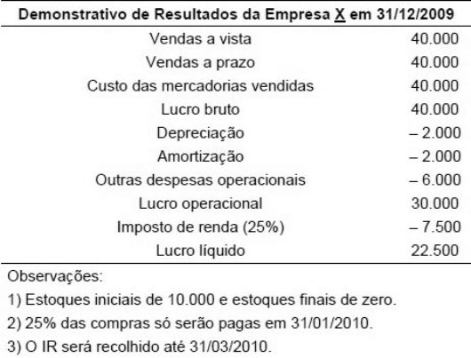{largura=42%}

Com base nos dados anteriores, analise:

I. As compras realizadas no período foram de 30.000.<br>
II. As compras realizadas no período foram de 40.000.<br>
III. O fluxo de caixa da empresa está negativo em 6.000.<br>
IV. O fluxo de caixa da empresa está positivo em 11.500.<br>

Está(ão) correta(s) apenas a(s) afirmativa(s):

- A) I, III
- B) I, IV
- C) II, III
- D) II, IV
- E) N.R.A.
- Gabarito: B
- Resolução: a caminho

## F0478 · CEBRASPE · 2010 · IPAJM · ME
- Fontes: TecConcursos 478 (2056619)
- Prova: CEBRASPE (CESPE) - Cont (IPAJM)/IPAJM/2010
- Grupos: ir-csll, receita-bruta, cmv, despesas-administrativas, deducoes, resultado-financeiro

rubrica valor (em R$)

| Conta | Valor |
|---|---:|
| caixa e bancos | 200.000 |
| ações em tesouraria | 20.000 |
| aplicações financeiras | 2.210.000 |
| juros ativos | 30.000 |
| duplicatas a receber | 200.000 |
| estoques de mercadorias | 125.000 |
| juros passivos a apropriar | 40.000 |
| salários antecipados | 25.000 |
| depósitos judiciais | 70.000 |
| depreciação | 70.000 |
| instalações | 410.000 |
| fornecedores | 120.000 |
| salários e encargos a pagar | 80.000 |
| empréstimos de curto prazo | 200.000 |
| duplicatas descontadas | 100.000 |
| capital social | 1.800.000 |
| reservas de lucros | 20.000 |
| juros passivos | 50.000 |
| vendas brutas | 2.100.000 |
| custo da mercadoria vendida | 450.000 |
| salários e encargos | 200.000 |
| juros ativos a apropriar | 50.000 |
| depreciação acumulada | 50.000 |
| impostos sobre vendas | 280.000 |
| aluguéis | 400.000 |

Os saldos nas rubricas patrimoniais e de resultado no encerramento de um exercício de determinada empresa são apresentados na tabela acima. Com base nesses dados e considerando que reste apenas apurar o resultado de exercício e calcular o imposto de renda e a contribuição social sobre o lucro, assinale a opção correta.

- A) O total do ativo é igual a R$ 3.140.000,00.
- B) O ativo disponível supera R$ 2.400.000,00.
- C) A liquidez corrente da empresa é superior a R$ 8,00.
- D) O resultado com mercadorias foi inferior a R$ 1.300.000,00.
- E) O resultado antes do imposto de renda é positivo em R$ 680.000,00.
- Gabarito: E
- Resolução: a caminho

## F0479 · CEBRASPE · 2010 · IPAJM · ME
- Fontes: TecConcursos 479 (2057864)
- Prova: CEBRASPE (CESPE) - Tec (IPAJM)/IPAJM/Superior/2010
- Grupos: resultado-financeiro, lucro-liquido, deducoes, receita-bruta, despesas-administrativas, despesas-vendas, ir-csll

Balancete de verificação para a questão. conta saldo em R$

| Conta | Valor |
|---|---:|
| seguros a pagar | 20 |
| receita financeira | 20 |
| provisões passivas | 70 |
| caixa | 90 |
| energia a pagar | 90 |
| marcas e patentes | 100 |
| banco | 120 |
| duplicatas descontadas | 130 |
| ações de controladas | 140 |
| empréstimos a pagar em longo prazo | 140 |
| títulos a receber | 150 |
| contingências trabalhistas | 180 |
| deduções sobre vendas | 180 |
| aluguéis a pagar | 190 |
| despesa com material | 190 |
| ações de coligadas | 200 |
| abatimento sobre compras | 200 |
| fretes sobre vendas | 210 |
| salários a pagar | 230 |
| fornecedores | 260 |
| provisão para perda de estoques | 300 |
| fretes sobre compras | 300 |
| despesa de depreciação | 300 |
| debêntures emitidas com resgate em curto prazo | 320 |
| duplicatas a receber | 330 |
| impostos sobre o lucro | 340 |
| despesas antecipadas de aluguéis | 400 |
| despesas antecipadas de seguros | 500 |
| capital social | 500 |
| duplicatas a receber em longo prazo | 600 |
| imóveis | 600 |
| terrenos | 800 |
| reserva de lucros | 900 |
| impostos incidentes sobre receita | 900 |
| despesa de manutenção | 900 |
| despesa financeira | 900 |
| veículos | 1.000 |
| depreciação acumulada | 1.100 |
| empréstimos bancários | 1.100 |
| despesa de salários | 1.100 |
| compra de estoques | 1.200 |
| estoque final de mercadorias | 1.500 |
| estoque inicial de mercadorias | 3.200 |
| receita operacional bruta | 9.000 |

Considerando as informações apresentadas no balancete de verificação, é correto afirmar que o resultado líquido apurado no período encontra-se entre

- A) R$ 300 e R$ 500.
- B) R$ 500 e R$ 700.
- C) R$ 700 e R$ 900.
- D) R$ 900 e R$ 1.100.
- E) R$ 1.100 e R$ 1.300.
- Gabarito: D
- Resolução: a caminho

## F0480 · CEBRASPE · 2010 · IPAJM · ME
- Fontes: TecConcursos 480 (2057883)
- Prova: CEBRASPE (CESPE) - Tec (IPAJM)/IPAJM/Superior/2010
- Grupos: resultado-bruto, receita-liquida, resultado-financeiro, deducoes, receita-bruta, despesas-administrativas, despesas-vendas, lucro-liquido, ir-csll

Balancete de verificação para a questão. conta saldo em R$

| Conta | Valor |
|---|---:|
| seguros a pagar | 20 |
| receita financeira | 20 |
| provisões passivas | 70 |
| caixa | 90 |
| energia a pagar | 90 |
| marcas e patentes | 100 |
| banco | 120 |
| duplicatas descontadas | 130 |
| ações de controladas | 140 |
| empréstimos a pagar em longo prazo | 140 |
| títulos a receber | 150 |
| contingências trabalhistas | 180 |
| deduções sobre vendas | 180 |
| aluguéis a pagar | 190 |
| despesa com material | 190 |
| ações de coligadas | 200 |
| abatimento sobre compras | 200 |
| fretes sobre vendas | 210 |
| salários a pagar | 230 |
| fornecedores | 260 |
| provisão para perda de estoques | 300 |
| fretes sobre compras | 300 |
| despesa de depreciação | 300 |
| debêntures emitidas com resgate em curto prazo | 320 |
| duplicatas a receber | 330 |
| impostos sobre o lucro | 340 |
| despesas antecipadas de aluguéis | 400 |
| despesas antecipadas de seguros | 500 |
| capital social | 500 |
| duplicatas a receber em longo prazo | 600 |
| imóveis | 600 |
| terrenos | 800 |
| reserva de lucros | 900 |
| impostos incidentes sobre receita | 900 |
| despesa de manutenção | 900 |
| despesa financeira | 900 |
| veículos | 1.000 |
| depreciação acumulada | 1.100 |
| empréstimos bancários | 1.100 |
| despesa de salários | 1.100 |
| compra de estoques | 1.200 |
| estoque final de mercadorias | 1.500 |
| estoque inicial de mercadorias | 3.200 |
| receita operacional bruta | 9.000 |

A margem bruta é um percentual obtido pela divisão do resultado bruto pela receita líquida de vendas e é utilizada para análise do desempenho das empresas. Após a elaboração da demonstração do resultado do exercício da empresa, é correto afirmar que a margem bruta encontra-se entre

- A) 6% e 18%.
- B) 18% e 30%.
- C) 30% e 42%.
- D) 42% e 54%.
- E) 54% e 66%.
- Gabarito: E
- Resolução: a caminho

## F0481 · CEBRASPE · 2010 · AGU · CE
- Fontes: TecConcursos 481 (2078044)
- Prova: CEBRASPE (CESPE) - Cont (AGU)/AGU/2010
- Grupos: resultado-bruto, receita-liquida, receita-bruta, cmv, despesas-administrativas, deducoes, resultado-financeiro

No encerramento de determinado exercício, uma empresa apresentou os seguintes saldos em suas contas patrimoniais e de resultado. rubrica valor (R$)

| Conta | Valor |
|---|---:|
| caixa e bancos | 20.000 |
| ações em tesouraria | 20.000 |
| aplicações financeiras | 210.000 |
| juros ativos | 30.000 |
| duplicatas a receber | 200.000 |
| estoques de mercadorias | 25.000 |
| juros passivos a apropriar | 4.000 |
| custo da mercadoria vendida | 900.000 |
| salários antecipados | 26.000 |
| depósitos judiciais | 70.000 |
| depreciação | 70.000 |
| instalações | 410.000 |
| fornecedores | 120.000 |
| salários e encargos a pagar | 80.000 |
| empréstimos de curto prazo | 200.000 |
| duplicatas descontadas | 100.000 |
| capital social | 180.000 |
| reservas de lucros | 20.000 |
| juros passivos | 50.000 |
| vendas brutas | 2.100.000 |
| salários e encargos | 200.000 |
| juros ativos a apropriar | 5.000 |
| depreciação acumulada | 50.000 |
| impostos sobre vendas | 280.000 |
| aluguéis | 400.000 |

Com base nesses saldos, julgue o próximo item.

O resultado com mercadorias foi superior a 50% das vendas líquidas.

- Gabarito: CERTO
- Resolução: a caminho

## F0482 · FCC · 2010 · TCM PA · ME
- Fontes: TecConcursos 482 (2149998)
- Prova: FCC - ACE (TCM PA)/TCM PA/"Sem Área"/2010
- Grupos: resultado-bruto, cmv, deducoes, receita-bruta, despesas-vendas

A Cia. Comercial apresenta em seu Balancete as seguintes contas de resultado, em reais: receita bruta: R$ 50.000,00; devolução de vendas: 5.000,00; abatimento sobre vendas: 1.000,00; frete sobre vendas: 2.000,00; custo das mercadorias vendidas: 15.000,00; comissões sobre vendas: 3.000,00; impostos sobre vendas: 10.000,00. Com base nessas informações, o lucro bruto da Cia. Comercial é, em reais,

- A) 25.000,00
- B) 20.000,00
- C) 19.000,00
- D) 17.000,00
- E) 14.000,00
- Gabarito: C
- Resolução: a caminho

## F0483 · FGV · 2010 · APS · ME
- Fontes: TecConcursos 483 (3096960)
- Prova: FGV - Esp Port (APS)/APS/Contador/2010
- Grupos: lucro-liquido, receita-bruta, despesas-administrativas, despesas-vendas

A Cia. Industrial Goiás apresentava os seguintes saldos em seu Balanço Patrimonial em 31/12/2008:

Caixa: R$ 8.000; Estoque de Matéria-Prima: R$ 1.000; Capital Social: R$ 9.000.

Em 2009, a empresa realizou as seguintes operações: - Requisição de 80% do estoque de Matéria-Prima - Incorrência de R$ 1.200 de custos com mão de obra direta, pagos integralmente - Incorrência de R$ 3.000 de Custos Indiretos de Fabricação, pagos integralmente - Despesas de Vendas de R$ 600, pagas integralmente - Despesas Administrativas de R$ 700, pagas integralmente - Compra de um terreno a prazo, no valor de R$ 1.500 No período, a empresa produziu 100 unidades, sendo que 90% foram vendidas por R$ 6.000 à vista.

Pede-se o valor do resultado líquido da Cia Goiás em 31/12/2009.

- A) Prejuízo de R$ 1.300.
- B) Prejuízo de R$ 790.
- C) Prejuízo de R$ 300.
- D) Lucro de R$ 380.
- E) Lucro de R$ 200.
- Gabarito: E
- Resolução: a caminho

## F0484 · FGV · 2010 · APS · ME
- Fontes: TecConcursos 484 (3096963)
- Prova: FGV - Esp Port (APS)/APS/Contador/2010
- Grupos: lair, ir-csll, despesas-administrativas

A Cia. AD comprou um ativo em 01/01/2007 por R$ 10.000. O ativo tem valor residual de R$ 1.000 e vida útil estimada em 3 anos. A depreciação é calculada pelo método linear. Em 1º de março de 2009, a Cia. AD vende o ativo por R$ 8.000. Qual é o resultado antes do imposto de renda da Cia. AD com a venda, considerando- se que a empresa não incorreu em despesas adicionais?

- A) Lucro de R$ 2.000.
- B) Lucro de R$ 1.500.
- C) Lucro de R$ 4.500.
- D) Lucro de R$ 7.222.
- E) Lucro de R$ 5.222.
- Gabarito: C
- Resolução: a caminho

## F0485 · FGV · 2010 · APS · ME
- Fontes: TecConcursos 485 (3096964)
- Prova: FGV - Esp Port (APS)/APS/Contador/2010
- Grupos: resultado-bruto, resultado-financeiro, ir-csll, deducoes, fora-destinacao, receita-bruta, despesas-administrativas, despesas-vendas

Em 31/12/2008, a Cia. Sergipe apresentava os seguintes saldos em suas contas, sendo que as receitas e despesas referem-se exclusivamente ao ano de 2008: Estoque Inicial de Mercadorias: zero; Despesas Administrativas: R$ 1.000; Vendas Brutas: R$ 200.000; Compras de Mercadorias: R$ 90.000; Estoque Final de Mercadorias: R$ 5.000; Descontos Financeiros Obtidos: R$2.000; Abatimentos Concedidos: R$ 4.000; Dividendos pagos: R$ 5.000; Imposto de Renda e Contribuição Social: R$2.000; Despesas Comerciais: R$ 20.000; Receita Financeira: R$ 10.000.

Qual é o valor do lucro bruto da Cia. Sergipe em 31/12/2008?

- A) R$ 109.000.
- B) R$ 111.000.
- C) R$ 118.000.
- D) R$ 196.000.
- E) R$ 116.000.
- Gabarito: B
- Resolução: a caminho

## F0486 · FGV · 2010 · CAERN · ME
- Fontes: TecConcursos 486 (3138927)
- Prova: FGV - Tec (CAERN)/CAERN/Contabilidade/2010
- Grupos: resultado-bruto, deducoes, receita-bruta, cmv

Em 31/12/2009 foram obtidos os seguintes dados de uma determinada empresa revendedora de mercadorias:

| Conta | Valor |
|---|---:|
| aquisição de mercadorias | R$ 60.000 |
| vendas de mercadorias | R$ 105.000 |
| devolução de vendas efetuadas | R$ 7.500 |
| inventário realizado de mercadorias | R$ 22.500 |

Sabendo-se que o estoque de mercadorias no início do exercício correspondia a 50% do valor líquido das aquisições e que o imposto de circulação de mercadorias era de 15%, o valor do lucro bruto apurado foi igual a

- A) R$ 24.375.
- B) R$ 28.875.
- C) R$ 39.000.
- D) R$ 37.500.
- E) R$ 30.000.
- Gabarito: B
- Resolução: a caminho

## F0487 · CEBRASPE · 2009 · PF · CE
- Fontes: TecConcursos 487 (22300)
- Prova: CEBRASPE (CESPE) - APF/PF/2009
- Grupos: ir-csll, lucro-liquido

A respeito da composição e da avaliação do patrimônio, julgue o item seguinte.

Suponha que o saldo da conta de resultado do exercício, antes do cálculo do imposto de renda devido, seja positivo em R$ 1,5 milhão e o valor desse imposto, de R$ 2 milhões. Nesse caso, o fato estará adequadamente representado pelo seguinte lançamento em reais.

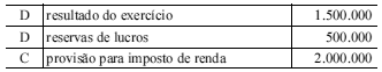{largura=35%}

- Gabarito: ERRADO
- Resolução: a caminho

## F0488 · CEBRASPE · 2009 · PF · CE
- Fontes: TecConcursos 488 (22302)
- Prova: CEBRASPE (CESPE) - APF/PF/2009
- Grupos: resultado-bruto

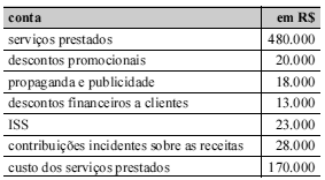{largura=35%}

Com base nas informações apresentadas na tabela acima, referentes a uma empresa prestadora de serviços, julgue o item seguinte.

As informações mostram que o lucro bruto da empresa foi de R$ 226.000,00.

- Gabarito: ERRADO
- Resolução: a caminho

## F0489 · FCC · 2009 · TRT 3 · ME
- Fontes: TecConcursos 489 (114609)
- Prova: FCC - TJ TRT3/TRT 3/Administrativa/Contabilidade/2009
- Grupos: cmv, resultado-financeiro, lucro-liquido, deducoes, fora-destinacao, receita-bruta, despesas-administrativas, despesas-vendas

Instruções: Utilize as informações abaixo para responder à questão.

A Cia. Fechadura apresentava seu Balancete em 31/12/X7, com os saldos, em reais, nas seguintes contas: Fornecedores 120.000,00; Aplicações Financeiras 105.000,00; Promissórias a Pagar 19.000,00; Fretes sobre Vendas 13.000,00; Conta Corrente 80.000,00; Clientes 175.000,00; Provisão para Créditos de Liquidação Duvidosa 5.000,00; Seguros Pagos Antecipadamente 40.000,00; Adiantamento de Clientes 25.000,00; Despesas Financeiras 17.500,00; Despesas de Comissões sobre vendas 7.500,00; Receitas Financeiras 6.000,00; Custo das Mercadorias Vendidas 140.000,00; Despesas de Salários 10.000,00; Reserva Legal 40.000,00; Abatimento sobre Vendas 1.500,00; Estoques de Mercadorias 150.000,00; Receita de Vendas 310.000,00; Capital Social 200.000,00; Títulos a Pagar de Longo Prazo 65.500,00; Devolução de Vendas 5.500,00; Empréstimos de Curto Prazo Obtidos 80.000,00; Terrenos 85.000,00; Despesas de Depreciação de Imóveis 2.500,00; Imóveis 50.000,00;

Depreciação Acumulada-Imóveis 12.000,00.

O lucro líquido do exercício foi, em reais,

- A) 111.500,00
- B) 113.500,00
- C) 118.500,00
- D) 121.000,00
- E) 125.500,00
- Gabarito: C
- Resolução: a caminho

## F0490 · FCC · 2009 · TRT 3 · ME
- Fontes: TecConcursos 490 (114614)
- Prova: FCC - TJ TRT3/TRT 3/Administrativa/Contabilidade/2009
- Grupos: receita-liquida, cmv, deducoes, receita-bruta, despesas-vendas

Instruções: Utilize as informações abaixo para responder à questão.

A empresa MJC realizou vendas de R$ 225.000,00 durante o ano de X8. Durante este ano, também registrou as seguintes operações: devoluções de vendas de R$ 7.500,00, abatimento sobre vendas de R$ 3.800,00, frete sobre vendas de R$ 6.600,00, custo das mercadorias vendidas de R$ 115.000,00, comissões sobre vendas de R$ 2.400,00, impostos sobre vendas de R$ 11.000,00 e provisão para créditos de  liquidação duvidosa de R$ 3.000,00.

A empresa MJC apurou uma receita líquida de, em reais,

- A) 190.700,00
- B) 197.300,00
- C) 200.300,00
- D) 202.700,00
- E) 214.000,00
- Gabarito: D
- Resolução: a caminho

## F0491 · FCC · 2009 · TRT 3 · ME
- Fontes: TecConcursos 491 (114615)
- Prova: FCC - TJ TRT3/TRT 3/Administrativa/Contabilidade/2009
- Grupos: resultado-bruto, cmv, deducoes, receita-bruta, despesas-vendas

Instruções: Utilize as informações abaixo para responder à questão.

A empresa MJC realizou vendas de R$ 225.000,00 durante o ano de X8. Durante este ano, também registrou as seguintes operações: devoluções de vendas de R$ 7.500,00, abatimento sobre vendas de R$ 3.800,00, frete sobre vendas de R$ 6.600,00, custo das mercadorias vendidas de R$ 115.000,00, comissões sobre vendas de R$ 2.400,00, impostos sobre vendas de R$ 11.000,00 e provisão para créditos de  liquidação duvidosa de R$ 3.000,00.

A empresa MJC apurou um resultado bruto com mercadorias de, em reais,

- A) 75.700,00
- B) 82.300,00
- C) 84.700,00
- D) 85.300,00
- E) 87.700,00
- Gabarito: E
- Resolução: a caminho

## F0492 · FCC · 2009 · TRT 3 · ME
- Fontes: TecConcursos 492 (114619)
- Prova: FCC - TJ TRT3/TRT 3/Administrativa/Contabilidade/2009
- Grupos: 

Se uma empresa superavalia seu estoque final, isso indica que o seu lucro

- A) não é alterado.
- B) é superavaliado.
- C) é subavaliado.
- D) é real.
- E) é imprevisível.
- Gabarito: B
- Resolução: a caminho

## F0493 · FCC · 2009 · MPE SE · ME
- Fontes: TecConcursos 493 (189628)
- Prova: FCC - Ana (MPE SE)/MPE SE/Contabilidade/2009
- Grupos: receita-bruta, cmv, resultado-bruto, despesas-vendas, despesas-administrativas, resultado-financeiro, equivalencia, outras-receitas-despesas, lucro-liquido, fora-ativo, fora-passivo, fora-pl

Instruções: Para responder à questão, considere as informações a seguir oriundas do Departamento de Contabilidade da Cia. Margarida.
I. Os saldos finais de suas contas no período 2007/2008 eram:<br>

| Saldos Devedores | 2007 | 2008 |
|---|---:|---:|
| Amortizações | 1.000,00 | 1.000,00 |
| Benfeitorias em Propriedades de Terceiros | 4.000,00 | 4.000,00 |
| Caixa | 500,00 | 1.500,00 |
| Clientes | 18.000,00 | 27.500,00 |
| Custo da Mercadoria Vendida | 20.000,00 | 30.000,00 |
| Depreciações | 1.000,00 | 2.000,00 |
| Despesas de Juros | 4.000,00 | 4.500,00 |
| Despesas Administrativas | 3.000,00 | 5.000,00 |
| Despesas Comerciais | 4.300,00 | 5.100,00 |
| Despesas Tributárias | 4.400,00 | 6.100,00 |
| Encargos e Salários | 12.000,00 | 16.100,00 |
| Estoques | 1.800,00 | 3.000,00 |
| Imóveis | 2.500,00 | 12.500,00 |
| Participações em Outras Companhias | 4.500,00 | 4.000,00 |
| Perdas com Clientes | 0 | 1.200,00 |
| Provisão para Devedores | 300,00 | 500,00 |
| Resultado de Equivalência | 0 | 500,00 |
| Veículos | 5.000,00 | 10.000,00 |
| **Total** | **86.300,00** | **134.500,00** |

| Saldos Credores | 2007 | 2008 |
|---|---:|---:|
| Amortização Acumulada | 1.000,00 | 2.000,00 |
| Capital Social | 15.000,00 | 27.000,00 |
| Contas a Pagar | 2.000,00 | 3.000,00 |
| Depreciação Acumulada | 3.000,00 | 2.000,00 |
| Duplicatas Descontadas | 0 | 10.000,00 |
| Encargos e Salários a Pagar | 600,00 | 1.200,00 |
| Empréstimos a Pagar | 5.400,00 | 10.000,00 |
| Fornecedores | 5.000,00 | 6.800,00 |
| Juros a Pagar | 3.000,00 | 1.000,00 |
| PDD | 300,00 | 500,00 |
| Reservas | 1.000,00 | 0 |
| Resultado c/Alienação de Veículos | 0 | 1.000,00 |
| Vendas de Mercadorias | 50.000,00 | 70.000,00 |
| **Total** | **86.300,00** | **134.500,00** |

II. Dados complementares relativos a operações realizadas, na empresa, no exercício de 2008:<br>

− No início do período a empresa renova integralmente sua frota, leiloando todos os veículos antigos e adquirindo novos veículos, mais adequados às necessidades previstas para os próximos 5 anos. − Aumenta seu capital por meio da utilização do saldo anterior das Reservas e de subscrições de novos sócios. − Altera o perfil de sua dívida de longo prazo, quitando os empréstimos anteriores, cujo vencimento era previsto para o final de 2009 e assume novo compromisso com quitação prevista para o final de 2012. − A empresa adquiriu novos imóveis, preparando-se para expansão futura, no final do período.

O resultado apurado pela empresa em 2007 foi

- A) um prejuízo de R$ 1.000,00.
- B) um resultado superavitário.
- C) maior que o obtido em 2008.
- D) um resultado deficitário.
- E) inferior ao resultado de 2008.
- Gabarito: C
### O que a questão pede
Comparar o **resultado de 2007** com o de 2008. É preciso apurar os dois a partir do balancete com as duas colunas. Os saldos de resultado ainda não foram encerrados em nenhum dos anos.

### Cálculos prévios
**Resultado de cada ano (saldo credor soma, saldo devedor subtrai):**

| Conta | 2007 | 2008 |
|---|---:|---:|
| Vendas de mercadorias | 50.000 | 70.000 |
| Resultado c/ alienação de veículos (ganho) | 0 | 1.000 |
| (–) Custo da mercadoria vendida | (20.000) | (30.000) |
| (–) Encargos e salários | (12.000) | (16.100) |
| (–) Despesas tributárias | (4.400) | (6.100) |
| (–) Despesas comerciais | (4.300) | (5.100) |
| (–) Despesas administrativas | (3.000) | (5.000) |
| (–) Despesas de juros | (4.000) | (4.500) |
| (–) Depreciações | (1.000) | (2.000) |
| (–) Amortizações | (1.000) | (1.000) |
| (–) Perdas com clientes | 0 | (1.200) |
| (–) Provisão para devedores (despesa) | (300) | (500) |
| (–) Resultado de equivalência (saldo devedor: perda) | 0 | (500) |
| **Resultado** | **0** | **(1.000)** |

2007 fechou **zerado** (nem lucro nem prejuízo); 2008 teve **prejuízo de 1.000**. Zero é maior que −1.000.

### Passo a passo
Resultado de 2007:

```dre
@ Vendas de Mercadorias | 50.000,00 | receita-bruta
@ Custo da Mercadoria Vendida | 20.000,00 | cmv
@ Despesas Comerciais | 4.300,00 | despesas-vendas
@ Provisão para Devedores | 300,00 | despesas-vendas
@ Encargos e Salários | 12.000,00 | despesas-administrativas
@ Despesas Tributárias | 4.400,00 | despesas-administrativas
@ Despesas Administrativas | 3.000,00 | despesas-administrativas
@ Depreciações | 1.000,00 | despesas-administrativas
@ Amortizações | 1.000,00 | despesas-administrativas
@ Despesas de Juros | 4.000,00 | resultado-financeiro
@ PDD (saldo credor) | 300,00 | fora-ativo
@ Capital, reservas e demais contas patrimoniais | — | fora-outros
> "Provisão para Devedores" no lado devedor é a despesa do ano; a "PDD" do lado credor é o saldo retificador de clientes.
! PDD (saldo credor); Capital, reservas e demais contas patrimoniais
+ Vendas de mercadorias | 50.000,00 | Vendas de Mercadorias
+ (–) CMV | (20.000,00) | Custo da Mercadoria Vendida
= Lucro bruto | 30.000,00
+ (–) Despesas comerciais | (4.600,00) | Despesas Comerciais; Provisão para Devedores
+ (–) Despesas administrativas e gerais | (21.400,00) | Encargos e Salários; Despesas Tributárias; Despesas Administrativas; Depreciações; Amortizações
+ (–) Despesas de juros | (4.000,00) | Despesas de Juros
= Resultado de 2007 | 0,00
```

Pela mesma conta, 2008 dá prejuízo de 1.000 (tabela acima). Gabarito **C (maior que o obtido em 2008)**.

### Por que as outras estão erradas
- **A (prejuízo de 1.000):** é o resultado de **2008**, não o de 2007.
- **B (superavitário) e D (deficitário):** 2007 ficou exatamente em zero; nem lucro nem prejuízo.
- **E (inferior ao de 2008):** é o contrário; 0 > −1.000.

### O que ignorar e por quê
- **Dados complementares de 2008** (troca da frota, aumento de capital, troca da dívida, compra de imóveis): só servem para as questões irmãs (F0494 e F0495) e para conferir o balancete.
- **Saldos patrimoniais** (caixa, clientes, estoques, imóveis, fornecedores, capital).

### Pegadinhas
- **Duas contas parecidas em lados diferentes:** "Provisão para Devedores" (devedora, despesa) e "PDD" (credora, saldo). Somar as duas como despesa conta em dobro.
- **Equivalência no lado devedor** é perda (2008: −500).
- **Resultado zero** não é superávit nem déficit: a FCC usou isso para eliminar B e D de uma vez.

### Leve para as próximas
1. Balancete de dois anos: apure os dois resultados lado a lado, na mesma tabela.
2. O lado do saldo diz a natureza: devedor = despesa ou perda; credor = receita ou ganho.
3. Conferência: o total devedor do balancete tem de bater com o credor (86.300 em 2007; 134.500 em 2008).

## F0494 · FCC · 2009 · MPE SE · ME
- Fontes: TecConcursos 494 (189720)
- Prova: FCC - Ana (MPE SE)/MPE SE/Contabilidade/2009
- Grupos: outras-receitas-despesas, fora-ativo

Instruções: Para responder à questão, considere as informações a seguir oriundas do Departamento de Contabilidade da Cia. Margarida.
I. Os saldos finais de suas contas no período 2007/2008 eram:<br>

| Saldos Devedores | 2007 | 2008 |
|---|---:|---:|
| Amortizações | 1.000,00 | 1.000,00 |
| Benfeitorias em Propriedades de Terceiros | 4.000,00 | 4.000,00 |
| Caixa | 500,00 | 1.500,00 |
| Clientes | 18.000,00 | 27.500,00 |
| Custo da Mercadoria Vendida | 20.000,00 | 30.000,00 |
| Depreciações | 1.000,00 | 2.000,00 |
| Despesas de Juros | 4.000,00 | 4.500,00 |
| Despesas Administrativas | 3.000,00 | 5.000,00 |
| Despesas Comerciais | 4.300,00 | 5.100,00 |
| Despesas Tributárias | 4.400,00 | 6.100,00 |
| Encargos e Salários | 12.000,00 | 16.100,00 |
| Estoques | 1.800,00 | 3.000,00 |
| Imóveis | 2.500,00 | 12.500,00 |
| Participações em Outras Companhias | 4.500,00 | 4.000,00 |
| Perdas com Clientes | 0 | 1.200,00 |
| Provisão para Devedores | 300,00 | 500,00 |
| Resultado de Equivalência | 0 | 500,00 |
| Veículos | 5.000,00 | 10.000,00 |
| **Total** | **86.300,00** | **134.500,00** |

| Saldos Credores | 2007 | 2008 |
|---|---:|---:|
| Amortização Acumulada | 1.000,00 | 2.000,00 |
| Capital Social | 15.000,00 | 27.000,00 |
| Contas a Pagar | 2.000,00 | 3.000,00 |
| Depreciação Acumulada | 3.000,00 | 2.000,00 |
| Duplicatas Descontadas | 0 | 10.000,00 |
| Encargos e Salários a Pagar | 600,00 | 1.200,00 |
| Empréstimos a Pagar | 5.400,00 | 10.000,00 |
| Fornecedores | 5.000,00 | 6.800,00 |
| Juros a Pagar | 3.000,00 | 1.000,00 |
| PDD | 300,00 | 500,00 |
| Reservas | 1.000,00 | 0 |
| Resultado c/Alienação de Veículos | 0 | 1.000,00 |
| Vendas de Mercadorias | 50.000,00 | 70.000,00 |
| **Total** | **86.300,00** | **134.500,00** |

II. Dados complementares relativos a operações realizadas, na empresa, no exercício de 2008:<br>

− No início do período a empresa renova integralmente sua frota, leiloando todos os veículos antigos e adquirindo novos veículos, mais adequados às necessidades previstas para os próximos 5 anos. − Aumenta seu capital por meio da utilização do saldo anterior das Reservas e de subscrições de novos sócios. − Altera o perfil de sua dívida de longo prazo, quitando os empréstimos anteriores, cujo vencimento era previsto para o final de 2009 e assume novo compromisso com quitação prevista para o final de 2012. − A empresa adquiriu novos imóveis, preparando-se para expansão futura, no final do período.

O valor recebido na alienação dos veículos foi, em R$,

- A) 1.000,00
- B) 2.000,00
- C) 3.000,00
- D) 4.000,00
- E) 5.000,00
- Gabarito: C
### O que a questão pede
O **preço recebido** no leilão dos veículos antigos. O balancete dá o **ganho** (1.000), não o preço. Preço = valor contábil baixado + ganho.

### Cálculos prévios
**1) Valor contábil dos veículos antigos** (vendidos no **início** de 2008, sem depreciação nesse ano):

| Item | Valor |
|---|---:|
| Custo dos veículos antigos (saldo de 2007) | 5.000 |
| (–) Depreciação acumulada (saldo de 2007) | (3.000) |
| = Valor contábil | **2.000** |

**2) Por que a depreciação acumulada de 2007 é toda dos veículos:** em 2008 ela recomeça do zero com os veículos novos. Veículos novos de 10.000 com vida útil de 5 anos → depreciação de **2.000** por ano, igual à despesa "Depreciações" de 2008 e ao saldo acumulado de 2008 (2.000). Logo, os 3.000 de 2007 saíram inteiros com os veículos antigos.

**3) Preço de venda:** valor contábil 2.000 + ganho 1.000 = **3.000**.

### Passo a passo
```dre
@ Veículos antigos (custo) | 5.000,00 | fora-ativo
@ Depreciação acumulada dos veículos antigos | 3.000,00 | fora-ativo
@ Resultado c/Alienação de Veículos | 1.000,00 | outras-receitas-despesas
> Baixa: sai o custo (5.000) e sai a depreciação acumulada (3.000); o valor contábil baixado é 2.000.
! Veículos antigos (custo); Depreciação acumulada dos veículos antigos
> Na DRE de 2008 entra só o ganho: preço recebido − valor contábil.
+ Outras receitas (ganho na alienação) | 1.000,00 | Resultado c/Alienação de Veículos
```

Preço recebido = 2.000 + 1.000 = **3.000**. Gabarito **C**.

### O que ignorar e por quê
- **Veículos de 2008 (10.000):** são os novos; não entram no cálculo do preço dos antigos.
- **Amortização acumulada:** é das benfeitorias em propriedades de terceiros, não dos veículos.

### Pegadinhas
- **A (1.000):** é o ganho, não o preço recebido.
- **B (2.000):** é o valor contábil baixado.
- **E (5.000):** é o custo original dos veículos antigos.
- **D (4.000)** = 3.000 + 1.000: contou o ganho duas vezes.
- **Esquecer a baixa da depreciação acumulada:** confundiria a queda de 3.000 para 2.000 no saldo com uma "reversão".

### Leve para as próximas
1. Ganho (ou perda) na venda de imobilizado = preço − (custo − depreciação acumulada).
2. Preço = valor contábil + ganho (ou − perda).
3. Use a variação da depreciação acumulada para descobrir quanto saiu na baixa: saldo inicial + depreciação do ano − baixa = saldo final.

## F0495 · FCC · 2009 · MPE SE · ME
- Fontes: TecConcursos 495 (189725)
- Prova: FCC - Ana (MPE SE)/MPE SE/Contabilidade/2009
- Grupos: calculo-cmv, cmv, fora-ativo

Instruções: Para responder à questão, considere as informações a seguir oriundas do Departamento de Contabilidade da Cia. Margarida.
I. Os saldos finais de suas contas no período 2007/2008 eram:<br>

| Saldos Devedores | 2007 | 2008 |
|---|---:|---:|
| Amortizações | 1.000,00 | 1.000,00 |
| Benfeitorias em Propriedades de Terceiros | 4.000,00 | 4.000,00 |
| Caixa | 500,00 | 1.500,00 |
| Clientes | 18.000,00 | 27.500,00 |
| Custo da Mercadoria Vendida | 20.000,00 | 30.000,00 |
| Depreciações | 1.000,00 | 2.000,00 |
| Despesas de Juros | 4.000,00 | 4.500,00 |
| Despesas Administrativas | 3.000,00 | 5.000,00 |
| Despesas Comerciais | 4.300,00 | 5.100,00 |
| Despesas Tributárias | 4.400,00 | 6.100,00 |
| Encargos e Salários | 12.000,00 | 16.100,00 |
| Estoques | 1.800,00 | 3.000,00 |
| Imóveis | 2.500,00 | 12.500,00 |
| Participações em Outras Companhias | 4.500,00 | 4.000,00 |
| Perdas com Clientes | 0 | 1.200,00 |
| Provisão para Devedores | 300,00 | 500,00 |
| Resultado de Equivalência | 0 | 500,00 |
| Veículos | 5.000,00 | 10.000,00 |
| **Total** | **86.300,00** | **134.500,00** |

| Saldos Credores | 2007 | 2008 |
|---|---:|---:|
| Amortização Acumulada | 1.000,00 | 2.000,00 |
| Capital Social | 15.000,00 | 27.000,00 |
| Contas a Pagar | 2.000,00 | 3.000,00 |
| Depreciação Acumulada | 3.000,00 | 2.000,00 |
| Duplicatas Descontadas | 0 | 10.000,00 |
| Encargos e Salários a Pagar | 600,00 | 1.200,00 |
| Empréstimos a Pagar | 5.400,00 | 10.000,00 |
| Fornecedores | 5.000,00 | 6.800,00 |
| Juros a Pagar | 3.000,00 | 1.000,00 |
| PDD | 300,00 | 500,00 |
| Reservas | 1.000,00 | 0 |
| Resultado c/Alienação de Veículos | 0 | 1.000,00 |
| Vendas de Mercadorias | 50.000,00 | 70.000,00 |
| **Total** | **86.300,00** | **134.500,00** |

II. Dados complementares relativos a operações realizadas, na empresa, no exercício de 2008:<br>

− No início do período a empresa renova integralmente sua frota, leiloando todos os veículos antigos e adquirindo novos veículos, mais adequados às necessidades previstas para os próximos 5 anos. − Aumenta seu capital por meio da utilização do saldo anterior das Reservas e de subscrições de novos sócios. − Altera o perfil de sua dívida de longo prazo, quitando os empréstimos anteriores, cujo vencimento era previsto para o final de 2009 e assume novo compromisso com quitação prevista para o final de 2012. − A empresa adquiriu novos imóveis, preparando-se para expansão futura, no final do período.

O valor das compras de mercadorias efetuadas no período é, em R$,

- A) 29.000,00
- B) 30.200,00
- C) 31.000,00
- D) 31.200,00
- E) 33.000,00
- Gabarito: D
### O que a questão pede
O valor das **compras de mercadorias** de 2008. É a fórmula do CMV ao contrário: compras = CMV + estoque final − estoque inicial.

### Cálculos prévios
| Item | Valor |
|---|---:|
| CMV de 2008 | 30.000 |
| (+) Estoque final (saldo de 2008) | 3.000 |
| (–) Estoque inicial (saldo de 2007) | (1.800) |
| **= Compras** | **31.200** |

Conferência: 1.800 + 31.200 − 3.000 = 30.000.

### Passo a passo
```dre
@ Estoques (saldo de 2007 = estoque inicial) | 1.800,00 | calculo-cmv
@ Compras de 2008 (incógnita) | 31.200,00 | calculo-cmv
@ Estoques (saldo de 2008 = estoque final) | 3.000,00 | calculo-cmv
> CMV = EI + compras − EF. Com o CMV dado (30.000), as compras saem por diferença: 30.000 + 3.000 − 1.800.
+ (–) CMV | (30.000,00) | Estoques (saldo de 2007 = estoque inicial); Compras de 2008 (incógnita); Estoques (saldo de 2008 = estoque final)
```

Gabarito **D (31.200)**.

### O que ignorar e por quê
- **Fornecedores (5.000 → 6.800):** a variação mostra quanto ficou a pagar, não quanto foi comprado. Compras a prazo e pagamentos se misturam nesse saldo.
- **Vendas de 2008:** não entram; o CMV já está pronto.

### Pegadinhas
- **E (33.000)** = 30.000 + 3.000: esqueceu de tirar o estoque inicial.
- **Inverter os estoques** (30.000 + 1.800 − 3.000 = 28.800) é o erro de sinal mais comum; não está nas alternativas, mas aparece em outras provas.
- **Saldo de 2007 = estoque inicial de 2008:** o fim de um ano é o começo do seguinte.

### Leve para as próximas
1. Compras = CMV + EF − EI (a fórmula do CMV isolando as compras).
2. Balancete de dois anos: a coluna do ano anterior dá o estoque inicial.

## F0496 · FCC · 2009 · MPE SE · ME
- Fontes: TecConcursos 496 (189729)
- Prova: FCC - Ana (MPE SE)/MPE SE/Contabilidade/2009
- Grupos: lucro-liquido

Na Demonstração do Resultado do Exercício, evidenciam-se

- A) os rendimentos ganhos no período apenas quando realizados em moeda e o resultado líquido do exercício.
- B) a destinação do resultado do exercício e a distribuição dos dividendos aos acionistas.
- C) os valores da riqueza gerada pela companhia e da distribuição entre os elementos que contribuíram para a geração dessa riqueza.
- D) a destinação do resultado do exercício e o montante por ação do lucro do exercício.
- E) as participações de debêntures, empregados, administradores e partes beneficiárias.
- Gabarito: E
- Resolução: a caminho

## F0497 · CEBRASPE · 2009 · ANTAQ · CE
- Fontes: TecConcursos 497 (192146)
- Prova: CEBRASPE (CESPE) - AA (ANTAQ)/ANTAQ/Ciências Contábeis/2009
- Grupos: lucro-liquido

Com relação aos tributos e contribuições, julgue o item a seguir.

A compensação dos prejuízos fiscais pode ser feita até o limite do lucro líquido ajustado, em um prazo de até 5 anos.

- Gabarito: ERRADO
- Resolução: a caminho

## F0498 · FCC · 2009 · TRT 16 · ME
- Fontes: TecConcursos 498 (201850)
- Prova: FCC - AJ TRT16/TRT 16/Administrativa/Contabilidade/2009
- Grupos: receita-bruta, lucro-liquido

Para apuração do resultado do exercício foram considerados os seguintes dados (em R$):

| Conta | Valor |
|---|---:|
| Compras | 1.200,00 |
| Estoque inicial de Mercadorias | 360,00 |
| Receitas de Vendas | 2.600,00 |

Sabendo-se que o estoque existente, no momento, alcançava o valor de R$ 480,00, é correto afirmar que o saldo da conta "Mercadoria", no balanço de encerramento do exercício social, é de

- A) R$ 480,00 e o custo das mercadorias vendidas foi de R$ 1.200,00.
- B) R$ 480,00 e o custo das mercadorias vendidas foi de R$ 1.400,00.
- C) R$ 480,00 e registrou-se um prejuízo de R$ 1.080,00.
- D) R$ 480,00 e o lucro bruto de vendas do período foi de R$ 1.080,00.
- E) R$ 480,00 e o lucro bruto das vendas foi de R$ 1.520,00.
- Gabarito: E
- Resolução: a caminho

## F0499 · FCC · 2009 · TRT 16 · ME
- Fontes: TecConcursos 499 (201868)
- Prova: FCC - AJ TRT16/TRT 16/Administrativa/Contabilidade/2009
- Grupos: resultado-bruto

A Empresa Sucesso S/A apresentou, em 31.12.2008, os seguintes saldos (em R$) em seu balancete de verificação:

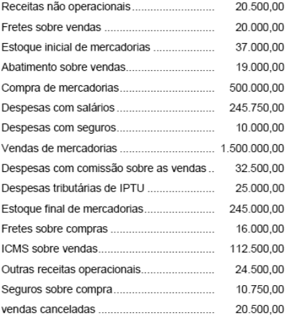{largura=35%}

De acordo com os dados fornecidos, o Resultado Bruto (em R$) foi de

- A) 1.250.029,00.
- B) 1.029.250,00.
- C) 1.129.250,00.
- D) 1.030.000,00.
- E) 1.025.250,00.
- Gabarito: B
- Resolução: a caminho

## F0500 · CEBRASPE · 2009 · TRT 17 · CE
- Fontes: TecConcursos 500 (219512)
- Prova: CEBRASPE (CESPE) - AJ TRT17/TRT 17/Administrativa/Contabilidade/2009
- Grupos: receita-bruta, lucro-liquido

Com relação a livros e demonstrativos contábeis, julgue o item.

O produto das vendas de bens ou direitos do ativo permanente, mesmo quando resulte em ingresso financeiro, não deve ser incluído na demonstração do resultado do exercício.

- Gabarito: ERRADO
- Resolução: a caminho

## F0501 · CEBRASPE · 2009 · TRE GO · ME
- Fontes: TecConcursos 501 (222130)
- Prova: CEBRASPE (CESPE) - AJ TRE GO/TRE GO/Administrativa/Contabilidade/2009
- Grupos: receita-liquida, deducoes, receita-bruta, despesas-vendas, resultado-financeiro

No encerramento do exercício de uma empresa comercial, apuraram-se, entre outros, os saldos a seguir. ► faturamento: R$ 700.000,00

► devoluções de vendas: R$ 35.000,00

► descontos comerciais sobre vendas: R$ 15.000,00

► IPI sobre vendas: R$ 50.000,00

► descontos financeiros sobre vendas: R$ 25.000,00

► ICMS sobre vendas: R$ 108.000,00

► comissões sobre vendas: R$ 30.750,00

► PIS (cumulativo) sobre vendas: R$ 9.900,00 Com base nesses dados, é correto afirmar que a receita líquida de vendas, nos termos das legislações comercial e tributária, é de

- A) R$ 522.750,00.
- B) R$ 532.100,00.
- C) R$ 426.350,00.
- D) R$ 482.100,00.
- Gabarito: D
- Resolução: a caminho

## F0502 · CEBRASPE · 2009 · TRE MG · ME
- Fontes: TecConcursos 502 (242354)
- Prova: CEBRASPE (CESPE) - TJ TRE MG/TRE MG/Administrativa/Contabilidade/2009
- Grupos: resultado-bruto, deducoes, receita-bruta, lucro-liquido

conta saldo (R$)

| Conta | Valor |
|---|---:|
| vendas brutas | 600.000,00 |
| devoluções de vendas | 6.000,00 |
| impostos sobre vendas | 126.000,00 |
| compras de mercadorias | 420.000,00 |

abatimentos sobre compras de mercadorias 12.000,00

| Conta | Valor |
|---|---:|
| devoluções de mercadorias compradas | 21.000,00 |
| ICMS sobre compras de mercadorias | 66.000,00 |
| estoque de mercadorias | 30.000,00 |
| frete sobre compras de mercadorias | 7.500,00 |

Considerando que as contas apresentadas acima, com os respectivos saldos, foram extraídas do balancete de verificação de determinada empresa, levantado para fins de apuração de resultado do exercício de 2008, e sabendo que, no início do exercício de 2008, o estoque de mercadorias era de R$ 84.000,00, é correto concluir que o lucro bruto apurado no exercício foi de

- A) R$ 279.000,00.
- B) R$ 169.500,00.
- C) R$ 85.500,00.
- D) R$ 27.000,00.
- E) R$ 14.000,00.
- Gabarito: C
- Resolução: a caminho

## F0503 · CEBRASPE · 2009 · TRE MG · ME
- Fontes: TecConcursos 503 (242357)
- Prova: CEBRASPE (CESPE) - TJ TRE MG/TRE MG/Administrativa/Contabilidade/2009
- Grupos: resultado-bruto, deducoes, receita-bruta, cmv

A Comercial Brasil de Embalagens Ltda. iniciou o exercício de 2008 com R$ 42.850,34 de mercadorias em estoque e encerrou o exercício sem estoque. Durante o exercício, a empresa comprou R$ 231.840,69 em mercadorias e faturou R$ 510.000,00 em vendas. Em suas compras, essa empresa sempre conseguiu desconto de 3% para pagamento no vencimento e sempre utilizou esse desconto.

Considerando essa situação hipotética e sabendo que sobre as vendas incidiram impostos à alíquota real de 18% e que não houve devoluções ou abatimentos, nem nas compras, nem nas vendas, o custo da mercadoria vendida e o lucro bruto foram, respectivamente, iguais a

- A) R$ 173.200,32 e R$ 143.508,97.
- B) R$ 274.691,03 e R$ 143.508,97.
- C) R$ 281.508,97 e R$ 130.010,11.
- D) R$ 302.700,55 e R$ 274.691,03.
- E) R$ 314.691,03 e R$ 173.200,32.
- Gabarito: B
- Resolução: a caminho

## F0504 · FGV · 2009 · SAD PE · ME
- Fontes: TecConcursos 504 (262609)
- Prova: FGV - Ana (SAD PE)/SAD PE/Controle Interno /Finanças Públicas/2009
- Grupos: resultado-bruto, receita-liquida, resultado-financeiro, deducoes, receita-bruta, despesas-administrativas, despesas-operacionais, lucro-liquido, outras-operacionais, outras-receitas-despesas, resultado-operacional

Conforme preceitua a legislação societária em vigor, analise as afirmativas a seguir.

I. A demonstração do resultado do exercício discriminará a receita bruta das vendas e serviços, as deduções das vendas, os abatimentos e os impostos.<br>
II. A demonstração do resultado do exercício discriminará a receita líquida das vendas e serviços, o custo das mercadorias e serviços vendidos e o lucro bruto.<br>
III. A demonstração do resultado do exercício discriminará as despesas com as vendas, as despesas financeiras, deduzidas das receitas, as despesas gerais e<br>

administrativas, e outras despesas operacionais.

IV. A demonstração do resultado do exercício discriminará o lucro ou prejuízo operacional, as receitas e despesas não operacionais.<br>

Assinale:

- A) se somente as afirmativas I e II estiverem corretas.
- B) se somente as afirmativas III e IV estiverem corretas.
- C) se somente as afirmativas I, III e V estiverem corretas.
- D) se somente as afirmativas I, II e III estiverem corretas.
- E) se somente as afirmativas II e IV estiverem corretas.
- Gabarito: D
- Resolução: a caminho

## F0505 · FCC · 2009 · TRE PI · ME
- Fontes: TecConcursos 505 (402751)
- Prova: FCC - TJ (TRE PI)/TRE PI/Administrativa/Contabilidade/2009
- Grupos: lucro-liquido

A Demonstração do Resultado do Exercício é um relatório contábil que reflete

- A) a variação da situação financeira entre dois momentos diferentes e sua distribuição.
- B) o Patrimônio Líquido em determinado momento e sua distribuição.
- C) as despesas e as receitas incorridas entre dois momentos diferentes.
- D) as despesas pagas e as receitas incorridas entre dois momentos diferentes e sua distribuição.
- E) as despesas incorridas e as receitas recebidas entre dois momentos diferentes e sua distribuição.
- Gabarito: C
- Resolução: a caminho

## F0506 · FCC · 2009 · TRE PI · ME
- Fontes: TecConcursos 506 (402753)
- Prova: FCC - TJ (TRE PI)/TRE PI/Administrativa/Contabilidade/2009
- Grupos: cmv, resultado-financeiro, lucro-liquido, deducoes, fora-destinacao, receita-bruta, despesas-administrativas, despesas-vendas

Instruções: Utilize as informações a seguir para responder à questão. (Valores em reais)

A Cia. Prezada apresentou seu Balancete em 31/12/X0, com os seguintes saldos das contas: Fornecedores 115.500; Clientes 300.000; Fundo de Aplicações Financeiras 102.000; Duplicatas a Pagar 28.500; Fretes sobre Vendas 3.000; Conta Corrente Banco X 120.000; Seguros Pagos Antecipadamente 45.000; Adiantamento de Clientes 87.000; Despesas Financeiras 12.000; Despesas de Comissões sobre vendas 7.500; Receitas Financeiras 15.000; Custo das Mercadorias Vendidas 150.000; Despesas de Salários 9.000; Reserva Legal 62.500; Abatimento sobre Vendas 1.500; Despesas com Propaganda 15.000; Mercadorias 150.000; Vendas 300.000; Capital Social 340.000; Títulos a Pagar de Longo Prazo 45.000; Devolução de Vendas 6.000; Empréstimos de Curto Prazo Obtidos 130.000; Terrenos 75.000; Despesas de Depreciação de Imóveis 7.500; Imóveis 150.000; Depreciação Acumulada − Imóveis 30.000.

O lucro líquido do exercício era, em R$,

- A) 73.500,00
- B) 88.500,00
- C) 97.500,00
- D) 103.500,00
- E) 104.500,00
- Gabarito: D
- Resolução: a caminho

## F0507 · FCC · 2009 · TRE PI · ME
- Fontes: TecConcursos 507 (402756)
- Prova: FCC - TJ (TRE PI)/TRE PI/Administrativa/Contabilidade/2009
- Grupos: resultado-bruto

O Lucro Bruto apresentado na Demonstração de Resultados do Exercício é decorrente da diferença entre

- A) receita líquida de vendas e despesas operacionais.
- B) receita líquida de vendas e custo das mercadorias vendidas.
- C) receita bruta de vendas e deduções da receita bruta.
- D) receita bruta de vendas e despesas operacionais.
- E) receita bruta de vendas e despesas financeiras.
- Gabarito: B
- Resolução: a caminho

## F0508 · FCC · 2009 · TRE PI · ME
- Fontes: TecConcursos 508 (402766)
- Prova: FCC - TJ (TRE PI)/TRE PI/Administrativa/Contabilidade/2009
- Grupos: 

Se uma empresa subavalia seu estoque final, seu lucro

- A) não é alterado.
- B) é subavaliado.
- C) é superavaliado.
- D) é real.
- E) é imprevisível.
- Gabarito: B
- Resolução: a caminho

## F0509 · FCC · 2009 · TRE PI · ME
- Fontes: TecConcursos 509 (402768)
- Prova: FCC - TJ (TRE PI)/TRE PI/Administrativa/Contabilidade/2009
- Grupos: cmv, deducoes, receita-bruta

A empresa XX realizou vendas no valor de R$ 55.000,00, recebeu em devolução R$ 8.000,00, concedeu abatimento de R$ 5.000,00, registrou impostos sobre vendas de R$ 10.000,00 e apurou o custo das mercadorias vendidas no valor R$ 20.000,00.

O resultado obtido com as mercadorias (RCM) foi, em R$,

- A) 12.000,00
- B) 22.000,00
- C) 25.000,00
- D) 27.000,00
- E) 35.000,00
- Gabarito: A
- Resolução: a caminho

## F0510 · FCC · 2009 · PGE RJ · ME
- Fontes: TecConcursos 510 (875328)
- Prova: FCC - Ana (PGE RJ)/PGE RJ/Contábil/2009
- Grupos: lucro-liquido

Compõem parte da Demonstração do Resultado do Exercício:

- A) Estoques, Vendas e Despesas Administrativas.
- B) Vendas, Despesas Administrativas e Clientes.
- C) Vendas, Custo da Mercadoria Vendida e Despesas Financeiras.
- D) Vendas, Depreciação Acumulada e Fornecedores.
- E) Despesas Financeiras, Depreciação Acumulada e Despesas de Vendas.
- Gabarito: C
- Resolução: a caminho

## F0511 · CEBRASPE · 2009 · TCE TO · ME
- Fontes: TecConcursos 511 (926069)
- Prova: CEBRASPE (CESPE) - AssCE (TCE-TO)/TCE TO/Técnico em Contabilidade/2009
- Grupos: resultado-bruto, receita-liquida, cmv, deducoes, receita-bruta, despesas-vendas, lucro-liquido

(em R$)

| Conta | Valor |
|---|---:|
| vendas | 6.000 |
| custo das mercadorias vendidas | 2.400 |
| ICMS conta-corrente | 300 |
| ICMS sobre vendas | 100 |
| devolução de vendas | 500 |
| despesas de venda | 200 |

Considerando apenas as contas e seus saldos apresentados na tabela acima, que constarão da demonstração do resultado do exercício, os valores das vendas líquidas e do lucro bruto dessa empresa são respectivamente de

- A) R $ 5.400,00 e R$ 3.000,00.
- B) R$ 5.400,00 e R$ 2.800,00.
- C) R$ 5.200,00 e R$ 2.800,00.
- D) R$ 5.200,00 e R$ 2.300,00.
- E) R$ 5.100,00 e R$ 2.200,00.
- Gabarito: A
- Resolução: a caminho

## F0512 · CEBRASPE · 2009 · TCE TO · ME
- Fontes: TecConcursos 512 (926078)
- Prova: CEBRASPE (CESPE) - AssCE (TCE-TO)/TCE TO/Técnico em Contabilidade/2009
- Grupos: 

Considere que uma empresa comercial concede e obtém descontos comerciais. Nesse caso, um desconto comercial

- A) de compra obtido reduz a receita líquida.
- B) de venda obtido reduz a receita líquida.
- C) de venda concedido aumenta a receita líquida.
- D) de venda concedido reduz a receita líquida.
- E) de compra concedido aumenta a receita líquida.
- Gabarito: D
- Resolução: a caminho

## F0513 · FCC · 2009 · TJ PI · ME
- Fontes: TecConcursos 513 (1523498)
- Prova: FCC - TJ (TJ PI)/TJ PI/Apoio Especializado/Técnico em Contabilidade/2009
- Grupos: deducoes, receita-bruta, lucro-liquido

Na Demonstração de Resultado do Exercício, trata-se de despesa classificada como dedução da Receita Bruta de Vendas:

- A) Despesas Financeiras.
- B) Comissão de Vendedores.
- C) Imposto de Renda com base no Lucro Presumido.
- D) Descontos Incondicionais Concedidos.
- E) Despesas de Fretes com Vendas.
- Gabarito: D
- Resolução: a caminho

## F0514 · FCC · 2009 · TJ PI · ME
- Fontes: TecConcursos 514 (1523522)
- Prova: FCC - TJ (TJ PI)/TJ PI/Apoio Especializado/Técnico em Contabilidade/2009
- Grupos: resultado-bruto, cmv, lucro-liquido, receita-bruta, deducoes

A Companhia Comercial Framboesa apresentou, no exercício findo em 31-12-2008, um lucro líquido de R$ 300.000,00, que correspondeu a 20% de sua Receita Bruta de Vendas no mesmo período. Por hipótese, os impostos e contribuições incidentes sobre vendas montaram a 30% da receita bruta e não houve mais nenhuma despesa redutora do valor das vendas brutas. No mesmo período, o Custo das Mercadorias Vendidas da Sociedade representou o dobro do Lucro Bruto. Este último, portanto, equivaleu, em R$, a

- A) 300.000,00.
- B) 350.000,00.
- C) 525.000,00.
- D) 625.000,00.
- E) 700.000,00.
- Gabarito: B
- Resolução: a caminho

## F0515 · CEBRASPE · 2009 · UNIPAMPA · CE
- Fontes: TecConcursos 515 (1532659)
- Prova: CEBRASPE (CESPE) - Cont (UNIPAMPA)/UNIPAMPA/2009
- Grupos: estrutura, lucro-liquido

Julgue o item que se segue, considerando as estruturas das demonstrações financeiras obrigatórias, de acordo com a legislação societária (Lei n.º 6.404/1976 e alterações posteriores) e com as normas brasileiras de contabilidade.

A demonstração do resultado do exercício deve incluir o lucro ou o prejuízo do exercício, além de seu percentual por ação do capital social.

- Gabarito: ERRADO
- Resolução: a caminho

## F0516 · CEBRASPE · 2009 · UNIPAMPA · CE
- Fontes: TecConcursos 516 (1532670)
- Prova: CEBRASPE (CESPE) - Cont (UNIPAMPA)/UNIPAMPA/2009
- Grupos: resultado-financeiro, lucro-liquido, deducoes, receita-bruta, despesas-administrativas, outras-receitas-despesas

Julgue o próximo item, relacionados à apuração do resultado do exercício.

Considere que uma empresa tenha apresentado em suas contas de resultado os seguintes saldos finais: < despesas administrativas = R$ 500,00 < despesas financeiras = R$ 200,00 < despesas não operacionais = R$ 300,00 < devolução de compras = R$ 400,00 < devolução de vendas = R$ 100,00 < compras = R$ 1.000,00 < estoque final = R$ 2.000,00 < estoque inicial = R$ 3.000,00 < vendas = R$ 4.000,00 Nessa situação, o resultado líquido apurado no exercício será superior ao estoque final.

- Gabarito: ERRADO
- Resolução: a caminho

## F0517 · CEBRASPE · 2009 · UNIPAMPA · CE
- Fontes: TecConcursos 517 (1532671)
- Prova: CEBRASPE (CESPE) - Cont (UNIPAMPA)/UNIPAMPA/2009
- Grupos: cmv, lucro-liquido

Julgue o próximo item, relacionados à apuração do resultado do exercício.

O custo das mercadorias vendidas é formado pelas compras das mercadorias (incluídos todos os custos de aquisição), adicionados os impostos incidentes, mais estoque final, menos estoque inicial.

- Gabarito: ERRADO
- Resolução: a caminho

## F0518 · CEBRASPE · 2009 · UNIPAMPA · CE
- Fontes: TecConcursos 518 (1532673)
- Prova: CEBRASPE (CESPE) - Cont (UNIPAMPA)/UNIPAMPA/2009
- Grupos: receita-bruta, lucro-liquido

Julgue o próximo item, relacionados à apuração do resultado do exercício.

Os impostos dedutíveis da receita bruta são identificáveis por incidirem sobre a venda de mercadorias e serviços.

- Gabarito: CERTO
- Resolução: a caminho

## F0519 · CEBRASPE · 2009 · UNIPAMPA · CE
- Fontes: TecConcursos 519 (1540100)
- Prova: CEBRASPE (CESPE) - Tec (UNIPAMPA)/UNIPAMPA/Contabilidade/2009
- Grupos: 

Acerca do ativo, passivo e patrimônio líquido, receitas e despesas das empresas comerciais, julgue o próximo item.

As receitas e despesas são consideradas contas patrimoniais porque os seus saldos devem ser encerrados (zerados) ao final de cada período de apuração dos resultados.

- Gabarito: ERRADO
- Resolução: a caminho

## F0520 · CEBRASPE · 2009 · Pref Ipojuca · CE
- Fontes: TecConcursos 520 (1702353)
- Prova: CEBRASPE (CESPE) - ATFM (Pref Ipojuca)/Pref Ipojuca/2009
- Grupos: resultado-bruto, cmv, resultado-financeiro, equivalencia, deducoes, receita-bruta, despesas-administrativas, despesas-vendas, despesas-operacionais, outras-operacionais, outras-receitas-despesas

em R$ serviços prestados 91.432 custo dos produtos vendidos e dos serviços prestados 11.818.710

| Conta | Valor |
|---|---:|
| amortização de ágio | 27.282 |
| devoluções e abatimentos de vendas | 223.190 |
| despesas de vendas | 268.770 |
| venda de produtos | 13.887.202 |
| despesas administrativas e gerais | 256.808 |
| resultado de equivalência patrimonial | 51.971 |

(devedor) resultado financeiro líquido 1.024.538 (devedor) impostos sobre as vendas 759.042 outras despesas operacionais 64.530 Os dados da tabela acima foram extraídos, de forma desordenada, de uma demonstração do resultado referente ao exercício findo em 2008. Sabendo-se que todas as despesas são de natureza operacional, julgue o item seguinte.

O lucro bruto apurado no período foi superior a R$ 1.800.000,00.

- Gabarito: ERRADO
- Resolução: a caminho

## F0521 · CEBRASPE · 2009 · Pref Ipojuca · CE
- Fontes: TecConcursos 521 (1702355)
- Prova: CEBRASPE (CESPE) - ATFM (Pref Ipojuca)/Pref Ipojuca/2009
- Grupos: cmv, resultado-financeiro, equivalencia, deducoes, receita-bruta, despesas-administrativas, despesas-vendas, despesas-operacionais, outras-operacionais, outras-receitas-despesas

em R$ serviços prestados 91.432 custo dos produtos vendidos e dos serviços prestados 11.818.710

| Conta | Valor |
|---|---:|
| amortização de ágio | 27.282 |
| devoluções e abatimentos de vendas | 223.190 |
| despesas de vendas | 268.770 |
| venda de produtos | 13.887.202 |
| despesas administrativas e gerais | 256.808 |
| resultado de equivalência patrimonial | 51.971 |

(devedor) resultado financeiro líquido 1.024.538 (devedor) impostos sobre as vendas 759.042 outras despesas operacionais 64.530 Os dados da tabela acima foram extraídos, de forma desordenada, de uma demonstração do resultado referente ao exercício findo em 2008. Sabendo-se que todas as despesas são de natureza operacional, julgue o item seguinte.

As despesas operacionais, no período, foram inferiores a R$ 2 milhões.

- Gabarito: CERTO
- Resolução: a caminho

## F0522 · CEBRASPE · 2009 · Pref Ipojuca · CE
- Fontes: TecConcursos 522 (1703488)
- Prova: CEBRASPE (CESPE) - Cont (Pref Ipojuca)/Pref Ipojuca/2009
- Grupos: participacoes, fora-destinacao, receita-bruta, cmv, despesas-administrativas, deducoes, despesas-vendas, despesas-operacionais, outras-receitas-despesas

| Conta | Débito | Crédito |
|---|---:|---:|
| adiantamento de clientes | 68.400 |  |
| amortização acumulada — patentes | 119.700 |  |
| bancos | 33.120 |  |
| capital a integralizar | 180.000 |  |
| capital social | 900.000 |  |
| custo da mercadoria vendida | 766.278 |  |
| depreciação acumulada — máquinas e equipamentos | 43.038 |  |
| despesas antecipadas | 64.800 |  |
| despesas diversas | 38.700 |  |
| duplicatas a receber — curto prazo | 180.000 |  |
| duplicatas a receber — longo prazo | 540.000 |  |
| duplicatas a receber de clientes — curto prazo | 682.200 |  |
| duplicatas descontadas — curto prazo | 86.400 |  |
| financiamento bancário — longo prazo | 185.400 |  |
| fornecedores | 390.600 |  |
| impostos e encargos sociais a recolher | 120.600 |  |
| impostos sobre vendas | 54.000 |  |
| juros a transcorrer (financiamento bancário) | 32.400 |  |
| máquinas e equipamentos | 617.760 |  |
| mercadorias | 873.540 |  |
| participações permanentes em outras empresas | 216.000 |  |
| patentes | 153.000 |  |
| provisão para crédito de liquidação duvidosa | 51.120 |  |
| despesa de provisão para crédito de liquidação duvidosa | 51.120 |  |
| provisão para plano de pensão — longo prazo | 69.210 |  |
| reserva legal | 72.000 |  |
| salários a pagar | 87.660 |  |
| terrenos | 330.300 |  |
| títulos de curto prazo | 73.800 |  |
| venda de imobilizado | 720.000 |  |
| vendas | 1.969.29 | 0 |

Julgue o item subsequente considerando apenas as informações constantes da tabela acima, que apresenta as contas de determinada empresa e seus saldos, sem indicação de suas naturezas.

As despesas operacionais inscritas até o momento somam R$ 1.040.508,00.

- Gabarito: ERRADO
- Resolução: a caminho

## F0523 · CEBRASPE · 2009 · Pref Ipojuca · CE
- Fontes: TecConcursos 523 (1703521)
- Prova: CEBRASPE (CESPE) - Cont (Pref Ipojuca)/Pref Ipojuca/2009
- Grupos: cmv, lucro-liquido

Uma empresa industrial atuante no mercado internacional realizou as seguintes operações: a) em 30/11/2008, comprou, a prazo, insumos de fornecedor alemão por 150.000, preço FOBporto de embarque. Os insumos foram embarcados em 26/12/2008, conforme conhecimento de embarque da mesma data. A chegada ao porto de Suape ocorreu em 15/1/2009; b) em 5/12/2008, vendeu, à vista, produtos a clientes espanhóis por 400.000, preço FOBporto de desembarque. O embarque ocorreu em 20/12/2008 no porto de Suape, conforme conhecimento de embarque da mesma data. O desembaraço do produto foi feito na cidade do Porto – Portugal em 20/1/2009, chegando ao estabelecimento do comprador em 30/1/2009. O custo dos produtos vendidos estava avaliado, em 5/12/2008, em R$ 200.000.

R$ 30/11/2008 2,97 5/12/2008 2,98 20/12/2008 3,30 26/12/2008 3,32 31/12/2008 3,23 15/1/2009 3,11 20/1/2009 3,04 30/1/2009 2,96 Em face da situação hipotética apresentada e considerando as cotações para o euro apresentadas na tabela acima, julgue o item subsequente em relação às informações que aparecerão nas demonstrações contábeis da referida empresa industrial.

O resultado apresentado na demonstração do resultado do exercício de 2008 é impactado positivamente em R$ 1.184.000, pois a venda ao exterior provocou um aumento de R$ 1.192.000, e a variação cambial, uma redução de R$ 8.000.

- Gabarito: ERRADO
- Resolução: a caminho

## F0524 · CEBRASPE · 2009 · SEGER ES · CE
- Fontes: TecConcursos 524 (1784075)
- Prova: CEBRASPE (CESPE) - AE (SEGER ES)/SEGER ES/Ciências Contábeis/2009
- Grupos: receita-bruta, deducoes, receita-liquida, calculo-cmv, cmv, resultado-bruto, fora-ativo, fora-passivo, fora-pl

conta (R$)

| Conta | Valor |
|---|---:|
| taxas e contribuições a pagar | 30 |
| reservas | 90 |
| abatimento de compras de mercadorias | 120 |
| telefone e Internet a pagar | 200 |
| seguros sobre compras de mercadorias | 300 |
| provisão para perda de estoques | 400 |
| despesa de telefone | 500 |
| despesa de material de consumo | 540 |
| amortização acumulada | 600 |
| compra de mercadorias para revenda | 600 |
| despesa de manutenção e conservação | 600 |
| energia a pagar | 600 |
| despesa de energia | 650 |
| despesas financeiras | 650 |
| devolução de vendas | 660 |
| fretes sobre compras de mercadorias | 700 |
| despesa de seguros | 750 |
| despesa de combustíveis | 800 |
| devolução de compras de mercadorias | 900 |
| provisão para créditos de liquidação duvidosa | 900 |
| provisão para perda de investimentos | 900 |
| abatimento de vendas | 980 |
| contas a pagar- fornecedores | 1.000 |
| manutenção a pagar | 1.000 |
| despesas com impostos e taxas | 1.130 |
| imposto de renda e contribuição social sobre o lucro | 1.140 |
| despesa de depreciação e amortização | 1.190 |
| material de consumo | 1.200 |
| receitas financeiras | 1.340 |
| peças de reposição para veículos | 1.900 |
| taxa de condomínio a pagar | 2.000 |
| impostos sobre vendas | 2.100 |
| mercadorias para revenda - estoque final | 2.100 |
| despesa antecipada de seguros | 2.300 |
| salários a pagar | 2.300 |
| títulos a receber | 2.490 |
| despesa de salários | 3.000 |
| impostos a recolher | 3.500 |
| aluguéis antecipados | 4.300 |
| investimento em coligadas e controladas | 4.500 |
| financiamentos a pagar em longo prazo | 5.400 |
| provisão para contingências trabalhistas | 5.400 |
| estoque inicial de mercadorias para revenda | 6.000 |
| caixa | 7.800 |
| móveis e utensílios | 9.800 |
| duplicatas a receber de longo prazo | 12.390 |
| gastos pré-operacionais | 12.400 |
| máquinas e equipamentos de informática | 12.800 |
| empréstimos a pagar em longo prazo | 14.560 |
| capital social | 16.300 |
| duplicatas a pagar em longo prazo | 22.700 |
| receita bruta de vendas | 24.590 |
| veículos | 32.800 |
| prédios e edificações diversas | 50.000 |
| depreciação acumulada | 78.900 |
| prejuízos acumulados antes da apuração do resultado | ???? |

Tendo como base o balancete de verificação apresentado, julgue o item seguinte.

O resultado bruto apurado é igual a R$ 17.370.

- Gabarito: ERRADO
### O que a questão pede
O **resultado bruto** (lucro bruto) a partir de um balancete de 2009 com 56 contas. O CMV sai pelo inventário, com fretes e seguros sobre compras somados ao custo.

### Cálculos prévios
**1) Receita líquida:**

| Item | Valor |
|---|---:|
| Receita bruta de vendas | 24.590 |
| (–) Devolução de vendas | (660) |
| (–) Abatimento de vendas | (980) |
| (–) Impostos sobre vendas | (2.100) |
| **= Receita líquida** | **20.850** |

**2) CMV pelo inventário:**

| Item | Valor |
|---|---:|
| Estoque inicial | 6.000 |
| (+) Compra de mercadorias | 600 |
| (+) Fretes sobre compras | 700 |
| (+) Seguros sobre compras | 300 |
| (–) Abatimento de compras | (120) |
| (–) Devolução de compras | (900) |
| (–) Estoque final | (2.100) |
| **= CMV** | **4.480** |

**3) Resultado bruto:** 20.850 − 4.480 = **16.370**. O item diz 17.370.

### Passo a passo
```dre
@ receita bruta de vendas | 24.590 | receita-bruta
@ devolução de vendas | 660 | deducoes
@ abatimento de vendas | 980 | deducoes
@ impostos sobre vendas | 2.100 | deducoes
@ estoque inicial de mercadorias para revenda | 6.000 | calculo-cmv
@ compra de mercadorias para revenda | 600 | calculo-cmv
@ fretes sobre compras de mercadorias | 700 | calculo-cmv
@ seguros sobre compras de mercadorias | 300 | calculo-cmv
@ abatimento de compras de mercadorias | 120 | calculo-cmv
@ devolução de compras de mercadorias | 900 | calculo-cmv
@ mercadorias para revenda - estoque final | 2.100 | calculo-cmv
@ provisão para perda de estoques | 400 | fora-ativo
@ material de consumo e peças de reposição | 3.100 | fora-ativo
@ gastos pré-operacionais | 12.400 | fora-ativo
@ demais contas de ativo, passivo e PL | — | fora-outros
> A provisão para perda de estoques é saldo retificador; material de consumo e peças são estoques de uso; gastos pré-operacionais eram ativo diferido em 2009.
! provisão para perda de estoques; material de consumo e peças de reposição; gastos pré-operacionais; demais contas de ativo, passivo e PL
+ Receita bruta de vendas | 24.590 | receita bruta de vendas
+ (–) Devoluções, abatimentos e impostos sobre vendas | (3.740) | devolução de vendas; abatimento de vendas; impostos sobre vendas
= Receita líquida | 20.850
> CMV com frete e seguro das compras somados ao custo.
+ (–) CMV | (4.480) | estoque inicial de mercadorias para revenda; compra de mercadorias para revenda; fretes sobre compras de mercadorias; seguros sobre compras de mercadorias; abatimento de compras de mercadorias; devolução de compras de mercadorias; mercadorias para revenda - estoque final
= Resultado bruto | 16.370
```

Gabarito **ERRADO** (o resultado bruto é 16.370).

### O que ignorar e por quê
- **Provisão para perda de estoques (400):** saldo retificador; não muda o CMV calculado pela fórmula.
- **Despesas operacionais, financeiras e IR:** abaixo do resultado bruto (são cobradas na F0525).
- **Gastos pré-operacionais (12.400):** ⚠️ eram ativo diferido; hoje seriam despesa, mas, mesmo assim, abaixo do lucro bruto.

### O que mais poderia estar ali
- **No custo:** tributos não recuperáveis na compra, carga e descarga, imposto de importação.
- **Nas deduções:** descontos incondicionais concedidos, PIS e Cofins.

### Pegadinhas
- **17.370 = 16.370 + 1.000:** é o resultado de quem **esquece os fretes (700) e os seguros (300) sobre compras** no CMV (CMV de 3.480, o valor da F0526). Os dois itens da prova se apoiam no mesmo erro.
- **Abatimento de compras × abatimento de vendas:** um reduz o custo, o outro a receita. O quadro traz os dois.

### Leve para as próximas
1. Frete e seguro na compra **aumentam** o CMV (CPC 16 (R1), item 11).
2. Resultado bruto = receita bruta − deduções − CMV.

## F0525 · CEBRASPE · 2009 · SEGER ES · CE
- Fontes: TecConcursos 525 (1784134)
- Prova: CEBRASPE (CESPE) - AE (SEGER ES)/SEGER ES/Ciências Contábeis/2009
- Grupos: receita-bruta, deducoes, receita-liquida, calculo-cmv, cmv, resultado-bruto, despesas-administrativas, resultado-financeiro, lair, ir-csll, lucro-liquido, fora-ativo, fora-passivo, fora-pl

conta (R$)

| Conta | Valor |
|---|---:|
| taxas e contribuições a pagar | 30 |
| reservas | 90 |
| abatimento de compras de mercadorias | 120 |
| telefone e Internet a pagar | 200 |
| seguros sobre compras de mercadorias | 300 |
| provisão para perda de estoques | 400 |
| despesa de telefone | 500 |
| despesa de material de consumo | 540 |
| amortização acumulada | 600 |
| compra de mercadorias para revenda | 600 |
| despesa de manutenção e conservação | 600 |
| energia a pagar | 600 |
| despesa de energia | 650 |
| despesas financeiras | 650 |
| devolução de vendas | 660 |
| fretes sobre compras de mercadorias | 700 |
| despesa de seguros | 750 |
| despesa de combustíveis | 800 |
| devolução de compras de mercadorias | 900 |
| provisão para créditos de liquidação duvidosa | 900 |
| provisão para perda de investimentos | 900 |
| abatimento de vendas | 980 |
| contas a pagar- fornecedores | 1.000 |
| manutenção a pagar | 1.000 |
| despesas com impostos e taxas | 1.130 |
| imposto de renda e contribuição social sobre o lucro | 1.140 |
| despesa de depreciação e amortização | 1.190 |
| material de consumo | 1.200 |
| receitas financeiras | 1.340 |
| peças de reposição para veículos | 1.900 |
| taxa de condomínio a pagar | 2.000 |
| impostos sobre vendas | 2.100 |
| mercadorias para revenda - estoque final | 2.100 |
| despesa antecipada de seguros | 2.300 |
| salários a pagar | 2.300 |
| títulos a receber | 2.490 |
| despesa de salários | 3.000 |
| impostos a recolher | 3.500 |
| aluguéis antecipados | 4.300 |
| investimento em coligadas e controladas | 4.500 |
| financiamentos a pagar em longo prazo | 5.400 |
| provisão para contingências trabalhistas | 5.400 |
| estoque inicial de mercadorias para revenda | 6.000 |
| caixa | 7.800 |
| móveis e utensílios | 9.800 |
| duplicatas a receber de longo prazo | 12.390 |
| gastos pré-operacionais | 12.400 |
| máquinas e equipamentos de informática | 12.800 |
| empréstimos a pagar em longo prazo | 14.560 |
| capital social | 16.300 |
| duplicatas a pagar em longo prazo | 22.700 |
| receita bruta de vendas | 24.590 |
| veículos | 32.800 |
| prédios e edificações diversas | 50.000 |
| depreciação acumulada | 78.900 |
| prejuízos acumulados antes da apuração do resultado | ???? |

Tendo como base o balancete de verificação apresentado, julgue o item seguinte.

O resultado líquido apurado é igual a R$ 5.420.

- Gabarito: ERRADO
### O que a questão pede
O **resultado líquido** do mesmo balancete da F0524. Parte do resultado bruto de **16.370** e desce até o fim, com receitas financeiras e IR.

### Cálculos prévios
**Despesas operacionais do balancete:**

| Conta | Valor |
|---|---:|
| Despesa de telefone | 500 |
| Despesa de material de consumo | 540 |
| Despesa de manutenção e conservação | 600 |
| Despesa de energia | 650 |
| Despesa de seguros | 750 |
| Despesa de combustíveis | 800 |
| Despesas com impostos e taxas | 1.130 |
| Despesa de depreciação e amortização | 1.190 |
| Despesa de salários | 3.000 |
| **Total** | **9.160** |

Resultado financeiro: receitas financeiras 1.340 − despesas financeiras 650 = **+690**.

### Passo a passo
```dre
@ Resultado bruto (ver F0524) | 16.370 | resultado-bruto
@ despesa de telefone | 500 | despesas-administrativas
@ despesa de material de consumo | 540 | despesas-administrativas
@ despesa de manutenção e conservação | 600 | despesas-administrativas
@ despesa de energia | 650 | despesas-administrativas
@ despesa de seguros | 750 | despesas-administrativas
@ despesa de combustíveis | 800 | despesas-administrativas
@ despesas com impostos e taxas | 1.130 | despesas-administrativas
@ despesa de depreciação e amortização | 1.190 | despesas-administrativas
@ despesa de salários | 3.000 | despesas-administrativas
@ despesas financeiras | 650 | resultado-financeiro
@ receitas financeiras | 1.340 | resultado-financeiro
@ imposto de renda e contribuição social sobre o lucro | 1.140 | ir-csll
@ provisões (créditos de liquidação duvidosa, perda de investimentos) | 1.800 | fora-ativo
@ provisão para contingências trabalhistas | 5.400 | fora-passivo
@ despesa antecipada de seguros e aluguéis antecipados | 6.600 | fora-ativo
> Provisões no balancete são saldos (retificadoras do ativo ou passivo); despesa antecipada e aluguéis antecipados são ativo.
! provisões (créditos de liquidação duvidosa, perda de investimentos); provisão para contingências trabalhistas; despesa antecipada de seguros e aluguéis antecipados
+ Resultado bruto | 16.370 | Resultado bruto (ver F0524)
+ (–) Despesas operacionais | (9.160) | despesa de telefone; despesa de material de consumo; despesa de manutenção e conservação; despesa de energia; despesa de seguros; despesa de combustíveis; despesas com impostos e taxas; despesa de depreciação e amortização; despesa de salários
+ Resultado financeiro | 690 | despesas financeiras; receitas financeiras
= LAIR | 7.900
+ (–) IR e CSLL | (1.140) | imposto de renda e contribuição social sobre o lucro
= Resultado líquido | 6.760
```

Gabarito **ERRADO** (o resultado líquido é 6.760).

### O que ignorar e por quê
- **Provisão para créditos de liquidação duvidosa (900), para perda de investimentos (900), para perda de estoques (400) e para contingências trabalhistas (5.400):** saldos de balanço (retificadoras do ativo ou passivo). Não há "despesa com provisão" no quadro.
- **Despesa antecipada de seguros (2.300) e aluguéis antecipados (4.300):** ativo. A **despesa de seguros** (750) é que é do período.
- **Material de consumo (1.200):** estoque; o consumo do ano já está na "despesa de material de consumo" (540).

### O que mais poderia estar ali
- **Abaixo do LAIR:** participações nos lucros (empregados, administradores).
- **No resultado financeiro:** descontos condicionais, juros sobre atrasos de clientes.

### Pegadinhas
- **5.420 = 6.760 − 1.340:** é o resultado de quem **deixa de fora as receitas financeiras**. O valor do item fecha exatamente com esse erro.
- **Duas contas de seguros:** "despesa de seguros" (resultado) e "despesa antecipada de seguros" (ativo). Só a primeira entra.

### Leve para as próximas
1. Resultado líquido = resultado bruto − despesas operacionais ± resultado financeiro − IR e CSLL.
2. "Despesa de X" é resultado; "despesa antecipada de X" e "provisão para X" são balanço.

## F0526 · CEBRASPE · 2009 · SEGER ES · CE
- Fontes: TecConcursos 526 (1784136)
- Prova: CEBRASPE (CESPE) - AE (SEGER ES)/SEGER ES/Ciências Contábeis/2009
- Grupos: calculo-cmv, cmv, fora-ativo

conta (R$)

| Conta | Valor |
|---|---:|
| taxas e contribuições a pagar | 30 |
| reservas | 90 |
| abatimento de compras de mercadorias | 120 |
| telefone e Internet a pagar | 200 |
| seguros sobre compras de mercadorias | 300 |
| provisão para perda de estoques | 400 |
| despesa de telefone | 500 |
| despesa de material de consumo | 540 |
| amortização acumulada | 600 |
| compra de mercadorias para revenda | 600 |
| despesa de manutenção e conservação | 600 |
| energia a pagar | 600 |
| despesa de energia | 650 |
| despesas financeiras | 650 |
| devolução de vendas | 660 |
| fretes sobre compras de mercadorias | 700 |
| despesa de seguros | 750 |
| despesa de combustíveis | 800 |
| devolução de compras de mercadorias | 900 |
| provisão para créditos de liquidação duvidosa | 900 |
| provisão para perda de investimentos | 900 |
| abatimento de vendas | 980 |
| contas a pagar- fornecedores | 1.000 |
| manutenção a pagar | 1.000 |
| despesas com impostos e taxas | 1.130 |
| imposto de renda e contribuição social sobre o lucro | 1.140 |
| despesa de depreciação e amortização | 1.190 |
| material de consumo | 1.200 |
| receitas financeiras | 1.340 |
| peças de reposição para veículos | 1.900 |
| taxa de condomínio a pagar | 2.000 |
| impostos sobre vendas | 2.100 |
| mercadorias para revenda - estoque final | 2.100 |
| despesa antecipada de seguros | 2.300 |
| salários a pagar | 2.300 |
| títulos a receber | 2.490 |
| despesa de salários | 3.000 |
| impostos a recolher | 3.500 |
| aluguéis antecipados | 4.300 |
| investimento em coligadas e controladas | 4.500 |
| financiamentos a pagar em longo prazo | 5.400 |
| provisão para contingências trabalhistas | 5.400 |
| estoque inicial de mercadorias para revenda | 6.000 |
| caixa | 7.800 |
| móveis e utensílios | 9.800 |
| duplicatas a receber de longo prazo | 12.390 |
| gastos pré-operacionais | 12.400 |
| máquinas e equipamentos de informática | 12.800 |
| empréstimos a pagar em longo prazo | 14.560 |
| capital social | 16.300 |
| duplicatas a pagar em longo prazo | 22.700 |
| receita bruta de vendas | 24.590 |
| veículos | 32.800 |
| prédios e edificações diversas | 50.000 |
| depreciação acumulada | 78.900 |
| prejuízos acumulados antes da apuração do resultado | ???? |

Tendo como base o balancete de verificação apresentado, julgue o item seguinte.

O custo da mercadoria vendida do período é igual a R$ 3.480.

- Gabarito: ERRADO
### O que a questão pede
O **CMV** do mesmo balancete da F0524, pela fórmula do inventário periódico.

### Cálculos prévios
| Item | Valor |
|---|---:|
| Estoque inicial de mercadorias para revenda | 6.000 |
| (+) Compra de mercadorias para revenda | 600 |
| (+) Fretes sobre compras de mercadorias | 700 |
| (+) Seguros sobre compras de mercadorias | 300 |
| (–) Abatimento de compras de mercadorias | (120) |
| (–) Devolução de compras de mercadorias | (900) |
| (–) Mercadorias para revenda – estoque final | (2.100) |
| **= CMV** | **4.480** |

### Passo a passo
```dre
@ estoque inicial de mercadorias para revenda | 6.000 | calculo-cmv
@ compra de mercadorias para revenda | 600 | calculo-cmv
@ fretes sobre compras de mercadorias | 700 | calculo-cmv
@ seguros sobre compras de mercadorias | 300 | calculo-cmv
@ abatimento de compras de mercadorias | 120 | calculo-cmv
@ devolução de compras de mercadorias | 900 | calculo-cmv
@ mercadorias para revenda - estoque final | 2.100 | calculo-cmv
@ provisão para perda de estoques | 400 | fora-ativo
> A provisão para perda de estoques é saldo retificador; não entra na fórmula.
! provisão para perda de estoques
+ (–) CMV | (4.480) | estoque inicial de mercadorias para revenda; compra de mercadorias para revenda; fretes sobre compras de mercadorias; seguros sobre compras de mercadorias; abatimento de compras de mercadorias; devolução de compras de mercadorias; mercadorias para revenda - estoque final
```

Gabarito **ERRADO** (o CMV é 4.480).

### Pegadinhas
- **3.480 = 4.480 − 1.000:** é o CMV de quem **esquece os fretes (700) e os seguros (300) sobre compras**. O mesmo erro leva aos 17.370 da F0524.
- **Devolução de compras reduz o custo** do mesmo jeito que o abatimento; as duas saem das compras.

### Leve para as próximas
1. CMV = EI + compras + fretes e seguros sobre compras − abatimentos e devoluções de compras − EF.
2. Gasto para trazer a mercadoria é custo; para levar ao cliente é despesa com vendas.

## F0527 · CEBRASPE · 2009 · SEGER ES · CE
- Fontes: TecConcursos 527 (1784181)
- Prova: CEBRASPE (CESPE) - AE (SEGER ES)/SEGER ES/Ciências Contábeis/2009
- Grupos: cmv, deducoes, receita-bruta, despesas-administrativas

conta saldo inicial (R$) saldo final (R$) abatimento de vendas

| Conta | Débito | Crédito |
|---|---:|---:|
| - | 890 |  |
| ações de coligadas | 900 | 3.320 |
| ações em tesouraria | 2.900 | 3.400 |
| clientes | 10.500 | 10.900 |

compra líquida de mercadorias - 12.800 contas a pagar - fornecedores 8.700 5.600 despesa com provisão para contingências trabalhistas - 1.400 despesa de manutenção - 3.900 despesa de seguros

| Conta | Débito | Crédito |
|---|---:|---:|
| - | 2.000 |  |
| financiamentos a pagar | 13.400 | 12.900 |
| manutenção a pagar | 1.120 | 990 |

manutenções pagas

| Conta | Débito | Crédito |
|---|---:|---:|
| antecipadamente | 889 | 320 |
| mercadorias para revenda | 5.400 | 3.200 |
| provisão para contingências | 2.130 | 3.320 |

recebimento de clientes - 32.500 receita antecipada de

| Conta | Débito | Crédito |
|---|---:|---:|
| vendas | 3.500 | 9.800 |
| reservas | 889 | 902 |
| seguros a pagar | 2.100 | 1.300 |
| seguros antecipados | 2.900 | 3.700 |

Quanto às especificidades dos registros contábeis e sua divulgação utilize a tabela acima e julgue o item que se seguem.

O custo das mercadorias vendidas apurado no período é igual a R$ 9.600.

- Gabarito: ERRADO
- Resolução: a caminho

## F0528 · CEBRASPE · 2009 · SEGER ES · CE
- Fontes: TecConcursos 528 (1784182)
- Prova: CEBRASPE (CESPE) - AE (SEGER ES)/SEGER ES/Ciências Contábeis/2009
- Grupos: resultado-bruto, deducoes, receita-bruta, despesas-administrativas

conta saldo inicial (R$) saldo final (R$) abatimento de vendas

| Conta | Débito | Crédito |
|---|---:|---:|
| - | 890 |  |
| ações de coligadas | 900 | 3.320 |
| ações em tesouraria | 2.900 | 3.400 |
| clientes | 10.500 | 10.900 |

compra líquida de mercadorias - 12.800 contas a pagar - fornecedores 8.700 5.600 despesa com provisão para contingências trabalhistas - 1.400 despesa de manutenção - 3.900 despesa de seguros

| Conta | Débito | Crédito |
|---|---:|---:|
| - | 2.000 |  |
| financiamentos a pagar | 13.400 | 12.900 |
| manutenção a pagar | 1.120 | 990 |

manutenções pagas

| Conta | Débito | Crédito |
|---|---:|---:|
| antecipadamente | 889 | 320 |
| mercadorias para revenda | 5.400 | 3.200 |
| provisão para contingências | 2.130 | 3.320 |

recebimento de clientes - 32.500 receita antecipada de

| Conta | Débito | Crédito |
|---|---:|---:|
| vendas | 3.500 | 9.800 |
| reservas | 889 | 902 |
| seguros a pagar | 2.100 | 1.300 |
| seguros antecipados | 2.900 | 3.700 |

Quanto às especificidades dos registros contábeis e sua divulgação utilize a tabela acima e julgue o item que se seguem.

O resultado bruto apurado no período é de R$ 10.710.

- Gabarito: CERTO
- Resolução: a caminho

## F0529 · CEBRASPE · 2009 · IBRAM DF · CE
- Fontes: TecConcursos 529 (1841736)
- Prova: CEBRASPE (CESPE) - AAMA (IBRAM DF)/IBRAM DF/Contador/2009
- Grupos: receita-liquida, lucro-liquido

Em junho de 2009, após ter esgotado seu estoque, uma empresa comercial adquiriu mercadorias para revenda, nas condições apresentadas a seguir.

| Conta | Valor |
|---|---:|
| valor das mercadorias (ICMS incluso) | R$ 400.000,00 |
| fretes pagos aos fornecedores | R$ 6.000,00 |
| alíquota de IPI | 10% |
| alíquota de ICMS (destacada na nota) | 18% |

Considerando a situação hipotética acima, julgue o item que se segue.

Ao ser realizada a venda das mercadorias, a receita líquida apresentada na demonstração do resultado do exercício será influenciada pelo valor do ICMS sobre as mercadorias adquiridas pela empresa.

- Gabarito: ERRADO
- Resolução: a caminho

## F0530 · CEBRASPE · 2009 · IBRAM DF · CE
- Fontes: TecConcursos 530 (1841769)
- Prova: CEBRASPE (CESPE) - AAMA (IBRAM DF)/IBRAM DF/Contador/2009
- Grupos: estrutura, receita-bruta, deducoes, receita-liquida, cmv, resultado-bruto, despesas-operacionais, resultado-operacional, outras-receitas-despesas, lair, ir-csll, participacoes, lucro-liquido, lucro-por-acao

Julgue o item a seguir, de acordo com os princípios e normas brasileiras de contabilidade e a legislação societária.

A demonstração do resultado do exercício deve discriminar:

I – a receita bruta das vendas e serviços, as deduções das vendas, os abatimentos e os impostos;

II – a receita líquida das vendas e serviços, o custo das mercadorias e serviços vendidos e o lucro bruto;

III – as despesas com vendas, as despesas financeiras, deduzidas das receitas, as despesas gerais e administrativas, e outras despesas e receitas operacionais; IV – o lucro ou prejuízo operacional e as receitas e despesas não-operacionais;

V – o resultado do exercício antes do imposto de renda e a provisão para o imposto;

VI – as participações de debêntures, empregados, administradores e partes beneficiárias, mesmo na forma de instrumentos financeiros, e de instituições ou fundos de assistência ou previdência de empregados, que não se caracterizem como despesa;

VII – o lucro ou prejuízo líquido do exercício e o seu montante por ação do capital social.

- Gabarito: ERRADO
### O que a questão pede
Se a lista de sete incisos reproduz o que a DRE "deve discriminar" pela legislação societária. É uma questão de **letra de lei**: o art. 187 da Lei 6.404/76 com a redação dada pela Lei 11.941/2009.

### A regra
| Inciso | Lei 6.404/76, art. 187 (redação atual) | O item |
|---|---|---|
| I | receita bruta, deduções das vendas, abatimentos e impostos | igual |
| II | receita líquida, custo das mercadorias e serviços vendidos e lucro bruto | igual |
| III | despesas com vendas, despesas financeiras deduzidas das receitas, despesas gerais e administrativas e **outras despesas operacionais** | fala em "outras despesas **e receitas** operacionais" |
| IV | **lucro ou prejuízo operacional, as outras receitas e as outras despesas** (Lei 11.941/2009) | ⚠️ usa a redação antiga: "receitas e despesas **não operacionais**" |
| V | resultado antes do IR e provisão para o imposto | igual |
| VI | participações de debêntures, empregados, administradores, partes beneficiárias, mesmo na forma de instrumentos financeiros, e de fundos de assistência ou previdência de empregados, que não se caracterizem como despesa | igual (já na redação nova) |
| VII | lucro ou prejuízo líquido e seu montante por ação do capital social | igual |

O inciso IV é o erro principal: desde a MP 449/2008, convertida na Lei 11.941/2009, a Lei não fala mais em receitas e despesas não operacionais. Gabarito **ERRADO**.

### Pegadinhas
- **Item longo com um único inciso trocado:** a CEBRASPE costuma copiar a lei e mudar uma expressão. Confira inciso por inciso.
- **Mistura de redações:** o item traz o inciso VI na redação nova ("mesmo na forma de instrumentos financeiros") e o IV na antiga ("não operacionais"). Essa combinação nunca existiu na lei.
- **"Não operacional" saiu da lei**, mas a separação entre o resultado operacional e as outras receitas e despesas continua no art. 187, IV.

### Leve para as próximas
1. Art. 187, IV (atual): lucro ou prejuízo operacional, **outras receitas e outras despesas**.
2. Art. 187, III: despesas financeiras **deduzidas das receitas** ficam dentro das operacionais na Lei.
3. Art. 187, VI: só entram as participações que **não se caracterizem como despesa**.

## F0531 · CEBRASPE · 2009 · IBRAM DF · CE
- Fontes: TecConcursos 531 (1842690)
- Prova: CEBRASPE (CESPE) - AAMA (IBRAM DF)/IBRAM DF/Economista/2009
- Grupos: ir-csll, lucro-liquido, receita-bruta, deducoes

Em relação ao sistema tributário e seus impactos na atividade empresarial, julgue o item que se segue.

Os elementos redutores da receita bruta das empresas, além do imposto sobre circulação de mercadorias e serviços (ICMS) e do imposto de exportações, incluem também as contribuições para o PIS/PASEP e aquelas referentes à contribuição social sobre o lucro líquido (CSLL).

- Gabarito: ERRADO
- Resolução: a caminho

## F0532 · CEBRASPE · 2009 · IBRAM DF · CE
- Fontes: TecConcursos 532 (1848432)
- Prova: CEBRASPE (CESPE) - TAMA (IBRAM DF)/IBRAM DF/Técnico em Contabilidade/2009
- Grupos: lucro-liquido

A demonstração de resultado do exercício, um demonstrativo que é anexado ao balanço geral das empresas, detalha a origem dos lucros ou dos prejuízos do exercício. Acerca da demonstração do resultado do exercício, julgue o próximo item.

Consolida as contas de despesas e de receitas em uma única conta: resultado do exercício.

- Gabarito: CERTO
- Resolução: a caminho

## F0533 · CEBRASPE · 2009 · IBRAM DF · CE
- Fontes: TecConcursos 533 (1848433)
- Prova: CEBRASPE (CESPE) - TAMA (IBRAM DF)/IBRAM DF/Técnico em Contabilidade/2009
- Grupos: lucro-liquido

A demonstração de resultado do exercício, um demonstrativo que é anexado ao balanço geral das empresas, detalha a origem dos lucros ou dos prejuízos do exercício. Acerca da demonstração do resultado do exercício, julgue o próximo item.

O saldo da conta resultado do exercício quando representar lucro, será transferido para o ativo da empresa.

- Gabarito: ERRADO
- Resolução: a caminho

## F0534 · CEBRASPE · 2009 · IBRAM DF · CE
- Fontes: TecConcursos 534 (1848435)
- Prova: CEBRASPE (CESPE) - TAMA (IBRAM DF)/IBRAM DF/Técnico em Contabilidade/2009
- Grupos: lucro-liquido

A demonstração de resultado do exercício, um demonstrativo que é anexado ao balanço geral das empresas, detalha a origem dos lucros ou dos prejuízos do exercício. Acerca da demonstração do resultado do exercício, julgue o próximo item.

O saldo da conta resultado do exercício quando representar prejuízo, será transferido para o passivo circulante da empresa.

- Gabarito: ERRADO
- Resolução: a caminho

## F0535 · CEBRASPE · 2009 · IBRAM DF · CE
- Fontes: TecConcursos 535 (1848436)
- Prova: CEBRASPE (CESPE) - TAMA (IBRAM DF)/IBRAM DF/Técnico em Contabilidade/2009
- Grupos: lucro-liquido

A demonstração de resultado do exercício, um demonstrativo que é anexado ao balanço geral das empresas, detalha a origem dos lucros ou dos prejuízos do exercício. Acerca da demonstração do resultado do exercício, julgue o próximo item.

O procedimento de encerrar todas as contas de receitas e de despesas, normalmente, é efetuado uma vez por ano, no encerramento do exercício social.

- Gabarito: CERTO
- Resolução: a caminho

## F0536 · CEBRASPE · 2009 · SEAGRI DF · CE
- Fontes: TecConcursos 536 (2168283)
- Prova: CEBRASPE (CESPE) - TDFA (SEAGRI DF)/SEAGRI DF/Técnico em Contabilidade/2009
- Grupos: lucro-liquido

Quanto aos conceitos, aos objetivos e à composição da demonstração do resultado do exercício, julgue o item subsequente.

A demonstração do resultado destina-se a evidenciar a composição do resultado formado em determinado período de operações da entidade.

- Gabarito: CERTO
- Resolução: a caminho

## F0537 · CEBRASPE · 2009 · SEAGRI DF · CE
- Fontes: TecConcursos 537 (2168284)
- Prova: CEBRASPE (CESPE) - TDFA (SEAGRI DF)/SEAGRI DF/Técnico em Contabilidade/2009
- Grupos: lucro-liquido

Quanto aos conceitos, aos objetivos e à composição da demonstração do resultado do exercício, julgue o item subsequente.

A demonstração do resultado, observado o regime de caixa, evidenciará a formação dos vários níveis de resultados mediante confronto entre as receitas e os correspondentes custos e despesas.

- Gabarito: ERRADO
- Resolução: a caminho

## F0538 · CEBRASPE · 2009 · SEAGRI DF · CE
- Fontes: TecConcursos 538 (2168286)
- Prova: CEBRASPE (CESPE) - TDFA (SEAGRI DF)/SEAGRI DF/Técnico em Contabilidade/2009
- Grupos: 

Considere que uma entidade inicie as suas operações comerciais com um capital de R$ 120.000,00, em dinheiro, realizando os seguintes eventos durante o exercício: < compra de imóveis à vista, no valor de R$ 60.000,00; < pagamento de folha de pessoal, no valor de R$ 40.000,00; < prestação de serviços a prazo, no valor de R$ 50.000,00.

Com base nessas informações, julgue o próximo item, desconsiderando os efeitos tributários sobre as transações.

O resultado apurado pela entidade, ao final do exercício, foi um prejuízo de R$ 10.000,00.

- Gabarito: ERRADO
- Resolução: a caminho

## F0539 · FCC · 2009 · INFRAERO · ME
- Fontes: TecConcursos 539 (2566525)
- Prova: FCC - AS-III (INFRAERO)/INFRAERO/Auditor/2009
- Grupos: cmv, receita-bruta, despesas-administrativas, deducoes

Utilize as seguintes informações para responder a questão.

Dados da Cia. Comercial Capivari para o mês de janeiro de 2009: − Aquisição de mercadorias no mês: 100 unidades a R$ 2.500,00 cada uma. − ICMS na compra: alíquota de 18%. − Vendas de mercadorias no mês: 80 unidades a R$ 6.000,00 cada. − Despesas de arrendamento mercantil junto à pessoa jurídica arrendadora: R$ 20.000,00. − Despesas de energia elétrica: R$ 5.000,00 − Aluguel de imóvel efetuado a uma pessoa física: R$ 10.000,00 − A companhia utiliza o método UEPS para avaliação de estoques. − A companhia é contribuinte do PIS e da COFINS no regime não cumulativo.

A conta de Custo das Mercadorias Vendidas foi debitada no mês pela importância de, em R$,

- A) 145.500,00
- B) 156.500,00
- C) 164.000,00
- D) 181.875,00
- E) 200.000,00
- Gabarito: A
- Resolução: a caminho

## F0540 · FCC · 2009 · INFRAERO · ME
- Fontes: TecConcursos 540 (2568417)
- Prova: FCC - PST (INFRAERO)/INFRAERO/Técnico em Contabilidade/2009
- Grupos: receita-bruta

O índice de lucratividade sobre vendas, também denominado margem líquida sobre vendas, é obtido pela divisão do lucro

- A) líquido do exercício pela receita bruta de vendas.
- B) operacional pela receita bruta de vendas.
- C) bruto do exercício pela receita bruta de vendas.
- D) bruto do exercício pela receita líquida de vendas.
- E) líquido do exercício pela receita líquida de vendas.
- Gabarito: E
- Resolução: a caminho

## F0541 · FCC · 2009 · TJ AP · ME
- Fontes: TecConcursos 541 (2615305)
- Prova: FCC - AJ (TJ AP)/TJ AP/Apoio Especializado/Contabilidade/2009
- Grupos: estrutura

A Cia. Estelar, no início de 2007, investe R$ 10.000,00, na construção de um parque fabril, objetivando produzir e vender um único produto do qual possui domínio da tecnologia e uma posição de mercado extremamente favorável, para os próximos 5 anos, possibilitando uma projeção bastante conservadora, de lucros anuais esperados de R$ 500.000,00/ano para o mesmo período. Estabelece ainda como meta obter o retorno do investimento efetuado em 4 anos.

Após cuidadoso estudo, a área de planejamento da empresa, estabelece como base a estrutura de custos, despesas e receita a seguir:

DADOS                                                                                                            VALORES EM R$

| Conta | Valor |
|---|---:|
| Preço de Venda Unitário | 1.200 |
| Custos Variáveis Unitários | 600 |
| Despesas Variáveis Unitárias | 100 |
| Despesas Fixas no período | 1.500.000 |
| Custos Fixos no período | 4.500.000 |

Considerando que no quinto ano sejam mantidos as condições esperadas e o mesmo volume de produção e venda do ano anterior, a empresa obterá como resultado, em R$,

- A) 500.000
- B) 1.000.000
- C) 2.500.000
- D) 3.000.000
- E) 3.500.000
- Gabarito: D
- Resolução: a caminho

## F0542 · CEBRASPE · 2008 · STF · CE
- Fontes: TecConcursos 542 (22797)
- Prova: CEBRASPE (CESPE) - AJ (STF)/STF/Administrativa/Contabilidade/2008
- Grupos: cmv

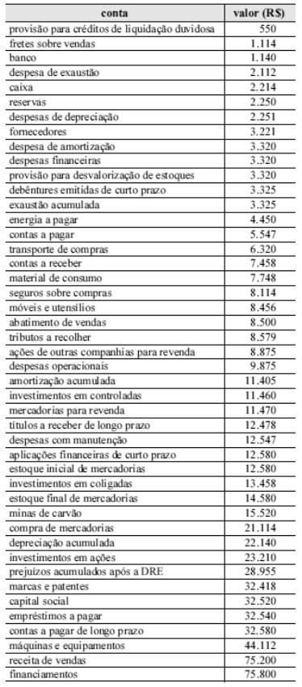{largura=35%}

Com base nas informações do balancete apresentado na tabela acima, julgue o item a seguir.

O custo das mercadorias vendidas é igual a R$ 34.662,00.

- Gabarito: ERRADO
- Resolução: a caminho

## F0543 · CEBRASPE · 2008 · INSS · CE
- Fontes: TecConcursos 543 (28933)
- Prova: CEBRASPE (CESPE) - Ana (INSS)/INSS/Ciências Atuariais/2008
- Grupos: estrutura

A respeito da estrutura e análise das demonstrações contábeis das empresas patrocinadoras, julgue o item seguinte.

Um acréscimo na taxa de saída influenciará positivamente na apuração da margem líquida na DRE.

- Gabarito: CERTO
- Resolução: a caminho

## F0544 · CEBRASPE · 2008 · SEFAZ ES · CE
- Fontes: TecConcursos 544 (43948)
- Prova: CEBRASPE (CESPE) - Cons TE (SEFAZ ES)/SEFAZ ES/Ciências Contábeis/2008
- Grupos: resultado-bruto

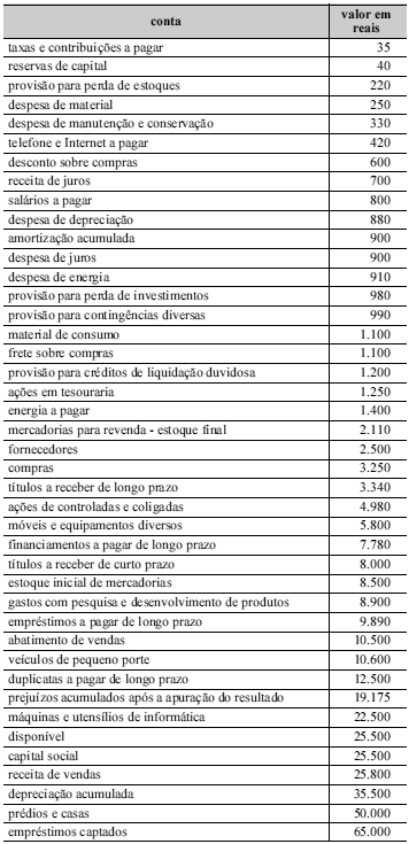{largura=35%}

Considerando o balancete de verificação apresentado, julgue o item seguinte, a respeito de demonstrações contábeis e sua evidenciação.

O resultado bruto do período é igual a R$ 5.660,00.

- Gabarito: ERRADO
- Resolução: a caminho

## F0545 · CEBRASPE · 2008 · SEFAZ ES · CE
- Fontes: TecConcursos 545 (43954)
- Prova: CEBRASPE (CESPE) - Cons TE (SEFAZ ES)/SEFAZ ES/Ciências Contábeis/2008
- Grupos: lucro-liquido

Acerca da divulgação das informações contábeis e suas características, julgue o item a seguir.

A demonstração do resultado do exercício é capaz de evidenciar o volume de recursos pagos ao estado na forma de impostos, taxas e contribuições de melhoria.

- Gabarito: ERRADO
- Resolução: a caminho

## F0546 · CEBRASPE · 2008 · SEFAZ ES · CE
- Fontes: TecConcursos 546 (43970)
- Prova: CEBRASPE (CESPE) - Cons TE (SEFAZ ES)/SEFAZ ES/Ciências Contábeis/2008
- Grupos: participacoes, lucro-liquido

Julgue o item seguinte, acerca do registro e evidenciação de eventos contábeis.

A demonstração do resultado do exercício discriminará as participações de debêntures, empregados, administradores e partes beneficiárias, exceto na forma de instrumentos financeiros.

- Gabarito: ERRADO
- Resolução: a caminho

## F0547 · CEBRASPE · 2008 · TST · CE
- Fontes: TecConcursos 547 (66902)
- Prova: CEBRASPE (CESPE) - AJ TST/TST/Administrativa/Contabilidade/2008
- Grupos: participacoes

Com referência aos fatos contábeis e à representação dos fenômenos patrimoniais e suas variações, julgue o item que se segue.

As participações dos empregados nos lucros das empresas, definidas no estatuto, devem ser provisionadas com a apuração do resultado e, quando atribuídas sob critérios objetivos e equânimes, são dedutíveis na determinação do lucro real.

- Gabarito: CERTO
- Resolução: a caminho

## F0548 · CEBRASPE · 2008 · TST · CE
- Fontes: TecConcursos 548 (66915)
- Prova: CEBRASPE (CESPE) - AJ TST/TST/Administrativa/Contabilidade/2008
- Grupos: lucro-liquido

Com relação às demonstrações financeiras − levantamento, classificação e avaliação −, julgue o item seguinte.

A forma vertical adotada para a apresentação da demonstração do resultado do exercício (DRE) facilita a análise da composição e evidencia a formação dos vários níveis de resultados, confrontando as receitas e os correspondentes custos e despesas.

- Gabarito: CERTO
- Resolução: a caminho

## F0549 · CEBRASPE · 2008 · TST · CE
- Fontes: TecConcursos 549 (66916)
- Prova: CEBRASPE (CESPE) - AJ TST/TST/Administrativa/Contabilidade/2008
- Grupos: resultado-bruto, receita-bruta, deducoes, resultado-financeiro

Com relação às demonstrações financeiras − levantamento, classificação e avaliação −, julgue o item seguinte.

Considere os saldos a seguir, apresentados na escrituração de uma empresa, ao final do exercício. vendas: R$ 180.000,00 compras: R$ 130.000,00 impostos sobre vendas: R$ 26.000,00 descontos comerciais sobre vendas: R$ 5.000,00 descontos financeiros sobre compras: R$ 3.000,00 conta corrente do ICMS: R$18.000,00 Nesse caso, e sabendo-se que os estoques inicial e final eram iguais, é correto concluir que o lucro bruto da empresa foi de R$ 22.000,00.

- Gabarito: ERRADO
- Resolução: a caminho

## F0550 · FCC · 2008 · TCE SP · ME
- Fontes: TecConcursos 550 (77915)
- Prova: FCC - Cons Sub Aud (TCE SP)/TCE SP/2008
- Grupos: lucro-liquido

São evidenciados na Demonstração de Resultado do Exercício como item não operacional:

- A) os resultados obtidos com a aplicação do método da equivalência patrimonial e com serviços.
- B) os dividendos recebidos de investimentos avaliados pelo método do custo.
- C) os ajustes de exercícios anteriores relacionados a mudança de critério contábil.
- D) as provisões para perdas prováveis na realização de investimentos.
- E) a amortização de ágio ou deságio de investimentos societários.
- Gabarito: D
- Resolução: a caminho

## F0551 · FGV · 2008 · TCM RJ · ME
- Fontes: TecConcursos 551 (93148)
- Prova: FGV - Aud (TCM-RJ)/TCM RJ/2008
- Grupos: resultado-operacional, fora-destinacao, despesas-administrativas

Com base no enunciado a seguir, responda à questão:

A Cia. JMAP vende o produto PAMJ. A empresa apresenta o seguinte Balanço em 31.08.X8:

ATIVO PASSIVO + PATRIMÔNIO

| Conta | Débito | Crédito |
|---|---:|---:|
| LÍQUIDO | – | – |
| Disponibilidades | 76.000 |  |
| Fornecedores | 26.500 |  |
| Estoques | 25.000 |  |

Contas a Pagar 20.000 Móveis e Utensílios 200.000 Capital Social 180.000 (-) Depreciação acumulada -16.000 Lucros

| Conta | Débito | Crédito | Valor |
|---|---:|---:|---:|
| Acumulados | 58.500 |  |  |
| Total | 285.000 | – | – |
| Total | 285.000 | – | – |

Informações adicionais: i) o Estoque é constituído por 1.000 unidades adquiridas por R$ 25,00 cada. A empresa adota o CMPM (Custo médio ponderado móvel) – controle permanente; ii) os Móveis e Utensílios são depreciados à taxa de 12% ao ano.

A empresa efetuou as seguintes operações no mês de setembro de X8:

Data Evento 01 A empresa efetuou o seguro anual de seu patrimônio, mediante o pagamento do

| Conta | Valor |
|---|---:|
| prêmio de seguro no valor total de R$ 6.000,00, à vista. | 02 |
| Compra 1.000 unidades de PAMJ por R$ 26,00 cada, para pagar em outubro/X8. | 05 |
| Compra 2.500 unidades de PAMJ por R$ 24,80 cada, à vista. | 10 |

Venda de 3.000 unidades de PAMJ por R$ 35,00 cada, sendo que metade à vista

| Conta | Valor |
|---|---:|
| e metade a prazo para recebimento em 30 dias. | 15 |
| Venda de 1.100 unidades de PAMJ por R$ 30,00 cada, à vista. | 22 |
| Compra 2.000 unidades de PAMJ por R$ 25,50, para pagamento em 60 dias. | 25 |

Aumento do Capital Social em R$ 35.000,00, sendo R$ 5.000,00 em dinheiro e o restante em integralização de parte do saldo de lucros acumulados. 26 Pagamento de R$ 38.000,00 aos fornecedores e da totalidade do saldo das contas a pagar. 30 Reconhecimento e pagamento de despesas administrativas e comerciais no montante total de R$ 18.000,00, sendo R$ 8.000,00 relativos a serviços de terceiros e o restante a pessoal próprio. 30 Apropriação mensal da despesa de seguro e depreciação dos móveis e utensílios. 30 Constatou que o valor realizável líquido, por unidade de PAMJ, é R$ 25,00. 30 Pagamento de dividendos, em dinheiro, no valor correspondente a 40% do lucro do período.

Considerando somente os dados do enunciado, determine o valor do lucro operacional do mês de setembro/X8.

- A) menor que 10.000,00
- B) entre 10.000,01 e 14.000,00
- C) entre 14.000,01 e 18.000,00
- D) entre 18.000,01 e 22.000,00
- E) maior que 22.000,01
- Gabarito: B
- Resolução: a caminho

## F0552 · FCC · 2008 · TRF 5 · ME
- Fontes: TecConcursos 552 (133530)
- Prova: FCC - AJ TRF5/TRF 5/Apoio Especializado/Contabilidade/2008
- Grupos: resultado-bruto, receita-liquida, cmv, resultado-operacional, deducoes, receita-bruta

Na Demonstração de Resultado da Cia. Comercial Estoril encerrada em 31 de dezembro de 2007, o valor total das deduções da Receita Operacional Bruta foi R$ 20.500,00 e representou 5% da Receita Operacional Bruta. Na mesma demonstração, o Custo das Mercadorias Vendidas foi equivalente a 60% da Receita Operacional Líquida e o valor do Estoque Final de Mercadorias correspondeu a R$ 40.000,00. Considerando apenas essas informações, o Lucro Operacional Bruto, a Receita Operacional Líquida e o Custo das Mercadorias Vendidas foram, respectivamente, em R$,

- A) 273.700,00, 410.000,00 e 155.800,00
- B) 233.700,00, 410.000,00 e 155.800,00
- C) 195.800,00, 410.000,00 e 233.700,00
- D) 195.800,00, 389.500,00 e 233.700,00
- E) 155.800,00, 389.500,00 e 233.700,00
- Gabarito: E
- Resolução: a caminho

## F0553 · FCC · 2008 · TCE AM · ME
- Fontes: TecConcursos 553 (290686)
- Prova: FCC - ATCE (TCE-AM)/TCE AM/Auditoria Governamental/2008
- Grupos: lucro-liquido

Na determinação do Resultado Líquido do Exercício NÃO computam-se

- A) as contribuições para instituições ou fundos de assistência ou previdência de empregados.
- B) os rendimentos ocorridos no período, independentemente da sua realização em moeda.
- C) as transferências para reservas e os dividendos distribuídos no período.
- D) as apropriações de valores relativos aos adiantamentos de clientes quando efetivamente ganhos no período.
- E) as despesas, os encargos financeiros e as perdas, pagos ou incorridos.
- Gabarito: C
- Resolução: a caminho

## F0554 · CEBRASPE · 2008 · CGE PB · ME
- Fontes: TecConcursos 554 (1316901)
- Prova: CEBRASPE (CESPE) - ACP (CGE PB)/CGE PB/Auditoria Governamental/2008
- Grupos: fora-destinacao, despesas-administrativas, receita-bruta

O balancete de verificação a seguir apresenta as contas de uma empresa ao final do mês de janeiro de 2008, antes dos ajustes. conta saldo (R$)

| Conta | Valor |
|---|---:|
| aluguéis antecipados | 450 |
| capital social | 1.802 |
| debêntures emitidas | 300 |
| depreciação acumulada | 320 |
| disponibilidades | 2.500 |
| energia a pagar | 230 |
| imobilizado | 200 |
| investimentos | 700 |
| lucros ou prejuízos acumulados | 650 |
| material de expediente | 200 |
| periódicos antecipados | 300 |
| pró-labore a pagar | 600 |
| receita antecipada | 800 |
| reserva de lucros | 98 |
| reserva de reavaliação | 20 |
| reserva legal | 30 |
| salários antecipados | 80 |
| seguros antecipados | 600 |
| telefone a pagar | 180 |

Na tabela a seguir, são apresentados os ajustes. saldo R$ saldo final de material de expediente 800 apropriação de despesa de energia do período 120 aluguel do período 175 apropriação de salários do

| Conta | Valor |
|---|---:|
| período | 400 |
| seguros do período | 250 |
| depreciação do período | 110 |

receita antecipada realizada no período 450 periódicos consumidos no

| Conta | Valor |
|---|---:|
| período | 90 |
| receitas auferidas no período | 980 |
| impostos apropriados no período | 114 |

quitação do saldo de obrigações com sócio-dirigente

Com base no balancete apresentado, assinale a opção que apresenta, em reais, o valor do lucro obtido no período, após a incorporação dos saldos dos ajustes contábeis.

- A) 51
- B) 131
- C) 161
- D) 165
- E) 401
- Gabarito: A
- Resolução: a caminho

## F0555 · CEBRASPE · 2008 · MPE RR · CE
- Fontes: TecConcursos 555 (1461665)
- Prova: CEBRASPE (CESPE) - Ana (MPE RR)/MPE RR/Contador/2008
- Grupos: participacoes, lucro-liquido

Julgue o próximo item, acerca de elaboração e divulgação das demonstrações contábeis.

O registro da participação de empregados e administradores na forma de instrumentos financeiros ocorrerá em conta de despesa operacional na demonstração do resultado do exercício (DRE).

- Gabarito: ERRADO
- Resolução: a caminho

## F0556 · CEBRASPE · 2008 · MPE RR · CE
- Fontes: TecConcursos 556 (1461693)
- Prova: CEBRASPE (CESPE) - Ana (MPE RR)/MPE RR/Contador/2008
- Grupos: resultado-operacional, receita-bruta, despesas-administrativas

data operação modalidade quantidade valor (R$) unitário total 2/3/2008 compra a prazo 200 8,50 1.700,00 5/3/2008 compra a prazo 50 9,10 455,00 8/3/2008 venda à vista 175 30,00 5.250,00 15/3/2008 compra a prazo 25 9,30 232,50 16/3/2008 venda à vista 50 32,00 1.600,00 19/3/2008 compra à vista 30 9,50 285,00 23/3/2008 compra a prazo 45 9,00 405,00 28/3/2008 venda à vista 82 35,00 2.870,00 29/3/2008 compra a prazo 18 9,80 176,40 30/3/2008 venda à vista 52 32,50 1.690,00 31/3/2008 venda a prazo 3 19,50 58,50 informações complementares (valores em R$) 31/3/2008 apropriação de despesas de telecomunicações 1.254,00 20/3/2008 apropriação da despesas de salários do mês 6.250,00 10/3/2008 apropriação da despesas de depreciação do período 2.120,00 9/3/2008 recebimento de clientes 12.890,00 8/3/2008 recebimento antecipado de clientes 25.800,00 5/3/2008 pagamento da folha de salários do mês anterior 8.250,00 2/3/2008 aquisição de material de consumo à vista 5.230,00 1.º/3/2008 saldo do disponível 18.750,00 1.º/3/2008 saldo inicial do ativo circulante 58.950,00 1.º/3/2008 saldo inicial do passivo circulante 32.480,00 Com base nas informações apresentadas acima, julgue o item que se segue.

O resultado operacional obtido em 31/3/2008 foi de R$ 9.760,90, credor.

- Gabarito: ERRADO
- Resolução: a caminho

## F0557 · CEBRASPE · 2008 · MPE RR · CE
- Fontes: TecConcursos 557 (1461716)
- Prova: CEBRASPE (CESPE) - Ana (MPE RR)/MPE RR/Contador/2008
- Grupos: resultado-operacional, lucro-liquido, deducoes, receita-bruta, despesas-administrativas, cmv, despesas-operacionais, ir-csll

conta

| Conta | Débito | Crédito | Valor |
|---|---:|---:|---:|
| ano (valores em R$) | 2005 | 2006 | 2007 |
| compras líquidas | 21.699 | 21.900 | 10.900 |
| deduções da receita | 2.460 | 3.445 | 321 |
| despesa de depreciação | 12.900 | 14.900 | 17.854 |
| despesa de exaustão | 9.980 | 10.987 | 12.234 |
| despesa de manutenção | 1.123 | 1.249 | 2.984 |
| despesas administrativas | 12.340 | 15.682 | 18.179 |
| despesas gerais | 13.289 | 15.690 | 18.943 |
| despesas operacionais | 10.093 | 11.230 | 15.980 |
| estoque final | 2.230 | 16.500 | 2.900 |
| estoque inicial | 5.600 | 2.230 | 16.500 |
| imposto sobre o lucro | 1.200 | 2.000 | 1.900 |
| imposto sobre receita | 7.680 | 9.887 | 11.234 |
| receita bruta de vendas | 99.800 | 98.870 | 130.000 |

O controle de estoques proporciona a apuração do custo da mercadoria vendida e, conseqüentemente, a determinação do valor do lucro líquido auferido. Com base nessa informação e nos dados da tabela acima apresentada, julgue o item seguinte, relacionadas ao reflexo da variação dos estoques na apuração do lucro líquido. Caso o estoque final no ano 2005 estivesse subavaliado em R$ 1.200, então o lucro operacional no ano 2006 estaria superavaliado em R$ 1.200.

- Gabarito: CERTO
- Resolução: a caminho

## F0558 · CEBRASPE · 2008 · MPE RR · CE
- Fontes: TecConcursos 558 (1461717)
- Prova: CEBRASPE (CESPE) - Ana (MPE RR)/MPE RR/Contador/2008
- Grupos: lucro-liquido, deducoes, receita-bruta, despesas-administrativas, cmv, despesas-operacionais, ir-csll

conta

| Conta | Débito | Crédito | Valor |
|---|---:|---:|---:|
| ano (valores em R$) | 2005 | 2006 | 2007 |
| compras líquidas | 21.699 | 21.900 | 10.900 |
| deduções da receita | 2.460 | 3.445 | 321 |
| despesa de depreciação | 12.900 | 14.900 | 17.854 |
| despesa de exaustão | 9.980 | 10.987 | 12.234 |
| despesa de manutenção | 1.123 | 1.249 | 2.984 |
| despesas administrativas | 12.340 | 15.682 | 18.179 |
| despesas gerais | 13.289 | 15.690 | 18.943 |
| despesas operacionais | 10.093 | 11.230 | 15.980 |
| estoque final | 2.230 | 16.500 | 2.900 |
| estoque inicial | 5.600 | 2.230 | 16.500 |
| imposto sobre o lucro | 1.200 | 2.000 | 1.900 |
| imposto sobre receita | 7.680 | 9.887 | 11.234 |
| receita bruta de vendas | 99.800 | 98.870 | 130.000 |

O controle de estoques proporciona a apuração do custo da mercadoria vendida e, conseqüentemente, a determinação do valor do lucro líquido auferido. Com base nessa informação e nos dados da tabela acima apresentada, julgue o item seguinte, relacionadas ao reflexo da variação dos estoques na apuração do lucro líquido. Caso o estoque inicial no ano 2005 estivesse superavaliado em R$ 3.200, então o valor do custo da mercadoria vendida em 2005 estaria superavaliado também em R$ 3.200.

- Gabarito: CERTO
- Resolução: a caminho

## F0559 · CEBRASPE · 2008 · MPE RR · CE
- Fontes: TecConcursos 559 (1461718)
- Prova: CEBRASPE (CESPE) - Ana (MPE RR)/MPE RR/Contador/2008
- Grupos: resultado-bruto, lucro-liquido, deducoes, receita-bruta, despesas-administrativas, cmv, despesas-operacionais, ir-csll

conta

| Conta | Débito | Crédito | Valor |
|---|---:|---:|---:|
| ano (valores em R$) | 2005 | 2006 | 2007 |
| compras líquidas | 21.699 | 21.900 | 10.900 |
| deduções da receita | 2.460 | 3.445 | 321 |
| despesa de depreciação | 12.900 | 14.900 | 17.854 |
| despesa de exaustão | 9.980 | 10.987 | 12.234 |
| despesa de manutenção | 1.123 | 1.249 | 2.984 |
| despesas administrativas | 12.340 | 15.682 | 18.179 |
| despesas gerais | 13.289 | 15.690 | 18.943 |
| despesas operacionais | 10.093 | 11.230 | 15.980 |
| estoque final | 2.230 | 16.500 | 2.900 |
| estoque inicial | 5.600 | 2.230 | 16.500 |
| imposto sobre o lucro | 1.200 | 2.000 | 1.900 |
| imposto sobre receita | 7.680 | 9.887 | 11.234 |
| receita bruta de vendas | 99.800 | 98.870 | 130.000 |

O controle de estoques proporciona a apuração do custo da mercadoria vendida e, conseqüentemente, a determinação do valor do lucro líquido auferido. Com base nessa informação e nos dados da tabela acima apresentada, julgue o item seguinte, relacionadas ao reflexo da variação dos estoques na apuração do lucro líquido. Caso o estoque final no ano 2006 estivesse superavaliado em R$ 5.900, então o saldo do lucro bruto em 2007 estaria subavaliado em R$ 5.900.

- Gabarito: CERTO
- Resolução: a caminho

## F0560 · CEBRASPE · 2008 · MPE RR · CE
- Fontes: TecConcursos 560 (1461719)
- Prova: CEBRASPE (CESPE) - Ana (MPE RR)/MPE RR/Contador/2008
- Grupos: resultado-bruto, lucro-liquido, deducoes, receita-bruta, despesas-administrativas, cmv, despesas-operacionais, ir-csll

conta

| Conta | Débito | Crédito | Valor |
|---|---:|---:|---:|
| ano (valores em R$) | 2005 | 2006 | 2007 |
| compras líquidas | 21.699 | 21.900 | 10.900 |
| deduções da receita | 2.460 | 3.445 | 321 |
| despesa de depreciação | 12.900 | 14.900 | 17.854 |
| despesa de exaustão | 9.980 | 10.987 | 12.234 |
| despesa de manutenção | 1.123 | 1.249 | 2.984 |
| despesas administrativas | 12.340 | 15.682 | 18.179 |
| despesas gerais | 13.289 | 15.690 | 18.943 |
| despesas operacionais | 10.093 | 11.230 | 15.980 |
| estoque final | 2.230 | 16.500 | 2.900 |
| estoque inicial | 5.600 | 2.230 | 16.500 |
| imposto sobre o lucro | 1.200 | 2.000 | 1.900 |
| imposto sobre receita | 7.680 | 9.887 | 11.234 |
| receita bruta de vendas | 99.800 | 98.870 | 130.000 |

O controle de estoques proporciona a apuração do custo da mercadoria vendida e, conseqüentemente, a determinação do valor do lucro líquido auferido. Com base nessa informação e nos dados da tabela acima apresentada, julgue o item seguinte, relacionadas ao reflexo da variação dos estoques na apuração do lucro líquido. Caso o estoque inicial de 2006 estivesse subestimado em R$ 1.789, então o valor do resultado com mercadorias no ano 2007 estaria superestimado em R$ 1.789.

- Gabarito: ERRADO
- Resolução: a caminho

## F0561 · CEBRASPE · 2008 · MPE RR · CE
- Fontes: TecConcursos 561 (1461720)
- Prova: CEBRASPE (CESPE) - Ana (MPE RR)/MPE RR/Contador/2008
- Grupos: lair, ir-csll, lucro-liquido, deducoes, receita-bruta, despesas-administrativas, cmv, despesas-operacionais

conta

| Conta | Débito | Crédito | Valor |
|---|---:|---:|---:|
| ano (valores em R$) | 2005 | 2006 | 2007 |
| compras líquidas | 21.699 | 21.900 | 10.900 |
| deduções da receita | 2.460 | 3.445 | 321 |
| despesa de depreciação | 12.900 | 14.900 | 17.854 |
| despesa de exaustão | 9.980 | 10.987 | 12.234 |
| despesa de manutenção | 1.123 | 1.249 | 2.984 |
| despesas administrativas | 12.340 | 15.682 | 18.179 |
| despesas gerais | 13.289 | 15.690 | 18.943 |
| despesas operacionais | 10.093 | 11.230 | 15.980 |
| estoque final | 2.230 | 16.500 | 2.900 |
| estoque inicial | 5.600 | 2.230 | 16.500 |
| imposto sobre o lucro | 1.200 | 2.000 | 1.900 |
| imposto sobre receita | 7.680 | 9.887 | 11.234 |
| receita bruta de vendas | 99.800 | 98.870 | 130.000 |

O controle de estoques proporciona a apuração do custo da mercadoria vendida e, conseqüentemente, a determinação do valor do lucro líquido auferido. Com base nessa informação e nos dados da tabela acima apresentada, julgue o item seguinte, relacionadas ao reflexo da variação dos estoques na apuração do lucro líquido. O resultado, antes do imposto de renda no ano 2007, foi igual a R$ 8.170.

- Gabarito: ERRADO
- Resolução: a caminho

## F0562 · CEBRASPE · 2008 · MPE RR · CE
- Fontes: TecConcursos 562 (1461732)
- Prova: CEBRASPE (CESPE) - Ana (MPE RR)/MPE RR/Contador/2008
- Grupos: resultado-bruto, resultado-financeiro, deducoes, receita-bruta, despesas-administrativas, despesas-vendas, despesas-operacionais, lucro-liquido, ir-csll

conta saldo (R$)

| Conta | Valor |
|---|---:|
| abatimento sobre vendas | 3.200 |
| compras de mercadorias | 7.120 |
| debêntures | 3.120 |
| despesa de depreciação | 2.250 |
| despesa de exaustão | 2.314 |
| despesa de manutenção | 4.157 |
| despesas administrativas | 2.213 |
| despesas financeiras | 100 |
| despesas gerais | 789 |
| despesas operacionais | 5.210 |
| energia a pagar | 1.140 |
| estoque final | 4.120 |
| estoque inicial | 12.850 |
| imposto sobre o lucro | 3.200 |
| imposto sobre receita | 12.000 |
| máquinas e equipamentos | 4.570 |
| receita bruta de vendas | 85.200 |
| receitas financeiras | 520 |
| seguro de compras | 2.140 |
| transporte de vendas | 2.210 |
| transporte sobre compras | 3.320 |

Com base nas informações apresentadas na tabela acima, julgue o item a seguir, relativos à demonstração do resultado do exercício e suas peculiaridades. O resultado bruto obtido é igual a R$ 48.690.

- Gabarito: CERTO
- Resolução: a caminho

## F0563 · CEBRASPE · 2008 · MPE RR · CE
- Fontes: TecConcursos 563 (1461734)
- Prova: CEBRASPE (CESPE) - Ana (MPE RR)/MPE RR/Contador/2008
- Grupos: cmv, resultado-financeiro, deducoes, receita-bruta, despesas-administrativas, despesas-vendas, despesas-operacionais, lucro-liquido, ir-csll

conta saldo (R$)

| Conta | Valor |
|---|---:|
| abatimento sobre vendas | 3.200 |
| compras de mercadorias | 7.120 |
| debêntures | 3.120 |
| despesa de depreciação | 2.250 |
| despesa de exaustão | 2.314 |
| despesa de manutenção | 4.157 |
| despesas administrativas | 2.213 |
| despesas financeiras | 100 |
| despesas gerais | 789 |
| despesas operacionais | 5.210 |
| energia a pagar | 1.140 |
| estoque final | 4.120 |
| estoque inicial | 12.850 |
| imposto sobre o lucro | 3.200 |
| imposto sobre receita | 12.000 |
| máquinas e equipamentos | 4.570 |
| receita bruta de vendas | 85.200 |
| receitas financeiras | 520 |
| seguro de compras | 2.140 |
| transporte de vendas | 2.210 |
| transporte sobre compras | 3.320 |

Com base nas informações apresentadas na tabela acima, julgue o item a seguir, relativos à demonstração do resultado do exercício e suas peculiaridades. O valor do custo das mercadorias vendidas corresponde a R$ 21.310.

- Gabarito: CERTO
- Resolução: a caminho

## F0564 · CEBRASPE · 2008 · MPE RR · CE
- Fontes: TecConcursos 564 (1461735)
- Prova: CEBRASPE (CESPE) - Ana (MPE RR)/MPE RR/Contador/2008
- Grupos: resultado-financeiro, lucro-liquido, deducoes, receita-bruta, despesas-administrativas, despesas-vendas, despesas-operacionais, ir-csll

conta saldo (R$)

| Conta | Valor |
|---|---:|
| abatimento sobre vendas | 3.200 |
| compras de mercadorias | 7.120 |
| debêntures | 3.120 |
| despesa de depreciação | 2.250 |
| despesa de exaustão | 2.314 |
| despesa de manutenção | 4.157 |
| despesas administrativas | 2.213 |
| despesas financeiras | 100 |
| despesas gerais | 789 |
| despesas operacionais | 5.210 |
| energia a pagar | 1.140 |
| estoque final | 4.120 |
| estoque inicial | 12.850 |
| imposto sobre o lucro | 3.200 |
| imposto sobre receita | 12.000 |
| máquinas e equipamentos | 4.570 |
| receita bruta de vendas | 85.200 |
| receitas financeiras | 520 |
| seguro de compras | 2.140 |
| transporte de vendas | 2.210 |
| transporte sobre compras | 3.320 |

Com base nas informações apresentadas na tabela acima, julgue o item a seguir, relativos à demonstração do resultado do exercício e suas peculiaridades. O valor do resultado líquido auferido é igual a R$ 38.967.

- Gabarito: ERRADO
- Resolução: a caminho

## F0565 · CEBRASPE · 2008 · MPE RR · CE
- Fontes: TecConcursos 565 (1461736)
- Prova: CEBRASPE (CESPE) - Ana (MPE RR)/MPE RR/Contador/2008
- Grupos: resultado-financeiro, lucro-liquido, deducoes, receita-bruta, despesas-administrativas, despesas-vendas, despesas-operacionais, ir-csll

conta saldo (R$)

| Conta | Valor |
|---|---:|
| abatimento sobre vendas | 3.200 |
| compras de mercadorias | 7.120 |
| debêntures | 3.120 |
| despesa de depreciação | 2.250 |
| despesa de exaustão | 2.314 |
| despesa de manutenção | 4.157 |
| despesas administrativas | 2.213 |
| despesas financeiras | 100 |
| despesas gerais | 789 |
| despesas operacionais | 5.210 |
| energia a pagar | 1.140 |
| estoque final | 4.120 |
| estoque inicial | 12.850 |
| imposto sobre o lucro | 3.200 |
| imposto sobre receita | 12.000 |
| máquinas e equipamentos | 4.570 |
| receita bruta de vendas | 85.200 |
| receitas financeiras | 520 |
| seguro de compras | 2.140 |
| transporte de vendas | 2.210 |
| transporte sobre compras | 3.320 |

Com base nas informações apresentadas na tabela acima, julgue o item a seguir, relativos à demonstração do resultado do exercício e suas peculiaridades. Caso a empresa resolva promover sua marca e vender mercadorias com desconto comercial de 20%, o resultado líquido do período será igual a R$ 28.190.

- Gabarito: ERRADO
- Resolução: a caminho

## F0566 · CEBRASPE · 2008 · TCE AC · ME
- Fontes: TecConcursos 566 (1568232)
- Prova: CEBRASPE (CESPE) - ACE (TCE AC)/TCE AC/Contabilidade/2008
- Grupos: resultado-financeiro, participacoes, deducoes, receita-bruta, despesas-administrativas, cmv, outras-receitas-despesas

contas saldo (em R$)

| Conta | Valor |
|---|---:|
| capital social | 87.874 |
| clientes | 6.520 |
| contas a pagar | 800 |
| custo da mercadoria vendida | 18.500 |
| deduções da receita | 9.000 |
| depreciação acumulada | 8.500 |
| despesas administrativas | 2.500 |
| despesas antecipadas | 3.340 |
| despesas de depreciação | 4.120 |
| despesas financeiras | 6.522 |
| despesas tributárias | 10.600 |
| disponível | 2.000 |
| energia a pagar | 3.200 |
| estoque para revenda | 9.500 |
| financiamentos a pagar de longo prazo | 30.000 |
| fornecedores | 1.200 |
| impostos a recolher | 3.200 |
| investimentos em ações | 2.100 |
| máquinas e equipamentos | 19.050 |
| material de consumo | 8.410 |
| móveis e utensílios | 8.450 |
| outras despesas | 3.200 |
| participações em controladas | 6.520 |
| provisões para contingências | 820 |
| receita de vendas | 60.000 |
| resultados acumulados após a DRE | 29.004 |
| salários a pagar | 14.100 |
| terrenos | 21.500 |
| títulos a receber de longo prazo | 12.300 |
| veículos | 21.000 |

A margem bruta apurada é

- A) inferior a 45%.
- B) superior a 46% e inferior a 56%.
- C) superior a 57% e inferior a 67%.
- D) superior a 68% e inferior a 78%.
- E) superior a 79%.
- Gabarito: C
- Resolução: a caminho

## F0567 · CEBRASPE · 2008 · TCE AC · ME
- Fontes: TecConcursos 567 (1568234)
- Prova: CEBRASPE (CESPE) - ACE (TCE AC)/TCE AC/Contabilidade/2008
- Grupos: resultado-financeiro, participacoes, deducoes, receita-bruta, despesas-administrativas, cmv, outras-receitas-despesas

contas saldo (em R$)

| Conta | Valor |
|---|---:|
| capital social | 87.874 |
| clientes | 6.520 |
| contas a pagar | 800 |
| custo da mercadoria vendida | 18.500 |
| deduções da receita | 9.000 |
| depreciação acumulada | 8.500 |
| despesas administrativas | 2.500 |
| despesas antecipadas | 3.340 |
| despesas de depreciação | 4.120 |
| despesas financeiras | 6.522 |
| despesas tributárias | 10.600 |
| disponível | 2.000 |
| energia a pagar | 3.200 |
| estoque para revenda | 9.500 |
| financiamentos a pagar de longo prazo | 30.000 |
| fornecedores | 1.200 |
| impostos a recolher | 3.200 |
| investimentos em ações | 2.100 |
| máquinas e equipamentos | 19.050 |
| material de consumo | 8.410 |
| móveis e utensílios | 8.450 |
| outras despesas | 3.200 |
| participações em controladas | 6.520 |
| provisões para contingências | 820 |
| receita de vendas | 60.000 |
| resultados acumulados após a DRE | 29.004 |
| salários a pagar | 14.100 |
| terrenos | 21.500 |
| títulos a receber de longo prazo | 12.300 |
| veículos | 21.000 |

A margem operacional é

- A) inferior a 20%.
- B) superior a 21% e inferior a 31%.
- C) superior a 32% e inferior a 42%.
- D) superior a 43% e inferior a 53%.
- E) superior a 54%.
- Gabarito: A
- Resolução: a caminho

## F0568 · CEBRASPE · 2008 · SGA AC · CE
- Fontes: TecConcursos 568 (1622936)
- Prova: CEBRASPE (CESPE) - Con (SGA AC)/SGA AC/2008
- Grupos: lair, ir-csll, receita-bruta, cmv, despesas-administrativas

saldo (em R$) conta 1/12/2007 31/12/2007

| Conta | Débito | Crédito |
|---|---:|---:|
| aluguel a pagar | 9.850 | 6.580 |
| aluguel antecipado | 6.500 | 7.650 |
| clientes | 3.200 | 5.400 |

custo da mercadoria vendida - 7.348 despesa de aluguel - 10.200 despesa de combustíveis - 787 despesa de energia - 9.987 despesa de salários

| Conta | Débito | Crédito |
|---|---:|---:|
| - | 10.850 |  |
| energia a pagar | 1.258 | 1.520 |
| estoques | 12.000 | 7.852 |
| fornecedores | 3.250 | 4.800 |
| máquinas | 12.580 | 8.790 |
| receita antecipada | 7.500 | 8.100 |

receita de vendas

| Conta | Débito | Crédito |
|---|---:|---:|
| - | 35.870 |  |
| salários a pagar | 8.000 | 3.200 |
| salários antecipados | 2.500 | 1.100 |
| terrenos | 6.580 | 5.252 |

Com base nas informações apresentadas no quadro acima, julgue o item subsequente.

O resultado antes do imposto de renda e contribuição social apurado a partir das informações apresentadas corresponde a R$ 2.154, devedor.

- Gabarito: CERTO
- Resolução: a caminho

## F0569 · CEBRASPE · 2008 · SGA AC · CE
- Fontes: TecConcursos 569 (1622937)
- Prova: CEBRASPE (CESPE) - Con (SGA AC)/SGA AC/2008
- Grupos: receita-bruta, cmv, despesas-administrativas, lucro-liquido

saldo (em R$) conta 1/12/2007 31/12/2007

| Conta | Débito | Crédito |
|---|---:|---:|
| aluguel a pagar | 9.850 | 6.580 |
| aluguel antecipado | 6.500 | 7.650 |
| clientes | 3.200 | 5.400 |

custo da mercadoria vendida - 7.348 despesa de aluguel - 10.200 despesa de combustíveis - 787 despesa de energia - 9.987 despesa de salários

| Conta | Débito | Crédito |
|---|---:|---:|
| - | 10.850 |  |
| energia a pagar | 1.258 | 1.520 |
| estoques | 12.000 | 7.852 |
| fornecedores | 3.250 | 4.800 |
| máquinas | 12.580 | 8.790 |
| receita antecipada | 7.500 | 8.100 |

receita de vendas

| Conta | Débito | Crédito |
|---|---:|---:|
| - | 35.870 |  |
| salários a pagar | 8.000 | 3.200 |
| salários antecipados | 2.500 | 1.100 |
| terrenos | 6.580 | 5.252 |

Com base nas informações apresentadas no quadro acima, julgue o item subsequente.

A margem bruta apurada após a elaboração da demonstração do resultado do exercício (DRE) é superior a 63,5%.

- Gabarito: CERTO
- Resolução: a caminho

## F0570 · CEBRASPE · 2008 · SGA AC · CE
- Fontes: TecConcursos 570 (1622938)
- Prova: CEBRASPE (CESPE) - Con (SGA AC)/SGA AC/2008
- Grupos: participacoes, fora-destinacao

Acerca da destinação do resultado das empresas, julgue o item a seguir.

As participações estatutárias são calculadas em função de percentuais que incidem sobre o lucro auferido no período correspondente. Assim, as participações estatutárias de empregados sempre precedem as participações dos administradores.

- Gabarito: CERTO
- Resolução: a caminho

## F0571 · CEBRASPE · 2008 · SGA AC · CE
- Fontes: TecConcursos 571 (1622957)
- Prova: CEBRASPE (CESPE) - Con (SGA AC)/SGA AC/2008
- Grupos: resultado-financeiro, ir-csll, deducoes, receita-bruta, despesas-administrativas, despesas-vendas

n.º contas a receber

| Conta | Débito | Crédito |
|---|---:|---:|
| saldo (R$) | 1 |  |
| abatimento sobre compras | 125 | 2 |
| aluguel a pagar | 850 | 3 |
| aluguel antecipado | 750 | 4 |
| assinaturas de revistas antecipadas | 985 | 5 |
| bancos | 15.200 | 6 |
| capital social | 21.200 | 7 |
| compra de mercadorias | 8.875 | 8 |
| computadores e impressoras | 8.745 | 9 |
| contas a receber | 2.340 | 10 |
| depreciação acumulada | 21.450 | 11 |
| despesa de assinaturas | 542 | 12 |
| despesa de depreciação | 750 | 13 |
| despesa de energia | 1.151 | 14 |
| despesa de juros | 323 | 15 |
| despesa de telefone | 141 | 16 |
| despesas de impostos e taxas | 441 | 17 |
| despesas de salários e encargos | 5.540 | 18 |
| despesas de seguros | 1.120 | 19 |
| devolução de compras | 178 | 20 |
| devoluções de vendas | 200 | 21 |
| empréstimos a pagar | 2.213 | 22 |
| energia a pagar | 554 | 23 |
| equipamentos | 4.120 | 24 |
| estoque final de mercadorias para revenda | 4.100 | 25 |
| estoque inicial de mercadorias para revenda | 1.120 | 26 |
| fornecedores | 1.147 | 27 |
| imposto de renda e contribuição social a pagar | 6.540 | 28 |
| imposto de renda e contribuição social sobre o lucro | 3.500 | 29 |
| impostos a recolher | 210 | 30 |
| impostos antecipados | 1.120 | 31 |
| impostos sobre a venda | 3.250 | 32 |
| investimento em ações de coligadas | 3.320 | 33 |
| lucros ou prejuízos acumulados | ????? | 34 |
| manutenção a pagar | 221 | 35 |
| manutenção de consumo | 650 | 36 |
| móveis e utensílios | 3.215 | 37 |
| provisão para desvalorização de estoques | 1.200 | 38 |
| provisão para devedores duvidosos | 1.100 | 39 |
| receita antecipada | 225 | 40 |
| receita de vendas | 32.500 | 41 |
| receita financeira | 2.245 | 42 |
| reservas | 2.250 | 43 |
| salários a pagar | 2.332 | 44 |
| telefone a pagar | 557 | 45 |
| veículos | 32.400 |  |

Acerca da elaboração, consolidação e análise das demonstrações contábeis, a partir do balancete de verificação apresentado acima, julgue o item.

A margem bruta é superior a 75%.

- Gabarito: CERTO
- Resolução: a caminho

## F0572 · CEBRASPE · 2008 · SGA AC · CE
- Fontes: TecConcursos 572 (1622961)
- Prova: CEBRASPE (CESPE) - Con (SGA AC)/SGA AC/2008
- Grupos: resultado-financeiro, ir-csll, deducoes, receita-bruta, despesas-administrativas, despesas-vendas

n.º contas a receber

| Conta | Débito | Crédito |
|---|---:|---:|
| saldo (R$) | 1 |  |
| abatimento sobre compras | 125 | 2 |
| aluguel a pagar | 850 | 3 |
| aluguel antecipado | 750 | 4 |
| assinaturas de revistas antecipadas | 985 | 5 |
| bancos | 15.200 | 6 |
| capital social | 21.200 | 7 |
| compra de mercadorias | 8.875 | 8 |
| computadores e impressoras | 8.745 | 9 |
| contas a receber | 2.340 | 10 |
| depreciação acumulada | 21.450 | 11 |
| despesa de assinaturas | 542 | 12 |
| despesa de depreciação | 750 | 13 |
| despesa de energia | 1.151 | 14 |
| despesa de juros | 323 | 15 |
| despesa de telefone | 141 | 16 |
| despesas de impostos e taxas | 441 | 17 |
| despesas de salários e encargos | 5.540 | 18 |
| despesas de seguros | 1.120 | 19 |
| devolução de compras | 178 | 20 |
| devoluções de vendas | 200 | 21 |
| empréstimos a pagar | 2.213 | 22 |
| energia a pagar | 554 | 23 |
| equipamentos | 4.120 | 24 |
| estoque final de mercadorias para revenda | 4.100 | 25 |
| estoque inicial de mercadorias para revenda | 1.120 | 26 |
| fornecedores | 1.147 | 27 |
| imposto de renda e contribuição social a pagar | 6.540 | 28 |
| imposto de renda e contribuição social sobre o lucro | 3.500 | 29 |
| impostos a recolher | 210 | 30 |
| impostos antecipados | 1.120 | 31 |
| impostos sobre a venda | 3.250 | 32 |
| investimento em ações de coligadas | 3.320 | 33 |
| lucros ou prejuízos acumulados | ????? | 34 |
| manutenção a pagar | 221 | 35 |
| manutenção de consumo | 650 | 36 |
| móveis e utensílios | 3.215 | 37 |
| provisão para desvalorização de estoques | 1.200 | 38 |
| provisão para devedores duvidosos | 1.100 | 39 |
| receita antecipada | 225 | 40 |
| receita de vendas | 32.500 | 41 |
| receita financeira | 2.245 | 42 |
| reservas | 2.250 | 43 |
| salários a pagar | 2.332 | 44 |
| telefone a pagar | 557 | 45 |
| veículos | 32.400 |  |

Acerca da elaboração, consolidação e análise das demonstrações contábeis, a partir do balancete de verificação apresentado acima, julgue o item.

A margem líquida é superior a 52%.

- Gabarito: ERRADO
- Resolução: a caminho

## F0573 · CEBRASPE · 2008 · SGA AC · CE
- Fontes: TecConcursos 573 (1622963)
- Prova: CEBRASPE (CESPE) - Con (SGA AC)/SGA AC/2008
- Grupos: resultado-financeiro, ir-csll, deducoes, receita-bruta, cmv, despesas-administrativas, despesas-vendas

n.º contas a receber

| Conta | Débito | Crédito |
|---|---:|---:|
| saldo (R$) | 1 |  |
| abatimento sobre compras | 125 | 2 |
| aluguel a pagar | 850 | 3 |
| aluguel antecipado | 750 | 4 |
| assinaturas de revistas antecipadas | 985 | 5 |
| bancos | 15.200 | 6 |
| capital social | 21.200 | 7 |
| compra de mercadorias | 8.875 | 8 |
| computadores e impressoras | 8.745 | 9 |
| contas a receber | 2.340 | 10 |
| depreciação acumulada | 21.450 | 11 |
| despesa de assinaturas | 542 | 12 |
| despesa de depreciação | 750 | 13 |
| despesa de energia | 1.151 | 14 |
| despesa de juros | 323 | 15 |
| despesa de telefone | 141 | 16 |
| despesas de impostos e taxas | 441 | 17 |
| despesas de salários e encargos | 5.540 | 18 |
| despesas de seguros | 1.120 | 19 |
| devolução de compras | 178 | 20 |
| devoluções de vendas | 200 | 21 |
| empréstimos a pagar | 2.213 | 22 |
| energia a pagar | 554 | 23 |
| equipamentos | 4.120 | 24 |
| estoque final de mercadorias para revenda | 4.100 | 25 |
| estoque inicial de mercadorias para revenda | 1.120 | 26 |
| fornecedores | 1.147 | 27 |
| imposto de renda e contribuição social a pagar | 6.540 | 28 |
| imposto de renda e contribuição social sobre o lucro | 3.500 | 29 |
| impostos a recolher | 210 | 30 |
| impostos antecipados | 1.120 | 31 |
| impostos sobre a venda | 3.250 | 32 |
| investimento em ações de coligadas | 3.320 | 33 |
| lucros ou prejuízos acumulados | ????? | 34 |
| manutenção a pagar | 221 | 35 |
| manutenção de consumo | 650 | 36 |
| móveis e utensílios | 3.215 | 37 |
| provisão para desvalorização de estoques | 1.200 | 38 |
| provisão para devedores duvidosos | 1.100 | 39 |
| receita antecipada | 225 | 40 |
| receita de vendas | 32.500 | 41 |
| receita financeira | 2.245 | 42 |
| reservas | 2.250 | 43 |
| salários a pagar | 2.332 | 44 |
| telefone a pagar | 557 | 45 |
| veículos | 32.400 |  |

Acerca da elaboração, consolidação e análise das demonstrações contábeis, a partir do balancete de verificação apresentado acima, julgue o item.

O custo da mercadoria vendida é igual a R$ 6.142.

- Gabarito: ERRADO
- Resolução: a caminho

## F0574 · CEBRASPE · 2008 · Min Esp · CE
- Fontes: TecConcursos 574 (1636470)
- Prova: CEBRASPE (CESPE) - Cont (Min Esp)/Min Esp/2008
- Grupos: resultado-financeiro, lair, participacoes, ir-csll, receita-bruta, despesas-administrativas, deducoes, despesas-vendas, despesas-operacionais, outras-receitas-despesas

| Conta | Valor |
|---|---:|
| receita bruta de vendas | 2.500 |
| impostos e contribuições sobre a venda | 300 |
| imposto de renda e contribuição social | 10 |
| estoque final de mercadorias | 310 |
| estoque inicial de mercadorias | 430 |
| compras de mercadorias no período | 1.200 |
| despesas gerais e administrativas | 53 |
| despesa com vendas | 140 |
| outros resultados operacionais (negativo) | 40 |
| receita financeira | 36 |
| despesa financeira | 38 |
| IOF/PIS/Cofins s/ receita financeira | 10 |
| resultados não-operacionais (positivo) | 5 |
| participações | 13 |
| participação minoritária | 2 |

Considerando a apuração de resultado de determinada empresa comercial, e de acordo com os dados hipotéticos mostrados na tabela acima, julgue o item a seguir. O lucro antes do imposto de renda e da contribuição social sobre o lucro corresponde a 640.

- Gabarito: CERTO
- Resolução: a caminho

## F0575 · CEBRASPE · 2008 · Min Esp · CE
- Fontes: TecConcursos 575 (1636472)
- Prova: CEBRASPE (CESPE) - Cont (Min Esp)/Min Esp/2008
- Grupos: resultado-financeiro, participacoes, ir-csll, receita-bruta, despesas-administrativas, deducoes, despesas-vendas, despesas-operacionais, outras-receitas-despesas

| Conta | Valor |
|---|---:|
| receita bruta de vendas | 2.500 |
| impostos e contribuições sobre a venda | 300 |
| imposto de renda e contribuição social | 10 |
| estoque final de mercadorias | 310 |
| estoque inicial de mercadorias | 430 |
| compras de mercadorias no período | 1.200 |
| despesas gerais e administrativas | 53 |
| despesa com vendas | 140 |
| outros resultados operacionais (negativo) | 40 |
| receita financeira | 36 |
| despesa financeira | 38 |
| IOF/PIS/Cofins s/ receita financeira | 10 |
| resultados não-operacionais (positivo) | 5 |
| participações | 13 |
| participação minoritária | 2 |

Considerando a apuração de resultado de determinada empresa comercial, e de acordo com os dados hipotéticos mostrados na tabela acima, julgue o item a seguir. O resultado financeiro, no período, foi desfavorável, correspondendo a 2, porém a margem líquida, que corresponde à folga operacional da empresa, foi superior a 30%.

- Gabarito: ERRADO
- Resolução: a caminho

## F0576 · CEBRASPE · 2008 · HEMOBRÁS · CE
- Fontes: TecConcursos 576 (1639247)
- Prova: CEBRASPE (CESPE) - Ana AAC (HEMOBRÁS)/HEMOBRÁS/Contador/2008
- Grupos: participacoes, lucro-liquido

As demonstrações contábeis são responsáveis pela evidenciação das informações aos usuários internos e externos. Acerca desse assunto, julgue o item a seguir. As participações de debêntures, de empregados e administradores, mesmo na forma de instrumentos financeiros, que não se caracterizem como despesa, serão evidenciadas na demonstração do resultado do exercício.

- Gabarito: CERTO
- Resolução: a caminho

## F0577 · CEBRASPE · 2008 · HEMOBRÁS · CE
- Fontes: TecConcursos 577 (1643760)
- Prova: CEBRASPE (CESPE) - Ass IGC (HEMOBRÁS)/HEMOBRÁS/Técnico em Contabilidade/2008
- Grupos: resultado-financeiro, deducoes, receita-bruta, despesas-administrativas

conta saldo (R$)

| Conta | Valor |
|---|---:|
| prejuízos acumulados antes da DRE | ????? |
| capital | 44.000 |
| gastos pré-operacionais | 32.900 |
| amortização acumulada do diferido | 23.000 |
| receita de vendas | 20.000 |
| veículos | 12.890 |
| financiamentos de longo prazo | 12.000 |
| compra de mercadorias | 9.800 |
| ações de controladas | 9.000 |
| estoque inicial de mercadorias | 7.600 |
| títulos a receber de longo prazo | 5.000 |
| empréstimos a pagar | 4.000 |
| estoque final de mercadorias | 3.900 |
| marcas | 3.420 |
| despesa de energia | 3.200 |
| fornecedores | 3.200 |
| contas a receber | 3.000 |
| despesa de salários | 2.300 |
| deduções da receita | 2.000 |
| salários e encargos a pagar | 2.000 |
| disponibilidades | 1.900 |
| provisões passivas | 1.200 |
| aplicações financeiras | 1.200 |
| impostos a recolher | 900 |
| despesas antecipadas de aluguel | 900 |
| outras contas a receber | 890 |
| material de consumo | 500 |
| depreciação acumulada | 500 |
| despesa de licença de softwares | 410 |
| seguro sobre compras | 400 |
| despesas de manutenção | 320 |
| despesa de segurança eletrônica | 190 |
| despesas financeiras | 20 |

Com base no balancete de verificação apresentado acima, julgue o item subsequente.

A margem bruta apurada é superior a 32%.

- Gabarito: CERTO
- Resolução: a caminho

## F0578 · CEBRASPE · 2008 · HEMOBRÁS · CE
- Fontes: TecConcursos 578 (1643761)
- Prova: CEBRASPE (CESPE) - Ass IGC (HEMOBRÁS)/HEMOBRÁS/Técnico em Contabilidade/2008
- Grupos: resultado-financeiro, deducoes, receita-bruta, cmv, despesas-administrativas

conta saldo (R$)

| Conta | Valor |
|---|---:|
| prejuízos acumulados antes da DRE | ????? |
| capital | 44.000 |
| gastos pré-operacionais | 32.900 |
| amortização acumulada do diferido | 23.000 |
| receita de vendas | 20.000 |
| veículos | 12.890 |
| financiamentos de longo prazo | 12.000 |
| compra de mercadorias | 9.800 |
| ações de controladas | 9.000 |
| estoque inicial de mercadorias | 7.600 |
| títulos a receber de longo prazo | 5.000 |
| empréstimos a pagar | 4.000 |
| estoque final de mercadorias | 3.900 |
| marcas | 3.420 |
| despesa de energia | 3.200 |
| fornecedores | 3.200 |
| contas a receber | 3.000 |
| despesa de salários | 2.300 |
| deduções da receita | 2.000 |
| salários e encargos a pagar | 2.000 |
| disponibilidades | 1.900 |
| provisões passivas | 1.200 |
| aplicações financeiras | 1.200 |
| impostos a recolher | 900 |
| despesas antecipadas de aluguel | 900 |
| outras contas a receber | 890 |
| material de consumo | 500 |
| depreciação acumulada | 500 |
| despesa de licença de softwares | 410 |
| seguro sobre compras | 400 |
| despesas de manutenção | 320 |
| despesa de segurança eletrônica | 190 |
| despesas financeiras | 20 |

Com base no balancete de verificação apresentado acima, julgue o item subsequente.

O custo da mercadoria vendida é igual a R$ 11.900.

- Gabarito: ERRADO
- Resolução: a caminho

## F0579 · CEBRASPE · 2008 · HEMOBRÁS · CE
- Fontes: TecConcursos 579 (1643762)
- Prova: CEBRASPE (CESPE) - Ass IGC (HEMOBRÁS)/HEMOBRÁS/Técnico em Contabilidade/2008
- Grupos: resultado-financeiro, deducoes, receita-bruta, despesas-administrativas

conta saldo (R$)

| Conta | Valor |
|---|---:|
| prejuízos acumulados antes da DRE | ????? |
| capital | 44.000 |
| gastos pré-operacionais | 32.900 |
| amortização acumulada do diferido | 23.000 |
| receita de vendas | 20.000 |
| veículos | 12.890 |
| financiamentos de longo prazo | 12.000 |
| compra de mercadorias | 9.800 |
| ações de controladas | 9.000 |
| estoque inicial de mercadorias | 7.600 |
| títulos a receber de longo prazo | 5.000 |
| empréstimos a pagar | 4.000 |
| estoque final de mercadorias | 3.900 |
| marcas | 3.420 |
| despesa de energia | 3.200 |
| fornecedores | 3.200 |
| contas a receber | 3.000 |
| despesa de salários | 2.300 |
| deduções da receita | 2.000 |
| salários e encargos a pagar | 2.000 |
| disponibilidades | 1.900 |
| provisões passivas | 1.200 |
| aplicações financeiras | 1.200 |
| impostos a recolher | 900 |
| despesas antecipadas de aluguel | 900 |
| outras contas a receber | 890 |
| material de consumo | 500 |
| depreciação acumulada | 500 |
| despesa de licença de softwares | 410 |
| seguro sobre compras | 400 |
| despesas de manutenção | 320 |
| despesa de segurança eletrônica | 190 |
| despesas financeiras | 20 |

Com base no balancete de verificação apresentado acima, julgue o item subsequente.

A margem líquida apurada é superior a 6%.

- Gabarito: ERRADO
- Resolução: a caminho

## F0580 · CEBRASPE · 2008 · HEMOBRÁS · CE
- Fontes: TecConcursos 580 (1643769)
- Prova: CEBRASPE (CESPE) - Ass IGC (HEMOBRÁS)/HEMOBRÁS/Técnico em Contabilidade/2008
- Grupos: resultado-financeiro, deducoes, receita-bruta, cmv, despesas-administrativas

conta saldo (R$)

| Conta | Valor |
|---|---:|
| prejuízos acumulados antes da DRE | ????? |
| capital | 44.000 |
| gastos pré-operacionais | 32.900 |
| amortização acumulada do diferido | 23.000 |
| receita de vendas | 20.000 |
| veículos | 12.890 |
| financiamentos de longo prazo | 12.000 |
| compra de mercadorias | 9.800 |
| ações de controladas | 9.000 |
| estoque inicial de mercadorias | 7.600 |
| títulos a receber de longo prazo | 5.000 |
| empréstimos a pagar | 4.000 |
| estoque final de mercadorias | 3.900 |
| marcas | 3.420 |
| despesa de energia | 3.200 |
| fornecedores | 3.200 |
| contas a receber | 3.000 |
| despesa de salários | 2.300 |
| deduções da receita | 2.000 |
| salários e encargos a pagar | 2.000 |
| disponibilidades | 1.900 |
| provisões passivas | 1.200 |
| aplicações financeiras | 1.200 |
| impostos a recolher | 900 |
| despesas antecipadas de aluguel | 900 |
| outras contas a receber | 890 |
| material de consumo | 500 |
| depreciação acumulada | 500 |
| despesa de licença de softwares | 410 |
| seguro sobre compras | 400 |
| despesas de manutenção | 320 |
| despesa de segurança eletrônica | 190 |
| despesas financeiras | 20 |

Com base no balancete de verificação apresentado acima, julgue o item subsequente.

Caso o custo da mercadoria vendida seja igual a R$ 15.000, a margem bruta da empresa será superior a 20%.

- Gabarito: ERRADO
- Resolução: a caminho

## F0581 · CEBRASPE · 2008 · HEMOBRÁS · CE
- Fontes: TecConcursos 581 (1643780)
- Prova: CEBRASPE (CESPE) - Ass IGC (HEMOBRÁS)/HEMOBRÁS/Técnico em Contabilidade/2008
- Grupos: resultado-financeiro

A variação cambial afeta alguns itens do patrimônio das empresas. Acerca da variação cambial e dos registros contábeis, julgue o item que se segue.

O registro contábil da atualização monetária deve ser feito a débito ou a crédito da conta atualizada e tem como contrapartida conta de patrimônio líquido de variações monetárias ativas ou de variações monetárias passivas.

- Gabarito: ERRADO
- Resolução: a caminho

## F0582 · CEBRASPE · 2008 · HEMOBRÁS · CE
- Fontes: TecConcursos 582 (1643825)
- Prova: CEBRASPE (CESPE) - Ass IGC (HEMOBRÁS)/HEMOBRÁS/Técnico em Contabilidade/2008
- Grupos: deducoes, receita-bruta, cmv, despesas-administrativas, despesas-vendas

conta saldo (R$)

| Conta | Valor |
|---|---:|
| fretes sobre compras | 200 |
| fretes sobre vendas | 600 |
| seguros sobre compras | 800 |
| abatimento sobre compras | 900 |
| deduções de vendas | 1.200 |
| deduções de vendas | 2.000 |
| estoque final | 2.390 |
| estoque inicial | 5.900 |
| marcas | 6.500 |
| provisão para perda de investimentos | 6.890 |
| contas a receber | 10.000 |
| ações de controladas | 12.390 |
| patentes registradas | 12.540 |
| gastos pré-operacionais | 13.450 |
| móveis e utensílios | 18.900 |
| depreciação acumulada | 20.000 |
| capital social | 23.590 |
| compras brutas | 32.000 |
| terrenos | 32.000 |
| ações de coligadas | 34.500 |
| receita bruta de vendas | 42.000 |
| veículos | 45.000 |

Com base no quadro acima, julgue o item a seguir.

O custo da mercadoria vendida totaliza R$ 35.610.

- Gabarito: CERTO
- Resolução: a caminho

## F0583 · CEBRASPE · 2008 · HEMOBRÁS · CE
- Fontes: TecConcursos 583 (1643831)
- Prova: CEBRASPE (CESPE) - Ass IGC (HEMOBRÁS)/HEMOBRÁS/Técnico em Contabilidade/2008
- Grupos: deducoes, receita-bruta, despesas-administrativas, despesas-vendas

conta saldo (R$)

| Conta | Valor |
|---|---:|
| fretes sobre compras | 200 |
| fretes sobre vendas | 600 |
| seguros sobre compras | 800 |
| abatimento sobre compras | 900 |
| seguro sobre vendas | 1.200 |
| deduções de vendas | 2.000 |
| estoque final | 2.390 |
| estoque inicial | 5.900 |
| marcas | 6.500 |
| provisão para perda de investimentos | 6.890 |
| contas a receber | 10.000 |
| ações de controladas | 12.390 |
| patentes registradas | 12.540 |
| gastos pré-operacionais | 13.450 |
| móveis e utensílios | 18.900 |
| depreciação acumulada | 20.000 |
| capital social | 23.590 |
| compras brutas | 32.000 |
| terrenos | 32.000 |
| ações de coligadas | 34.500 |
| receita bruta de vendas | 42.000 |
| veículos | 45.000 |

Com base no quadro acima, julgue o item a seguir.

A margem bruta apurada é inferior a 15%.

- Gabarito: CERTO
- Resolução: a caminho

## F0584 · CEBRASPE · 2008 · MCom · CE
- Fontes: TecConcursos 584 (1767543)
- Prova: CEBRASPE (CESPE) - ATS (MCom)/MCom/Ciências Contábeis/2008
- Grupos: resultado-bruto, resultado-financeiro, deducoes, receita-bruta, despesas-administrativas, despesas-vendas, ir-csll

contas valor (R$)

| Conta | Valor |
|---|---:|
| abatimento sobre compras | 320 |
| carga e descarga de mercadorias adquiridas | 554 |
| provisão para créditos de liquidação duvidosa | 650 |
| receita financeira | 850 |
| suprimentos de impressoras | 880 |
| despesa financeira | 885 |
| seguro sobre compras | 887 |
| frete sobre compras | 1.104 |
| material de expediente | 1.180 |
| caixa | 1.267 |
| frete de vendas | 1.450 |
| contas a pagar | 2.140 |
| opções de compra de minério | 2.203 |
| despesa de energia | 2.250 |
| valores a receber de longo prazo | 3.324 |
| estoque de mercadorias em 31/3/2008 | 3.325 |
| aplicação financeira | 4.470 |
| imposto sobre lucro | 4.500 |
| banco | 5.570 |
| fornecedores | 6.650 |
| impostos sobre vendas | 7.210 |
| clientes | 8.840 |
| compras de mercadorias | 8.870 |
| despesa de salários | 9.890 |
| debêntures emitidas | 14.879 |
| estoque de mercadorias em 10/3/2008 | 18.120 |
| capital social | 54.410 |
| receita de vendas | 65.800 |

Acerca do conjunto de contas apresentado acima, julgue o item a seguir.

O resultado bruto obtido no período é de R$ 32.700.

- Gabarito: CERTO
- Resolução: a caminho

## F0585 · CEBRASPE · 2008 · MCom · CE
- Fontes: TecConcursos 585 (1767545)
- Prova: CEBRASPE (CESPE) - ATS (MCom)/MCom/Ciências Contábeis/2008
- Grupos: resultado-financeiro, deducoes, receita-bruta, cmv, despesas-administrativas, despesas-vendas, ir-csll

contas valor (R$)

| Conta | Valor |
|---|---:|
| abatimento sobre compras | 320 |
| carga e descarga de mercadorias adquiridas | 554 |
| provisão para créditos de liquidação duvidosa | 650 |
| receita financeira | 850 |
| suprimentos de impressoras | 880 |
| despesa financeira | 885 |
| seguro sobre compras | 887 |
| frete sobre compras | 1.104 |
| material de expediente | 1.180 |
| caixa | 1.267 |
| frete de vendas | 1.450 |
| contas a pagar | 2.140 |
| opções de compra de minério | 2.203 |
| despesa de energia | 2.250 |
| valores a receber de longo prazo | 3.324 |
| estoque de mercadorias em 31/3/2008 | 3.325 |
| aplicação financeira | 4.470 |
| imposto sobre lucro | 4.500 |
| banco | 5.570 |
| fornecedores | 6.650 |
| impostos sobre vendas | 7.210 |
| clientes | 8.840 |
| compras de mercadorias | 8.870 |
| despesa de salários | 9.890 |
| debêntures emitidas | 14.879 |
| estoque de mercadorias em 10/3/2008 | 18.120 |
| capital social | 54.410 |
| receita de vendas | 65.800 |

Acerca do conjunto de contas apresentado acima, julgue o item a seguir.

O custo da mercadoria vendida no período é de R$ 25.336.

- Gabarito: ERRADO
- Resolução: a caminho

## F0586 · CEBRASPE · 2008 · MCom · CE
- Fontes: TecConcursos 586 (1767546)
- Prova: CEBRASPE (CESPE) - ATS (MCom)/MCom/Ciências Contábeis/2008
- Grupos: resultado-financeiro, deducoes, receita-bruta, despesas-administrativas, despesas-vendas, ir-csll

contas valor (R$)

| Conta | Valor |
|---|---:|
| abatimento sobre compras | 320 |
| carga e descarga de mercadorias adquiridas | 554 |
| provisão para créditos de liquidação duvidosa | 650 |
| receita financeira | 850 |
| suprimentos de impressoras | 880 |
| despesa financeira | 885 |
| seguro sobre compras | 887 |
| frete sobre compras | 1.104 |
| material de expediente | 1.180 |
| caixa | 1.267 |
| frete de vendas | 1.450 |
| contas a pagar | 2.140 |
| opções de compra de minério | 2.203 |
| despesa de energia | 2.250 |
| valores a receber de longo prazo | 3.324 |
| estoque de mercadorias em 31/3/2008 | 3.325 |
| aplicação financeira | 4.470 |
| imposto sobre lucro | 4.500 |
| banco | 5.570 |
| fornecedores | 6.650 |
| impostos sobre vendas | 7.210 |
| clientes | 8.840 |
| compras de mercadorias | 8.870 |
| despesa de salários | 9.890 |
| debêntures emitidas | 14.879 |
| estoque de mercadorias em 10/3/2008 | 18.120 |
| capital social | 54.410 |
| receita de vendas | 65.800 |

Acerca do conjunto de contas apresentado acima, julgue o item a seguir.

O resultado antes dos impostos sobre lucro é de R$ 19.075.

- Gabarito: CERTO
- Resolução: a caminho

## F0587 · CEBRASPE · 2008 · Pref Vila Velha · CE
- Fontes: TecConcursos 587 (2193205)
- Prova: CEBRASPE (CESPE) - APG (Vila Velha)/Pref Vila Velha/Contabilidade/2008
- Grupos: receita-bruta, deducoes, receita-liquida, calculo-cmv, cmv, resultado-bruto, despesas-vendas, despesas-administrativas, resultado-financeiro, equivalencia, lair, ir-csll, fora-ativo, fora-passivo, fora-pl

conta saldo em reais

| Conta | Valor |
|---|---:|
| energia a pagar | 48,00 |
| despesa financeira | 69,00 |
| juros a pagar | 79,00 |
| abatimento sobre compras | 90,00 |
| manutenção a pagar | 98,00 |
| receita financeira | 113,00 |
| abatimento sobre vendas | 116,00 |
| combustíveis e lubrificantes a pagar | 118,00 |
| fretes sobre vendas | 123,00 |
| salários a pagar | 147,00 |
| despesa de telefone | 190,00 |
| fornecedores | 190,00 |
| reservas de lucros | 221,00 |
| aluguel antecipado | 230,00 |
| imposto sobre o lucro | 230,00 |
| fretes de compras | 238,00 |
| material de consumo | 320,00 |
| despesa de energia | 320,00 |
| provisão para contingências judiciais | 320,00 |
| seguros antecipados | 330,00 |
| reserva de reavaliação | 345,00 |
| caixa | 400,00 |
| material de limpeza | 430,00 |
| telefone a pagar | 430,00 |
| financiamentos a pagar | 436,00 |
| impostos e contribuições a pagar | 439,00 |
| assinaturas antecipadas | 440,00 |
| equivalência patrimonial | 480,00 |
| aluguel a pagar | 490.00 |
| banco | 500,00 |
| reserva legal | 540,00 |
| seguros sobre compras de mercadorias | 556,00 |
| computadores | 750,00 |
| despesa de aluguel | 800,00 |
| adiantamento de salários | 890,00 |
| provisão para devedores duvidosos | 900,00 |
| estoque final de mercadorias para revenda | 900,00 |
| provisão para perda de investimentos | 980,00 |
| despesa de salários | 1.100,00 |
| móveis | 1.123,00 |
| devolução de compras | 1.234,00 |
| impostos sobre vendas | 1.330,00 |
| investimentos em controladas | 2.134,00 |
| financiamentos a pagar em longo prazo | 2.234,00 |
| utensílios diversos | 2.334,00 |
| veículos | 2.340,00 |
| compra de mercadorias | 2.345,00 |
| clientes | 3.200,00 |
| prédios | 3.456,00 |
| casas | 4.210,00 |
| investimentos em coligadas | 4.390,00 |
| depreciação acumulada | 4.500,00 |
| terrenos | 5.467,00 |
| capital social | 6.780,00 |
| estoque inicial de mercadorias para revenda | 6.790,00 |
| apartamentos | 7.659,00 |
| custo da mercadoria vendida | 2.178,00 |
| empréstimos a pagar em longo prazo | 8.769,00 |
| vendas de mercadorias | 13.249,00 |
| lucros ou prejuízos acumulados | ????????? |

Considerando o balancete de verificação de uma empresa apresentado na tabela acima, julgue o item a seguir.

O valor do lucro antes do imposto de renda é de R$ 1.129,00.

- Gabarito: CERTO
### O que a questão pede
O **lucro antes do imposto de renda** a partir de um balancete de 61 contas, de 2008. O CMV sai pelo inventário, e a equivalência patrimonial vem sem sinal.

### Cálculos prévios
**1) Receita líquida:** 13.249 − 116 (abatimento sobre vendas) − 1.330 (impostos sobre vendas) = **11.803**.

**2) Compras líquidas e CMV pelo inventário (ver a F0588):**

| Item | Valor |
|---|---:|
| Estoque inicial | 6.790 |
| (+) Compra de mercadorias | 2.345 |
| (+) Fretes de compras | 238 |
| (+) Seguros sobre compras de mercadorias | 556 |
| (–) Abatimento sobre compras | (90) |
| (–) Devolução de compras | (1.234) |
| = Compras líquidas | 1.815 |
| (–) Estoque final | (900) |
| **= CMV** | **7.705** |

**3) O saldo "custo da mercadoria vendida 2.178":** o quadro está em ordem **crescente** de valor, e esse saldo aparece entre 7.659 e 8.769, justamente a faixa do CMV calculado (7.705). Com 2.178, nenhuma combinação de contas chega a 1.129; com o CMV pelo inventário, chega exatamente. Use o inventário e trate o 2.178 como erro de digitação do quadro.

**4) Equivalência patrimonial (480):** o gabarito só fecha com ela **negativa** (perda). Testando as contas duvidosas (provisões, materiais, despesas antecipadas), essa é a única leitura que dá 1.129.

### Passo a passo
```dre
@ vendas de mercadorias | 13.249,00 | receita-bruta
@ abatimento sobre vendas | 116,00 | deducoes
@ impostos sobre vendas | 1.330,00 | deducoes
@ estoque inicial de mercadorias para revenda | 6.790,00 | calculo-cmv
@ compra de mercadorias | 2.345,00 | calculo-cmv
@ fretes de compras | 238,00 | calculo-cmv
@ seguros sobre compras de mercadorias | 556,00 | calculo-cmv
@ abatimento sobre compras | 90,00 | calculo-cmv
@ devolução de compras | 1.234,00 | calculo-cmv
@ estoque final de mercadorias para revenda | 900,00 | calculo-cmv
@ custo da mercadoria vendida (saldo do quadro) | 2.178,00 | cmv
@ fretes sobre vendas | 123,00 | despesas-vendas
@ despesa de telefone | 190,00 | despesas-administrativas
@ despesa de energia | 320,00 | despesas-administrativas
@ despesa de aluguel | 800,00 | despesas-administrativas
@ despesa de salários | 1.100,00 | despesas-administrativas
@ despesa financeira | 69,00 | resultado-financeiro
@ receita financeira | 113,00 | resultado-financeiro
@ equivalência patrimonial | 480,00 | equivalencia
@ imposto sobre o lucro | 230,00 | ir-csll
@ provisões (devedores duvidosos, perda de investimentos) | 1.880,00 | fora-ativo
@ material de consumo e material de limpeza | 750,00 | fora-ativo
@ aluguel, seguros e assinaturas antecipados | 1.000,00 | fora-ativo
@ provisão para contingências judiciais | 320,00 | fora-passivo
@ reservas e capital social | — | fora-pl
> Triagem: provisões são saldos; materiais e despesas antecipadas são ativo; a provisão para contingências é passivo. O saldo de CMV de 2.178 não conversa com o inventário: use a fórmula.
! provisões (devedores duvidosos, perda de investimentos); material de consumo e material de limpeza; aluguel, seguros e assinaturas antecipados; provisão para contingências judiciais; reservas e capital social; custo da mercadoria vendida (saldo do quadro)
+ Vendas de mercadorias | 13.249,00 | vendas de mercadorias
+ (–) Abatimentos e impostos sobre vendas | (1.446,00) | abatimento sobre vendas; impostos sobre vendas
= Receita líquida | 11.803,00
+ (–) CMV | (7.705,00) | estoque inicial de mercadorias para revenda; compra de mercadorias; fretes de compras; seguros sobre compras de mercadorias; abatimento sobre compras; devolução de compras; estoque final de mercadorias para revenda
= Lucro bruto | 4.098,00
+ (–) Despesas com vendas | (123,00) | fretes sobre vendas
+ (–) Despesas administrativas | (2.410,00) | despesa de telefone; despesa de energia; despesa de aluguel; despesa de salários
+ Resultado financeiro | 44,00 | despesa financeira; receita financeira
+ (–) Equivalência patrimonial (perda) | (480,00) | equivalência patrimonial
= Lucro antes do IR | 1.129,00
> O imposto sobre o lucro vem depois.
! imposto sobre o lucro
```

Gabarito **CERTO**.

### O que ignorar e por quê
- **Provisão para devedores duvidosos (900) e provisão para perda de investimentos (980):** saldos retificadores, não despesas do ano.
- **Material de consumo (320) e material de limpeza (430):** estoques de consumo (ativo), sem informação de consumo no período.
- **Aluguel antecipado, seguros antecipados, assinaturas antecipadas:** despesas pagas antes (ativo).
- **Adiantamento de salários (890):** ativo (direito de descontar do empregado).
- **Reserva de reavaliação (345):** PL. ⚠️ A reavaliação de ativos foi proibida pela Lei 11.638/2007; o saldo existente podia ser mantido até a realização.
- **Imposto sobre o lucro (230):** abaixo do LAIR.

### O que mais poderia estar ali
- **Consumo de materiais:** se houvesse estoque inicial e final de material de consumo, o consumo seria despesa (como na F0646).
- **Despesa com provisão para devedores duvidosos:** reduziria o LAIR, se viesse com esse nome.

### Pegadinhas
- **Somar o saldo de CMV (2.178) e também o CMV pelo inventário:** contaria o custo duas vezes. Nunca use os dois.
- **Equivalência sem sinal:** quando o enunciado não diz, teste as duas possibilidades contra o valor do item; aqui só a perda fecha.
- **Seguros sobre compras** entram no custo da mercadoria; **seguros antecipados** são ativo; despesa de seguros seria despesa do período. Três contas de "seguros", três destinos.

### Leve para as próximas
1. CMV = EI + compras + fretes e seguros sobre compras − abatimentos e devoluções de compras − EF.
2. Balancete em ordem crescente de valor: um saldo fora da ordem é sinal de erro de digitação. Confira contra a fórmula.
3. Provisões no balancete são saldos; despesas antecipadas, ativo.

## F0588 · CEBRASPE · 2008 · Pref Vila Velha · CE
- Fontes: TecConcursos 588 (2193218)
- Prova: CEBRASPE (CESPE) - APG (Vila Velha)/Pref Vila Velha/Contabilidade/2008
- Grupos: calculo-cmv, cmv, fora-ativo

conta saldo em reais

| Conta | Valor |
|---|---:|
| energia a pagar | 48,00 |
| despesa financeira | 69,00 |
| juros a pagar | 79,00 |
| abatimento sobre compras | 90,00 |
| manutenção a pagar | 98,00 |
| receita financeira | 113,00 |
| abatimento sobre vendas | 116,00 |
| combustíveis e lubrificantes a pagar | 118,00 |
| fretes sobre vendas | 123,00 |
| salários a pagar | 147,00 |
| despesa de telefone | 190,00 |
| fornecedores | 190,00 |
| reservas de lucros | 221,00 |
| aluguel antecipado | 230,00 |
| imposto sobre o lucro | 230,00 |
| fretes de compras | 238,00 |
| material de consumo | 320,00 |
| despesa de energia | 320,00 |
| provisão para contingências judiciais | 320,00 |
| seguros antecipados | 330,00 |
| reserva de reavaliação | 345,00 |
| caixa | 400,00 |
| material de limpeza | 430,00 |
| telefone a pagar | 430,00 |
| financiamentos a pagar | 436,00 |
| impostos e contribuições a pagar | 439,00 |
| assinaturas antecipadas | 440,00 |
| equivalência patrimonial | 480,00 |
| aluguel a pagar | 490.00 |
| banco | 500,00 |
| reserva legal | 540,00 |
| seguros sobre compras de mercadorias | 556,00 |
| computadores | 750,00 |
| despesa de aluguel | 800,00 |
| adiantamento de salários | 890,00 |
| provisão para devedores duvidosos | 900,00 |
| estoque final de mercadorias para revenda | 900,00 |
| provisão para perda de investimentos | 980,00 |
| despesa de salários | 1.100,00 |
| móveis | 1.123,00 |
| devolução de compras | 1.234,00 |
| impostos sobre vendas | 1.330,00 |
| investimentos em controladas | 2.134,00 |
| financiamentos a pagar em longo prazo | 2.234,00 |
| utensílios diversos | 2.334,00 |
| veículos | 2.340,00 |
| compra de mercadorias | 2.345,00 |
| clientes | 3.200,00 |
| prédios | 3.456,00 |
| casas | 4.210,00 |
| investimentos em coligadas | 4.390,00 |
| depreciação acumulada | 4.500,00 |
| terrenos | 5.467,00 |
| capital social | 6.780,00 |
| estoque inicial de mercadorias para revenda | 6.790,00 |
| apartamentos | 7.659,00 |
| custo da mercadoria vendida | 2.178,00 |
| empréstimos a pagar em longo prazo | 8.769,00 |
| vendas de mercadorias | 13.249,00 |
| lucros ou prejuízos acumulados | ????????? |

Considerando o balancete de verificação de uma empresa apresentado na tabela acima, julgue o item a seguir.

O valor das compras líquidas é de R$ 3.139,00.

- Gabarito: ERRADO
### O que a questão pede
As **compras líquidas** do período, do mesmo balancete da F0587. Compras líquidas = compras + gastos que integram o custo (frete e seguro) − abatimentos − devoluções.

### Cálculos prévios
| Item | Valor |
|---|---:|
| Compra de mercadorias | 2.345 |
| (+) Fretes de compras | 238 |
| (+) Seguros sobre compras de mercadorias | 556 |
| = Compras brutas com gastos | 3.139 |
| (–) Abatimento sobre compras | (90) |
| (–) Devolução de compras | (1.234) |
| **= Compras líquidas** | **1.815** |

O item diz **3.139**: é o valor **antes** de tirar os abatimentos e as devoluções.

### Passo a passo
```dre
@ compra de mercadorias | 2.345,00 | calculo-cmv
@ fretes de compras | 238,00 | calculo-cmv
@ seguros sobre compras de mercadorias | 556,00 | calculo-cmv
@ abatimento sobre compras | 90,00 | calculo-cmv
@ devolução de compras | 1.234,00 | calculo-cmv
@ estoque inicial de mercadorias para revenda | 6.790,00 | calculo-cmv
@ estoque final de mercadorias para revenda | 900,00 | calculo-cmv
> Compras líquidas: compras + frete + seguro − abatimento − devolução = 1.815.
+ Compras líquidas | 1.815,00 | compra de mercadorias; fretes de compras; seguros sobre compras de mercadorias; abatimento sobre compras; devolução de compras
> O CMV usaria ainda os estoques: 6.790 + 1.815 − 900 = 7.705 (ver a F0587).
+ (–) CMV | (7.705,00) | estoque inicial de mercadorias para revenda; compra de mercadorias; fretes de compras; seguros sobre compras de mercadorias; abatimento sobre compras; devolução de compras; estoque final de mercadorias para revenda
```

Gabarito **ERRADO** (as compras líquidas são 1.815).

### Pegadinhas
- **Parar nas compras brutas:** o valor do item (3.139) soma frete e seguro, mas esquece de tirar abatimento e devolução.
- **Abatimento sobre compras × abatimento sobre vendas:** o de compras reduz o custo; o de vendas reduz a receita (116, outra linha do mesmo quadro).
- **Frete sobre vendas (123)** não é gasto de compra: é despesa com vendas.

### Leve para as próximas
1. Compras líquidas = compras + frete + seguro (e tributos não recuperáveis) − devoluções − abatimentos − descontos incondicionais obtidos − tributos recuperáveis.
2. "Líquida" sempre pede as reduções; "bruta" é antes delas.

## F0589 · CEBRASPE · 2008 · Pref Vila Velha · CE
- Fontes: TecConcursos 589 (2193280)
- Prova: CEBRASPE (CESPE) - APG (Vila Velha)/Pref Vila Velha/Contabilidade/2008
- Grupos: lucro-liquido, receita-bruta, cmv, despesas-administrativas

saldo em reais contas 31/12/2006 31/12/2007

| Conta | Débito | Crédito |
|---|---:|---:|
| seguros antecipados | 80,00 | 130,00 |
| seguros a pagar | 340,00 | 660,00 |
| adiantamento de salários | 340,00 | 700,00 |
| despesa de seguros | 430,00 | 600,00 |
| despesa de energia | 456,00 | 998,00 |
| despesa de aluguel | 650,00 | 1.180,00 |
| aluguel antecipado | 1.900,00 | 900,00 |
| receita antecipada | 2.000,00 | 3.000,00 |
| aluguel a pagar | 2.100,00 | 900,00 |
| depreciação acumulada | 2.450,00 | 3.146,00 |
| salários a pagar | 3.000,00 | 4.800,00 |
| custo da mercadoria vendida | 3.145,00 | 6.432,00 |
| clientes | 4.100,00 | 2.300,00 |
| despesa de salários | 4.300,00 | 6.500,00 |
| fornecedores de mercadorias | 5.600,00 | 8.000,00 |
| estoque de mercadorias | 8.100,00 | 5.600,00 |
| receita de vendas | 10.900,00 | 17.800,00 |
| imobilizado | 11.900,00 | 11.900,00 |

Considerando as informações na tabela acima, relativas à movimentação econômica de uma empresa, julgue o item que se segue.

O resultado líquido apurado após a elaboração da demonstração do resultado do exercício (DRE) é de R$ 1.394,00.

- Gabarito: ERRADO
- Resolução: a caminho

## F0590 · CEBRASPE · 2008 · Pref Vila Velha · CE
- Fontes: TecConcursos 590 (2195387)
- Prova: CEBRASPE (CESPE) - Tec (Vila Velha)/Pref Vila Velha/Contabilidade/2008
- Grupos: receita-bruta, despesas-administrativas, deducoes, ir-csll

conta mês de outubro saldo em reais

| Conta | Valor |
|---|---:|
| adiantamento de salários | 2.134 |
| aluguel a pagar | 2.109 |
| aluguel antecipado | 3.156 |
| amortização acumulada | 3.000 |
| assinaturas antecipadas | 4.468 |
| bancos | 3.700 |
| capital social | 21.234 |
| clientes | 2.300 |
| depreciação acumulada | 15.670 |
| energia a pagar | 990 |
| equipamentos | 10.239 |
| estoques | 90.000 |
| financiamentos a pagar | 87.600 |
| gastos pré-operacionais | 6.000 |
| lucros ou prejuízos acumulados | 56.287 |
| máquinas | 2.190 |
| material de consumo | 5.567 |
| seguro antecipado | 2.234 |
| telefonia a pagar | 998 |
| terrenos | 23.000 |
| veículos | 32.900 |

eventos do mês de novembro valores em reais

| Conta | Valor |
|---|---:|
| compra de mercadorias à vista | 2.000 |
| despesas de seguros do período | 1.134 |
| despesa de aluguel do período | 2.000 |
| apropriação de despesa de salários do período | 5.540 |
| devolução de mercadorias adquiridas | 200 |
| depreciação do período | 390 |
| amortização do período | 1.190 |

venda de R$ 50.000 de mercadorias por R$ 80.000, 60% à vista e 40% a prazo

apropriação de imposto sobre vendas de 10%

apropriação de imposto sobre lucro de 20%

| Conta | Valor |
|---|---:|
| despesa de manutenção | 665 |
| despesa de combustíveis | 450 |
| recebimento de clientes | 800 |

A tabela acima apresenta informações do balancete de verificação de uma empresa referente ao mês de outubro, e também apresenta eventos do mês de novembro. Considerando essa tabela, julgue o item a seguir.

O saldo da conta de resultados acumulados após a contabilização dos eventos do mês de novembro será de R$ 58.769,00.

- Gabarito: ERRADO
- Resolução: a caminho

## F0591 · CEBRASPE · 2008 · Pref Vila Velha · CE
- Fontes: TecConcursos 591 (2195388)
- Prova: CEBRASPE (CESPE) - Tec (Vila Velha)/Pref Vila Velha/Contabilidade/2008
- Grupos: lucro-liquido, receita-bruta, despesas-administrativas, deducoes, ir-csll

conta mês de outubro saldo em reais

| Conta | Valor |
|---|---:|
| adiantamento de salários | 2.134 |
| aluguel a pagar | 2.109 |
| aluguel antecipado | 3.156 |
| amortização acumulada | 3.000 |
| assinaturas antecipadas | 4.468 |
| bancos | 3.700 |
| capital social | 21.234 |
| clientes | 2.300 |
| depreciação acumulada | 15.670 |
| energia a pagar | 990 |
| equipamentos | 10.239 |
| estoques | 90.000 |
| financiamentos a pagar | 87.600 |
| gastos pré-operacionais | 6.000 |
| lucros ou prejuízos acumulados | 56.287 |
| máquinas | 2.190 |
| material de consumo | 5.567 |
| seguro antecipado | 2.234 |
| telefonia a pagar | 998 |
| terrenos | 23.000 |
| veículos | 32.900 |

eventos do mês de novembro valores em reais

| Conta | Valor |
|---|---:|
| compra de mercadorias à vista | 2.000 |
| despesas de seguros do período | 1.134 |
| despesa de aluguel do período | 2.000 |
| apropriação de despesa de salários do período | 5.540 |
| devolução de mercadorias adquiridas | 200 |
| depreciação do período | 390 |
| amortização do período | 1.190 |

venda de R$ 50.000 de mercadorias por R$ 80.000, 60% à vista e 40% a prazo

apropriação de imposto sobre vendas de 10%

apropriação de imposto sobre lucro de 20%

| Conta | Valor |
|---|---:|
| despesa de manutenção | 665 |
| despesa de combustíveis | 450 |
| recebimento de clientes | 800 |

A tabela acima apresenta informações do balancete de verificação de uma empresa referente ao mês de outubro, e também apresenta eventos do mês de novembro. Considerando essa tabela, julgue o item a seguir.

O lucro líquido apurado em novembro corresponde a R$ 10.631,00.

- Gabarito: ERRADO
- Resolução: a caminho

## F0592 · CEBRASPE · 2008 · Pref Vila Velha · CE
- Fontes: TecConcursos 592 (2195392)
- Prova: CEBRASPE (CESPE) - Tec (Vila Velha)/Pref Vila Velha/Contabilidade/2008
- Grupos: resultado-bruto, receita-bruta, despesas-administrativas, deducoes, ir-csll

conta mês de outubro saldo em reais

| Conta | Valor |
|---|---:|
| adiantamento de salários | 2.134 |
| aluguel a pagar | 2.109 |
| aluguel antecipado | 3.156 |
| amortização acumulada | 3.000 |
| assinaturas antecipadas | 4.468 |
| bancos | 3.700 |
| capital social | 21.234 |
| clientes | 2.300 |
| depreciação acumulada | 15.670 |
| energia a pagar | 990 |
| equipamentos | 10.239 |
| estoques | 90.000 |
| financiamentos a pagar | 87.600 |
| gastos pré-operacionais | 6.000 |
| lucros ou prejuízos acumulados | 56.287 |
| máquinas | 2.190 |
| material de consumo | 5.567 |
| seguro antecipado | 2.234 |
| telefonia a pagar | 998 |
| terrenos | 23.000 |
| veículos | 32.900 |

eventos do mês de novembro valores em reais

| Conta | Valor |
|---|---:|
| compra de mercadorias à vista | 2.000 |
| despesas de seguros do período | 1.134 |
| despesa de aluguel do período | 2.000 |
| apropriação de despesa de salários do período | 5.540 |
| devolução de mercadorias adquiridas | 200 |
| depreciação do período | 390 |
| amortização do período | 1.190 |

venda de R$ 50.000 de mercadorias por R$ 80.000, 60% à vista e 40% a prazo

apropriação de imposto sobre vendas de 10%

apropriação de imposto sobre lucro de 20%

| Conta | Valor |
|---|---:|
| despesa de manutenção | 665 |
| despesa de combustíveis | 450 |
| recebimento de clientes | 800 |

A tabela acima apresenta informações do balancete de verificação de uma empresa referente ao mês de outubro, e também apresenta eventos do mês de novembro. Considerando essa tabela, julgue o item a seguir.

O lucro bruto apurado no mês de novembro será de R$ 22.000,00.

- Gabarito: CERTO
- Resolução: a caminho

## F0593 · CEBRASPE · 2008 · Pref Vila Velha · CE
- Fontes: TecConcursos 593 (2195396)
- Prova: CEBRASPE (CESPE) - Tec (Vila Velha)/Pref Vila Velha/Contabilidade/2008
- Grupos: 

Acerca das demonstrações contábeis e suas características, julgue o item seguinte.

A evidenciação do lucro por ação não ocorre no balanço patrimonial.

- Gabarito: CERTO
- Resolução: a caminho

## F0594 · CEBRASPE · 2008 · Pref Vila Velha · CE
- Fontes: TecConcursos 594 (2195399)
- Prova: CEBRASPE (CESPE) - Tec (Vila Velha)/Pref Vila Velha/Contabilidade/2008
- Grupos: lucro-liquido

Acerca das demonstrações contábeis e suas características, julgue o item seguinte.

Os gastos da empresa com imposto sobre a propriedade de veículos automotivos (IPVA) e com imposto sobre propriedade territorial urbana (IPTU) serão evidenciados na demonstração do resultado do exercício.

- Gabarito: CERTO
- Resolução: a caminho

## F0595 · CEBRASPE · 2008 · Pref Vila Velha · CE
- Fontes: TecConcursos 595 (2195400)
- Prova: CEBRASPE (CESPE) - Tec (Vila Velha)/Pref Vila Velha/Contabilidade/2008
- Grupos: receita-bruta

Quanto aos registros contábeis e suas peculiaridades, julgue o item subsequente.

O registro do imposto sobre faturamento a recolher proporcionará um aumento no passivo circulante. O imposto sobre faturamento incidirá sobre as vendas efetivas e não sobre o valor das receitas antecipadas.

- Gabarito: CERTO
- Resolução: a caminho

## F0596 · CEBRASPE · 2008 · Pref Vila Velha · CE
- Fontes: TecConcursos 596 (2195407)
- Prova: CEBRASPE (CESPE) - Tec (Vila Velha)/Pref Vila Velha/Contabilidade/2008
- Grupos: resultado-bruto, receita-bruta, cmv, despesas-administrativas

conta saldo em reais 31/12/2006 31/12/2007

| Conta | Débito | Crédito |
|---|---:|---:|
| contas a receber | 5.689 | 3.320 |
| fornecedores | 6.500 | 7.890 |
| aluguel a pagar | 3.200 | 1.130 |
| aluguel antecipado | 2.000 | 3.000 |
| seguros a pagar | 400 | 900 |
| seguros antecipado | 100 | 500 |
| adiantamento de salários | 500 | 700 |
| receita antecipada | 4.500 | 2.100 |
| despesa de aluguel | 650 | 1.180 |
| despesa de salários | 4.300 | 6.500 |
| despesa de seguros | 430 | 600 |
| estoque de mercadorias | 7.800 | 6.500 |
| receita de vendas | 8.990 | 12.900 |
| depreciação acumulada | 3.122 | 4.560 |
| despesa de energia | 870 | 1.130 |
| custo da mercadoria vendida | 2.460 | 5.590 |
| salários a pagar | 3.000 | 4.800 |
| imobilizado | 12.300 | 12.300 |

Considerando as informações apresentadas na tabela acima, julgue o item a seguir acerca do funcionamento das contas patrimoniais e de resultado.

O resultado bruto no ano de 2007 corresponde a R$ 6.560,00, credor.

- Gabarito: ERRADO
- Resolução: a caminho

## F0597 · CEBRASPE · 2008 · Pref Vila Velha · CE
- Fontes: TecConcursos 597 (2195411)
- Prova: CEBRASPE (CESPE) - Tec (Vila Velha)/Pref Vila Velha/Contabilidade/2008
- Grupos: lair, ir-csll, receita-bruta, cmv, despesas-administrativas

conta saldo em reais 31/12/2006 31/12/2007

| Conta | Débito | Crédito |
|---|---:|---:|
| contas a receber | 5.689 | 3.320 |
| fornecedores | 6.500 | 7.890 |
| aluguel a pagar | 3.200 | 1.130 |
| aluguel antecipado | 2.000 | 3.000 |
| seguros a pagar | 400 | 900 |
| seguros antecipado | 100 | 500 |
| adiantamento de salários | 500 | 700 |
| receita antecipada | 4.500 | 2.100 |
| despesa de aluguel | 650 | 1.180 |
| despesa de salários | 4.300 | 6.500 |
| despesa de seguros | 430 | 600 |
| estoque de mercadorias | 7.800 | 6.500 |
| receita de vendas | 8.990 | 12.900 |
| depreciação acumulada | 3.122 | 4.560 |
| despesa de energia | 870 | 1.130 |
| custo da mercadoria vendida | 2.460 | 5.590 |
| salários a pagar | 3.000 | 4.800 |
| imobilizado | 12.300 | 12.300 |

Considerando as informações apresentadas na tabela acima, julgue o item a seguir acerca do funcionamento das contas patrimoniais e de resultado.

O resultado antes do imposto de renda e contribuição social sobre o lucro, no ano 2007, corresponde a R$ 3.538,00, devedor.

- Gabarito: CERTO
- Resolução: a caminho

## F0598 · CEBRASPE · 2008 · Pref Vila Velha · CE
- Fontes: TecConcursos 598 (2195421)
- Prova: CEBRASPE (CESPE) - Tec (Vila Velha)/Pref Vila Velha/Contabilidade/2008
- Grupos: resultado-financeiro, receita-bruta

No que se refere aos registros típicos de uma empresa comercial, julgue o próximo item.

As receitas financeiras auferidas serão evidenciadas em conta distinta da conta receita de vendas na DRE.

- Gabarito: CERTO
- Resolução: a caminho

## F0599 · CEBRASPE · 2008 · Pref Vila Velha · CE
- Fontes: TecConcursos 599 (2195422)
- Prova: CEBRASPE (CESPE) - Tec (Vila Velha)/Pref Vila Velha/Contabilidade/2008
- Grupos: participacoes

Acerca da evidenciação das informações contábeis, julgue o item subsequente.

A constituição das participações estatutárias é evidenciada na demonstração dos fluxos de caixa.

- Gabarito: ERRADO
- Resolução: a caminho

## F0600 · CEBRASPE · 2008 · TJDFT · CE
- Fontes: TecConcursos 600 (3836639)
- Prova: CEBRASPE (CESPE) - AJ (TJDFT)/TJDFT/Apoio Especializado/Contabilidade/2008
- Grupos: resultado-financeiro, ir-csll, lucro-liquido, deducoes, receita-bruta, despesas-administrativas, despesas-vendas

contas valor em R$

| Conta | Valor |
|---|---:|
| despesa de assinaturas | 120 |
| abatimento sobre compras | 125 |
| provisão para desvalorização de estoques | 132 |
| despesa de telefone | 147 |
| energia a pagar | 175 |
| devolução de compras | 178 |
| devoluções de vendas | 185 |
| despesa de juros | 214 |
| receita financeira | 251 |
| despesas de impostos e taxas | 332 |
| clientes | 400 |
| despesas de seguros | 458 |
| material de consumo | 479 |
| fornecedores | 489 |
| telefone a pagar | 748 |
| despesa de energia | 798 |
| assinaturas antecipadas | 870 |
| despesa de depreciação | 875 |
| provisão para devedores duvidosos | 900 |
| salários a pagar | 998 |

estoque final de mercadorias para

| Conta | Valor |
|---|---:|
| revenda | 1.140 |
| empréstimos a pagar | 1.147 |
| impostos a recolher | 1.149 |
| receita antecipada | 1.200 |
| aluguel a pagar | 1.478 |
| aluguel antecipado | 2.000 |
| compra de mercadorias | 2.180 |
| seguros antecipados | 2.210 |

imposto de renda e contribuição social a

| Conta | Valor |
|---|---:|
| pagar | 2.250 |
| reservas | 2.250 |
| disponível | 2.258 |
| despesas de salários e encargos | 3.250 |

imposto de renda e contribuição social

| Conta | Valor |
|---|---:|
| sobre o lucro | 3.250 |
| impostos sobre a venda | 3.250 |
| máquinas | 3.321 |

estoque inicial de mercadorias para

| Conta | Valor |
|---|---:|
| revenda | 3.325 |
| móveis e utensílios diversos | 4.178 |
| investimento em ações de controladas | 4.520 |
| computadores e impressoras | 6.658 |
| depreciação acumulada | 10.580 |
| veículos | 20.580 |
| receita de vendas | 25.890 |
| capital social | 10.000 |
| lucros ou prejuízos acumulados | ?????? |

Considerando o balancete de verificação ao lado, julgue o item a seguir, acerca do uso da contabilidade para o registro e a evidenciação da informação da empresa. O lucro líquido apurado corresponde a R$ 9.200,00.

- Gabarito: CERTO
- Resolução: a caminho

## F0601 · CEBRASPE · 2008 · TJDFT · CE
- Fontes: TecConcursos 601 (3836672)
- Prova: CEBRASPE (CESPE) - AJ (TJDFT)/TJDFT/Apoio Especializado/Contabilidade/2008
- Grupos: lucro-liquido, fora-destinacao

A respeito dos lançamentos contábeis e de seus reflexos no patrimônio, julgue o item subsequente.

Ao se apurar o lucro líquido na demonstração do resultado do exercício (DRE), o saldo é transferido para a conta de lucros ou prejuízos acumulados. A distribuição de dividendos poderá ser evidenciada na DRE ou na demonstração de lucros ou prejuízos acumulados, independentemente do prazo de pagamento aos sócios.

- Gabarito: ERRADO
- Resolução: a caminho

## F0602 · CEBRASPE · 2008 · FUB · CE
- Fontes: TecConcursos 602 (3898735)
- Prova: CEBRASPE (CESPE) - Cont (FUB)/FUB/2008
- Grupos: despesas-administrativas, lucro-liquido

Texto para o item No mês de abril de 2001 ocorreram os seguintes eventos na Cia. Comercial Ltda.:

1/4 constituição da empresa com a integralização de capital em dinheiro, no valor de R$ 10.000,00;<br>

1/4 empréstimo bancário creditado na conta corrente da empresa, no valor de R$ 20.000,00;<br>

2/4 depósito na conta corrente de recursos advindos do caixa da empresa, no valor de R$ 10.000,00;<br>

10/4 aquisição de mercadorias para revenda, pagamento com cheque e à vista, no valor de R$ 5.000,00;<br>

15/4 pagamento de despesas administrativas, com cheque e à vista, no valor de R$ 2.000,00;<br>

20/4 venda de todo o estoque de mercadorias, recebimento à vista por meio de depósito direto no banco, no valor de R$ 10.000,00;<br>

20/4 baixa de todo o estoque, no valor de R$ 5.000,00, com base no critério do PEPS;<br>

25/4 aquisição de um terreno para uso próprio da empresa, pagamento com cheque e à vista, no valor de R$ 5.000,00;<br>

30/4 venda do terreno, recebimento à vista e em dinheiro, no valor de R$ 6.000,00;<br>

30/4 baixa do custo do terreno, no valor de R$ 5.000,00;<br>

30/4 apropriação mensal dos salários, no valor de R$ 2.500,00;<br>

30/4 apropriação mensal dos juros sobre empréstimos, no valor de R$ 1.000,00.<br>

Com base nos eventos mencionados no texto e na demonstração do resultado do exercício (DRE) referente ao mês de abril/2001, julgue o item subseqüente. O resultado do período foi um lucro contábil de R$ 500,00 ao invés de prejuízo.

- Gabarito: CERTO
- Resolução: a caminho

## F0603 · CEBRASPE · 2008 · FUB · CE
- Fontes: TecConcursos 603 (3906498)
- Prova: CEBRASPE (CESPE) - Tec (FUB)/FUB/Contabilidade/2008
- Grupos: lucro-liquido

Com base nos dados apresentados no texto, julgue o item subseqüente, relativo à demonstração do resultado do exercício da Cia. WWZ Ltda., referente ao mês de julho de 2004.

A Cia. WWZ Ltda. apresentou lucro contábil.

- Gabarito: CERTO
- Resolução: a caminho

## F0604 · FCC · 2007 · TRF 2 · ME
- Fontes: TecConcursos 604 (722)
- Prova: FCC - AJ TRF2/TRF 2/Apoio Especializado/Contabilidade/2007
- Grupos: resultado-bruto

Os saldos finais das contas da Empresa Comercial Mundial, em 31.12.x1, eram os seguintes:

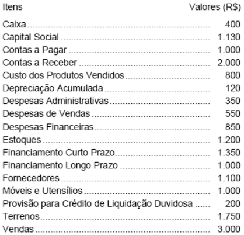{largura=35%}

O valor do Resultado Bruto Operacional do Exercício é

- A) Prejuízo R$ 2.800,00
- B) Prejuízo R$ 1.850,00
- C) Lucro R$ 750,00
- D) Lucro R$ 1.400,00
- E) Lucro R$ 2.200,00
- Gabarito: E
- Resolução: a caminho

## F0605 · FGV · 2007 · SEFAZ RJ · ME
- Fontes: TecConcursos 605 (3942)
- Prova: FGV - AFRE RJ/SEFAZ RJ/2007
- Grupos: receita-bruta, calculo-cmv, cmv, resultado-bruto, despesas-vendas, despesas-administrativas, resultado-financeiro, fora-ativo, fora-passivo, fora-pl, fora-destinacao, fora-outros

A empresa JJM Crianças e Cia., dedicada ao comércio de brinquedos, apurou o seguinte balanço patrimonial apurado em 31/12/2006:

Balanço Patrimonial, JJM Crianças e Cia., apurado em 31/12/2006

| Ativo | R$ | Passivo e PL | R$ |
|---|---:|---|---:|
| caixa | 55,00 | fornecedores | 600,00 |
| clientes | 1.000,00 | salários a pagar | 380,00 |
| estoques | 665,00 | empréstimos | 2.000,00 |
| móveis e utensílios | 10.000,00 | capital social | 4.000,00 |
| depreciação acumulada | −4.000,00 | lucros acumulados | 740,00 |
| ativo total | 7.720,00 | passivo + PL | 7.720,00 |

Considere as informações a seguir:

O estoque é avaliado pelo critério PEPS e era composto por:

| Mercadoria | custo unitário | quantidade estocada | valor total |
|---|---:|---:|---:|
| ioiô (unidade) | 1,00 | 300 | 300,00 |
| bolinhas de gude (quilograma) | 2,00 | 40 | 80,00 |
| bonecas de pano (unidade) | 3,00 | 95 | 285,00 |

Os móveis e utensílios têm vida útil original estimada em 10 anos e valor residual nulo.

Os empréstimos vencerão em 2010, mas cobram juros mensais de R$ 85,00

Durante o mês de janeiro de 2007, a empresa JJM Crianças e Cia. desenvolveu exclusivamente as seguintes transações (na ordem cronológica apresentada):

i. Recebeu 1/4 do Contas a Receber em aberto no início do ano.

ii. Os sócios aumentaram o Capital Social mediante subscrição de novas ações pelo valor nominal total de R$ 10.000,00. Entretanto, só integralizaram R$ 8.000,00, sendo R$ 5.000,00 em dinheiro e R$ 3.000,00 em um computador novo a ser utilizado nas atividades administrativas (cujo tempo de vida útil é 5 anos e valor residual nulo).

iii. Pagou toda a dívida com Fornecedores que estava em aberto no início do ano.

iv. Pagou os Salários a Pagar que eram devidos no início do ano.

v. Comprou 1.000 unidades de ioiô ao custo unitário de R$ 1,00 cada; 25kg de bolinhas de gude ao custo unitário de R$ 3,00 cada quilo; 200 unidades de bonecas de pano ao custo unitário de R$ 3,50 cada. Essas compras foram negociadas para pagamento da seguinte forma: metade à vista e metade para pagamento em fevereiro próximo.

vi. Contratou serviços de terceiros relativos ao desenvolvimento de uma campanha publicitária para veiculação na rádio local, cujos serviços foram executados e pagos ainda em janeiro, pelo valor total de R$ 500,00.

vii. Reconheceu e pagou os juros do mês de janeiro, no valor de R$ 85,00.

viii. Vendeu mercadorias à vista: 400 unidades de ioiô ao preço unitário de R$ 4,00 cada; 30kg de bolinhas de gude ao preço unitário de R$ 10,00 cada quilo; 150 unidades de bonecas de pano ao preço unitário de R$ 6,00 cada.

ix. Vendeu mercadorias, cuja forma de pagamento foi negociada da seguinte forma: 1/3 à vista; 1/3 para recebimento em fevereiro próximo e o restante para recebimento em março próximo ? 800 unidades de ioiô ao preço unitário de R$ 4,50 cada; 20kg de bolinhas de gude ao preço unitário de R$ 12,00 cada quilo; 120 unidades de bonecas de pano ao preço unitário de R$ 7,50 cada.

x. Reconheceu e provisionou a folha de pagamentos aos empregados, no valor total de R$ 400,00.

xi. Depreciou os móveis e utensílios e o computador.

xii. Identificou que o valor de venda das bonecas de pano, para o mês seguinte, deverá ser reduzido para R$ 5,00 por unidade, em função da entrada de um novo concorrente que importará bonecas de pano da China por um valor significativamente mais barato, apesar de a JJM Crianças e Cia. continuar comprando as bonecas de seu fornecedor tradicional.

xiii. Amortizou, antecipadamente, metade dos empréstimos, pagando R$ 1.000,00 ao banco. O saldo remanescente continua vencendo no prazo inicialmente contratado.

xiv. Distribuiu e pagou dividendos relativos ao lucro do mês de janeiro, no valor total de R$ 3.000,00.

O saldo do Lucro Bruto, evidenciado na DRE apurada em 31/01/2007, é:

- A) 5.332,50.
- B) 5.323,27.
- C) 5.360,00.
- D) 5.370,00.
- E) 5.319,24.
- Gabarito: A
### O que a questão pede
O **lucro bruto** de janeiro de 2007 de uma loja de brinquedos, com estoque pelo **PEPS** e três mercadorias diferentes. Das 14 transações, só três chegam ao lucro bruto: a compra (v) e as duas vendas (viii e ix). Uma quarta (xii) é armadilha.

### Cálculos prévios
**1) Receita de vendas:**

| Venda | Ioiô | Bolinhas de gude | Bonecas de pano | Total |
|---|---:|---:|---:|---:|
| viii (à vista) | 400 × 4,00 = 1.600,00 | 30 × 10,00 = 300,00 | 150 × 6,00 = 900,00 | 2.800,00 |
| ix (parte à vista, parte a prazo) | 800 × 4,50 = 3.600,00 | 20 × 12,00 = 240,00 | 120 × 7,50 = 900,00 | 4.740,00 |
| **Receita bruta** | | | | **7.540,00** |

**2) CMV pelo PEPS** (as vendas consomem primeiro o estoque inicial, depois a compra de janeiro):

| Mercadoria | Disponível | Vendido | Custo pelo PEPS | CMV |
|---|---|---:|---|---:|
| Ioiô | 300 a 1,00 + 1.000 a 1,00 | 1.200 | 1.200 a 1,00 | 1.200,00 |
| Bolinhas de gude (kg) | 40 a 2,00 + 25 a 3,00 | 50 | 40 a 2,00 + 10 a 3,00 | 110,00 |
| Bonecas de pano | 95 a 3,00 + 200 a 3,50 | 270 | 95 a 3,00 + 175 a 3,50 | 897,50 |
| **Total** | | | | **2.207,50** |

Sobram no estoque: 100 ioiôs a 1,00, 15 kg de bolinhas a 3,00 e **25 bonecas a 3,50** (232,50).

**3) Transação xii (preço futuro das bonecas cai para 5,00):** o estoque se mede pelo **menor entre o custo e o valor realizável líquido** (CPC 16 (R1), item 9). O custo das 25 bonecas restantes é 3,50, abaixo de 5,00. **Não há perda** a reconhecer.

### Passo a passo
```dre
@ Vendas à vista (viii) | 2.800,00 | receita-bruta
@ Vendas a prazo (ix) | 4.740,00 | receita-bruta
@ Estoque inicial (ioiô, gude e bonecas) | 665,00 | calculo-cmv
@ Compras de janeiro (v) | 1.775,00 | calculo-cmv
@ Estoque final pelo PEPS | 232,50 | calculo-cmv
@ Campanha publicitária (vi) | 500,00 | despesas-vendas
@ Folha de pagamentos de janeiro (x) | 400,00 | despesas-administrativas
@ Depreciação dos móveis e do computador (xi) | — | despesas-administrativas
@ Juros de janeiro (vii) | 85,00 | resultado-financeiro
@ Recebimento de clientes, pagamentos a fornecedores e salários (i, iii, iv) | — | fora-outros
@ Aumento de capital (ii) | 8.000,00 | fora-pl
@ Amortização antecipada do empréstimo (xiii) | 1.000,00 | fora-passivo
@ Dividendos de janeiro (xiv) | 3.000,00 | fora-destinacao
> Recebimentos, pagamentos, integralização de capital, amortização de dívida e dividendos não passam pela DRE.
! Recebimento de clientes, pagamentos a fornecedores e salários (i, iii, iv); Aumento de capital (ii); Amortização antecipada do empréstimo (xiii); Dividendos de janeiro (xiv)
> A receita é o total das duas vendas; a forma de recebimento não importa.
+ Receita de vendas | 7.540,00 | Vendas à vista (viii); Vendas a prazo (ix)
> CMV = EI 665,00 + compras 1.775,00 − EF 232,50 (100 ioiôs a 1,00 + 15 kg a 3,00 + 25 bonecas a 3,50). Dá o mesmo que a ficha PEPS.
+ (–) CMV | (2.207,50) | Estoque inicial (ioiô, gude e bonecas); Compras de janeiro (v); Estoque final pelo PEPS
= Lucro bruto | 5.332,50
> Publicidade, folha, depreciação e juros ficam abaixo do lucro bruto.
! Campanha publicitária (vi); Folha de pagamentos de janeiro (x); Depreciação dos móveis e do computador (xi); Juros de janeiro (vii)
```

Gabarito **A (5.332,50)**.

### O que ignorar e por quê
- **i, iii, iv:** recebimento de clientes e pagamentos de fornecedores e salários de dezembro. Caixa.
- **ii:** aumento de capital (subscrito 10.000, integralizado 8.000, inclusive o computador). PL e imobilizado.
- **v (forma de pagamento):** metade à vista e metade em fevereiro não muda o custo do estoque.
- **vi, vii, x, xi:** são despesas do mês (publicidade, juros, salários, depreciação), mas ficam **abaixo** do lucro bruto.
- **xii:** o valor realizável líquido (5,00) continua acima do custo (3,50). Nada a ajustar.
- **xiii e xiv:** amortização de principal (passivo) e dividendos (destinação).

### O que mais poderia estar ali
- **Perda por redução ao valor realizável líquido:** se o novo preço ficasse abaixo do custo (por exemplo, 3,00 contra 3,50), a perda de 0,50 por boneca reduziria o estoque e iria ao resultado (CPC 16 (R1), item 34).
- **Outros critérios:** a média ponderada daria outro CMV; o UEPS não é aceito pelo CPC 16.
- **Deduções da receita** (tributos sobre vendas, devoluções, descontos incondicionais), se houvesse.

### Pegadinhas
- **E (5.319,24)** = 7.540,00 − 2.220,76: é o lucro bruto pela **média ponderada** (como todas as compras vêm antes das vendas, a média fixa e a móvel coincidem). O enunciado pede PEPS.
- **Achar que o item xii gera perda:** o preço futuro (5,00) é menor que o preço atual de venda, mas ainda maior que o custo. Só se ajusta quando o valor realizável fica **abaixo do custo**.
- **Vendas a prazo e compras a prazo:** a forma de pagamento não muda receita nem custo.
- **Gude em kg:** atenção à unidade; a ficha funciona igual.

### Leve para as próximas
1. Muitas transações: filtre primeiro as que mexem em receita bruta, deduções e CMV.
2. PEPS com compras antes das vendas: o CMV leva os custos mais antigos; o estoque final fica com os mais recentes.
3. Estoque = menor entre custo e valor realizável líquido. Queda de preço só gera perda se ficar abaixo do custo.

## F0606 · CEBRASPE · 2007 · TCU · CE
- Fontes: TecConcursos 606 (5630)
- Prova: CEBRASPE (CESPE) - AUFC (TCU)/TCU/Controle Externo/Auditoria Governamental/2007
- Grupos: lair, ir-csll

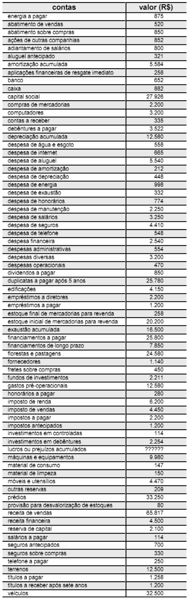{largura=41%}

Utilizando as informações do balancete de verificação de determinada empresa, apresentado a cima, julgue o item a seguir.

O lucro antes do imposto de renda e da contribuição social é igual a R$ 16.526.

- Gabarito: CERTO
- Resolução: a caminho

## F0607 · CEBRASPE · 2007 · TCU · CE
- Fontes: TecConcursos 607 (5632)
- Prova: CEBRASPE (CESPE) - AUFC (TCU)/TCU/Controle Externo/Auditoria Governamental/2007
- Grupos: cmv

{largura=41%}

Utilizando as informações do balancete de verificação de determinada empresa, apresentado a cima, julgue o item a seguir.

O custo da mercadoria vendida apurado no período é igual a R$ 22.072.

- Gabarito: CERTO
- Resolução: a caminho

## F0608 · FCC · 2007 · Pref SP · ME
- Fontes: TecConcursos 608 (24069)
- Prova: FCC - AFTM SP/Pref SP/2007
- Grupos: despesas-vendas

No curso de auditoria externa realizada na Cia. Novo Hamburgo foram constatadas as seguintes irregularidades: - Registro incorreto de gastos de manutenção do Ativo Imobilizado de R$ 30.000,00 como despesas, em vez de acréscimo ao valor dos bens. - Insuficiência na constituição da Provisão para Créditos de Liquidação Duvidosa no valor de R$ 17.000,00. - Falta de registro contábil de duplicatas já pagas, mantidas incorretamente no Passivo Circulante, no valor de R$ 28.000,00. - Falta de registro de adiantamento a empregados no valor de R$ 6.000,00.

Efetuados os lançamentos de ajuste para sanar tais irregularidades, recomendados pelo auditor, o resultado da companhia

- A) diminuiu R$ 21.000,00.
- B) diminuiu R$ 15.000,00.
- C) permaneceu inalterado.
- D) aumentou R$ 13.000,00.
- E) aumentou R$ 7.000,00.
- Gabarito: D
- Resolução: a caminho

## F0609 · FCC · 2007 · MPU · ME
- Fontes: TecConcursos 609 (40818)
- Prova: FCC - Ana MPU/MPU/Administrativo/2007
- Grupos: resultado-bruto, cmv, resultado-financeiro, receita-bruta, deducoes

Considere as seguintes informações relativas à Cia. Industrial Araraquara (em R$):

| Conta | Valor |
|---|---:|
| Receita Bruta de Vendas | 300.000,00 |
| Vendas Canceladas | 20.000,00 |
| Despesas financeiras na aquisição de materiais diretos | 8.000,00 |
| Custo dos Produtos Vendidos | 110.000,00 |
| Impostos incidentes sobre Vendas | 30.000,00 |

O lucro bruto da companhia nesse exercício correspondeu, em R$, a

- A) 124.000,00
- B) 134.000,00
- C) 140.000,00
- D) 150.000,00
- E) 170.000,00
- Gabarito: C
- Resolução: a caminho

## F0610 · FCC · 2007 · MPU · ME
- Fontes: TecConcursos 610 (40822)
- Prova: FCC - Ana MPU/MPU/Administrativo/2007
- Grupos: participacoes, lucro-liquido

Dadas as seguintes informações relativas à Cia. Vinhedo (em R$):

| Conta | Valor |
|---|---:|
| - Prejuízo contábil de exercícios anteriores | 120.000,00 |
| - Lucro líquido do exercício antes das participações | 380.000,00 |

Sabendo que as participações dos empregados e dos administradores foram calculadas de acordo com o disposto na Lei no 6.404/76 e que as percentagens previstas no estatuto da companhia são, respectivamente, 10% e 5% para cada uma delas, o valor da participação dos administradores foi, em R$, de

- A) 11.700,00
- B) 13.000,00
- C) 15.900,00
- D) 17.100,00
- E) 19.000,00
- Gabarito: A
- Resolução: a caminho

## F0611 · FCC · 2007 · MPU · ME
- Fontes: TecConcursos 611 (41630)
- Prova: FCC - Ana MPU/MPU/Perito/Contabilidade/2007
- Grupos: participacoes, ir-csll, lucro-liquido

Instruções: Para responder à questão considere o caso abaixo, as informações nele fornecidas, bem como os dispositivos constantes a respeito do assunto na Lei no 6.404/76 (Lei das Sociedades por Ações).

As seguintes informações foram extraídas da contabilidade da Cia. XYZ em 31/12/2005: - Saldo da conta Lucros ou Prejuízos Acumulados, antes do lançamento do resultado do exercício de 2005: devedor em R$ 20.000,00; - Lucro líquido de 2005, antes da Contribuição Social sobre o Lucro Líquido e do Imposto de Renda das Pessoas Jurídicas: R$ 260.000,00; - Contribuição Social sobre o Lucro Líquido: R$ 18.000,00; - Imposto de Renda das Pessoas Jurídicas: R$ 30.000,00.

O estatuto da companhia prevê o pagamento das seguintes participações nos lucros: - Empregados: 10% - Administradores: 5% - Contribuições para fundo de assistência e previdência dos empregados: 5% A base de cálculo da participação dos empregados no lucro correspondeu, em R$, a

- A) 260.000,00
- B) 240.000,00
- C) 212.000,00
- D) 210.000,00
- E) 192.000,00
- Gabarito: E
- Resolução: a caminho

## F0612 · FCC · 2007 · MPU · ME
- Fontes: TecConcursos 612 (41631)
- Prova: FCC - Ana MPU/MPU/Perito/Contabilidade/2007
- Grupos: participacoes, ir-csll, lucro-liquido

Instruções: Para responder à questão considere o caso abaixo, as informações nele fornecidas, bem como os dispositivos constantes a respeito do assunto na Lei no 6.404/76 (Lei das Sociedades por Ações).

As seguintes informações foram extraídas da contabilidade da Cia. XYZ em 31/12/2005: - Saldo da conta Lucros ou Prejuízos Acumulados, antes do lançamento do resultado do exercício de 2005: devedor em R$ 20.000,00; - Lucro líquido de 2005, antes da Contribuição Social sobre o Lucro Líquido e do Imposto de Renda das Pessoas Jurídicas: R$ 260.000,00; - Contribuição Social sobre o Lucro Líquido: R$ 18.000,00; - Imposto de Renda das Pessoas Jurídicas: R$ 30.000,00.

O estatuto da companhia prevê o pagamento das seguintes participações nos lucros: - Empregados: 10% - Administradores: 5% - Contribuições para fundo de assistência e previdência dos empregados: 5% A participação dos administradores no lucro da companhia foi, em R$,

- A) 8.060,00
- B) 8.640,00
- C) 9.250,00
- D) 9.750,00
- E) 10.600,00
- Gabarito: B
- Resolução: a caminho

## F0613 · FCC · 2007 · MPU · ME
- Fontes: TecConcursos 613 (41632)
- Prova: FCC - Ana MPU/MPU/Perito/Contabilidade/2007
- Grupos: participacoes, ir-csll, lucro-liquido

Instruções: Para responder à questão considere o caso abaixo, as informações nele fornecidas, bem como os dispositivos constantes a respeito do assunto na Lei no 6.404/76 (Lei das Sociedades por Ações).

As seguintes informações foram extraídas da contabilidade da Cia. XYZ em 31/12/2005: - Saldo da conta Lucros ou Prejuízos Acumulados, antes do lançamento do resultado do exercício de 2005: devedor em R$ 20.000,00; - Lucro líquido de 2005, antes da Contribuição Social sobre o Lucro Líquido e do Imposto de Renda das Pessoas Jurídicas: R$ 260.000,00; - Contribuição Social sobre o Lucro Líquido: R$ 18.000,00; - Imposto de Renda das Pessoas Jurídicas: R$ 30.000,00.

O estatuto da companhia prevê o pagamento das seguintes participações nos lucros: - Empregados: 10% - Administradores: 5% - Contribuições para fundo de assistência e previdência dos empregados: 5% A companhia contribuiu para o fundo de assistência e previdência de empregados com o valor, em R$, de

- A) 9.295,00
- B) 8.685,00
- C) 8.208,00
- D) 8.105,00
- E) 7.595,00
- Gabarito: C
- Resolução: a caminho

## F0614 · CEBRASPE · 2007 · TRE TO · ME
- Fontes: TecConcursos 614 (87688)
- Prova: CEBRASPE (CESPE) - AJ TRE TO/TRE TO/Administrativa/Contabilidade/2007
- Grupos: receita-bruta, deducoes, receita-liquida, calculo-cmv, cmv, resultado-bruto, fora-ativo, fora-passivo

A tabela a seguir apresenta resultados de operações realizadas por determinada empresa, em janeiro de 2007.

| Data | Operação | Quantidade | Valor unitário (estoque e receita bruta) | Valor total |
|---|---|---:|---:|---:|
| — | saldo inicial do estoque | 28 | 647,40 | 18.127,20 |
| 2/1/2007 | compra a prazo | 15 | 581,00 | 8.715,00 |
| 5/1/2007 | venda a prazo | 17 | 1.200,00 | 20.400,00 |
| 8/1/2007 | compra à vista | 25 | 605,90 | 15.147,50 |
| 12/1/2007 | devolução de compra | 6 | 605,90 | 3.635,40 |
| 18/1/2007 | venda à vista | 32 | 1.280,00 | 40.960,00 |
| 21/1/2007 | compra a prazo | 16 | 664,00 | 10.624,00 |
| 25/1/2007 | compra a prazo | 5 | 730,40 | 3.652,00 |
| 29/1/2007 | venda à vista | 26 | 1.300,00 | 33.800,00 |
| 29/1/2007 | abatimento de vendas do dia 5/1/2007 | — | — | 800,00 |

A seguir, estão listadas outras informações referentes à contabilidade dessa empresa que também deverão ser consideradas para a questão.

- despesas administrativas de janeiro pagas em 5/2/2007: R$ 5.200,00
- despesas de salários e encargos de janeiro pagos em 2/2/2007: R$ 12.500,00
- despesas de manutenção de janeiro pagas em 29/1/2007: R$ 13.250,00
- redução da receita antecipada em janeiro, com 8 unidades de mercadorias entregues, ocorrida em 20/1/2007: R$ 20.000,00
- aumento de despesas antecipadas em janeiro, com pagamento na data, ocorrido em 21/1/2007: R$ 7.500,00
- despesas de aluguel do mês de janeiro pagas em 28/1/2007: R$ 3.240,00
- ICMS sobre compras: 17%
- ICMS sobre vendas: 17%
- ICMS a recuperar do estoque inicial encontra-se no ativo circulante da empresa
- saldo do disponível em 1º/1/2007: R$ 95.800,00
- a empresa pagou o ICMS do período, com a utilização dos créditos tributários, em 29/1/2007

Considere apenas a incidência do ICMS e o controle de estoques permanente pelo PEPS.

Desconsidere: PIS, PASEP, COFINS, CSLL, IRPJ, IPI, ISS, FGTS, II e IE.

Na demonstração do resultado do exercício (DRE) do mês de janeiro de 2007, o lucro bruto apurado, em reais, corresponde a

- A) 12.152,50.
- B) 22.152,50.
- C) 35.198,30.
- D) 39.852,62.
- E) 42.152,50.
- Gabarito: E
### O que a questão pede
O **lucro bruto** de janeiro de uma empresa comercial com estoque permanente pelo **PEPS** (o primeiro que entra é o primeiro que sai) e com ICMS de 17% nas vendas. É a questão mais trabalhosa do caderno: exige ficha de estoque, receita realizada de adiantamento e deduções.

### Cálculos prévios
**1) Leia o cabeçalho da coluna:** "valor unitário (estoque e receita bruta)". Nas compras, o valor unitário é o **valor que vai para o estoque**, já sem o ICMS recuperável. Nas vendas, é o preço de venda (receita bruta). Não tire o ICMS das compras de novo.

**2) Receita bruta.** São as três vendas da tabela **mais** a receita antecipada realizada em 20/1 (8 unidades entregues: o cliente já tinha pago, e a receita nasce na entrega, pelo CPC 47).

| Venda | Valor |
|---|---:|
| 5/1 (17 un.) | 20.400,00 |
| 18/1 (32 un.) | 40.960,00 |
| 20/1, entrega da venda antecipada (8 un.) | 20.000,00 |
| 29/1 (26 un.) | 33.800,00 |
| **Receita bruta** | **115.160,00** |

**3) Deduções:** ICMS de 17% × 115.160,00 = **19.577,20**; abatimento sobre vendas = **800,00**. Receita líquida = 115.160,00 − 19.577,20 − 800,00 = **94.782,80**.

**4) Ficha de estoque pelo PEPS** (custo das saídas):

| Data | Movimento | Saída pelo PEPS | Custo da saída | Fica no estoque |
|---|---|---|---:|---|
| 1/1 | saldo | — | — | 28 a 647,40 |
| 2/1 | compra | — | — | 28 a 647,40 · 15 a 581,00 |
| 5/1 | venda de 17 | 17 a 647,40 | 11.005,80 | 11 a 647,40 · 15 a 581,00 |
| 8/1 | compra | — | — | … · 25 a 605,90 |
| 12/1 | devolução de 6 da compra de 8/1 | — | — | 11 a 647,40 · 15 a 581,00 · 19 a 605,90 |
| 18/1 | venda de 32 | 11 a 647,40 + 15 a 581,00 + 6 a 605,90 | 19.471,80 | 13 a 605,90 |
| 20/1 | entrega de 8 (venda antecipada) | 8 a 605,90 | 4.847,20 | 5 a 605,90 |
| 21/1 e 25/1 | compras | — | — | 5 a 605,90 · 16 a 664,00 · 5 a 730,40 |
| 29/1 | venda de 26 | 5 a 605,90 + 16 a 664,00 + 5 a 730,40 | 17.305,50 | 0 |
| | **CMV** | | **52.630,30** | |

A devolução de compra **sai do lote de onde veio** (8/1, a 605,90), não do mais antigo.

### Passo a passo
```dre
@ Vendas da tabela (5/1, 18/1 e 29/1) | 95.160,00 | receita-bruta
@ Receita antecipada realizada (8 un. em 20/1) | 20.000,00 | receita-bruta
@ ICMS sobre vendas (17%) | 19.577,20 | deducoes
@ Abatimento de vendas | 800,00 | deducoes
@ Custo das saídas pelo PEPS | 52.630,30 | cmv
@ Despesas administrativas, salários, manutenção e aluguel | 34.190,00 | despesas-administrativas
@ Despesas antecipadas pagas em 21/1 | 7.500,00 | fora-ativo
@ Saldo do disponível em 1/1 | 95.800,00 | fora-ativo
@ ICMS sobre compras (já fora do valor do estoque) | — | fora-ativo
> O saldo de caixa, as despesas antecipadas (ativo) e o ICMS das compras (já tirado do valor do estoque) não entram no lucro bruto.
! Despesas antecipadas pagas em 21/1; Saldo do disponível em 1/1; ICMS sobre compras (já fora do valor do estoque)
> Receita bruta: as três vendas da tabela mais os 20.000 da receita antecipada que se realizou com a entrega.
+ Receita bruta | 115.160,00 | Vendas da tabela (5/1, 18/1 e 29/1); Receita antecipada realizada (8 un. em 20/1)
+ (–) ICMS sobre vendas | (19.577,20) | ICMS sobre vendas (17%)
+ (–) Abatimentos sobre vendas | (800,00) | Abatimento de vendas
= Receita líquida | 94.782,80
> CMV pela ficha PEPS, com as 8 unidades entregues em 20/1 também saindo do estoque.
+ (–) CMV | (52.630,30) | Custo das saídas pelo PEPS
= Lucro bruto | 42.152,50
> As despesas do mês vêm abaixo do lucro bruto (a questão seguinte, F0615, cobra o resultado com elas).
! Despesas administrativas, salários, manutenção e aluguel
```

Gabarito **E (42.152,50)**.

### O que ignorar e por quê
- **Datas de pagamento** das despesas, "à vista" ou "a prazo" nas vendas e compras: a DRE é por competência.
- **Saldo do disponível (95.800) e pagamento do ICMS em 29/1:** movimentos de caixa.
- **Despesas antecipadas (7.500):** ativo; só viram despesa no mês a que se referem.
- **"ICMS sobre compras: 17%":** o valor do estoque já vem líquido. A informação serve ao cálculo do ICMS a pagar, não ao lucro bruto.
- **ICMS a recuperar do estoque inicial:** está no ativo; o estoque inicial (647,40 por unidade) já está líquido.

### O que mais poderia estar ali
- **Receitas realizadas de adiantamentos:** assinaturas, aluguéis recebidos antes, serviços pagos antecipadamente. Todas entram na receita quando o bem é entregue ou o serviço é prestado.
- **Outras deduções:** devoluções de vendas, descontos incondicionais, PIS e Cofins sobre faturamento.
- **Outros métodos de estoque:** média ponderada móvel (custo médio recalculado a cada entrada). O UEPS (último que entra, primeiro que sai) não é aceito pelo CPC 16.

### Pegadinhas
- **Esquecer a receita antecipada realizada:** a receita "de verdade" nasce na entrega, mesmo que o dinheiro tenha entrado antes. A alternativa **B (22.152,50)** fica exatamente 20.000 abaixo do gabarito.
- **Tirar o ICMS das compras de novo:** baixa o CMV e infla o lucro bruto.
- **Esquecer as 8 unidades entregues em 20/1** na ficha de estoque: muda todas as saídas seguintes pelo PEPS.
- **Devolução de compra pelo custo errado:** sai do lote devolvido (605,90), não do primeiro lote.

### Leve para as próximas
1. Leia o cabeçalho das colunas: ele diz se o valor é de estoque (líquido) ou de nota (bruto).
2. Receita antecipada realizada = receita do período e baixa de estoque na data da entrega.
3. PEPS: monte a ficha linha a linha; cada venda consome os lotes mais antigos primeiro.
4. ICMS sobre vendas incide sobre toda a receita bruta do mês, inclusive a realizada de adiantamentos.

## F0615 · CEBRASPE · 2007 · TRE TO · ME
- Fontes: TecConcursos 615 (87689)
- Prova: CEBRASPE (CESPE) - AJ TRE TO/TRE TO/Administrativa/Contabilidade/2007
- Grupos: receita-bruta, deducoes, cmv, resultado-bruto, despesas-administrativas, lair, fora-ativo

A tabela a seguir apresenta resultados de operações realizadas por determinada empresa, em janeiro de 2007.

| Data | Operação | Quantidade | Valor unitário (estoque e receita bruta) | Valor total |
|---|---|---:|---:|---:|
| — | saldo inicial do estoque | 28 | 647,40 | 18.127,20 |
| 2/1/2007 | compra a prazo | 15 | 581,00 | 8.715,00 |
| 5/1/2007 | venda a prazo | 17 | 1.200,00 | 20.400,00 |
| 8/1/2007 | compra à vista | 25 | 605,90 | 15.147,50 |
| 12/1/2007 | devolução de compra | 6 | 605,90 | 3.635,40 |
| 18/1/2007 | venda à vista | 32 | 1.280,00 | 40.960,00 |
| 21/1/2007 | compra a prazo | 16 | 664,00 | 10.624,00 |
| 25/1/2007 | compra a prazo | 5 | 730,40 | 3.652,00 |
| 29/1/2007 | venda à vista | 26 | 1.300,00 | 33.800,00 |
| 29/1/2007 | abatimento de vendas do dia 5/1/2007 | — | — | 800,00 |

A seguir, estão listadas outras informações referentes à contabilidade dessa empresa que também deverão ser consideradas para a questão.

- despesas administrativas de janeiro pagas em 5/2/2007: R$ 5.200,00
- despesas de salários e encargos de janeiro pagos em 2/2/2007: R$ 12.500,00
- despesas de manutenção de janeiro pagas em 29/1/2007: R$ 13.250,00
- redução da receita antecipada em janeiro, com 8 unidades de mercadorias entregues, ocorrida em 20/1/2007: R$ 20.000,00
- aumento de despesas antecipadas em janeiro, com pagamento na data, ocorrido em 21/1/2007: R$ 7.500,00
- despesas de aluguel do mês de janeiro pagas em 28/1/2007: R$ 3.240,00
- ICMS sobre compras: 17%
- ICMS sobre vendas: 17%
- ICMS a recuperar do estoque inicial encontra-se no ativo circulante da empresa
- saldo do disponível em 1º/1/2007: R$ 95.800,00
- a empresa pagou o ICMS do período, com a utilização dos créditos tributários, em 29/1/2007

Considere apenas a incidência do ICMS e o controle de estoques permanente pelo PEPS.

Desconsidere: PIS, PASEP, COFINS, CSLL, IRPJ, IPI, ISS, FGTS, II e IE.

O resultado da empresa, antes da aplicação do imposto de renda, corresponderá a

- A) prejuízo de R$ 8.637,50.
- B) lucro de R$ 13.141,70.
- C) prejuízo de R$ 9.165,30.
- D) lucro de R$ 7.962,50.
- E) prejuízo de R$ 11.352,80.
- Gabarito: D
### O que a questão pede
O **resultado antes do imposto de renda** (LAIR) de janeiro, com os mesmos dados da F0614. Parte do lucro bruto de **42.152,50** e tira as despesas do mês.

### Cálculos prévios
- **Lucro bruto:** 42.152,50 (ficha PEPS e receitas da F0614).
- **Despesas de janeiro, pelo regime de competência:** todas as despesas "de janeiro" entram, pagas em janeiro ou em fevereiro.

| Despesa de janeiro | Paga em | Entra? | Valor |
|---|---|---|---:|
| Administrativas | 5/2 | Sim | 5.200,00 |
| Salários e encargos | 2/2 | Sim | 12.500,00 |
| Manutenção | 29/1 | Sim | 13.250,00 |
| Aluguel | 28/1 | Sim | 3.240,00 |
| Despesas antecipadas (aumento) | 21/1 | **Não**: é ativo | 7.500,00 |
| **Total** | | | **34.190,00** |

### Passo a passo
```dre
@ Lucro bruto (ver F0614) | 42.152,50 | resultado-bruto
@ Despesas administrativas | 5.200,00 | despesas-administrativas
@ Salários e encargos | 12.500,00 | despesas-administrativas
@ Manutenção | 13.250,00 | despesas-administrativas
@ Aluguel | 3.240,00 | despesas-administrativas
@ Aumento de despesas antecipadas | 7.500,00 | fora-ativo
> As despesas antecipadas aumentaram: houve pagamento de despesa futura, que é ativo. Fora.
! Aumento de despesas antecipadas
+ Lucro bruto | 42.152,50 | Lucro bruto (ver F0614)
> Todas as despesas de janeiro, pagas ou não no mês.
+ (–) Despesas administrativas | (5.200,00) | Despesas administrativas
+ (–) Salários e encargos | (12.500,00) | Salários e encargos
+ (–) Manutenção | (13.250,00) | Manutenção
+ (–) Aluguel | (3.240,00) | Aluguel
= Resultado antes do IR | 7.962,50
```

Gabarito **D (lucro de 7.962,50)**.

### O que ignorar e por quê
- **Datas de pagamento:** irrelevantes para a DRE. Despesa de janeiro paga em fevereiro é despesa de janeiro (e passivo no fim do mês).
- **Despesas antecipadas (7.500):** pagamento de despesa de meses futuros. É ativo e vira despesa quando o período chegar.
- **Saldo de caixa e pagamento do ICMS:** caixa.

### O que mais poderia estar ali
- **Despesas do mês ainda não pagas:** energia, telefone, juros incorridos, depreciação.
- **Apropriação de despesas antecipadas de meses anteriores:** seguro ou aluguel pagos antes e que vencem no mês. Essa sim seria despesa de janeiro.

### Pegadinhas
- **A (prejuízo de 8.637,50)** = 7.962,50 − 16.600,00: tirou a receita antecipada realizada, líquida do ICMS (20.000 − 3.400), sem mexer no CMV.
- **Somar o aumento de despesas antecipadas como despesa:** daria 462,50. Não é alternativa, mas é o erro clássico.
- **Usar só as despesas pagas em janeiro:** confunde DRE (competência) com DFC (caixa).

### Leve para as próximas
1. Competência: "despesa de janeiro" é de janeiro, não importa quando foi paga.
2. Aumento de despesa antecipada = pagamento adiantado (ativo); redução = despesa apropriada no período.

## F0616 · CEBRASPE · 2007 · TRE AP · ME
- Fontes: TecConcursos 616 (96926)
- Prova: CEBRASPE (CESPE) - AJ TRE AP/TRE AP/Administrativa/Contabilidade/2007
- Grupos: receita-bruta, deducoes, calculo-cmv, cmv, resultado-bruto, despesas-administrativas, lair, ir-csll, fora-ativo, fora-passivo, fora-pl

Balancete para a questão balancete de verificação em 31/1/2007

contas saldo (R$)

| Conta | Valor |
|---|---:|
| 1 abatimento de compras | 175,00 |
| 2 fretes sobre compras | 253,00 |
| 3 despesa de seguros | 330,00 |
| 4 aluguel a pagar | 410,00 |
| 5 caixa | 800,00 |
| 6 despesa de aluguel | 875,00 |
| 7 despesa de energia | 950,00 |
| 8 devolução de compras | 950,00 |
| 9 despesa de salários | 952,00 |
| 10 investimentos em ações | 985,00 |
| 11 reserva de capital | 1.100,00 |
| 12 abatimento sobre receitas | 1.100,00 |
| 13 aplicação em poupança | 1.250,00 |
| 14 deságio na emissão de debêntures | 2.000,00 |
| 15 estoque em 31/1/2007 | 2.140,00 |
| 16 fornecedores | 2.500,00 |
| 17 receita antecipada | 2.580,00 |
| 18 amortização acumulada | 2.587,00 |
| 19 ágio na emissão de debêntures | 3.200,00 |
| 20 títulos a receber de longo prazo | 3.250,00 |
| 21 banco | 3.500,00 |
| 22 compras de mercadorias | 3.522,00 |
| 23 provisão para devedores duvidosos | 3.580,00 |
| 24 adiantamento a funcionários | 4.120,00 |
| 25 salários a pagar | 4.150,00 |
| 26 prédios | 4.550,00 |
| 27 debêntures emitidas | 5.800,00 |
| 28 impostos sobre lucro | 6.082,00 |
| 29 provisão para contingências | 7.582,00 |
| 30 contas a receber | 8.500,00 |
| 31 empréstimos a dirigentes | 8.500,00 |
| 32 estoque em 1.o/1/2007 | 8.500,00 |
| 33 impostos sobre receita | 9.640,00 |
| 34 gastos com desenvolvimento de produtos | 9.875,00 |
| 35 depreciação acumulada | 12.000,00 |
| 36 capital social | 13.840,00 |
| 37 terrenos | 14.500,00 |
| 38 veículos | 25.000,00 |
| 39 receita de vendas | 48.200,00 |
| 40 lucros ou prejuízos acumulados | ? ? ? ? ? ? |

Considerando o balancete de verificação apresentado, é correto afirmar que o valor do lucro antes do imposto de renda é igual a

- A) R$ 17.343,00.
- B) R$ 18.435,00.
- C) R$ 21.345,00.
- D) R$ 25.343,00.
- E) R$ 27.407,00.
- Gabarito: D
### O que a questão pede
O **lucro antes do imposto de renda** a partir de um balancete com 40 contas misturadas. O CMV não vem pronto: sai pelo inventário periódico. O saldo de lucros acumulados vem com "???" de propósito: ele não é necessário.

### Cálculos prévios
**1) Receita líquida:** receita de vendas 48.200 − abatimento sobre receitas 1.100 − impostos sobre receita 9.640 = **37.460**.

**2) CMV = estoque inicial + compras líquidas − estoque final:**

| Item | Valor |
|---|---:|
| Estoque em 1º/1/2007 | 8.500 |
| (+) Compras de mercadorias | 3.522 |
| (+) Fretes sobre compras | 253 |
| (–) Abatimento de compras | (175) |
| (–) Devolução de compras | (950) |
| (–) Estoque em 31/1/2007 | (2.140) |
| **CMV** | **9.010** |

**3) Despesas operacionais do balancete:** seguros 330 + aluguel 875 + energia 950 + salários 952 = **3.107**.

### Passo a passo
```dre
@ receita de vendas | 48.200 | receita-bruta
@ abatimento sobre receitas | 1.100 | deducoes
@ impostos sobre receita | 9.640 | deducoes
@ estoque em 1.o/1/2007 | 8.500 | calculo-cmv
@ compras de mercadorias | 3.522 | calculo-cmv
@ fretes sobre compras | 253 | calculo-cmv
@ abatimento de compras | 175 | calculo-cmv
@ devolução de compras | 950 | calculo-cmv
@ estoque em 31/1/2007 | 2.140 | calculo-cmv
@ despesa de seguros | 330 | despesas-administrativas
@ despesa de aluguel | 875 | despesas-administrativas
@ despesa de energia | 950 | despesas-administrativas
@ despesa de salários | 952 | despesas-administrativas
@ impostos sobre lucro | 6.082 | ir-csll
@ gastos com desenvolvimento de produtos | 9.875 | fora-ativo
@ receita antecipada | 2.580 | fora-passivo
@ deságio e ágio na emissão de debêntures | — | fora-passivo
@ provisão para devedores duvidosos | 3.580 | fora-ativo
@ demais contas de ativo, passivo e PL | — | fora-outros
> Triagem: o que é saldo de ativo, passivo ou PL sai. Atenção aos "falsos amigos": receita antecipada (passivo), provisão para devedores duvidosos (saldo, não despesa), gastos com desenvolvimento (ativo).
! gastos com desenvolvimento de produtos; receita antecipada; deságio e ágio na emissão de debêntures; provisão para devedores duvidosos; demais contas de ativo, passivo e PL
+ Receita de vendas | 48.200 | receita de vendas
+ (–) Abatimentos e impostos sobre a receita | (10.740) | abatimento sobre receitas; impostos sobre receita
= Receita líquida | 37.460
> CMV pelo inventário: EI + compras + fretes − abatimentos − devoluções − EF.
+ (–) CMV | (9.010) | estoque em 1.o/1/2007; compras de mercadorias; fretes sobre compras; abatimento de compras; devolução de compras; estoque em 31/1/2007
= Lucro bruto | 28.450
+ (–) Despesas operacionais | (3.107) | despesa de seguros; despesa de aluguel; despesa de energia; despesa de salários
= Lucro antes do IR | 25.343
> Os impostos sobre o lucro vêm depois desta linha.
! impostos sobre lucro
```

Gabarito **D (25.343)**.

### O que ignorar e por quê
- **Impostos sobre lucro (6.082):** ficam **depois** do lucro antes do IR, por definição.
- **Gastos com desenvolvimento de produtos (9.875):** ativo (na época, ativo diferido; hoje, intangível, se cumprir os requisitos do CPC 04).
- **Receita antecipada (2.580):** passivo; só vira receita com a entrega.
- **Provisão para devedores duvidosos (3.580):** saldo retificador de clientes; a despesa do período não foi informada.
- **Ágio e deságio na emissão de debêntures:** contas do passivo (o deságio reduz a dívida) ou, em 2007, do PL. Não passam pela DRE nesse balancete.
- **Caixa, banco, poupança, contas a receber, prédios, terrenos, veículos, capital, reservas, fornecedores…:** patrimoniais.

### O que mais poderia estar ali
- **No CMV:** seguro sobre compras, descontos incondicionais obtidos, ICMS recuperável (subtrai).
- **Nas despesas:** depreciação e amortização do período. Aqui só há os saldos **acumulados**, que não são despesa.

### Pegadinhas
- **Tirar os impostos sobre o lucro:** 25.343 − 6.082 = 19.261 (seria o lucro líquido).
- **Lançar o desenvolvimento como despesa:** 25.343 − 9.875 = 15.468.
- **Esquecer devoluções e abatimentos de compras:** o CMV sobe para 10.135 e o resultado cai para 24.218.
- **Fretes sobre compras** somam ao custo; não são despesa com vendas.
- ⚠️ **Hoje**, pelo CPC 04, gasto com **pesquisa** é sempre despesa; gasto com **desenvolvimento** pode ser ativado se cumprir os requisitos (viabilidade técnica, intenção e capacidade de concluir e usar, benefício provável, mensuração confiável).

### Leve para as próximas
1. Balancete longo: triagem primeiro (resultado × patrimonial), depois a montagem.
2. Compras líquidas = compras + fretes e seguros − devoluções − abatimentos − descontos obtidos.
3. Saldos "acumulados" e "provisões" são patrimoniais; despesas vêm com o nome "despesa".

## F0617 · FCC · 2007 · TRF 3 · ME
- Fontes: TecConcursos 617 (122558)
- Prova: FCC - TJ TRF3/TRF 3/Apoio Especializado/Contabilidade/2007
- Grupos: resultado-bruto, resultado-financeiro, deducoes, receita-bruta, despesas-operacionais, despesas-vendas, outras-receitas-despesas

Atenção: Utilize apenas as informações a seguir, relativas ao exercício de 2006, extraídas da contabilidade da Cia. Comercial Onze de Agosto, para responder à questão.

| Conta | Valor |
|---|---:|
| Compras | R$ 200.000,00 |
| Receitas financeiras | R$ 13.000,00 |
| Comissões sobre vendas | R$ 25.000,00 |
| Devolução de vendas | R$ 15.000,00 |
| Impostos sobre vendas | R$ 90.000,00 |
| Devolução de compras | R$ 20.000,00 |
| Estoque inicial de mercadorias | R$ 40.000,00 |
| Receita bruta de vendas | R$ 505.000,00 |
| Resultado não-operacional | R$ 8.000,00 |
| Estoque final de mercadorias | R$ 60.000,00 |
| Demais despesas operacionais | R$ 55.000,00 |

O lucro bruto nas operações com mercadorias da companhia no exercício de 2006 equivaleu a, em R$,

- A) 215.000,00
- B) 240.000,00
- C) 265.000,00
- D) 285.000,00
- E) 290.000,00
- Gabarito: B
### O que a questão pede
O **lucro bruto** de 2006 da Cia. Onze de Agosto. É preciso calcular o CMV pelo inventário e a receita líquida.

### Cálculos prévios
**1) Receita líquida:** 505.000 − 15.000 (devolução de vendas) − 90.000 (impostos sobre vendas) = **400.000**.

**2) CMV:** estoque inicial 40.000 + compras líquidas (200.000 − 20.000 de devolução de compras) − estoque final 60.000 = **160.000**.

### Passo a passo
```dre
@ Receita bruta de vendas | 505.000 | receita-bruta
@ Devolução de vendas | 15.000 | deducoes
@ Impostos sobre vendas | 90.000 | deducoes
@ Estoque inicial de mercadorias | 40.000 | calculo-cmv
@ Compras | 200.000 | calculo-cmv
@ Devolução de compras | 20.000 | calculo-cmv
@ Estoque final de mercadorias | 60.000 | calculo-cmv
@ Comissões sobre vendas | 25.000 | despesas-vendas
@ Demais despesas operacionais | 55.000 | despesas-operacionais
@ Receitas financeiras | 13.000 | resultado-financeiro
@ Resultado não-operacional | 8.000 | outras-receitas-despesas
+ Receita bruta de vendas | 505.000 | Receita bruta de vendas
+ (–) Devolução de vendas | (15.000) | Devolução de vendas
+ (–) Impostos sobre vendas | (90.000) | Impostos sobre vendas
= Receita líquida | 400.000
> CMV = 40.000 + (200.000 − 20.000) − 60.000.
+ (–) CMV | (160.000) | Estoque inicial de mercadorias; Compras; Devolução de compras; Estoque final de mercadorias
= Lucro bruto | 240.000
> Comissões, demais despesas, receitas financeiras e o resultado não operacional ficam abaixo do lucro bruto.
! Comissões sobre vendas; Demais despesas operacionais; Receitas financeiras; Resultado não-operacional
```

Gabarito **B (240.000)**.

### O que ignorar e por quê
Comissões sobre vendas (despesa com vendas), demais despesas operacionais, receitas financeiras e resultado não operacional: todos abaixo do lucro bruto.

### O que mais poderia estar ali
- **Compras líquidas:** abatimentos e descontos incondicionais obtidos (subtraem), fretes e seguros sobre compras (somam).
- **Deduções:** abatimentos, descontos incondicionais, vendas canceladas.

### Pegadinhas
- **A (215.000)** = 240.000 − 25.000: tirou as comissões, que são despesa com vendas.
- **Comissões "sobre vendas" não são dedução da receita:** são despesa com vendas. Dedução é o que reduz o **preço** (devolução, abatimento, desconto incondicional, tributo).
- **Inverter os estoques:** com EI 60.000 e EF 40.000, o CMV vira 200.000.

### Leve para as próximas
1. Lucro bruto = RB − deduções − (EI + compras líquidas − EF).
2. "Sobre vendas" no nome não garante dedução: comissão e frete sobre vendas são despesas com vendas.

## F0618 · FCC · 2007 · TRF 3 · ME
- Fontes: TecConcursos 618 (122559)
- Prova: FCC - TJ TRF3/TRF 3/Apoio Especializado/Contabilidade/2007
- Grupos: resultado-operacional, resultado-financeiro, deducoes, receita-bruta, despesas-operacionais, despesas-vendas, outras-receitas-despesas

Atenção: Utilize apenas as informações a seguir, relativas ao exercício de 2006, extraídas da contabilidade da Cia. Comercial Onze de Agosto, para responder à questão.

| Conta | Valor |
|---|---:|
| Compras | R$ 200.000,00 |
| Receitas financeiras | R$ 13.000,00 |
| Comissões sobre vendas | R$ 25.000,00 |
| Devolução de vendas | R$ 15.000,00 |
| Impostos sobre vendas | R$ 90.000,00 |
| Devolução de compras | R$ 20.000,00 |
| Estoque inicial de mercadorias | R$ 40.000,00 |
| Receita bruta de vendas | R$ 505.000,00 |
| Resultado não-operacional | R$ 8.000,00 |
| Estoque final de mercadorias | R$ 60.000,00 |
| Demais despesas operacionais | R$ 55.000,00 |

A companhia apurou lucro operacional líquido no exercício de 2006 no montante de, em R$,

- A) 253.000,00
- B) 240.000,00
- C) 206.000,00
- D) 181.000,00
- E) 173.000,00
- Gabarito: E
### O que a questão pede
O **lucro operacional líquido** de 2006 (mesmos dados da F0617). Na redação da Lei 6.404/76 vigente em 2006, é o resultado operacional (art. 187, IV), **antes** do resultado não operacional. As receitas financeiras ficam dentro do operacional.

### Cálculos prévios
- Lucro bruto: **240.000** (F0617).
- Despesas operacionais: comissões 25.000 + demais 55.000 = 80.000.
- Receitas financeiras: +13.000 (operacionais, pela Lei).

### Passo a passo
```dre
@ Lucro bruto (ver F0617) | 240.000 | resultado-bruto
@ Comissões sobre vendas | 25.000 | despesas-vendas
@ Demais despesas operacionais | 55.000 | despesas-operacionais
@ Receitas financeiras | 13.000 | resultado-financeiro
@ Resultado não-operacional | 8.000 | outras-receitas-despesas
+ Lucro bruto | 240.000 | Lucro bruto (ver F0617)
+ (–) Comissões sobre vendas | (25.000) | Comissões sobre vendas
+ (–) Demais despesas operacionais | (55.000) | Demais despesas operacionais
> Pela Lei, o resultado financeiro entra antes do resultado operacional.
+ (+) Receitas financeiras | 13.000 | Receitas financeiras
= Lucro operacional líquido | 173.000
> O resultado não operacional (hoje, "outras receitas e despesas") vem depois. Não entra.
! Resultado não-operacional
```

Gabarito **E (173.000)**.

### O que ignorar e por quê
**Resultado não operacional (8.000):** fica depois do lucro operacional na Lei. Desde a Lei 11.941/2009 essa linha se chama "outras receitas e outras despesas" (art. 187, IV), e continua depois do resultado operacional.

### O que mais poderia estar ali
- **Dentro do operacional (Lei):** equivalência patrimonial, despesas financeiras, despesas administrativas, outras receitas e despesas operacionais (reversão de provisões, por exemplo).
- **No não operacional (hoje, "outras receitas e despesas"):** ganhos e perdas na venda de imobilizado, investimentos e intangível.

### Pegadinhas
- **D (181.000)** = 173.000 + 8.000: somou o resultado não operacional.
- **A (253.000)** = 240.000 + 13.000: esqueceu as despesas operacionais.
- **B (240.000):** é o lucro bruto.
- **Pelo CPC 26**, as receitas financeiras ficariam **fora** do bloco operacional ("resultado antes do resultado financeiro" = 160.000). A questão é pela Lei.

### Leve para as próximas
1. "Lucro operacional líquido" (Lei) = LB − despesas operacionais ± resultado financeiro ± equivalência.
2. Não operacional / outras receitas e despesas: depois do resultado operacional.

## F0619 · FCC · 2007 · TRF 3 · ME
- Fontes: TecConcursos 619 (122732)
- Prova: FCC - AJ TRF3/TRF 3/Apoio Especializado/Contadoria/2007
- Grupos: resultado-bruto, deducoes, receita-bruta

Dados extraídos da contabilidade da Cia. Monte Alto, cujo objeto social é a revenda de mercadorias:

| Conta | Valor |
|---|---:|
| Devolução de Vendas | R$ 17.000,00 |
| Estoque Final | R$ 28.000,00 |
| Estoque Inicial | R$ 22.000,00 |
| ICMS Incidente sobre as Vendas | R$ 85.000,00 |
| Compras | R$ 242.000,00 |
| Receita Bruta de Vendas | R$ 440.000,00 |

O resultado bruto da companhia nesse exercício correspondeu a, em R$,

- A) 99.000,00
- B) 102.000,00
- C) 125.000,00
- D) 139.000,00
- E) 198.000,00
- Gabarito: B
### O que a questão pede
O **resultado bruto** da Cia. Monte Alto, com CMV pelo inventário.

### Cálculos prévios
- **Receita líquida:** 440.000 − 17.000 (devolução de vendas) − 85.000 (ICMS sobre vendas) = **338.000**.
- **CMV:** 22.000 (EI) + 242.000 (compras) − 28.000 (EF) = **236.000**.

### Passo a passo
```dre
@ Receita Bruta de Vendas | 440.000 | receita-bruta
@ Devolução de Vendas | 17.000 | deducoes
@ ICMS Incidente sobre as Vendas | 85.000 | deducoes
@ Estoque Inicial | 22.000 | calculo-cmv
@ Compras | 242.000 | calculo-cmv
@ Estoque Final | 28.000 | calculo-cmv
+ Receita bruta de vendas | 440.000 | Receita Bruta de Vendas
+ (–) Devolução de vendas | (17.000) | Devolução de Vendas
+ (–) ICMS sobre vendas | (85.000) | ICMS Incidente sobre as Vendas
= Receita líquida | 338.000
+ (–) CMV | (236.000) | Estoque Inicial; Compras; Estoque Final
= Resultado bruto | 102.000
```

Gabarito **B (102.000)**.

### O que ignorar e por quê
Nada: todas as contas entram. A dificuldade é a **ordem embaralhada** da lista (estoque final antes do inicial).

### O que mais poderia estar ali
Abatimentos e descontos incondicionais (deduções); fretes, devoluções e abatimentos de compras (no CMV).

### Pegadinhas
- **E (198.000)** = 440.000 − 242.000: usou as compras no lugar do CMV e esqueceu as deduções.
- **Trocar os estoques:** com EI 28.000 e EF 22.000, o CMV vira 248.000 e o resultado bruto, 90.000.
- **Esquecer a devolução ou o ICMS:** o resultado bruto sobe 17.000 ou 85.000.

### Leve para as próximas
1. Compras ≠ CMV: o CMV ajusta as compras pela variação do estoque.
2. Lista embaralhada: identifique EI e EF antes de calcular.

## F0620 · FCC · 2007 · TRF 3 · ME
- Fontes: TecConcursos 620 (122733)
- Prova: FCC - AJ TRF3/TRF 3/Apoio Especializado/Contadoria/2007
- Grupos: outras-receitas-despesas

Consoante as Normas Brasileiras de Contabilidade, constituem exemplo de receitas não-operacionais na Demonstração de Resultado da pessoa jurídica

- A) os juros obtidos em aplicações financeiras de renda fixa.
- B) os dividendos recebidos de investimentos avaliados pela equivalência patrimonial.
- C) as reversões de provisões de contingências.
- D) os resultados positivos na equivalência patrimonial.
- E) ingressos provenientes de alienação de bens do ativo imobilizado.
- Gabarito: E
### O que a questão pede
Qual item era **receita não operacional** na DRE, pela terminologia da época (2007).

### A regra
Antes da Lei 11.941/2009, o art. 187, IV, da Lei 6.404/76 previa as "receitas e despesas não operacionais": ganhos e perdas de capital, vindos da **baixa ou alienação de bens do ativo permanente** (imobilizado, investimentos, intangível). Hoje a linha se chama "**outras receitas e outras despesas**", e o conteúdo é o mesmo.

Gabarito **E**. A rigor, o que entra na DRE é o **ganho** (preço − valor contábil), não o ingresso inteiro.

### Por que as outras estão erradas
- **A) juros de aplicações financeiras:** receita financeira, operacional pela Lei.
- **B) dividendos de investimentos avaliados pela equivalência:** **não são receita**. Reduzem o valor do investimento, porque o lucro da investida já entrou pela equivalência (CPC 18).
- **C) reversão de provisões para contingências:** outras receitas operacionais (ou redução da despesa que criou a provisão).
- **D) equivalência patrimonial positiva:** operacional pela Lei; linha própria no CPC 26.

### Pegadinhas
- **Dividendos × equivalência:** quem avalia pelo custo reconhece dividendo como receita; quem avalia pela equivalência, não.
- **Termo antigo:** prova recente fala em "outras receitas e despesas", não em "não operacionais".

### Leve para as próximas
1. Não operacional (antigo) = outras receitas e despesas (atual) = ganhos e perdas na venda ou baixa de ativo não circulante.
2. Dividendo recebido de investida avaliada pela equivalência não é receita.

## F0621 · FCC · 2007 · TRF 4 · ME
- Fontes: TecConcursos 621 (129421)
- Prova: FCC - AJ TRF4/TRF 4/Apoio Especializado/Contabilidade/2007
- Grupos: resultado-bruto, cmv, resultado-financeiro, participacoes, ir-csll, equivalencia, deducoes, receita-bruta, despesas-operacionais, outras-operacionais, despesas-vendas, outras-receitas-despesas

Instrução: Para responder à questão, utilize as informações a seguir (em R$), extraídas da Demonstração de Resultado da Cia. Avaré em 31/12/2006.

| Conta | Valor |
|---|---:|
| − Receita Bruta de Vendas | 220.000,00 |
| − Receitas Financeiras | 6.000,00 |
| − Ganho na Equivalência Patrimonial | 15.000,00 |
| − Despesas de Comissões sobre Vendas | 4.000,00 |
| − Reversão de Provisões | 5.000,00 |
| − Outras Despesas Operacionais | 26.000,00 |
| − Custo das Mercadorias Vendidas | 105.500,00 |
| − Descontos Incondicionais Concedidos | 20.000,00 |
| − PIS sobre Vendas | 3.300,00 |
| − COFINS sobre Vendas | 15.200,00 |
| − Resultado Não-operacional Positivo | 8.000,00 |
| − Despesas Financeiras | 2.000,00 |
| − Provisão para Imposto de Renda | 3.000,00 |
| − Provisão para Contribuição Social | 1.800,00 |
| − Participação dos Empregados no lucro | 2.500,00 |
| − ICMS sobre Vendas | 36.000,00 |

O lucro bruto da Cia. Avaré nesse exercício correspondeu, em R$, a

- A) 60.000,00
- B) 58.500,00
- C) 40.000,00
- D) 38.500,00
- E) 38.000,00
- Gabarito: C
### O que a questão pede
O **lucro bruto** da Cia. Avaré. Os "−" antes de cada conta são só marcadores da lista, não sinais.

### Cálculos prévios
**Deduções da receita bruta:** descontos incondicionais 20.000 + PIS 3.300 + Cofins 15.200 + ICMS 36.000 = **74.500**.

### Passo a passo
```dre
@ Receita Bruta de Vendas | 220.000,00 | receita-bruta
@ Descontos Incondicionais Concedidos | 20.000,00 | deducoes
@ PIS sobre Vendas | 3.300,00 | deducoes
@ COFINS sobre Vendas | 15.200,00 | deducoes
@ ICMS sobre Vendas | 36.000,00 | deducoes
@ Custo das Mercadorias Vendidas | 105.500,00 | cmv
@ Receitas Financeiras | 6.000,00 | resultado-financeiro
@ Despesas Financeiras | 2.000,00 | resultado-financeiro
@ Ganho na Equivalência Patrimonial | 15.000,00 | equivalencia
@ Despesas de Comissões sobre Vendas | 4.000,00 | despesas-vendas
@ Reversão de Provisões | 5.000,00 | outras-operacionais
@ Outras Despesas Operacionais | 26.000,00 | outras-operacionais
@ Resultado Não-operacional Positivo | 8.000,00 | outras-receitas-despesas
@ Provisão para Imposto de Renda | 3.000,00 | ir-csll
@ Provisão para Contribuição Social | 1.800,00 | ir-csll
@ Participação dos Empregados no lucro | 2.500,00 | participacoes
+ Receita bruta de vendas | 220.000,00 | Receita Bruta de Vendas
+ (–) Descontos incondicionais | (20.000,00) | Descontos Incondicionais Concedidos
+ (–) PIS, Cofins e ICMS sobre vendas | (54.500,00) | PIS sobre Vendas; COFINS sobre Vendas; ICMS sobre Vendas
= Receita líquida | 145.500,00
+ (–) CMV | (105.500,00) | Custo das Mercadorias Vendidas
= Lucro bruto | 40.000,00
> O resto vem abaixo do lucro bruto (as questões F0622 e F0623 descem a DRE).
! Receitas Financeiras; Despesas Financeiras; Ganho na Equivalência Patrimonial; Despesas de Comissões sobre Vendas; Reversão de Provisões; Outras Despesas Operacionais; Resultado Não-operacional Positivo; Provisão para Imposto de Renda; Provisão para Contribuição Social; Participação dos Empregados no lucro
```

Gabarito **C (40.000)**.

### Pegadinhas
- **A (60.000)** = 40.000 + 20.000: esqueceu os descontos incondicionais.
- **B (58.500)** = 40.000 + 18.500: esqueceu PIS e Cofins (lembrou só do ICMS).
- **Desconto incondicional × condicional:** o incondicional (na nota) é dedução; o condicional (por pagamento antecipado) é despesa financeira.
- **"Provisão para imposto de renda"** é o nome antigo da **despesa** de IR do período, não uma provisão do passivo comum.

### Leve para as próximas
1. Deduções = devoluções + abatimentos + descontos incondicionais + tributos sobre vendas (ICMS, PIS, Cofins, ISS).
2. Sinais de marcador de lista não são sinais contábeis: classifique pela natureza da conta.

## F0622 · FCC · 2007 · TRF 4 · ME
- Fontes: TecConcursos 622 (129422)
- Prova: FCC - AJ TRF4/TRF 4/Apoio Especializado/Contabilidade/2007
- Grupos: cmv, resultado-operacional, resultado-financeiro, participacoes, ir-csll, equivalencia, deducoes, receita-bruta, despesas-operacionais, outras-operacionais, despesas-vendas, outras-receitas-despesas

Instrução: Para responder à questão, utilize as informações a seguir (em R$), extraídas da Demonstração de Resultado da Cia. Avaré em 31/12/2006.

| Conta | Valor |
|---|---:|
| − Receita Bruta de Vendas | 220.000,00 |
| − Receitas Financeiras | 6.000,00 |
| − Ganho na Equivalência Patrimonial | 15.000,00 |
| − Despesas de Comissões sobre Vendas | 4.000,00 |
| − Reversão de Provisões | 5.000,00 |
| − Outras Despesas Operacionais | 26.000,00 |
| − Custo das Mercadorias Vendidas | 105.500,00 |
| − Descontos Incondicionais Concedidos | 20.000,00 |
| − PIS sobre Vendas | 3.300,00 |
| − COFINS sobre Vendas | 15.200,00 |
| − Resultado Não-operacional Positivo | 8.000,00 |
| − Despesas Financeiras | 2.000,00 |
| − Provisão para Imposto de Renda | 3.000,00 |
| − Provisão para Contribuição Social | 1.800,00 |
| − Participação dos Empregados no lucro | 2.500,00 |
| − ICMS sobre Vendas | 36.000,00 |

O lucro operacional líquido da Cia. Avaré nesse exercício foi, em R$,

- A) 34.000,00
- B) 31.500,00
- C) 29.000,00
- D) 19.000,00
- E) 14.000,00
- Gabarito: A
### O que a questão pede
O **lucro operacional líquido** (Lei 6.404/76, art. 187, IV, na redação de 2006). Parte do lucro bruto de **40.000** (F0621).

### Cálculos prévios
Blocos operacionais pela Lei:
- **Despesas com vendas:** comissões 4.000.
- **Outras receitas e despesas operacionais:** reversão de provisões +5.000; outras despesas −26.000.
- **Equivalência patrimonial:** +15.000.
- **Resultado financeiro:** +6.000 − 2.000 = +4.000.

### Passo a passo
```dre
@ Lucro bruto (ver F0621) | 40.000,00 | resultado-bruto
@ Despesas de Comissões sobre Vendas | 4.000,00 | despesas-vendas
@ Outras Despesas Operacionais | 26.000,00 | outras-operacionais
@ Reversão de Provisões | 5.000,00 | outras-operacionais
@ Ganho na Equivalência Patrimonial | 15.000,00 | equivalencia
@ Receitas Financeiras | 6.000,00 | resultado-financeiro
@ Despesas Financeiras | 2.000,00 | resultado-financeiro
@ Resultado Não-operacional Positivo | 8.000,00 | outras-receitas-despesas
@ IR, CSLL e participação dos empregados | 7.300,00 | ir-csll
+ Lucro bruto | 40.000,00 | Lucro bruto (ver F0621)
+ (–) Comissões sobre vendas | (4.000,00) | Despesas de Comissões sobre Vendas
+ (–) Outras despesas operacionais | (26.000,00) | Outras Despesas Operacionais
+ (+) Reversão de provisões | 5.000,00 | Reversão de Provisões
+ (+) Equivalência patrimonial | 15.000,00 | Ganho na Equivalência Patrimonial
+ (+) Receitas financeiras | 6.000,00 | Receitas Financeiras
+ (–) Despesas financeiras | (2.000,00) | Despesas Financeiras
= Lucro operacional líquido | 34.000,00
> O resultado não operacional, os tributos sobre o lucro e as participações vêm depois.
! Resultado Não-operacional Positivo; IR, CSLL e participação dos empregados
```

Gabarito **A (34.000)**.

### O que ignorar e por quê
Resultado não operacional (8.000), IR (3.000), CSLL (1.800) e participação dos empregados (2.500): todos abaixo do resultado operacional.

### Pegadinhas
- **B (31.500)** = 34.000 − 2.500: tirou a participação dos empregados antes da hora.
- **C (29.000)** = 34.000 − 5.000: ignorou a reversão de provisões.
- **D (19.000)** = 34.000 − 15.000: ignorou a equivalência patrimonial.
- **E (14.000)** = 34.000 − 15.000 − 5.000: ignorou a equivalência e a reversão.
- **Reversão de provisão é receita** (ou redução de despesa): a provisão criada antes deixou de ser necessária.

### Leve para as próximas
1. Lei: lucro operacional inclui equivalência, resultado financeiro e outras receitas e despesas **operacionais**.
2. Pelo CPC 26 não há "lucro operacional"; seria preciso montar o "resultado antes do resultado financeiro" (30.000, sem as financeiras).

## F0623 · FCC · 2007 · TRF 4 · ME
- Fontes: TecConcursos 623 (129423)
- Prova: FCC - AJ TRF4/TRF 4/Apoio Especializado/Contabilidade/2007
- Grupos: cmv, resultado-financeiro, participacoes, ir-csll, lucro-liquido, equivalencia, deducoes, receita-bruta, despesas-operacionais, outras-operacionais, despesas-vendas, outras-receitas-despesas

Instrução: Para responder à questão, utilize as informações a seguir (em R$), extraídas da Demonstração de Resultado da Cia. Avaré em 31/12/2006.

| Conta | Valor |
|---|---:|
| − Receita Bruta de Vendas | 220.000,00 |
| − Receitas Financeiras | 6.000,00 |
| − Ganho na Equivalência Patrimonial | 15.000,00 |
| − Despesas de Comissões sobre Vendas | 4.000,00 |
| − Reversão de Provisões | 5.000,00 |
| − Outras Despesas Operacionais | 26.000,00 |
| − Custo das Mercadorias Vendidas | 105.500,00 |
| − Descontos Incondicionais Concedidos | 20.000,00 |
| − PIS sobre Vendas | 3.300,00 |
| − COFINS sobre Vendas | 15.200,00 |
| − Resultado Não-operacional Positivo | 8.000,00 |
| − Despesas Financeiras | 2.000,00 |
| − Provisão para Imposto de Renda | 3.000,00 |
| − Provisão para Contribuição Social | 1.800,00 |
| − Participação dos Empregados no lucro | 2.500,00 |
| − ICMS sobre Vendas | 36.000,00 |

O lucro líquido do exercício da Cia. Avaré nesse exercício montou, em R$, a

- A) 17.200,00
- B) 34.000,00
- C) 34.700,00
- D) 37.200,00
- E) 42.000,00
- Gabarito: C
### O que a questão pede
O **lucro líquido** da Cia. Avaré: desce do lucro operacional (34.000, F0622) até o fim, com IR, CSLL e a participação dos empregados.

### Cálculos prévios
- LAIR = 34.000 + 8.000 (não operacional) = **42.000**.
- IR e CSLL: vêm prontos (3.000 + 1.800). Não recalcule.
- Participação dos empregados (2.500): pela Lei, **depois** do IR e da CSLL (art. 187, VI, e art. 190).

### Passo a passo
```dre
@ Lucro operacional líquido (ver F0622) | 34.000,00 | resultado-operacional
@ Resultado Não-operacional Positivo | 8.000,00 | outras-receitas-despesas
@ Provisão para Imposto de Renda | 3.000,00 | ir-csll
@ Provisão para Contribuição Social | 1.800,00 | ir-csll
@ Participação dos Empregados no lucro | 2.500,00 | participacoes
+ Lucro operacional líquido | 34.000,00 | Lucro operacional líquido (ver F0622)
+ (+) Resultado não operacional | 8.000,00 | Resultado Não-operacional Positivo
= LAIR | 42.000,00
+ (–) IR | (3.000,00) | Provisão para Imposto de Renda
+ (–) CSLL | (1.800,00) | Provisão para Contribuição Social
= Lucro antes das participações | 37.200,00
> Participação dos empregados: depois dos tributos sobre o lucro.
+ (–) Participação dos empregados | (2.500,00) | Participação dos Empregados no lucro
= Lucro líquido | 34.700,00
```

Gabarito **C (34.700)**.

### O que mais poderia estar ali
Outras participações, na ordem DEAPI: **D**ebêntures, **E**mpregados, **A**dministradores, **P**artes beneficiárias, **I**nstrumentos com direito de participação (fundos de assistência de empregados). Cada uma calculada sobre o lucro que sobra depois da anterior.

### Pegadinhas
- **D (37.200):** parou antes da participação dos empregados.
- **E (42.000):** é o LAIR.
- **B (34.000):** é o lucro operacional.
- **Participação × dividendo:** a participação dos empregados entra na DRE; os dividendos dos acionistas, não.
- **CPC 33:** pela norma contábil, a participação de empregados é despesa com pessoal, dentro do operacional. Na Lei (e na maioria das questões de DRE), fica depois do IR. Veja a divergência no grupo Participações das Estruturas.

### Leve para as próximas
1. LAIR → (–) IR e CSLL → lucro antes das participações → (–) participações (DEAPI) → lucro líquido.
2. IR dado pronto não se recalcula.

## F0624 · CEBRASPE · 2007 · CBM DF · CE
- Fontes: TecConcursos 624 (365160)
- Prova: CEBRASPE (CESPE) - Of BM (CBM DF)/CBM DF/Complementar/Ciências Contábeis/2007
- Grupos: receita-bruta, deducoes, receita-liquida, cmv, resultado-bruto

A tabela a seguir apresenta o balancete de verificação de uma empresa, em que os valores estão em reais.

| Nº | Conta | Saldo (R$) |
|---:|---|---:|
| 1 | caixa | 250 |
| 2 | condomínio a pagar | 870 |
| 3 | seguros a pagar | 920 |
| 4 | assinaturas antecipadas | 980 |
| 5 | telefones pré-pagos | 980 |
| 6 | provisão para perda de estoques | 1.100 |
| 7 | despesa de condomínio | 1.280 |
| 8 | aluguel a pagar | 2.140 |
| 9 | despesa de telefone | 2.150 |
| 10 | provisão para devedores duvidosos | 2.450 |
| 11 | despesa de assinaturas | 2.490 |
| 12 | telefone a pagar | 2.580 |
| 13 | combustíveis a pagar | 2.580 |
| 14 | aluguéis antecipados | 2.890 |
| 15 | seguros antecipados | 3.150 |
| 16 | despesa de Internet | 3.214 |
| 17 | despesa de impostos e taxas | 3.325 |
| 18 | serviços de Internet a pagar | 3.325 |
| 19 | impostos a recuperar | 3.342 |
| 20 | energia a pagar | 3.532 |
| 21 | salários a pagar | 4.415 |
| 22 | despesa de combustíveis e lubrificantes | 4.418 |
| 23 | receita antecipada | 4.520 |
| 24 | despesa de energia | 4.580 |
| 25 | imposto e contribuição sobre lucro | 4.580 |
| 26 | fornecedores | 4.870 |
| 27 | adiantamento de salários | 4.980 |
| 28 | suprimentos de informática | 5.400 |
| 29 | despesa de seguros | 5.470 |
| 30 | impostos a pagar | 5.524 |
| 31 | notas promissórias a receber | 6.150 |
| 32 | contas a pagar | 6.870 |
| 33 | banco | 6.890 |
| 34 | contas a receber | 7.150 |
| 35 | títulos a receber | 8.410 |
| 36 | deságio na emissão de debêntures de curto prazo | 8.570 |
| 37 | provisão para perda de investimentos | 8.875 |
| 38 | despesa de aluguel | 8.950 |
| 39 | receita financeira | 8.980 |
| 40 | despesa de salários | 9.850 |
| 41 | financiamentos a pagar | 10.000 |
| 42 | material de consumo | 10.480 |
| 43 | empréstimos a pagar | 10.740 |
| 44 | debêntures emitidas com resgate em longo prazo | 12.500 |
| 45 | despesa financeira | 12.580 |
| 46 | investimentos em ações | 13.250 |
| 47 | abatimentos sobre vendas | 13.520 |
| 48 | provisão para contingências judiciais | 14.500 |
| 49 | lucros ou prejuízos acumulados após a apuração do resultado | 14.500 |
| 50 | investimentos em debêntures | 14.580 |
| 51 | empréstimos a diretores | 14.780 |
| 52 | mercadorias para revenda | 14.870 |
| 53 | impostos sobre vendas | 18.590 |
| 54 | reservas | 19.041 |
| 55 | debêntures a pagar em curto prazo | 20.000 |
| 56 | despesa de depreciação | 20.580 |
| 57 | impressoras e aparelhos de fax | 24.150 |
| 58 | despesa de amortização | 25.000 |
| 59 | aparelhos de ar-condicionado | 25.600 |
| 60 | participações em coligadas | 25.800 |
| 61 | televisores e reprodutores de DVD | 32.140 |
| 62 | títulos a receber de longo prazo | 32.580 |
| 63 | assinaturas a pagar | 33.120 |
| 64 | investimentos em títulos públicos | 41.200 |
| 65 | computadores e periféricos | 45.200 |
| 66 | custo da mercadoria vendida | 52.400 |
| 67 | debêntures adquiridas com resgate em longo prazo | 52.800 |
| 68 | veículos leves | 68.500 |
| 69 | títulos a pagar de longo prazo | 78.500 |
| 70 | tratores e implementos agrícolas | 78.900 |
| 71 | móveis e utensílios diversos | 90.000 |
| 72 | terrenos | 125.000 |
| 73 | prédios | 145.000 |
| 74 | empréstimos a pagar de longo prazo | 187.500 |
| 75 | equipamentos de manutenção e conservação | 198.500 |
| 76 | receita operacional bruta | 198.500 |
| 77 | apartamentos | 250.000 |
| 78 | amortização acumulada | 250.000 |
| 79 | pesquisa de novos produtos | 258.000 |
| 80 | capital social | 380.000 |
| 81 | máquinas e equipamentos de produção | 452.000 |
| 82 | depreciação acumulada | 1.000.00 (assim no original) |

Com base nos dados fornecidos na tabela, julgue o item seguinte, referente ao balancete de verificação apresentado.

A margem bruta apurada é maior que 65%.

- Gabarito: CERTO
### O que a questão pede
A **margem bruta**: lucro bruto ÷ receita líquida. O item diz que passa de 65%. O balancete tem 82 contas, mas só cinco interessam.

### Cálculos prévios
- **Receita líquida:** receita operacional bruta 198.500 − abatimentos sobre vendas 13.520 − impostos sobre vendas 18.590 = **166.390**.
- **Lucro bruto:** 166.390 − CMV 52.400 = **113.990**.
- **Margem bruta:** 113.990 ÷ 166.390 = **68,5%** (> 65%).

### Passo a passo
```dre
@ receita operacional bruta | 198.500 | receita-bruta
@ abatimentos sobre vendas | 13.520 | deducoes
@ impostos sobre vendas | 18.590 | deducoes
@ custo da mercadoria vendida | 52.400 | cmv
@ demais 78 contas (despesas e patrimoniais) | — | fora-outros
> Só cinco contas chegam ao lucro bruto. Despesas e contas patrimoniais ficam fora desta conta.
! demais 78 contas (despesas e patrimoniais)
+ Receita operacional bruta | 198.500 | receita operacional bruta
+ (–) Abatimentos sobre vendas | (13.520) | abatimentos sobre vendas
+ (–) Impostos sobre vendas | (18.590) | impostos sobre vendas
= Receita líquida | 166.390
+ (–) CMV | (52.400) | custo da mercadoria vendida
= Lucro bruto | 113.990
> Margem bruta = 113.990 ÷ 166.390 = 68,5%.
```

Gabarito **CERTO**.

### O que ignorar e por quê
Todas as despesas, as receitas financeiras e as 70 contas patrimoniais: a margem bruta só usa receita líquida e CMV. "Mercadorias para revenda" (14.870) é o estoque, ativo; o CMV já vem pronto.

### Pegadinhas
- **Margem sobre a receita bruta:** 113.990 ÷ 198.500 = 57,4% (< 65%), e o item pareceria errado. Margens se calculam sobre a **receita líquida**.
- **Confundir margem bruta com lucro bruto ÷ CMV** (isso é markup).

### Leve para as próximas
1. Margem bruta = lucro bruto ÷ receita líquida; margem líquida = lucro líquido ÷ receita líquida.
2. Em balancete enorme, procure só as contas da etapa pedida.

## F0625 · CEBRASPE · 2007 · CBM DF · CE
- Fontes: TecConcursos 625 (365162)
- Prova: CEBRASPE (CESPE) - Of BM (CBM DF)/CBM DF/Complementar/Ciências Contábeis/2007
- Grupos: receita-bruta, deducoes, cmv, resultado-bruto, despesas-administrativas, resultado-financeiro, lair, ir-csll, lucro-liquido
A tabela a seguir apresenta o balancete de verificação de uma empresa, em que os valores estão em reais.

| Nº | Conta | Saldo (R$) |
|---:|---|---:|
| 1 | caixa | 250 |
| 2 | condomínio a pagar | 870 |
| 3 | seguros a pagar | 920 |
| 4 | assinaturas antecipadas | 980 |
| 5 | telefones pré-pagos | 980 |
| 6 | provisão para perda de estoques | 1.100 |
| 7 | despesa de condomínio | 1.280 |
| 8 | aluguel a pagar | 2.140 |
| 9 | despesa de telefone | 2.150 |
| 10 | provisão para devedores duvidosos | 2.450 |
| 11 | despesa de assinaturas | 2.490 |
| 12 | telefone a pagar | 2.580 |
| 13 | combustíveis a pagar | 2.580 |
| 14 | aluguéis antecipados | 2.890 |
| 15 | seguros antecipados | 3.150 |
| 16 | despesa de Internet | 3.214 |
| 17 | despesa de impostos e taxas | 3.325 |
| 18 | serviços de Internet a pagar | 3.325 |
| 19 | impostos a recuperar | 3.342 |
| 20 | energia a pagar | 3.532 |
| 21 | salários a pagar | 4.415 |
| 22 | despesa de combustíveis e lubrificantes | 4.418 |
| 23 | receita antecipada | 4.520 |
| 24 | despesa de energia | 4.580 |
| 25 | imposto e contribuição sobre lucro | 4.580 |
| 26 | fornecedores | 4.870 |
| 27 | adiantamento de salários | 4.980 |
| 28 | suprimentos de informática | 5.400 |
| 29 | despesa de seguros | 5.470 |
| 30 | impostos a pagar | 5.524 |
| 31 | notas promissórias a receber | 6.150 |
| 32 | contas a pagar | 6.870 |
| 33 | banco | 6.890 |
| 34 | contas a receber | 7.150 |
| 35 | títulos a receber | 8.410 |
| 36 | deságio na emissão de debêntures de curto prazo | 8.570 |
| 37 | provisão para perda de investimentos | 8.875 |
| 38 | despesa de aluguel | 8.950 |
| 39 | receita financeira | 8.980 |
| 40 | despesa de salários | 9.850 |
| 41 | financiamentos a pagar | 10.000 |
| 42 | material de consumo | 10.480 |
| 43 | empréstimos a pagar | 10.740 |
| 44 | debêntures emitidas com resgate em longo prazo | 12.500 |
| 45 | despesa financeira | 12.580 |
| 46 | investimentos em ações | 13.250 |
| 47 | abatimentos sobre vendas | 13.520 |
| 48 | provisão para contingências judiciais | 14.500 |
| 49 | lucros ou prejuízos acumulados após a apuração do resultado | 14.500 |
| 50 | investimentos em debêntures | 14.580 |
| 51 | empréstimos a diretores | 14.780 |
| 52 | mercadorias para revenda | 14.870 |
| 53 | impostos sobre vendas | 18.590 |
| 54 | reservas | 19.041 |
| 55 | debêntures a pagar em curto prazo | 20.000 |
| 56 | despesa de depreciação | 20.580 |
| 57 | impressoras e aparelhos de fax | 24.150 |
| 58 | despesa de amortização | 25.000 |
| 59 | aparelhos de ar-condicionado | 25.600 |
| 60 | participações em coligadas | 25.800 |
| 61 | televisores e reprodutores de DVD | 32.140 |
| 62 | títulos a receber de longo prazo | 32.580 |
| 63 | assinaturas a pagar | 33.120 |
| 64 | investimentos em títulos públicos | 41.200 |
| 65 | computadores e periféricos | 45.200 |
| 66 | custo da mercadoria vendida | 52.400 |
| 67 | debêntures adquiridas com resgate em longo prazo | 52.800 |
| 68 | veículos leves | 68.500 |
| 69 | títulos a pagar de longo prazo | 78.500 |
| 70 | tratores e implementos agrícolas | 78.900 |
| 71 | móveis e utensílios diversos | 90.000 |
| 72 | terrenos | 125.000 |
| 73 | prédios | 145.000 |
| 74 | empréstimos a pagar de longo prazo | 187.500 |
| 75 | equipamentos de manutenção e conservação | 198.500 |
| 76 | receita operacional bruta | 198.500 |
| 77 | apartamentos | 250.000 |
| 78 | amortização acumulada | 250.000 |
| 79 | pesquisa de novos produtos | 258.000 |
| 80 | capital social | 380.000 |
| 81 | máquinas e equipamentos de produção | 452.000 |
| 82 | depreciação acumulada | 1.000.00 (assim no original) |

Com base nos dados fornecidos na tabela, julgue o item seguinte, referente ao balancete de verificação apresentado.

A margem líquida apurada é menor que 5%.

- Gabarito: ERRADO
### O que a questão pede
A **margem líquida**: lucro líquido ÷ receita líquida. O item diz que é menor que 5%. É preciso montar a DRE inteira a partir do balancete de 82 contas.

### Cálculos prévios
**1) Lucro bruto:** 113.990 (ver F0624). Receita líquida: 166.390.

**2) Despesas operacionais (todas as contas "despesa de…")**:

| Despesa | Valor |
|---|---:|
| condomínio | 1.280 |
| telefone | 2.150 |
| assinaturas | 2.490 |
| Internet | 3.214 |
| impostos e taxas | 3.325 |
| combustíveis e lubrificantes | 4.418 |
| energia | 4.580 |
| seguros | 5.470 |
| aluguel | 8.950 |
| salários | 9.850 |
| depreciação | 20.580 |
| amortização | 25.000 |
| **Total** | **91.307** |

**3) Resultado financeiro:** receita financeira 8.980 − despesa financeira 12.580 = **−3.600**.

**4) Tributos sobre o lucro:** "imposto e contribuição sobre lucro" 4.580 (já dado).

### Passo a passo
```dre
@ receita operacional bruta | 198.500 | receita-bruta
@ abatimentos e impostos sobre vendas | 32.110 | deducoes
@ custo da mercadoria vendida | 52.400 | cmv
@ despesas de condomínio a amortização (12 contas) | 91.307 | despesas-administrativas
@ receita financeira | 8.980 | resultado-financeiro
@ despesa financeira | 12.580 | resultado-financeiro
@ imposto e contribuição sobre lucro | 4.580 | ir-csll
@ provisões para perdas (estoques, devedores duvidosos, investimentos) | — | fora-ativo
@ antecipados, pré-pagos e a pagar | — | fora-outros
> Fora: saldos de provisões, despesas antecipadas, contas a pagar e todo o resto patrimonial.
! provisões para perdas (estoques, devedores duvidosos, investimentos); antecipados, pré-pagos e a pagar
+ Receita operacional bruta | 198.500 | receita operacional bruta
+ (–) Abatimentos e impostos sobre vendas | (32.110) | abatimentos e impostos sobre vendas
= Receita líquida | 166.390
+ (–) CMV | (52.400) | custo da mercadoria vendida
= Lucro bruto | 113.990
+ (–) Despesas operacionais | (91.307) | despesas de condomínio a amortização (12 contas)
+ (+) Receita financeira | 8.980 | receita financeira
+ (–) Despesa financeira | (12.580) | despesa financeira
= Resultado antes dos tributos | 19.083
+ (–) Imposto e contribuição sobre lucro | (4.580) | imposto e contribuição sobre lucro
= Lucro líquido | 14.503
> Margem líquida = 14.503 ÷ 166.390 = 8,7%. Não é menor que 5%.
```

Gabarito **ERRADO** (margem líquida de 8,7%).

### O que ignorar e por quê
- **Provisões para perda de estoques (1.100), devedores duvidosos (2.450), perda de investimentos (8.875) e contingências (14.500):** saldos patrimoniais. As despesas que as criaram não aparecem no balancete.
- **Seguros, aluguéis e assinaturas antecipados; telefones pré-pagos; suprimentos e material de consumo:** ativo (ainda não consumidos).
- **Receita antecipada (4.520):** passivo.
- **Pesquisa de novos produtos (258.000):** em 2007 era ativo diferido. ⚠️ Hoje, pelo CPC 04, pesquisa é **sempre despesa**: numa questão atual, esse valor derrubaria o resultado.
- **Deságio na emissão de debêntures:** redutora do passivo.

### Pegadinhas
- **Margem sobre a receita bruta:** 14.503 ÷ 198.500 = 7,3%; o item continuaria errado, mas o critério está errado.
- **Esquecer depreciação e amortização (45.580):** são despesas sem saída de caixa, mas despesas.
- **Contar as contas "a pagar" como despesa:** são passivo; a despesa já está na conta "despesa de…".

### Leve para as próximas
1. Margem líquida = lucro líquido ÷ receita líquida.
2. Em balancete, só é despesa o que tem nome de despesa; "antecipado", "a pagar" e "provisão para…" são patrimoniais.

## F0626 · CEBRASPE · 2007 · CBM DF · CE
- Fontes: TecConcursos 626 (365165)
- Prova: CEBRASPE (CESPE) - Of BM (CBM DF)/CBM DF/Complementar/Ciências Contábeis/2007
- Grupos: lucro-liquido, fora-pl

A tabela a seguir apresenta o balancete de verificação de uma empresa, em que os valores estão em reais.

| Nº | Conta | Saldo (R$) |
|---:|---|---:|
| 1 | caixa | 250 |
| 2 | condomínio a pagar | 870 |
| 3 | seguros a pagar | 920 |
| 4 | assinaturas antecipadas | 980 |
| 5 | telefones pré-pagos | 980 |
| 6 | provisão para perda de estoques | 1.100 |
| 7 | despesa de condomínio | 1.280 |
| 8 | aluguel a pagar | 2.140 |
| 9 | despesa de telefone | 2.150 |
| 10 | provisão para devedores duvidosos | 2.450 |
| 11 | despesa de assinaturas | 2.490 |
| 12 | telefone a pagar | 2.580 |
| 13 | combustíveis a pagar | 2.580 |
| 14 | aluguéis antecipados | 2.890 |
| 15 | seguros antecipados | 3.150 |
| 16 | despesa de Internet | 3.214 |
| 17 | despesa de impostos e taxas | 3.325 |
| 18 | serviços de Internet a pagar | 3.325 |
| 19 | impostos a recuperar | 3.342 |
| 20 | energia a pagar | 3.532 |
| 21 | salários a pagar | 4.415 |
| 22 | despesa de combustíveis e lubrificantes | 4.418 |
| 23 | receita antecipada | 4.520 |
| 24 | despesa de energia | 4.580 |
| 25 | imposto e contribuição sobre lucro | 4.580 |
| 26 | fornecedores | 4.870 |
| 27 | adiantamento de salários | 4.980 |
| 28 | suprimentos de informática | 5.400 |
| 29 | despesa de seguros | 5.470 |
| 30 | impostos a pagar | 5.524 |
| 31 | notas promissórias a receber | 6.150 |
| 32 | contas a pagar | 6.870 |
| 33 | banco | 6.890 |
| 34 | contas a receber | 7.150 |
| 35 | títulos a receber | 8.410 |
| 36 | deságio na emissão de debêntures de curto prazo | 8.570 |
| 37 | provisão para perda de investimentos | 8.875 |
| 38 | despesa de aluguel | 8.950 |
| 39 | receita financeira | 8.980 |
| 40 | despesa de salários | 9.850 |
| 41 | financiamentos a pagar | 10.000 |
| 42 | material de consumo | 10.480 |
| 43 | empréstimos a pagar | 10.740 |
| 44 | debêntures emitidas com resgate em longo prazo | 12.500 |
| 45 | despesa financeira | 12.580 |
| 46 | investimentos em ações | 13.250 |
| 47 | abatimentos sobre vendas | 13.520 |
| 48 | provisão para contingências judiciais | 14.500 |
| 49 | lucros ou prejuízos acumulados após a apuração do resultado | 14.500 |
| 50 | investimentos em debêntures | 14.580 |
| 51 | empréstimos a diretores | 14.780 |
| 52 | mercadorias para revenda | 14.870 |
| 53 | impostos sobre vendas | 18.590 |
| 54 | reservas | 19.041 |
| 55 | debêntures a pagar em curto prazo | 20.000 |
| 56 | despesa de depreciação | 20.580 |
| 57 | impressoras e aparelhos de fax | 24.150 |
| 58 | despesa de amortização | 25.000 |
| 59 | aparelhos de ar-condicionado | 25.600 |
| 60 | participações em coligadas | 25.800 |
| 61 | televisores e reprodutores de DVD | 32.140 |
| 62 | títulos a receber de longo prazo | 32.580 |
| 63 | assinaturas a pagar | 33.120 |
| 64 | investimentos em títulos públicos | 41.200 |
| 65 | computadores e periféricos | 45.200 |
| 66 | custo da mercadoria vendida | 52.400 |
| 67 | debêntures adquiridas com resgate em longo prazo | 52.800 |
| 68 | veículos leves | 68.500 |
| 69 | títulos a pagar de longo prazo | 78.500 |
| 70 | tratores e implementos agrícolas | 78.900 |
| 71 | móveis e utensílios diversos | 90.000 |
| 72 | terrenos | 125.000 |
| 73 | prédios | 145.000 |
| 74 | empréstimos a pagar de longo prazo | 187.500 |
| 75 | equipamentos de manutenção e conservação | 198.500 |
| 76 | receita operacional bruta | 198.500 |
| 77 | apartamentos | 250.000 |
| 78 | amortização acumulada | 250.000 |
| 79 | pesquisa de novos produtos | 258.000 |
| 80 | capital social | 380.000 |
| 81 | máquinas e equipamentos de produção | 452.000 |
| 82 | depreciação acumulada | 1.000.00 (assim no original) |

Com base nos dados fornecidos na tabela, julgue o item seguinte, referente ao balancete de verificação apresentado.

O saldo do patrimônio líquido, antes da incorporação do resultado do exercício, é de R$ 399.038,00.

- Gabarito: CERTO
### O que a questão pede
O **patrimônio líquido antes de incorporar o resultado do exercício**. O balancete traz o saldo de lucros acumulados **depois** da apuração do resultado (14.500). Para "voltar no tempo", é preciso tirar dele o lucro do período.

### Cálculos prévios
**1) Lucro líquido do período:** **14.503** (ver a DRE da F0625).

**2) Lucros acumulados antes da apuração:** 14.500 (depois) − 14.503 (lucro) = **−3**, ou seja, saldo **devedor** de 3 (prejuízo acumulado).

**3) PL antes do resultado:**

| Conta do PL | Valor |
|---|---:|
| Capital social | 380.000 |
| Reservas | 19.041 |
| Lucros (prejuízos) acumulados antes do resultado | (3) |
| **PL antes do resultado** | **399.038** |

Gabarito **CERTO**.

### O que ignorar e por quê
- **Provisão para contingências (14.500):** passivo, embora tenha o mesmo valor dos lucros acumulados (coincidência proposital).
- **Provisões para perdas:** retificadoras do ativo, não PL.

### Pegadinhas
- **Somar os 14.500 "após a apuração" ao PL:** daria 413.541, o PL **depois** do resultado.
- **Achar que lucros acumulados antes do resultado é zero:** o saldo existia (negativo em 3) e entra no PL.

### Leve para as próximas
1. Lucros acumulados depois da apuração = saldo anterior + lucro líquido (− destinações). Para achar o anterior, desfaça a conta.
2. Resultado do exercício passa pela DRE e só depois vai para o PL.

## F0627 · CEBRASPE · 2007 · CBM DF · CE
- Fontes: TecConcursos 627 (365168)
- Prova: CEBRASPE (CESPE) - Of BM (CBM DF)/CBM DF/Complementar/Ciências Contábeis/2007
- Grupos: resultado-bruto, despesas-administrativas, resultado-financeiro, resultado-operacional, lair

A tabela a seguir apresenta o balancete de verificação de uma empresa, em que os valores estão em reais.

| Nº | Conta | Saldo (R$) |
|---:|---|---:|
| 1 | caixa | 250 |
| 2 | condomínio a pagar | 870 |
| 3 | seguros a pagar | 920 |
| 4 | assinaturas antecipadas | 980 |
| 5 | telefones pré-pagos | 980 |
| 6 | provisão para perda de estoques | 1.100 |
| 7 | despesa de condomínio | 1.280 |
| 8 | aluguel a pagar | 2.140 |
| 9 | despesa de telefone | 2.150 |
| 10 | provisão para devedores duvidosos | 2.450 |
| 11 | despesa de assinaturas | 2.490 |
| 12 | telefone a pagar | 2.580 |
| 13 | combustíveis a pagar | 2.580 |
| 14 | aluguéis antecipados | 2.890 |
| 15 | seguros antecipados | 3.150 |
| 16 | despesa de Internet | 3.214 |
| 17 | despesa de impostos e taxas | 3.325 |
| 18 | serviços de Internet a pagar | 3.325 |
| 19 | impostos a recuperar | 3.342 |
| 20 | energia a pagar | 3.532 |
| 21 | salários a pagar | 4.415 |
| 22 | despesa de combustíveis e lubrificantes | 4.418 |
| 23 | receita antecipada | 4.520 |
| 24 | despesa de energia | 4.580 |
| 25 | imposto e contribuição sobre lucro | 4.580 |
| 26 | fornecedores | 4.870 |
| 27 | adiantamento de salários | 4.980 |
| 28 | suprimentos de informática | 5.400 |
| 29 | despesa de seguros | 5.470 |
| 30 | impostos a pagar | 5.524 |
| 31 | notas promissórias a receber | 6.150 |
| 32 | contas a pagar | 6.870 |
| 33 | banco | 6.890 |
| 34 | contas a receber | 7.150 |
| 35 | títulos a receber | 8.410 |
| 36 | deságio na emissão de debêntures de curto prazo | 8.570 |
| 37 | provisão para perda de investimentos | 8.875 |
| 38 | despesa de aluguel | 8.950 |
| 39 | receita financeira | 8.980 |
| 40 | despesa de salários | 9.850 |
| 41 | financiamentos a pagar | 10.000 |
| 42 | material de consumo | 10.480 |
| 43 | empréstimos a pagar | 10.740 |
| 44 | debêntures emitidas com resgate em longo prazo | 12.500 |
| 45 | despesa financeira | 12.580 |
| 46 | investimentos em ações | 13.250 |
| 47 | abatimentos sobre vendas | 13.520 |
| 48 | provisão para contingências judiciais | 14.500 |
| 49 | lucros ou prejuízos acumulados após a apuração do resultado | 14.500 |
| 50 | investimentos em debêntures | 14.580 |
| 51 | empréstimos a diretores | 14.780 |
| 52 | mercadorias para revenda | 14.870 |
| 53 | impostos sobre vendas | 18.590 |
| 54 | reservas | 19.041 |
| 55 | debêntures a pagar em curto prazo | 20.000 |
| 56 | despesa de depreciação | 20.580 |
| 57 | impressoras e aparelhos de fax | 24.150 |
| 58 | despesa de amortização | 25.000 |
| 59 | aparelhos de ar-condicionado | 25.600 |
| 60 | participações em coligadas | 25.800 |
| 61 | televisores e reprodutores de DVD | 32.140 |
| 62 | títulos a receber de longo prazo | 32.580 |
| 63 | assinaturas a pagar | 33.120 |
| 64 | investimentos em títulos públicos | 41.200 |
| 65 | computadores e periféricos | 45.200 |
| 66 | custo da mercadoria vendida | 52.400 |
| 67 | debêntures adquiridas com resgate em longo prazo | 52.800 |
| 68 | veículos leves | 68.500 |
| 69 | títulos a pagar de longo prazo | 78.500 |
| 70 | tratores e implementos agrícolas | 78.900 |
| 71 | móveis e utensílios diversos | 90.000 |
| 72 | terrenos | 125.000 |
| 73 | prédios | 145.000 |
| 74 | empréstimos a pagar de longo prazo | 187.500 |
| 75 | equipamentos de manutenção e conservação | 198.500 |
| 76 | receita operacional bruta | 198.500 |
| 77 | apartamentos | 250.000 |
| 78 | amortização acumulada | 250.000 |
| 79 | pesquisa de novos produtos | 258.000 |
| 80 | capital social | 380.000 |
| 81 | máquinas e equipamentos de produção | 452.000 |
| 82 | depreciação acumulada | 1.000.00 (assim no original) |

Com base nos dados fornecidos na tabela, julgue o item seguinte, referente ao balancete de verificação apresentado.

O lucro operacional apurado no período, antes dos impostos e contribuições, é igual a R$ 10.103,00.

- Gabarito: ERRADO
### O que a questão pede
O **lucro operacional antes dos impostos e contribuições** e se ele é igual a 10.103. Como não há outras receitas e despesas nem participações, coincide com o LAIR.

### Cálculos prévios
Pela DRE da F0625: lucro bruto 113.990 − despesas operacionais 91.307 − resultado financeiro líquido 3.600 = **19.083**.

### Passo a passo
```dre
@ Lucro bruto (ver F0624) | 113.990 | resultado-bruto
@ Despesas operacionais (12 contas) | 91.307 | despesas-administrativas
@ receita financeira | 8.980 | resultado-financeiro
@ despesa financeira | 12.580 | resultado-financeiro
+ Lucro bruto | 113.990 | Lucro bruto (ver F0624)
+ (–) Despesas operacionais | (91.307) | Despesas operacionais (12 contas)
+ (+) Receita financeira | 8.980 | receita financeira
+ (–) Despesa financeira | (12.580) | despesa financeira
= Lucro operacional antes dos tributos | 19.083
> 19.083 ≠ 10.103: o item está errado.
```

Gabarito **ERRADO** (19.083).

### Pegadinhas
- **Tirar o tributo sobre o lucro** (4.580): 14.503, que é o lucro **líquido**, não o operacional antes dos tributos.
- **Somar contas "a pagar" às despesas** ou incluir o saldo das provisões: aumenta a despesa e derruba o resultado.
- **Pelo CPC 26**, o "resultado antes do resultado financeiro" seria 22.683 (sem as financeiras). A questão segue a Lei: financeiras dentro do operacional.

### Leve para as próximas
1. Lucro operacional (Lei) = LB − despesas operacionais ± resultado financeiro ± equivalência.
2. Sem outras receitas e despesas, lucro operacional = LAIR.

## F0628 · CEBRASPE · 2007 · CBM DF · CE
- Fontes: TecConcursos 628 (365171)
- Prova: CEBRASPE (CESPE) - Of BM (CBM DF)/CBM DF/Complementar/Ciências Contábeis/2007
- Grupos: lucro-liquido, fora-pl

A tabela a seguir apresenta o balancete de verificação de uma empresa, em que os valores estão em reais.

| Nº | Conta | Saldo (R$) |
|---:|---|---:|
| 1 | caixa | 250 |
| 2 | condomínio a pagar | 870 |
| 3 | seguros a pagar | 920 |
| 4 | assinaturas antecipadas | 980 |
| 5 | telefones pré-pagos | 980 |
| 6 | provisão para perda de estoques | 1.100 |
| 7 | despesa de condomínio | 1.280 |
| 8 | aluguel a pagar | 2.140 |
| 9 | despesa de telefone | 2.150 |
| 10 | provisão para devedores duvidosos | 2.450 |
| 11 | despesa de assinaturas | 2.490 |
| 12 | telefone a pagar | 2.580 |
| 13 | combustíveis a pagar | 2.580 |
| 14 | aluguéis antecipados | 2.890 |
| 15 | seguros antecipados | 3.150 |
| 16 | despesa de Internet | 3.214 |
| 17 | despesa de impostos e taxas | 3.325 |
| 18 | serviços de Internet a pagar | 3.325 |
| 19 | impostos a recuperar | 3.342 |
| 20 | energia a pagar | 3.532 |
| 21 | salários a pagar | 4.415 |
| 22 | despesa de combustíveis e lubrificantes | 4.418 |
| 23 | receita antecipada | 4.520 |
| 24 | despesa de energia | 4.580 |
| 25 | imposto e contribuição sobre lucro | 4.580 |
| 26 | fornecedores | 4.870 |
| 27 | adiantamento de salários | 4.980 |
| 28 | suprimentos de informática | 5.400 |
| 29 | despesa de seguros | 5.470 |
| 30 | impostos a pagar | 5.524 |
| 31 | notas promissórias a receber | 6.150 |
| 32 | contas a pagar | 6.870 |
| 33 | banco | 6.890 |
| 34 | contas a receber | 7.150 |
| 35 | títulos a receber | 8.410 |
| 36 | deságio na emissão de debêntures de curto prazo | 8.570 |
| 37 | provisão para perda de investimentos | 8.875 |
| 38 | despesa de aluguel | 8.950 |
| 39 | receita financeira | 8.980 |
| 40 | despesa de salários | 9.850 |
| 41 | financiamentos a pagar | 10.000 |
| 42 | material de consumo | 10.480 |
| 43 | empréstimos a pagar | 10.740 |
| 44 | debêntures emitidas com resgate em longo prazo | 12.500 |
| 45 | despesa financeira | 12.580 |
| 46 | investimentos em ações | 13.250 |
| 47 | abatimentos sobre vendas | 13.520 |
| 48 | provisão para contingências judiciais | 14.500 |
| 49 | lucros ou prejuízos acumulados após a apuração do resultado | 14.500 |
| 50 | investimentos em debêntures | 14.580 |
| 51 | empréstimos a diretores | 14.780 |
| 52 | mercadorias para revenda | 14.870 |
| 53 | impostos sobre vendas | 18.590 |
| 54 | reservas | 19.041 |
| 55 | debêntures a pagar em curto prazo | 20.000 |
| 56 | despesa de depreciação | 20.580 |
| 57 | impressoras e aparelhos de fax | 24.150 |
| 58 | despesa de amortização | 25.000 |
| 59 | aparelhos de ar-condicionado | 25.600 |
| 60 | participações em coligadas | 25.800 |
| 61 | televisores e reprodutores de DVD | 32.140 |
| 62 | títulos a receber de longo prazo | 32.580 |
| 63 | assinaturas a pagar | 33.120 |
| 64 | investimentos em títulos públicos | 41.200 |
| 65 | computadores e periféricos | 45.200 |
| 66 | custo da mercadoria vendida | 52.400 |
| 67 | debêntures adquiridas com resgate em longo prazo | 52.800 |
| 68 | veículos leves | 68.500 |
| 69 | títulos a pagar de longo prazo | 78.500 |
| 70 | tratores e implementos agrícolas | 78.900 |
| 71 | móveis e utensílios diversos | 90.000 |
| 72 | terrenos | 125.000 |
| 73 | prédios | 145.000 |
| 74 | empréstimos a pagar de longo prazo | 187.500 |
| 75 | equipamentos de manutenção e conservação | 198.500 |
| 76 | receita operacional bruta | 198.500 |
| 77 | apartamentos | 250.000 |
| 78 | amortização acumulada | 250.000 |
| 79 | pesquisa de novos produtos | 258.000 |
| 80 | capital social | 380.000 |
| 81 | máquinas e equipamentos de produção | 452.000 |
| 82 | depreciação acumulada | 1.000.00 (assim no original) |

Com base nos dados fornecidos na tabela, julgue o item seguinte, referente ao balancete de verificação apresentado.

O saldo da conta lucros ou prejuízos acumulados antes da apuração do resultado do exercício é de R$ 258,00 credor.

- Gabarito: ERRADO
### O que a questão pede
O **saldo de lucros ou prejuízos acumulados antes da apuração** do resultado. O item diz 258 credor.

### Cálculos prévios
- Lucros acumulados **depois** da apuração: 14.500 (credor).
- Lucro líquido do período: 14.503 (F0625).
- Antes da apuração: 14.500 − 14.503 = **−3**, saldo **devedor** de 3 (prejuízo acumulado de 3).

Gabarito **ERRADO** (o saldo era devedor de 3, não credor de 258).

### Pegadinhas
- **258** lembra a conta "pesquisa de novos produtos" (258.000): número plantado para quem confunde valores do balancete.
- **Credor × devedor:** lucros acumulados positivos = credor; prejuízos acumulados = devedor (reduz o PL).

### Leve para as próximas
1. Saldo anterior de lucros acumulados = saldo depois − lucro do período (+ destinações feitas).
2. Lucro do período maior que o saldo final → o saldo anterior era prejuízo.

## F0629 · FCC · 2007 · TRE SE · ME
- Fontes: TecConcursos 629 (396528)
- Prova: FCC - AJ TRE SE/TRE SE/Administrativa/Contabilidade/2007
- Grupos: cmv, receita-bruta, despesas-administrativas, despesas-vendas, lucro-liquido, outras-receitas-despesas

Atenção: Para responder à questão considere as informações e os dados ajustados abaixo.

I. A empresa Comercial Aliança apresenta uma listagem de suas contas, em 31.12.06, com seus respectivos saldos finais a seguir:<br>

Lista de Contas Valores

| Conta | Valor |
|---|---:|
| Caixa | 1.000 |
| Capital Social | 2.000 |
| Contas a Pagar | 2.000 |
| Contas a Receber | 2.000 |
| Custo das Mercadorias Vendidas | 1.000 |
| Depreciação Acumulada | 500 |
| Despesas Administrativas | 400 |
| Despesas de Vendas | 300 |
| Estoques | 2.000 |
| Financiamentos a Pagar Após 36 meses | 1.200 |
| Imobilizado | 2.000 |
| Impostos a Pagar | 500 |
| Investimentos Permanentes | 1.000 |
| Outras Receitas | 140 |
| Provisão para Devedores Duvidosos | 60 |
| Salários a Pagar | 300 |
| Vendas | 2.000 |

II. Ao analisar a listagem fornecida pela empresa, o responsável pela contabilidade identifica na listagem fornecida a ausência da uma única conta e de seu<br>

respectivo saldo, relativa a uma operação de Empréstimo a Pagar com vencimento para 180 dias, para que o balancete de verificação da empresa ficasse completo.

O resultado do exercício de 2006 é

- A) Lucro R$ 300
- B) Lucro R 250
- C) Lucro R$ 440
- D) Prejuízo R$ 300
- E) Prejuízo R$ 440
- Gabarito: C
- Resolução: a caminho

## F0630 · FCC · 2007 · CAM DEP · ME
- Fontes: TecConcursos 630 (426676)
- Prova: FCC - AL (CAM DEP)/CAM DEP/Contador/2007
- Grupos: lair, participacoes, ir-csll

A Cia Saturno iniciou suas atividades em 2005, apurando nesse período um prejuízo R$ 400.000. No exercício de2006, a empresa apura um Lucro Antes do Imposto de Renda e Contribuição Social no valor de R$ 1.600.000, estabelecendo R$ 400.000 como Provisão para o Imposto de Renda e Contribuição Social.

Ao final do exercício a empresa calcula as diversas participações, utilizando os percentuais a seguir:

Participação dos Administradores nos Lucros da Sociedade 10% Participações de Debêntures nos Lucros da Companhia 20% Participações dos Empregados nos Lucros da Sociedade 15% Com base nessas informações o valor líquido a ser transportado para a conta Lucros/Prejuízos Acumulados (em R$) é:

- A) 489.600
- B) 760.000
- C) 889.600
- D) 960.000
- E) 1.140.000
- Gabarito: C
- Resolução: a caminho

## F0631 · FCC · 2007 · CAM DEP · ME
- Fontes: TecConcursos 631 (426684)
- Prova: FCC - AL (CAM DEP)/CAM DEP/Contador/2007
- Grupos: lucro-liquido

A  questão efere-se ao balancete apresentado abaixo.

A Cia.Mundial é uma Empresa Comercial e apresentou os seguintes saldos em sua Contabilidade em 31.12.x1

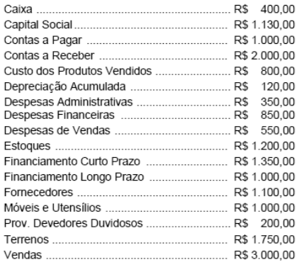{largura=35%}

O valor do Resultado do Exercício é

- A) prejuízo R$ 2.800,00
- B) prejuízo R$ 1.850,00
- C) lucro R$ 1.400,00
- D) lucro R$ 750,00
- E) lucro R$ 450,00
- Gabarito: E
- Resolução: a caminho

## F0632 · FCC · 2007 · TRE PB · ME
- Fontes: TecConcursos 632 (482341)
- Prova: FCC - AJ (TRE PB)/TRE PB/Administrativa/Contabilidade/2007
- Grupos: resultado-bruto, deducoes, receita-bruta

Na apuração do Resultado Bruto Operacional são considerados como deduções da Receita Bruta de Vendas

- A) os valores pagos relativos ao transporte das vendas e as despesas de comissões.
- B) as devoluções de vendas e os gastos com amostras e anúncios do produto.
- C) os abatimentos concedidos ao comprador e o IPI constante da nota fiscal de venda.
- D) as despesas de publicidade pagas antecipadamente e as devoluções de venda.
- E) os desembolsos feitos na contratação de propaganda e publicidade e os impostos indiretos.
- Gabarito: C
- Resolução: a caminho

## F0633 · FCC · 2007 · TRE PB · ME
- Fontes: TecConcursos 633 (482342)
- Prova: FCC - AJ (TRE PB)/TRE PB/Administrativa/Contabilidade/2007
- Grupos: resultado-operacional, lucro-liquido

Na Demonstração do Resultado do Exercício são evidenciados no Resultado Operacional

- A) os encargos a transcorrer e as retenções contratuais.
- B) gratificações e participações de administradores nos lucros.
- C) lucros com alienação de imobilizados e despesas de pessoal.
- D) as receitas de dividendos e os descontos obtidos.
- E) os prêmios de debêntures e perda de capital no ativo diferido.
- Gabarito: D
- Resolução: a caminho

## F0634 · FCC · 2007 · TRE PB · ME
- Fontes: TecConcursos 634 (482346)
- Prova: FCC - AJ (TRE PB)/TRE PB/Administrativa/Contabilidade/2007
- Grupos: cmv, resultado-financeiro, participacoes, ir-csll, lucro-liquido, equivalencia, fora-destinacao, receita-bruta, despesas-administrativas, despesas-vendas, outras-operacionais, outras-receitas-despesas

Atenção: Para responder a questão considere os dados abaixo.

Dados da Cia Chuvisco relativos ao final do exercício de 2006.

I. Saldos finais constantes do Balancete de Verificação de 31.12.2006 (em R$)<br>

Listagem das contas Saldos Finais Listagem das contas Saldos Finais

| Conta | Valor |
|---|---:|
| Capital Social | 820.000 |
| Equipamentos | 456.000 |
| CMV | 400.000 |
| Estoques | 80.480 |
| Contas a pagar | 95.000 |
| Fornecedores | 150.000 |

Depreciações Acumuladas

| Conta | Valor |
|---|---:|
| 79.300 Ganhos/Perdas com Alienação Imobilizado | 10.000 |
| Despesa de Depreciação | 58.000 |
| Imóveis | 200.000 |
| Despesa de Vendas | 174.000 |
| Lucros Acumulados | 103.900 |
| Despesas com Devedores Duvidosos | 4.300 |
| Participação Societária Empresa Alpha | 324.00 |

Despesas Com Pessoal

| Conta | Valor |
|---|---:|
| 182.400 Provisão Crédito de Liquidação Duvidosa | 4.300 |
| Despesas de Seguros | 56.000 |
| Receitas Eventuais | 8.200 |
| Despesas Financeiras de Juros | 59.500 |
| Reserva Legal | 31.000 |
| Disponível | 87.420 |
| Resultado de Equivalência Patrimonial | 44.000 |
| Duplicatas a Receber | 289.000 |
| Salários a Pagar | 15.000 |
| Duplicatas Descontadas | 60.400 |
| Veículos | 180.000 |
| Empréstimos de Longo Prazo | 218.000 |
| Vendas | 912.000 |

II. Segundo informações adicionais do departamento de contabilidade, a diretoria da empresa antes da elaboração de suas demonstrações deve ainda considerar,<br>

os seguintes itens:

Ajustes finais relativos à Imposto de Renda e demais Contribuições no valor de R$ 8.000 e R$ 2.000 para Participações da Diretoria nos Lucros.

Do lucro líquido do exercício devem ser distribuídos ainda 25% para a remuneração dos acionistas e calculada a Reserva Legal.

O resultado apurado antes dos impostos e contribuições é:

- A) 23.000
- B) 30.000
- C) 32.000
- D) 38.000
- E) 40.000
- Gabarito: E
- Resolução: a caminho

## F0635 · FCC · 2007 · TRE PB · ME
- Fontes: TecConcursos 635 (484012)
- Prova: FCC - TJ (TRE PB)/TRE PB/Administrativa/Contabilidade/2007
- Grupos: resultado-financeiro, participacoes, equivalencia, receita-bruta, despesas-administrativas, despesas-vendas

Atenção: Enunciado para a resolução da questão.

A área de contabilidade da Cia Compra & Vende, apresenta os dados finais para a apuração dos resultados e a elaboração do balanço patrimonial referente ao exercício de 2005. Na ocasião, o relatório dos dados apontava o valor de R$ 40.000 para o inventário final de mercadorias e listava os saldos finais de suas contas, conforme demonstra o balancete de verificação, de 31.12.2005, a seguir:

Contas Saldos Finais

| Conta | Valor |
|---|---:|
| Caixa | 15.000 |
| Capital Social | 231.000 |
| Clientes | 120.000 |
| Compras de Mercadorias | 150.000 |
| Contas a Pagar | 44.000 |
| Depreciação Acumulada | 24.000 |
| Depreciações do Período | 14.000 |
| Despesas Administrativas | 65.000 |
| Despesas Antecipadas | 12.000 |
| Despesas de Aluguéis | 21.000 |
| Despesas de Vendas | 40.000 |
| Despesas Financeiras | 12.000 |
| Empréstimos a Pagar (48 meses) | 40.000 |
| Estoque Inicial | 47.000 |
| Fornecedores | 78.000 |
| Imóveis | 100.000 |
| Participações Societárias | 135.000 |
| Perdas c/ Clientes | 2.000 |
| Prov. Para Crédito de Liquidação Duvidosa | 5.000 |
| Receitas Antecipadas | 50.000 |
| Receitas de Vendas | 300.000 |
| Resultado de Equivalência Patrimonial | 11.000 |
| Veículos | 50.000 |

Com base nos dados fornecidos pode-se afirmar que o resultado obtido pela empresa, no período foi um

- A) resultado negativo.
- B) lucro de 18.000.
- C) resultado positivo.
- D) prejuízo de R$ 12.000.
- E) resultado nulo.
- Gabarito: E
- Resolução: a caminho

## F0636 · FCC · 2007 · TRE PB · ME
- Fontes: TecConcursos 636 (484015)
- Prova: FCC - TJ (TRE PB)/TRE PB/Administrativa/Contabilidade/2007
- Grupos: cmv, resultado-financeiro, participacoes, equivalencia, receita-bruta, despesas-administrativas, despesas-vendas

Atenção: Enunciado para a resolução da questão.

A área de contabilidade da Cia Compra & Vende, apresenta os dados finais para a apuração dos resultados e a elaboração do balanço patrimonial referente ao exercício de 2005. Na ocasião, o relatório dos dados apontava o valor de R$ 40.000 para o inventário final de mercadorias e listava os saldos finais de suas contas, conforme demonstra o balancete de verificação, de 31.12.2005, a seguir:

Contas Saldos Finais

| Conta | Valor |
|---|---:|
| Caixa | 15.000 |
| Capital Social | 231.000 |
| Clientes | 120.000 |
| Compras de Mercadorias | 150.000 |
| Contas a Pagar | 44.000 |
| Depreciação Acumulada | 24.000 |
| Depreciações do Período | 14.000 |
| Despesas Administrativas | 65.000 |
| Despesas Antecipadas | 12.000 |
| Despesas de Aluguéis | 21.000 |
| Despesas de Vendas | 40.000 |
| Despesas Financeiras | 12.000 |
| Empréstimos a Pagar (48 meses) | 40.000 |
| Estoque Inicial | 47.000 |
| Fornecedores | 78.000 |
| Imóveis | 100.000 |
| Participações Societárias | 135.000 |
| Perdas c/ Clientes | 2.000 |
| Prov. Para Crédito de Liquidação Duvidosa | 5.000 |
| Receitas Antecipadas | 50.000 |
| Receitas de Vendas | 300.000 |
| Resultado de Equivalência Patrimonial | 11.000 |
| Veículos | 50.000 |

O valor do CMV é:

- A) R$ 157.000
- B) R$ 154.000
- C) R$ 143.000
- D) R$ 104.000
- E) R$ 100.000
- Gabarito: A
- Resolução: a caminho

## F0637 · FCC · 2007 · TRE PB · ME
- Fontes: TecConcursos 637 (484016)
- Prova: FCC - TJ (TRE PB)/TRE PB/Administrativa/Contabilidade/2007
- Grupos: resultado-financeiro, participacoes, equivalencia, receita-bruta, despesas-administrativas, despesas-vendas

Atenção: Enunciado para a resolução da questão.

A área de contabilidade da Cia Compra & Vende, apresenta os dados finais para a apuração dos resultados e a elaboração do balanço patrimonial referente ao exercício de 2005. Na ocasião, o relatório dos dados apontava o valor de R$ 40.000 para o inventário final de mercadorias e listava os saldos finais de suas contas, conforme demonstra o balancete de verificação, de 31.12.2005, a seguir:

Contas Saldos Finais

| Conta | Valor |
|---|---:|
| Caixa | 15.000 |
| Capital Social | 231.000 |
| Clientes | 120.000 |
| Compras de Mercadorias | 150.000 |
| Contas a Pagar | 44.000 |
| Depreciação Acumulada | 24.000 |
| Depreciações do Período | 14.000 |
| Despesas Administrativas | 65.000 |
| Despesas Antecipadas | 12.000 |
| Despesas de Aluguéis | 21.000 |
| Despesas de Vendas | 40.000 |
| Despesas Financeiras | 12.000 |
| Empréstimos a Pagar (48 meses) | 40.000 |
| Estoque Inicial | 47.000 |
| Fornecedores | 78.000 |
| Imóveis | 100.000 |
| Participações Societárias | 135.000 |
| Perdas c/ Clientes | 2.000 |
| Prov. Para Crédito de Liquidação Duvidosa | 5.000 |
| Receitas Antecipadas | 50.000 |
| Receitas de Vendas | 300.000 |
| Resultado de Equivalência Patrimonial | 11.000 |
| Veículos | 50.000 |

Com relação aos números apresentados no balancete é verdadeiro concluir que

- A) no período a empresa obteve receitas operacionais e não operacionais.
- B) os valores inscritos no Ativo Permanente Diferido era R$ 12.000.
- C) ao final do período foi identificado um aumento da situação líquida.
- D) a empresa incorreu em outras receitas operacionais.
- E) o valor que deve ser inscrito no imobilizado é de R$ 150.000.
- Gabarito: D
- Resolução: a caminho

## F0638 · FCC · 2007 · TRE PB · ME
- Fontes: TecConcursos 638 (484028)
- Prova: FCC - TJ (TRE PB)/TRE PB/Administrativa/Contabilidade/2007
- Grupos: cmv, resultado-financeiro, deducoes, receita-bruta, despesas-administrativas, despesas-vendas

Atenção: Enunciado para elaboração da questão.

Ao final de 2006, o sistema contábil da Cia São Francisco emite um relatório contendo as seguintes informações:

Contas Valor

| Conta | Valor |
|---|---:|
| Abatimentos s/Compras | 100.000 |
| Abatimentos s/Vendas | 40.000 |
| Comissões s/Vendas | 900.000 |
| Compras do período | 10.000.000 |
| Descontos Comerciais sobre Compras | 40.000 |
| Despesas com Aluguéis | 700.000 |
| Despesas com Pessoal | 1.300.000 |
| Despesas Financeiras | 700.000 |
| Despesas Gerais | 500.000 |
| Devolução de Compras | 580.000 |
| Devoluções de Vendas | 460.000 |
| Estoque Final | 1.200.000 |
| Estoque Inicial | 120.000 |
| Impostos Diretos s/Vendas | 500.000 |
| Propaganda e Publicidade | 900.000 |
| Transportes sobre Compras | 600.000 |
| Transportes sobre Vendas | 700.000 |
| Vendas de Mercadorias | 16.000.000 |

O valor do CMV é

- A) R$ 6.200.000
- B) R$ 8.800.000
- C) R$ 9.500.000
- D) R$ 9.880.000
- E) R$ 10.020.000
- Gabarito: B
- Resolução: a caminho

## F0639 · FCC · 2007 · TRE PB · ME
- Fontes: TecConcursos 639 (484029)
- Prova: FCC - TJ (TRE PB)/TRE PB/Administrativa/Contabilidade/2007
- Grupos: resultado-bruto, resultado-financeiro, deducoes, receita-bruta, despesas-administrativas, despesas-vendas

Atenção: Enunciado para elaboração da questão.

Ao final de 2006, o sistema contábil da Cia São Francisco emite um relatório contendo as seguintes informações:

Contas Valor

| Conta | Valor |
|---|---:|
| Abatimentos s/Compras | 100.000 |
| Abatimentos s/Vendas | 40.000 |
| Comissões s/Vendas | 900.000 |
| Compras do período | 10.000.000 |
| Descontos Comerciais sobre Compras | 40.000 |
| Despesas com Aluguéis | 700.000 |
| Despesas com Pessoal | 1.300.000 |
| Despesas Financeiras | 700.000 |
| Despesas Gerais | 500.000 |
| Devolução de Compras | 580.000 |
| Devoluções de Vendas | 460.000 |
| Estoque Final | 1.200.000 |
| Estoque Inicial | 120.000 |
| Impostos Diretos s/Vendas | 500.000 |
| Propaganda e Publicidade | 900.000 |
| Transportes sobre Compras | 600.000 |
| Transportes sobre Vendas | 700.000 |
| Vendas de Mercadorias | 16.000.000 |

O valor do Resultado Bruto Operacional é

- A) R$ 6.200.000
- B) R$ 8.800.000
- C) R$ 5.500.000
- D) R$ 4.600.000
- E) R$ 3.700.000
- Gabarito: A
- Resolução: a caminho

## F0640 · FCC · 2007 · TRE PB · ME
- Fontes: TecConcursos 640 (484030)
- Prova: FCC - TJ (TRE PB)/TRE PB/Administrativa/Contabilidade/2007
- Grupos: receita-liquida, resultado-financeiro, deducoes, receita-bruta, despesas-administrativas, despesas-vendas

Atenção: Enunciado para elaboração da questão.

Ao final de 2006, o sistema contábil da Cia São Francisco emite um relatório contendo as seguintes informações:

Contas Valor

| Conta | Valor |
|---|---:|
| Abatimentos s/Compras | 100.000 |
| Abatimentos s/Vendas | 40.000 |
| Comissões s/Vendas | 900.000 |
| Compras do período | 10.000.000 |
| Descontos Comerciais sobre Compras | 40.000 |
| Despesas com Aluguéis | 700.000 |
| Despesas com Pessoal | 1.300.000 |
| Despesas Financeiras | 700.000 |
| Despesas Gerais | 500.000 |
| Devolução de Compras | 580.000 |
| Devoluções de Vendas | 460.000 |
| Estoque Final | 1.200.000 |
| Estoque Inicial | 120.000 |
| Impostos Diretos s/Vendas | 500.000 |
| Propaganda e Publicidade | 900.000 |
| Transportes sobre Compras | 600.000 |
| Transportes sobre Vendas | 700.000 |
| Vendas de Mercadorias | 16.000.000 |

O valor da Receita Líquida de Venda é

- A) R$ 16.000.000
- B) R$ 15.500.000
- C) R$ 15.000.000
- D) R$ 14.600.000
- E) R$ 13.900.000
- Gabarito: C
- Resolução: a caminho

## F0641 · FCC · 2007 · TCE MG · ME
- Fontes: TecConcursos 641 (728539)
- Prova: FCC - ACE (TCE-MG)/TCE MG/Ciências Contábeis/2007
- Grupos: lucro-liquido

Quando o resultado do exercício constituir-se em um prejuízo, este será obrigatoriamente absorvido obedecendo à seguinte ordem:

- A) pelos lucros acumulados, pelas reservas de lucros e pela reserva legal.
- B) pelas reservas de capital, pelas reservas de lucros e pelos lucros acumulados.
- C) pelas reservas de lucros, pelos lucros acumulados e pelas reservas de reavaliações.
- D) pelos lucros acumulados, pela reserva legal e pelas reservas de capital.
- E) pelas reservas de capital, pelas reservas de reavaliações e pelos lucros acumulados.
- Gabarito: A
- Resolução: a caminho

## F0642 · FCC · 2007 · TCE MG · ME
- Fontes: TecConcursos 642 (728545)
- Prova: FCC - ACE (TCE-MG)/TCE MG/Ciências Contábeis/2007
- Grupos: cmv, resultado-operacional, resultado-financeiro, receita-bruta, despesas-administrativas, despesas-vendas, despesas-operacionais, outras-receitas-despesas

Instruções: Considere os dados, a seguir, para responder à questão.

Para a apuração do resultado da Cia. Comercial Caladinho foram extraídos os saldos finais das seguintes contas:

Contas saldos em 31.12.2006

| Conta | Valor |
|---|---:|
| CMV − Custo de mercadorias vendidas | . |
| Depreciações | . |
| Despesas Comerciais | . |
| Despesas de Pessoal | . |
| Despesas Financeiras | . |
| Perdas com Imobilizados | . |
| Vendas | . |

R$ 1.250.000,00 R$       30.000,00 R$     260.000,00 R$     340.000,00 R$       40.000,00 R$       20.000,00 R$ 2.000.000,00 O Departamento de Contabilidade da empresa informa ainda que:

- 40% das receitas registradas serão recebidas no próximo exercício.
- Excetuando os valores do CMV − Custo de mercadorias vendidas e das depreciações, as despesas operacionais continham 10% dos valores distribuídos em

diversas provisões.

O resultado operacional apurado de acordo com o estabelecido pela Lei nº 6.404/76 é, em reais,

- A) (70.000,00)
- B) (60.000,00)
- C) 80.000,00
- D) 70.000,00
- E) 60.000,00
- Gabarito: C
- Resolução: a caminho

## F0643 · CEBRASPE · 2007 · PGE PA · ME
- Fontes: TecConcursos 643 (1112251)
- Prova: CEBRASPE (CESPE) - Tec Proc (PGE PA)/PGE PA/Ciências Contábeis/2007
- Grupos: resultado-financeiro, lair, ir-csll, deducoes, receita-bruta, despesas-administrativas, cmv, despesas-vendas

Conjunto de contas para a questão. conta saldo (R$)

| Conta | Valor |
|---|---:|
| provisão para devedores duvidosos | 8.000 |
| despesa de exaustão | 14 |
| despesa de amortização | 44 |
| despesa de manutenção e conservação | 120 |
| despesa de depreciação | 200 |
| despesa de salários | 250 |
| despesa de telefone | 660 |
| salários a pagar | 1.100 |
| despesas financeiras | 1.140 |
| seguros a pagar | 1.147 |
| aluguéis antecipados | 1.230 |
| despesas administrativas | 1.410 |
| despesa de salários | 2.140 |
| despesas gerais | 3.320 |
| debêntures a pagar | 3.325 |
| seguros antecipados | 5.200 |
| receita financeira | 6.520 |
| impostos a pagar | 6.859 |
| receita antecipada | 7.350 |
| imposto sobre vendas | 8.000 |
| caixa | 10.000 |
| deduções da receita | 12.000 |
| depósitos em poupança | 12.800 |
| terrenos | 15.800 |
| lucro antes do imposto de renda | 17.222 |
| veículos | 25.400 |
| bancos | 25.800 |
| investimentos | 32.000 |
| custo da mercadoria vendida | 40.000 |
| receita operacional bruta | 80.000 |

Após elaborar a DRE, com base nas informações apresentadas no quadro acima, a margem líquida apurada

- A) é superior a 60%.
- B) está entre 45% e 58%.
- C) está entre 26% e 44%.
- D) é inferior a 25%.
- Gabarito: C
- Resolução: a caminho

## F0644 · CEBRASPE · 2007 · PGE PA · ME
- Fontes: TecConcursos 644 (1112330)
- Prova: CEBRASPE (CESPE) - Tec Proc (PGE PA)/PGE PA/Economia, Estatística e Matemática/2007
- Grupos: resultado-bruto, receita-liquida, resultado-financeiro, deducoes, receita-bruta, despesas-administrativas, cmv, despesas-operacionais

Conjunto de contas para a questão. conta saldo (R$)

| Conta | Valor |
|---|---:|
| despesa de amortização | 11 |
| despesa de água | 120 |
| despesa de manutenção e conservação | 140 |
| energia a pagar | 140 |
| despesa de depreciação | 147 |
| despesa de energia | 200 |
| despesa de exaustão | 200 |
| seguros a pagar | 225 |
| despesa de salários | 250 |
| despesas financeiras | 320 |
| despesas administrativas | 400 |
| deduções da receita | 600 |
| imposto sobre vendas | 800 |
| aluguéis antecipados | 1.230 |
| salários a pagar | 1.250 |
| despesas de seguros | 2.140 |
| mercadorias para revenda | 2.580 |
| impostos a pagar | 2.580 |
| custo da mercadoria vendida | 4.000 |
| seguros antecipados | 5.200 |
| receita antecipada | 2.000 |
| receita financeira | 8.520 |
| receita bruta de vendas | 9.200 |
| caixa | 10.000 |
| despesas operacionais | 151.580 |
| aplicações em poupança | 12.800 |
| debêntures a pagar | 14.780 |
| prédios | 15.800 |
| capital social | 25.000 |
| veículo | 25.400 |
| bancos | 25.800 |
| investimentos | 32.000 |

Assinale a opção em que se apresentam o saldo do lucro bruto e o saldo da receita líquida de vendas, respectivamente.

- A) R$ 5.100,00 e R$ 9.200,00
- B) R$ 4.600,00 e R$ 8.600,00
- C) R$ 4.400,00 e R$ 8.400,00
- D) R$ 3.800,00 e R$ 7.800,00
- Gabarito: D
- Resolução: a caminho

## F0645 · CEBRASPE · 2007 · PGE PA · ME
- Fontes: TecConcursos 645 (1113545)
- Prova: CEBRASPE (CESPE) - Ass Proc (PGE PA)/PGE PA/Contabilidade/2007
- Grupos: calculo-cmv, cmv, fora-ativo

Balancete de verificação para a questão.

conta saldo (R$)

| Conta | Valor |
|---|---:|
| 1 estoque inicial de mercadorias | 100 |
| 2 despesa de amortização | 110 |
| 3 estoque final de material de limpeza | 120 |
| 4 despesa de manutenção | 128 |
| 5 honorários a pagar | 147 |
| 6 despesas de juros | 147 |
| 7 aluguéis a pagar | 148 |
| 8 despesa de depreciação | 150 |
| 9 energia elétrica a pagar | 180 |
| 10 abatimento de vendas | 180 |
| 11 fretes sobre vendas de mercadorias | 225 |
| 12 despesas de seguros | 230 |
| 13 despesas de conservação | 245 |
| 14 manutenção de veículos a pagar | 250 |
| 15 telefone e Internet a pagar | 250 |
| 16 deduções de receitas | 300 |
| 17 provisão para perda de estoques | 320 |
| 18 despesas de combustíveis | 385 |
| 19 compras de material de limpeza | 400 |
| 20 despesas de telefone | 432 |
| 21 reservas de capital | 450 |
| 22 impostos a recuperar | 485 |
| 23 receita de juros | 540 |
| 24 despesas de multas de trânsito | 578 |
| 25 duplicatas a pagar | 580 |
| 26 despesa antecipada de seguros | 600 |
| 27 estoque inicial de material de limpeza | 600 |
| 28 empréstimos a pagar | 620 |
| 29 receita antecipada | 650 |
| 30 fretes sobre compras | 800 |
| 31 assinaturas antecipadas de revistas | 850 |
| 32 provisão para perda de investimentos | 850 |
| 33 salários a pagar | 1.200 |
| 34 provisão para devedores duvidosos | 1.460 |
| 35 caixa | 1.600 |
| 36 estoque final de mercadorias para revenda | 1.600 |
| 37 fornecedores de serviços | 2.120 |
| 38 financiamentos a pagar de curto prazo | 3.000 |
| 39 compra de mercadorias | 3.000 |
| 40 empréstimos a pagar de longo prazo | 3.189 |
| 41 investimentos em títulos da dívida pública | 4.100 |
| 42 materiais de expediente | 4.150 |
| 43 despesas de salários | 5.100 |
| 44 investimentos em debêntures | 5.409 |
| 45 debêntures emitidas com resgate em longo prazo | 5.569 |
| 46 debêntures emitidas para resgate em curto prazo | 5.600 |
| 47 títulos da dívida pública a receber em longo prazo | 6.850 |
| 48 clientes | 8.700 |
| 49 fundos de investimentos | 8.780 |
| 50 investimentos em ações | 10.145 |
| 51 depreciação acumulada | 12.589 |
| 52 computadores | 14.500 |
| 53 bancos | 14.985 |
| 54 títulos a pagar de longo prazo | 21.450 |
| 55 gastos pré-operacionais | 22.000 |
| 56 receita de vendas | 22.500 |
| 57 móveis e demais utensílios | 25.800 |
| 58 automóveis e tratores | 35.900 |
| 59 máquinas e equipamentos | 49.850 |
| 60 casas | 75.000 |
| 61 prédios | 78.000 |
| 62 terrenos | 85.000 |
| 63 lucros ou prejuízos acumulados antes da DRE | 181.532 |
| 64 gastos em pesquisa e desenvolvimento de novos produtos | 198.000 |
| 65 capital | 198.500 |
| 66 amortização acumulada | 20.000 |

O saldo do custo das mercadorias vendidas é igual a

- A) R$ 4.600,00.
- B) R$ 2.300,00.
- C) R$ 1.500,00.
- D) R$ 3.800,00.
- Gabarito: B
### O que a questão pede
O **CMV** do mesmo balancete da F0646, pelo inventário periódico: estoque inicial + compras líquidas − estoque final.

### Cálculos prévios
| Item | Valor |
|---|---:|
| Estoque inicial de mercadorias | 100 |
| (+) Compra de mercadorias | 3.000 |
| (+) Fretes sobre compras | 800 |
| (–) Estoque final de mercadorias para revenda | (1.600) |
| **CMV** | **2.300** |

### Passo a passo
```dre
@ estoque inicial de mercadorias | 100 | calculo-cmv
@ compra de mercadorias | 3.000 | calculo-cmv
@ fretes sobre compras | 800 | calculo-cmv
@ estoque final de mercadorias para revenda | 1.600 | calculo-cmv
@ estoque inicial de material de limpeza | 600 | despesas-administrativas
@ compras de material de limpeza | 400 | despesas-administrativas
@ estoque final de material de limpeza | 120 | despesas-administrativas
@ fretes sobre vendas de mercadorias | 225 | despesas-vendas
@ provisão para perda de estoques | 320 | fora-ativo
@ impostos a recuperar | 485 | fora-ativo
> Material de limpeza não é mercadoria: seu consumo é despesa administrativa. Frete sobre vendas é despesa com vendas. A provisão é saldo retificador e os impostos a recuperar são ativo.
! estoque inicial de material de limpeza; compras de material de limpeza; estoque final de material de limpeza; fretes sobre vendas de mercadorias; provisão para perda de estoques; impostos a recuperar
> CMV = EI + compras + fretes sobre compras − EF.
+ (–) CMV | (2.300) | estoque inicial de mercadorias; compra de mercadorias; fretes sobre compras; estoque final de mercadorias para revenda
```

Gabarito **B (2.300)**.

### O que ignorar e por quê
- **Material de limpeza (EI 600, compras 400, EF 120):** é material de consumo, não mercadoria para revenda. Entra nas despesas (880), não no CMV.
- **Fretes sobre vendas (225):** gasto para levar a mercadoria ao cliente, despesa com vendas.
- **Provisão para perda de estoques (320):** saldo retificador do estoque no balanço. Não muda o CMV calculado pela fórmula.
- **Impostos a recuperar:** ativo; o valor das compras já é o que entra no estoque.

### O que mais poderia estar ali
- **Somam às compras:** seguros sobre compras, tributos não recuperáveis, imposto de importação, carga e descarga.
- **Subtraem das compras:** devoluções de compras, abatimentos sobre compras, descontos incondicionais obtidos, tributos recuperáveis.

### Pegadinhas
- **D (3.800)** = 3.000 + 800: ficou só com as compras e os fretes, sem mexer nos estoques.
- **C (1.500)** = 100 + 3.000 − 1.600: esqueceu os fretes sobre compras (800).
- **A (4.600)** não sai de um erro simples de fórmula; elimine pelo cálculo.
- **Misturar o material de limpeza no CMV:** daria 3.180, que não está nas alternativas, mas é o erro que a banca quer provocar ao colocar os dois estoques lado a lado.

### Leve para as próximas
1. CMV só com **mercadorias para revenda**; material de consumo vai para despesa.
2. Frete na compra é custo; frete na venda é despesa.
3. Provisão para perda de estoques no balancete é saldo, não entra na fórmula do CMV.

## F0646 · CEBRASPE · 2007 · PGE PA · ME
- Fontes: TecConcursos 646 (1113552)
- Prova: CEBRASPE (CESPE) - Ass Proc (PGE PA)/PGE PA/Contabilidade/2007
- Grupos: receita-bruta, deducoes, receita-liquida, calculo-cmv, cmv, resultado-bruto, despesas-vendas, despesas-administrativas, resultado-financeiro, lair, fora-ativo, fora-passivo, fora-pl

Balancete de verificação para a questão.

conta saldo (R$)

| Conta | Valor |
|---|---:|
| 1 estoque inicial de mercadorias | 100 |
| 2 despesa de amortização | 110 |
| 3 estoque final de material de limpeza | 120 |
| 4 despesa de manutenção | 128 |
| 5 honorários a pagar | 147 |
| 6 despesas de juros | 147 |
| 7 aluguéis a pagar | 148 |
| 8 despesa de depreciação | 150 |
| 9 energia elétrica a pagar | 180 |
| 10 abatimento de vendas | 180 |
| 11 fretes sobre vendas de mercadorias | 225 |
| 12 despesas de seguros | 230 |
| 13 despesas de conservação | 245 |
| 14 manutenção de veículos a pagar | 250 |
| 15 telefone e Internet a pagar | 250 |
| 16 deduções de receitas | 300 |
| 17 provisão para perda de estoques | 320 |
| 18 despesas de combustíveis | 385 |
| 19 compras de material de limpeza | 400 |
| 20 despesas de telefone | 432 |
| 21 reservas de capital | 450 |
| 22 impostos a recuperar | 485 |
| 23 receita de juros | 540 |
| 24 despesas de multas de trânsito | 578 |
| 25 duplicatas a pagar | 580 |
| 26 despesa antecipada de seguros | 600 |
| 27 estoque inicial de material de limpeza | 600 |
| 28 empréstimos a pagar | 620 |
| 29 receita antecipada | 650 |
| 30 fretes sobre compras | 800 |
| 31 assinaturas antecipadas de revistas | 850 |
| 32 provisão para perda de investimentos | 850 |
| 33 salários a pagar | 1.200 |
| 34 provisão para devedores duvidosos | 1.460 |
| 35 caixa | 1.600 |
| 36 estoque final de mercadorias para revenda | 1.600 |
| 37 fornecedores de serviços | 2.120 |
| 38 financiamentos a pagar de curto prazo | 3.000 |
| 39 compra de mercadorias | 3.000 |
| 40 empréstimos a pagar de longo prazo | 3.189 |
| 41 investimentos em títulos da dívida pública | 4.100 |
| 42 materiais de expediente | 4.150 |
| 43 despesas de salários | 5.100 |
| 44 investimentos em debêntures | 5.409 |
| 45 debêntures emitidas com resgate em longo prazo | 5.569 |
| 46 debêntures emitidas para resgate em curto prazo | 5.600 |
| 47 títulos da dívida pública a receber em longo prazo | 6.850 |
| 48 clientes | 8.700 |
| 49 fundos de investimentos | 8.780 |
| 50 investimentos em ações | 10.145 |
| 51 depreciação acumulada | 12.589 |
| 52 computadores | 14.500 |
| 53 bancos | 14.985 |
| 54 títulos a pagar de longo prazo | 21.450 |
| 55 gastos pré-operacionais | 22.000 |
| 56 receita de vendas | 22.500 |
| 57 móveis e demais utensílios | 25.800 |
| 58 automóveis e tratores | 35.900 |
| 59 máquinas e equipamentos | 49.850 |
| 60 casas | 75.000 |
| 61 prédios | 78.000 |
| 62 terrenos | 85.000 |
| 63 lucros ou prejuízos acumulados antes da DRE | 181.532 |
| 64 gastos em pesquisa e desenvolvimento de novos produtos | 198.000 |
| 65 capital | 198.500 |
| 66 amortização acumulada | 20.000 |

O saldo do resultado líquido, antes de tributos, obtido na demonstração do resultado do exercício (DRE) é igual a

- A) R$ 11.830,00.
- B) R$ 19.720,00.
- C) R$ 11.950,00.
- D) R$ 11.650,00.
- Gabarito: D
### O que a questão pede
O **resultado antes dos tributos** (LAIR) a partir de um balancete de 66 contas misturadas, de 2007. Há duas armadilhas de cálculo: o CMV sai pelo inventário, e o **consumo de material de limpeza** também sai por inventário (estoque inicial + compras − estoque final).

### Cálculos prévios
**1) Receita líquida:** 22.500 − 180 (abatimento de vendas) − 300 (deduções de receitas) = **22.020**.

**2) CMV pelo inventário (ver a F0645):** 100 + 3.000 + 800 − 1.600 = **2.300**.

**3) Consumo de material de limpeza:** estoque inicial 600 + compras 400 − estoque final 120 = **880** de despesa.

**4) Despesas e receitas do balancete:**

| Conta | Grupo | Valor |
|---|---|---:|
| Fretes sobre vendas de mercadorias | vendas | 225 |
| Despesa de amortização | administrativas | 110 |
| Despesa de manutenção | administrativas | 128 |
| Despesa de depreciação | administrativas | 150 |
| Despesas de seguros | administrativas | 230 |
| Despesas de conservação | administrativas | 245 |
| Despesas de combustíveis | administrativas | 385 |
| Despesas de telefone | administrativas | 432 |
| Despesas de multas de trânsito | administrativas | 578 |
| Despesas de salários | administrativas | 5.100 |
| Consumo de material de limpeza | administrativas | 880 |
| **Total das operacionais** | | **8.463** |
| Despesas de juros | financeiro | (147) |
| Receita de juros | financeiro | 540 |

### Passo a passo
```dre
@ receita de vendas | 22.500 | receita-bruta
@ abatimento de vendas | 180 | deducoes
@ deduções de receitas | 300 | deducoes
@ estoque inicial de mercadorias | 100 | calculo-cmv
@ compra de mercadorias | 3.000 | calculo-cmv
@ fretes sobre compras | 800 | calculo-cmv
@ estoque final de mercadorias para revenda | 1.600 | calculo-cmv
@ fretes sobre vendas de mercadorias | 225 | despesas-vendas
@ despesa de amortização | 110 | despesas-administrativas
@ despesa de manutenção | 128 | despesas-administrativas
@ despesa de depreciação | 150 | despesas-administrativas
@ despesas de seguros | 230 | despesas-administrativas
@ despesas de conservação | 245 | despesas-administrativas
@ despesas de combustíveis | 385 | despesas-administrativas
@ despesas de telefone | 432 | despesas-administrativas
@ despesas de multas de trânsito | 578 | despesas-administrativas
@ despesas de salários | 5.100 | despesas-administrativas
@ estoque inicial de material de limpeza | 600 | despesas-administrativas
@ compras de material de limpeza | 400 | despesas-administrativas
@ estoque final de material de limpeza | 120 | despesas-administrativas
@ despesas de juros | 147 | resultado-financeiro
@ receita de juros | 540 | resultado-financeiro
@ materiais de expediente | 4.150 | fora-ativo
@ provisão para perda de estoques | 320 | fora-ativo
@ provisão para devedores duvidosos | 1.460 | fora-ativo
@ provisão para perda de investimentos | 850 | fora-ativo
@ gastos pré-operacionais | 22.000 | fora-ativo
@ gastos em pesquisa e desenvolvimento de novos produtos | 198.000 | fora-ativo
@ despesa antecipada de seguros | 600 | fora-ativo
@ receita antecipada | 650 | fora-passivo
@ assinaturas antecipadas de revistas | 850 | fora-passivo
@ demais contas de ativo, passivo e PL | — | fora-outros
> Triagem. Falsos amigos: provisões (saldos retificadores, não despesas), despesa antecipada (ativo), receita antecipada e assinaturas antecipadas (passivo), material de expediente (estoque), gastos pré-operacionais e P&D (ativo diferido e intangível, pela regra de 2007).
! materiais de expediente; provisão para perda de estoques; provisão para devedores duvidosos; provisão para perda de investimentos; gastos pré-operacionais; gastos em pesquisa e desenvolvimento de novos produtos; despesa antecipada de seguros; receita antecipada; assinaturas antecipadas de revistas; demais contas de ativo, passivo e PL
+ Receita de vendas | 22.500 | receita de vendas
+ (–) Abatimentos e deduções | (480) | abatimento de vendas; deduções de receitas
= Receita líquida | 22.020
+ (–) CMV | (2.300) | estoque inicial de mercadorias; compra de mercadorias; fretes sobre compras; estoque final de mercadorias para revenda
= Lucro bruto | 19.720
+ (–) Despesas com vendas | (225) | fretes sobre vendas de mercadorias
> Despesas administrativas: as contas "despesa" mais o consumo de material de limpeza (600 + 400 − 120 = 880).
+ (–) Despesas administrativas | (7.358) | despesa de amortização; despesa de manutenção; despesa de depreciação; despesas de seguros; despesas de conservação; despesas de combustíveis; despesas de telefone; despesas de multas de trânsito; despesas de salários
+ (–) Consumo de material de limpeza | (880) | estoque inicial de material de limpeza; compras de material de limpeza; estoque final de material de limpeza
+ Resultado financeiro líquido | 393 | despesas de juros; receita de juros
= Resultado antes dos tributos | 11.650
```

Gabarito **D (11.650)**.

### O que ignorar e por quê
- **Provisões para perda de estoques, para devedores duvidosos e para perda de investimentos:** no balancete são **saldos** retificadores de ativo. A despesa do período teria nome próprio ("despesa com provisão…"), e não há nenhuma.
- **Materiais de expediente (4.150):** estoque de material ainda não consumido (ativo). Só o que foi consumido vira despesa.
- **Despesa antecipada de seguros:** ativo. **Receita antecipada** e **assinaturas antecipadas de revistas:** passivo (receita ainda não ganha).
- **Gastos pré-operacionais (22.000) e pesquisa e desenvolvimento (198.000):** em 2007 iam para o ativo diferido. ⚠️ Hoje o diferido foi extinto (Lei 11.638/2007 e Lei 11.941/2009): gastos pré-operacionais são despesa; **pesquisa é sempre despesa** e desenvolvimento só vira intangível se cumprir os requisitos (CPC 04 (R1), itens 54 e 57).
- **Lucros ou prejuízos acumulados, capital, reservas de capital:** PL.

### O que mais poderia estar ali
- **Consumo por inventário:** qualquer material de consumo (expediente, limpeza, combustível em estoque) segue a lógica EI + compras − EF.
- **Outras despesas administrativas:** água, energia, aluguel, honorários (a despesa, não o "a pagar").
- **No financeiro:** descontos obtidos ou concedidos condicionalmente, variações monetárias.

### Pegadinhas
- **B (19.720):** é o lucro bruto; parou antes das despesas.
- **A (11.830)** = 11.650 + 180: não deduziu o abatimento de vendas.
- **C (11.950)** = 11.650 + 300: não deduziu as "deduções de receitas".
- **Contas "a pagar"** (honorários, aluguéis, energia, salários, telefone) são passivo, mesmo com nome parecido com despesa.
- **Multa de trânsito** é despesa do período (para o IR, multa punitiva costuma ser indedutível, mas isso só mexe na base do imposto, não na DRE).

### Leve para as próximas
1. Estoque de material de consumo com EI, compras e EF: o consumo é despesa, calculado como o CMV.
2. "Provisão para…" no balancete é saldo; despesa vem escrita como despesa.
3. "Antecipada" do lado da despesa é ativo; do lado da receita, passivo.
4. Questões de antes de 2008 com "gastos pré-operacionais" ou "P&D": ⚠️ respeite a regra da época para achar o gabarito, mas saiba que hoje vão para o resultado (pesquisa) ou para o intangível (desenvolvimento qualificado).

## F0647 · FCC · 2007 · ANS · ME
- Fontes: TecConcursos 647 (1327234)
- Prova: FCC - ERSS (ANS)/ANS/Administração, Ciências Contábeis e Economia/2007
- Grupos: lair, ir-csll, lucro-liquido

Instruções: Para responder à questão, utilize as informações constantes do balancete de verificação da Cia. Montes Claros em 31/12/2006, antes da apuração do resultado do exercício, apresentado abaixo.

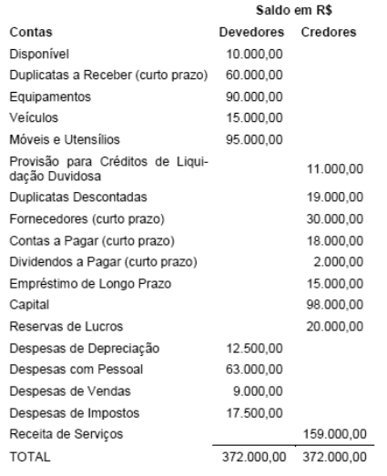{largura=35%}

O lucro apurado pela companhia, antes do imposto de renda e da contribuição social sobre o lucro líquido, foi de

- A) R$ 34.000,00
- B) R$ 45.000,00
- C) R$ 46.000,00
- D) R$ 57.000,00
- E) R$ 69.000,00
- Gabarito: D
- Resolução: a caminho

## F0648 · CEBRASPE · 2007 · PETROBRAS · CE
- Fontes: TecConcursos 648 (1631334)
- Prova: CEBRASPE (CESPE) - PPNS (PETROBRAS)/PETROBRAS/Contabilidade/2007
- Grupos: resultado-bruto, deducoes, fora-destinacao, estrutura, receita-bruta, despesas-administrativas, despesas-vendas, lucro-liquido, ir-csll

conta saldo (R$) lucros (ou prejuízos) acumulados antes da elaboração

| Conta | Valor |
|---|---:|
| da demonstração do resultado do exercício (DRE) | (2.240) |
| despesas com cartórios | 40 |
| despesa de energia elétrica | 130 |
| abatimento sobre compras de matéria prima | 175 |
| frete sobre compra de matéria prima | 200 |
| devolução de compras de matéria prima | 350 |
| outros custos indiretos | 380 |
| despesas com combustíveis | 450 |
| despesas de manutenção e conservação | 650 |
| despesas com veículos | 780 |
| fretes sobre vendas de mercadorias | 800 |
| despesa de assinaturas | 800 |
| despesa de impostos e taxas diversas | 800 |
| despesa de condomínio | 1.000 |
| despesa de telefonia e Internet | 1.120 |
| componentes indiretos | 1.150 |
| despesa antecipada de assinaturas | 1.850 |
| estoque final de matéria prima | 2.130 |
| despesas de vendas | 2.150 |
| pneus para veículos utilitários | 2.214 |
| leasing de veículos a pagar | 2.245 |
| mão-de-obra indireta | 2.850 |
| despesas com viagens | 3.120 |
| reserva de reavaliação | 3.125 |
| componentes diretos | 3.150 |
| compra de matéria prima | 3.250 |
| despesa antecipada de aluguel | 3.258 |
| terrenos | 4.415 |
| reserva legal | 4.458 |
| despesa com salários e ordenados | 4.480 |
| investimento em opções de compra de cobre | 6.658 |
| reserva de capital | 6.680 |
| investimento em opções de compra de níquel | 7.410 |
| estoque inicial de matéria prima | 8.000 |
| estoque final de produtos em processamento | 8.110 |
| mão-de-obra direta | 8.520 |
| despesa antecipada de impostos | 8.850 |
| provisão para contingências | 9.870 |
| abatimento de vendas de produtos | 10.000 |
| estoque final de produtos acabados | 11.000 |
| estoque inicial de produtos em processamento | 12.105 |
| estoque inicial de produtos acabados | 25.000 |
| prédios | 88.790 |
| receita bruta de vendas de produtos | 120.000 |
| capital social | 125.800 |

imposto sobre receita — apurar na demonstração do resultado do exercício (DRE) e apropriar 20% para o período seguinte. imposto sobre lucro — apurar na DRE e apropriar 30% para o período seguinte.

Considerando a estrutura das demonstrações contábeis prevista na Lei 6.404/1976 e em legislação correlata, bem como o conjunto de contas acima, julgue o item a seguir.

Após a elaboração da DRE, o lucro bruto apurado corresponde a R$ 43.160.

- Gabarito: CERTO
- Resolução: a caminho

## F0649 · CEBRASPE · 2007 · PETROBRAS · CE
- Fontes: TecConcursos 649 (1631335)
- Prova: CEBRASPE (CESPE) - PPNS (PETROBRAS)/PETROBRAS/Contabilidade/2007
- Grupos: deducoes, fora-destinacao, estrutura, receita-bruta, despesas-administrativas, despesas-vendas, lucro-liquido, ir-csll

conta saldo (R$) lucros (ou prejuízos) acumulados antes da elaboração

| Conta | Valor |
|---|---:|
| da demonstração do resultado do exercício (DRE) | (2.240) |
| despesas com cartórios | 40 |
| despesa de energia elétrica | 130 |
| abatimento sobre compras de matéria prima | 175 |
| frete sobre compra de matéria prima | 200 |
| devolução de compras de matéria prima | 350 |
| outros custos indiretos | 380 |
| despesas com combustíveis | 450 |
| despesas de manutenção e conservação | 650 |
| despesas com veículos | 780 |
| fretes sobre vendas de mercadorias | 800 |
| despesa de assinaturas | 800 |
| despesa de impostos e taxas diversas | 800 |
| despesa de condomínio | 1.000 |
| despesa de telefonia e Internet | 1.120 |
| componentes indiretos | 1.150 |
| despesa antecipada de assinaturas | 1.850 |
| estoque final de matéria prima | 2.130 |
| despesas de vendas | 2.150 |
| pneus para veículos utilitários | 2.214 |
| leasing de veículos a pagar | 2.245 |
| mão-de-obra indireta | 2.850 |
| despesas com viagens | 3.120 |
| reserva de reavaliação | 3.125 |
| componentes diretos | 3.150 |
| compra de matéria prima | 3.250 |
| despesa antecipada de aluguel | 3.258 |
| terrenos | 4.415 |
| reserva legal | 4.458 |
| despesa com salários e ordenados | 4.480 |
| investimento em opções de compra de cobre | 6.658 |
| reserva de capital | 6.680 |
| investimento em opções de compra de níquel | 7.410 |
| estoque inicial de matéria prima | 8.000 |
| estoque final de produtos em processamento | 8.110 |
| mão-de-obra direta | 8.520 |
| despesa antecipada de impostos | 8.850 |
| provisão para contingências | 9.870 |
| abatimento de vendas de produtos | 10.000 |
| estoque final de produtos acabados | 11.000 |
| estoque inicial de produtos em processamento | 12.105 |
| estoque inicial de produtos acabados | 25.000 |
| prédios | 88.790 |
| receita bruta de vendas de produtos | 120.000 |
| capital social | 125.800 |

imposto sobre receita — apurar na demonstração do resultado do exercício (DRE) e apropriar 20% para o período seguinte. imposto sobre lucro — apurar na DRE e apropriar 30% para o período seguinte.

Considerando a estrutura das demonstrações contábeis prevista na Lei 6.404/1976 e em legislação correlata, bem como o conjunto de contas acima, julgue o item a seguir.

O lucro auferido antes da apuração dos impostos sobre lucro corresponde a R$ 26.840.

- Gabarito: CERTO
- Resolução: a caminho

## F0650 · CEBRASPE · 2007 · PETROBRAS · CE
- Fontes: TecConcursos 650 (1631348)
- Prova: CEBRASPE (CESPE) - PPNS (PETROBRAS)/PETROBRAS/Contabilidade/2007
- Grupos: lucro-liquido, deducoes, fora-destinacao, estrutura, receita-bruta, despesas-administrativas, despesas-vendas, ir-csll

conta saldo (R$) lucros (ou prejuízos) acumulados antes da elaboração

| Conta | Valor |
|---|---:|
| da demonstração do resultado do exercício (DRE) | (2.240) |
| despesas com cartórios | 40 |
| despesa de energia elétrica | 130 |
| abatimento sobre compras de matéria prima | 175 |
| frete sobre compra de matéria prima | 200 |
| devolução de compras de matéria prima | 350 |
| outros custos indiretos | 380 |
| despesas com combustíveis | 450 |
| despesas de manutenção e conservação | 650 |
| despesas com veículos | 780 |
| fretes sobre vendas de mercadorias | 800 |
| despesa de assinaturas | 800 |
| despesa de impostos e taxas diversas | 800 |
| despesa de condomínio | 1.000 |
| despesa de telefonia e Internet | 1.120 |
| componentes indiretos | 1.150 |
| despesa antecipada de assinaturas | 1.850 |
| estoque final de matéria prima | 2.130 |
| despesas de vendas | 2.150 |
| pneus para veículos utilitários | 2.214 |
| leasing de veículos a pagar | 2.245 |
| mão-de-obra indireta | 2.850 |
| despesas com viagens | 3.120 |
| reserva de reavaliação | 3.125 |
| componentes diretos | 3.150 |
| compra de matéria prima | 3.250 |
| despesa antecipada de aluguel | 3.258 |
| terrenos | 4.415 |
| reserva legal | 4.458 |
| despesa com salários e ordenados | 4.480 |
| investimento em opções de compra de cobre | 6.658 |
| reserva de capital | 6.680 |
| investimento em opções de compra de níquel | 7.410 |
| estoque inicial de matéria prima | 8.000 |
| estoque final de produtos em processamento | 8.110 |
| mão-de-obra direta | 8.520 |
| despesa antecipada de impostos | 8.850 |
| provisão para contingências | 9.870 |
| abatimento de vendas de produtos | 10.000 |
| estoque final de produtos acabados | 11.000 |
| estoque inicial de produtos em processamento | 12.105 |
| estoque inicial de produtos acabados | 25.000 |
| prédios | 88.790 |
| receita bruta de vendas de produtos | 120.000 |
| capital social | 125.800 |

imposto sobre receita — apurar na demonstração do resultado do exercício (DRE) e apropriar 20% para o período seguinte. imposto sobre lucro — apurar na DRE e apropriar 30% para o período seguinte.

Considerando a estrutura das demonstrações contábeis prevista na Lei 6.404/1976 e em legislação correlata, bem como o conjunto de contas acima, julgue o item a seguir.

Após a elaboração da DRE, o lucro líquido apurado corresponde a R$ 12.882.

- Gabarito: ERRADO
- Resolução: a caminho

## F0651 · CEBRASPE · 2007 · PETROBRAS · CE
- Fontes: TecConcursos 651 (1631426)
- Prova: CEBRASPE (CESPE) - PPNS (PETROBRAS)/PETROBRAS/Contabilidade/2007
- Grupos: resultado-financeiro, fora-destinacao, receita-bruta, despesas-administrativas, deducoes, despesas-vendas, ir-csll, outras-receitas-despesas

contas a receber saldo (R$)

| Conta | Valor |
|---|---:|
| lucros ou prejuízos acumulados | 560 |
| despesas antecipadas | 1.000 |
| outras despesas | 250 |
| ativo diferido | 2.000 |
| reserva de capital | 2.500 |
| reserva de lucros | 3.000 |
| empréstimos a pagar | 3.500 |
| fretes sobre vendas | 3.580 |
| receita financeira | 8.750 |
| empréstimos concedidos a diretores | 10.000 |
| despesas administrativas | 10.500 |
| estoque de mercadorias | 12.000 |
| estoque final | 12.000 |
| despesas comerciais | 12.750 |
| ativo permanente investimentos | 15.000 |
| dividendos a pagar | 15.000 |
| impostos a pagar | 19.000 |
| compras líquidas | 24.520 |
| tributos sobre vendas | 4.904 |
| fornecedores | 45.000 |
| estoque inicial | 50.000 |
| imposto e contribuição social sobre o lucro | 56.643 |
| contas a receber | 75.200 |
| imobilizado | 85.000 |
| capital social | 100.000 |
| vendas brutas | 200.000 |

Com base no balancete de verificação apresentado acima e nos conceitos vinculados à análise econômico-financeira das empresas, julgue o seguinte item. A margem bruta apurada é maior do que 88,74%.

- Gabarito: ERRADO
- Resolução: a caminho

## F0652 · CEBRASPE · 2007 · PETROBRAS · CE
- Fontes: TecConcursos 652 (1631427)
- Prova: CEBRASPE (CESPE) - PPNS (PETROBRAS)/PETROBRAS/Contabilidade/2007
- Grupos: resultado-financeiro, fora-destinacao, receita-bruta, despesas-administrativas, deducoes, despesas-vendas, ir-csll, outras-receitas-despesas

contas a receber saldo (R$)

| Conta | Valor |
|---|---:|
| lucros ou prejuízos acumulados | 560 |
| despesas antecipadas | 1.000 |
| outras despesas | 250 |
| ativo diferido | 2.000 |
| reserva de capital | 2.500 |
| reserva de lucros | 3.000 |
| empréstimos a pagar | 3.500 |
| fretes sobre vendas | 3.580 |
| receita financeira | 8.750 |
| empréstimos concedidos a diretores | 10.000 |
| despesas administrativas | 10.500 |
| estoque de mercadorias | 12.000 |
| estoque final | 12.000 |
| despesas comerciais | 12.750 |
| ativo permanente investimentos | 15.000 |
| dividendos a pagar | 15.000 |
| impostos a pagar | 19.000 |
| compras líquidas | 24.520 |
| tributos sobre vendas | 4.904 |
| fornecedores | 45.000 |
| estoque inicial | 50.000 |
| imposto e contribuição social sobre o lucro | 56.643 |
| contas a receber | 75.200 |
| imobilizado | 85.000 |
| capital social | 100.000 |
| vendas brutas | 200.000 |

Com base no balancete de verificação apresentado acima e nos conceitos vinculados à análise econômico-financeira das empresas, julgue o seguinte item. A margem líquida apurada é maior do que 50,3%.

- Gabarito: ERRADO
- Resolução: a caminho

## F0653 · CEBRASPE · 2007 · PETROBRAS · CE
- Fontes: TecConcursos 653 (1631433)
- Prova: CEBRASPE (CESPE) - PPNS (PETROBRAS)/PETROBRAS/Contabilidade/2007
- Grupos: resultado-financeiro, fora-destinacao, receita-bruta, despesas-administrativas, deducoes, despesas-vendas, lucro-liquido, ir-csll, outras-receitas-despesas

contas a receber saldo (R$)

| Conta | Valor |
|---|---:|
| lucros ou prejuízos acumulados | 560 |
| despesas antecipadas | 1.000 |
| outras despesas | 250 |
| ativo diferido | 2.000 |
| reserva de capital | 2.500 |
| reserva de lucros | 3.000 |
| empréstimos a pagar | 3.500 |
| fretes sobre vendas | 3.580 |
| receita financeira | 8.750 |
| empréstimos concedidos a diretores | 10.000 |
| despesas administrativas | 10.500 |
| estoque de mercadorias | 12.000 |
| estoque final | 12.000 |
| despesas comerciais | 12.750 |
| ativo permanente investimentos | 15.000 |
| dividendos a pagar | 15.000 |
| impostos a pagar | 19.000 |
| compras líquidas | 24.520 |
| tributos sobre vendas | 4.904 |
| fornecedores | 45.000 |
| estoque inicial | 50.000 |
| imposto e contribuição social sobre o lucro | 56.643 |
| contas a receber | 75.200 |
| imobilizado | 85.000 |
| capital social | 100.000 |
| vendas brutas | 200.000 |

Com base no balancete de verificação apresentado acima e nos conceitos vinculados à análise econômico-financeira das empresas, julgue o seguinte item. Caso a empresa resolva comercializar seu ativo permanente imobilizado por R$ 100.000, ocorrerá um decréscimo de R$ 2.000 no resultado do exercício.

- Gabarito: ERRADO
- Resolução: a caminho

## F0654 · CEBRASPE · 2007 · PETROBRAS · CE
- Fontes: TecConcursos 654 (1631472)
- Prova: CEBRASPE (CESPE) - PPNS (PETROBRAS)/PETROBRAS/Contabilidade/2007
- Grupos: fora-destinacao

Sobre a destinação do resultado obtido após a elaboração da DRE e a movimentação das contas do patrimônio líquido, julgue o item a seguir.

A retenção de resultados deve ser suportada em orçamento de capital que justifique tal posicionamento dos gestores.

- Gabarito: CERTO
- Resolução: a caminho

## F0655 · CEBRASPE · 2007 · PETROBRAS · CE
- Fontes: TecConcursos 655 (1638151)
- Prova: CEBRASPE (CESPE) - PPNT (PETROBRAS)/PETROBRAS/Suprimento de Bens e Serviços/Administração/2007
- Grupos: resultado-bruto, cmv, resultado-operacional, lucro-liquido, receita-bruta

Com base nos conceitos e critérios aplicáveis a lucro bruto, custo das vendas, lucro operacional e lucro líquido, julgue o item abaixo.

O lucro bruto na atividade comercial corresponde à diferença entre o preço de venda da mercadoria e o custo de sua aquisição acrescido das despesas diretas incidentes sobre as compras.

- Gabarito: CERTO
- Resolução: a caminho

## F0656 · CEBRASPE · 2007 · PETROBRAS · CE
- Fontes: TecConcursos 656 (1638160)
- Prova: CEBRASPE (CESPE) - PPNT (PETROBRAS)/PETROBRAS/Suprimento de Bens e Serviços/Administração/2007
- Grupos: resultado-operacional, deducoes, receita-bruta, despesas-vendas, resultado-financeiro

Considere que, em uma empresa comercial, os saldos, em reais, ao final do período, eram os seguintes.

| Conta | Valor |
|---|---:|
| vendas: | 600.000 |
| compras: | 370.000 |
| estoque inicial: | 120.000 |
| estoque final: | 180.000 |
| abatimento sobre compras: | 25.000 |
| descontos comerciais sobre vendas: | 20.000 |
| conta corrente do ICMS: | 45.000 |
| descontos financeiros obtidos: | 18.000 |
| comissões sobre vendas: | 33.000 |

Nessa situação, é correto concluir que o lucro operacional foi de R$ 280.000,00.

- Gabarito: CERTO
- Resolução: a caminho

## F0657 · CEBRASPE · 2007 · PETROBRAS · CE
- Fontes: TecConcursos 657 (1638162)
- Prova: CEBRASPE (CESPE) - PPNT (PETROBRAS)/PETROBRAS/Suprimento de Bens e Serviços/Administração/2007
- Grupos: lucro-liquido, deducoes, receita-bruta, despesas-vendas, resultado-financeiro

Considere que, em uma empresa comercial, os saldos, em reais, ao final do período, eram os seguintes.

| Conta | Valor |
|---|---:|
| vendas: | 600.000 |
| compras: | 370.000 |
| estoque inicial: | 120.000 |
| estoque final: | 180.000 |
| abatimento sobre compras: | 25.000 |
| descontos comerciais sobre vendas: | 20.000 |
| conta corrente do ICMS: | 45.000 |
| descontos financeiros obtidos: | 18.000 |
| comissões sobre vendas: | 33.000 |

Nessa situação, é correto concluir que o lucro líquido foi de R$ 235.000,00.

- Gabarito: ERRADO
- Resolução: a caminho

## F0658 · CEBRASPE · 2007 · PETROBRAS · CE
- Fontes: TecConcursos 658 (1638618)
- Prova: CEBRASPE (CESPE) - PPNT (PETROBRAS)/PETROBRAS/Contabilidade/2007
- Grupos: cmv, deducoes, receita-bruta, despesas-vendas

conta saldo (em R$)

| Conta | Valor |
|---|---:|
| mercadorias | 120.000 |
| vendas canceladas | 30.000 |
| vendas | 650.000 |
| compras | 490.000 |
| fretes e seguros sobre vendas | 15.000 |
| abatimentos sobre compras | 20.000 |
| tributos incidentes sobre vendas | 35.000 |

Considerando os saldos contábeis de uma empresa comercial apresentados no quadro acima e considerando, ainda, que o estoque final dessa empresa, no período considerado, seja de R$ 155.000,00, julgue o item seguinte.

O custo das mercadorias vendidas foi de R$ 435.000,00.

- Gabarito: CERTO
- Resolução: a caminho

## F0659 · CEBRASPE · 2007 · PETROBRAS · CE
- Fontes: TecConcursos 659 (1638620)
- Prova: CEBRASPE (CESPE) - PPNT (PETROBRAS)/PETROBRAS/Contabilidade/2007
- Grupos: receita-liquida, deducoes, receita-bruta, despesas-vendas

conta saldo (em R$)

| Conta | Valor |
|---|---:|
| mercadorias | 120.000 |
| vendas canceladas | 30.000 |
| vendas | 650.000 |
| compras | 490.000 |
| fretes e seguros sobre vendas | 15.000 |
| abatimentos sobre compras | 20.000 |
| tributos incidentes sobre vendas | 35.000 |

Considerando os saldos contábeis de uma empresa comercial apresentados no quadro acima e considerando, ainda, que o estoque final dessa empresa, no período considerado, seja de R$ 155.000,00, julgue o item seguinte.

A receita líquida foi de R$ 570.000,00.

- Gabarito: ERRADO
- Resolução: a caminho

## F0660 · CEBRASPE · 2007 · PETROBRAS · CE
- Fontes: TecConcursos 660 (1638635)
- Prova: CEBRASPE (CESPE) - PPNT (PETROBRAS)/PETROBRAS/Contabilidade/2007
- Grupos: resultado-bruto, receita-bruta

Com referência às receitas no âmbito da contabilidade industrial, julgue o item abaixo.

As vendas dos produtos de fabricação própria de uma indústria constituem sua receita bruta. Todas as receitas operacionais da indústria compõem o seu lucro bruto.

- Gabarito: ERRADO
- Resolução: a caminho

## F0661 · FCC · 2007 · TCE AL · ME
- Fontes: TecConcursos 661 (2069726)
- Prova: FCC - Aud (TCE AL)/TCE AL/2007
- Grupos: resultado-bruto, receita-liquida, cmv, resultado-operacional, deducoes, receita-bruta

Na Demonstração de Resultado da Cia. Comercial Estrela D'Oeste de 31 de dezembro de 2007, o valor total da Receita Operacional Bruta da sociedade correspondeu a R$ 200.000,00, sendo que as deduções de vendas representaram 23% dessa importância. Nessa mesma demonstração, o Custo das Mercadorias Vendidas foi equivalente a 55% da Receita Operacional Líquida e o valor do Estoque Final de Mercadorias correspondeu a R$ 80.000,00. Considerando apenas essas informações, o Lucro Operacional Bruto, a Receita Operacional Líquida e o Custo das Mercadorias Vendidas foram, em R$, respectivamente,

- A) 115.300,00, 246.000,00 e 110.700,00.
- B) 115.300,00, 200.000,00 e 110.700,00.
- C) 87.300,00, 200.000,00 e 110.700,00.
- D) 69.300,00, 177.000,00 e 84.700,00.
- E) 69.300,00, 154.000,00 e 84.700,00.
- Gabarito: E
- Resolução: a caminho

## F0662 · CEBRASPE · 2007 · INMETRO · CE
- Fontes: TecConcursos 662 (2738881)
- Prova: CEBRASPE (CESPE) - Ana EMQ (INMETRO)/INMETRO/Ciências Contábeis/2007
- Grupos: participacoes, fora-destinacao

No referente a apuração e destinação do resultado das empresas, julgue o item subsequente.

Enquanto a empresa estiver em débito por falta de recolhimento de imposto no prazo legal, não poderá distribuir quaisquer bonificações a seus acionistas, nem dar ou atribuir participação de lucros a seus sócios ou quotistas, bem como a seus diretores e demais membros de órgãos dirigentes, fiscais ou consultivos.

- Gabarito: CERTO
- Resolução: a caminho

## F0663 · CEBRASPE · 2007 · Pref Vitória · CE
- Fontes: TecConcursos 663 (3006368)
- Prova: CEBRASPE (CESPE) - AFTM (Pref Vitória)/Pref Vitória/2007
- Grupos: resultado-bruto, resultado-operacional, deducoes, receita-bruta, despesas-vendas

A propósito da apuração dos resultados contábeis, julgue o item subsequente.

Considere que os saldos (em R$ 1,00) de algumas contas de determinada empresa, ao final do período, sejam os apresentados abaixo. vendas . . . . . . . . . . . . . . . . . . . . . . . . . . . . . . . . . 450.000 compras . . . . . . . . . . . . . . . . . . . . . . . . . . . . . . . . 280.000 ICMS s/ vendas . . . . . . . . . . . . . . . . . . . . . . . . . . . 45.000 ICMS a recuperar. . . . . . . . . . . . . . . . . . . . . . . . . . 25.000 abatimento s/ compras . . . . . . . . . . . . . . . . . . . . . . 10.000 comissões s/ vendas . . . . . . . . . . . . . . . . . . . . . . . . 18.000 devoluções de compras . . . . . . . . . . . . . . . . . . . . . 15.000 descontos comerciais s/ vendas . . . . . . . . . . . . . . . 20.000 estoque final . . . . . . . . . . . . . . . . . . . . . . . . . . . . . 60.000 Com base nos dados apresentados, é correto concluir que o lucro operacional bruto dessa empresa foi de R$ 197.000,00.

- Gabarito: ERRADO
- Resolução: a caminho

## F0664 · CEBRASPE · 2007 · BASA · CE
- Fontes: TecConcursos 664 (3194138)
- Prova: CEBRASPE (CESPE) - Tec Cien (BASA)/BASA/Contabilidade/2007
- Grupos: deducoes, fora-destinacao, receita-bruta, despesas-administrativas, despesas-vendas, lucro-liquido

ordem extrato do balancete de verificação do mês 4/07, em reais conta saldo em 1.º/4/07 saldo em 30/4/2007 1 devoluções de compras

| Conta | Débito | Crédito | Valor |
|---|---:|---:|---:|
| - | 110 | 2 |  |
| manutenção a pagar | 750 | 220 | 3 |
| energia a pagar | 1.140 | 250 | 4 |

abatimento sobre compras - 320 5 desconto sobre compras - 400 6 despesa de depreciação - 400 7 despesa de provisão para devedores duvidosos - 600 8 despesa de energia - 650 9 seguros a pagar 2.480 800 10 despesa de seguros - 950 11 despesa de aluguel - 985 12 dividendos a pagar 3.520 1.250 13 despesa de assinaturas - 1.490 14 despesa de combustíveis - 1.750 15 telecomunicações a pagar 3.100 1.890 16 dividendos distribuídos - 2.000 17 despesa de telecomunicações

| Conta | Débito | Crédito | Valor |
|---|---:|---:|---:|
| - | 2.180 | 18 |  |
| salários a pagar | 4.580 | 2.320 | 19 |
| combustíveis | 4.000 | 2.580 | 20 |
| combustíveis a pagar | 4.180 | 3.110 |  |

ordem extrato do balancete de verificação do mês 4/07, em reais conta saldo em 1.o/4/07 saldo em 30/4/2007 21 estoque de mercadorias 6.800 3.120 22 tributos - 3.250 23 despesa de manutenção

| Conta | Débito | Crédito | Valor |
|---|---:|---:|---:|
| - | 3.250 | 24 |  |
| fornecedores de estoque a pagar | 8.740 | 3.310 | 25 |
| assinaturas a pagar | 3.140 | 4.850 | 26 |
| seguros antecipados | 4.980 | 5.100 | 27 |
| tributos antecipados | 4.580 | 5.420 | 28 |
| tributos a recolher | 8.740 | 2.390 | 29 |
| provisão para devedores duvidosos | 5.200 | 5.800 | 30 |

despesa de salários - 6.980 31 receita antecipada 10.200 8.350 32 compra de mercadorias

| Conta | Débito | Crédito | Valor |
|---|---:|---:|---:|
| - | 8.520 | 33 |  |
| aluguel a pagar | 12.500 | 8.750 | 34 |
| assinatura de revistas antecipada | 10.200 | 11.450 | 35 |
| empréstimos a pagar | 3.580 | 12.850 | 36 |
| contas a receber | 42.180 | 25.840 | 37 |
| capital social | 35.870 | 44.780 | 38 |

receita de vendas - 45.800 39 terrenos 58.700 65.800 Com base nos dados da tabela acima, julgue o item que se segue.

O resultado do exercício, apurado em 30/4, foi de R$ 11.945.

- Gabarito: CERTO
- Resolução: a caminho

## F0665 · CEBRASPE · 2007 · IEMA ES · CE
- Fontes: TecConcursos 665 (3861484)
- Prova: CEBRASPE (CESPE) - Ana SDARH (IEMA ES)/IEMA ES/Ciências Contábeis/2007
- Grupos: cmv, despesas-administrativas, lucro-liquido

Julgue o item a seguir com fundamento na análise das demonstrações contábeis.

Na reclassificação das contas da demonstração do resultado do exercício para fins de análise, o contador agirá corretamente caso desdobre o custo dos produtos vendidos para permitir a identificação da parcela relativa às depreciações, com vistas à determinação do fluxo de caixa.

- Gabarito: CERTO
- Resolução: a caminho

## F0666 · FCC · 2006 · SEFAZ SP · ME
- Fontes: TecConcursos 666 (1671)
- Prova: FCC - AFRE (SEFAZ SP)/SEFAZ SP/Gestão Tributária/2006
- Grupos: despesas-administrativas, lucro-liquido

Na auditoria da Demonstração de Resultado do Exercício de uma companhia, foi constatado pelo auditor:

I. Um prêmio de seguro pago no dia 1º de julho do exercício, no valor de R$ 84.000,00, com vigência de dois anos, a partir dessa data, foi lançado integralmente como<br>

despesa.

II. Duplicatas aceitas por uma empresa cliente no valor de R$ 30.000,00, com pagamento atrasado em mais de dez meses, sem perspectiva nenhuma de recebimento,<br>

que estão classificadas no ativo circulante da companhia auditada.

III. A depreciação de um imóvel da companhia adquirido por R$ 500.000,00, com vida útil estimada de 25 anos, não tinha sido contabilizada.<br>

Em função dos ajustes corretamente efetuados pelo auditor, o resultado do exercício

- A) aumentou em R$ 13.000,00.
- B) aumentou em R$ 3.000,00.
- C) ficou inalterado.
- D) diminuiu em R$ 9.000,00.
- E) diminuiu em R$ 29.000,00.
- Gabarito: A
- Resolução: a caminho

## F0667 · FCC · 2006 · SEFAZ SP · ME
- Fontes: TecConcursos 667 (1746)
- Prova: FCC - AFRE (SEFAZ SP)/SEFAZ SP/Gestão Tributária/2006
- Grupos: participacoes, ir-csll

O estatuto social da Cia. Amarilis prevê direito à participação nos lucros de empregados, administradores e as debêntures emitidas, a base de 10% cada uma. Em um determinado período, o valor do Lucro após o Imposto de Renda e Contribuições foi de R$ 1.500.000,00 e, no mesmo período, a empresa apresenta um saldo de prejuízos acumulados no valor de R$ 450.000,00. Com base nessas informações e de acordo com o estabelecido no artigo 187 da Lei nº 6.404/76, é correto afirmar que, nesse período,

- A) o valor a ser transferido para o Patrimônio Líquido é de R$ 984.150,00.
- B) o lucro líquido apurado no exercício é de R$ 900.000,00.
- C) a provisão para participação dos Administradores foi R$ 150.000,00.
- D) a provisão para participações a empregados é de R$ 94.500,00.
- E) a provisão para participação de debêntures é de R$ 76.545,00.
- Gabarito: D
- Resolução: a caminho

## F0668 · CEBRASPE · 2006 · SEFAZ AC · ME
- Fontes: TecConcursos 668 (37974)
- Prova: CEBRASPE (CESPE) - ARE (SEFAZ AC)/SEFAZ AC/2006
- Grupos: resultado-bruto

Considere os seguintes saldos de algumas contas de uma empresa, ao final do exercício.

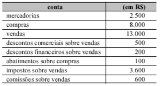{largura=35%}

Com base nessas informações e considerando que o estoque final da empresa era de R$ 1.500,00, é correto concluir que o lucro bruto da empresa foi igual a

- A) zero.
- B) R$ 500,00.
- C) R$ 800,00.
- D) R$ 3.500,00.
- Gabarito: A
- Resolução: a caminho

## F0669 · FGV · 2006 · SEFAZ MS · ME
- Fontes: TecConcursos 669 (45104)
- Prova: FGV - FTE (SEFAZ MS)/SEFAZ MS/2006
- Grupos: resultado-operacional, fora-destinacao, despesas-administrativas, despesas-vendas, lucro-liquido

Com base no enunciado a seguir, responda à questão.

A Cia. Comercial Complexa e Extensa apurou o seguinte Balanço Patrimonial em 01/01/2005:

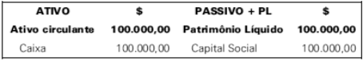{largura=36%}

Durante o primeiro semestre de 2005, ocorreram as seguintes transações:

Os sócios da Cia. Comercial Complexa e Extensa aumentaram o Capital Social da empresa em $ 100.000,00, da seguinte forma: $ 50.000,00 integralizados, imediatamente, em dinheiro; $ 30.000,00 integralizados, imediatamente, em um terreno localizado na cidade de Corumbá; e $ 20.000,00 a serem integralizados no ano de 2008.

A Cia. Comercial Complexa e Extensa comprou 50.000 unidades da mercadoria "Dificuldade", por $1,50 a unidade (desconsidere os impostos). O pagamento ao fornecedor foi realizado à vista.

A Cia. Comercial Complexa e Extensa vendeu 45.000 unidades da mercadoria "Dificuldade", por $ 2,00 a unidade (desconsidere os impostos). A venda foi negociada a prazo.

A Cia. Comercial Complexa e Extensa recebeu de seus clientes metade (1/2) das Duplicatas a Receber. O restante das duplicatas vencerá, ainda, em 2005 (no segundo semestre).

No início de abril, a Cia. Comercial Complexa e Extensa obteve um empréstimo bancário no valor de $ 70.000,00. O principal deverá ser pago em 2009, mas os juros mensais de $ 400,00 devem ser pagos ao final de cada mês. A Cia. Comercial Complexa e Extensa honrou o pagamento dos juros nos prazos acordados (inclusive no mês de abril).

No início de maio, a Cia. Comercial Complexa e Extensa comprou um caminhão, à vista, por $ 60.000,00. Espera-se que esse veículo tenha uma vida útil de 5 anos, ao final do qual se reduzirá a sucata, e o método de depreciação adotado é o linear - cotas constantes. A Cia. Comercial Complexa e Extensa reconheceu a depreciação mensalmente (inclusive no mês de maio).

A Cia. Comercial Complexa e Extensa incorreu e pagou despesas administrativas de $ 10.000,00 e despesas comerciais de $ 5.000,00.

Desconsidere a incidência de qualquer tributo, bem como qualquer outra variável não apresentada neste enunciado.

Sabe-se que 25% do lucro do semestre foram provisionados como dividendos, mas ainda não foram pagos.

De acordo com a Lei 6.404/76, determine o valor do Lucro Operacional da Cia. Comercial Complexa e Extensa, apresentado na Demonstração do Resultado do Exercício apurada em 30/06/2005.

- A) $ 2.300,00
- B) $ 4.300,00
- C) $ 5.500,00
- D) $ 7.500,00
- E) $ 22.500,00
- Gabarito: B
- Resolução: a caminho

## F0670 · FCC · 2006 · SER PB · ME
- Fontes: TecConcursos 670 (45948)
- Prova: FCC - AFTE (SER PB)/SER PB/2006
- Grupos: receita-liquida, cmv, resultado-operacional, participacoes, ir-csll, lucro-liquido, deducoes, receita-bruta, despesas-operacionais, despesas-administrativas, equivalencia, resultado-financeiro, outras-operacionais

Considere os componentes da Demonstração de Resultados do Exercício de 31/12/2005 da empresa Equipamentos Modernos S.A., para responder à questão.

| Conta | Valor |
|---|---:|
| Receita Operacional Bruta de Vendas | R$ 1.600.000,00 |
| Descontos Incondicionais Concedidos | R$      40.000,00 |
| Devolução de Vendas | R$      60.000,00 |
| ICMS sobre Vendas | R$     270.000,00 |
| Demais Impostos Incidentes sobre Vendas | R$     138.750,00 |
| Custo das Mercadorias Vendidas - CMV | R$     391.250,00 |
| Despesas Operacionais (Vendas e Administrativas) | R$     300.000,00 |
| Descontos Financeiros Obtidos | R$      36.000,00 |
| Descontos Financeiros Concedidos | R$       16.000,00 |
| Variações Monetárias Ativas | R$       64.000,00 |
| Resultado Positivo em Participações Societárias | R$      220.000,00 |
| Reversão de Provisões | R$       40.000,00 |
| Ganho de Capital na Venda de Bens Permanentes . | R$      65.250,00 |
| PIS Despesa Operacional | R$        1.650,00 |
| COFINS Despesa Operacional | R$       7.600,00 |
| Provisão para Contribuição Social sobre o Lucro Líquido | R$    120.000,00 |
| Provisão para o Imposto de Renda | R$    180.000,00 |

Os valores da receita operacional líquida (vendas líquidas), do lucro operacional líquido e do lucro líquido do exercício da empresa Equipamentos Modernos S.A., em 31/12/2005, nessa ordem, foram, em R$, de:

- A) 1.022.000,00; 680.000,00 e 350.000,00
- B) 1.050.500,00; 700.000,00 e 405.000,00
- C) 1.091.250,00; 734.750,00 e 500.000,00
- D) 1.100.250,00; 785.750,00 e 655.555,00
- E) 1.195.250,00; 845.250,00 e 755.555,55
- Gabarito: C
- Resolução: a caminho

## F0671 · FCC · 2006 · SER PB · ME
- Fontes: TecConcursos 671 (45950)
- Prova: FCC - AFTE (SER PB)/SER PB/2006
- Grupos: lucro-liquido

Considere os dados relativos à Demonstração de Lucros ou Prejuízos Acumulados da Cia. Marte Equipamentos Solares, levantada em 31/12/2005:

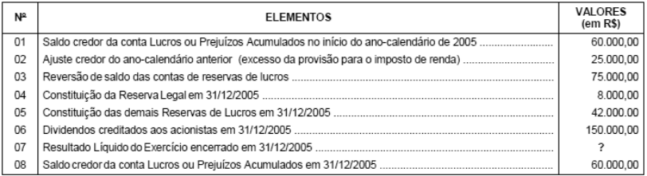{largura=64%}

Com base nos dados apresentados, é correto afirmar que o valor do Resultado Líquido do Exercício, apurado na Demonstração do Resultado do Exercício levantada em 31/12/2005, em R$, foi de:

- A) 100.000,00
- B) 98.000,00
- C) 90.000,00
- D) 85.500,00
- E) 60.000,00
- Gabarito: A
- Resolução: a caminho

## F0672 · FCC · 2006 · SER PB · ME
- Fontes: TecConcursos 672 (45951)
- Prova: FCC - AFTE (SER PB)/SER PB/2006
- Grupos: participacoes, ir-csll, lucro-liquido

A Companhia Paraíba de Cimentos apresenta em 31/12/2005, a seguinte situação patrimonial:

| Conta | Valor |
|---|---:|
| - Lucro Líquido do Exercício (sem o valor da provisão para Imposto de Renda) | R$ 2.600.000,00 |
| - Provisão para o Imposto de Renda de 31/12/2005, sobre o valor do Lucro Real | R$ 450.000,00 |
| - Saldo devedor da conta patrimonial denominada Lucros ou Prejuízos Acumulados | R$ 150.000,00 |

- Participações nos lucros prevista no estatuto da companhia: Administradores 10%, Empregados 10%, Debêntures 10%.

Os valores da participação dos administradores e do lucro líquido do exercício em 31/12/2005 foram, respectivamente, em R$, de:

- A) 600.000,00 e 1.400.000,00
- B) 420.000,00 e 1.350.000,00
- C) 300.000,00 e 1.470.000,00
- D) 200.000,00 e 1.570.000,00
- E) 162.000,00 e 1.608.000,00
- Gabarito: E
- Resolução: a caminho

## F0673 · FCC · 2006 · SER PB · ME
- Fontes: TecConcursos 673 (45952)
- Prova: FCC - AFTE (SER PB)/SER PB/2006
- Grupos: receita-liquida, receita-bruta

Considere os dados abaixo da Cia. Maranhense de Máquinas Industriais em 31/12/2005, para responder à questão.

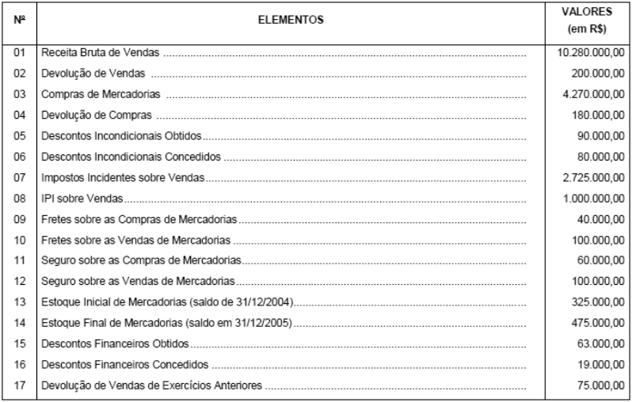{largura=63%}

Os valores da receita operacional bruta (vendas brutas) e da receita operacional líquida (vendas líquidas) da Cia. Maranhense de Máquinas Industriais em 31/12/2005, nessa ordem, foram, em R$, de:

- A) 9.986.000,00 e 6.981.000,00
- B) 10.061.000,00 e 7.000.000,00
- C) 10.186.000,00 e 7.056.000,00
- D) 10.280.000,00 e 7.275.000,00
- E) 11.280.000,00 e 7.275.000,00
- Gabarito: D
- Resolução: a caminho

## F0674 · FCC · 2006 · SER PB · ME
- Fontes: TecConcursos 674 (45953)
- Prova: FCC - AFTE (SER PB)/SER PB/2006
- Grupos: resultado-bruto, cmv, resultado-operacional

Considere os dados abaixo da Cia. Maranhense de Máquinas Industriais em 31/12/2005, para responder à questão.

{largura=63%}

Os valores do custo das mercadorias vendidas (CMV) e do lucro operacional bruto (Lucro Bruto) da Cia. Maranhense de Máquinas Industriais em 31/12/2005, nessa ordem, foram, em R$, de:

- A) 3.837.500,00 e 3.437.500,00
- B) 3.887.000,00 e 3.485.000,00
- C) 3.950.000,00 e 3.325.000,00
- D) 3.950.000,00 e 4.325.000,00
- E) 4.000.000,00 e 4.131.000,00
- Gabarito: C
- Resolução: a caminho

## F0675 · FCC · 2006 · SER PB · ME
- Fontes: TecConcursos 675 (45954)
- Prova: FCC - AFTE (SER PB)/SER PB/2006
- Grupos: participacoes, ir-csll, lucro-liquido, equivalencia

Para responder à questão, observe os saldos das contas do Razão da Cia. Imperial do Nordeste em 31/12/2005 e as informações adicionais, antes da contabilização da Equivalência Patrimonial e da Apuração do Resultado do Exercício de 2005.

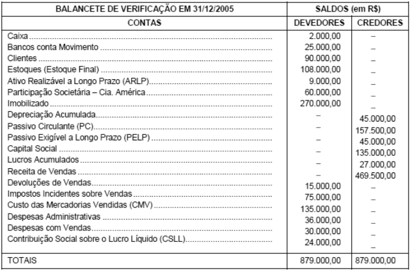{largura=54%}

INFORMAÇÕES ADICIONAIS: - Valor do Patrimônio Líquido da investida Cia. América no Balanço Patrimonial, levantado em 31/12/2005, somava o valor total de R$ 210.000,00. - O percentual de participação da Investidora Cia. Imperial do Nordeste no patrimônio líquido de sua investida (Cia. América) em 31 de dezembro de 2005 é de 60%. - A participação societária da investidora no capital da investida Cia. América é considerada relevante e influente. - O valor da Provisão para o Imposto de Renda a ser contabilizado em 31 de dezembro de 2005 (apurado sobre o valor do Lucro Real) é de R$ 20.500,00.

O lucro líquido do exercício apurado na Demonstração do Resultado do Exercício levantada em 31/12/2005 foi, em R$, de:

- A) 134.000,00
- B) 180.500,00
- C) 194.560,00
- D) 200.000,00
- E) 266.000,00
- Gabarito: D
- Resolução: a caminho

## F0676 · FCC · 2006 · TRT 4 · ME
- Fontes: TecConcursos 676 (117358)
- Prova: FCC - AJ TRT4/TRT 4/Administrativa/Contabilidade/2006
- Grupos: cmv, receita-bruta, despesas-administrativas, despesas-vendas

Num determinado dia do exercício social, o contador de uma companhia industrial registrou os seguintes fatos contábeis no livro Diário (valores em reais):

| Conta | Valor |
|---|---:|
| Venda de produtos acabados | 120.000,00 |
| Aquisição de matérias-primas | 11.000,00 |
| Pagamento de salários e encargos sociais provisionados | 40.000,00 |
| Custo de energia elétrica da fábrica | 6.000,00 |
| Custo dos produtos vendidos | 45.000,00 |
| Despesas de vendas incorridas e pagas no dia | 14.000,00 |

Considerando-se apenas os fatos contábeis mencionados nesse dia, o resultado da companhia, apurado pelo regime de competência, aumentou em

- A) 75.000,00
- B) 61.000,00
- C) 50.000,00
- D) 10.000,00
- E) 4.000,00
- Gabarito: B
- Resolução: a caminho

## F0677 · FCC · 2006 · TRT 4 · ME
- Fontes: TecConcursos 677 (117361)
- Prova: FCC - AJ TRT4/TRT 4/Administrativa/Contabilidade/2006
- Grupos: 

A Cia. Comercial Cruzeiro do Leste adquiriu 1.600 unidades de uma determinada mercadoria no valor de R$ 320.000,00, pagando metade à vista e financiando com o fornecedor a outra metade, para pagamento no exercício seguinte. Vendeu à vista, no próprio exercício, 1/2 do lote por R$ 400.000,00 e vendeu a prazo, para recebimento no exercício seguinte, 1/8 do lote por R$ 120.000,00. O total das despesas incorridas no exercício foi de R$ 200.000,00, do qual 30% não foi pago no próprio exercício. Apurando-se o resultado pelo regime de competência, é correto concluir que o lucro da companhia, em reais, foi

- A) 180.000,00
- B) 140.000,00
- C) 120.000,00
- D) 80.000,00
- E) 40.000,00
- Gabarito: C
- Resolução: a caminho

## F0678 · CEBRASPE · 2006 · TJ RR · ME
- Fontes: TecConcursos 678 (180395)
- Prova: CEBRASPE (CESPE) - AJ (TJ RR)/TJ RR/Contabilidade/2006
- Grupos: resultado-bruto, resultado-financeiro, receita-bruta, cmv, despesas-administrativas, deducoes

Considere o balancete de verificação de uma empresa hipotética apresentado a seguir para responder à questão. conta saldo (R$)

| Conta | Valor |
|---|---:|
| bancos conta movimento | 290 |
| aplicações financeiras | 450 |
| duplicatas a receber | 690 |
| caixa | 900 |
| despesa de manutenção | 1.000 |
| despesa de salários | 1.200 |
| salários a pagar | 1.230 |
| seguros antecipados | 1.290 |
| INSS a recolher | 1.890 |
| despesa financeira | 2.000 |
| receita antecipada | 2.120 |
| despesa de telefone | 3.000 |
| empréstimos contraídos | 3.210 |
| mercadorias | 3.290 |
| duplicatas a receber de longo prazo | 3.500 |
| computadores | 5.000 |
| despesa de depreciação | 5.000 |
| receita financeira | 5.000 |
| reservas | 8.760 |
| custos de mercadorias vendidas | 8.900 |
| despesa de energia | 9.000 |
| amortização acumulada | 12.000 |
| lucros e(ou) prejuízos acumulados | 12.700 |
| veículos | 12.800 |
| duplicatas a pagar | 13.500 |
| impostos sobre vendas | 14.500 |
| instalações | 16.700 |
| capital social | 20.000 |
| terrenos | 22.400 |
| depreciação acumulada | 23.900 |
| financiamentos de longo prazo | 30.000 |
| imóveis | 30.000 |
| gastos pré-operacionais | 32.000 |
| receita operacional bruta | 87.000 |

O valor do lucro bruto do período é igual a

- A) R$ 63.600,00.
- B) R$ 65.720,00.
- C) R$ 67.680,00.
- D) R$ 60.490,00.
- Gabarito: A
- Resolução: a caminho

## F0679 · CEBRASPE · 2006 · TJ RR · ME
- Fontes: TecConcursos 679 (180396)
- Prova: CEBRASPE (CESPE) - AJ (TJ RR)/TJ RR/Contabilidade/2006
- Grupos: resultado-financeiro, lair, ir-csll, deducoes, receita-bruta, despesas-administrativas, cmv, lucro-liquido

Conjunto de contas para a questão. conta R$

| Conta | Valor |
|---|---:|
| despesa de água | 120 |
| despesa de exaustão | 470 |
| despesa de amortização | 550 |
| despesa de depreciação | 558 |
| despesa de manutenção e conservação | 780 |
| despesa de energia | 980 |
| despesas administrativas | 1.140 |
| despesa antecipada de aluguéis | 1.230 |
| salários a pagar | 1.250 |
| reservas | 2.240 |
| seguros a pagar | 2.258 |
| despesas financeiras | 2.587 |
| despesa de salários | 3.258 |
| despesas gerais | 3.320 |
| despesa antecipada de seguros | 5.200 |
| receita financeira | 6.520 |
| imposto sobre vendas | 8.000 |
| caixa | 10.000 |
| deduções da receita | 12.000 |
| receita antecipada | 12.000 |
| impostos a pagar | 12.580 |
| aplicações em poupança | 12.800 |
| debêntures a pagar | 14.780 |
| terrenos | 15.800 |
| capital social | 22.100 |
| custo da mercadoria vendida | 25.000 |
| veículos | 25.400 |
| bancos | 25.800 |
| investimentos | 32.000 |
| receita operacional bruta | 60.000 |

Assinale a opção correspondente ao valor da demonstração do resultado do exercício (DRE), antes do imposto de renda e da contribuição social.

- A) R$ 39.557,00
- B) R$ 27.557,00
- C) R$ 14.757,00
- D) R$ 7.757,00
- Gabarito: D
- Resolução: a caminho

## F0680 · CEBRASPE · 2006 · TJ RR · ME
- Fontes: TecConcursos 680 (180401)
- Prova: CEBRASPE (CESPE) - AJ (TJ RR)/TJ RR/Contabilidade/2006
- Grupos: resultado-bruto, resultado-financeiro, deducoes, receita-bruta, despesas-administrativas, cmv

Conjunto de contas para a questão. conta R$

| Conta | Valor |
|---|---:|
| despesa de água | 120 |
| despesa de exaustão | 470 |
| despesa de amortização | 550 |
| despesa de depreciação | 558 |
| despesa de manutenção e conservação | 780 |
| despesa de energia | 980 |
| despesas administrativas | 1.140 |
| despesa antecipada de aluguéis | 1.230 |
| salários a pagar | 1.250 |
| reservas | 2.240 |
| seguros a pagar | 2.258 |
| despesas financeiras | 2.587 |
| despesa de salários | 3.258 |
| despesas gerais | 3.320 |
| despesa antecipada de seguros | 5.200 |
| receita financeira | 6.520 |
| imposto sobre vendas | 8.000 |
| caixa | 10.000 |
| deduções da receita | 12.000 |
| receita antecipada | 12.000 |
| impostos a pagar | 12.580 |
| aplicações em poupança | 12.800 |
| aplicações em poupança | 14.780 |
| terrenos | 15.800 |
| capital social | 22.100 |
| custo da mercadoria vendida | 25.000 |
| veículos | 25.400 |
| bancos | 25.800 |
| investimentos | 32.000 |
| receita operacional bruta | 60.000 |

O valor do lucro bruto é igual a

- A) R$ 40.000,00.
- B) R$ 15.000,00.
- C) R$ 23.000,00.
- D) R$ 19.757,00.
- Gabarito: B
- Resolução: a caminho

## F0681 · FCC · 2006 · TRT 20 · ME
- Fontes: TecConcursos 681 (384052)
- Prova: FCC - AJ TRT20/TRT 20/Administrativa/Contabilidade/2006
- Grupos: despesas-administrativas, lucro-liquido, receita-bruta

Instruções: Com base unicamente nos dados fornecidos, responda à questão.

As empresas A, B e C atuam no setor de serviços e, ao final do exercício de 2004, tinham uma situação patrimonial conforme os gráficos abaixo evidenciam: Cia. A ATIVO 250 PASSIVO 180 PL 70 Cia. B ATIVO 400 PASSIVO 300 PL 100

Cia. C ATIVO 300 PASSIVO 240 PL 60

Em 2005 as empresas realizaram as seguintes operações:

Operações efetuadas Cia. A Cia. B Cia. C

| Conta | Débito | Crédito | Valor |
|---|---:|---:|---:|
| Realização de receitas à vista | 15 | 22 | 40 |
| Receitas efetuadas a prazo | 90 | 90 | 25 |
| Recebimentos por conta de serviços a serem prestados futuramente | 40 | 30 | 30 |
| Despesas Administrativas pagas no período | 50 | 55 | 45 |
| Despesas Diversas provisionadas | 20 | 13 | 80 |
| Depreciações a apropriar no período | 5 | 9 | 10 |
| Pagamentos de passivos | 20 | 12 | 10 |
| Obrigações financeiras contraídas | 15 | 20 | 10 |

Em relação à apuração do resultado do exercício de 2005, a Cia.

- A) C apurou um prejuízo.
- B) B foi a única empresa a ter lucro.
- C) C apurou lucro de 35.
- D) A teve resultado nulo.
- E) A obteve um prejuízo de 35.
- Gabarito: A
- Resolução: a caminho

## F0682 · CEBRASPE · 2006 · MPE TO · CE
- Fontes: TecConcursos 682 (542316)
- Prova: CEBRASPE (CESPE) - Ana Min (MPE TO)/MPE TO/Especializado/Ciências Contábeis/2006
- Grupos: receita-liquida, deducoes, receita-bruta, despesas-administrativas, despesas-vendas

conta saldo (em R$)

| Conta | Valor |
|---|---:|
| abatimento sobre compras | 200 |
| abatimento de vendas | 320 |
| desconto de compras | 400 |
| seguros sobre compras | 410 |
| fretes sobre vendas | 750 |
| devolução de vendas | 800 |
| fretes sobre compras | 1.200 |
| despesas de exaustão | 1.447 |
| despesas antecipadas de seguros | 1.500 |
| despesas de depreciação | 1.580 |
| despesas antecipadas de salários | 2.400 |
| receita de serviços | 2.500 |
| despesas antecipadas de aluguel | 3.250 |
| empréstimos a pagar | 4.470 |
| aplicações financeiras | 5.296 |
| debêntures emitidas | 6.650 |
| receita antecipada de serviços | 7.440 |
| estoque em 31/1 | 12.000 |
| compras de mercadorias | 13.800 |
| estoque em 1.º/1 | 50.000 |
| receita de vendas | 65.800 |

Com base no conjunto de contas hipotéticas apresentado acima, julgue o item seguinte.

O valor da receita líquida de vendas é menor do que R$ 68.000,00.

- Gabarito: CERTO
- Resolução: a caminho

## F0683 · CEBRASPE · 2006 · MPE TO · CE
- Fontes: TecConcursos 683 (542324)
- Prova: CEBRASPE (CESPE) - Ana Min (MPE TO)/MPE TO/Especializado/Ciências Contábeis/2006
- Grupos: deducoes, receita-bruta, despesas-administrativas, despesas-vendas

conta saldo (em R$)

| Conta | Valor |
|---|---:|
| abatimento sobre compras | 200 |
| abatimento de vendas | 320 |
| desconto de compras | 400 |
| seguros sobre compras | 410 |
| fretes sobre vendas | 750 |
| devolução de vendas | 800 |
| fretes sobre compras | 1.200 |
| despesas de exaustão | 1.447 |
| despesas antecipadas de seguros | 1.500 |
| despesas de depreciação | 1.580 |
| despesas antecipadas de salários | 2.400 |
| receita de serviços | 2.500 |
| despesas antecipadas de aluguel | 3.250 |
| empréstimos a pagar | 4.470 |
| aplicações financeiras | 5.296 |
| debêntures emitidas | 6.650 |
| receita antecipada de serviços | 7.440 |
| estoque em 31/1 | 12.000 |
| compras de mercadorias | 13.800 |
| estoque em 1.º/1 | 50.000 |
| receita de vendas | 65.800 |

Com base no conjunto de contas hipotéticas apresentado acima, julgue o item seguinte.

A margem bruta é maior do que 32,5%.

- Gabarito: ERRADO
- Resolução: a caminho

## F0684 · CEBRASPE · 2006 · MPE TO · CE
- Fontes: TecConcursos 684 (542325)
- Prova: CEBRASPE (CESPE) - Ana Min (MPE TO)/MPE TO/Especializado/Ciências Contábeis/2006
- Grupos: deducoes, receita-bruta, despesas-administrativas, despesas-vendas

conta saldo (em R$)

| Conta | Valor |
|---|---:|
| abatimento sobre compras | 200 |
| abatimento de vendas | 320 |
| desconto de compras | 400 |
| seguros sobre compras | 410 |
| fretes sobre vendas | 750 |
| devolução de vendas | 800 |
| fretes sobre compras | 1.200 |
| despesas de exaustão | 1.447 |
| despesas antecipadas de seguros | 1.500 |
| despesas de depreciação | 1.580 |
| despesas antecipadas de salários | 2.400 |
| receita de serviços | 2.500 |
| despesas antecipadas de aluguel | 3.250 |
| empréstimos a pagar | 4.470 |
| aplicações financeiras | 5.296 |
| debêntures emitidas | 6.650 |
| receita antecipada de serviços | 7.440 |
| estoque em 31/1 | 12.000 |
| compras de mercadorias | 13.800 |
| estoque em 1.º/1 | 50.000 |
| receita de vendas | 65.800 |

Com base no conjunto de contas hipotéticas apresentado acima, julgue o item seguinte.

A margem operacional apurada é maior do que 23,5%.

- Gabarito: ERRADO
- Resolução: a caminho

## F0685 · CEBRASPE · 2006 · MPE TO · CE
- Fontes: TecConcursos 685 (546484)
- Prova: CEBRASPE (CESPE) - Tec Min (MPE TO)/MPE TO/Especializado/Contabilidade/2006
- Grupos: deducoes, receita-bruta, cmv, despesas-administrativas, despesas-vendas

conta saldo (R$)

| Conta | Valor |
|---|---:|
| despesa de amortização | 124,00 |
| despesa com seguros | 125,00 |
| salários a pagar | 180,00 |
| seguros sobre compras | 180,00 |
| despesa de depreciação | 198,00 |
| abatimento sobre compras | 200,00 |
| fretes sobre compras | 310,00 |
| salários antecipados | 320,00 |
| abatimento sobre vendas | 410,00 |
| energia a pagar | 420,00 |
| despesa de aluguel | 441,00 |
| devolução de vendas | 500,00 |
| receita antecipada de vendas | 500,00 |
| despesa antecipada de aluguel | 600,00 |
| devolução de compras | 600,00 |
| fretes sobre vendas | 900,00 |
| depreciação acumulada | 980,00 |
| impostos sobre vendas | 1.100,00 |
| ações de outras empresas | 1.180,00 |
| estoque final | 1.200,00 |
| estoque inicial | 2.500,00 |
| compras de mercadorias | 3.100,00 |
| receita de vendas | 9.500,00 |

Considerando o extrato das contas de determinada empresa hipotética, apresentado acima, julgue o item seguinte.

O custo da mercadoria vendida corresponde a R$ 4.090,00.

- Gabarito: CERTO
- Resolução: a caminho

## F0686 · CEBRASPE · 2006 · MPE TO · CE
- Fontes: TecConcursos 686 (546485)
- Prova: CEBRASPE (CESPE) - Tec Min (MPE TO)/MPE TO/Especializado/Contabilidade/2006
- Grupos: resultado-bruto, deducoes, receita-bruta, despesas-administrativas, despesas-vendas

conta saldo (R$)

| Conta | Valor |
|---|---:|
| despesa de amortização | 124,00 |
| despesa com seguros | 125,00 |
| salários a pagar | 180,00 |
| seguros sobre compras | 180,00 |
| despesa de depreciação | 198,00 |
| abatimento sobre compras | 200,00 |
| fretes sobre compras | 310,00 |
| salários antecipados | 320,00 |
| abatimento sobre vendas | 410,00 |
| energia a pagar | 420,00 |
| despesa de aluguel | 441,00 |
| devolução de vendas | 500,00 |
| receita antecipada de vendas | 500,00 |
| despesa antecipada de aluguel | 600,00 |
| devolução de compras | 600,00 |
| fretes sobre vendas | 900,00 |
| depreciação acumulada | 980,00 |
| impostos sobre vendas | 1.100,00 |
| ações de outras empresas | 1.180,00 |
| estoque final | 1.200,00 |
| estoque inicial | 2.500,00 |
| compras de mercadorias | 3.100,00 |
| receita de vendas | 9.500,00 |

Considerando o extrato das contas de determinada empresa hipotética, apresentado acima, julgue o item seguinte.

O valor do lucro bruto é igual a R$ 3.900,00.

- Gabarito: ERRADO
- Resolução: a caminho

## F0687 · CEBRASPE · 2006 · MPE TO · CE
- Fontes: TecConcursos 687 (546486)
- Prova: CEBRASPE (CESPE) - Tec Min (MPE TO)/MPE TO/Especializado/Contabilidade/2006
- Grupos: lucro-liquido, deducoes, receita-bruta, despesas-administrativas, despesas-vendas

conta saldo (R$)

| Conta | Valor |
|---|---:|
| despesa de amortização | 124,00 |
| despesa com seguros | 125,00 |
| salários a pagar | 180,00 |
| seguros sobre compras | 180,00 |
| despesa de depreciação | 198,00 |
| abatimento sobre compras | 200,00 |
| fretes sobre compras | 310,00 |
| salários antecipados | 320,00 |
| abatimento sobre vendas | 410,00 |
| energia a pagar | 420,00 |
| despesa de aluguel | 441,00 |
| devolução de vendas | 500,00 |
| receita antecipada de vendas | 500,00 |
| despesa antecipada de aluguel | 600,00 |
| devolução de compras | 600,00 |
| fretes sobre vendas | 900,00 |
| depreciação acumulada | 980,00 |
| impostos sobre vendas | 1.100,00 |
| ações de outras empresas | 1.180,00 |
| estoque final | 1.200,00 |
| estoque inicial | 2.500,00 |
| compras de mercadorias | 3.100,00 |
| receita de vendas | 9.500,00 |

Considerando o extrato das contas de determinada empresa hipotética, apresentado acima, julgue o item seguinte.

O valor do lucro líquido é igual a R$ 1.612,00.

- Gabarito: CERTO
- Resolução: a caminho

## F0688 · CEBRASPE · 2006 · MPE TO · CE
- Fontes: TecConcursos 688 (546487)
- Prova: CEBRASPE (CESPE) - Tec Min (MPE TO)/MPE TO/Especializado/Contabilidade/2006
- Grupos: deducoes, receita-bruta, despesas-administrativas, despesas-vendas

conta saldo (R$)

| Conta | Valor |
|---|---:|
| despesa de amortização | 124,00 |
| despesa com seguros | 125,00 |
| salários a pagar | 180,00 |
| seguros sobre compras | 180,00 |
| despesa de depreciação | 198,00 |
| abatimento sobre compras | 200,00 |
| fretes sobre compras | 310,00 |
| salários antecipados | 320,00 |
| abatimento sobre vendas | 410,00 |
| energia a pagar | 420,00 |
| despesa de aluguel | 441,00 |
| devolução de vendas | 500,00 |
| receita antecipada de vendas | 500,00 |
| despesa antecipada de aluguel | 600,00 |
| devolução de compras | 600,00 |
| fretes sobre vendas | 900,00 |
| depreciação acumulada | 980,00 |
| impostos sobre vendas | 1.100,00 |
| ações de outras empresas | 1.180,00 |
| estoque final | 1.200,00 |
| estoque inicial | 2.500,00 |
| compras de mercadorias | 3.100,00 |
| receita de vendas | 9.500,00 |

Considerando o extrato das contas de determinada empresa hipotética, apresentado acima, julgue o item seguinte.

A margem bruta da empresa ultrapassa 42,5%.

- Gabarito: CERTO
- Resolução: a caminho

## F0689 · CEBRASPE · 2006 · MPE TO · CE
- Fontes: TecConcursos 689 (546488)
- Prova: CEBRASPE (CESPE) - Tec Min (MPE TO)/MPE TO/Especializado/Contabilidade/2006
- Grupos: deducoes, receita-bruta, despesas-administrativas, despesas-vendas

conta saldo (R$)

| Conta | Valor |
|---|---:|
| despesa de amortização | 124,00 |
| despesa com seguros | 125,00 |
| salários a pagar | 180,00 |
| seguros sobre compras | 180,00 |
| despesa de depreciação | 198,00 |
| abatimento sobre compras | 200,00 |
| fretes sobre compras | 310,00 |
| salários antecipados | 320,00 |
| abatimento sobre vendas | 410,00 |
| energia a pagar | 420,00 |
| despesa de aluguel | 441,00 |
| devolução de vendas | 500,00 |
| receita antecipada de vendas | 500,00 |
| despesa antecipada de aluguel | 600,00 |
| devolução de compras | 600,00 |
| fretes sobre vendas | 900,00 |
| depreciação acumulada | 980,00 |
| impostos sobre vendas | 1.100,00 |
| ações de outras empresas | 1.180,00 |
| estoque final | 1.200,00 |
| estoque inicial | 2.500,00 |
| compras de mercadorias | 3.100,00 |
| receita de vendas | 9.500,00 |

Considerando o extrato das contas de determinada empresa hipotética, apresentado acima, julgue o item seguinte.

A margem líquida da empresa supera 30%.

- Gabarito: ERRADO
- Resolução: a caminho

## F0690 · CEBRASPE · 2006 · CL DF · CE
- Fontes: TecConcursos 690 (631189)
- Prova: CEBRASPE (CESPE) - Ana Leg (CL DF)/CL DF/Técnico de Contabilidade/2006
- Grupos: resultado-bruto, resultado-operacional, cmv, despesas-administrativas, receita-bruta, deducoes, resultado-financeiro, ir-csll

contas valores em R$

| Conta | Valor |
|---|---:|
| despesa de juros | 3.200 |
| despesa de material | 5.800 |
| impostos sobre o lucro | 5.900 |
| cartão de crédito de clientes | 7.458 |
| reserva de lucros | 8.000 |
| despesa antecipada de seguros | 8.590 |
| despesa de aluguel | 10.000 |
| impostos sobre receita | 12.900 |
| reserva de capital | 14.570 |
| ações em tesouraria | 30.000 |
| despesa de depreciação | 35.000 |
| cheques a compensar emitidos pela empresa | 58.000 |
| material de expediente | 58.000 |
| despesa de salários | 58.700 |
| contas a pagar | 58.900 |
| banco | 65.800 |
| caixa | 78.900 |
| provisões para contingências trabalhistas | 79.500 |
| estoques de mercadorias | 87.590 |
| gastos pré-operacionais | 87.900 |
| valores a receber – duplicatas | 98.700 |
| computadores | 100.000 |
| custo da mercadoria vendida | 115.000 |
| depreciação acumulada | 125.700 |
| veículos | 147.800 |
| aplicações financeiras de longo prazo | 187.900 |
| receita antecipada | 190.000 |
| capital social | 248.000 |
| receita operacional bruta | 258.000 |
| doações recebidas | 258.000 |
| terrenos | 258.000 |
| contas a receber | 258.000 |
| máquinas e equipamentos | 290.000 |
| prédio | 359.000 |

Considerando o balancete de verificação acima, julgue o item a seguir.

O lucro operacional bruto corresponde a R$ 130.100,00.

- Gabarito: CERTO
- Resolução: a caminho

## F0691 · CEBRASPE · 2006 · CL DF · CE
- Fontes: TecConcursos 691 (631361)
- Prova: CEBRASPE (CESPE) - Ana Leg (CL DF)/CL DF/Técnico de Contabilidade/2006
- Grupos: deducoes, receita-bruta, despesas-administrativas, lucro-liquido, despesas-vendas

contas valor (em R$)

| Conta | Valor |
|---|---:|
| despesas de seguros | 479 |
| caixa | 800 |
| devolução de compras | 930 |
| despesas de aluguel | 985 |
| despesas de publicidade | 1.158 |
| descontos sobre compras | 1.250 |
| abatimento de compras | 1.870 |
| deduções sobre vendas | 2.500 |
| despesas gráficas | 2.985 |
| despesa de transporte | 3.520 |
| frete sobre compras | 3.580 |
| despesa de manutenção e conservação | 4.780 |
| impostos sobre a receita | 4.800 |
| despesas de salários | 5.580 |
| despesas de combustíveis | 6.584 |
| assinaturas antecipadas | 8.970 |
| seguros antecipados | 12.870 |
| duplicatas a pagar | 12.980 |
| estoque final | 20.000 |
| receita antecipada | 29.000 |
| banco | 35.800 |
| aquisição de mercadorias | 38.500 |
| estoque inicial | 45.800 |
| capital social | 93.658 |
| receita de vendas | 95.800 |
| duplicatas a receber | 98.741 |

Após elaborar a demonstração do resultado do exercício com as informações fornecidas no quadro acima, julgue o item a seguir.

Mesmo que a empresa possua saldo anterior de lucros/(prejuízos) acumulados de R$ 3.500,00, o saldo dessa conta, após a apuração do resultado, será devedor em R$ 1.401,00.

- Gabarito: ERRADO
- Resolução: a caminho

## F0692 · CEBRASPE · 2006 · CL DF · CE
- Fontes: TecConcursos 692 (631362)
- Prova: CEBRASPE (CESPE) - Ana Leg (CL DF)/CL DF/Técnico de Contabilidade/2006
- Grupos: ir-csll, deducoes, receita-bruta, despesas-administrativas, lucro-liquido, despesas-vendas

contas valor (em R$)

| Conta | Valor |
|---|---:|
| despesas de seguros | 479 |
| caixa | 800 |
| devolução de compras | 930 |
| despesas de aluguel | 985 |
| despesas de publicidade | 1.158 |
| descontos sobre compras | 1.250 |
| abatimento de compras | 1.870 |
| deduções sobre vendas | 2.500 |
| despesas gráficas | 2.985 |
| despesa de transporte | 3.520 |
| frete sobre compras | 3.580 |
| despesa de manutenção e conservação | 4.780 |
| impostos sobre a receita | 4.800 |
| despesas de salários | 5.580 |
| despesas de combustíveis | 6.584 |
| assinaturas antecipadas | 8.970 |
| seguros antecipados | 12.870 |
| duplicatas a pagar | 12.980 |
| estoque final | 20.000 |
| receita antecipada | 29.000 |
| banco | 35.800 |
| aquisição de mercadorias | 38.500 |
| estoque inicial | 45.800 |
| capital social | 93.658 |
| receita de vendas | 95.800 |
| duplicatas a receber | 98.741 |

Após elaborar a demonstração do resultado do exercício com as informações fornecidas no quadro acima, julgue o item a seguir.

A empresa auferiu lucro antes do pagamento do imposto de renda no valor de R$ 24.670,00.

- Gabarito: ERRADO
- Resolução: a caminho

## F0693 · CEBRASPE · 2006 · CL DF · CE
- Fontes: TecConcursos 693 (631364)
- Prova: CEBRASPE (CESPE) - Ana Leg (CL DF)/CL DF/Técnico de Contabilidade/2006
- Grupos: receita-liquida, deducoes, receita-bruta, despesas-administrativas, lucro-liquido, despesas-vendas

contas valor (em R$)

| Conta | Valor |
|---|---:|
| despesas de seguros | 479 |
| caixa | 800 |
| devolução de compras | 930 |
| despesas de aluguel | 985 |
| despesas de publicidade | 1.158 |
| descontos sobre compras | 1.250 |
| abatimento de compras | 1.870 |
| deduções sobre vendas | 2.500 |
| despesas gráficas | 2.985 |
| despesa de transporte | 3.520 |
| frete sobre compras | 3.580 |
| despesa de manutenção e conservação | 4.780 |
| impostos sobre a receita | 4.800 |
| despesas de salários | 5.580 |
| despesas de combustíveis | 6.584 |
| assinaturas antecipadas | 8.970 |
| seguros antecipados | 12.870 |
| duplicatas a pagar | 12.980 |
| estoque final | 20.000 |
| receita antecipada | 29.000 |
| banco | 35.800 |
| aquisição de mercadorias | 38.500 |
| estoque inicial | 45.800 |
| capital social | 93.658 |
| receita de vendas | 95.800 |
| duplicatas a receber | 98.741 |

Após elaborar a demonstração do resultado do exercício com as informações fornecidas no quadro acima, julgue o item a seguir.

A empresa obteve receita líquida de vendas no valor de R$ 117.500,00.

- Gabarito: ERRADO
- Resolução: a caminho

## F0694 · CEBRASPE · 2006 · CL DF · CE
- Fontes: TecConcursos 694 (631365)
- Prova: CEBRASPE (CESPE) - Ana Leg (CL DF)/CL DF/Técnico de Contabilidade/2006
- Grupos: deducoes, receita-bruta, cmv, despesas-administrativas, lucro-liquido, despesas-vendas

contas valor (em R$)

| Conta | Valor |
|---|---:|
| despesas de seguros | 479 |
| caixa | 800 |
| devolução de compras | 930 |
| despesas de aluguel | 985 |
| despesas de publicidade | 1.158 |
| descontos sobre compras | 1.250 |
| abatimento de compras | 1.870 |
| deduções sobre vendas | 2.500 |
| despesas gráficas | 2.985 |
| despesa de transporte | 3.520 |
| frete sobre compras | 3.580 |
| despesa de manutenção e conservação | 4.780 |
| impostos sobre a receita | 4.800 |
| despesas de salários | 5.580 |
| despesas de combustíveis | 6.584 |
| assinaturas antecipadas | 8.970 |
| seguros antecipados | 12.870 |
| duplicatas a pagar | 12.980 |
| estoque final | 20.000 |
| receita antecipada | 29.000 |
| banco | 35.800 |
| aquisição de mercadorias | 38.500 |
| estoque inicial | 45.800 |
| capital social | 93.658 |
| receita de vendas | 95.800 |
| duplicatas a receber | 98.741 |

Após elaborar a demonstração do resultado do exercício com as informações fornecidas no quadro acima, julgue o item a seguir.

A empresa apurou custo da mercadoria vendida no valor de R$ 63.830,00.

- Gabarito: CERTO
- Resolução: a caminho

## F0695 · CEBRASPE · 2006 · CL DF · CE
- Fontes: TecConcursos 695 (631366)
- Prova: CEBRASPE (CESPE) - Ana Leg (CL DF)/CL DF/Técnico de Contabilidade/2006
- Grupos: resultado-bruto, deducoes, receita-bruta, despesas-administrativas, lucro-liquido, despesas-vendas

contas valor (em R$)

| Conta | Valor |
|---|---:|
| despesas de seguros | 479 |
| caixa | 800 |
| devolução de compras | 930 |
| despesas de aluguel | 985 |
| despesas de publicidade | 1.158 |
| descontos sobre compras | 1.250 |
| abatimento de compras | 1.870 |
| deduções sobre vendas | 2.500 |
| despesas gráficas | 2.985 |
| despesa de transporte | 3.520 |
| frete sobre compras | 3.580 |
| despesa de manutenção e conservação | 4.780 |
| impostos sobre a receita | 4.800 |
| despesas de salários | 5.580 |
| despesas de combustíveis | 6.584 |
| assinaturas antecipadas | 8.970 |
| seguros antecipados | 12.870 |
| duplicatas a pagar | 12.980 |
| estoque final | 20.000 |
| receita antecipada | 29.000 |
| banco | 35.800 |
| aquisição de mercadorias | 38.500 |
| estoque inicial | 45.800 |
| capital social | 93.658 |
| receita de vendas | 95.800 |
| duplicatas a receber | 98.741 |

Após elaborar a demonstração do resultado do exercício com as informações fornecidas no quadro acima, julgue o item a seguir.

A empresa auferiu lucro bruto no valor de R$ 53.670,00.

- Gabarito: ERRADO
- Resolução: a caminho

## F0696 · CEBRASPE · 2006 · CL DF · CE
- Fontes: TecConcursos 696 (631368)
- Prova: CEBRASPE (CESPE) - Ana Leg (CL DF)/CL DF/Técnico de Contabilidade/2006
- Grupos: deducoes, receita-bruta, despesas-administrativas, lucro-liquido, despesas-vendas

contas valor (em R$)

| Conta | Valor |
|---|---:|
| despesas de seguros | 479 |
| caixa | 800 |
| devolução de compras | 930 |
| despesas de aluguel | 985 |
| despesas de publicidade | 1.158 |
| descontos sobre compras | 1.250 |
| abatimento de compras | 1.870 |
| deduções sobre vendas | 2.500 |
| despesas gráficas | 2.985 |
| despesa de transporte | 3.520 |
| frete sobre compras | 3.580 |
| despesa de manutenção e conservação | 4.780 |
| impostos sobre a receita | 4.800 |
| despesas de salários | 5.580 |
| despesas de combustíveis | 6.584 |
| assinaturas antecipadas | 8.970 |
| seguros antecipados | 12.870 |
| duplicatas a pagar | 12.980 |
| estoque final | 20.000 |
| receita antecipada | 29.000 |
| banco | 35.800 |
| aquisição de mercadorias | 38.500 |
| estoque inicial | 45.800 |
| capital social | 93.658 |
| receita de vendas | 95.800 |
| duplicatas a receber | 98.741 |

Após elaborar a demonstração do resultado do exercício com as informações fornecidas no quadro acima, julgue o item a seguir.

As despesas registradas na demonstração do resultado do exercício totalizam R$ 46.071,00.

- Gabarito: ERRADO
- Resolução: a caminho

## F0697 · CEBRASPE · 2006 · CL DF · CE
- Fontes: TecConcursos 697 (631389)
- Prova: CEBRASPE (CESPE) - Ana Leg (CL DF)/CL DF/Técnico de Contabilidade/2006
- Grupos: resultado-bruto, receita-bruta, cmv

contas inicial (valor em R$) movimentação (valor em R$) caixa 1.800

3.500

banco 2.500

7.580 2.000 aplicações financeiras de resgate imediato 3.250

poupança 1.000

cartões de crédito a receber 2.580

2.580 cheques a receber 7.400

títulos a receber 8.500

contas a pagar

9.000

2.000 aplicações financeiras de longo prazo 3.698

receita antecipada

8.500

despesa antecipada de seguros 4.520

estoques 5.000

3.000 gastos de expansão 12.500

custo da mercadoria vendida

3.000

capital social

30.000

receita de vendas

8500 lucros/(prejuízos) acumulados

5.248

despesas do período

4.000

52.748 52.748 18.080 18.080 Com base no balancete de verificação apresentado acima, julgue o item seguinte.

O lucro bruto obtido no período totaliza R$ 5.500,00.

- Gabarito: CERTO
- Resolução: a caminho

## F0698 · CEBRASPE · 2006 · CL DF · CE
- Fontes: TecConcursos 698 (631406)
- Prova: CEBRASPE (CESPE) - Ana Leg (CL DF)/CL DF/Técnico de Contabilidade/2006
- Grupos: receita-liquida, receita-bruta

Com relação à utilização da matemática financeira e de registros contábeis, julgue o item seguinte.

Ao registrar o desconto financeiro obtido, a empresa evidencia decréscimo não operacional no resultado do período, o que provocará mudança no valor da receita líquida de vendas.

- Gabarito: ERRADO
- Resolução: a caminho

## F0699 · CEBRASPE · 2006 · CL DF · CE
- Fontes: TecConcursos 699 (632280)
- Prova: CEBRASPE (CESPE) - Con Tec Leg (CL DF)/CL DF/Contador/2006
- Grupos: receita-bruta, cmv, despesas-administrativas, lucro-liquido

contas valores em R$

| Conta | Valor |
|---|---:|
| cartão de crédito a pagar | 18.790,00 |
| receita de serviços antecipada | 42.100,00 |
| cheques a compensar – clientes | 18.970,00 |
| ágio na emissão de debêntures | 28.900,00 |
| deságio na emissão de debêntures | 12.800,00 |
| custo da mercadoria vendida | 35.000,00 |
| despesa de material de consumo | 12.580,00 |
| despesa de depreciação | 9.587,00 |
| despesa antecipada de seguros | 7.800,00 |
| receita antecipada de vendas | 12.580,00 |
| receita de vendas | 98.000,00 |
| despesa de telefone | 2.589,00 |
| despesa de assinatura de revistas | 850,00 |
| pró-labore a pagar | 5.780,00 |
| INSS a recolher | 3.987,00 |
| despesa de salários | 45.800,00 |
| despesa de aluguel | 18.500,00 |
| lucros/(prejuízos) acumulados | (20.000,00) |
| receita de serviços | 75.800,00 |
| debêntures a pagar | 150.000,00 |
| custo do serviço prestado | 25.800,00 |

A respeito do conjunto de contas de uma empresa mostrado na tabela acima, julgue o item a seguir.

Ao se apurar o resultado do exercício, será creditado o montante de R$ 150.706,00 de custos e despesas, e será debitada a conta de lucros/(prejuízos) acumulados no mesmo valor.

- Gabarito: CERTO
- Resolução: a caminho

## F0700 · CEBRASPE · 2006 · CL DF · CE
- Fontes: TecConcursos 700 (632281)
- Prova: CEBRASPE (CESPE) - Con Tec Leg (CL DF)/CL DF/Contador/2006
- Grupos: receita-bruta, cmv, despesas-administrativas, lucro-liquido

contas valores em R$

| Conta | Valor |
|---|---:|
| cartão de crédito a pagar | 18.790,00 |
| receita de serviços antecipada | 42.100,00 |
| cheques a compensar – clientes | 18.970,00 |
| ágio na emissão de debêntures | 28.900,00 |
| deságio na emissão de debêntures | 12.800,00 |
| custo da mercadoria vendida | 35.000,00 |
| despesa de material de consumo | 12.580,00 |
| despesa de depreciação | 9.587,00 |
| despesa antecipada de seguros | 7.800,00 |
| receita antecipada de vendas | 12.580,00 |
| receita de vendas | 98.000,00 |
| despesa de telefone | 2.589,00 |
| despesa de assinatura de revistas | 850,00 |
| pró-labore a pagar | 5.780,00 |
| INSS a recolher | 3.987,00 |
| despesa de salários | 45.800,00 |
| despesa de aluguel | 18.500,00 |
| lucros/(prejuízos) acumulados | (20.000,00) |
| receita de serviços | 75.800,00 |
| debêntures a pagar | 150.000,00 |
| custo do serviço prestado | 25.800,00 |

A respeito do conjunto de contas de uma empresa mostrado na tabela acima, julgue o item a seguir.

Ao se apurar o resultado do exercício, será debitado o montante de R$ 173.800,00 de receitas de vendas e serviços e será creditada, no mesmo valor, a conta de lucros/(prejuízos) acumulados.

- Gabarito: CERTO
- Resolução: a caminho

## F0701 · FCC · 2006 · MPE PE · ME
- Fontes: TecConcursos 701 (685255)
- Prova: FCC - Ana Min (MPE PE)/MPE PE/Planejamento/2006
- Grupos: resultado-bruto, receita-bruta

A Cia. Comercial do Sul adquiriu 50 unidades de uma determinada mercadoria por R$ 100,00 cada uma, com ICMS de 18% incluso no preço. Posteriormente, revendeu metade desse lote a uma empresa situada fora do estado, com incidência de ICMS à alíquota de 12%. Sabendo que o lucro bruto da referida operação foi R$ 1.558,00, podese concluir que a receita bruta de vendas obtida na transação foi, em R$, de

- A) 8.200,00
- B) 5.608,00
- C) 5.000,00
- D) 4.592,00
- E) 4.100,00
- Gabarito: E
- Resolução: a caminho

## F0702 · CEBRASPE · 2006 · Pref Limeira (SP) · CE
- Fontes: TecConcursos 702 (801160)
- Prova: CEBRASPE (CESPE) - Ag Fis Trb (Pref Limeira)/Pref Limeira (SP)/2006
- Grupos: receita-liquida, resultado-operacional, resultado-financeiro, participacoes, receita-bruta, despesas-administrativas

Com fundamento nos conceitos e na legislação contábeis, julgue o item a seguir.

Suponha a existência dos saldos abaixo, à data de encerramento de certo exercício (valores em R$ 1.000,00).

Receita líquida de vendas: 480 Compras: 370 Mercadorias: 130 Estoque final: 150 Despesas administrativas e de vendas: 75 Receitas financeiras: 15 Resultado (positivo) de participações societárias: 50 Participações no resultado: 40 Nessa situação, seria correto apurar um resultado operacional de R$ 70.000,00.

- Gabarito: ERRADO
- Resolução: a caminho

## F0703 · CEBRASPE · 2006 · CODEBA · CE
- Fontes: TecConcursos 703 (1329526)
- Prova: CEBRASPE (CESPE) - Ana Por (CODEBA)/CODEBA/Contador/2006
- Grupos: lucro-liquido

Acerca do registro das operações típicas de empresas comerciais, julgue o item subsequente.

O registro da despesa de entrega de mercadorias, quando a empresa paga o transportador, proporciona um débito na demonstração do resultado do exercício (DRE) e um crédito no ativo circulante. A despesa de entrega de mercadorias não influencia na apuração da margem bruta da DRE.

- Gabarito: CERTO
- Resolução: a caminho

## F0704 · CEBRASPE · 2006 · CODEBA · CE
- Fontes: TecConcursos 704 (1329528)
- Prova: CEBRASPE (CESPE) - Ana Por (CODEBA)/CODEBA/Contador/2006
- Grupos: resultado-financeiro, ir-csll, deducoes, estrutura, receita-bruta, despesas-administrativas, despesas-vendas

conta

| Conta | Débito | Crédito | Valor |
|---|---:|---:|---:|
| ano | 2003 | 2004 | 2005 |
| compras | 9.000 35.000 | 40.000 |  |
| deduções da receita de vendas 10.800 17.000 | 23.100 |  |  |
| despesas administrativas | 12.500 16.800 | 13.100 |  |
| despesas de vendas | 3.500 | 4.100 | 6.000 |
| despesas financeiras | 6.000 | 8.000 | 4.300 |
| devolução de compras | 280 | 350 | 320 |
| estoque final | 8.000 | 9.500 | 2.000 |
| estoque inicial | 20.000 | 4.800 | 3.870 |
| frete sobre compras | 900 | 1.100 | 2.000 |
| fretes sobre vendas | 1.200 | 1.800 | 2.800 |
| provisão para imposto de renda | 1.280 | 903 | 1.572 |
| receita bruta de vendas | 60.000 85.000 105.000 |  |  |
| receitas financeiras | 4.800 | 3.870 | 5.500 |
| seguro sobre compras | 650 | 900 | 1.540 |

Com referência às informações apresentadas no quadro acima, em que os valores estão em reais, e acerca da estrutura e análise das demonstrações contábeis, julgue o item a seguir.  A margem bruta apurada no ano de 2003 é inferior a 50%.

- Gabarito: ERRADO
- Resolução: a caminho

## F0705 · CEBRASPE · 2006 · CODEBA · CE
- Fontes: TecConcursos 705 (1329529)
- Prova: CEBRASPE (CESPE) - Ana Por (CODEBA)/CODEBA/Contador/2006
- Grupos: resultado-financeiro, ir-csll, deducoes, estrutura, receita-bruta, despesas-administrativas, despesas-vendas

conta

| Conta | Débito | Crédito | Valor |
|---|---:|---:|---:|
| ano | 2003 | 2004 | 2005 |
| compras | 9.000 35.000 | 40.000 |  |
| deduções da receita de vendas 10.800 17.000 | 23.100 |  |  |
| despesas administrativas | 12.500 16.800 | 13.100 |  |
| despesas de vendas | 3.500 | 4.100 | 6.000 |
| despesas financeiras | 6.000 | 8.000 | 4.300 |
| devolução de compras | 280 | 350 | 320 |
| estoque final | 8.000 | 9.500 | 2.000 |
| estoque inicial | 20.000 | 4.800 | 3.870 |
| frete sobre compras | 900 | 1.100 | 2.000 |
| fretes sobre vendas | 1.200 | 1.800 | 2.800 |
| provisão para imposto de renda | 1.280 | 903 | 1.572 |
| receita bruta de vendas | 60.000 85.000 105.000 |  |  |
| receitas financeiras | 4.800 | 3.870 | 5.500 |
| seguro sobre compras | 650 | 900 | 1.540 |

Com referência às informações apresentadas no quadro acima, em que os valores estão em reais, e acerca da estrutura e análise das demonstrações contábeis, julgue o item a seguir.

A margem líquida do ano de 2004 é menor do que a margem líquida apurada no ano de 2003.

- Gabarito: CERTO
- Resolução: a caminho

## F0706 · CEBRASPE · 2006 · CODEBA · CE
- Fontes: TecConcursos 706 (1329530)
- Prova: CEBRASPE (CESPE) - Ana Por (CODEBA)/CODEBA/Contador/2006
- Grupos: resultado-financeiro, lair, ir-csll, deducoes, estrutura, receita-bruta, despesas-administrativas, despesas-vendas

conta

| Conta | Débito | Crédito | Valor |
|---|---:|---:|---:|
| ano | 2003 | 2004 | 2005 |
| compras | 9.000 35.000 | 40.000 |  |
| deduções da receita de vendas 10.800 17.000 | 23.100 |  |  |
| despesas administrativas | 12.500 16.800 | 13.100 |  |
| despesas de vendas | 3.500 | 4.100 | 6.000 |
| despesas financeiras | 6.000 | 8.000 | 4.300 |
| devolução de compras | 280 | 350 | 320 |
| estoque final | 8.000 | 9.500 | 2.000 |
| estoque inicial | 20.000 | 4.800 | 3.870 |
| frete sobre compras | 900 | 1.100 | 2.000 |
| fretes sobre vendas | 1.200 | 1.800 | 2.800 |
| provisão para imposto de renda | 1.280 | 903 | 1.572 |
| receita bruta de vendas | 60.000 85.000 105.000 |  |  |
| receitas financeiras | 4.800 | 3.870 | 5.500 |
| seguro sobre compras | 650 | 900 | 1.540 |

Com referência às informações apresentadas no quadro acima, em que os valores estão em reais, e acerca da estrutura e análise das demonstrações contábeis, julgue o item a seguir.

O lucro antes do imposto de renda no ano de 2005 é de R$ 10.480,00.

- Gabarito: CERTO
- Resolução: a caminho

## F0707 · CEBRASPE · 2006 · CODEBA · CE
- Fontes: TecConcursos 707 (1329531)
- Prova: CEBRASPE (CESPE) - Ana Por (CODEBA)/CODEBA/Contador/2006
- Grupos: resultado-bruto, resultado-financeiro, ir-csll, deducoes, estrutura, receita-bruta, despesas-administrativas, despesas-vendas

conta

| Conta | Débito | Crédito | Valor |
|---|---:|---:|---:|
| ano | 2003 | 2004 | 2005 |
| compras | 9.000 35.000 | 40.000 |  |
| deduções da receita de vendas 10.800 17.000 | 23.100 |  |  |
| despesas administrativas | 12.500 16.800 | 13.100 |  |
| despesas de vendas | 3.500 | 4.100 | 6.000 |
| despesas financeiras | 6.000 | 8.000 | 4.300 |
| devolução de compras | 280 | 350 | 320 |
| estoque final | 8.000 | 9.500 | 2.000 |
| estoque inicial | 20.000 | 4.800 | 3.870 |
| frete sobre compras | 900 | 1.100 | 2.000 |
| fretes sobre vendas | 1.200 | 1.800 | 2.800 |
| provisão para imposto de renda | 1.280 | 903 | 1.572 |
| receita bruta de vendas | 60.000 85.000 105.000 |  |  |
| receitas financeiras | 4.800 | 3.870 | 5.500 |
| seguro sobre compras | 650 | 900 | 1.540 |

Com referência às informações apresentadas no quadro acima, em que os valores estão em reais, e acerca da estrutura e análise das demonstrações contábeis, julgue o item a seguir.

O lucro bruto no ano de 2003 é de R$ 32.850,00.

- Gabarito: ERRADO
- Resolução: a caminho

## F0708 · CEBRASPE · 2006 · CODEBA · CE
- Fontes: TecConcursos 708 (1329532)
- Prova: CEBRASPE (CESPE) - Ana Por (CODEBA)/CODEBA/Contador/2006
- Grupos: resultado-financeiro, ir-csll, lucro-liquido, deducoes, estrutura, receita-bruta, despesas-administrativas, despesas-vendas

conta

| Conta | Débito | Crédito | Valor |
|---|---:|---:|---:|
| ano | 2003 | 2004 | 2005 |
| compras | 9.000 35.000 | 40.000 |  |
| deduções da receita de vendas 10.800 17.000 | 23.100 |  |  |
| despesas administrativas | 12.500 16.800 | 13.100 |  |
| despesas de vendas | 3.500 | 4.100 | 6.000 |
| despesas financeiras | 6.000 | 8.000 | 4.300 |
| devolução de compras | 280 | 350 | 320 |
| estoque final | 8.000 | 9.500 | 2.000 |
| estoque inicial | 20.000 | 4.800 | 3.870 |
| frete sobre compras | 900 | 1.100 | 2.000 |
| fretes sobre vendas | 1.200 | 1.800 | 2.800 |
| provisão para imposto de renda | 1.280 | 903 | 1.572 |
| receita bruta de vendas | 60.000 85.000 105.000 |  |  |
| receitas financeiras | 4.800 | 3.870 | 5.500 |
| seguro sobre compras | 650 | 900 | 1.540 |

Com referência às informações apresentadas no quadro acima, em que os valores estão em reais, e acerca da estrutura e análise das demonstrações contábeis, julgue o item a seguir.

O lucro líquido apurado no ano de 2005 é de R$ 11.590,00.

- Gabarito: ERRADO
- Resolução: a caminho

## F0709 · CEBRASPE · 2006 · CODEBA · CE
- Fontes: TecConcursos 709 (1329533)
- Prova: CEBRASPE (CESPE) - Ana Por (CODEBA)/CODEBA/Contador/2006
- Grupos: resultado-financeiro, ir-csll, deducoes, estrutura, receita-bruta, despesas-administrativas, despesas-vendas

conta

| Conta | Débito | Crédito | Valor |
|---|---:|---:|---:|
| ano | 2003 | 2004 | 2005 |
| compras | 9.000 35.000 | 40.000 |  |
| deduções da receita de vendas 10.800 17.000 | 23.100 |  |  |
| despesas administrativas | 12.500 16.800 | 13.100 |  |
| despesas de vendas | 3.500 | 4.100 | 6.000 |
| despesas financeiras | 6.000 | 8.000 | 4.300 |
| devolução de compras | 280 | 350 | 320 |
| estoque final | 8.000 | 9.500 | 2.000 |
| estoque inicial | 20.000 | 4.800 | 3.870 |
| frete sobre compras | 900 | 1.100 | 2.000 |
| fretes sobre vendas | 1.200 | 1.800 | 2.800 |
| provisão para imposto de renda | 1.280 | 903 | 1.572 |
| receita bruta de vendas | 60.000 85.000 105.000 |  |  |
| receitas financeiras | 4.800 | 3.870 | 5.500 |
| seguro sobre compras | 650 | 900 | 1.540 |

Com referência às informações apresentadas no quadro acima, em que os valores estão em reais, e acerca da estrutura e análise das demonstrações contábeis, julgue o item a seguir.

O resultado financeiro do ano de 2003 é maior do que o resultado financeiro do ano de 2004.

- Gabarito: CERTO
- Resolução: a caminho

## F0710 · CEBRASPE · 2006 · CODEBA · CE
- Fontes: TecConcursos 710 (1329534)
- Prova: CEBRASPE (CESPE) - Ana Por (CODEBA)/CODEBA/Contador/2006
- Grupos: cmv, resultado-financeiro, ir-csll, deducoes, estrutura, receita-bruta, despesas-administrativas, despesas-vendas

conta

| Conta | Débito | Crédito | Valor |
|---|---:|---:|---:|
| ano | 2003 | 2004 | 2005 |
| compras | 9.000 35.000 | 40.000 |  |
| deduções da receita de vendas 10.800 17.000 | 23.100 |  |  |
| despesas administrativas | 12.500 16.800 | 13.100 |  |
| despesas de vendas | 3.500 | 4.100 | 6.000 |
| despesas financeiras | 6.000 | 8.000 | 4.300 |
| devolução de compras | 280 | 350 | 320 |
| estoque final | 8.000 | 9.500 | 2.000 |
| estoque inicial | 20.000 | 4.800 | 3.870 |
| frete sobre compras | 900 | 1.100 | 2.000 |
| fretes sobre vendas | 1.200 | 1.800 | 2.800 |
| provisão para imposto de renda | 1.280 | 903 | 1.572 |
| receita bruta de vendas | 60.000 85.000 105.000 |  |  |
| receitas financeiras | 4.800 | 3.870 | 5.500 |
| seguro sobre compras | 650 | 900 | 1.540 |

Com referência às informações apresentadas no quadro acima, em que os valores estão em reais, e acerca da estrutura e análise das demonstrações contábeis, julgue o item a seguir.

O custo da mercadoria vendida (CMV) no ano de 2004 é superior ao de 2003.

- Gabarito: CERTO
- Resolução: a caminho

## F0711 · CEBRASPE · 2006 · PC PA · ME
- Fontes: TecConcursos 711 (1353861)
- Prova: CEBRASPE (CESPE) - Esc Pol (PC PA)/PC PA/2006
- Grupos: resultado-financeiro, deducoes, receita-bruta, cmv, despesas-vendas

contas valor em R$

| Conta | Valor |
|---|---:|
| devoluções de compras | 4 |
| fretes sobre vendas | 7 |
| despesa financeira | 8 |
| estoque final | 13 |
| receita de juros | 15 |
| devoluções de vendas | 18 |
| descontos sobre vendas | 40 |
| receita antecipada | 40 |
| banco | 45 |
| deduções sobre compras | 50 |
| seguros sobre compras | 60 |
| despesa antecipada de fretes | 80 |
| provisão para insolventes | 80 |
| fretes sobre compras | 90 |
| caixa | 97 |
| vendas | 114 |
| abatimento sobre compras | 800 |
| compras de mercadorias | 2.000 |
| estoque final | 2.000 |
| estoque inicial | 5.000 |

Considere que as contas na tabela acima tenham feito parte da contabilidade de uma empresa no ano de 2005. A partir dessas informações, é correto concluir que, para a referida empresa, o custo da mercadoria vendida, no período, foi igual a

- A) R$ 5.000,00.
- B) R$ 4.346,00.
- C) R$ 4.296,00.
- D) R$ 4.146,00.
- Gabarito: C
- Resolução: a caminho

## F0712 · CEBRASPE · 2006 · MIN · CE
- Fontes: TecConcursos 712 (1544380)
- Prova: CEBRASPE (CESPE) - Tec (MIN)/MIN/Contabilidade/2006
- Grupos: receita-liquida, resultado-financeiro, deducoes, receita-bruta, despesas-administrativas, despesas-vendas

conta saldo (em R$)

| Conta | Valor |
|---|---:|
| abatimento sobre compras | 91,00 |
| deduções sobre compras | 119,00 |
| receitas financeiras | 220,00 |
| provisão para devedores duvidosos | 464,00 |
| despesas administrativas | 499,00 |
| seguros sobre compras | 500,00 |
| despesas financeiras | 524,00 |
| despesas gerais | 621,00 |
| fretes sobre compras | 650,00 |
| deduções sobre vendas | 661,00 |
| despesas de material de consumo e conservação | 700,00 |
| reservas | 1.140,00 |
| estoque final | 3.260,00 |
| fornecedores | 3.580,00 |
| lucros acumulados | 7.520,00 |
| aquisição de mercadorias para revenda | 7.560,00 |
| estoque inicial | 12.000,00 |
| bancos | 12.500,00 |
| debêntures a pagar | 13.800,00 |
| receita de vendas | 42.980,00 |
| contas a receber | 44.100,00 |
| capital social | 74.100,00 |

Considere o conjunto de contas apresentado na tabela acima e julgue o item que se segue.

Ao se apurar o valor da receita líquida de vendas, obtém-se R$ 42.319,00.

- Gabarito: CERTO
- Resolução: a caminho

## F0713 · CEBRASPE · 2006 · MIN · CE
- Fontes: TecConcursos 713 (1544395)
- Prova: CEBRASPE (CESPE) - Tec (MIN)/MIN/Contabilidade/2006
- Grupos: resultado-financeiro, deducoes, receita-bruta, despesas-administrativas, cmv, despesas-vendas

conta saldo (em R$)

| Conta | Valor |
|---|---:|
| abatimento sobre compras | 91,00 |
| deduções sobre compras | 119,00 |
| receitas financeiras | 220,00 |
| provisão para devedores duvidosos | 464,00 |
| despesas administrativas | 499,00 |
| seguros sobre compras | 500,00 |
| despesas financeiras | 524,00 |
| despesas gerais | 621,00 |
| fretes sobre compras | 650,00 |
| deduções sobre vendas | 661,00 |
| despesas de material de consumo e conservação | 700,00 |
| reservas | 1.140,00 |
| estoque final | 3.260,00 |
| fornecedores | 3.580,00 |
| lucros acumulados | 7.520,00 |
| aquisição de mercadorias para revenda | 7.560,00 |
| estoque inicial | 12.000,00 |
| bancos | 12.500,00 |
| debêntures a pagar | 13.800,00 |
| receita de vendas | 42.980,00 |
| contas a receber | 44.100,00 |
| capital social | 74.100,00 |

Considere o conjunto de contas apresentado na tabela acima e julgue o item que se segue.

Ao se efetuar o cálculo do custo da mercadoria vendida, obtém-se R$ 17.660,00.

- Gabarito: ERRADO
- Resolução: a caminho

## F0714 · CEBRASPE · 2006 · MIN · CE
- Fontes: TecConcursos 714 (1544398)
- Prova: CEBRASPE (CESPE) - Tec (MIN)/MIN/Contabilidade/2006
- Grupos: resultado-financeiro, deducoes, receita-bruta, despesas-administrativas, despesas-vendas

conta saldo (em R$)

| Conta | Valor |
|---|---:|
| abatimento sobre compras | 91,00 |
| deduções sobre compras | 119,00 |
| receitas financeiras | 220,00 |
| provisão para devedores duvidosos | 464,00 |
| despesas administrativas | 499,00 |
| seguros sobre compras | 500,00 |
| despesas financeiras | 524,00 |
| despesas gerais | 621,00 |
| fretes sobre compras | 650,00 |
| deduções sobre vendas | 661,00 |
| despesas de material de consumo e conservação | 700,00 |
| reservas | 1.140,00 |
| estoque final | 3.260,00 |
| fornecedores | 3.580,00 |
| lucros acumulados | 7.520,00 |
| aquisição de mercadorias para revenda | 7.560,00 |
| estoque inicial | 12.000,00 |
| bancos | 12.500,00 |
| debêntures a pagar | 13.800,00 |
| receita de vendas | 42.980,00 |
| contas a receber | 44.100,00 |
| capital social | 74.100,00 |

Considere o conjunto de contas apresentado na tabela acima e julgue o item que se segue.

O valor da margem bruta apurado é maior do que 50%.

- Gabarito: CERTO
- Resolução: a caminho

## F0715 · CEBRASPE · 2006 · MIN · CE
- Fontes: TecConcursos 715 (1544403)
- Prova: CEBRASPE (CESPE) - Tec (MIN)/MIN/Contabilidade/2006
- Grupos: resultado-financeiro, deducoes, receita-bruta, despesas-administrativas, despesas-vendas

conta saldo (em R$)

| Conta | Valor |
|---|---:|
| abatimento sobre compras | 91,00 |
| deduções sobre compras | 119,00 |
| receitas financeiras | 220,00 |
| provisão para devedores duvidosos | 464,00 |
| despesas administrativas | 499,00 |
| seguros sobre compras | 500,00 |
| despesas financeiras | 524,00 |
| despesas gerais | 621,00 |
| fretes sobre compras | 650,00 |
| deduções sobre vendas | 661,00 |
| despesas de material de consumo e conservação | 700,00 |
| reservas | 1.140,00 |
| estoque final | 3.260,00 |
| fornecedores | 3.580,00 |
| lucros acumulados | 7.520,00 |
| aquisição de mercadorias para revenda | 7.560,00 |
| estoque inicial | 12.000,00 |
| bancos | 12.500,00 |
| debêntures a pagar | 13.800,00 |
| receita de vendas | 42.980,00 |
| contas a receber | 44.100,00 |
| capital social | 74.100,00 |

Considere o conjunto de contas apresentado na tabela acima e julgue o item que se segue.

O valor da margem operacional apurado é inferior a 54%.

- Gabarito: CERTO
- Resolução: a caminho

## F0716 · CEBRASPE · 2006 · MIN · CE
- Fontes: TecConcursos 716 (1544462)
- Prova: CEBRASPE (CESPE) - Tec (MIN)/MIN/Contabilidade/2006
- Grupos: receita-liquida, deducoes, receita-bruta

Acerca dos registros contábeis típicos de empresas comerciais, julgue o item seguinte.

O cancelamento de vendas após a emissão de nota fiscal será considerado dedução da receita bruta de vendas, o que provocará a diminuição da receita líquida de vendas.

- Gabarito: CERTO
- Resolução: a caminho

## F0717 · CEBRASPE · 2006 · MIN · CE
- Fontes: TecConcursos 717 (1544600)
- Prova: CEBRASPE (CESPE) - Tec (MIN)/MIN/Contabilidade/2006
- Grupos: resultado-bruto, resultado-financeiro, deducoes, receita-bruta, cmv, despesas-administrativas, despesas-vendas, ir-csll

conta saldo (em R$)

| Conta | Valor |
|---|---:|
| ações de outras empresas | 620,00 |
| bancos | 800,00 |
| capital social | 12.000,00 |
| clientes | 250,00 |
| contas a pagar de longo prazo | 2.480,00 |
| custo da mercadoria vendida | 7.500,00 |
| deduções sobre vendas | 2.500,00 |
| despesa de depreciação | 650,00 |
| despesa de manutenção | 410,00 |
| despesa de material de expediente | 600,00 |
| despesa de vendas | 290,00 |
| despesas de energia | 680,00 |
| despesas de salários | 2.400,00 |
| despesas de telefone | 800,00 |
| despesas financeiras | 485,00 |
| empréstimos a pagar | 4.170,00 |
| empréstimos a sócios | 1.500,00 |
| estoque de mercadorias para revenda | 400,00 |
| financiamentos | 124,00 |
| financiamentos de longo prazo | 3.120,00 |
| fornecedores | 470,00 |
| fretes sobre vendas | 250,00 |
| fundo de investimentos | 180,00 |
| impostos a pagar | 1.520,00 |
| impostos sobre o lucro | 2.000,00 |
| instalações comerciais | 9.000,00 |
| lucros ou prejuízos acumulados | 1.160,00 |
| máquinas e equipamentos | 1.200,00 |
| material de expediente | 350,00 |
| prédios | 5.000,00 |
| provisão para crédito de liquidação duvidosa | 80,00 |
| provisões para contingências | 200,00 |
| receita de vendas | 15.000,00 |
| receitas financeiras | 150,00 |
| reservas | 91,00 |
| terrenos | 4.000,00 |
| títulos a receber de longo prazo | 600,00 |
| veículos | 6.000,00 |

Com base nas informações do balancete de verificação acima, julgue o item subsequente.

O lucro bruto apurado no período é de R$ 10.000,00

- Gabarito: CERTO
- Resolução: a caminho

## F0718 · CEBRASPE · 2006 · MIN · CE
- Fontes: TecConcursos 718 (1544602)
- Prova: CEBRASPE (CESPE) - Tec (MIN)/MIN/Contabilidade/2006
- Grupos: receita-liquida, resultado-financeiro, deducoes, receita-bruta, cmv, despesas-administrativas, despesas-vendas, ir-csll

conta saldo (em R$)

| Conta | Valor |
|---|---:|
| ações de outras empresas | 620,00 |
| bancos | 800,00 |
| capital social | 12.000,00 |
| clientes | 250,00 |
| contas a pagar de longo prazo | 2.480,00 |
| custo da mercadoria vendida | 7.500,00 |
| deduções sobre vendas | 2.500,00 |
| despesa de depreciação | 650,00 |
| despesa de manutenção | 410,00 |
| despesa de material de expediente | 600,00 |
| despesa de vendas | 290,00 |
| despesas de energia | 680,00 |
| despesas de salários | 2.400,00 |
| despesas de telefone | 800,00 |
| despesas financeiras | 485,00 |
| empréstimos a pagar | 4.170,00 |
| empréstimos a sócios | 1.500,00 |
| estoque de mercadorias para revenda | 400,00 |
| financiamentos | 124,00 |
| financiamentos de longo prazo | 3.120,00 |
| fornecedores | 470,00 |
| fretes sobre vendas | 250,00 |
| fundo de investimentos | 180,00 |
| impostos a pagar | 1.520,00 |
| impostos sobre o lucro | 2.000,00 |
| instalações comerciais | 9.000,00 |
| lucros ou prejuízos acumulados | 1.160,00 |
| máquinas e equipamentos | 1.200,00 |
| material de expediente | 350,00 |
| prédios | 5.000,00 |
| provisão para crédito de liquidação duvidosa | 80,00 |
| provisões para contingências | 200,00 |
| receita de vendas | 15.000,00 |
| receitas financeiras | 150,00 |
| reservas | 91,00 |
| terrenos | 4.000,00 |
| títulos a receber de longo prazo | 600,00 |
| veículos | 6.000,00 |

Com base nas informações do balancete de verificação acima, julgue o item subsequente.  A receita líquida de vendas é igual a R$ 17.500,00.

- Gabarito: CERTO
- Resolução: a caminho

## F0719 · CEBRASPE · 2006 · MIN · CE
- Fontes: TecConcursos 719 (1544604)
- Prova: CEBRASPE (CESPE) - Tec (MIN)/MIN/Contabilidade/2006
- Grupos: resultado-financeiro, deducoes, receita-bruta, cmv, despesas-administrativas, despesas-vendas, lucro-liquido, ir-csll

conta saldo (em R$)

| Conta | Valor |
|---|---:|
| ações de outras empresas | 620,00 |
| bancos | 800,00 |
| capital social | 12.000,00 |
| clientes | 250,00 |
| contas a pagar de longo prazo | 2.480,00 |
| custo da mercadoria vendida | 7.500,00 |
| deduções sobre vendas | 2.500,00 |
| despesa de depreciação | 650,00 |
| despesa de manutenção | 410,00 |
| despesa de material de expediente | 600,00 |
| despesa de vendas | 290,00 |
| despesas de energia | 680,00 |
| despesas de salários | 2.400,00 |
| despesas de telefone | 800,00 |
| despesas financeiras | 485,00 |
| empréstimos a pagar | 4.170,00 |
| empréstimos a sócios | 1.500,00 |
| estoque de mercadorias para revenda | 400,00 |
| financiamentos | 124,00 |
| financiamentos de longo prazo | 3.120,00 |
| fornecedores | 470,00 |
| fretes sobre vendas | 250,00 |
| fundo de investimentos | 180,00 |
| impostos a pagar | 1.520,00 |
| impostos sobre o lucro | 2.000,00 |
| instalações comerciais | 9.000,00 |
| lucros ou prejuízos acumulados | 1.160,00 |
| máquinas e equipamentos | 1.200,00 |
| material de expediente | 350,00 |
| prédios | 5.000,00 |
| provisão para crédito de liquidação duvidosa | 80,00 |
| provisões para contingências | 200,00 |
| receita de vendas | 15.000,00 |
| receitas financeiras | 150,00 |
| reservas | 91,00 |
| terrenos | 4.000,00 |
| títulos a receber de longo prazo | 600,00 |
| veículos | 6.000,00 |

Com base nas informações do balancete de verificação acima, julgue o item subsequente.  Após a elaboração da demonstração do resultado do exercício, o percentual obtido no cálculo da margem líquida será maior do que 10%.

- Gabarito: ERRADO
- Resolução: a caminho

## F0720 · CEBRASPE · 2006 · MIN · CE
- Fontes: TecConcursos 720 (1544610)
- Prova: CEBRASPE (CESPE) - Tec (MIN)/MIN/Contabilidade/2006
- Grupos: resultado-financeiro, deducoes, receita-bruta, cmv, despesas-administrativas, despesas-vendas, lucro-liquido, ir-csll

conta saldo (em R$)

| Conta | Valor |
|---|---:|
| ações de outras empresas | 620,00 |
| bancos | 800,00 |
| capital social | 12.000,00 |
| clientes | 250,00 |
| contas a pagar de longo prazo | 2.480,00 |
| custo da mercadoria vendida | 7.500,00 |
| deduções sobre vendas | 2.500,00 |
| despesa de depreciação | 650,00 |
| despesa de manutenção | 410,00 |
| despesa de material de expediente | 600,00 |
| despesa de vendas | 290,00 |
| despesas de energia | 680,00 |
| despesas de salários | 2.400,00 |
| despesas de telefone | 800,00 |
| despesas financeiras | 485,00 |
| empréstimos a pagar | 4.170,00 |
| empréstimos a sócios | 1.500,00 |
| estoque de mercadorias para revenda | 400,00 |
| financiamentos | 124,00 |
| financiamentos de longo prazo | 3.120,00 |
| fornecedores | 470,00 |
| fretes sobre vendas | 250,00 |
| fundo de investimentos | 180,00 |
| impostos a pagar | 1.520,00 |
| impostos sobre o lucro | 2.000,00 |
| instalações comerciais | 9.000,00 |
| lucros ou prejuízos acumulados | 1.160,00 |
| máquinas e equipamentos | 1.200,00 |
| material de expediente | 350,00 |
| prédios | 5.000,00 |
| provisão para crédito de liquidação duvidosa | 80,00 |
| provisões para contingências | 200,00 |
| receita de vendas | 15.000,00 |
| receitas financeiras | 150,00 |
| reservas | 91,00 |
| terrenos | 4.000,00 |
| títulos a receber de longo prazo | 600,00 |
| veículos | 6.000,00 |

Com base nas informações do balancete de verificação acima, julgue o item subsequente.  O saldo da conta de lucros ou prejuízos acumulados foi acrescido após a apuração do resultado do exercício. Assim, o percentual de capital próprio, após a elaboração da demonstração do resultado do exercício, será maior do que 53%.

- Gabarito: CERTO
- Resolução: a caminho

## F0721 · CEBRASPE · 2006 · IPAJM · CE
- Fontes: TecConcursos 721 (1580589)
- Prova: CEBRASPE (CESPE) - Tec (IPAJM)/IPAJM/Superior/2006
- Grupos: resultado-bruto, cmv, resultado-financeiro, participacoes, ir-csll, deducoes, fora-destinacao, receita-bruta, despesas-administrativas, lucro-liquido, despesas-vendas

Considere os saldos seguintes (em R$), extraídos da contabilidade de uma sociedade por ações. receita da venda de mercadorias: . . . . . . . . . . . . . 220.000 impostos incidentes sobre a receita: . . . . . . . . . . . 27.000 receita da prestação de serviços: . . . . . . . . . . . . . . 70.000 custo das mercadorias vendidas: . . . . . . . . . . . . . . 85.000 devoluções de vendas: . . . . . . . . . . . . . . . . . . . . . . 17.000 receitas financeiras: . . . . . . . . . . . . . . . . . . . . . . . . 19.000 despesas com pessoal e encargos: . . . . . . . . . . . . 23.000 descontos financeiros sobre receitas de serviços: . . 4.000 provisão para pagamento de IR e CSLL: . . . . . . . 21.000 participações no resultado: . . . . . . . . . . . . . . . . . . 26.000 comissões sobre vendas: . . . . . . . . . . . . . . . . . . . . . 9.000 despesas gerais: . . . . . . . . . . . . . . . . . . . . . . . . . . 14.000 dividendos a pagar: . . . . . . . . . . . . . . . . . . . . . . . 13.000 Com base nos dados apresentados, na legislação comercial e nas especificações da legislação tributária relativas à demonstração do resultado do exercício, julgue o item a seguir.

O lucro bruto foi de R$ 82.000,00.

- Gabarito: ERRADO
- Resolução: a caminho

## F0722 · CEBRASPE · 2006 · IPAJM · CE
- Fontes: TecConcursos 722 (1580591)
- Prova: CEBRASPE (CESPE) - Tec (IPAJM)/IPAJM/Superior/2006
- Grupos: cmv, resultado-operacional, resultado-financeiro, participacoes, ir-csll, deducoes, fora-destinacao, receita-bruta, despesas-administrativas, lucro-liquido, despesas-vendas

Considere os saldos seguintes (em R$), extraídos da contabilidade de uma sociedade por ações. receita da venda de mercadorias: . . . . . . . . . . . . . 220.000 impostos incidentes sobre a receita: . . . . . . . . . . . 27.000 receita da prestação de serviços: . . . . . . . . . . . . . . 70.000 custo das mercadorias vendidas: . . . . . . . . . . . . . . 85.000 devoluções de vendas: . . . . . . . . . . . . . . . . . . . . . . 17.000 receitas financeiras: . . . . . . . . . . . . . . . . . . . . . . . . 19.000 despesas com pessoal e encargos: . . . . . . . . . . . . 23.000 descontos financeiros sobre receitas de serviços: . . 4.000 provisão para pagamento de IR e CSLL: . . . . . . . 21.000 participações no resultado: . . . . . . . . . . . . . . . . . . 26.000 comissões sobre vendas: . . . . . . . . . . . . . . . . . . . . . 9.000 despesas gerais: . . . . . . . . . . . . . . . . . . . . . . . . . . 14.000 dividendos a pagar: . . . . . . . . . . . . . . . . . . . . . . . 13.000 Com base nos dados apresentados, na legislação comercial e nas especificações da legislação tributária relativas à demonstração do resultado do exercício, julgue o item a seguir.

O resultado operacional foi de R$ 130.000,00.

- Gabarito: CERTO
- Resolução: a caminho

## F0723 · CEBRASPE · 2006 · IPAJM · CE
- Fontes: TecConcursos 723 (1580592)
- Prova: CEBRASPE (CESPE) - Tec (IPAJM)/IPAJM/Superior/2006
- Grupos: cmv, resultado-financeiro, participacoes, ir-csll, lucro-liquido, deducoes, fora-destinacao, receita-bruta, despesas-administrativas, despesas-vendas

Considere os saldos seguintes (em R$), extraídos da contabilidade de uma sociedade por ações. receita da venda de mercadorias: . . . . . . . . . . . . . 220.000 impostos incidentes sobre a receita: . . . . . . . . . . . 27.000 receita da prestação de serviços: . . . . . . . . . . . . . . 70.000 custo das mercadorias vendidas: . . . . . . . . . . . . . . 85.000 devoluções de vendas: . . . . . . . . . . . . . . . . . . . . . . 17.000 receitas financeiras: . . . . . . . . . . . . . . . . . . . . . . . . 19.000 despesas com pessoal e encargos: . . . . . . . . . . . . 23.000 descontos financeiros sobre receitas de serviços: . . 4.000 provisão para pagamento de IR e CSLL: . . . . . . . 21.000 participações no resultado: . . . . . . . . . . . . . . . . . . 26.000 comissões sobre vendas: . . . . . . . . . . . . . . . . . . . . . 9.000 despesas gerais: . . . . . . . . . . . . . . . . . . . . . . . . . . 14.000 dividendos a pagar: . . . . . . . . . . . . . . . . . . . . . . . 13.000 Com base nos dados apresentados, na legislação comercial e nas especificações da legislação tributária relativas à demonstração do resultado do exercício, julgue o item a seguir.

O resultado líquido foi de R$ 70.000,00.

- Gabarito: ERRADO
- Resolução: a caminho

## F0724 · FCC · 2006 · TCM CE · ME
- Fontes: TecConcursos 724 (2805879)
- Prova: FCC - Aud (TCM CE)/TCM CE/2006
- Grupos: cmv, resultado-financeiro, ir-csll, lucro-liquido, equivalencia, receita-bruta, despesas-administrativas, deducoes, despesas-vendas, outras-receitas-despesas, outras-operacionais

Dados extraídos da contabilidade da Cia. Celulose e Papel (em R$):

| Conta | Valor |
|---|---:|
| Receita bruta de vendas | 1.200.000,00 |
| Despesas administrativas | 280.000,00 |
| Despesas de vendas | 130.000,00 |
| Resultado positivo da equivalência patrimonial | 60.000,00 |
| Reversão de provisões | 25.000,00 |
| Tributos e contribuições incidentes sobre vendas | 245.000,00 |
| Despesas financeiras líquidas | 40.000,00 |
| Receitas não- operacionais | 15.000,00 |
| Despesas não- operacionais | 10.000,00 |
| Imposto de renda e contribuição social sobre o lucro | 22.000,00 |
| Custo das mercadorias vendidas | 470.000,00 |

Com base nessas informações, pode-se concluir que o lucro líquido do exercício da companhia correspondeu, em R$, a

- A) 103.000,00
- B) 113.000,00
- C) 118.000,00
- D) 120.000,00
- E) 125.000,00
- Gabarito: A
- Resolução: a caminho

## F0725 · FGV · 2006 · POTIGÁS · ME
- Fontes: TecConcursos 725 (3079351)
- Prova: FGV - Tec (POTIGÁS)/POTIGÁS/Contabilidade/2006
- Grupos: 

Assinale a alternativa que, de acordo com a teoria contábil, apresenta somente contas diferenciais:

- A) despesas com impostos, receitas de juros, depreciação acumulada.
- B) capital a realizar, amortização acumulada, despesas operacionais.
- C) despesas antecipadas, despesas com salários, descontos comerciais.
- D) depreciação, juros passivos, receitas financeiras.
- E) provisão para 13º salário, duplicatas descontadas, descontos incondicionais.
- Gabarito: D
- Resolução: a caminho

## F0726 · FCC · 2005 · TRT 3 · ME
- Fontes: TecConcursos 726 (114225)
- Prova: FCC - TJ TRT3/TRT 3/Apoio Especializado/Contabilidade/2005
- Grupos: receita-bruta, despesas-administrativas, resultado-financeiro

Instrução: Utilize a informação abaixo para determinar os valores solicitados na questão.

Em 31.12.2003 a Cia. Itanhangá apura no seu inventário final o valor de R$ 1.500,00. Na ocasião, constavam em suas contas os saldos a seguir (Valores em reais): Contas R$

| Conta | Valor |
|---|---:|
| Caixa | 300 |
| Mercadorias Estoque Inicial | 1 200 |
| Bancos Conta Movimento | 150 |
| Clientes | 3 000 |
| Compras | 12 000 |
| Veículos | 1 600 |
| Despesas de Aluguéis | 2 000 |
| Despesa de Depreciação | 600 |
| Despesas Diversas | 1 050 |
| Despesas de Salários | 2 000 |
| Despesas de Juros | 1 000 |
| Contas a Pagar | 1 500 |
| Depreciação Acumulada | 1 000 |
| Vendas | 18 000 |
| Fornecedores | 900 |
| Lucros Acumulados | 500 |
| Capital | 3 000 |

Resultado final do exercício de 2003:

- A) 500
- B) 350
- C) 100
- D) (100)
- E) (350)
- Gabarito: E
- Resolução: a caminho

## F0727 · FCC · 2005 · TRT 3 · ME
- Fontes: TecConcursos 727 (114445)
- Prova: FCC - AJ TRT3/TRT 3/Apoio Especializado/Contabilidade/2005
- Grupos: cmv, resultado-financeiro, receita-bruta, despesas-vendas

Instrução: Utilize as informações abaixo, em reais, para determinar o valor solicitado na questão.

| Conta | Valor |
|---|---:|
| Estoque final do ano de 2003 | 156.000 |
| Receitas Financeiras do ano de 2003 | 12.000 |
| Custo das Mercadorias Vendidas 2002 | 36.500 |
| Vendas de mercadorias do ano de 2003 | 235.000 |
| Compras de Mercadorias do ano de 2003 | 76.200 |
| Receitas de Vendas do ano de 2002 | 198.400 |
| Despesas comerciais 2003 | 32.500 |
| Estoque Final do ano de 2002 | 198.600 |
| Despesas com vendas do ano de 2002 | 46.300 |
| Compras de Mercadorias do ano de 2002 | 84.300 |

No exercício contábil de 2003, o

- A) Lucro Líquido foi de R$ 166.200,00.
- B) Lucro Bruto Operacional foi de R$ 116.200,00.
- C) total das Vendas Líquidas é de R$ 202.500,00.
- D) valor do Inventário Inicial é R$ 130.800,00.
- E) Custo das Mercadorias Vendidas foi R$ 119.800,00.
- Gabarito: B
- Resolução: a caminho

## F0728 · FCC · 2005 · TRT 3 · ME
- Fontes: TecConcursos 728 (114446)
- Prova: FCC - AJ TRT3/TRT 3/Apoio Especializado/Contabilidade/2005
- Grupos: cmv, resultado-financeiro, receita-bruta, despesas-vendas

Instrução: Utilize as informações abaixo, em reais, para determinar o valor solicitado na questão.

| Conta | Valor |
|---|---:|
| Estoque final do ano de 2003 | 156.000 |
| Receitas Financeiras do ano de 2003 | 12.000 |
| Custo das Mercadorias Vendidas 2002 | 36.500 |
| Vendas de mercadorias do ano de 2003 | 235.000 |
| Compras de Mercadorias do ano de 2003 | 76.200 |
| Receitas de Vendas do ano de 2002 | 198.400 |
| Despesas comerciais 2003 | 32.500 |
| Estoque Final do ano de 2002 | 198.600 |
| Despesas com vendas do ano de 2002 | 46.300 |
| Compras de Mercadorias do ano de 2002 | 84.300 |

No ano de 2002,

- A) o Lucro Líquido foi de R$ 198.900,00.
- B) o Lucro Bruto Operacional foi de R$ 161.200,00.
- C) o Resultado Final foi de R$ 61.500,00.
- D) o valor do Inventário Inicial é R$ 150.800,00.
- E) as Receitas Líquidas de Vendas foram de R$ 198.800,00.
- Gabarito: D
- Resolução: a caminho

## F0729 · FCC · 2005 · TCE PI · ME
- Fontes: TecConcursos 729 (187061)
- Prova: FCC - Aud (TCE-PI)/TCE PI/2005
- Grupos: participacoes

O lucro do exercício antes do cálculo das participações de uma companhia foi de R$ 500.000,00. A empresa tinha prejuízos acumulados de exercícios anteriores no valor de R$ 100.000,00. No estatuto, estão previstas a participação de empregados e de administradores no lucro nas percentagens de 10% e 5%, respectivamente. Obedecidos os preceitos da Lei das Sociedades por Ações (Lei no 6.404/76), a participação dos administradores equivalerá, em R$, a

- A) 18.000,00
- B) 20.000,00
- C) 22.500,00
- D) 25.000,00
- E) 27.500,00
- Gabarito: A
- Resolução: a caminho

## F0730 · FCC · 2005 · TRE RN · ME
- Fontes: TecConcursos 730 (381246)
- Prova: FCC - AJ TRE RN/TRE RN/Administrativa/Contabilidade/2005
- Grupos: resultado-bruto, lucro-liquido, receita-bruta, despesas-administrativas, despesas-vendas, resultado-financeiro

Atenção: Considere as informações fornecidas abaixo para resolver a questão.

A empresa Comercial Alvorada, em um determinado período, identifica no seu balancete de verificação os seguintes saldos finais em suas contas:

| Conta | Valor |
|---|---:|
| Salários | 120 000 |
| Disponbilidades | 2 000 |
| Encargos Sociais | 60 000 |
| Imóveis | 30 000 |
| Depósitos a Prazo Fixo (90 dias) | 100 000 |
| Receitas a Apropriar | 24 000 |
| Despesas de Depreciação | 12 000 |
| Instalações | 42 000 |
| Contas a Pagar | 189 000 |
| Duplicatas Descontadas | 220 000 |
| Clientes | 340 000 |
| Mercadorias | 150 000 |
| Depreciação Acumulada | 20 000 |
| Receitas Antecipadas | 132 000 |
| Despesas de Juros | 24 000 |
| Juros Antecipados | 36 000 |
| Despesas Comerciais | 39 000 |
| Veículos | 50 000 |
| Capital Social | 300 000 |
| Aluguéis | 45 000 |
| Fornecedores | 165 000 |

Ao final desse mesmo período recebe uma proposta para venda a prazo de todas as 500 unidades, disponíveis para venda, possuídas em estoque. A diretoria da empresa definiu como meta que a empresa deve obter, sempre, como resultado líquido 10% do valor total de suas vendas. Com as informações fornecidas e para obter o resultado esperado por sua diretoria:

Nas condições estabelecidas, o valor do Resultado Bruto Operacional teria que ser

- A) 350 000,00
- B) 380 000,00
- C) 390 000,00
- D) 400 000,00
- E) 410 000,00
- Gabarito: A
- Resolução: a caminho

## F0731 · CEBRASPE · 2005 · TRE PA · ME
- Fontes: TecConcursos 731 (405345)
- Prova: CEBRASPE (CESPE) - AJ TRE PA/TRE PA/Administrativa/Contabilidade/2005
- Grupos: receita-bruta, cmv, despesas-administrativas, despesas-vendas, resultado-financeiro

Utilize o balancete de verificação abaixo para responder à questão. contas a pagar saldo (R$)

| Conta | Valor |
|---|---:|
| caixa | 25.840 |
| clientes — curto prazo | 12.870 |
| energia a pagar | 214 |
| despesa de seguros | 1.254 |
| custo da mercadoria vendida | 12.547 |
| empréstimos a pagar | 10.250 |
| salários a pagar | 7.451 |
| cheques a compensar — curto prazo | 6.985 |
| provisão para devedores duvidosos | 4.287 |
| fornecedores | 2.541 |
| despesa de material de consumo | 2.587 |
| financiamentos | 6.587 |
| reserva de lucros | 1.580 |
| despesa de depreciação | 530 |
| provisão para contingências trabalhistas | 5.879 |
| despesa de juros | 158 |
| receita de vendas | 38.970 |
| estoque de mercadorias | 10.256 |
| despesa antecipada de seguros | 879 |
| material de consumo | 1.520 |
| veículos | 7.654 |
| ações | 20.282 |
| capital social | 38.570 |
| terrenos | 15.870 |
| reserva de reavaliação | 1.587 |
| depreciação acumulada | 1.530 |
| despesa de salários | 8.970 |
| contas a pagar | 8.756 |

Considere que a receita de vendas foi acrescida em R$ 18.560, com recebimento em curto prazo. Nesse caso, o

- A) lucro líquido totalizou R$ 31.484.
- B) ativo permanente totalizou R$ 21.994.
- C) ativo circulante totalizou R$ 76.910.
- D) ativo realizável em longo prazo totalizou R$ 20.282.
- E) passivo circulante totalizou R$ 35.799.
- Gabarito: A
- Resolução: a caminho

## F0732 · CEBRASPE · 2005 · TRE PA · ME
- Fontes: TecConcursos 732 (405355)
- Prova: CEBRASPE (CESPE) - AJ TRE PA/TRE PA/Administrativa/Contabilidade/2005
- Grupos: resultado-financeiro, deducoes, receita-bruta, cmv, despesas-vendas

conta saldo (R$)

| Conta | Valor |
|---|---:|
| receita de vendas | 50.000 |
| receita antecipada | 8.587 |
| imposto sobre receita | 8.500 |
| devolução de vendas | 8.500 |
| abatimento sobre vendas | 2.500 |
| abatimento sobre compras | 5.870 |
| estoque de mercadorias | 38.970 |
| custo da mercadoria vendida | 25.465 |
| frete sobre compras a pagar | 1.857 |
| frete sobre vendas | 3.258 |
| despesa financeira | 278 |

Considerando as contas apresentadas acima e a Lei n.º 6.404/1976, assinale a opção correta.

- A) O lucro operacional obtido é igual a R$ 1.777.
- B) O lucro bruto corresponde a R$ 13.622.
- C) O lucro bruto corresponde a R$ 3.178.
- D) O lucro operacional totaliza R$ 1.499.
- E) A receita líquida de vendas é igual a R$ 39.087.
- Gabarito: D
- Resolução: a caminho

## F0733 · FCC · 2005 · TRT 11 · ME
- Fontes: TecConcursos 733 (407967)
- Prova: FCC - AJ TRT11/TRT 11/Administrativa/Contabilidade/2005
- Grupos: 

Se, em um determinado período, uma empresa tem seus estoques finais avaliados e registrados por valor superior ao real, o impacto dessa ocorrência seria a empresa apurar um

- A) lucro operacional menor.
- B) estoque sub-avaliado.
- C) resultado bruto menor que o real.
- D) resultado inferior ao real.
- E) custo da mercadoria vendida menor que o real.
- Gabarito: E
- Resolução: a caminho

## F0734 · CEBRASPE · 2005 · BRB · CE
- Fontes: TecConcursos 734 (787836)
- Prova: CEBRASPE (CESPE) - Esc (BRB)/BRB/2005
- Grupos: receita-liquida, receita-bruta, despesas-operacionais

A elaboração de índices é fundamental para a interpretação das demonstrações contábeis. Acerca desse assunto, julgue o item.

Ao apurar a margem bruta, a empresa consegue mensurar o percentual de despesas operacionais em relação à receita líquida de vendas.

- Gabarito: ERRADO
- Resolução: a caminho

## F0735 · FCC · 2005 · Pref Santos · ME
- Fontes: TecConcursos 735 (1110024)
- Prova: FCC - AFTM (Pref Santos)/Pref Santos/2005
- Grupos: resultado-bruto, cmv, deducoes, receita-bruta, despesas-vendas

Dados extraídos da contabilidade da Cia. Catarinense de Papel num determinado exercício social:

| Conta | Valor |
|---|---:|
| - Lucro bruto | R$ 500 000,00 |
| - Impostos incidentes sobre venda | R$ 360 000,00 |
| - Vendas canceladas | R$   40 000,00 |
| - Descontos incondicionais obtido | R$   20 000,00 |

- Descontos incondicionais concedidos     R$   30 000,00

| Conta | Valor |
|---|---:|
| - Custo das Mercadorias Vendidas | R$ 570 000,00 |
| - Fretes sobre Vendas | R$  50 000,00 |

A receita bruta de vendas da companhia nesse exercício correspondeu a (em R$ ):

- A) 1 540 000,00
- B) 1 500 000,00
- C) 1 490 000,00
- D) 1 470 000,00
- E) 1 440 000,00
- Gabarito: B
- Resolução: a caminho

## F0736 · CEBRASPE · 2005 · ANS · CE
- Fontes: TecConcursos 736 (1335107)
- Prova: CEBRASPE (CESPE) - ERSS (ANS)/ANS/Administração, Ciências Contábeis e Economia/2005
- Grupos: cmv

A análise das demonstrações financeiras é fundamental para a tomada de decisões. Com relação a esse assunto, julgue o item a seguir.

A apuração da margem líquida independe da apuração do custo da mercadoria vendida.

- Gabarito: ERRADO
- Resolução: a caminho

## F0737 · CEBRASPE · 2005 · ANS · CE
- Fontes: TecConcursos 737 (1337966)
- Prova: CEBRASPE (CESPE) - AA (ANS)/ANS/Ciências Contábeis/2005
- Grupos: lucro-liquido

A utilização de um sistema de custeio influencia diretamente na apuração do resultado da empresa. Com relação a esse assunto, julgue o item que se seguem. Ao apurar o custo do produto, sob a ótica do custeio por absorção, o valor dos custos indiretos de fabricação rateados estará na demonstração do resultado do exercício de maneira proporcional ao volume vendido. Assim, os produtos que não foram vendidos incorporam o custo indireto ao ativo circulante da empresa.

- Gabarito: CERTO
- Resolução: a caminho

## F0738 · CEBRASPE · 2004 · PF · CE
- Fontes: TecConcursos 738 (31857)
- Prova: CEBRASPE (CESPE) - Tec Contab (PF)/PF/2004
- Grupos: resultado-financeiro

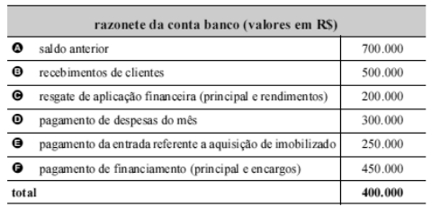{largura=38%}

Considerando a tabela acima, que representa a movimentação ocorrida no último mês no disponível da empresa Exata, julgue o item que se segue.

Pelos valores registrados na conta, infere-se que a empresa, durante o exercício social, apresentou despesas financeiras maiores que as receitas financeiras.

- Gabarito: ERRADO
- Resolução: a caminho

## F0739 · CEBRASPE · 2004 · PF · CE
- Fontes: TecConcursos 739 (31875)
- Prova: CEBRASPE (CESPE) - Tec Contab (PF)/PF/2004
- Grupos: lucro-liquido

{largura=35%}

Considerando as contas mostradas acima, incluídas no balancete de verificação da empresa Tróia antes do encerramento do primeiro exercício social, julgue o item que se segue.

Eventuais reversões de provisão para clientes de liquidação duvidosa são classificadas adequadamente como itens operacionais na demonstração do resultado do exercício.

- Gabarito: CERTO
- Resolução: a caminho

## F0740 · CEBRASPE · 2004 · PF · CE
- Fontes: TecConcursos 740 (31876)
- Prova: CEBRASPE (CESPE) - Tec Contab (PF)/PF/2004
- Grupos: resultado-operacional

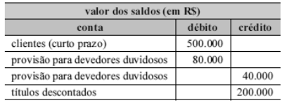{largura=35%}

Considerando as contas mostradas acima, incluídas no balancete de verificação da empresa Tróia antes do encerramento do primeiro exercício social, julgue o item que se segue.

Um título baixado contra uma provisão constituída no ano 1, que venha a ser recebido após o ano 5, aumentará o resultado operacional da empresa no exercício do recebimento.

- Gabarito: ERRADO
- Resolução: a caminho

## F0741 · CEBRASPE · 2004 · PF · CE
- Fontes: TecConcursos 741 (31885)
- Prova: CEBRASPE (CESPE) - Tec Contab (PF)/PF/2004
- Grupos: resultado-financeiro

Ernesto, proprietário da firma Entregas Rápidas, alienou, por R$ 15.000,00, três motocicletas, adquiridas dois anos antes. Outra motocicleta, adquirida junto com as demais, sofreu um acidente e tornou-se um bem imprestável. O valor médio de mercado de cada uma dessas motocicletas, na data da alienação, é R$ 4.500,00, valor igual ao custo de aquisição.

Com base nessa situação hipotética, julgue o seguinte item.

Em conseqüência desses fatos, o resultado financeiro da empresa foi reduzido em R$ 3.000,00.

- Gabarito: ERRADO
- Resolução: a caminho

## F0742 · CEBRASPE · 2004 · PF · CE
- Fontes: TecConcursos 742 (31886)
- Prova: CEBRASPE (CESPE) - Tec Contab (PF)/PF/2004
- Grupos: lucro-liquido

Ernesto, proprietário da firma Entregas Rápidas, alienou, por R$ 15.000,00, três motocicletas, adquiridas dois anos antes. Outra motocicleta, adquirida junto com as demais, sofreu um acidente e tornou-se um bem imprestável. O valor médio de mercado de cada uma dessas motocicletas, na data da alienação, é R$ 4.500,00, valor igual ao custo de aquisição.

Com base nessa situação hipotética, julgue o seguinte item.

Considerando que a motocicleta acidentada teve perda total, o lucro líquido da firma sofreu uma redução de R$ 4.500,00.

- Gabarito: ERRADO
- Resolução: a caminho

## F0743 · CEBRASPE · 2004 · PF · CE
- Fontes: TecConcursos 743 (31890)
- Prova: CEBRASPE (CESPE) - Tec Contab (PF)/PF/2004
- Grupos: resultado-financeiro

O saldo do estoque da empresa Águas Furtadas, avaliado em R$ 8.000,00 na data 1, foi calculado em R$ 10.000,00 na data 2. No mesmo período, as contas de resultado da empresa apresentaram os seguintes saldos.

{largura=35%}

Considerando as informações acima e as despesas financeiras como operacionais, julgue o item a seguir.

As receitas líquidas são iguais a R$ 78.250,00.

- Gabarito: ERRADO
- Resolução: a caminho

## F0744 · CEBRASPE · 2004 · PF · CE
- Fontes: TecConcursos 744 (31891)
- Prova: CEBRASPE (CESPE) - Tec Contab (PF)/PF/2004
- Grupos: resultado-financeiro, cmv

O saldo do estoque da empresa Águas Furtadas, avaliado em R$ 8.000,00 na data 1, foi calculado em R$ 10.000,00 na data 2. No mesmo período, as contas de resultado da empresa apresentaram os seguintes saldos.

{largura=35%}

Considerando as informações acima e as despesas financeiras como operacionais, julgue o item a seguir.

O custo da mercadoria vendida é igual a R$ 34.750,00.

- Gabarito: ERRADO
- Resolução: a caminho

## F0745 · CEBRASPE · 2004 · PF · CE
- Fontes: TecConcursos 745 (31893)
- Prova: CEBRASPE (CESPE) - Tec Contab (PF)/PF/2004
- Grupos: resultado-bruto, resultado-financeiro

O saldo do estoque da empresa Águas Furtadas, avaliado em R$ 8.000,00 na data 1, foi calculado em R$ 10.000,00 na data 2. No mesmo período, as contas de resultado da empresa apresentaram os seguintes saldos.

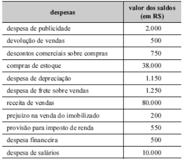{largura=35%}

Considerando as informações acima e as despesas financeiras como operacionais, julgue o item a seguir.

O lucro bruto do período situa-se entre R$ 28.000,00 e R$ 32.000,00.

- Gabarito: ERRADO
- Resolução: a caminho

## F0746 · CEBRASPE · 2004 · PF · CE
- Fontes: TecConcursos 746 (32350)
- Prova: CEBRASPE (CESPE) - Cont (PF)/PF/2004
- Grupos: lucro-liquido, fora-destinacao

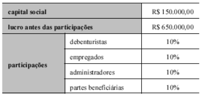{largura=35%}

Acerca da destinação do resultado e com base nas informações acima, relativas a uma empresa e a um período hipotéticos, julgue o item seguinte.

No período considerado, o valor do lucro líquido apurado dessa empresa foi igual a R$ 325.000,00

- Gabarito: ERRADO
- Resolução: a caminho

## F0747 · CEBRASPE · 2004 · PF · CE
- Fontes: TecConcursos 747 (32351)
- Prova: CEBRASPE (CESPE) - Cont (PF)/PF/2004
- Grupos: fora-destinacao

{largura=35%}

Acerca da destinação do resultado e com base nas informações acima, relativas a uma empresa e a um período hipotéticos, julgue o item seguinte.

No período considerado, o valor da reserva legal dessa empresa foi superior a R$ 20.000,00

- Gabarito: CERTO
- Resolução: a caminho

## F0748 · CEBRASPE · 2004 · ANATEL · CE
- Fontes: TecConcursos 748 (92087)
- Prova: CEBRASPE (CESPE) - AA (ANATEL)/ANATEL/Contabilidade/2004
- Grupos: cmv, ir-csll, fora-destinacao, receita-bruta, despesas-administrativas, deducoes, lucro-liquido

balancete de 30/11/2003 em R$ mil ativo

| Conta | Valor |
|---|---:|
| caixa | 5.000 |
| clientes | 20.000 |
| estoques | 50.000 |
| ICMS a recuperar | 6.000 |
| veículos | 6.000 |
| imóveis | 6.000 |
| (-) depreciação acumulada | (2.000) |
| total do ativo | 91.000 |

passivo

| Conta | Valor |
|---|---:|
| empréstimos | 5.000 |
| ICMS a recolher | 8.000 |
| receitas de vendas | 70.000 |
| CMV | (28.000) |
| ICMS | (12.000) |
| PIS/PASEP | (1.000) |
| COFINS | (4.000) |
| capital | 53.000 |
| total do passivo | 91.000 |

operações realizadas em dezembro 2003 valores (em R$ mil)

| Conta | Valor |
|---|---:|
| compra de mercadorias¹ | 10.000 |
| venda de mercadorias¹ | 30.000 |
| contratação de serviços de terceiros² | 40.000 |

¹ Valor da nota fiscal, o ICMS é de 17% para os produtos comercializados pela Cia. Beta. ² Para os serviços contratados, foi retido 1,5% de IRRF. outras informações

| Conta | Valor |
|---|---:|
| imposto de renda | 25% |
| contribuição social | 9% |
| PIS/PASEP | 0,65% |
| COFINS | 4% |
| reserva legal | 5% |
| reserva estatutária | 3% |
| dividendos | 50% |

estoque final em dezembro 2003, em R$ mil 51.000 A gestão tributária ou de imposto é uma das funções mais relevantes das entidades econômico-administrativas. Um analista administrativo da área contábil deve estar afinado com as questões tributárias para melhor subsidiar os gestores em decisões que envolvam impostos ou taxas. Outro fator relevante é a destinação do lucro, que também sofre com os impactos tributários. Com base nas tabelas acima, que discriminam diversas informações contábeis de uma empresa hipotética, denominada Cia. Beta, julgue o item subseqüente.

Efetuadas todas as contabilizações, o lucro da Cia. Beta será de R$ 27.195 mil, valor que será evidenciado na demonstração do resultado do exercício.

- Gabarito: CERTO
- Resolução: a caminho

## F0749 · CEBRASPE · 2004 · ANATEL · CE
- Fontes: TecConcursos 749 (92090)
- Prova: CEBRASPE (CESPE) - AA (ANATEL)/ANATEL/Contabilidade/2004
- Grupos: cmv, ir-csll, fora-destinacao, receita-bruta, despesas-administrativas, deducoes

balancete de 30/11/2003 em R$ mil ativo

| Conta | Valor |
|---|---:|
| caixa | 5.000 |
| clientes | 20.000 |
| estoques | 50.000 |
| ICMS a recuperar | 6.000 |
| veículos | 6.000 |
| imóveis | 6.000 |
| (-) depreciação acumulada | (2.000) |
| total do ativo | 91.000 |

passivo

| Conta | Valor |
|---|---:|
| empréstimos | 5.000 |
| ICMS a recolher | 8.000 |
| receitas de vendas | 70.000 |
| CMV | (28.000) |
| ICMS | (12.000) |
| PIS/PASEP | (1.000) |
| COFINS | (4.000) |
| capital | 53.000 |
| total do passivo | 91.000 |

operações realizadas em dezembro 2003 valores (em R$ mil)

| Conta | Valor |
|---|---:|
| compra de mercadorias¹ | 10.000 |
| venda de mercadorias¹ | 30.000 |
| contratação de serviços de terceiros² | 40.000 |

¹ Valor da nota fiscal, o ICMS é de 17% para os produtos comercializados pela Cia. Beta. ² Para os serviços contratados, foi retido 1,5% de IRRF. outras informações

| Conta | Valor |
|---|---:|
| imposto de renda | 25% |
| contribuição social | 9% |
| PIS/PASEP | 0,65% |
| COFINS | 4% |
| reserva legal | 5% |
| reserva estatutária | 3% |
| dividendos | 50% |

estoque final em dezembro 2003, em R$ mil 51.000 A gestão tributária ou de imposto é uma das funções mais relevantes das entidades econômico-administrativas. Um analista administrativo da área contábil deve estar afinado com as questões tributárias para melhor subsidiar os gestores em decisões que envolvam impostos ou taxas. Outro fator relevante é a destinação do lucro, que também sofre com os impactos tributários. Com base nas tabelas acima, que discriminam diversas informações contábeis de uma empresa hipotética, denominada Cia. Beta, julgue o item subseqüente.

A reserva legal e a reserva estatutária são despesas que serão deduzidas da base de cálculo do imposto de renda e da contribuição social.

- Gabarito: ERRADO
- Resolução: a caminho

## F0750 · CEBRASPE · 2004 · ANATEL · CE
- Fontes: TecConcursos 750 (92161)
- Prova: CEBRASPE (CESPE) - ERSPT (ANATEL)/ANATEL/Geral (Ciências Exatas ou Humanas)/2004
- Grupos: resultado-operacional, resultado-financeiro, participacoes, ir-csll, lucro-liquido, deducoes, despesas-administrativas, cmv, receita-bruta, despesas-operacionais, outras-operacionais, outras-receitas-despesas

item final do ano 2 final do ano 1 ações em tesouraria 90.934

capital social 4.141.599

custo dos serviços prestados

5.294.442 deduções da receita bruta

2.723.588 despesas de comercialização

885.726 despesas financeiras

369.850 despesas gerais e administrativas

835.782 imposto de renda e contribuição social

174.638 lucro líquido do exercício 721.312 472.135 lucro operacional do exercício 727.520

lucros acumulados

2.407.234 outras despesas operacionais

118.636 participação dos empregados no 90.934 64.831 participação minoritária

257.216 receitas financeiras

330.382 receitas não-operacionais líquidas

15.884 reserva de capital 862.873

reserva de lucros 2.636.242 229.008 Com base nas tabelas acima, que apresentam dados contábeis, em reais, de uma empresa operadora de serviços de telecomunicações com concessão para exploração de serviço telefônico fixo comutado, julgue o item a seguir.

No primeiro período, a empresa apresentou margem operacional superior a 10%.

- Gabarito: CERTO
- Resolução: a caminho

## F0751 · CEBRASPE · 2004 · ANATEL · CE
- Fontes: TecConcursos 751 (92162)
- Prova: CEBRASPE (CESPE) - ERSPT (ANATEL)/ANATEL/Geral (Ciências Exatas ou Humanas)/2004
- Grupos: resultado-operacional, resultado-financeiro, participacoes, ir-csll, lucro-liquido, deducoes, despesas-administrativas, cmv, receita-bruta, despesas-operacionais, outras-operacionais, outras-receitas-despesas

item final do ano 2 final do ano 1 ações em tesouraria 90.934

capital social 4.141.599

custo dos serviços prestados

5.294.442 deduções da receita bruta

2.723.588 despesas de comercialização

885.726 despesas financeiras

369.850 despesas gerais e administrativas

835.782 imposto de renda e contribuição social

174.638 lucro líquido do exercício 721.312 472.135 lucro operacional do exercício 727.520

lucros acumulados

2.407.234 outras despesas operacionais

118.636 participação dos empregados no 90.934 64.831 participação minoritária

257.216 receitas financeiras

330.382 receitas não-operacionais líquidas

15.884 reserva de capital 862.873

reserva de lucros 2.636.242 229.008 Com base nas tabelas acima, que apresentam dados contábeis, em reais, de uma empresa operadora de serviços de telecomunicações com concessão para exploração de serviço telefônico fixo comutado, julgue o item a seguir.

No ano 1, a demonstração do resultado do exercício apresentou receita operacional bruta igual a R$ 10.850.578,00. 

- Gabarito: CERTO
- Resolução: a caminho

## F0752 · CEBRASPE · 2004 · ANATEL · CE
- Fontes: TecConcursos 752 (92163)
- Prova: CEBRASPE (CESPE) - ERSPT (ANATEL)/ANATEL/Geral (Ciências Exatas ou Humanas)/2004
- Grupos: resultado-bruto, resultado-operacional, resultado-financeiro, participacoes, ir-csll, lucro-liquido, deducoes, despesas-administrativas, cmv, receita-bruta, despesas-operacionais, outras-operacionais, outras-receitas-despesas

item final do ano 2 final do ano 1 ações em tesouraria 90.934

capital social 4.141.599

custo dos serviços prestados

5.294.442 deduções da receita bruta

2.723.588 despesas de comercialização

885.726 despesas financeiras

369.850 despesas gerais e administrativas

835.782 imposto de renda e contribuição social

174.638 lucro líquido do exercício 721.312 472.135 lucro operacional do exercício 727.520

lucros acumulados

2.407.234 outras despesas operacionais

118.636 participação dos empregados no 90.934 64.831 participação minoritária

257.216 receitas financeiras

330.382 receitas não-operacionais líquidas

15.884 reserva de capital 862.873

reserva de lucros 2.636.242 229.008 Com base nas tabelas acima, que apresentam dados contábeis, em reais, de uma empresa operadora de serviços de telecomunicações com concessão para exploração de serviço telefônico fixo comutado, julgue o item a seguir.

O lucro operacional — após o resultado financeiro —, no ano 1, é igual a R$ 952.936,00 e o lucro bruto é inferior a R$ 980.000,00.

- Gabarito: ERRADO
- Resolução: a caminho

## F0753 · CEBRASPE · 2004 · ANATEL · CE
- Fontes: TecConcursos 753 (92165)
- Prova: CEBRASPE (CESPE) - ERSPT (ANATEL)/ANATEL/Geral (Ciências Exatas ou Humanas)/2004
- Grupos: resultado-operacional, resultado-financeiro, participacoes, ir-csll, lucro-liquido, deducoes, despesas-administrativas, cmv, receita-bruta, despesas-operacionais, outras-operacionais, outras-receitas-despesas

item final do ano 2 final do ano 1 ações em tesouraria 90.934

capital social 4.141.599

custo dos serviços prestados

5.294.442 deduções da receita bruta

2.723.588 despesas de comercialização

885.726 despesas financeiras

369.850 despesas gerais e administrativas

835.782 imposto de renda e contribuição social

174.638 lucro líquido do exercício 721.312 472.135 lucro operacional do exercício 727.520

lucros acumulados

2.407.234 outras despesas operacionais

118.636 participação dos empregados no 90.934 64.831 participação minoritária

257.216 receitas financeiras

330.382 receitas não-operacionais líquidas

15.884 reserva de capital 862.873

reserva de lucros 2.636.242 229.008 Com base nas tabelas acima, que apresentam dados contábeis, em reais, de uma empresa operadora de serviços de telecomunicações com concessão para exploração de serviço telefônico fixo comutado, julgue o item a seguir.

Considerando que as despesas financeiras do ano 1 foram juros incorridos e pagos no período, então a despesa de R$ 369.850,00 representa, para a empresa, juros reais.

- Gabarito: ERRADO
- Resolução: a caminho

## F0754 · CEBRASPE · 2004 · TRT 10 · CE
- Fontes: TecConcursos 754 (111081)
- Prova: CEBRASPE (CESPE) - AJ TRT10/TRT 10/Administrativa/"Sem Especialidade"/2004
- Grupos: resultado-bruto, deducoes, receita-bruta, lucro-liquido, despesas-vendas, resultado-financeiro

conta valores (em R$)

| Conta | Valor |
|---|---:|
| vendas | 500.000 |
| abatimentos sobre compras | 20.000 |
| comissões sobre vendas | 50.000 |
| fretes sobre compras | 10.000 |
| anulações de compras | 20.000 |
| estoque inicial de mercadorias | 150.000 |
| descontos financeiros sobre compras | 15.000 |
| contribuições incidentes sobre vendas | 40.000 |
| devoluções de vendas | 30.000 |
| compras | 250.000 |

não havia estoque final

Antes da apuração do resultado do exercício, os saldos de algumas contas de uma empresa que tem como objeto a compra e venda de mercadorias eram os especificados no quadro acima. Com base nesses dados, julgue o item seguinte.

O lucro bruto da empresa foi de R$ 25.000,00.

- Gabarito: ERRADO
- Resolução: a caminho

## F0755 · CEBRASPE · 2004 · TCE PE · CE
- Fontes: TecConcursos 755 (197250)
- Prova: CEBRASPE (CESPE) - AUCE (TCE-PE)/TCE PE/Auditoria de Contas Públicas/2004
- Grupos: resultado-financeiro, outras-receitas-despesas

Com referência a registros e demonstrações contábeis, julgue o item seguinte.

De acordo com a Lei n.º 6.404/1976, a receita financeira obtida deve ser classificada como receita não-operacional. No entanto, se a empresa em questão for uma instituição financeira, a receita financeira será considerada operacional.

- Gabarito: ERRADO
- Resolução: a caminho

## F0756 · CEBRASPE · 2004 · TCE PE · CE
- Fontes: TecConcursos 756 (197315)
- Prova: CEBRASPE (CESPE) - AUCE (TCE-PE)/TCE PE/Auditoria de Obras Públicas/2004
- Grupos: deducoes, receita-bruta, despesas-administrativas, despesas-vendas, lucro-liquido, resultado-financeiro

contas Saldo em 31/10/2004

| Conta | Valor |
|---|---:|
| fornecedores | 18.570,00 |
| banco conta movimento | 50.000,00 |
| contas a receber | 35.874,00 |
| energia elétrica a pagar | 993,00 |
| estoque de mercadorias | 25.780,00 |
| material de consumo | 5.870,00 |
| títulos descontados | 12.590,00 |
| lucros ou prejuízos acumulados | 91.121,00 |
| capital social | 27.800,00 |
| provisão para desvalorização de estoques | 2.580,00 |
| depreciação acumulada | 98.785,00 |
| ágio na emissão de debêntures | 10.000,00 |
| receita de vendas | 187.000,00 |
| veículos | 65.879,00 |
| móveis e utensílios | 34.587,00 |
| máquinas e equipamentos | 17.987,00 |
| terrenos | 36.698,00 |
| prédios | 78.598,00 |
| ações de outras companhias | 13.587,00 |
| compras de mercadorias | 58.974,00 |
| despesas de energia elétrica | 993,00 |
| deságio na emissão de debêntures | 12.587,00 |
| empréstimos a pagar | 12.570,00 |
| despesas de aluguel | 2.870,00 |
| salários a pagar | 13.287,00 |
| despesas de manutenção | 4.879,00 |
| fretes sobre compras | 368,00 |
| deduções sobre vendas | 18.790,00 |
| aluguel a pagar | 1.587,00 |
| debêntures a pagar | 87.564,00 |
| despesas de material de consumo | 2.580,00 |
| deduções sobre compras | 1.274,00 |
| despesas de depreciação | 2.000,00 |
| despesa de juros | 158,00 |
| fretes sobre vendas | 1.547,00 |
| seguros sobre compras | 987,00 |
| despesas de salários | 48.700,00 |

Considerando que o saldo inicial da conta estoque de mercadorias da empresa XYZ — à qual se referem as contas, em reais, acima listadas — era de R$ 16.870,00, julgue o item a seguir sob a ótica da apresentação e composição das demonstrações contábeis.

O valor do lucro antes da apuração da demonstração do resultado do exercício é de R$ 17.933,00.

- Gabarito: ERRADO
- Resolução: a caminho

## F0757 · CEBRASPE · 2004 · TCE PE · CE
- Fontes: TecConcursos 757 (197316)
- Prova: CEBRASPE (CESPE) - AUCE (TCE-PE)/TCE PE/Auditoria de Obras Públicas/2004
- Grupos: resultado-bruto, deducoes, receita-bruta, despesas-administrativas, despesas-vendas, resultado-financeiro

contas Saldo em 31/10/2004

| Conta | Valor |
|---|---:|
| fornecedores | 18.570,00 |
| banco conta movimento | 50.000,00 |
| contas a receber | 35.874,00 |
| energia elétrica a pagar | 993,00 |
| estoque de mercadorias | 25.780,00 |
| material de consumo | 5.870,00 |
| títulos descontados | 12.590,00 |
| lucros ou prejuízos acumulados | 91.121,00 |
| capital social | 27.800,00 |
| provisão para desvalorização de estoques | 2.580,00 |
| depreciação acumulada | 98.785,00 |
| ágio na emissão de debêntures | 10.000,00 |
| receita de vendas | 187.000,00 |
| veículos | 65.879,00 |
| móveis e utensílios | 34.587,00 |
| máquinas e equipamentos | 17.987,00 |
| terrenos | 36.698,00 |
| prédios | 78.598,00 |
| ações de outras companhias | 13.587,00 |
| compras de mercadorias | 58.974,00 |
| despesas de energia elétrica | 993,00 |
| deságio na emissão de debêntures | 12.587,00 |
| empréstimos a pagar | 12.570,00 |
| despesas de aluguel | 2.870,00 |
| salários a pagar | 13.287,00 |
| despesas de manutenção | 4.879,00 |
| fretes sobre compras | 368,00 |
| deduções sobre vendas | 18.790,00 |
| aluguel a pagar | 1.587,00 |
| debêntures a pagar | 87.564,00 |
| despesas de material de consumo | 2.580,00 |
| deduções sobre compras | 1.274,00 |
| despesas de depreciação | 2.000,00 |
| despesa de juros | 158,00 |
| fretes sobre vendas | 1.547,00 |
| seguros sobre compras | 987,00 |
| despesas de salários | 48.700,00 |

Considerando que o saldo inicial da conta estoque de mercadorias da empresa XYZ — à qual se referem as contas, em reais, acima listadas — era de R$ 16.870,00, julgue o item a seguir sob a ótica da apresentação e composição das demonstrações contábeis.

O lucro bruto do período é de R$ 136.855,00.

- Gabarito: ERRADO
- Resolução: a caminho

## F0758 · CEBRASPE · 2004 · TCE PE · CE
- Fontes: TecConcursos 758 (197319)
- Prova: CEBRASPE (CESPE) - AUCE (TCE-PE)/TCE PE/Auditoria de Contas Públicas de Saúde/2004
- Grupos: deducoes, receita-bruta, despesas-administrativas, despesas-vendas, resultado-financeiro

contas Saldo em 31/10/2004

| Conta | Valor |
|---|---:|
| fornecedores | 18.570,00 |
| banco conta movimento | 50.000,00 |
| contas a receber | 35.874,00 |
| energia elétrica a pagar | 993,00 |
| estoque de mercadorias | 25.780,00 |
| material de consumo | 5.870,00 |
| títulos descontados | 12.590,00 |
| lucros ou prejuízos acumulados | 91.121,00 |
| capital social | 27.800,00 |
| provisão para desvalorização de estoques | 2.580,00 |
| depreciação acumulada | 98.785,00 |
| ágio na emissão de debêntures | 10.000,00 |
| receita de vendas | 187.000,00 |
| veículos | 65.879,00 |
| móveis e utensílios | 34.587,00 |
| máquinas e equipamentos | 17.987,00 |
| terrenos | 36.698,00 |
| prédios | 78.598,00 |
| ações de outras companhias | 13.587,00 |
| compras de mercadorias | 58.974,00 |
| despesas de energia elétrica | 993,00 |
| deságio na emissão de debêntures | 12.587,00 |
| empréstimos a pagar | 12.570,00 |
| despesas de aluguel | 2.870,00 |
| salários a pagar | 13.287,00 |
| despesas de manutenção | 4.879,00 |
| fretes sobre compras | 368,00 |
| deduções sobre vendas | 18.790,00 |
| aluguel a pagar | 1.587,00 |
| debêntures a pagar | 87.564,00 |
| despesas de material de consumo | 2.580,00 |
| deduções sobre compras | 1.274,00 |
| despesas de depreciação | 2.000,00 |
| despesa de juros | 158,00 |
| fretes sobre vendas | 1.547,00 |
| seguros sobre compras | 987,00 |
| despesas de salários | 48.700,00 |

Considerando que o saldo inicial da conta estoque de mercadorias da empresa XYZ — à qual se referem as contas, em reais, acima listadas — era de R$ 16.870,00, julgue o item a seguir sob a ótica da apresentação e composição das demonstrações contábeis.

O patrimônio líquido, após a apuração da demonstração do resultado, totaliza R$ 128.500,00.

- Gabarito: ERRADO
- Resolução: a caminho

## F0759 · CEBRASPE · 2004 · TRE AL · CE
- Fontes: TecConcursos 759 (405926)
- Prova: CEBRASPE (CESPE) - AJ (TRE AL)/TRE AL/Administrativa/"Sem Especialidade"/2004
- Grupos: receita-bruta, cmv, despesas-administrativas

conta período (valores em R$) dezembro 2002 dezembro 2003 caixa 75.000,00

| Conta | Débito | Crédito |
|---|---:|---:|
| clientes | 50.000,00 | 35.000,00 |
| despesa antecipada de aluguel | 38.000,00 | 25.000,00 |
| despesa antecipada de seguros | 18.000,00 | 12.000,00 |
| despesa de salários | 50.000,00 | 65.000,00 |
| despesa de aluguel | 12.000,00 | 18.000,00 |
| receita de vendas | 90.000,00 | 180.000,00 |
| salários a pagar | 5.000,00 | 4.500,00 |
| estoque de mercadorias | 35.000,00 | 50.000,00 |
| custo da mercadoria vendida | 32.000,00 | 55.000,00 |
| fornecedores | 18.000,00 | 35.000,00 |
| receita antecipada | 10.000,00 | 5.000,00 |
| aluguel a pagar | 4.000,00 | 2.000,00 |

Quando se elabora as demonstrações contábeis, busca-se a melhor evidenciação dos eventos. Para representar adequadamente a realidade econômico-financeira da empresa, há a necessidade de se efetuar registros contábeis em forma de lançamentos. Acerca dos lançamentos, regimes de registro e componentes do patrimônio, julgue o item seguinte, relativo à contabilidade de determinada empresa, da qual alguns dados são apresentados no quadro acima.

De acordo com as informações do quadro, o valor recebido pela empresa no ano de 2003 corresponde a R$ 190.000,00.

- Gabarito: CERTO
- Resolução: a caminho

## F0760 · CEBRASPE · 2004 · TRE AL · CE
- Fontes: TecConcursos 760 (405927)
- Prova: CEBRASPE (CESPE) - AJ (TRE AL)/TRE AL/Administrativa/"Sem Especialidade"/2004
- Grupos: receita-bruta, cmv, despesas-administrativas

conta período (valores em R$) dezembro 2002 dezembro 2003 caixa 75.000,00

| Conta | Débito | Crédito |
|---|---:|---:|
| clientes | 50.000,00 | 35.000,00 |
| despesa antecipada de aluguel | 38.000,00 | 25.000,00 |
| despesa antecipada de seguros | 18.000,00 | 12.000,00 |
| despesa de salários | 50.000,00 | 65.000,00 |
| despesa de aluguel | 12.000,00 | 18.000,00 |
| receita de vendas | 90.000,00 | 180.000,00 |
| salários a pagar | 5.000,00 | 4.500,00 |
| estoque de mercadorias | 35.000,00 | 50.000,00 |
| custo da mercadoria vendida | 32.000,00 | 55.000,00 |
| fornecedores | 18.000,00 | 35.000,00 |
| receita antecipada | 10.000,00 | 5.000,00 |
| aluguel a pagar | 4.000,00 | 2.000,00 |

Quando se elabora as demonstrações contábeis, busca-se a melhor evidenciação dos eventos. Para representar adequadamente a realidade econômico-financeira da empresa, há a necessidade de se efetuar registros contábeis em forma de lançamentos. Acerca dos lançamentos, regimes de registro e componentes do patrimônio, julgue o item seguinte, relativo à contabilidade de determinada empresa, da qual alguns dados são apresentados no quadro acima.

No ano de 2003, a empresa despendeu um total de R$ 2.000,00 em aluguéis.

- Gabarito: ERRADO
- Resolução: a caminho

## F0761 · CEBRASPE · 2004 · TERRACAP · CE
- Fontes: TecConcursos 761 (443125)
- Prova: CEBRASPE (CESPE) - Cont (TERRACAP)/TERRACAP/2004
- Grupos: cmv, deducoes, receita-bruta, despesas-administrativas, despesas-vendas, outras-operacionais

conta valor (em R$)

| Conta | Valor |
|---|---:|
| caixa | 35.000 |
| clientes | 28.000 |
| terrenos | 34.630 |
| veículos | 14.870 |
| fornecedores | 3.580 |
| capital social | 78.500 |
| contas a pagar | 4.789 |
| despesas gerais | 1.800 |
| receita de vendas | 180.000 |
| reserva de capital | 3.500 |
| receita antecipada | 3.590 |
| prédios e construções | 18.500 |
| despesas com salários | 7.800 |
| depreciação acumulada | 8.500 |
| duplicatas descontadas | 15.400 |
| despesas com seguros | 990 |
| despesas com provisões | 5.200 |
| despesa com depreciação | 4.100 |
| debêntures de curto prazo | 9.870 |
| debêntures de longo prazo | 28.900 |
| provisão para contingências | 1.130 |
| despesa com energia elétrica | 850 |
| lucros ou prejuízos acumulados | 3.859 |
| contas a receber de longo prazo | 40.000 |
| deduções sobre receita de vendas | 14.400 |
| fretes sobre vendas de mercadorias | 2.500 |
| provisão para devedores duvidosos | 2.580 |
| fretes sobre compras de mercadorias | 795 |
| aquisição de mercadorias para revenda | 12.500 |
| seguros sobre compras de mercadorias | 589 |
| devolução de mercadorias para revenda | 1.100 |
| estoque final de mercadorias para revenda | 7.850 |
| estoque inicial de mercadorias para revenda | 50.000 |

Considerando as informações apresentadas no quadro acima, julgue o item a seguir.

O custo das mercadorias vendidas é de R$ 54.934.

- Gabarito: CERTO
- Resolução: a caminho

## F0762 · CEBRASPE · 2004 · TERRACAP · CE
- Fontes: TecConcursos 762 (443135)
- Prova: CEBRASPE (CESPE) - Cont (TERRACAP)/TERRACAP/2004
- Grupos: resultado-bruto, deducoes, receita-bruta, despesas-administrativas, despesas-vendas, outras-operacionais

conta valor (em R$)

| Conta | Valor |
|---|---:|
| caixa | 35.000 |
| clientes | 28.000 |
| terrenos | 34.630 |
| veículos | 14.870 |
| fornecedores | 3.580 |
| capital social | 78.500 |
| contas a pagar | 4.789 |
| despesas gerais | 1.800 |
| receita de vendas | 180.000 |
| reserva de capital | 3.500 |
| receita antecipada | 3.590 |
| prédios e construções | 18.500 |
| despesas com salários | 7.800 |
| depreciação acumulada | 8.500 |
| duplicatas descontadas | 15.400 |
| despesas com seguros | 990 |
| despesas com provisões | 5.200 |
| despesa com depreciação | 4.100 |
| debêntures de curto prazo | 9.870 |
| debêntures de longo prazo | 28.900 |
| provisão para contingências | 1.130 |
| despesa com energia elétrica | 850 |
| lucros ou prejuízos acumulados | 3.859 |
| contas a receber de longo prazo | 40.000 |
| deduções sobre receita de vendas | 14.400 |
| fretes sobre vendas de mercadorias | 2.500 |
| provisão para devedores duvidosos | 2.580 |
| fretes sobre compras de mercadorias | 795 |
| aquisição de mercadorias para revenda | 12.500 |
| seguros sobre compras de mercadorias | 589 |
| devolução de mercadorias para revenda | 1.100 |
| estoque final de mercadorias para revenda | 7.850 |
| estoque inicial de mercadorias para revenda | 50.000 |

Considerando as informações apresentadas no quadro acima, julgue o item a seguir.

O lucro bruto é igual a R$ 110.666.

- Gabarito: CERTO
- Resolução: a caminho

## F0763 · CEBRASPE · 2004 · TERRACAP · CE
- Fontes: TecConcursos 763 (443136)
- Prova: CEBRASPE (CESPE) - Cont (TERRACAP)/TERRACAP/2004
- Grupos: deducoes, receita-bruta, despesas-administrativas, despesas-vendas, outras-operacionais

conta valor (em R$)

| Conta | Valor |
|---|---:|
| caixa | 35.000 |
| clientes | 28.000 |
| terrenos | 34.630 |
| veículos | 14.870 |
| fornecedores | 3.580 |
| capital social | 78.500 |
| contas a pagar | 4.789 |
| despesas gerais | 1.800 |
| receita de vendas | 180.000 |
| reserva de capital | 3.500 |
| receita antecipada | 3.590 |
| prédios e construções | 18.500 |
| despesas com salários | 7.800 |
| depreciação acumulada | 8.500 |
| duplicatas descontadas | 15.400 |
| despesas com seguros | 990 |
| despesas com provisões | 5.200 |
| despesa com depreciação | 4.100 |
| debêntures de curto prazo | 9.870 |
| debêntures de longo prazo | 28.900 |
| provisão para contingências | 1.130 |
| despesa com energia elétrica | 850 |
| lucros ou prejuízos acumulados | 3.859 |
| contas a receber de longo prazo | 40.000 |
| deduções sobre receita de vendas | 14.400 |
| fretes sobre vendas de mercadorias | 2.500 |
| provisão para devedores duvidosos | 2.580 |
| fretes sobre compras de mercadorias | 795 |
| aquisição de mercadorias para revenda | 12.500 |
| seguros sobre compras de mercadorias | 589 |
| devolução de mercadorias para revenda | 1.100 |
| estoque final de mercadorias para revenda | 7.850 |
| estoque inicial de mercadorias para revenda | 50.000 |

Considerando as informações apresentadas no quadro acima, julgue o item a seguir.

A margem bruta é inferior a 60%.

- Gabarito: ERRADO
- Resolução: a caminho

## F0764 · CEBRASPE · 2004 · TERRACAP · CE
- Fontes: TecConcursos 764 (443139)
- Prova: CEBRASPE (CESPE) - Cont (TERRACAP)/TERRACAP/2004
- Grupos: deducoes, receita-bruta, despesas-administrativas, despesas-vendas, outras-operacionais

conta valor (em R$)

| Conta | Valor |
|---|---:|
| caixa | 35.000 |
| clientes | 28.000 |
| terrenos | 34.630 |
| veículos | 14.870 |
| fornecedores | 3.580 |
| capital social | 78.500 |
| contas a pagar | 4.789 |
| despesas gerais | 1.800 |
| receita de vendas | 180.000 |
| reserva de capital | 3.500 |
| receita antecipada | 3.590 |
| prédios e construções | 18.500 |
| despesas com salários | 7.800 |
| depreciação acumulada | 8.500 |
| duplicatas descontadas | 15.400 |
| despesas com seguros | 990 |
| despesas com provisões | 5.200 |
| despesa com depreciação | 4.100 |
| debêntures de curto prazo | 9.870 |
| debêntures de longo prazo | 28.900 |
| provisão para contingências | 1.130 |
| despesa com energia elétrica | 850 |
| lucros ou prejuízos acumulados | 3.859 |
| contas a receber de longo prazo | 40.000 |
| deduções sobre receita de vendas | 14.400 |
| fretes sobre vendas de mercadorias | 2.500 |
| provisão para devedores duvidosos | 2.580 |
| fretes sobre compras de mercadorias | 795 |
| aquisição de mercadorias para revenda | 12.500 |
| seguros sobre compras de mercadorias | 589 |
| devolução de mercadorias para revenda | 1.100 |
| estoque final de mercadorias para revenda | 7.850 |
| estoque inicial de mercadorias para revenda | 50.000 |

Considerando as informações apresentadas no quadro acima, julgue o item a seguir.

A margem líquida apurada é superior a 50%.

- Gabarito: CERTO
- Resolução: a caminho

## F0765 · CEBRASPE · 2004 · TERRACAP · CE
- Fontes: TecConcursos 765 (443141)
- Prova: CEBRASPE (CESPE) - Cont (TERRACAP)/TERRACAP/2004
- Grupos: deducoes, receita-bruta, despesas-administrativas, despesas-vendas, outras-operacionais

conta valor (em R$)

| Conta | Valor |
|---|---:|
| caixa | 35.000 |
| clientes | 28.000 |
| terrenos | 34.630 |
| veículos | 14.870 |
| fornecedores | 3.580 |
| capital social | 78.500 |
| contas a pagar | 4.789 |
| despesas gerais | 1.800 |
| receita de vendas | 180.000 |
| reserva de capital | 3.500 |
| receita antecipada | 3.590 |
| prédios e construções | 18.500 |
| despesas com salários | 7.800 |
| depreciação acumulada | 8.500 |
| duplicatas descontadas | 15.400 |
| despesas com seguros | 990 |
| despesas com provisões | 5.200 |
| despesa com depreciação | 4.100 |
| debêntures de curto prazo | 9.870 |
| debêntures de longo prazo | 28.900 |
| provisão para contingências | 1.130 |
| despesa com energia elétrica | 850 |
| lucros ou prejuízos acumulados | 3.859 |
| contas a receber de longo prazo | 40.000 |
| deduções sobre receita de vendas | 14.400 |
| fretes sobre vendas de mercadorias | 2.500 |
| provisão para devedores duvidosos | 2.580 |
| fretes sobre compras de mercadorias | 795 |
| aquisição de mercadorias para revenda | 12.500 |
| seguros sobre compras de mercadorias | 589 |
| devolução de mercadorias para revenda | 1.100 |
| estoque final de mercadorias para revenda | 7.850 |
| estoque inicial de mercadorias para revenda | 50.000 |

Considerando as informações apresentadas no quadro acima, julgue o item a seguir.

Antes da apuração do resultado do período, havia R$ 68.915 de prejuízo acumulado.

- Gabarito: CERTO
- Resolução: a caminho

## F0766 · CEBRASPE · 2004 · TERRACAP · CE
- Fontes: TecConcursos 766 (443146)
- Prova: CEBRASPE (CESPE) - Cont (TERRACAP)/TERRACAP/2004
- Grupos: fora-destinacao

Acerca da destinação do resultado e dos procedimentos contábeis, segundo a Lei n.º 6.404/1976 e a legislação complementar, julgue o item seguinte.

A contabilização do montante dos lucros atribuído às partes beneficiárias deverá ser feita em conta de patrimônio.

- Gabarito: ERRADO
- Resolução: a caminho

## F0767 · CEBRASPE · 2004 · SECONT ES · CE
- Fontes: TecConcursos 767 (1337884)
- Prova: CEBRASPE (CESPE) - Aud Est (SECONT ES)/SECONT ES/Ciências Contábeis/2004
- Grupos: lucro-liquido, fora-destinacao

Julgue o seguinte item, relativo a normas aplicáveis à fusão, à cisão e incorporação de empresas e a destinação/registro de lucros.

Os lucros auferidos no exterior, por intermédio de filiais ou sucursais, controladas ou coligadas, serão adicionados ao lucro líquido, para a determinação do lucro real correspondente ao balanço levantado no dia 31 de dezembro do ano-calendário em que tiverem sido disponibilizados para a pessoa jurídica domiciliada no Brasil.

- Gabarito: CERTO
- Resolução: a caminho

## F0768 · CEBRASPE · 2004 · PG DF · CE
- Fontes: TecConcursos 768 (1340707)
- Prova: CEBRASPE (CESPE) - AJ (PGDF)/PG DF/Contador/2004
- Grupos: participacoes, fora-destinacao, lucro-liquido

Considerando as peculiaridades da Lei n.º 6.404/1976 e da destinação do resultado, julgue o item que se segue.

As participações estatutárias serão registradas a débito do resultado e a crédito do passivo circulante ou do ativo circulante disponível. Seu registro reduzirá o resultado da demonstração do resultado do exercício independentemente de seu pagamento.

- Gabarito: CERTO
- Resolução: a caminho

## F0769 · CEBRASPE · 2004 · TCE ES · CE
- Fontes: TecConcursos 769 (1341424)
- Prova: CEBRASPE (CESPE) - ACE (TCE ES)/TCE ES/Ciências Contábeis/2004
- Grupos: resultado-financeiro, deducoes, receita-bruta, cmv, despesas-administrativas, despesas-vendas

conta saldo (em R$)

| Conta | Valor |
|---|---:|
| banco | 34.000 |
| receita antecipada | 25.000 |
| material de consumo | 5.500 |
| receita de vendas | 50.000 |
| devolução de compras | 10.000 |
| energia elétrica a pagar | 500 |
| despesa com energia elétrica | 700 |
| despesa com salários | 5.000 |
| despesa com seguros | 680 |
| despesa com aluguel | 1.800 |

despesa antecipada com assinatura de

| Conta | Valor |
|---|---:|
| revistas | 580 |
| prédios | 25.000 |
| veículos | 16.000 |
| depreciação acumulada | 8.000 |
| capital social | 48.000 |
| fretes sobre compras | 900 |
| estoque inicial | 30.000 |
| despesas financeiras | 900 |
| aquisição de mercadorias | 50.000 |
| estoque final | 60.000 |
| seguro sobre compras | 500 |
| duplicatas a receber | 5.000 |
| fornecedores | 10.000 |
| provisão para contingências | 1.900 |
| provisão para devedores duvidosos | 890 |
| deduções de receitas | 200 |
| receitas financeiras | 1.900 |
| deduções sobre vendas | 1.000 |
| reservas | 5.000 |
| despesas com material de consumo | 600 |
| despesas com depreciação | 450 |

Com relação ao balancete apresentado acima, julgue o item seguinte, considerando o que preconiza a Lei das Sociedades por Ações (Lei n.º 6.404/1976).

O valor apurado do custo da mercadoria vendida é de R$ 11.400,00.

- Gabarito: CERTO
- Resolução: a caminho

## F0770 · CEBRASPE · 2004 · TCE ES · CE
- Fontes: TecConcursos 770 (1341425)
- Prova: CEBRASPE (CESPE) - ACE (TCE ES)/TCE ES/Ciências Contábeis/2004
- Grupos: resultado-financeiro, deducoes, receita-bruta, despesas-administrativas, despesas-vendas

conta saldo (em R$)

| Conta | Valor |
|---|---:|
| banco | 34.000 |
| receita antecipada | 25.000 |
| material de consumo | 5.500 |
| receita de vendas | 50.000 |
| devolução de compras | 10.000 |
| energia elétrica a pagar | 500 |
| despesa com energia elétrica | 700 |
| despesa com salários | 5.000 |
| despesa com seguros | 680 |
| despesa com aluguel | 1.800 |

despesa antecipada com assinatura de

| Conta | Valor |
|---|---:|
| revistas | 580 |
| prédios | 25.000 |
| veículos | 16.000 |
| depreciação acumulada | 8.000 |
| capital social | 48.000 |
| fretes sobre compras | 900 |
| estoque inicial | 30.000 |
| despesas financeiras | 900 |
| aquisição de mercadorias | 50.000 |
| estoque final | 60.000 |
| seguro sobre compras | 500 |
| duplicatas a receber | 5.000 |
| fornecedores | 10.000 |
| provisão para contingências | 1.900 |
| provisão para devedores duvidosos | 890 |
| deduções de receitas | 200 |
| receitas financeiras | 1.900 |
| deduções sobre vendas | 1.000 |
| reservas | 5.000 |
| despesas com material de consumo | 600 |
| despesas com depreciação | 450 |

Com relação ao balancete apresentado acima, julgue o item seguinte, considerando o que preconiza a Lei das Sociedades por Ações (Lei n.º 6.404/1976).

O valor do lucro acumulado, antes da apuração do resultado do período, é igual a R$ 17.620,00.

- Gabarito: CERTO
- Resolução: a caminho

## F0771 · CEBRASPE · 2004 · TCE ES · CE
- Fontes: TecConcursos 771 (1341433)
- Prova: CEBRASPE (CESPE) - ACE (TCE ES)/TCE ES/Ciências Contábeis/2004
- Grupos: receita-liquida, resultado-financeiro, deducoes, receita-bruta, despesas-administrativas, despesas-vendas

conta saldo (em R$)

| Conta | Valor |
|---|---:|
| banco | 34.000 |
| receita antecipada | 25.000 |
| material de consumo | 5.500 |
| receita de vendas | 50.000 |
| devolução de compras | 10.000 |
| energia elétrica a pagar | 500 |
| despesa com energia elétrica | 700 |
| despesa com salários | 5.000 |
| despesa com seguros | 680 |
| despesa com aluguel | 1.800 |

despesa antecipada com assinatura de

| Conta | Valor |
|---|---:|
| revistas | 580 |
| prédios | 25.000 |
| veículos | 16.000 |
| depreciação acumulada | 8.000 |
| capital social | 48.000 |
| fretes sobre compras | 900 |
| estoque inicial | 30.000 |
| despesas financeiras | 900 |
| aquisição de mercadorias | 50.000 |
| estoque final | 60.000 |
| seguro sobre compras | 500 |
| duplicatas a receber | 5.000 |
| fornecedores | 10.000 |
| provisão para contingências | 1.900 |
| provisão para devedores duvidosos | 890 |
| deduções de receitas | 200 |
| receitas financeiras | 1.900 |
| deduções sobre vendas | 1.000 |
| reservas | 5.000 |
| despesas com material de consumo | 600 |
| despesas com depreciação | 450 |

Com relação ao balancete apresentado acima, julgue o item seguinte, considerando o que preconiza a Lei das Sociedades por Ações (Lei n.º 6.404/1976).

A receita líquida de vendas corresponde a R$ 48.800,00.

- Gabarito: CERTO
- Resolução: a caminho

## F0772 · CEBRASPE · 2004 · PETROBRAS · CE
- Fontes: TecConcursos 772 (1418457)
- Prova: CEBRASPE (CESPE) - PPNS (PETROBRAS)/PETROBRAS/Contabilidade/2004
- Grupos: lucro-liquido

A propósito da legislação societária compreendida na Lei n.º 6.404/1976 e demais normas aplicáveis à contabilidade das empresas, julgue o item subseqüente. A demonstração do resultado do exercício (DRE) deve ser apresentada de forma dedutiva, a começar pelo detalhamento de receitas, custos, despesas, ganhos e perdas, finalizando-se com a definição do resultado (lucro ou prejuízo) líquido do exercício, conta em que se faz a distribuição ou a alocação do resultado.

- Gabarito: ERRADO
- Resolução: a caminho

## F0773 · CEBRASPE · 2004 · PETROBRAS · CE
- Fontes: TecConcursos 773 (1418674)
- Prova: CEBRASPE (CESPE) - PPNS (PETROBRAS)/PETROBRAS/Contabilidade/2004
- Grupos: cmv

Acerca dos conceitos, sistemas, procedimentos, comportamentos, finalidade e utilização de custos nas empresas, julgue o item a seguir.

Estoques iniciais superavaliados reduzem o custo do produto vendido (CPV) e aumentam o resultado; caso sejam subavaliados, aumentam o CPV e diminuem o resultado.

- Gabarito: ERRADO
- Resolução: a caminho

## F0774 · CEBRASPE · 2004 · PETROBRAS · CE
- Fontes: TecConcursos 774 (1419035)
- Prova: CEBRASPE (CESPE) - PPNS (PETROBRAS)/PETROBRAS/Economia/2004
- Grupos: cmv

Com relação à contabilidade de custos, julgue o item a seguir.

Estoques iniciais superavaliados reduzem o custo do produto vendido (CPV) e aumentam o resultado; caso sejam subavaliados, aumentam o CPV e diminuem o resultado.

- Gabarito: ERRADO
- Resolução: a caminho

## F0775 · CEBRASPE · 2004 · PETROBRAS · CE
- Fontes: TecConcursos 775 (1474613)
- Prova: CEBRASPE (CESPE) - PPNT (PETROBRAS)/PETROBRAS/Suprimento de Bens e Serviços/Administração/2004
- Grupos: deducoes, receita-bruta

No referente à escrituração contábil, julgue o item subseqüente.  Na venda, o abatimento concedido e o frete são deduções da receita operacional bruta.

- Gabarito: ERRADO
- Resolução: a caminho

## F0776 · CEBRASPE · 2004 · PETROBRAS · CE
- Fontes: TecConcursos 776 (1474623)
- Prova: CEBRASPE (CESPE) - PPNT (PETROBRAS)/PETROBRAS/Suprimento de Bens e Serviços/Administração/2004
- Grupos: resultado-operacional, resultado-financeiro, deducoes, receita-bruta, despesas-administrativas, despesas-vendas, outras-receitas-despesas

R$

| Conta | Valor |
|---|---:|
| estoque em 31/1 | 39.500,00 |
| despesa de depreciação | 6.000,00 |
| desconto financeiro de compras | 500,00 |
| desconto comercial de vendas | 1.500,00 |
| despesas de vendas | 5.000,00 |
| despesas gerais | 2.000,00 |
| devolução de compras | 1.200,00 |
| devolução de vendas | 1.400,00 |
| compra de estoques | 40.000,00 |
| estoque em 29/2 | 37.100,00 |
| frete de vendas | 500,00 |
| ganho não-operacional | 7.000,00 |
| receita de vendas | 93.000,00 |
| receita financeira | 4.500,00 |

A tabela acima é referente a operações realizadas pela empresa Gutembergue no mês de fevereiro. Com base nos dados acima e considerando receitas e despesas financeiras como operacionais, julgue o item subseqüente.  O lucro operacional obtido pela empresa foi de R$ 40.100,00.

- Gabarito: ERRADO
- Resolução: a caminho

## F0777 · CEBRASPE · 2004 · PETROBRAS · CE
- Fontes: TecConcursos 777 (1474624)
- Prova: CEBRASPE (CESPE) - PPNT (PETROBRAS)/PETROBRAS/Suprimento de Bens e Serviços/Administração/2004
- Grupos: resultado-financeiro, lucro-liquido, deducoes, receita-bruta, despesas-administrativas, despesas-vendas, outras-receitas-despesas

R$

| Conta | Valor |
|---|---:|
| estoque em 31/1 | 39.500,00 |
| despesa de depreciação | 6.000,00 |
| desconto financeiro de compras | 500,00 |
| desconto comercial de vendas | 1.500,00 |
| despesas de vendas | 5.000,00 |
| despesas gerais | 2.000,00 |
| devolução de compras | 1.200,00 |
| devolução de vendas | 1.400,00 |
| compra de estoques | 40.000,00 |
| estoque em 29/2 | 37.100,00 |
| frete de vendas | 500,00 |
| ganho não-operacional | 7.000,00 |
| receita de vendas | 93.000,00 |
| receita financeira | 4.500,00 |

A tabela acima é referente a operações realizadas pela empresa Gutembergue no mês de fevereiro. Com base nos dados acima e considerando receitas e despesas financeiras como operacionais, julgue o item subseqüente.  O lucro líquido do período foi igual a R$ 46.400,00.

- Gabarito: CERTO
- Resolução: a caminho

## F0778 · CEBRASPE · 2004 · PETROBRAS · CE
- Fontes: TecConcursos 778 (1474625)
- Prova: CEBRASPE (CESPE) - PPNT (PETROBRAS)/PETROBRAS/Suprimento de Bens e Serviços/Administração/2004
- Grupos: resultado-financeiro, deducoes, receita-bruta, despesas-administrativas, despesas-vendas, outras-receitas-despesas

R$

| Conta | Valor |
|---|---:|
| estoque em 31/1 | 39.500,00 |
| despesa de depreciação | 6.000,00 |
| desconto financeiro de compras | 500,00 |
| desconto comercial de vendas | 1.500,00 |
| despesas de vendas | 5.000,00 |
| despesas gerais | 2.000,00 |
| devolução de compras | 1.200,00 |
| devolução de vendas | 1.400,00 |
| compra de estoques | 40.000,00 |
| estoque em 29/2 | 37.100,00 |
| frete de vendas | 500,00 |
| ganho não-operacional | 7.000,00 |
| receita de vendas | 93.000,00 |
| receita financeira | 4.500,00 |

A tabela acima é referente a operações realizadas pela empresa Gutembergue no mês de fevereiro. Com base nos dados acima e considerando receitas e despesas financeiras como operacionais, julgue o item subseqüente.  O resultado financeiro do período foi igual a R$ 4.000,00.

- Gabarito: CERTO
- Resolução: a caminho

## F0779 · CEBRASPE · 2004 · PETROBRAS · CE
- Fontes: TecConcursos 779 (1474626)
- Prova: CEBRASPE (CESPE) - PPNT (PETROBRAS)/PETROBRAS/Suprimento de Bens e Serviços/Administração/2004
- Grupos: resultado-bruto, resultado-financeiro, deducoes, receita-bruta, despesas-administrativas, despesas-vendas, outras-receitas-despesas

R$

| Conta | Valor |
|---|---:|
| estoque em 31/1 | 39.500,00 |
| despesa de depreciação | 6.000,00 |
| desconto financeiro de compras | 500,00 |
| desconto comercial de vendas | 1.500,00 |
| despesas de vendas | 5.000,00 |
| despesas gerais | 2.000,00 |
| devolução de compras | 1.200,00 |
| devolução de vendas | 1.400,00 |
| compra de estoques | 40.000,00 |
| estoque em 29/2 | 37.100,00 |
| frete de vendas | 500,00 |
| ganho não-operacional | 7.000,00 |
| receita de vendas | 93.000,00 |
| receita financeira | 4.500,00 |

A tabela acima é referente a operações realizadas pela empresa Gutembergue no mês de fevereiro. Com base nos dados acima e considerando receitas e despesas financeiras como operacionais, julgue o item subseqüente.  A empresa obteve lucro bruto igual a R$ 48.900,00.

- Gabarito: CERTO
- Resolução: a caminho

## F0780 · CEBRASPE · 2004 · PETROBRAS · CE
- Fontes: TecConcursos 780 (1474627)
- Prova: CEBRASPE (CESPE) - PPNT (PETROBRAS)/PETROBRAS/Suprimento de Bens e Serviços/Administração/2004
- Grupos: resultado-financeiro, deducoes, receita-bruta, despesas-administrativas, cmv, despesas-vendas, outras-receitas-despesas

R$

| Conta | Valor |
|---|---:|
| estoque em 31/1 | 39.500,00 |
| despesa de depreciação | 6.000,00 |
| desconto financeiro de compras | 500,00 |
| desconto comercial de vendas | 1.500,00 |
| despesas de vendas | 5.000,00 |
| despesas gerais | 2.000,00 |
| devolução de compras | 1.200,00 |
| devolução de vendas | 1.400,00 |
| compra de estoques | 40.000,00 |
| estoque em 29/2 | 37.100,00 |
| frete de vendas | 500,00 |
| ganho não-operacional | 7.000,00 |
| receita de vendas | 93.000,00 |
| receita financeira | 4.500,00 |

A tabela acima é referente a operações realizadas pela empresa Gutembergue no mês de fevereiro. Com base nos dados acima e considerando receitas e despesas financeiras como operacionais, julgue o item subseqüente.  O custo da mercadoria vendida apurado em fevereiro foi de R$ 40.700,00.

- Gabarito: ERRADO
- Resolução: a caminho

## F0781 · CEBRASPE · 2004 · PETROBRAS · CE
- Fontes: TecConcursos 781 (1475261)
- Prova: CEBRASPE (CESPE) - PPNT (PETROBRAS)/PETROBRAS/Contabilidade/2004
- Grupos: receita-bruta, despesas-administrativas

Durante o último mês, a empresa Sibemol movimentou em seu caixa o montante de R$ 100.000,00, sendo que foram recebidos R$ 90.000,00 de clientes e foram pagos R$ 8.000,00 a título de salários e R$ 2.000,00 a título de despesas diversas.

Além do caixa, outras contas sofreram alterações no período, como apresentado no quadro abaixo. contas saldo inicial (em R$) saldo final (em R$)

| Conta | Débito | Crédito |
|---|---:|---:|
| valores a receber | 7.200 | 9.000 |
| salários a pagar | 14.300 | 16.100 |
| despesas diversas a pagar | 1.000 | – |
| imobilizado | 15.000 | 10.000 |
| depreciação acumulada | 800 | 1.050 |
| aluguel antecipado | 1.500 | 600 |
| receita antecipada | 4.500 | 3.900 |

Considerando que as contas aluguel antecipado e receita antecipada não sofreram acréscimos no período, julgue o seguinte item, referentes ao último mês de exercício da empresa. A receita com vendas é igual a R$ 91.900,00.

- Gabarito: ERRADO
- Resolução: a caminho

## F0782 · CEBRASPE · 2004 · PETROBRAS · CE
- Fontes: TecConcursos 782 (1475268)
- Prova: CEBRASPE (CESPE) - PPNT (PETROBRAS)/PETROBRAS/Contabilidade/2004
- Grupos: despesas-administrativas

Durante o último mês, a empresa Sibemol movimentou em seu caixa o montante de R$ 100.000,00, sendo que foram recebidos R$ 90.000,00 de clientes e foram pagos R$ 8.000,00 a título de salários e R$ 2.000,00 a título de despesas diversas.

Além do caixa, outras contas sofreram alterações no período, como apresentado no quadro abaixo. contas saldo inicial (em R$) saldo final (em R$)

| Conta | Débito | Crédito |
|---|---:|---:|
| valores a receber | 7.200 | 9.000 |
| salários a pagar | 14.300 | 16.100 |
| despesas diversas a pagar | 1.000 | – |
| imobilizado | 15.000 | 10.000 |
| depreciação acumulada | 800 | 1.050 |
| aluguel antecipado | 1.500 | 600 |
| receita antecipada | 4.500 | 3.900 |

Considerando que as contas aluguel antecipado e receita antecipada não sofreram acréscimos no período, julgue o seguinte item, referentes ao último mês de exercício da empresa.

As despesas diversas do período foram maiores que R$ 2.000,00.

- Gabarito: ERRADO
- Resolução: a caminho

## F0783 · CEBRASPE · 2004 · PETROBRAS · CE
- Fontes: TecConcursos 783 (1475318)
- Prova: CEBRASPE (CESPE) - PPNT (PETROBRAS)/PETROBRAS/Contabilidade/2004
- Grupos: deducoes, receita-bruta

Julgue os item subseqüente, relativos a operações de compra e venda de mercadorias.

Na venda, o abatimento concedido e o frete são deduções da receita operacional bruta.

- Gabarito: ERRADO
- Resolução: a caminho

## F0784 · CEBRASPE · 2004 · PETROBRAS · CE
- Fontes: TecConcursos 784 (1475325)
- Prova: CEBRASPE (CESPE) - PPNT (PETROBRAS)/PETROBRAS/Contabilidade/2004
- Grupos: resultado-operacional

Como diferencial mercadológico, a empresa comercial X oferece aos seus clientes a entrega, dentro de 24 horas, dos produtos vendidos no estabelecimento do comprador. Para isso, utiliza os serviços da empresa de transportes de carga Y.

Na última venda, acertou, com a transportadora Y uma entrega no destino pelo valor de R$ 1.200,00, com pagamento para 60 dias.

Considerando a situação hipotética apresentada, julgue o item a seguir.

O resultado operacional da empresa vendedora será reduzido em R$ 1.200,00.

- Gabarito: CERTO
- Resolução: a caminho

## F0785 · CEBRASPE · 2004 · PETROBRAS · CE
- Fontes: TecConcursos 785 (1475327)
- Prova: CEBRASPE (CESPE) - PPNT (PETROBRAS)/PETROBRAS/Contabilidade/2004
- Grupos: 

Como diferencial mercadológico, a empresa comercial X oferece aos seus clientes a entrega, dentro de 24 horas, dos produtos vendidos no estabelecimento do comprador. Para isso, utiliza os serviços da empresa de transportes de carga Y.

Na última venda, acertou, com a transportadora Y uma entrega no destino pelo valor de R$ 1.200,00, com pagamento para 60 dias.

Considerando a situação hipotética apresentada, julgue o item a seguir.  Para a transportadora, o recebimento do frete aumentará a receita operacional.

- Gabarito: ERRADO
- Resolução: a caminho

## F0786 · CEBRASPE · 2004 · PETROBRAS · CE
- Fontes: TecConcursos 786 (1475357)
- Prova: CEBRASPE (CESPE) - PPNT (PETROBRAS)/PETROBRAS/Contabilidade/2004
- Grupos: cmv

Como diferencial mercadológico, a empresa comercial X oferece aos seus clientes a entrega, dentro de 24 horas, dos produtos vendidos no estabelecimento do comprador. Para isso, utiliza os serviços da empresa de transportes de carga Y.

Na última venda, acertou, com a transportadora Y uma entrega no destino pelo valor de R$ 1.200,00, com pagamento para 60 dias.

Considerando a situação hipotética apresentada, julgue o item a seguir.  Na empresa X, o custo da mercadoria vendida sofrerá um aumento de R$ 1.200,00.

- Gabarito: ERRADO
- Resolução: a caminho

## F0787 · CEBRASPE · 2004 · PETROBRAS · CE
- Fontes: TecConcursos 787 (1475358)
- Prova: CEBRASPE (CESPE) - PPNT (PETROBRAS)/PETROBRAS/Contabilidade/2004
- Grupos: 

Como diferencial mercadológico, a empresa comercial X oferece aos seus clientes a entrega, dentro de 24 horas, dos produtos vendidos no estabelecimento do comprador. Para isso, utiliza os serviços da empresa de transportes de carga Y.

Na última venda, acertou, com a transportadora Y uma entrega no destino pelo valor de R$ 1.200,00, com pagamento para 60 dias.

Considerando a situação hipotética apresentada, julgue o item a seguir.  O pagamento da despesa de frete aumentará a despesa operacional da empresa X em R$ 1.200,00.

- Gabarito: ERRADO
- Resolução: a caminho

## F0788 · FCC · 2004 · TRF 4 · ME
- Fontes: TecConcursos 788 (1519606)
- Prova: FCC - AJ TRF4/TRF 4/Apoio Especializado/Contabilidade/2004
- Grupos: resultado-bruto, cmv, lucro-liquido, receita-bruta, despesas-administrativas, deducoes

A questão deverá ser respondida com base nos demonstrativos contábeis resultantes do balancete já ajustado a seguir indicado, sendo o estoque final de mercadorias inventariado por 50, de uma entidade mercantil, da qual deverá ser apurado o custo das mercadorias vendidas e o lucro líquido, sendo que os lucros acumulados anteriores foram atribuídos aos sócios.

Contas Débito Crédito Mercadorias Estoque 40

Caixa e Bancos 15

Clientes 140

Compras 120

Vendas Canceladas 10

Móveis e Utensílios 180

Despesas Administrativas 45

Despesas Antecipadas 25

Gastos de Instalação 30

Compras Anuladas

15 Receitas de Vendas

165 Receitas Antecipadas

40 Capital

150 Receitas de Assistência Técnica

35 Lucros Acumulados

88 Fornecedores

60 Depreciação Acumulada

16 Amortização Acumulada

6 Contas a Pagar

30 Total 605 605 Lucro Bruto:

- A) 60
- B) 55
- C) 50
- D) 45
- E) 40
- Gabarito: A
- Resolução: a caminho

## F0789 · FCC · 2004 · TRF 4 · ME
- Fontes: TecConcursos 789 (1519607)
- Prova: FCC - AJ TRF4/TRF 4/Apoio Especializado/Contabilidade/2004
- Grupos: cmv, lucro-liquido, receita-bruta, despesas-administrativas, deducoes

A questão deverá ser respondida com base nos demonstrativos contábeis resultantes do balancete já ajustado a seguir indicado, sendo o estoque final de mercadorias inventariado por 50, de uma entidade mercantil, da qual deverá ser apurado o custo das mercadorias vendidas e o lucro líquido, sendo que os lucros acumulados anteriores foram atribuídos aos sócios.

Contas Débito Crédito Mercadorias Estoque 40

Caixa e Bancos 15

Clientes 140

Compras 120

Vendas Canceladas 10

Móveis e Utensílios 180

Despesas Administrativas 45

Despesas Antecipadas 25

Gastos de Instalação 30

Compras Anuladas

15 Receitas de Vendas

165 Receitas Antecipadas

40 Capital

150 Receitas de Assistência Técnica

35 Lucros Acumulados

88 Fornecedores

60 Depreciação Acumulada

16 Amortização Acumulada

6 Contas a Pagar

30 Total 605 605 Lucro Líquido:

- A) 45
- B) 50
- C) 55
- D) 65
- E) 75
- Gabarito: B
- Resolução: a caminho

## F0790 · CEBRASPE · 2004 · Pref Boa Vista · CE
- Fontes: TecConcursos 790 (2346586)
- Prova: CEBRASPE (CESPE) - Ana (Pref Boa Vista)/Pref Boa Vista/Contador/2004
- Grupos: participacoes, fora-destinacao, lucro-liquido

Acerca da destinação do resultado, segundo as normas vigentes, julgue o item a seguir.

Os administradores somente terão participação nos lucros do exercício social em relação ao qual, for atribuído aos acionistas o dividendo obrigatório.

- Gabarito: CERTO
- Resolução: a caminho

## F0791 · CEBRASPE · 2004 · FASEPA · CE
- Fontes: TecConcursos 791 (2372815)
- Prova: CEBRASPE (CESPE) - Eco (FASEPA)/FASEPA/2004
- Grupos: receita-liquida

Acerca das relações custo- volume-lucro, julgue o item subsequente.

O ICMS e o IPI, quando recuperáveis, não fazem parte do custo de aquisição dos estoques da compradora, não fazendo parte, também, da receita líquida da vendedora.

- Gabarito: ERRADO
- Resolução: a caminho

## F0792 · CEBRASPE · 2004 · SESPA · CE
- Fontes: TecConcursos 792 (2504257)
- Prova: CEBRASPE (CESPE) - Tec (SESPA)/SESPA/Contabilidade/2004
- Grupos: lucro-liquido

Tomando por base a legislação brasileira em vigor e a doutrina contábil acerca dos conceitos, dos objetivos e da composição das demonstrações financeiras, julgue o item seguinte.

A demonstração do resultado do exercício é a demonstração destinada a evidenciar a composição do resultado, em seus vários níveis, formado em um determinado período de operações da entidade, mediante confronto entre as receitas e os correspondentes custos e despesas, observando-se, para tanto, o princípio da competência.

- Gabarito: CERTO
- Resolução: a caminho

## F0793 · CEBRASPE · 2004 · TJ AP · CE
- Fontes: TecConcursos 793 (2628366)
- Prova: CEBRASPE (CESPE) - TJ (TJ AP)/TJ AP/Apoio Especializado/Técnico em Contabilidade/2004
- Grupos: resultado-financeiro, participacoes, despesas-operacionais, despesas-vendas

Considerando as disposições legais, profissionais e doutrinárias relativas às demonstrações financeiras elaboradas pela contabilidade, julgue o item que se segue.  Despesas operacionais são aquelas pagas ou incorridas para vender produtos e administrar uma empresa. A lei exclui desse grupo todas as transações realizadas no período não-vinculadas à exploração do objeto da empresa, como, por exemplo, as despesas financeiras (juros, descontos, comissões, despesas bancárias etc.), os rendimentos de participação em outras sociedades e o resultado obtido na venda ou baixa de bens do ativo permanente

- Gabarito: ERRADO
- Resolução: a caminho

## F0794 · CEBRASPE · 2004 · TJ AP · CE
- Fontes: TecConcursos 794 (2628370)
- Prova: CEBRASPE (CESPE) - TJ (TJ AP)/TJ AP/Apoio Especializado/Técnico em Contabilidade/2004
- Grupos: participacoes, lucro-liquido

Considerando as disposições legais, profissionais e doutrinárias relativas às demonstrações financeiras elaboradas pela contabilidade, julgue o item que se segue.  As participações de debêntures, empregados, administradores e partes beneficiárias devem ser apresentadas na demonstração de resultado do exercício como despesas, ou seja, antes do lucro líquido e não como apropriação do lucro.

- Gabarito: CERTO
- Resolução: a caminho

## F0795 · FCC · 2003 · CVM · ME
- Fontes: TecConcursos 795 (26508)
- Prova: FCC - Insp (CMV)/CVM/"Sem Área"/2003
- Grupos: lucro-liquido

As informações a seguir e somente elas, extraídas da contabilidade da Cia. Cruzeiro do Sul, relativas ao exercício de 20X0, devem ser utilizadas para responder à questão. As variações dos saldos das contas Clientes e Fornecedores foram calculadas diminuindo-se seu saldo, no final do exercício de 20X0, dos saldos finais do ano-calendário anterior.

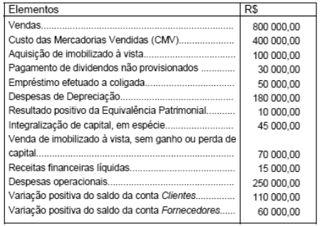{largura=35%}

A Demonstração de Resultado do Exercício (DRE) da companhia, em 20X0, evidenciava

- A) prejuízo de R$ 30 000,00.
- B) lucro de R$ 125 000,00.
- C) prejuízo de R$ 15 000,00.
- D) lucro de R$ 10 000,00.
- E) prejuízo de R$ 5 000,00.
- Gabarito: E
- Resolução: a caminho

## F0796 · FCC · 2003 · CVM · ME
- Fontes: TecConcursos 796 (26812)
- Prova: FCC - Ana (CVM)/CVM/Mercado de Capitais/2003
- Grupos: participacoes, lucro-liquido

As participações de administradores e empregados nos lucros da companhia são calculadas com base no lucro líquido do exercício,

- A) após a constituição da provisão para o imposto de renda e da reserva legal.
- B) antes da constituição da provisão para o imposto de renda e do pagamento de dividendos.
- C) após a constituição da provisão para o imposto de renda e da dedução, se houver, dos prejuízos acumulados.
- D) descontado o dividendo obrigatório a ser pago aos acionistas.
- E) antes da dedução da provisão do imposto de renda, da compensação dos prejuízos acumulados e após a dedução do dividendo obrigatório.
- Gabarito: C
- Resolução: a caminho

## F0797 · FCC · 2003 · CVM · ME
- Fontes: TecConcursos 797 (26836)
- Prova: FCC - Ana (CVM)/CVM/Contabilidade Pública/2003
- Grupos: lucro-liquido

As informações a seguir e somente elas, extraídas da contabilidade da Cia. Cruzeiro do Sul, relativas ao exercício de 20X0, devem ser utilizadas para responder à questão. As variações dos saldos das contas Clientes e Fornecedores foram calculadas diminuindo-se seu saldo, no final do exercício de 20X0, dos saldos finais do ano-calendário anterior.

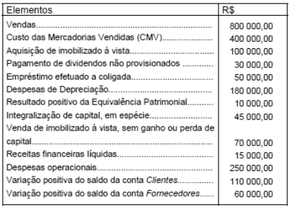{largura=35%}

A Demonstração de Resultado do Exercício (DRE) da companhia, em 20X0, evidenciava

- A) prejuízo de R$ 30 000,00.
- B) lucro de R$ 125 000,00.
- C) prejuízo de R$ 15 000,00.
- D) lucro de R$ 10 000,00.
- E) prejuízo de R$ 5 000,00.
- Gabarito: E
- Resolução: a caminho

## F0798 · CEBRASPE · 2003 · TST · CE
- Fontes: TecConcursos 798 (69065)
- Prova: CEBRASPE (CESPE) - AJ TST/TST/Administrativa/"Sem Especialidade"/2003
- Grupos: resultado-operacional, ir-csll

Com referência a conceitos de contabilidade, julgue o item seguinte.

Conforme prevê a Lei das S.A., o lucro operacional deve aparecer, na demonstração do resultado, antes da provisão para imposto de renda.

- Gabarito: CERTO
- Resolução: a caminho

## F0799 · CEBRASPE · 2003 · TRE RS · CE
- Fontes: TecConcursos 799 (302847)
- Prova: CEBRASPE (CESPE) - AJ TRE RS/TRE RS/Administrativa/2003
- Grupos: cmv, resultado-financeiro, ir-csll, lucro-liquido, deducoes, receita-bruta, despesas-administrativas, despesas-vendas, despesas-operacionais, outras-operacionais, outras-receitas-despesas

demonstração do resultado encerrado em 31/12/2002 (em R$) receita bruta de vendas 1.200.000 descontos, abatimentos e tributos sobre as vendas (264.000)

| Conta | Valor |
|---|---:|
| custo das mercadorias vendidas | (480.000) |
| despesas comerciais | (115.000) |
| despesas gerais e administrativas | (65.000) |
| outras receitas e despesas operacionais | (4.000) |
| despesas financeiras | (25.000) |

De acordo com a demonstração de resultado incompleta apresentada acima, julgue o item a seguir.

Calculando-se, sobre os números da demonstração de resultado apresentada, uma provisão para IR e CSLL de 34% do lucro antes dessa provisão, o lucro líquido do período será apurado em um valor menor que R$ 150.000,00.

- Gabarito: ERRADO
- Resolução: a caminho

## F0800 · CEBRASPE · 2003 · TRE RS · CE
- Fontes: TecConcursos 800 (302853)
- Prova: CEBRASPE (CESPE) - AJ TRE RS/TRE RS/Administrativa/2003
- Grupos: resultado-bruto, cmv, resultado-financeiro, deducoes, receita-bruta, despesas-administrativas, despesas-vendas, despesas-operacionais, outras-operacionais, outras-receitas-despesas

demonstração do resultado encerrado em 31/12/2002 (em R$) receita bruta de vendas 1.200.000 descontos, abatimentos e tributos sobre as vendas (264.000)

| Conta | Valor |
|---|---:|
| custo das mercadorias vendidas | (480.000) |
| despesas comerciais | (115.000) |
| despesas gerais e administrativas | (65.000) |
| outras receitas e despesas operacionais | (4.000) |
| despesas financeiras | (25.000) |

De acordo com a demonstração de resultado incompleta apresentada acima, julgue o item a seguir.

O lucro bruto na demonstração apresentada é menor que R$ 500.000,00.

- Gabarito: CERTO
- Resolução: a caminho

## F0801 · CEBRASPE · 2003 · TRE RS · CE
- Fontes: TecConcursos 801 (302854)
- Prova: CEBRASPE (CESPE) - AJ TRE RS/TRE RS/Administrativa/2003
- Grupos: resultado-bruto, cmv, resultado-operacional, resultado-financeiro, participacoes, ir-csll, lucro-liquido, deducoes, receita-bruta, despesas-administrativas, despesas-vendas, despesas-operacionais, outras-operacionais, outras-receitas-despesas, lair

demonstração do resultado encerrado em 31/12/2002 (em R$)

| Conta | Valor |
|---|---:|
| receita bruta de vendas | 2.500.000 |
| descontos, abatimentos e tributos sobre as vendas | (550.000) |
| custo das mercadorias vendidas | (1.000.000) |
| lucro bruto | 950.000 |
| despesas comerciais | (455.000) |
| despesas gerais e administrativas | (265.000) |
| outras receitas e despesas operacionais | (25.000) |
| despesas financeiras | (135.000) |
| lucro operacional | 70.000 |
| resultado não-operacional | 55.000 |
| lucro antes de IR, CSLL e participações | 125.000 |
| IR e CSLL | (35.700) |
| participação de empregados | (20.000) |
| lucro líquido | 69.300 |

Considerando a demonstração de resultado mostrada acima, julgue o item subseqüente.

Caso apenas as despesas comerciais sofressem uma redução para R$ 355.000,00 e considerando um provisão para IR e CSLL de 34% calculada consistentemente, o lucro líquido recalculado seria maior que R$ 135.000,00.

- Gabarito: CERTO
- Resolução: a caminho

## F0802 · CEBRASPE · 2003 · TRE RS · CE
- Fontes: TecConcursos 802 (302855)
- Prova: CEBRASPE (CESPE) - AJ TRE RS/TRE RS/Administrativa/2003
- Grupos: resultado-bruto, cmv, resultado-operacional, resultado-financeiro, participacoes, ir-csll, lucro-liquido, deducoes, fora-destinacao, receita-bruta, despesas-administrativas, despesas-vendas, despesas-operacionais, outras-operacionais, outras-receitas-despesas, lair

demonstração do resultado encerrado em 31/12/2002 (em R$)

| Conta | Valor |
|---|---:|
| receita bruta de vendas | 2.500.000 |
| descontos, abatimentos e tributos sobre as vendas | (550.000) |
| custo das mercadorias vendidas | (1.000.000) |
| lucro bruto | 950.000 |
| despesas comerciais | (455.000) |
| despesas gerais e administrativas | (265.000) |
| outras receitas e despesas operacionais | (25.000) |
| despesas financeiras | (135.000) |
| lucro operacional | 70.000 |
| resultado não-operacional | 55.000 |
| lucro antes de IR, CSLL e participações | 125.000 |
| IR e CSLL | (35.700) |
| participação de empregados | (20.000) |
| lucro líquido | 69.300 |

Considerando a demonstração de resultado mostrada acima, julgue o item subseqüente.  Não havendo outra reserva constituída ou revertida além da citada a seguir e caso sejam destinados, do lucro líquido, 5% para a reserva legal e, do lucro líquido ajustado previsto no art. n.º 202 da Lei das S.A., 25% para dividendos, estes terão um valor menor que R$ 33.000 mil.

- Gabarito: CERTO
- Resolução: a caminho

## F0803 · CEBRASPE · 2003 · TRE RS · CE
- Fontes: TecConcursos 803 (303306)
- Prova: CEBRASPE (CESPE) - TJ TRE RS/TRE RS/Administrativa/Contabilidade/2003
- Grupos: cmv, resultado-financeiro, participacoes, ir-csll, lucro-liquido, deducoes, receita-bruta, despesas-administrativas, despesas-vendas, despesas-operacionais, outras-operacionais, outras-receitas-despesas

contas e valores em 31/12/2002 rubricas valores R$

| Conta | Valor |
|---|---:|
| receita bruta de vendas | 4.600.000 |
| disponibilidades | 150.000 |
| contas a receber | 714.000 |
| estoques | 220.000 |
| descontos, abatimentos e tributos sobre as vendas | 1.012.000 |
| custo das mercadorias vendidas | 1.840.000 |
| despesas do período seguinte | 25.000 |
| empréstimos a receber de longo prazo | 15.000 |
| despesas comerciais | 680.000 |
| contas a pagar | 350.000 |
| tributos a pagar | 120.000 |
| pessoal e encargos a pagar | 80.000 |
| despesas gerais e administrativas | 490.000 |
| outras receitas operacionais | 50.000 |
| outras despesas operacionais | 300.000 |
| investimentos permanentes | 50.000 |
| imobilizado | 500.000 |
| depreciação e amortização acumulada do imobilizado | 200.000 |
| diferido bruto | 50.000 |
| despesas financeiras | 115.000 |
| amortização acumulada do diferido | 30.000 |
| receita não-operacional | 12.000 |
| empréstimos bancários passivos de curto prazo | 120.000 |
| empréstimos bancários passivos de longo prazo | 200.000 |
| provisão para IR e CSLL | 68.000 |
| participação de empregados | 25.000 |
| capital social | 312.000 |
| reservas de capital | 80.000 |
| reservas de lucros e lucros acumulados | 100.000 |
| total | 12.508.000 |

De acordo com a relação de contas e valores apresentada acima, elabore a demonstração do resultado e o balanço patrimonial e, com base nessas peças, julgue o item a seguir.

O lucro líquido do período é superior a R$ 140.000.

- Gabarito: ERRADO
- Resolução: a caminho

## F0804 · CEBRASPE · 2003 · TRE RS · CE
- Fontes: TecConcursos 804 (303335)
- Prova: CEBRASPE (CESPE) - TJ TRE RS/TRE RS/Administrativa/Contabilidade/2003
- Grupos: resultado-bruto, cmv, resultado-financeiro, participacoes, ir-csll, deducoes, receita-bruta, despesas-administrativas, despesas-vendas, despesas-operacionais, outras-operacionais, outras-receitas-despesas

contas e valores em 31/12/2002 rubricas valores R$

| Conta | Valor |
|---|---:|
| receita bruta de vendas | 4.600.000 |
| disponibilidades | 150.000 |
| contas a receber | 714.000 |
| estoques | 220.000 |
| descontos, abatimentos e tributos sobre as vendas | 1.012.000 |
| custo das mercadorias vendidas | 1.840.000 |
| despesas do período seguinte | 25.000 |
| empréstimos a receber de longo prazo | 15.000 |
| despesas comerciais | 680.000 |
| contas a pagar | 350.000 |
| tributos a pagar | 120.000 |
| pessoal e encargos a pagar | 80.000 |
| despesas gerais e administrativas | 490.000 |
| outras receitas operacionais | 50.000 |
| outras despesas operacionais | 300.000 |
| investimentos permanentes | 50.000 |
| imobilizado | 500.000 |
| depreciação e amortização acumulada do imobilizado | 200.000 |
| diferido bruto | 50.000 |
| despesas financeiras | 115.000 |
| amortização acumulada do diferido | 30.000 |
| receita não-operacional | 12.000 |
| empréstimos bancários passivos de curto prazo | 120.000 |
| empréstimos bancários passivos de longo prazo | 200.000 |
| provisão para IR e CSLL | 68.000 |
| participação de empregados | 25.000 |
| capital social | 312.000 |
| reservas de capital | 80.000 |
| reservas de lucros e lucros acumulados | 100.000 |
| total | 12.508.000 |

De acordo com a relação de contas e valores apresentada acima, elabore a demonstração do resultado e o balanço patrimonial e, com base nessas peças, julgue o item a seguir.

O lucro bruto é de R$ 1.548.000.

- Gabarito: ERRADO
- Resolução: a caminho

## F0805 · CEBRASPE · 2003 · TRE RS · CE
- Fontes: TecConcursos 805 (303336)
- Prova: CEBRASPE (CESPE) - TJ TRE RS/TRE RS/Administrativa/Contabilidade/2003
- Grupos: cmv, resultado-operacional, resultado-financeiro, participacoes, ir-csll, deducoes, receita-bruta, despesas-administrativas, despesas-vendas, despesas-operacionais, outras-operacionais, outras-receitas-despesas

contas e valores em 31/12/2002 rubricas valores R$

| Conta | Valor |
|---|---:|
| receita bruta de vendas | 4.600.000 |
| disponibilidades | 150.000 |
| contas a receber | 714.000 |
| estoques | 220.000 |
| descontos, abatimentos e tributos sobre as vendas | 1.012.000 |
| custo das mercadorias vendidas | 1.840.000 |
| despesas do período seguinte | 25.000 |
| empréstimos a receber de longo prazo | 15.000 |
| despesas comerciais | 680.000 |
| contas a pagar | 350.000 |
| tributos a pagar | 120.000 |
| pessoal e encargos a pagar | 80.000 |
| despesas gerais e administrativas | 490.000 |
| outras receitas operacionais | 50.000 |
| outras despesas operacionais | 300.000 |
| investimentos permanentes | 50.000 |
| imobilizado | 500.000 |
| depreciação e amortização acumulada do imobilizado | 200.000 |
| diferido bruto | 50.000 |
| despesas financeiras | 115.000 |
| amortização acumulada do diferido | 30.000 |
| receita não-operacional | 12.000 |
| empréstimos bancários passivos de curto prazo | 120.000 |
| empréstimos bancários passivos de longo prazo | 200.000 |
| provisão para IR e CSLL | 68.000 |
| participação de empregados | 25.000 |
| capital social | 312.000 |
| reservas de capital | 80.000 |
| reservas de lucros e lucros acumulados | 100.000 |
| total | 12.508.000 |

De acordo com a relação de contas e valores apresentada acima, elabore a demonstração do resultado e o balanço patrimonial e, com base nessas peças, julgue o item a seguir.

O lucro operacional é de R$ 193.000.

- Gabarito: ERRADO
- Resolução: a caminho

## F0806 · CEBRASPE · 2003 · TRE RS · CE
- Fontes: TecConcursos 806 (303343)
- Prova: CEBRASPE (CESPE) - TJ TRE RS/TRE RS/Administrativa/Contabilidade/2003
- Grupos: lucro-liquido

Acerca de gestão, receitas, despesas, custos e resultados, julgue o item subseqüente.

A demonstração do resultado deve evidenciar o lucro ou o prejuízo líquido do exercício e o seu montante por ação do capital social.

- Gabarito: CERTO
- Resolução: a caminho

## F0807 · CEBRASPE · 2003 · TRE RS · CE
- Fontes: TecConcursos 807 (303375)
- Prova: CEBRASPE (CESPE) - TJ TRE RS/TRE RS/Administrativa/Contabilidade/2003
- Grupos: lucro-liquido

Em relação a fatos e registros contábeis, correção de erros e apuração de resultado, julgue o item subseqüente.

O resultado obtido na conta de apuração de resultado do exercício será o lucro líquido do período ou o prejuízo do exercício, caso seja diferente de zero.

- Gabarito: CERTO
- Resolução: a caminho

## F0808 · CEBRASPE · 2003 · TRE RS · CE
- Fontes: TecConcursos 808 (303440)
- Prova: CEBRASPE (CESPE) - TJ TRE RS/TRE RS/Administrativa/Contabilidade/2003
- Grupos: 

Com relação a demonstrativos contábeis, julgue o item que se segue.

A demonstração do resultado apresenta o volume de recursos movimentado no período, de receitas e despesas, evidenciando o resultado econômico obtido ao longo desse período.

- Gabarito: CERTO
- Resolução: a caminho

## F0809 · CEBRASPE · 2003 · CNPq · CE
- Fontes: TecConcursos 809 (2589375)
- Prova: CEBRASPE (CESPE) - TNM (CNPq)/CNPq/Classificação I/2003
- Grupos: lucro-liquido

Com relação a demonstrações contábeis, julgue o item a seguir.

A DRE apresenta, resumidamente, o conjunto de operações realizadas pela empresa durante o exercício social, de forma a demonstrar a formação do resultado líquido do período.

- Gabarito: CERTO
- Resolução: a caminho

## F0810 · CEBRASPE · 2002 · SEFAZ AL · CE
- Fontes: TecConcursos 810 (38140)
- Prova: CEBRASPE (CESPE) - AFTE (SEFAZ AL)/SEFAZ AL/2002
- Grupos: 

Ainda com relação à contabilidade geral, julgue o item abaixo.

O balanço patrimonial evidencia a dinâmica patrimonial, enquanto a demonstração do resultado, a estática patrimonial.

- Gabarito: ERRADO
- Resolução: a caminho

## F0811 · CEBRASPE · 2002 · SEFAZ AL · CE
- Fontes: TecConcursos 811 (38141)
- Prova: CEBRASPE (CESPE) - AFTE (SEFAZ AL)/SEFAZ AL/2002
- Grupos: 

{largura=35%}

A respeito da demonstração de resultado acima apresentada, julgue o seguinte item.

Na demonstração de resultado acima, as contas de receita possuem saldo devedor, e as de despesa, saldo credor.

- Gabarito: ERRADO
- Resolução: a caminho

## F0812 · CEBRASPE · 2002 · SEFAZ AL · CE
- Fontes: TecConcursos 812 (38142)
- Prova: CEBRASPE (CESPE) - AFTE (SEFAZ AL)/SEFAZ AL/2002
- Grupos: despesas-administrativas

{largura=35%}

A respeito da demonstração de resultado acima apresentada, julgue o seguinte item.

Em despesas administrativas, devem ser incluídas apenas as relativas a serviços de terceiros utilizados na administração da empresa.

- Gabarito: ERRADO
- Resolução: a caminho

## F0813 · CEBRASPE · 2002 · SEFAZ AL · CE
- Fontes: TecConcursos 813 (38143)
- Prova: CEBRASPE (CESPE) - AFTE (SEFAZ AL)/SEFAZ AL/2002
- Grupos: lucro-liquido

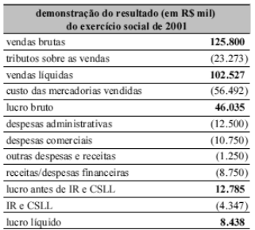{largura=35%}

A respeito da demonstração de resultado acima apresentada, julgue o seguinte item.

Seguindo os preceitos da Lei das Sociedades Anônimas, a empresa, após o lucro ou prejuízo líquido do exercício, deve demonstrar o seu montante por ação do capital social.

- Gabarito: CERTO
- Resolução: a caminho

## F0814 · CEBRASPE · 2002 · SEFAZ AL · CE
- Fontes: TecConcursos 814 (38144)
- Prova: CEBRASPE (CESPE) - AFTE (SEFAZ AL)/SEFAZ AL/2002
- Grupos: 

{largura=35%}

A respeito da demonstração de resultado acima apresentada, julgue o seguinte item.

As contas de resultado são transitórias, pois permanecem abertas ao longo do exercício social e são fechadas no encerramento dele, transferindo o seu saldo para a conta de lucros ou prejuízos acumulados diretamente ou utilizando uma conta transitória.

- Gabarito: CERTO
- Resolução: a caminho

## F0815 · CEBRASPE · 2002 · SEFAZ AL · CE
- Fontes: TecConcursos 815 (38145)
- Prova: CEBRASPE (CESPE) - AFTE (SEFAZ AL)/SEFAZ AL/2002
- Grupos: resultado-financeiro

{largura=35%}

A respeito da demonstração de resultado acima apresentada, julgue o seguinte item.

As despesas financeiras são escrituradas em contrapartida de uma conta passiva, uma retificadora do passivo ou das disponibilidades.

- Gabarito: CERTO
- Resolução: a caminho

## F0816 · CEBRASPE · 2002 · PF · CE
- Fontes: TecConcursos 816 (49498)
- Prova: CEBRASPE (CESPE) - APF/PF/2002
- Grupos: ir-csll, lucro-liquido, deducoes, despesas-administrativas, despesas-operacionais, outras-operacionais, outras-receitas-despesas

Julgue o item a seguir, relativos à contabilidade geral.

Em uma demonstração de resultado, uma empresa pode apresentar tributos pagos ou devidos - nas contas de dedução das receitas brutas, das despesas gerais e administrativas, de outras despesas operacionais - e, antes do lucro líquido, o imposto de renda e a contribuição social sobre o lucro.

- Gabarito: CERTO
- Resolução: a caminho

## F0817 · CEBRASPE · 2002 · TJ AC · CE
- Fontes: TecConcursos 817 (550212)
- Prova: CEBRASPE (CESPE) - AJ (TJ AC)/TJ AC/Economista/2002
- Grupos: receita-bruta, cmv, despesas-administrativas, deducoes, despesas-vendas

Texto IV – A empresa Kampa Ltda. iniciou suas atividades em 1.º/7/2001, dedicando-se à comercialização de produtos naturais originários da Amazônia, sendo, atualmente, seus produtos vendidos exclusivamente em mercados da região Norte.

Embora a empresa esteja satisfeita com seus clientes e com os resultados alcançados no último ano, a administração considera a possibilidade de expandir suas vendas em 2003, tendo em vista a crescente procura por produtos naturais em cidades localizadas na região Sudeste do país, onde a unidade de seu produto, cujo custo está calculado em R$ 30,00, poderá ser vendida por R$ 50,00.

A expansão do mercado necessitará, entretanto, de uma representação comercial no Rio de Janeiro ou em São Paulo. Em vista disso, o gerente comercial levantou os custos incorridos nas duas hipóteses:

I Representação própria em instalações alugadas — despesas comerciais no percentual de 7% sobre preço de venda e despesas fixas anuais de R$ 20.000,00. II Contratação de representante — despesas comerciais no percentual de 17% sobre preço de venda. Para essa empresa, o balancete de verificação da empresa levantado no final do exercício, em 30/6/2002, após ajustes, é composto das contas apresentadas no quadro abaixo.

contas valores em R$

| Conta | Valor |
|---|---:|
| disponível | 6.900 |
| clientes | 7.500 |
| mercadorias | 6.490 |
| benfeitoria em imóvel | 6.500 |
| móveis e utensílios | 1.200 |
| depreciação acumulada | 240 |
| amortização acumulada | 1.300 |
| fornecedores | 7.500 |
| contas a pagar | 1.800 |
| impostos a recolher | 700 |
| capital | 10.000 |
| vendas | 61.460 |
| custo da mercadoria vendida | 38.050 |
| despesas comerciais | 4.100 |
| despesas diversas | 420 |
| pró-labore | 8.200 |
| despesa de depreciação | 240 |
| despesa de amortização | 1.300 |
| impostos sobre vendas | 2.100 |

Considerando ainda as informações do texto IV, julgue o item subsequente, relativo à empresa Kampa Ltda.

A empresa funcionou com uma margem operacional inferior a 10%.

- Gabarito: ERRADO
- Resolução: a caminho

## F0818 · CEBRASPE · 2002 · TJ AC · CE
- Fontes: TecConcursos 818 (550215)
- Prova: CEBRASPE (CESPE) - AJ (TJ AC)/TJ AC/Economista/2002
- Grupos: receita-bruta, deducoes, receita-liquida, cmv, resultado-bruto, despesas-vendas, despesas-administrativas

Texto IV – A empresa Kampa Ltda. iniciou suas atividades em 1.º/7/2001, dedicando-se à comercialização de produtos naturais originários da Amazônia, sendo, atualmente, seus produtos vendidos exclusivamente em mercados da região Norte.

Embora a empresa esteja satisfeita com seus clientes e com os resultados alcançados no último ano, a administração considera a possibilidade de expandir suas vendas em 2003, tendo em vista a crescente procura por produtos naturais em cidades localizadas na região Sudeste do país, onde a unidade de seu produto, cujo custo está calculado em R$ 30,00, poderá ser vendida por R$ 50,00.

A expansão do mercado necessitará, entretanto, de uma representação comercial no Rio de Janeiro ou em São Paulo. Em vista disso, o gerente comercial levantou os custos incorridos nas duas hipóteses:

I Representação própria em instalações alugadas — despesas comerciais no percentual de 7% sobre preço de venda e despesas fixas anuais de R$ 20.000,00. II Contratação de representante — despesas comerciais no percentual de 17% sobre preço de venda. Para essa empresa, o balancete de verificação da empresa levantado no final do exercício, em 30/6/2002, após ajustes, é composto das contas apresentadas no quadro abaixo.

contas valores em R$

| Conta | Valor |
|---|---:|
| disponível | 6.900 |
| clientes | 7.500 |
| mercadorias | 6.490 |
| benfeitoria em imóvel | 6.500 |
| móveis e utensílios | 1.200 |
| depreciação acumulada | 240 |
| amortização acumulada | 1.300 |
| fornecedores | 7.500 |
| contas a pagar | 1.800 |
| impostos a recolher | 700 |
| capital | 10.000 |
| vendas | 61.460 |
| custo da mercadoria vendida | 38.050 |
| despesas comerciais | 4.100 |
| despesas diversas | 420 |
| pró-labore | 8.200 |
| despesa de depreciação | 240 |
| despesa de amortização | 1.300 |
| impostos sobre vendas | 2.100 |

Considerando ainda as informações do texto IV, julgue o item subsequente, relativo à empresa Kampa Ltda.

A diferença entre a conta “vendas” e a soma das contas “custo da mercadoria vendida”, “impostos sobre vendas” e “despesas comerciais” representa o lucro bruto do período.

- Gabarito: ERRADO
### O que a questão pede
Se **vendas − (CMV + impostos sobre vendas + despesas comerciais)** é o lucro bruto. O texto sobre a expansão para o Sudeste é contexto de outros itens; para este, só importa a definição de lucro bruto.

### A regra
Lucro bruto = receita líquida (receita bruta − deduções) − custo das vendas (Lei 6.404/76, art. 187, I e II). As **despesas comerciais** (com vendas) são despesas operacionais, deduzidas **depois** do lucro bruto (art. 187, III).

### Cálculos prévios
| Linha | Valor |
|---|---:|
| Vendas | 61.460 |
| (–) Impostos sobre vendas | (2.100) |
| = Receita líquida | 59.360 |
| (–) CMV | (38.050) |
| **= Lucro bruto** | **21.310** |

A conta do item (61.460 − 38.050 − 2.100 − 4.100) dá **17.210**: é o lucro bruto já diminuído das despesas comerciais, um valor intermediário que não tem nome na DRE.

### Passo a passo
```dre
@ vendas | 61.460 | receita-bruta
@ impostos sobre vendas | 2.100 | deducoes
@ custo da mercadoria vendida | 38.050 | cmv
@ despesas comerciais | 4.100 | despesas-vendas
@ despesas diversas | 420 | despesas-administrativas
@ pró-labore | 8.200 | despesas-administrativas
@ despesa de depreciação | 240 | despesas-administrativas
@ despesa de amortização | 1.300 | despesas-administrativas
+ Vendas | 61.460 | vendas
+ (–) Impostos sobre vendas | (2.100) | impostos sobre vendas
= Receita líquida | 59.360
+ (–) CMV | (38.050) | custo da mercadoria vendida
= Lucro bruto | 21.310
> As despesas comerciais ficam abaixo do lucro bruto, junto com as demais despesas operacionais.
! despesas comerciais; despesas diversas; pró-labore; despesa de depreciação; despesa de amortização
```

Gabarito **ERRADO**.

### Pegadinhas
- **Despesa comercial não é dedução da receita:** dedução é tributo sobre vendas, devolução, abatimento e desconto incondicional. Comissões, fretes de entrega e propaganda são despesas com vendas.
- **Despesas comerciais variáveis** (os 7% ou 17% do texto) continuam sendo despesas, não custo do produto. Entram na margem de contribuição da análise gerencial, não no CMV contábil.

### Leve para as próximas
1. Lucro bruto = receita bruta − deduções − custo das vendas. Nenhuma despesa operacional entra nessa conta.
2. Item que mistura uma despesa de vendas com o CMV e os tributos é o modelo clássico de ERRADO.

## F0819 · CEBRASPE · 2002 · BANESE · CE
- Fontes: TecConcursos 819 (979158)
- Prova: CEBRASPE (CESPE) - Train (BANESE)/BANESE/Área II/2002
- Grupos: 

É usual que departamentos de crédito de instituições financeiras, com o objetivo de avaliar a situação econômico-financeira de uma determinada empresa, apliquem índices econômicos aos demonstrativos contábeis dessa empresa. Acerca dessa prática, julgue o item abaixo.

Quanto menor o valor do índice de margem líquida, melhor a situação financeira da empresa.

- Gabarito: ERRADO
- Resolução: a caminho

## F0820 · FGV · 2002 · MPE AM · ME
- Fontes: TecConcursos 820 (1401304)
- Prova: FGV - Ag Tec (MPE AM)/MPE AM/Economista/2002
- Grupos: cmv, receita-bruta, despesas-administrativas, deducoes, lucro-liquido

Os dados a seguir foram obtidos nos registros contábeis da empresa W, em 31 ⁄ 12 ⁄ 2000:

Custo das mercadorias vendidas $ 250 Vendas de mercadorias $ 800 Despesas de salários $ 180 ICMS sobre vendas $ 120 Descontos sobre vendas $ 40 Despesas diversas $ 42 IPI $ 90 Encargos sociais $ 36

O Resultado do Exercício foi:

- A) $ 42
- B) $ 132
- C) $ 172
- D) $ 214
- E) $ 252
- Gabarito: B
- Resolução: a caminho

## F0821 · CEBRASPE · 2002 · MPE RR · ME
- Fontes: TecConcursos 821 (1462415)
- Prova: CEBRASPE (CESPE) - Tec (MPE RR)/MPE RR/Apoio Técnico-Administrativo/2002
- Grupos: cmv, resultado-financeiro, ir-csll, lucro-liquido, receita-bruta, despesas-administrativas, deducoes, despesas-vendas, outras-receitas-despesas

demonstração do resultado do exercício social de 2001 (em R$ mil)

| Conta | Valor |
|---|---:|
| vendas brutas | 2.150.000 |
| tributos sobre as vendas | (397.750) |
| custo das mercadorias vendidas | (965.490) |
| despesas administrativas | (215.000) |
| despesas comerciais | (185.000) |

outras despesas e receitas operacionais (52.000)

| Conta | Valor |
|---|---:|
| receitas/despesas financeiras | (125.000) |
| despesas não-operacionais | (12.500) |
| IR e CSLL | (67.068) |
| lucro líquido | 130.192 |

Com base na demonstração do resultado de uma empresa apresentado acima, é correto afirmar que o lucro

- A) operacional é maior que R$ 210.000,00.
- B) bruto é inferior a R$ 785.000,00.
- C) antes do imposto de renda e da contribuição social sobre o lucro líquido é superior a R$ 200.000,00.
- D) líquido corresponde a mais de 6,5% sobre as vendas líquidas.
- E) operacional é menor que R$ 200.000,00.
- Gabarito: D
- Resolução: a caminho

## F0822 · CEBRASPE · 2002 · MPE RR · ME
- Fontes: TecConcursos 822 (1462416)
- Prova: CEBRASPE (CESPE) - Tec (MPE RR)/MPE RR/Apoio Técnico-Administrativo/2002
- Grupos: lucro-liquido, fora-destinacao

demonstração de lucros acumulados do exercício encerrado em 31/12/2001 rubrica R$ mil

| Conta | Valor |
|---|---:|
| lucros acumulados em 31/12/2000 | 250.000 |
| lucro líquido do exercício | 135.000 |
| reserva legal | (6.750) |
| reserva de contingências | (25.000) |
| dividendos | (25.813) |
| lucros acumulados em 31/12/2001 | 327.438 |

Em face da demonstração de lucros acumulados de uma companhia aberta, apresentada acima, assinale a opção correta.

- A) Os dividendos foram calculados na base de 25% do lucro líquido ajustado previsto na Lei das S.A.
- B) A reserva legal é uma reserva de capital.
- C) Os dividendos de 2001 devem ser registrados no passivo circulante somente no mês do pagamento.
- D) Um prejuízo apurado em determinado exercício deve ser obrigatoriamente absorvido pelas reservas de capital.
- E) O excesso de reservas de lucros sobre o capital social deve ser destinado para reservas de capital.
- Gabarito: A
- Resolução: a caminho

## F0823 · CEBRASPE · 2002 · CAM DEP · CE
- Fontes: TecConcursos 823 (1781375)
- Prova: CEBRASPE (CESPE) - AL (CAM DEP)/CAM DEP/Consultor Legislativo/Área III/2002
- Grupos: resultado-bruto, receita-liquida, cmv, resultado-financeiro, lucro-liquido, equivalencia, fora-destinacao, receita-bruta, despesas-administrativas, despesas-vendas, ir-csll, lair

balanço patrimonial em 31 de dezembro de 2001 ativo R$ mil

| Conta | Valor |
|---|---:|
| ativo circulante | 526.300 |
| disponível | 85.000 |
| contas a receber | 325.000 |
| estoque | 95.800 |
| créditos tributários | 12.000 |
| despesas período seguinte | 8.500 |
| ativo permanente | 440.500 |
| investimento | 10.500 |
| imobilizado | 415.000 |
| diferido | 15.000 |
| total ativo | 966.800 |

passivo R$ mil passivo circulante 285.000

| Conta | Valor |
|---|---:|
| contas a pagar | 125.000 |
| financiamentos | 70.000 |
| tributos | 50.000 |
| dividendos | 25.000 |
| outros passivos | 15.000 |

patrimônio líquido 681.800

| Conta | Valor |
|---|---:|
| capital | 450.000 |
| reservas de capital | 85.000 |
| reservas de lucro | 12.500 |
| lucros acumulados | 134.300 |
| total passivo | 966.800 |

demonstração de resultado – 1.º trimestre/2002 (em R$ mil)

| Conta | Valor |
|---|---:|
| vendas | 700.000 |
| impostos | (140.000) |
| vendas líquidas | 560.000 |
| custo das mercadorias vendidas | (320.000) |
| lucro bruto | 240.000 |
| despesas gerais e administrativas | (75.800) |
| despesas comerciais | (98.000) |
| resultado equivalência patrimonial | 700 |
| depreciação | (15.000) |
| despesas financeiras | (4.500) |
| receitas financeiras | 4.000 |
| lucro antes IR/CSL | 51.400 |
| IR/CSL | (17.238) |
| lucro líquido | 34.162 |

Com relação a aspectos diversos de contabilidade e às demonstrações contábeis apresentadas acima, julgue o item a seguir.

Caso a empresa tivesse liquidado a dívida de financiamento de R$ 70.000.000,00 15 dias antes do encerramento do exercício social, o seu resultado não teria sofrido alteração, mesmo considerando diferentes taxas para remunerar ativos financeiros e reconhecimento de encargos do passivo.

- Gabarito: ERRADO
- Resolução: a caminho

## F0824 · CEBRASPE · 2002 · CAM DEP · CE
- Fontes: TecConcursos 824 (1781378)
- Prova: CEBRASPE (CESPE) - AL (CAM DEP)/CAM DEP/Consultor Legislativo/Área III/2002
- Grupos: resultado-bruto, receita-liquida, cmv, resultado-financeiro, lucro-liquido, equivalencia, fora-destinacao, receita-bruta, despesas-administrativas, despesas-vendas, ir-csll, lair

balanço patrimonial em 31 de dezembro de 2001 ativo R$ mil

| Conta | Valor |
|---|---:|
| ativo circulante | 526.300 |
| disponível | 85.000 |
| contas a receber | 325.000 |
| estoque | 95.800 |
| créditos tributários | 12.000 |
| despesas período seguinte | 8.500 |
| ativo permanente | 440.500 |
| investimento | 10.500 |
| imobilizado | 415.000 |
| diferido | 15.000 |
| total ativo | 966.800 |

passivo R$ mil passivo circulante 285.000

| Conta | Valor |
|---|---:|
| contas a pagar | 125.000 |
| financiamentos | 70.000 |
| tributos | 50.000 |
| dividendos | 25.000 |
| outros passivos | 15.000 |

patrimônio líquido 681.800

| Conta | Valor |
|---|---:|
| capital | 450.000 |
| reservas de capital | 85.000 |
| reservas de lucro | 12.500 |
| lucros acumulados | 134.300 |
| total passivo | 966.800 |

demonstração de resultado – 1.º trimestre/2002 (em R$ mil)

| Conta | Valor |
|---|---:|
| vendas | 700.000 |
| impostos | (140.000) |
| vendas líquidas | 560.000 |
| custo das mercadorias vendidas | (320.000) |
| lucro bruto | 240.000 |
| despesas gerais e administrativas | (75.800) |
| despesas comerciais | (98.000) |
| resultado equivalência patrimonial | 700 |
| depreciação | (15.000) |
| despesas financeiras | (4.500) |
| receitas financeiras | 4.000 |
| lucro antes IR/CSL | 51.400 |
| IR/CSL | (17.238) |
| lucro líquido | 34.162 |

Com relação a aspectos diversos de contabilidade e às demonstrações contábeis apresentadas acima, julgue o item a seguir.

O estoque, caso fosse reduzido de R$ 95.800.000,00 para R$ 50.000.000,00, por problema de avaliação e inventário, implicaria redução do lucro do período e do patrimônio líquido.

- Gabarito: CERTO
- Resolução: a caminho

## F0825 · CEBRASPE · 2002 · PARANAPREVIDÊNCIA · CE
- Fontes: TecConcursos 825 (3151786)
- Prova: CEBRASPE (CESPE) - Ana FinInv (PARANAPREVIDÊNCIA)/PARANAPREVIDÊNCIA/2002
- Grupos: resultado-bruto, receita-liquida, cmv, resultado-financeiro, lair, ir-csll, lucro-liquido, receita-bruta, despesas-administrativas, deducoes, despesas-vendas, outras-receitas-despesas

demonstração do resultado do exercício social de 2001 (em R$ mil)

| Conta | Valor |
|---|---:|
| vendas brutas | 2.150.000 |
| tributos sobre vendas | (397.750) |
| vendas líquidas | 1.752.250 |
| custo das mercadorias vendidas | (965.490) |
| lucro bruto | 786.760 |
| despesas administrativas | (215.000) |
| despesas comerciais | (185.000) |
| outras despesas e receitas | (52.000) |
| receitas/despesas financeiras | (125.000) |
| lucro antes do IR e do CSLL | 209.760 |
| IR e CSLL (critério lucro real) | (71.318) |
| lucro líquido | 138.442 |

Com base na demonstração de resultado apresentada acima, julgue o item a seguir

As despesas com o pessoal da própria empresa podem estar classificadas em despesas administrativas e comerciais, entre outras.

- Gabarito: CERTO
- Resolução: a caminho

## F0826 · CEBRASPE · 2002 · PARANAPREVIDÊNCIA · CE
- Fontes: TecConcursos 826 (3151795)
- Prova: CEBRASPE (CESPE) - Ana FinInv (PARANAPREVIDÊNCIA)/PARANAPREVIDÊNCIA/2002
- Grupos: resultado-bruto, receita-liquida, cmv, resultado-financeiro, lair, ir-csll, lucro-liquido, receita-bruta, despesas-administrativas, deducoes, despesas-vendas, outras-receitas-despesas

demonstração do resultado do exercício social de 2001 (em R$ mil)

| Conta | Valor |
|---|---:|
| vendas brutas | 2.150.000 |
| tributos sobre vendas | (397.750) |
| vendas líquidas | 1.752.250 |
| custo das mercadorias vendidas | (965.490) |
| lucro bruto | 786.760 |
| despesas administrativas | (215.000) |
| despesas comerciais | (185.000) |
| outras despesas e receitas | (52.000) |
| receitas/despesas financeiras | (125.000) |
| lucro antes do IR e do CSLL | 209.760 |
| IR e CSLL (critério lucro real) | (71.318) |
| lucro líquido | 138.442 |

Com base na demonstração de resultado apresentada acima, julgue o item a seguir

O lucro líquido é o valor que resta no patrimônio líquido após o desconto de despesas, encargos e remuneração dos acionistas no período.

- Gabarito: ERRADO
- Resolução: a caminho

## F0827 · CEBRASPE · 2002 · PARANAPREVIDÊNCIA · CE
- Fontes: TecConcursos 827 (3151796)
- Prova: CEBRASPE (CESPE) - Ana FinInv (PARANAPREVIDÊNCIA)/PARANAPREVIDÊNCIA/2002
- Grupos: resultado-bruto, receita-liquida, cmv, resultado-financeiro, lair, ir-csll, lucro-liquido, receita-bruta, despesas-administrativas, deducoes, despesas-vendas, outras-receitas-despesas

demonstração do resultado do exercício social de 2001 (em R$ mil)

| Conta | Valor |
|---|---:|
| vendas brutas | 2.150.000 |
| tributos sobre vendas | (397.750) |
| vendas líquidas | 1.752.250 |
| custo das mercadorias vendidas | (965.490) |
| lucro bruto | 786.760 |
| despesas administrativas | (215.000) |
| despesas comerciais | (185.000) |
| outras despesas e receitas | (52.000) |
| receitas/despesas financeiras | (125.000) |
| lucro antes do IR e do CSLL | 209.760 |
| IR e CSLL (critério lucro real) | (71.318) |
| lucro líquido | 138.442 |

Com base na demonstração de resultado apresentada acima, julgue o item a seguir

A elevação das despesas administrativas de R$ 215.000 mil para R$ 300.000 mil provocaria uma redução no lucro líquido em R$ 85.000 mil.

- Gabarito: ERRADO
- Resolução: a caminho

## F0828 · CEBRASPE · 2002 · PARANAPREVIDÊNCIA · CE
- Fontes: TecConcursos 828 (3158198)
- Prova: CEBRASPE (CESPE) - Ana FinInv (PARANAPREVIDÊNCIA)/PARANAPREVIDÊNCIA/2002
- Grupos: 

Na elaboração do orçamento empresarial, é comum a utilização da técnica de projeção de demonstrativos financeiros. Para a projeção de um balanço patrimonial há uma ordem tecnicamente correta a ser seguida. Acerca dessa seqüência, julgue o item subseqüente.

O financiamento dos ajustes deve anteceder a projeção da demonstração de resultados do exercício financeiro objeto do orçamento.

- Gabarito: ERRADO
- Resolução: a caminho

## F0829 · CEBRASPE · 2001 · INSS · CE
- Fontes: TecConcursos 829 (31020)
- Prova: CEBRASPE (CESPE) - AFPS/INSS/2001
- Grupos: fora-destinacao, lucro-liquido

Com relação aos princípios fundamentais da contabilidade, apuração de resultado e encerramento de exercício social, destinação de lucros, demonstrações contábeis societárias e notas explicativas, julgue o item que se segue.

No encerramento de cada exercício anual, os saldos das contas de ativo e passivo no ultimo dia do exercício são mantidas na abertura do período seguinte, e as contas de receita e despesas são encerradas contra uma conta de apuração do resultado do exercício, de maneira que, no inicio do próximo exercício, não haja saldo nessas contas. Essa conta de apuração do resultado também pode ser encerrada contra a conta de lucros ou prejuízos acumulados.

- Gabarito: CERTO
- Resolução: a caminho

## F0830 · CEBRASPE · 2001 · INSS · CE
- Fontes: TecConcursos 830 (31033)
- Prova: CEBRASPE (CESPE) - AFPS/INSS/2001
- Grupos: despesas-administrativas

Os quadros a seguir são demonstrações contábeis de uma empresa, realizadas em 30/9/2000.

{largura=48%}

{largura=35%}

Julgue o item abaixo, relativo às demonstrações contábeis apresentadas no texto.

Considerando que essa empresa apresente histórico de muitos anos de resultado positivo, tanto operacional quanto não-operacional, é correto concluir que, se ela tivesse baixado ativos fixos obsoletos ou fora de atividade, que não possuem valor de salvado, com valor residual - custo menos depreciação acumulada - de R$ 15.000,00, teria apresentado resultado negativo.

- Gabarito: ERRADO
- Resolução: a caminho

## F0831 · CEBRASPE · 2001 · INSS · CE
- Fontes: TecConcursos 831 (31035)
- Prova: CEBRASPE (CESPE) - AFPS/INSS/2001
- Grupos: lucro-liquido, receita-bruta, deducoes

Os quadros a seguir são demonstrações contábeis de uma empresa, realizadas em 30/9/2000.

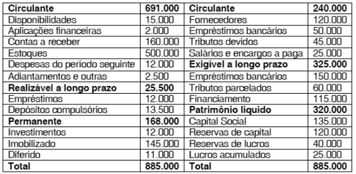{largura=48%}

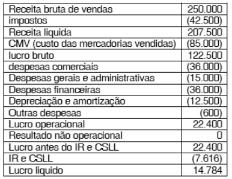{largura=35%}

Com relação às demonstrações contábeis do texto, julgue o item a seguir.

Caso não houvesse incidência de impostos sobre a receita bruta e os demais tributos fossem mantidos, o lucro líquido seria superior a R$ 40.000,00.

- Gabarito: CERTO
- Resolução: a caminho

## F0832 · CEBRASPE · 2001 · PETROBRAS · CE
- Fontes: TecConcursos 832 (2924234)
- Prova: CEBRASPE (CESPE) - PPNS (PETROBRAS)/PETROBRAS/Administração/2001
- Grupos: 

Os quadros a seguir são demonstrações financeiras de uma empresa referentes aos exercícios de 1999 e 2000.

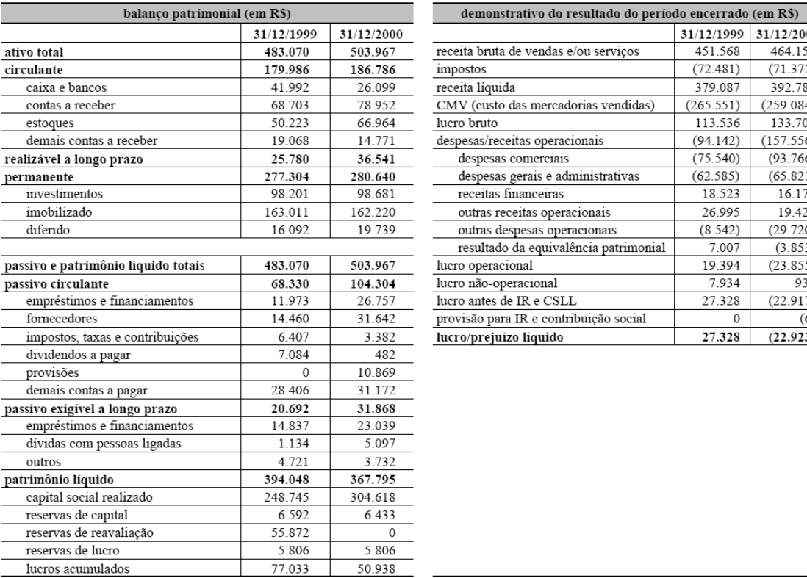{largura=87%}

Julgue o item abaixo com base nos quadros demonstrativos do texto CE-I.

Quanto mais elevado for o ponto de equilíbrio financeiro, menor será o risco financeiro da empresa.

- Gabarito: ERRADO
- Resolução: a caminho

## F0833 · CEBRASPE · 2001 · PETROBRAS · CE
- Fontes: TecConcursos 833 (2928995)
- Prova: CEBRASPE (CESPE) - PPNS (PETROBRAS)/PETROBRAS/Economia/2001
- Grupos: 

Os quadros a seguir são de demonstrações contábeis da companhia H, realizadas em 1999/2000.

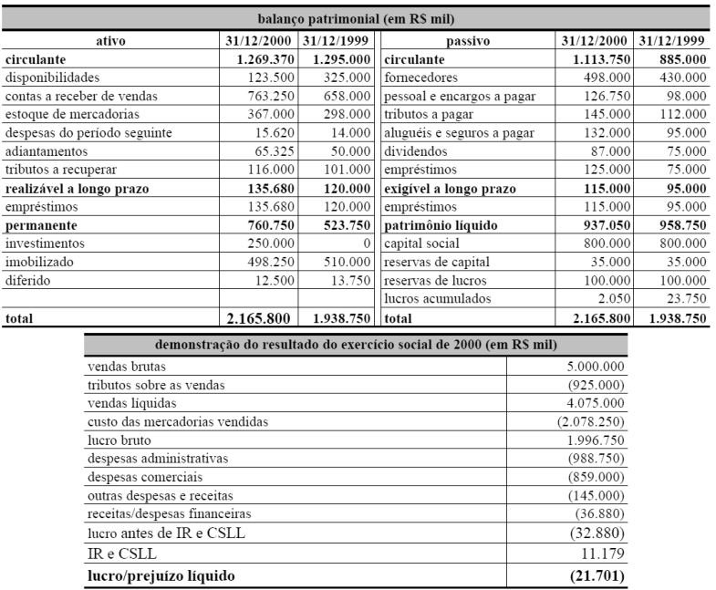{largura=62%}

Julgue o item a seguir, considerando as demonstrações contábeis da companhia H mostradas no texto CE-II.

A companhia H apresentou índice de rentabilidade do capital próprio de 6,8% em 2000.

- Gabarito: ERRADO
- Resolução: a caminho

## F0834 · CEBRASPE · 2000 · PF · CE
- Fontes: TecConcursos 834 (48890)
- Prova: CEBRASPE (CESPE) - APF/PF/2000
- Grupos: despesas-administrativas

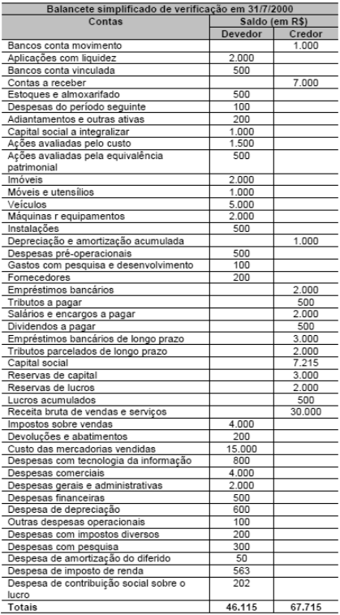{largura=35%}

Com base nos dados do balancete de uma determinada sociedade anônima, apresentado acima, julgue o seguinte item.

Em despesas gerais e administrativas, devem estar registradas as despesas com salários e encargos sociais do pessoal empregado no departamento jurídico que exerça função de assessoramento da diretoria.

- Gabarito: CERTO
- Resolução: a caminho

## F0835 · CEBRASPE · 2000 · PF · CE
- Fontes: TecConcursos 835 (49150)
- Prova: CEBRASPE (CESPE) - PPF/PF/2000
- Grupos: despesas-administrativas, despesas-vendas

{largura=35%}

Tendo em vista as informações apresentadas no quadro, julgue o item seguinte.

As despesas de comissões de vendedores devem estar registradas como despesas gerais e administrativas.

- Gabarito: ERRADO
- Resolução: a caminho

## F0836 · CEBRASPE · 2000 · PF · CE
- Fontes: TecConcursos 836 (49152)
- Prova: CEBRASPE (CESPE) - PPF/PF/2000
- Grupos: receita-liquida, deducoes, despesas-administrativas, receita-bruta, despesas-vendas

{largura=35%}

Tendo em vista as informações apresentadas no quadro, julgue o item seguinte.

Os impostos prediais e territoriais urbanos incidentes sobre o valor da sede social da empresa devem ser considerados como despesas gerais e administrativas ou como despesas comerciais, e não como impostos em dedução da receita bruta, antes da receita líquida.

- Gabarito: CERTO
- Resolução: a caminho

## F0837 · CEBRASPE · 2000 · PF · CE
- Fontes: TecConcursos 837 (49153)
- Prova: CEBRASPE (CESPE) - PPF/PF/2000
- Grupos: resultado-financeiro, ir-csll, lucro-liquido

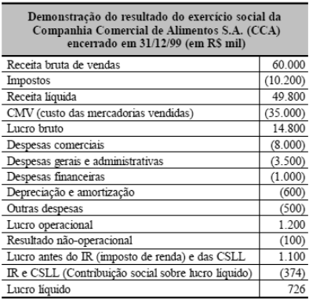{largura=35%}

Com relação ao quadro, julgue o item a seguir.

Caso a CCA não tivesse registrado despesas financeiras no exercício social apresentado, o lucro líquido teria ficado entre R$ 1.300.000 e R$ 1.400.000, considerando os efeitos do imposto de renda e da contribuição social sobre o lucro, à alíquota geral de 34% sobre o lucro antes dos impostos.

- Gabarito: CERTO
- Resolução: a caminho

## F0838 · CEBRASPE · 2000 · PF · CE
- Fontes: TecConcursos 838 (49154)
- Prova: CEBRASPE (CESPE) - PPF/PF/2000
- Grupos: resultado-financeiro, ir-csll, lucro-liquido

{largura=35%}

Com relação ao quadro, julgue o item a seguir.

Caso a CCA, no exercício social encerrado em 31/12/99, tivesse registrado as despesas financeiras mostradas no quadro, além de despesas não-dedutíveis para fins de imposto de renda e contribuição social sobre o lucro, em condições permanentes, de R$ 100.000, então o seu lucro líquido teria sido superior a R$ 690.000 e inferior a R$ 700.000.

- Gabarito: CERTO
- Resolução: a caminho

## F0839 · CEBRASPE · 2000 · PF · CE
- Fontes: TecConcursos 839 (49155)
- Prova: CEBRASPE (CESPE) - PPF/PF/2000
- Grupos: lucro-liquido

{largura=35%}

Com relação ao quadro, julgue o item a seguir.

O lucro líquido acrescido das despesas não-monetárias operacionais explicitadas na demonstração totalizaram R$ 1.326.000 no exercício social apresentado.

- Gabarito: CERTO
- Resolução: a caminho

## F0840 · CEBRASPE · 1997 · PF · CE
- Fontes: TecConcursos 840 (54804)
- Prova: CEBRASPE (CESPE) - PCF/PF/Área 1/1997
- Grupos: lucro-liquido

A demonstração do resultado do exercício é a apresentação, em forma resumida, das operações realizadas pela empresa, durante o exercício social, demonstradas de forma a destacar o resultado líquido do período. Relativamente a esse assunto, julgue o item a seguir.

Na determinação do resultado do exercício, serão computadas apenas as receitas e os rendimentos efetivamente realizados em moeda no período, assim como os custos, despesas, encargos e perdas pagos, correspondentes às receitas e rendimentos.

- Gabarito: ERRADO
- Resolução: a caminho

## F0841 · CEBRASPE · 1997 · PF · CE
- Fontes: TecConcursos 841 (54805)
- Prova: CEBRASPE (CESPE) - PCF/PF/Área 1/1997
- Grupos: lucro-liquido, fora-destinacao

A demonstração do resultado do exercício é a apresentação, em forma resumida, das operações realizadas pela empresa, durante o exercício social, demonstradas de forma a destacar o resultado líquido do período. Relativamente a esse assunto, julgue o item a seguir.

O resultado do período, antes das destinações para constituição das reservas e dividendos, deve ser registrado na conta de lucros ou prejuízos acumulados.

- Gabarito: CERTO
- Resolução: a caminho

## F0842 · CEBRASPE · 1997 · PF · CE
- Fontes: TecConcursos 842 (54806)
- Prova: CEBRASPE (CESPE) - PCF/PF/Área 1/1997
- Grupos: resultado-operacional, resultado-financeiro, lucro-liquido, receita-bruta

A demonstração do resultado do exercício é a apresentação, em forma resumida, das operações realizadas pela empresa, durante o exercício social, demonstradas de forma a destacar o resultado líquido do período. Relativamente a esse assunto, julgue o item a seguir.

As despesas financeiras, gerais, administrativas e com vendas devem ser demonstradas após a apuração do resultado operacional.

- Gabarito: ERRADO
- Resolução: a caminho

## F0843 · CEBRASPE · 1997 · PF · CE
- Fontes: TecConcursos 843 (54807)
- Prova: CEBRASPE (CESPE) - PCF/PF/Área 1/1997
- Grupos: resultado-bruto, lucro-liquido, deducoes, receita-bruta

A demonstração do resultado do exercício é a apresentação, em forma resumida, das operações realizadas pela empresa, durante o exercício social, demonstradas de forma a destacar o resultado líquido do período. Relativamente a esse assunto, julgue o item a seguir.

Os impostos sobre as vendas, como IPI, ICMS e ISS, considerados como dedução da receita bruta, devem ser demonstrados após a apuração do lucro bruto.

- Gabarito: ERRADO
- Resolução: a caminho

## F0844 · CEBRASPE · 1997 · PF · CE
- Fontes: TecConcursos 844 (54808)
- Prova: CEBRASPE (CESPE) - PCF/PF/Área 1/1997
- Grupos: lucro-liquido, outras-receitas-despesas

A demonstração do resultado do exercício é a apresentação, em forma resumida, das operações realizadas pela empresa, durante o exercício social, demonstradas de forma a destacar o resultado líquido do período. Relativamente a esse assunto, julgue o item a seguir.

Os valores devedores de ajustes de exercícios anteriores, decorrentes de mudanças de critérios contábeis ou de efeitos de erros imputáveis a determinados exercícios anteriores, e que não possam ser atribuíveis a fatos subseqüentes, devem ser contabilizados em despesas não-operacionais.

- Gabarito: ERRADO
- Resolução: a caminho

## F0845 · CEBRASPE · 1997 · PF · CE
- Fontes: TecConcursos 845 (54809)
- Prova: CEBRASPE (CESPE) - PCF/PF/Área 1/1997
- Grupos: lucro-liquido, fora-destinacao

As demonstrações financeiras são elaboradas para cumprir as obrigações societárias das empresas, com a finalidade de dar conhecimento aos interessados sobre a sua situação econômico-financeira e permitir uma série de decisões sobre investimentos, gerenciamento de recursos, direitos trabalhistas, dividendos e outras. Os objetivos principais a serem atingidos na divulgação são os relativos à informação não-enganosa, clara e concisa, de maneira a dar representatividade às demonstrações, para que sirvam de instrumentos valiosos a orientar as decisões a serem tomadas com base nela. Relativamente a esse tema, julgue o seguinte item.

A Lei das Sociedades por Ações determina a obrigatoriedade de divulgação do montante do lucro ou prejuízo líquido por ação do capital social da companhia, mais comumente denominado lucro por ação, na demonstração do resultado do exercício.

- Gabarito: CERTO
- Resolução: a caminho

## F0846 · CEBRASPE · 1997 · BACEN · CE
- Fontes: TecConcursos 846 (4078824)
- Prova: CEBRASPE (CESPE) - Ana (BACEN)/BACEN/Contábil-Financeira/1997
- Grupos: resultado-operacional, resultado-financeiro, lucro-liquido

O objetivo da demonstração do resultado do exercício é fornecer aos usuários das demonstrações financeiras da empresa os dados básicos e essenciais da formação do resultado do exercício. O art. 187 da Lei das Sociedades por Ações disciplina a apresentação dessa demonstração, visando atender a tal objetivo. A esse respeito, julgue o item a seguir.

Na demonstração de resultado, as despesas financeiras devem ser dispostas depois do resultado operacional.

- Gabarito: ERRADO
- Resolução: a caminho

## F0847 · CEBRASPE · 1997 · BACEN · CE
- Fontes: TecConcursos 847 (4078826)
- Prova: CEBRASPE (CESPE) - Ana (BACEN)/BACEN/Contábil-Financeira/1997
- Grupos: receita-liquida, deducoes, receita-bruta, lucro-liquido

O objetivo da demonstração do resultado do exercício é fornecer aos usuários das demonstrações financeiras da empresa os dados básicos e essenciais da formação do resultado do exercício. O art. 187 da Lei das Sociedades por Ações disciplina a apresentação dessa demonstração, visando atender a tal objetivo. A esse respeito, julgue o item a seguir.

A receita líquida de vendas é a obtida a partir da receita bruta de vendas após as deduções das vendas, dos abatimentos e dos impostos.

- Gabarito: CERTO
- Resolução: a caminho

## F0848 · CEBRASPE · 1997 · BACEN · CE
- Fontes: TecConcursos 848 (4078828)
- Prova: CEBRASPE (CESPE) - Ana (BACEN)/BACEN/Contábil-Financeira/1997
- Grupos: participacoes, lucro-liquido

O objetivo da demonstração do resultado do exercício é fornecer aos usuários das demonstrações financeiras da empresa os dados básicos e essenciais da formação do resultado do exercício. O art. 187 da Lei das Sociedades por Ações disciplina a apresentação dessa demonstração, visando atender a tal objetivo. A esse respeito, julgue o item a seguir.

As participação de debêntures, empregados e administradores devem ser reconhecidas após o lucro líquido.

- Gabarito: ERRADO
- Resolução: a caminho

## F0849 · CEBRASPE · 1997 · BACEN · CE
- Fontes: TecConcursos 849 (4078832)
- Prova: CEBRASPE (CESPE) - Ana (BACEN)/BACEN/Contábil-Financeira/1997
- Grupos: lucro-liquido

O objetivo da demonstração do resultado do exercício é fornecer aos usuários das demonstrações financeiras da empresa os dados básicos e essenciais da formação do resultado do exercício. O art. 187 da Lei das Sociedades por Ações disciplina a apresentação dessa demonstração, visando atender a tal objetivo. A esse respeito, julgue o item a seguir.

A demonstração do resultado discriminará lucro ou prejuízo líquido do exercício por ação do capital social.

- Gabarito: CERTO
- Resolução: a caminho

## F0850 · CEBRASPE · 1997 · BACEN · CE
- Fontes: TecConcursos 850 (4078834)
- Prova: CEBRASPE (CESPE) - Ana (BACEN)/BACEN/Contábil-Financeira/1997
- Grupos: resultado-bruto, receita-bruta, despesas-vendas, lucro-liquido

O objetivo da demonstração do resultado do exercício é fornecer aos usuários das demonstrações financeiras da empresa os dados básicos e essenciais da formação do resultado do exercício. O art. 187 da Lei das Sociedades por Ações disciplina a apresentação dessa demonstração, visando atender a tal objetivo. A esse respeito, julgue o item a seguir.

As despesas com vendas devem ser demonstradas antes do lucro bruto.

- Gabarito: ERRADO
- Resolução: a caminho

## F0851 · CEBRASPE · 1997 · BACEN · CE
- Fontes: TecConcursos 851 (4079267)
- Prova: CEBRASPE (CESPE) - Ana (BACEN)/BACEN/Contábil-Financeira/1997
- Grupos: 

As análises horizontal e vertical são utilizadas na avaliação da situação patrimonial, econômica e financeira de uma empresa como instrumentos facilitadores das conclusões a que se deseja chegar. A esse respeito, julgue o seguinte item.

A análise vertical da demonstração do resultado facilita a análise das margens bruta, operacional e líquida.

- Gabarito: CERTO
- Resolução: a caminho

## F0852 · Consulplan · 2025 · CM Araraquara/SP · ME
- Fontes: Igor Cintra 1
- Prova: Consulplan – Contador – CM Araraquara/SP – 2025
- Grupos: 

Contador Ambrósio, servidor da Câmara Municipal de Araraquara, está encarregado de analisar as demonstrações financeiras da empresa XYZ, prestes a formalizar contrato de prestação de serviços com o órgão legislativo. Ambrósio é sabedor que o art. 176, da Lei nº 6.404/1976, determina que, ao fim de cada exercício social, a diretoria da empresa fará elaborar, com base na escrituração mercantil da companhia, demonstrações financeiras que deverão exprimir com clareza a situação do patrimônio da companhia e as mutações ocorridas no exercício. Convocada a disponibilizar os documentos

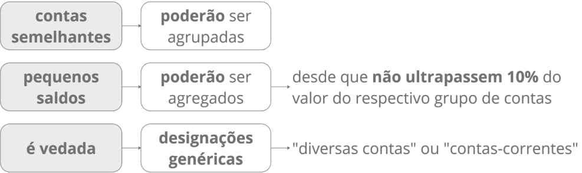{largura=78%}

previsto na legislação citada, a empresa XYZ deverá apresentar ao Legislativo Municipal as seguintes demonstrações financeiras, EXCETO:

- A) Balanço Patrimonial (BP).
- B) Demonstração do Fluxo de Caixa (DFC).
- C) Demonstração do Resultado do Exercício (DRE).
- D) Demonstração do Lucro ou Prejuízo Acumulado (DLPA).
- E) Demonstração das Origens e Aplicações de Recursos (DOAR).
- Gabarito: E
- Resolução: a caminho

## F0853 · FGV · 2024 · ALETO · ME
- Fontes: Igor Cintra 2
- Prova: FGV – Analista Legislativo – ALETO – 2024
- Grupos: 

De acordo com a Lei nº 6.404/1976 e modificações, ao fim de cada exercício social, as seguintes demonstrações deverão ser elaboradas pelas companhias, à exceção de uma. Assinale-a.

- A) Balanço patrimonial.
- B) Demonstração dos fluxos de caixa.
- C) Demonstração do resultado do exercício.
- D) Demonstração dos lucros ou prejuízos acumulados.
- E) Demonstração das origens e aplicações de recursos.
- Gabarito: E
- Resolução: a caminho

## F0854 · FGV · 2024 · Pref. São José dos Campos/SP · ME
- Fontes: Igor Cintra 3
- Prova: FGV – Auditor Fiscal – Pref. São José dos Campos/SP – 2024
- Grupos: 

De acordo com a Lei nº 6.404/76 e modificações, as informações divulgadas pelas notas explicativas

- A) não são auditadas pelo auditor independente.
- B) não são exigidas pelas práticas contábeis adotadas no Brasil.
- C) não são consideradas necessárias para uma apresentação adequada.
- D) não são apresentadas em outra parte das demonstrações financeiras.
- E) não devem seguir os mesmos padrões contábeis das demonstrações financeiras.
- Gabarito: D
- Resolução: a caminho

## F0855 · FGV · 2024 · ALETO · ME
- Fontes: Igor Cintra 4
- Prova: FGV – Analista Legislativo – ALETO – 2024
- Grupos: 

Uma empresa S.A. não elaborou as demonstrações financeiras referentes aos exercícios sociais em 2022 e 2023 e também não elaborou as demonstrações financeiras trimestrais que serviriam como base ao preenchimento dos formulários ITR de 2022 (2º e 3º) e de 2023 (1º, 2º e 3º).

Considerando as informações apresentadas e os preceitos da Lei nº 6.404, o analista da CVM identificou que a elaboração das demonstrações financeiras era de responsabilidade do(a):

- A) conselho de administração;
- B) conselho fiscal;
- C) comitê de auditoria;
- D) diretoria;
- E) contador.
- Gabarito: D
- Resolução: a caminho

## F0856 · CEBRASPE · 2026 · Telebras · CE
- Fontes: Igor Cintra 5
- Prova: CEBRASPE – Analista – Telebras – 2026
- Grupos: 

Nas demonstrações financeiras, é permitida a agregação de pequenos saldos, desde que sua natureza seja indicada e seus valores não ultrapassem 0,1 (um décimo) do valor do respectivo grupo de contas, sendo vedada a utilização de expressões genéricas para designar a conta representativa dessa agregação.

- Gabarito: CERTO
- Resolução: a caminho

## F0857 · CPCON · 2023 · Pref. Cabaceiras/PB · ME
- Fontes: Igor Cintra 6
- Prova: CPCON – Auditor Fiscal – Pref. Cabaceiras/PB – 2023
- Grupos: fora-destinacao

De acordo com a Lei nº 6.404/1976 e suas alterações ao final de cada exercício social,  com base na escrituração mercantil, será elaborada as demonstrações financeiras, que deverão exprimir com clareza a situação do patrimônio e as mutações ocorridas no exercício. Nesse contexto, julgue as proposições a seguir:

I- Nas demonstrações as contas semelhantes poderão ser agrupadas, os pequenos saldos poderão ser<br>

agregados, desde que indicada a sua natureza e não ultrapassem 0,1 (um décimo) do valor do respectivo grupo de contas. Mas, é vedada a utilização de designações genéricas, como "diversas contas" ou "contas-correntes".

II- As demonstrações serão complementadas por notas explicativas e outros quadros analíticos ou<br>

demonstrações contábeis necessárias para esclarecimento da situação patrimonial e dos resultados do exercício.

III- As demonstrações financeiras registrarão a destinação dos lucros segundo a proposta dos órgãos<br>

da administração, no pressuposto de sua aprovação pela assembleia geral.

É CORRETO o que se afirma em:

- A) I e II apenas. [[IMG igor-p9-y277.png 395x117]] [[PAG 9]]
- B) I apenas.
- C) I, II e III.
- D) II e III apenas.
- E) II apenas.
- Gabarito: C
- Resolução: a caminho

## F0858 · Quadrix · 2022 · CRC/AC · ME
- Fontes: Igor Cintra 7
- Prova: Quadrix – Contador – CRC/AC – 2022
- Grupos: 

A Lei n.º 6.404/1976 é o pilar da legislação societária no Brasil, estabelecendo regras quanto ao exercício social e às informações que devem ser anualmente divulgadas pelas sociedades anônimas, por meio das demonstrações financeiras. Com base em seu regramento, assinale a alternativa correta.

- A) As demonstrações de cada exercício serão publicadas com a indicação dos valores correspondentes das demonstrações dos três exercícios anteriores.
- B) Nas demonstrações, as contas semelhantes poderão ser agrupadas, sendo facultada a utilização de designações genéricas, como “diversas contas” ou “contas-correntes”.
- C) A companhia fechada com patrimônio líquido, na data do balanço, inferior a R$ 5.000.000,00 não será obrigada à elaboração e à publicação da demonstração dos fluxos de caixa.
- D) A demonstração do valor adicionado é de elaboração e publicação obrigatória apenas para as sociedades anônimas de capital aberto.
- Gabarito: D
- Resolução: a caminho

## F0859 · Metropole · 2022 · Pref. Pedra Branca do Amapari/AP · ME
- Fontes: Igor Cintra 8
- Prova: Metropole – Fiscal de Tributos – Pref. Pedra Branca do Amapari/AP – 2022
- Grupos: 

A assinale a alternativa incorreta sobre a contabilidade:

- A) o exercício social terá duração de 1 (um) ano e a data do término será fixada no estatuto, podendo ter duração diversa.
- B) as demonstrações financeiras registrarão a destinação dos lucros segundo a proposta dos órgãos da administração, no pressuposto de sua aprovação pela assembleia-geral.
- C) as demonstrações financeiras das companhias abertas observarão as normas expedidas pela Comissão de Valores Mobiliários e serão obrigatoriamente submetidas a auditoria por auditores independentes nela registrados.
- D) as companhias fechadas deverão observar as normas sobre demonstrações financeiras expedidas pela Comissão de Valores Mobiliários para as companhias abertas.
- E) nas demonstrações, as contas semelhantes poderão ser agrupadas; os pequenos saldos poderão ser agregados, desde que indicada a sua natureza e não ultrapassem 0,1 (um décimo) do valor do respectivo grupo de contas; mas é vedada a utilização de designações genéricas, como "diversas contas" ou "contas- correntes".
- Gabarito: D
- Resolução: a caminho

## F0860 · FGV · 2018 · MPE/AL · ME
- Fontes: Igor Cintra 9
- Prova: FGV – Contador – MPE/AL – 2018
- Grupos: 

Uma sociedade de ações de capital fechado apresentava, em 31/12/2017, os seguintes saldos em seu balanço patrimonial:

Ativo                         900.000 Passivo                         300.000 PL                                   600.000 Ativo Total              900.000 Passivo + PL               900.000 Assinale a opção que indica, de acordo com a Lei nº 6404/64 e alterações, o conjunto de demonstrações contábeis obrigatório para esta sociedade empresária.

- A) Balanço Patrimonial, demonstração do resultado do exercício, demonstração dos lucros ou prejuízos acumulados, demonstração dos fluxos de caixa e demonstração do valor adicionado.
- B) Balanço Patrimonial, demonstração do resultado do exercício, demonstração dos lucros ou prejuízos acumulados e demonstração dos fluxos de caixa.
- C) Balanço Patrimonial, demonstração do resultado do exercício, demonstração das mutações do patrimônio líquido e demonstração dos fluxos de caixa.
- D) Balanço Patrimonial, demonstração do resultado do exercício, demonstração das mutações do patrimônio líquido e demonstração do valor adicionado.
- E) Balanço Patrimonial, demonstração do resultado do exercício e demonstração dos lucros ou prejuízos acumulados.
- Gabarito: E
- Resolução: a caminho

## F0861 · FGV · 2024 · Câmara dos Deputados · ME
- Fontes: Igor Cintra 10
- Prova: FGV – Consultor Legislativo – Câmara dos Deputados – 2024
- Grupos: 

De acordo com a Lei nº 6.404/76 e modificações, as notas explicativas devem divulgar as informações exigidas pelas práticas contábeis adotadas no Brasil quando

- A) envolvem valores importantes.
- B) refletem mudanças exclusivas em relação ao exercício anterior.
- C) são consideradas necessárias para uma apresentação completa.
- D) não são apresentadas em outra parte das demonstrações financeiras.
- E) não representam as práticas adotadas de acordo com as normas internacionais.
- Gabarito: D
- Resolução: a caminho

## F0862 · FCC · 2023 · TRT 12ª Região · ME
- Fontes: Igor Cintra 11
- Prova: FCC – Analista – TRT 12ª Região – 2023
- Grupos: 

De acordo com a Lei nº 6404/1976 e suas alterações, as notas explicativas devem, dentre outras,

I. apresentar informações sobre a base de preparação das demonstrações financeiras e das práticas<br>

contábeis especificas selecionadas e aplicadas para negócios e eventos significativos.

II. divulgar as informações exigidas pelas práticas contábeis adotadas no Brasil, mesmo que estejam<br>

apresentadas em outra parte das demonstrações financeiras.

III. fornecer informações adicionais não indicadas nas próprias demonstrações financeiras, ainda que<br>

elas não sejam consideradas necessárias para uma apresentação adequada.

Está correto o que se afirma em

- A) I, II e III.
- B) I e III, apenas.
- C) I e II, apenas.
- D) I, apenas.
- E) II e III, apenas.
- Gabarito: D
- Resolução: a caminho

## F0863 · Objetiva · 2023 · Pref. Canoas/RS · ME
- Fontes: Igor Cintra 12
- Prova: Objetiva – Gestor – Pref. Canoas/RS – 2023
- Grupos: 

Considerando-se as notas explicativas, marcar C para as afirmativas Certas, E para as Erradas e, após, assinalar a alternativa que apresenta a sequência CORRETA:

(      )  As notas explicativas devem apresentar informações sobre a base de preparação das

demonstrações financeiras e das práticas contábeis específicas selecionadas e aplicadas para negócios e eventos significativos.

(      )  É necessário que as notas explicativas divulguem as informações exigidas pelas práticas

contábeis adotadas no Brasil que não estejam apresentadas em nenhuma outra parte das demonstrações financeiras.

(      )  As notas explicativas devem fornecer informações adicionais não indicadas nas próprias

demonstrações financeiras e consideradas necessárias para uma apresentação adequada.

- A) C - C - C.
- B) E - E - C.
- C) C - E - E.
- D) E - C - C.
- E) E - E - E.
- Gabarito: A
- Resolução: a caminho

## F0864 · Consulplan · 2025 · CM Araraquara/SP · ME
- Fontes: Igor Cintra 13
- Prova: Consulplan – Contador – CM Araraquara/SP – 2025
- Grupos: 

As Demonstrações Financeiras das Sociedades por Ações serão complementadas por Notas Explicativas e outros quadros analíticos ou demonstrações contábeis necessários para esclarecimento da situação patrimonial e dos resultados do exercício. NÃO se trata de uma função ou característica das Notas Explicativas:

- A) Indicar a taxa de juros, as datas de vencimento e as garantias das obrigações a curto prazo.
- B) Fornecer informações adicionais não indicadas nas próprias demonstrações financeiras e consideradas necessárias para uma apresentação adequada.
- C) Indicar os ônus reais constituídos sobre elementos do Ativo, as garantias prestadas a terceiros e outras responsabilidades eventuais ou contingentes.
- D) Divulgar as informações exigidas pelas práticas contábeis adotadas no Brasil que não estejam apresentadas em nenhuma outra parte das demonstrações financeiras.
- E) Apresentar informações sobre a base de preparação das demonstrações financeiras e das práticas contábeis específicas selecionadas e aplicadas para negócios e eventos significativos.
- Gabarito: A
- Resolução: a caminho

## F0865 · Fepese · 2026 · InvestSC · ME
- Fontes: Igor Cintra 14
- Prova: Fepese – Analista – InvestSC – 2026
- Grupos: receita-bruta, deducoes

As demonstrações financeiras serão complementadas por notas explicativas e outros quadros analíticos ou demonstrações contábeis necessárias para esclarecimento da situação patrimonial e dos resulta dos do exercício.

As notas explicativas devem: 1. Fornecer informações adicionais não indicada das nas próprias demonstrações financeiras e consideradas necessárias para uma apresentação adequada. 2. Apresentar cálculos de índices de liquidez, rentabilidade e endividamento relativos às demonstrações financeiras que estão sendo publicadas. 3. Demonstrar a política comercial da companhia em relação a prazos de pagamento, descontos sobre vendas e condições privilegiadas ou especiais concedidas a determinados clientes. 4. Indicar a taxa de juros, as datas de vencimento e as garantias das obrigações a longo prazo. 5. Divulgar as informações exigidas pelas práticas contábeis adotadas no Brasil que não estejam apresentadas em nenhuma outra parte das demonstrações financeiras.

Assinale a alternativa que indica todas as afirmativas corretas.

- A) São corretas apenas as afirmativas 1, 2 e 5.
- B) São corretas apenas as afirmativas 1, 3 e 4.
- C) São corretas apenas as afirmativas 1, 4 e 5.
- D) São corretas apenas as afirmativas 2, 3 e 4.
- E) São corretas apenas as afirmativas 2, 3 e 5.
- Gabarito: C
- Resolução: a caminho

## F0866 · Quadrix · 2025 · CRO/AL · CE
- Fontes: Igor Cintra 26
- Prova: Quadrix – Analista – CRO/AL – 2025
- Grupos: receita-liquida, deducoes, receita-bruta, lucro-liquido

Na demonstração do resultado do exercício de uma entidade comercial, os primeiros três itens a serem evidenciados são, respectivamente, a receita bruta, as deduções da receita e a receita líquida de vendas.

- Gabarito: CERTO
- Resolução: a caminho

## F0867 · Igeduc · 2023 · Pref. Triunfo/RS · CE
- Fontes: Igor Cintra 28
- Prova: Igeduc – Agente – Pref. Triunfo/RS – 2023
- Grupos: deducoes, receita-bruta, lucro-liquido

A demonstração do resultado do exercício deve discriminar, entre outras informações, a receita bruta das vendas e serviços, as deduções das vendas, os abatimentos e os impostos.

- Gabarito: CERTO
- Resolução: a caminho

## F0868 · Quadrix · 2022 · CRC/PR · CE
- Fontes: Igor Cintra 29
- Prova: Quadrix – Analista – CRC/PR – 2022
- Grupos: deducoes, receita-bruta, lucro-liquido

Na Demonstração do Resultado do Exercício, figurarão como deduções da receita bruta os abatimentos, os descontos incondicionais concedidos, o custo das mercadorias e dos produtos vendidos e os tributos incidentes sobre o faturamento.

- Gabarito: ERRADO
- Resolução: a caminho

## F0869 · VUNESP · 2026 · São José do Rio Preto/SP · ME
- Fontes: Igor Cintra 36
- Prova: VUNESP – Auditor Fiscal – São José do Rio Preto/SP – 2026
- Grupos: receita-bruta, deducoes, receita-liquida, cmv, despesas-vendas, fora-passivo

Considere as informações a seguir da Companhia Industrial RP Ltda: – Venda de 1.600 unidades de um produto, ao preço unitário de R$ 576,00, com frete total de R$ 14.400,00 por conta do vendedor.

– Na emissão de nota fiscal dessa venda, foi concedido um desconto de R$ 12.000,00.

Demais informações: – Custo dos produtos vendidos R$ 576.000,00 – Salários dos vendedores R$ 16.800,00 – Despesas com publicidade R$ 12.480,00 – A transação está sujeita à seguinte tributação: – ICMS R$ 92.160,00 – IPI R$ 10.080,00 – PIS sobre o faturamento R$ 15.200,00 – COFINS sobre o faturamento R$ 70.040,00 Considerando tais informações, o valor correspondente à receita líquida de vendas será de

- A) R$ 767.960,00.
- B) R$ 717.800,00.
- C) R$ 732.200,00.
- D) R$ 921.600,00.
- E) R$ 902.400,00.
- Gabarito: C
### O que a questão pede
A **receita líquida de vendas** de uma indústria. É preciso separar: o que é dedução da receita (desconto na nota, ICMS, PIS, Cofins), o que nem é receita (IPI) e o que é despesa com vendas (frete por conta do vendedor, salários dos vendedores, publicidade).

### Cálculos prévios
**Receita bruta:** 1.600 × 576,00 = **921.600**. O IPI (10.080) é cobrado por fora e **não** compõe a receita bruta.

**Três tipos de redução de preço, três lugares diferentes:**

| Redução | Quando | Onde vai |
|---|---|---|
| Desconto incondicional | Na própria nota fiscal, sem depender de evento futuro | Dedução da receita bruta |
| Abatimento | Depois da venda (defeito, atraso, avaria) | Dedução da receita bruta |
| Desconto condicional | Depois, se o cliente cumprir uma condição (pagar antes do vencimento) | Despesa financeira |

O desconto de 12.000 foi dado "na emissão da nota fiscal": é **incondicional**.

### Passo a passo
```dre
@ Venda de 1.600 unidades a 576,00 | 921.600 | receita-bruta
@ Desconto concedido na nota fiscal | 12.000 | deducoes
@ ICMS | 92.160 | deducoes
@ PIS sobre o faturamento | 15.200 | deducoes
@ COFINS sobre o faturamento | 70.040 | deducoes
@ IPI | 10.080 | fora-passivo
@ Custo dos produtos vendidos | 576.000 | cmv
@ Frete por conta do vendedor | 14.400 | despesas-vendas
@ Salários dos vendedores | 16.800 | despesas-vendas
@ Despesas com publicidade | 12.480 | despesas-vendas
> O IPI não é receita da empresa. O CPV e as despesas com vendas ficam abaixo da receita líquida.
! IPI; Custo dos produtos vendidos; Frete por conta do vendedor; Salários dos vendedores; Despesas com publicidade
+ Receita bruta | 921.600 | Venda de 1.600 unidades a 576,00
> Deduções: desconto incondicional e os tributos sobre a receita.
+ (–) Desconto incondicional | (12.000) | Desconto concedido na nota fiscal
+ (–) ICMS | (92.160) | ICMS
+ (–) PIS e Cofins | (85.240) | PIS sobre o faturamento; COFINS sobre o faturamento
= Receita líquida | 732.200
```

Gabarito **C (732.200)**.

### O que ignorar e por quê
- **IPI (10.080):** tributo por fora; o vendedor só o repassa ao fisco.
- **Frete de 14.400 por conta do vendedor:** gasto para entregar ao cliente, despesa com vendas.
- **CPV, salários dos vendedores e publicidade:** abaixo da receita líquida.

### O que mais poderia estar ali
- **Deduções:** devoluções de vendas, vendas canceladas, abatimentos, ISS (em serviços), AVP sobre vendas a prazo.
- **Fora da receita:** IPI e ICMS-ST cobrados do cliente; ⚠️ IBS e CBS, pela orientação técnica do CFC de 2026, também não compõem a receita bruta.

### Pegadinhas
- **D (921.600):** é a receita bruta; não deduziu nada.
- **B (717.800)** = 732.200 − 14.400: tirou também o frete de entrega, que é despesa com vendas.
- **Somar o IPI à receita bruta e depois deduzi-lo** dá o mesmo resultado, mas não é o tratamento técnico: o IPI nem entra na receita bruta.
- **Desconto na nota = incondicional = dedução.** Desconto por pagamento antecipado = condicional = despesa financeira.

### Leve para as próximas
1. Receita líquida = receita bruta − (devoluções + abatimentos + descontos incondicionais + tributos sobre a receita).
2. IPI e ICMS-ST são cobrados por fora: não entram na receita bruta.
3. Frete na venda por conta do vendedor é despesa com vendas, nunca dedução.
4. Fonte: resolução do professor Igor Cintra, reescrita e ampliada.

## F0870 · VUNESP · 2026 · CM Nova Odessa/SP · ME
- Fontes: Igor Cintra 37
- Prova: VUNESP – Contador – CM Nova Odessa/SP – 2026
- Grupos: receita-liquida, resultado-financeiro, receita-bruta, deducoes, outras-receitas-despesas

Considere as informações a seguir, extraídas do balancete de verificação de determinada empresa, relativas ao último exercício financeiro:

- Receita bruta de vendas de mercadorias: R$ 216.000,00.
- Receitas financeiras: R$ 21.600,00.
- Encargos financeiros: R$ 32.400,00.
- Vendas canceladas: R$ 16.200,00.
- Receita bruta de prestação de serviços: R$ 64.800,00.
- Receita líquida de venda de ativo imobilizado: R$ 540.000,00.
- ICMS sobre vendas e serviços: R$ 54.000,00.
- Demais impostos sobre vendas e serviços: R$ 10.800,00.

Considerando exclusivamente as informações apresentadas, é correto afirmar que o valor correspondente à receita operacional líquida da empresa, no período, foi de R$

- A) 210.600,00.
- B) 216.540,00.
- C) 199.800,00.
- D) 248.940,00.
- E) 216.000,00.
- Gabarito: C
- Resolução: a caminho

## F0871 · FCC · 2026 · SEFAZ/SP · ME
- Fontes: Igor Cintra 38
- Prova: FCC – Auditor Fiscal – SEFAZ/SP – 2026
- Grupos: receita-bruta

A empresa comercial Direto da Fonte S.A. realizou as seguintes vendas durante o mês de dezembro de 2025:

Data Valores em Reais (R$)

Data de vencimento 01/12/2025 9.100.000 01/06/2027 15/12/2025 2.100.000 À vista 29/12/2025 1.700.000 À vista A taxa de juros praticada pela empresa para as vendas a prazo, em dezembro de 2025, era de 1,5% ao mês, sendo que a taxa equivalente para o período de 01/12/2025 a 01/06/2027 era 30%.

A empresa reconheceu na Demonstração do Resultado do ano de 2025, especificamente em relação às vendas efetuadas no mês de dezembro de 2025, receita de vendas no valor de

- A) R$ 10.800.000,00 e receita financeira no valor de R$ 2.100.000.
- B) R$ 10.170.000 e receita financeira no valor de R$ 2.730.000.
- C) R$ 12.900.000, apenas.
- D) R$ 10.800.000, apenas.
- E) R$ 10.800.000 e receita financeira no valor de R$ 105.000.
- Gabarito: E
- Resolução: a caminho

## F0872 · FCC · 2026 · SEFAZ/SP · ME
- Fontes: Igor Cintra 39
- Prova: FCC – Auditor Fiscal – SEFAZ/SP – 2026
- Grupos: 

A Cia. Enrolada adquiriu, em 30/11/2025, produtos para serem comercializados. Em função de sua situação financeira, a Cia. adquiriu estes produtos por R$ 480.000 para serem pagos em 30/11/2026, mas, se a Cia. tivesse adquirido estes produtos à vista, teria pagado R$ 400.000. Em 10/12/2025, a Cia. Enrolada vendeu 80% desses produtos por R$ 1.020.000, para serem recebidos integralmente em 10/12/2026. Sabe-se que a empresa concede, normalmente, um prazo de 90 dias para seus clientes e que se o cliente tivesse adquirido as mercadorias à vista teria pagado R$ 850.000. Com base nessas informações, a Cia. Enrolada reconheceu

- A) Estoques no valor de R$ 480.000, na data da aquisição.
- B) Receita financeira no valor de R$ 170.000, no mês de dezembro de 2025.
- C) Receita de vendas no valor de R$ 1.020.000 e Custo dos produtos vendidos no valor de R$ 320.000, na data da venda.
- D) Receita de vendas no valor de R$ 850.000 e Custo dos produtos vendidos no valor de R$ 320.000, na data da venda.
- E) Receita de vendas no valor de R$ 850.000, Custo dos produtos vendidos no valor de R$ 320.000 e Resultado financeiro positivo no valor de R$ 90.000, na data da venda.
- Gabarito: D
- Resolução: a caminho

## F0873 · FGV · 2024 · Câmara Municipal · ME
- Fontes: Igor Cintra 49
- Prova: FGV – Contador – Câmara Municipal – Fortaleza/CE – 2024
- Grupos: receita-bruta

Uma imobiliária constrói e vende apartamentos. Para estimular as vendas, a imobiliária costuma organizar um grande evento de lançamento de seus prédios.

O valor gasto com esse evento deve ser contabilizado como

- A) ativo circulante, no balanço patrimonial.
- B) ativo intangível, no balanço patrimonial.
- C) ativo imobilizado, no balanço patrimonial.
- D) custo, na demonstração do resultado do exercício.
- E) despesa operacional, na demonstração do resultado do exercício.
- Gabarito: E
- Resolução: a caminho

## F0874 · FGV · 2024 · Pref. São José dos Campos/SP · ME
- Fontes: Igor Cintra 56
- Prova: FGV – Analista – Pref. São José dos Campos/SP – 2024
- Grupos: lucro-liquido

Em janeiro de 2020, uma sociedade empresária contraiu um empréstimo bancário de R$80.000 para pagamento em 5 anos, com o objetivo de adquirir computadores para atendimento a clientes. Os juros periódicos incorridos são acrescidos ao principal.

Assinale a opção que indica a apresentação dos juros do empréstimo na Demonstração do Resultado do Exercício da sociedade empresária.

- A) Outras despesas.
- B) Despesas financeiras.
- C) Despesas operacionais.
- D) Ajustes de conversão do período.
- E) Não há contabilização na Demonstração do Resultado. [[PAG 61]]
- Gabarito: B
- Resolução: a caminho

## F0875 · FGV · 2024 · Câmara Municipal de São Paulo/SP · ME
- Fontes: Igor Cintra 57
- Prova: FGV – Consultor – Câmara Municipal de São Paulo/SP – 2024
- Grupos: lucro-liquido

Em 01/01/2020, uma sociedade empresária captou um empréstimo bancário no valor de R$400.000 para pagamento em 5 anos. Os juros anuais são de 10%.

Na data da captação do empréstimo, o banco cobrou uma comissão de R$32.000 para concretizar a operação, quantia julgada como material pela sociedade empresária. O montante foi pago ao banco no mês seguinte.

Assinale a opção que indica a contabilização da comissão na Demonstração do Resultado do Exercício da sociedade empresária.

- A) Despesa administrativa, na data da captação do empréstimo.
- B) Despesa administrativa, durante a vigência do empréstimo
- C) Despesa financeira, na data do pagamento da comissão.
- D) Despesa financeira, na data da captação do empréstimo.
- E) Despesa financeira, durante a vigência do empréstimo.
- Gabarito: E
- Resolução: a caminho

## F0876 · FGV · 2024 · TJ/MT · ME
- Fontes: Igor Cintra 59
- Prova: FGV – Analista – TJ/MT – 2024
- Grupos: resultado-financeiro, receita-bruta, despesas-vendas

Uma loja de bolsas apresentava os seguintes saldos em seu balanço patrimonial de 31/10/2024: Disponibilidades: R$ 10.000; Estoque: R$ 20.000; Fornecedores (30 dias): R$ 50.000; Patrimônio Líquido: R$ 40.000; Clientes (180 dias): R$ 60.000.

Em novembro de 2024, a loja vendeu metade do seu estoque à vista. A receita deveria ser de R$ 30.000, no entanto, a loja concedeu um desconto sobre o preço de vendas de R$ 2.000. Além disso, a loja negociou com o seu cliente a antecipação do montante a receber. Desse modo, recebeu R$ 57.000 e extinguiu todo o direito.

Ainda, reconheceu e pagou despesas comerciais e administrativas de R$ 15.000. As despesas financeiras da loja em novembro de 2024 somaram

- A) zero.
- B) R$ 2.000.
- C) R$ 3.000.
- D) R$ 5.000.
- E) R$ 15.000.
- Gabarito: C
- Resolução: a caminho

## F0877 · FGV · 2024 · Pref. Vitória/ES · ME
- Fontes: Igor Cintra 63
- Prova: FGV – Auditor de Controle Interno – Pref. Vitória/ES – 2024
- Grupos: 

Em 2023, uma sociedade empresária pagou uma duplicata a seu principal fornecedor, antes da data do vencimento. Pelo pagamento antecipado, recebeu um desconto, reconhecido como "Descontos Obtidos", em suas demonstrações contábeis.

O reconhecimento do desconto obtido pela sociedade empresária em 31/12/2023 é indicado por

- A) Receitas Financeiras, na Demonstração do Resultado do Exercício.
- B) Despesas Financeiras, na Demonstração do Resultado do Exercício.
- C) Deduções da Receita, na Demonstração do Resultado do Exercício.
- D) Reserva de Capital, na Demonstração das Mutações do Patrimônio Líquido.
- E) Ajustes de Avaliação Patrimonial, na Demonstração das Mutações do Patrimônio Líquido.
- Gabarito: A
- Resolução: a caminho

## F0878 · FCC · 2024 · TRT 11ª Região · ME
- Fontes: Igor Cintra 65
- Prova: FCC – Analista Judiciário – TRT 11ª Região – 2024
- Grupos: receita-bruta, deducoes, receita-liquida, cmv, resultado-bruto, despesas-vendas, despesas-administrativas, lair, fora-ativo, fora-passivo

A indústria OMEGA Ltda. produziu, em março de 20X3, 2.000 unidades de seu produto, sendo que 1.500 unidades foram vendidas no período pelo preço final de venda de R$ 134,40 cada unidade. O custo variável unitário da mercadoria vendida foi de R$ 30,00 por unidade, mas a empresa incorreu ainda em R$ 64.000,00 de custos fixos indiretos de fabricação, distribuídos igualmente entre as unidades produzidas. Nesta transação de venda, houve a incidência de Imposto sobre a Circulação de Mercadorias e Prestação de Serviços (ICMS) à alíquota de 18% e incidência de Imposto sobre Produtos Industrializados (IPI) à alíquota de 12%. A entidade incorreu ainda em despesas de vendas de R$ 20.000,00 e outras despesas administrativas de R$ 15.000,00. Com base nas informações apresentadas e considerando que a entidade utiliza o método de custeio permitido pelo CPC16(R1) – Estoques, que não foram registradas outras receitas no período e que não havia estoque remanescente do mês anterior, o Resultado Antes dos Tributos sobre o Lucro da empresa OMEGA Ltda. no mês de março de 20X3 foi, em reais,

- A) 28.350,00.
- B) 13.120,00.
- C) 19.600,00.
- D) 37.800,00.
- E) 3.600,00.
- Gabarito: C
### O que a questão pede
O **resultado antes dos tributos sobre o lucro** (LAIR) de março de uma indústria. Duas decisões: tirar o **IPI** do preço final (ele não é receita) e usar o **custeio por absorção**, o único aceito pelo CPC 16 (R1), que leva os custos fixos de fabricação ao produto.

### Cálculos prévios
**1) Preço sem IPI.** O preço final de 134,40 já tem o IPI de 12% somado "por fora":

| Item | Valor por unidade |
|---|---:|
| Preço da mercadoria (X) | 120,00 |
| (+) IPI (12% × 120,00) | 14,40 |
| = Preço final (1,12 X) | 134,40 |

X = 134,40 ÷ 1,12 = **120,00**. Receita bruta = 1.500 × 120,00 = **180.000**.

**2) ICMS sobre vendas:** 18% × 180.000 = **32.400** (dedução da receita).

**3) Custo unitário por absorção:**

| Item | Valor |
|---|---:|
| Custo variável por unidade | 30,00 |
| (+) Custo fixo por unidade (64.000 ÷ 2.000 unidades **produzidas**) | 32,00 |
| = Custo unitário | **62,00** |
| CPV = 1.500 vendidas × 62,00 | **93.000** |
| Fica no estoque: 500 × 62,00 | 31.000 |

### Passo a passo
```dre
@ Receita bruta (1.500 × 120,00) | 180.000 | receita-bruta
@ IPI destacado na nota (12%) | 21.600 | fora-passivo
@ ICMS sobre vendas (18%) | 32.400 | deducoes
@ Custo variável das unidades vendidas (1.500 × 30,00) | 45.000 | cmv
@ Custo fixo absorvido pelas unidades vendidas (1.500 × 32,00) | 48.000 | cmv
@ Custo das 500 unidades em estoque (500 × 62,00) | 31.000 | fora-ativo
@ Despesas de vendas | 20.000 | despesas-vendas
@ Outras despesas administrativas | 15.000 | despesas-administrativas
> O IPI é cobrado do cliente e repassado ao fisco: não é receita da empresa. O custo das unidades não vendidas fica no estoque.
! IPI destacado na nota (12%); Custo das 500 unidades em estoque (500 × 62,00)
+ Receita bruta | 180.000 | Receita bruta (1.500 × 120,00)
+ (–) ICMS sobre vendas | (32.400) | ICMS sobre vendas (18%)
= Receita líquida | 147.600
> Custeio por absorção: o custo fixo de fabricação vai para o produto (32,00 por unidade produzida).
+ (–) CPV | (93.000) | Custo variável das unidades vendidas (1.500 × 30,00); Custo fixo absorvido pelas unidades vendidas (1.500 × 32,00)
= Lucro bruto | 54.600
+ (–) Despesas de vendas | (20.000) | Despesas de vendas
+ (–) Despesas administrativas | (15.000) | Outras despesas administrativas
= Resultado antes dos tributos sobre o lucro | 19.600
```

Gabarito **C (19.600)**.

### O que ignorar e por quê
- **IPI (21.600):** tributo não cumulativo cobrado destacadamente do comprador; o vendedor é mero depositário. Não entra na receita bruta (Decreto-Lei 1.598/77, art. 12, § 4º, com a redação da Lei 12.973/2014). Se o enunciado desse a receita **com** IPI, ele seria deduzido.
- **Custo fixo das 500 unidades não vendidas (16.000):** pelo custeio por absorção, fica no estoque e só vira custo quando elas forem vendidas.

### O que mais poderia estar ali
- **Deduções:** PIS e Cofins sobre o faturamento, devoluções, descontos incondicionais.
- **Custos que também iriam para o produto:** mão de obra direta, depreciação das máquinas da fábrica, energia da produção.
- **Despesas, nunca custo:** comissões de vendedores, propaganda, frete de entrega, salários da administração.

### Pegadinhas
- **E (3.600)** = 147.600 − 45.000 − 64.000 − 35.000: é o resultado pelo **custeio variável**, que lança todos os custos fixos (64.000) no período. O custeio variável é gerencial; o CPC 16 (R1) exige a absorção.
- **Ratear o custo fixo pelas unidades vendidas** (64.000 ÷ 1.500) e não pelas produzidas: joga no resultado custo que pertence ao estoque.
- **Calcular o ICMS sobre 134,40** ou deixar o IPI na receita: os dois inflam a receita e erram o resultado.

### Leve para as próximas
1. Preço "final" de indústria com IPI: divida por (1 + alíquota do IPI) para achar a receita bruta.
2. Custeio por absorção: custo unitário = custo variável + custos fixos ÷ unidades **produzidas**.
3. O custo das unidades não vendidas fica no estoque; só o das vendidas vai para o CPV.
4. Fonte: resolução do professor Igor Cintra, reescrita e ampliada.

## F0879 · FCC · 2023 · Copergás · ME
- Fontes: Igor Cintra 66
- Prova: FCC – Analista – Copergás – 2023
- Grupos: ir-csll, lucro-liquido

Uma companhia de gás, que está enquadrada no regime de apuração pelo Lucro Real, apresenta, em seu balanço patrimonial de 2021, e nos respectivos livros fiscais, um prejuízo fiscal de imposto de renda, no montante de R$ 50.000.000,00, que, de acordo com as regras fiscais vigentes, poderá ser compensado em períodos futuros, observado, em cada período de apuração de IRPJ, o limite de 30% do lucro líquido ajustado.

Durante o ano de 2022, apurou um lucro líquido tributável já ajustado de R$ 70.000.000,00, para fins de Imposto de Renda.

Baseado nessas informações, e considerando que não existe nenhum benefício fiscal de IRPJ a ser aplicado ao lucro tributável, o Imposto de Renda, já acrescido do adicional do Imposto de Renda apurados para o referido ano calendário de 2022, será, em reais, de

- A) 7.350.000,00.
- B) 12.226.000,00.
- C) 12.250.000,00. [[IMG igor-p73-y177.png 437x70]] [[IMG igor-p73-y324.png 473x50]] [[PAG 73]]
- D) 4.410.000,00.
- E) 16.660.000,00.
- Gabarito: B
- Resolução: a caminho

## F0880 · VUNESP · 2023 · EPC · ME
- Fontes: Igor Cintra 67
- Prova: VUNESP – Analista – EPC – 2023
- Grupos: lair, ir-csll

Com base nas informações contábeis e fiscais prestadas pelo contador da empresa Chego Lá Ltda., referente, hipoteticamente, ao último trimestre de 2022, responda à questão.

Enquadramento fiscal: Lucro real Lucro antes do IR e CSL no trimestre: R$ 620.000 Adições temporárias: R$ 67.000 Adições permanentes: R$ 17.500 Exclusões permanentes: R$ 30.000,00 Exclusões temporárias: R$ 14.000,00 Assinale a alternativa que apresenta o valor correto do imposto de renda e do adicional do imposto de renda no trimestre, em Reais.

- A) 155.000.
- B) 159.125.
- C) 166.125.
- D) 166.725.
- E) 169.700.
- Gabarito: B
- Resolução: a caminho

## F0881 · VUNESP · 2023 · EPC · ME
- Fontes: Igor Cintra 68
- Prova: VUNESP – Analista – EPC – 2023
- Grupos: lucro-liquido, ir-csll

Assinale a alternativa que apresenta o valor correto da contribuição social sobre o lucro líquido no trimestre, em Reais.

- A) 45.360.
- B) 55.800.
- C) 59.445.
- D) 61.250.
- E) 62.300.
- Gabarito: C
- Resolução: a caminho

## F0882 · FGV · 2024 · TCE/GO · ME
- Fontes: Igor Cintra 71
- Prova: FGV – Auditor de Controle Externo – TCE/GO – 2024
- Grupos: despesas-administrativas

A Cia Lua foi constituída em 01/12/2023. Os seguintes fatos aconteceram no mês de sua constituição: 01/12: Os sócios integralizaram R$200.000 em capital social, sendo R$100.000 em dinheiro e R$100.000 em estoque. 01/12: Pagamento de R$24.000 referente a aluguel antecipado de um ano, apropriado linearmente a partir desta data. 31/12: Reconhecimento da venda de todo o estoque por R$240.000. Metade do valor foi recebida em dezembro e o restante tem recebimento previsto para fevereiro de 2024. A inadimplência é estimada em 2%. 31/12: Reconhecimento de despesas de salários, no valor de R$18.000 para pagamento no mês seguinte. 31/12: Reconhecimento e pagamento de despesas gerais no valor de R$12.000.

Assinale a opção que indica o resultado apurado em 31/12/2023, sem considerar a incidência de impostos.

- A) R$93.200.
- B) R$95.600.
- C) R$103.200.
- D) R$105.600.
- E) R$108.000.
- Gabarito: D
- Resolução: a caminho

## F0883 · VUNESP · 2023 · Pref. Araçatuba/SP · ME
- Fontes: Igor Cintra 74
- Prova: VUNESP – Fiscal Tributário – Pref. Araçatuba/SP – 2023
- Grupos: receita-liquida, cmv, resultado-bruto, despesas-administrativas, resultado-financeiro, lair, ir-csll, lucro-liquido, fora-ativo, fora-passivo, fora-pl

A Cia Serviços Gerais é uma empresa prestadora de serviços de limpeza e conservação. Em 31.12.2022, a entidade apresentou o seguinte Balancete de Verificação:

Contas Contábeis Saldo (em R$)

| Conta | Valor |
|---|---:|
| Amortização acumulada | 35.500,00 |
| Aplicações financeiras | 450.000,00 |
| Bancos | 60.000,00 |
| Capital | 2.000.000,00 |
| Contas a receber | 700.000,00 |
| Custo dos serviços prestados | 990.000,00 |
| Depreciação acumulada | 150.000,00 |
| Despesa com depreciação | 35.000,00 |
| Despesa de IR e CSLL | 45.600,00 |
| Despesa financeira | 12.000,00 |
| Despesas com amortização | 5.500,00 |
| Despesas gerais e administrativas | 20.000,00 |
| Empréstimos de curto prazo | 100.000,00 |
| Fornecedores | 90.000,00 |
| Imobilizado | 1.000.000,00 |
| Intangível | 800.000,00 |
| Investimentos em títulos públicos – longo prazo | 560.000,00 |
| Material de expediente (estoque) | 70.000,00 |
| Perda estimada de crédito de liquidação duvidosa – ativo | 56.000,00 |
| Receita financeira | 26.700,00 |
| Receita líquida | 1.200.000,00 |
| Reserva de capital | 300.000,00 |
| Reservas de lucro | 8.500,00 |
| Salários a pagar | 900.000,00 |

O lucro líquido do exercício de 2022, totalizou, em R$:

- A) 210.000,00.
- B) 164.200,00.
- C) 118.600,00.
- D) 110.100,00.
- E) 8.500,00.
- Gabarito: C
### O que a questão pede
O **lucro líquido** de 2022 de uma prestadora de serviços. Como a pergunta é só o resultado final, basta somar as receitas e tirar as despesas, sem montar a DRE linha a linha (atalho de apuração do resultado).

### Cálculos prévios
**Contas de resultado do balancete:**

| Receitas | Valor | Despesas e custos | Valor |
|---|---:|---|---:|
| Receita líquida | 1.200.000 | Custo dos serviços prestados | 990.000 |
| Receita financeira | 26.700 | Despesa com depreciação | 35.000 |
| | | Despesas com amortização | 5.500 |
| | | Despesas gerais e administrativas | 20.000 |
| | | Despesa financeira | 12.000 |
| | | Despesa de IR e CSLL | 45.600 |
| **Total** | **1.226.700** | **Total** | **1.108.100** |

Lucro líquido = 1.226.700 − 1.108.100 = **118.600**.

### Passo a passo
```dre
@ Receita líquida | 1.200.000 | receita-liquida
@ Custo dos serviços prestados | 990.000 | cmv
@ Despesa com depreciação | 35.000 | despesas-administrativas
@ Despesas com amortização | 5.500 | despesas-administrativas
@ Despesas gerais e administrativas | 20.000 | despesas-administrativas
@ Despesa financeira | 12.000 | resultado-financeiro
@ Receita financeira | 26.700 | resultado-financeiro
@ Despesa de IR e CSLL | 45.600 | ir-csll
@ Perda estimada de crédito de liquidação duvidosa – ativo | 56.000 | fora-ativo
@ Material de expediente (estoque) | 70.000 | fora-ativo
@ Salários a pagar | 900.000 | fora-passivo
@ Reservas de lucro | 8.500 | fora-pl
@ Demais contas de ativo, passivo e PL | — | fora-outros
> A perda estimada com créditos é o saldo retificador (o próprio nome diz "ativo"); material de expediente é estoque; reservas são PL.
! Perda estimada de crédito de liquidação duvidosa – ativo; Material de expediente (estoque); Salários a pagar; Reservas de lucro; Demais contas de ativo, passivo e PL
+ Receita líquida | 1.200.000 | Receita líquida
+ (–) Custo dos serviços prestados | (990.000) | Custo dos serviços prestados
= Lucro bruto | 210.000
+ (–) Despesas operacionais | (60.500) | Despesa com depreciação; Despesas com amortização; Despesas gerais e administrativas
+ Resultado financeiro | 14.700 | Receita financeira; Despesa financeira
= LAIR | 164.200
+ (–) IR e CSLL | (45.600) | Despesa de IR e CSLL
= Lucro líquido | 118.600
```

Gabarito **C (118.600)**.

### O que ignorar e por quê
- **Perda estimada de crédito de liquidação duvidosa (56.000):** saldo do ativo, não despesa do ano.
- **Material de expediente (70.000):** estoque de consumo.
- **Amortização e depreciação acumuladas:** retificadoras do intangível e do imobilizado; as despesas do ano têm contas próprias.
- **Reservas de lucro (8.500):** PL de anos anteriores.

### O que mais poderia estar ali
- **Em prestadora de serviços:** "custo dos serviços prestados" ocupa o lugar do CMV; deduções seriam ISS, PIS e Cofins.
- **Outras despesas:** despesa com perdas estimadas em créditos (essa sim reduziria o lucro), multas, provisões trabalhistas.

### Pegadinhas
- **A (210.000)** = 1.200.000 − 990.000: é o lucro bruto.
- **B (164.200)** = 118.600 + 45.600: é o LAIR; esqueceu o IR e a CSLL.
- **D (110.100)** = 118.600 − 8.500: tirou as reservas de lucro, que são PL.
- **E (8.500):** é o saldo das reservas de lucro.

### Leve para as próximas
1. Pergunta só pelo lucro líquido? Some receitas, subtraia despesas (inclusive IR e CSLL) e pronto.
2. "Perda estimada… – ativo" é saldo; despesa com perda estimada é outra conta.
3. Fonte: resolução do professor Igor Cintra, reescrita e ampliada.

## F0884 · VUNESP · 2023 · Pref. Itapevi/SP · ME
- Fontes: Igor Cintra 75
- Prova: VUNESP – Auditor – Pref. Itapevi/SP – 2023
- Grupos: receita-liquida, cmv, resultado-bruto, despesas-vendas, despesas-administrativas, outras-operacionais, resultado-financeiro, lair, ir-csll, fora-ativo, fora-passivo, fora-pl

Balancete de verificação apresentado pela empresa Pac Man Ltda. em 31 de dezembro de 2022. Balancete contábil em 31/12/2022 Descrição da conta contábil Reais

| Conta | Valor |
|---|---:|
| Lucros a destinar | (43.750,00) |
| Outras despesas operacionais | 1.750,00 |
| Receitas líquidas de vendas | (871.500,00) |
| Bancos | 26.250,00 |
| Adiantamento a fornecedores | 17.500,00 |
| Empréstimos e financiamentos (LP) | (122.500,00) |
| Demais contas a receber | 10.500,00 |
| Fornecedores | (70.000,00) |
| Empréstimos e financiamentos | (70.000,00) |
| Estoques | 105.000,00 |
| Incentivos fiscais de LP | 14.000,00 |
| Investimentos | 17.500,00 |
| Impostos a recolher | (33.250,00) |
| Aplicações financeiras | 87.500,00 |
| IR e CSL a pagar | (19.250,00) |
| Contas a pagar de longo prazo | (3.500,00) |
| Despesas administrativas, tributárias e gerais | 98.000,00 |
| Ativos intangíveis | 26.250,00 |
| Contingências trabalhistas de LP | (40.250,00) |
| Ajustes patrimoniais | (26.250,00) |
| Caixa | 1.750,00 |
| CPV | 612.500,00 |
| Títulos a receber de LP | 15.750,00 |
| Despesas de vendas | 42.000,00 |
| Salários a pagar | (21.000,00) |
| Capital | (35.000,00) |
| Contas a receber de clientes | 84.000,00 |
| Imobilizado | 210.000,00 |
| Reservas de capital | (17.500,00) |
| Despesas financeiras | 9.625,00 |
| Imposto de renda e contribuição social correntes | 35.875,00 |
| Depreciação acumulada | (42.000,00) |

Assinale a alternativa que contenha o lucro antes do imposto de renda e da contribuição social sobre o lucro líquido, da Pac Man Ltda. em 31/12/2022, em Reais.

- A) 259.000
- B) 151.375
- C) 131.375
- D) 107.625
- E) 71.750
- Gabarito: D
### O que a questão pede
O **LAIR** a partir de um balancete com sinal: valores entre parênteses são saldos **credores** (receitas, passivo, PL); os demais, **devedores** (despesas, ativo). O ponto de partida já é a **receita líquida**.

### Cálculos prévios
| Receitas (credoras) | Valor | Despesas antes do IR (devedoras) | Valor |
|---|---:|---|---:|
| Receitas líquidas de vendas | 871.500 | CPV | 612.500 |
| | | Despesas administrativas, tributárias e gerais | 98.000 |
| | | Despesas de vendas | 42.000 |
| | | Despesas financeiras | 9.625 |
| | | Outras despesas operacionais | 1.750 |
| **Total** | **871.500** | **Total** | **763.875** |

LAIR = 871.500 − 763.875 = **107.625**. O IR e a CSLL correntes (35.875) vêm **depois** dessa linha.

### Passo a passo
```dre
@ Receitas líquidas de vendas | 871.500 | receita-liquida
@ CPV | 612.500 | cmv
@ Despesas de vendas | 42.000 | despesas-vendas
@ Despesas administrativas, tributárias e gerais | 98.000 | despesas-administrativas
@ Outras despesas operacionais | 1.750 | outras-operacionais
@ Despesas financeiras | 9.625 | resultado-financeiro
@ Imposto de renda e contribuição social correntes | 35.875 | ir-csll
@ Lucros a destinar | 43.750 | fora-pl
@ Ajustes patrimoniais, capital e reservas de capital | 78.750 | fora-pl
@ Incentivos fiscais de LP | 14.000 | fora-ativo
@ IR e CSL a pagar | 19.250 | fora-passivo
@ Demais contas de ativo e passivo | — | fora-outros
> Saldos de balanço ficam fora, inclusive os "lucros a destinar" (PL) e o IR a pagar (passivo).
! Lucros a destinar; Ajustes patrimoniais, capital e reservas de capital; Incentivos fiscais de LP; IR e CSL a pagar; Demais contas de ativo e passivo
+ Receita líquida | 871.500 | Receitas líquidas de vendas
+ (–) CPV | (612.500) | CPV
= Lucro bruto | 259.000
+ (–) Despesas de vendas | (42.000) | Despesas de vendas
+ (–) Despesas administrativas, tributárias e gerais | (98.000) | Despesas administrativas, tributárias e gerais
+ (–) Outras despesas operacionais | (1.750) | Outras despesas operacionais
+ (–) Despesas financeiras | (9.625) | Despesas financeiras
= LAIR | 107.625
> A despesa de IR e CSLL vem depois do LAIR.
! Imposto de renda e contribuição social correntes
```

Gabarito **D (107.625)**.

### O que ignorar e por quê
- **Lucros a destinar (43.750, credor):** saldo de PL de lucros ainda não destinados; não é receita do ano.
- **IR e CSLL correntes (35.875):** despesa, mas abaixo do LAIR. **IR e CSL a pagar (19.250):** passivo.
- **Incentivos fiscais de LP (14.000, devedor):** ativo.
- **Deduções da receita:** o balancete já parte da receita **líquida**; não procure tributos sobre vendas.

### O que mais poderia estar ali
- **Antes do LAIR:** receitas financeiras, equivalência patrimonial, ganhos e perdas na venda de imobilizado.
- **Depois do LAIR:** IR e CSLL diferidos, participações nos lucros.

### Pegadinhas
- **A (259.000)** = 871.500 − 612.500: é o lucro bruto.
- **B (151.375)** = 107.625 + 43.750: somou os lucros a destinar como se fossem receita.
- **E (71.750)** = 107.625 − 35.875: é o lucro líquido; descontou o IR, que vem depois do LAIR.
- **Balancete com parênteses:** o sinal diz o lado. Parênteses = credor, sem parênteses = devedor. Na conferência, a soma de todos os saldos com sinal dá zero.

### Leve para as próximas
1. LAIR: todas as receitas menos todas as despesas, **exceto** IR e CSLL (e participações).
2. Se o balancete começa na receita líquida, as deduções já saíram.
3. Fonte: resolução do professor Igor Cintra, reescrita e ampliada.

## F0885 · FADESP · 2022 · SEFA/PA · ME
- Fontes: Igor Cintra 76
- Prova: FADESP – Auditor – SEFA/PA – 2022
- Grupos: deducoes, receita-bruta, despesas-vendas, despesas-administrativas, resultado-financeiro

Determinada empresa, em 31/12/2020, apresentou em seu balancete de verificação os seguintes saldos para fins de apuração de seu resultado econômico:

CONTAS SALDOS EM REAIS

| Conta | Valor |
|---|---:|
| Aluguéis passivos | 24.000,00 |
| Estoque inicial de mercadorias | 30.000,00 |
| Juros ativos | 10.500,00 |
| Receitas de vendas de mercadorias | 240.000,00 |
| Descontos incondicionais | 12.000,00 |
| Fretes sobre vendas | 4.000,00 |
| Compra de mercadorias | 20.000,00 |
| Abatimentos concedidos | 3.000,00 |
| Descontos condicionais | 5.400,00 |
| Estoque final de mercadorias | 10.000,00 |
| ICMS sobre vendas | 28.800,00 |
| ICMS incluso nas compras de mercadorias | 1.200,00 |

Levando em consideração que a referida empresa utiliza o sistema de inventário periódico, pode-se dizer que a empresa obteve

- A) despesas operacionais de R$ 43.900,00.
- B) receita líquida de R$ 206.700,00.
- C) lucro bruto de R$ 156.200,00.
- D) custo das mercadorias vendidas de R$ 40.000,00.
- E) lucro líquido de R$ 134.500,00.
- Gabarito: E
- Resolução: a caminho

## F0886 · VUNESP · 2026 · Pref. Mogi das Cruzes/SP · ME
- Fontes: Igor Cintra 77
- Prova: VUNESP – Contador – Pref. Mogi das Cruzes/SP – 2026
- Grupos: cmv, resultado-financeiro, deducoes, fora-destinacao, receita-bruta, despesas-administrativas, despesas-vendas

Considere os dados do balancete de verificação da Comercial Jota Ltda., em 31/12/X0, para responder à questão.

Balancete de Verificação – Comercial Jota Ltda. em 31/12/X0 em $ Contas Devedoras Contas Credoras

| Conta | Valor |
|---|---:|
| Caixa e Equivalentes de Caixa | 8.000 |
| Adiantamento de Clientes | 40.000 |
| Capital a Integralizar | 50.000 |
| Capital Social | 120.000 |
| Clientes | 94.000 |
| Depreciação Acumulada Veículos | 40.000 |
| Custo das Mercadorias Vendidas | 180.000 |
| Despesas a pagar | 8.000 |
| Despesa PECLD | 2.000 |
| Empréstimos Bancários | 38.000 |
| Despesa de Depreciação Veículos | 20.000 |
| Financiamentos | 15.000 |
| Despesas Administrativas | 15.000 |
| PECLD | 2.000 |
| Despesas Comerciais | 25.000 |
| Receitas de Vendas | 300.000 |
| Despesas Financeiras | 3.000 |
| Receitas Financeiras | 2.000 |
| Devolução de Vendas | 14.000 |
| Reserva Legal | 8.000 |
| Prejuízos Acumulados | 62.000 |
| Veículos | 100.000 |
| Total Débitos | 573.000 |
| Total Débitos | 573.000 |

Com base exclusivamente nas contas apresentadas no balancete de verificação da Cia Jota Ltda., em 31/12/X0, o lucro do ano X0 foi de:

- A) $ 223.000
- B) $ 221.000
- C) $ 83.000
- D) $ 43.000
- E) $ 41.000
- Gabarito: D
- Resolução: a caminho

## F0887 · Idecan · 2024 · Pref. Teresina/PI · ME
- Fontes: Igor Cintra 79
- Prova: Idecan – Contador – Pref. Teresina/PI – 2024
- Grupos: participacoes

Em se tratando de Demonstrações Contábeis, leia o enunciado a seguir e responda. As participações de debêntures, empregados, administradores e partes beneficiárias e as contribuições ou fundos de assistência ou previdência de empregados, devem estar discriminadas na

- A) demonstração das Mutações do Patrimônio Líquido – DMPL. [[IMG igor-p91-y375.png 397x225]] [[PAG 91]]
- B) demonstração de Lucros ou Prejuízos Acumulados – DLPA.
- C) demonstração do Resultado Abrangente do Período – DRA.
- D) demonstração do Resultado do Exercício – DRE.
- E) demonstração do Valor Adicionado – DVA.
- Gabarito: D
- Resolução: a caminho

## F0888 · IESES · 2024 · SERGAS · ME
- Fontes: Igor Cintra 82
- Prova: IESES – Analista – SERGAS – 2024
- Grupos: participacoes, ir-csll, deducoes, lucro-liquido

As deduções que sucedem a provisão para o imposto de renda, na demonstração do resultado do Conforme a Lei 6.404/76, do resultado do exercício serão deduzidos antes de qualquer participação:

- A) Reserva de Contingência.
- B) Participação dos administradores.
- C) A constituição da Reserva Legal.
- D) Os prejuízos acumulados e a provisão para o Imposto sobre a Renda.
- Gabarito: D
- Resolução: a caminho

## F0889 · Legalle · 2026 · BADESUL · ME
- Fontes: Igor Cintra 83
- Prova: Legalle – Técnico – BADESUL – 2026
- Grupos: participacoes, deducoes, fora-destinacao, lucro-liquido

De acordo com a Lei nº 6.404/1976, que disciplina a elaboração e a destinação do resultado do exercício nas sociedades por ações, determinadas deduções devem ser efetuadas previamente à apuração das participações estatutárias ou contratuais incidentes sobre o lucro. Nesse sentido, é CORRETO afirmar que, antes de qualquer participação, do resultado do exercício deverão ser deduzidos:

- A) Os prejuízos acumulados e a constituição da reserva legal.
- B) A provisão para o imposto sobre a renda e a constituição da reserva legal.
- C) Os prejuízos acumulados e a constituição das reservas estatutárias.
- D) Os prejuízos acumulados e a provisão para o imposto sobre a renda.
- E) A provisão para o imposto sobre a renda e os dividendos obrigatórios.
- Gabarito: D
- Resolução: a caminho

## F0890 · Instituto ACCESS · 2026 · UNIPAMPA · ME
- Fontes: Igor Cintra 84
- Prova: Instituto ACCESS – Técnico – UNIPAMPA – 2026
- Grupos: resultado-bruto, participacoes, ir-csll, lucro-liquido, deducoes, estrutura

A Demonstração do Resultado do Exercício (DRE) obedece a uma estrutura lógica dedutiva para a apuração do Lucro Líquido, respeitando a legislação societária quanto às participações estatutárias. Acerca da base de cálculo e da ordem dessas participações, registre V, para as afirmativas verdadeiras, e F, para as falsas:

(     ) A base de cálculo das participações estatutárias (empregados, administradores, debenturistas)

é o lucro remanescente após a dedução dos prejuízos acumulados de exercícios anteriores e da provisão para o Imposto de Renda.

(     ) A participação dos administradores nos lucros é considerada uma despesa operacional dedutível

para fins de apuração do Lucro Real e da base de cálculo da Contribuição Social sobre o Lucro Líquido (CSLL).

(     ) A ordem de cálculo das participações deve ser sucessiva, ou seja, o valor da participação

calculada anteriormente é deduzido do lucro base para o cálculo da próxima participação, conforme a sequência legal: debenturistas, empregados, administradores e partes beneficiárias.

(     ) As participações estatutárias são calculadas sobre o Lucro Bruto Operacional, antes de qualquer

dedução tributária, para garantir que os beneficiários recebam uma parcela maior do resultado gerado pela operação.

Assinale a alternativa que apresenta a sequência correta, de cima para baixo:

- A) V, F, V, F.
- B) F, F, F, V.
- C) V, V, F, F.
- D) F, V, V, V.
- Gabarito: A
- Resolução: a caminho

## F0891 · UNIQUE · 2025 · CM Sena Madureira/AC · ME
- Fontes: Igor Cintra 85
- Prova: UNIQUE – Analista Legislativo – CM Sena Madureira/AC – 2025
- Grupos: participacoes, lucro-liquido

A luz da Lei Federal 6.404/1976, antes de qualquer participação, do resultado do exercício serão deduzidos:

- A) A reserva legal e a provisão para imposto sobre a renda.
- B) A reserva para contingência e a reserva legal.
- C) Os prejuízos acumulados e a reserva legal.
- D) Os prejuízos acumulados e a provisão para o imposto sobre a renda.
- Gabarito: D
- Resolução: a caminho

## F0892 · AOCP · 2025 · Pref. Uberaba/MG · ME
- Fontes: Igor Cintra 87
- Prova: AOCP – Auditor Fiscal – Pref. Uberaba/MG – 2025
- Grupos: lair, participacoes, ir-csll, lucro-liquido

Na apuração final do resultado do exercício de 2023, a empresa Investimentos S/A auferiu um lucro antes do Imposto sobre a Renda (IR) e da Contribuição Social do Lucro Líquido (CSLL) de R$ 800.000. O valor correspondente ao IR e à CSLL foi calculado em R$ 120.000. Seguindo as disposições do estatuto social da companhia, tanto os empregados quanto os administradores têm direito a uma participação estatutária nos resultados, estabelecida em 10% para cada grupo. Diante dessa situação e em conformidade com a Lei nº 6.404/1976, o valor a ser distribuído aos administradores foi de

- A) R$ 80.000.
- B) R$ 72.200.
- C) R$ 68.000.
- D) R$ 61.200.
- Gabarito: D
- Resolução: a caminho

## F0893 · Copeve · 2022 · TCE/AL · ME
- Fontes: Igor Cintra 88
- Prova: Copeve – Agente – TCE/AL – 2022
- Grupos: lair, participacoes, ir-csll

A companhia XW S.A apurou o resultado de suas operações no final do exercício, apresentando um lucro de R$ 310.000,00 antes do imposto de renda, o qual foi calculado em R$ 46.500,00. A empresa possui acordo de participação de empregados e partes beneficiárias nos resultados da companhia nos percentuais de 5% e 10%, respectivamente. Considerando essa situação hipotética, o valor total a ser distribuído às partes beneficiárias, de acordo com a Lei Federal nº 6.404, de 15 de dezembro de 1976, será igual a

- A) R$ 13.175,00.
- B) R$ 25.032,50. [[PAG 98]]
- C) R$ 26.350,00.
- D) R$ 31.000,00.
- E) R$ 38.207,50.
- Gabarito: B
- Resolução: a caminho

## F0894 · Fundatec · 2022 · AGERGS · ME
- Fontes: Igor Cintra 89
- Prova: Fundatec – Técnico – AGERGS – 2022
- Grupos: lair, participacoes, ir-csll

No estatuto social da Companhia Água dos Reis, consta que a participação no lucro do exercício dos administradores, empregados e partes beneficiárias é de 10% para cada grupo de beneficiário, calculada na forma da lei. A empresa obteve no exercício um lucro no valor de R$ 500.000,00, antes do imposto de renda e contribuição social sobre o lucro (IRCSLL). A provisão para pagamento de IRCSLL foi calculada em R$ 50.000,00. Sabendo-se, ainda, que a empresa possui R$ 50.000,00 de prejuízos acumulados, qual é o valor da participação das partes beneficiárias?

- A) R$ 32.400,00.
- B) R$ 36.000,00.
- C) R$ 40.000,00.
- D) R$ 45.000,00.
- E) R$ 50.000,00.
- Gabarito: A
- Resolução: a caminho

## F0895 · FADESP · 2022 · SEFA/PA · ME
- Fontes: Igor Cintra 90
- Prova: FADESP – Fiscal – SEFA/PA – 2022
- Grupos: participacoes, ir-csll, lucro-liquido

A Cia. Popular S.A. obteve um lucro líquido no ano de 2020 de R$ 45.000,00. Considerando-se que seu imposto de renda é calculado à alíquota de 20% do lucro real e que seu estatuto prevê a participação de empregados à alíquota de 10% e de debenturistas à alíquota de 4%, a provisão para o imposto de renda e a participação de empregados deve ser, respectivamente,

- A) R$ 10.125,00 e R$ 5.625,00.
- B) R$ 9.990,00 e R$ 4.500,00
- C) R$ 10.125,00 e R$ 4.320,00.
- D) R$ 9.990,00 e R$ 5.625,00.
- E) R$ 10.026,00 e R$ 4.320,00.
- Gabarito: E
- Resolução: a caminho

## F0896 · CEBRASPE · 2019 · SLU/DF · CE
- Fontes: Igor Cintra 91
- Prova: CEBRASPE – Analista – SLU/DF – 2019
- Grupos: 

Companhias abertas de capital fechado cujo patrimônio líquido seja inferior a R$ 2.000.000 são dispensadas da elaboração de notas explicativas.

- Gabarito: ERRADO
- Resolução: a caminho

## F0897 · FGV · 2023 · BANESTES · ME
- Fontes: Igor Cintra 92
- Prova: FGV – Analista – BANESTES – 2023
- Grupos: 

A Lei nº 6.404/76 foi alterada pela Lei nº 11.638/07.

Assinale a opção que indica uma alteração trazida pela Lei nº 11.638/07 em relação apenas às companhias abertas.

- A) Elaboração da Demonstração dos Fluxos de Caixa.
- B) Elaboração da Demonstração do Valor Adicionado.
- C) Extinção da Demonstração das Origens e Aplicações de Recursos.
- D) Publicação das demonstrações de cada exercício com a indicação dos valores correspondentes das demonstrações do exercício anterior.
- E) Registro da destinação dos lucros segundo a proposta dos órgãos da administração, no pressuposto de sua aprovação pela assembleia-geral.
- Gabarito: B
- Resolução: a caminho

## F0898 · CEBRASPE · 2019 · COGE/CE · ME
- Fontes: Igor Cintra 93
- Prova: CEBRASPE – Auditor – COGE/CE – 2019
- Grupos: 

À luz da Lei n.º 6.404/1976, assinale a opção correta.

- A) A elaboração da demonstração financeira do resultado abrangente é obrigatória para as sociedades por ações de capital aberto.
- B) A elaboração da demonstração financeira dos lucros ou prejuízos acumulados é facultativa para as sociedades por ações de capital fechado.
- C) A elaboração da demonstração financeira dos fluxos de caixa é facultativa para as sociedades por ações de capital fechado ou aberto.
- D) A elaboração da demonstração financeira do valor adicionado é obrigatória para as sociedades por ações de capital aberto.
- E) A elaboração das demonstrações financeiras consolidadas é obrigatória para as sociedades por ações de capital aberto ou fechado.
- Gabarito: D
- Resolução: a caminho

## F0899 · CEBRASPE · 2018 · CAGE/RS · ME
- Fontes: Igor Cintra 94
- Prova: CEBRASPE – Auditor – CAGE/RS – 2018
- Grupos: 

Assinale a opção correspondente a preceito legal aplicável às demonstrações contábeis elaboradas por sociedade anônima.

- A) As contas de natureza semelhante que apresentem pequenos saldos devem ser agrupadas em contas de designações genéricas.
- B) A demonstração de lucros ou prejuízos acumulados indicará o montante do lucro por ação do capital social.
- C) A duração do exercício social não pode ser inferior a um ano.
- D) Eventos subsequentes à data de encerramento do exercício social serão evidenciados em notas explicativas sempre que tragam, ou venham a trazer, impactos relevantes na situação financeira e no resultado futuro da empresa.
- E) É vedado às companhias fechadas utilizar-se das normas expedidas pela Comissão de Valores Mobiliários (CVM) para fins de elaboração de suas demonstrações contábeis.
- Gabarito: D
- Resolução: a caminho

## F0900 · Igeduc · 2023 · Pref. Surubim/PE · CE
- Fontes: Igor Cintra 95
- Prova: Igeduc – Contador – Pref. Surubim/PE – 2023
- Grupos: 

Nas demonstrações financeiras as contas semelhantes poderão ser agrupadas; os pequenos saldos poderão ser agregados, desde que indicada a sua natureza e não ultrapassem 0,1 (um décimo) do valor do respectivo grupo de contas; mas é vedada a utilização de designações genéricas, como “diversas contas” ou “contas-correntes”.

- Gabarito: CERTO
- Resolução: a caminho

## F0901 · FGV · 2018 · MPE/AL · ME
- Fontes: Igor Cintra 96
- Prova: FGV – Contador – MPE/AL – 2018
- Grupos: 

Uma sociedade de ações de capital fechado apresentava, em 31/12/2017, os seguintes saldos em seu balanço patrimonial:

Ativo                         900.000 Passivo                         300.000 PL                                   600.000 Ativo Total              900.000 Passivo + PL               900.000 Assinale a opção que indica, de acordo com a Lei nº 6404/64 e alterações, o conjunto de demonstrações contábeis obrigatório para esta sociedade empresária.

- A) Balanço Patrimonial, demonstração do resultado do exercício, demonstração dos lucros ou prejuízos acumulados, demonstração dos fluxos de caixa e demonstração do valor adicionado.
- B) Balanço Patrimonial, demonstração do resultado do exercício, demonstração dos lucros ou prejuízos acumulados e demonstração dos fluxos de caixa.
- C) Balanço Patrimonial, demonstração do resultado do exercício, demonstração das mutações do patrimônio líquido e demonstração dos fluxos de caixa.
- D) Balanço Patrimonial, demonstração do resultado do exercício, demonstração das mutações do patrimônio líquido e demonstração do valor adicionado.
- E) Balanço Patrimonial, demonstração do resultado do exercício e demonstração dos lucros ou prejuízos acumulados.
- Gabarito: E
- Resolução: a caminho

## F0902 · AOCP · 2019 · CM Cabo Sto Agostinho/PE · ME
- Fontes: Igor Cintra 97
- Prova: AOCP – Contador – CM Cabo Sto Agostinho/PE – 2019
- Grupos: 

Em relação a Notas Explicativas, à luz da Lei nº 6.404/1976 e suas alterações, analise as assertivas e assinale a alternativa que aponta as corretas. As notas explicativas, entre outras, devem:

I. apresentar informações sobre a base de preparação das demonstrações financeiras e das práticas<br>

contábeis específicas selecionadas e aplicadas para negócios e eventos significativos.

II. divulgar as informações exigidas pelas práticas contábeis adotadas no Brasil que não estejam<br>

apresentadas em nenhuma outra parte das demonstrações financeiras.

III. fornecer informações adicionais indicadas nas próprias demonstrações financeiras e consideradas<br>

necessárias para uma apresentação adequada.

- A) Apenas II e III.
- B) Apenas I e III.
- C) Apenas I e II.
- D) I, II e III.
- Gabarito: C
- Resolução: a caminho

## F0903 · AOCP · 2020 · Pref. Cariacica/ES · ME
- Fontes: Igor Cintra 98
- Prova: AOCP – Auditor Fiscal – Pref. Cariacica/ES – 2020
- Grupos: 

Nos termos da legislação societária, as notas explicativas devem

- A) indicar os principais critérios de avaliação dos elementos patrimoniais, especialmente estoques, dos cálculos de depreciação, amortização e exaustão, de constituição de provisões para encargos ou riscos e dos ajustes para atender a perdas prováveis na realização de elementos do ativo.
- B) indicar os eventos subsequentes à data de encerramento do exercício que tenham, ou possam vir a ter, efeito não relevante sobre a situação financeira e os resultados futuros da companhia. [[PAG 107]]
- C) fornecer informações adicionais indicadas nas próprias demonstrações financeiras e consideradas necessárias para uma apresentação adequada.
- D) apresentar informações sobre a base de preparação das demonstrações financeiras e das práticas contábeis específicas selecionadas e aplicadas para seus negócios e eventos.
- Gabarito: A
- Resolução: a caminho

## F0904 · CEBRASPE · 2024 · TCE/AC · CE
- Fontes: Igor Cintra 100
- Prova: CEBRASPE – Analista – TCE/AC – 2024
- Grupos: lucro-liquido

O objetivo da DRE é fornecer aos usuários das demonstrações contábeis da empresa as informações essenciais sobre a formação do resultado do exercício, que evidencia o desempenho da entidade.

- Gabarito: CERTO
- Resolução: a caminho

## F0905 · Igeduc · 2023 · Pref. Triunfo/PE · CE
- Fontes: Igor Cintra 103
- Prova: Igeduc – Agente – Pref. Triunfo/PE – 2023
- Grupos: deducoes, receita-bruta, lucro-liquido

A demonstração do resultado do exercício deve discriminar, entre outras informações, a receita bruta das vendas e serviços, as deduções das vendas, os abatimentos e os impostos.

- Gabarito: CERTO
- Resolução: a caminho

## F0906 · Adm&Tec · 2024 · Pref. Palmeiras dos Índios/AL · ME
- Fontes: Igor Cintra 104
- Prova: Adm&Tec – Fiscal de Tributos – Pref. Palmeiras dos Índios/AL – 2024
- Grupos: resultado-bruto, receita-liquida, deducoes, receita-bruta, lucro-liquido

Analise as informações a seguir:

I. A Demonstração do Resultado do Exercício (DRE) discriminará a receita bruta das vendas e serviços,<br>

as deduções das vendas, os abatimentos e os impostos.

II – É desnecessário em uma Demonstração do Resultado do Exercício (DRE) discriminar a receita líquida das vendas e serviços, o custo das mercadorias e serviços vendidos e o lucro bruto, pois isso ultrapassa a finalidade de uma DRE.

Marque a alternativa CORRETA:

- A) As duas afirmativas são verdadeiras.
- B) A afirmativa I é verdadeira, e a II é falsa.
- C) A afirmativa II é verdadeira, e a I é falsa.
- D) As duas afirmativas são falsas.
- Gabarito: B
- Resolução: a caminho

## F0907 · Objetiva · 2023 · pref. Itabuna/BA · ME
- Fontes: Igor Cintra 105
- Prova: Objetiva – Contador – pref. Itabuna/BA – 2023
- Grupos: receita-liquida, lair, lucro-liquido, deducoes, receita-bruta

Sobre o que deverá ser discriminado na Demonstração de Resultados do Exercício nas Sociedades por ações, analisar os itens abaixo:

I. A receita bruta das vendas e dos serviços, as deduções das vendas, os abatimentos e os impostos.<br>
II. O lucro ou o prejuízo líquido do exercício.<br>
III. A receita líquida das vendas e dos serviços, bem como o custo das mercadorias.<br>
IV. O resultado do exercício antes do imposto sobre a renda e a provisão para o imposto.<br>

Estão CORRETOS:

- A) Somente os itens I e II.
- B) Somente os itens I e III.
- C) Somente os itens II e IV.
- D) Somente os itens II, III e IV.
- E) Todos os itens.
- Gabarito: E
- Resolução: a caminho

## F0908 · FURB · 2023 · Pref. Schroeder/SC · ME
- Fontes: Igor Cintra 111
- Prova: FURB – Fiscal de Tributos – Pref. Schroeder/SC – 2023
- Grupos: receita-liquida, deducoes, receita-bruta, cmv, despesas-administrativas, despesas-vendas

Considerando que determinada empresa apurou os seguintes saldos para a Demonstração do Resultado em 31/12/2022: Despesa de Energia Elétrica - Administrativo R$ 300,00; Despesa de Telefone - Publicidade R$ 200,00; Devolução de Vendas R$ 3.000,00; Custo da Mercadoria Vendida R$ 15.000,00; Despesa de Salários - vendas R$ 2.500,00; Descontos incondicionais R$ 700,00; Impostos sobre vendas R$ 9.000,00; Comissões de representantes R$ 900,00 e Receita de Vendas R$ 50.000,00.

Pode-se afirmar que a Receita Líquida da entidade foi de:

- A) R$ 19.800,00
- B) R$ 22.300,00
- C) R$ 50.000,00
- D) R$ 37.300,00
- E) R$ 18.400,00
- Gabarito: D
- Resolução: a caminho

## F0909 · AvançaSP · 2023 · Pref. São Miguel Arcanjo/SP · ME
- Fontes: Igor Cintra 112
- Prova: AvançaSP – Técnico de Tributos – Pref. São Miguel Arcanjo/SP – 2023
- Grupos: receita-liquida, receita-bruta

Uma empresa comercial efetuou vendas a prazo em 01/10/2022, no valor de R$ 10.000,00, com ICMS à alíquota interna de 18%, para recebimento em 60 dias. No entanto, estipulou a seguinte condição contratual: caso o pagamento fosse feito dentro dos próximos 10 dias, o cliente obteria um desconto de 5% sobre o valor da Nota Fiscal. Em 18/10/2022, o cliente quitou integralmente a dívida via depósito bancário. No caso da questão anterior, a receita líquida de vendas da empresa apenas com aquela operação equivaleu a:

- A) 10.000,00.
- B) 9.500,00.
- C) 8.200,00.
- D) 7.790,00.
- E) 8.800,00.
- Gabarito: C
- Resolução: a caminho

## F0910 · COPEVE · 2023 · Pref. Marechal Deodoro/AL · ME
- Fontes: Igor Cintra 117
- Prova: COPEVE – Fiscal de Tributos – Pref. Marechal Deodoro/AL – 2023
- Grupos: deducoes, receita-bruta

No exercício de 2022, desconsiderando a incidência de tributos, foi apurado que a empresa ABC vendeu mercadorias a prazo no valor de R$ 100.000,00, concedendo um abatimento sobre essas vendas de R$ 1.000,00, e tendo a mercadoria vendida um custo de R$ 30.000,00, com incidência de frete sobre a venda no valor de R$ 500,00. Verificou-se também que uma parte dessa mercadoria vendida foi devolvida, no valor de R$ 14.000,00, cujo custo foi de R$ 4.200,00, não alterando o valor do abatimento já concedido nas vendas. De acordo com essas informações, é correto afirmar que

- A) a receita líquida de vendas foi de R$ 69.000,00.
- B) as deduções de vendas totalizaram R$ 41.300,00.
- C) o lucro bruto da empresa ABC foi de R$ 58.700,00.
- D) o lucro bruto da empresa ABC foi de R$ 59.200,00.
- E) o custo da mercadoria vendida foi de R$ 30.000,00.
- Gabarito: D
- Resolução: a caminho

## F0911 · Instituto Mais · 2023 · Pref. Santos/SP · ME
- Fontes: Igor Cintra 122
- Prova: Instituto Mais – Auditor Fiscal – Pref. Santos/SP – 2023
- Grupos: resultado-bruto, cmv, resultado-financeiro, fora-destinacao, receita-bruta, despesas-administrativas, deducoes, ir-csll

Balancete em 31/12/2022 Reais

| Conta | Valor |
|---|---:|
| Estoques | 191.250 |
| Despesas de Depreciação | 50.000 |
| Fornecedores | 135.000 |
| Caixa e Equivalentes de Caixa | 195.000 |
| Despesas Administrativas | 90.000 |
| Receitas Bruta de Vendas | 1.500.000 |
| Contas a Pagar | 52.500 |
| Despesas Gerais | 60.000 |
| Impostos a Recolher | 105.000 |
| Depreciação Acumulada | 37.500 |
| Impostos sobre Vendas | 300.000 |
| Clientes | 180.000 |
| Capital Social | 540.000 |
| CMV – Custo das Mercadorias Vendidas | 480.000 |
| Máquinas e Equipamentos | 180.000 |
| Despesas de IR e CS do Período | 170.000 |
| Reserva Legal | 26.250 |
| Despesas Financeiras | 20.000 |
| Financiamento Bancário LP | 180.000 |

O valor do lucro bruto foi de

- A) R$ 720.000.
- B) R$ 780.000.
- C) R$ 1.020.000.
- D) R$ 1.200.000.
- Gabarito: A
- Resolução: a caminho

## F0912 · IBGP · 2023 · Pref. Ouro Preto/MG · ME
- Fontes: Igor Cintra 124
- Prova: IBGP – Auditor Fiscal – Pref. Ouro Preto/MG – 2023
- Grupos: calculo-cmv, cmv, deducoes, receita-bruta, resultado-bruto, fora-ativo, fora-passivo

Considere as informações a seguir para responder a questão.

A Luz do Mundo Ltda. atua na revenda de material de construção para consumidores finais. Imagine que, no dia 10/01/2022 a empresa adquira, à vista, 1000 sacos do cimento Casca Grossa, sendo o valor total da Nota Fiscal de entrada de R$27.500,00, incidindo IPI na operação à alíquota de 10%, destacado na Nota Fiscal, e ICMS à alíquota interna de 12%. Posteriormente, em 18/01/2022 a empresa vende 450 sacos deste cimento, emitindo Nota Fiscal no valor de R$25.000,00, com incidência de ICMS à alíquota interna de 18%, além de Contribuição para o PIS e COFINS, a alíquotas cumulativas (0,65% e 3%, respectivamente). * Em seus cálculos, considere que o valor do ICMS não compõe a base de cálculo para fins de incidência do PIS e da COFINS, de acordo com entendimento jurisprudencial do Supremo Tribunal Federal.

Considerando que esta foi a única venda do mês e a Luz do Mundo Ltda. não tinha estoques anteriores do produto, é CORRETO afirmar que o custo unitário de cada saco de cimento e o valor do ICMS a pagar no final do janeiro são, respectivamente, de:

- A) R$ 24,50 e R$ 1.200,00.
- B) R$ 27,50 e R$ 751,75.
- C) R$ 24,50 e R$ 1.500,00.
- D) R$ 27,50 e R$ 1.500,00.
- Gabarito: C
### O que a questão pede
Duas coisas que vêm antes da DRE: o **custo unitário** de cada saco de cimento no estoque e o **ICMS a pagar** de janeiro. A revendedora vende ao consumidor final, então o IPI da compra **não** é recuperável, e o ICMS da compra **é**.

### Cálculos prévios
**1) Desmonte a nota fiscal de compra:** o valor total (27.500) é a mercadoria mais o IPI de 10% somado por fora.

| Item | Valor |
|---|---:|
| Valor da mercadoria (27.500 ÷ 1,10) | 25.000 |
| (+) IPI (10%) | 2.500 |
| = Total da nota | 27.500 |
| ICMS da compra (12% × 25.000; o IPI não entra na base) | 3.000 |

**2) Custo do estoque:**

| Item | Valor |
|---|---:|
| Total da nota | 27.500 |
| (–) ICMS a recuperar | (3.000) |
| = Custo do estoque | **24.500** |
| Custo unitário (÷ 1.000 sacos) | **24,50** |

O IPI fica no custo porque a revendedora não é contribuinte do IPI na venda ao consumidor final: não tem como compensá-lo.

**3) ICMS a pagar no fim de janeiro:**

| Item | Valor |
|---|---:|
| ICMS sobre a venda (18% × 25.000) | 4.500 |
| (–) Crédito da compra | (3.000) |
| = **ICMS a recolher** | **1.500** |

### Passo a passo
Para fixar, a DRE de janeiro até o lucro bruto (a questão não pede, mas é o próximo passo natural):

```dre
@ Venda de 450 sacos (nota fiscal) | 25.000,00 | receita-bruta
@ ICMS sobre vendas (18%) | 4.500,00 | deducoes
@ PIS e Cofins cumulativos (3,65% sobre 25.000 − 4.500) | 748,25 | deducoes
@ Custo de 450 sacos a 24,50 | 11.025,00 | cmv
@ ICMS a recuperar da compra | 3.000,00 | fora-ativo
@ Estoque final: 550 sacos a 24,50 | 13.475,00 | fora-ativo
@ ICMS a recolher (4.500 − 3.000) | 1.500,00 | fora-passivo
> O crédito de ICMS da compra é ativo e, compensado com o débito da venda, deixa 1.500 a recolher (passivo). Nada disso é linha da DRE.
! ICMS a recuperar da compra; Estoque final: 550 sacos a 24,50; ICMS a recolher (4.500 − 3.000)
+ Receita bruta | 25.000,00 | Venda de 450 sacos (nota fiscal)
+ (–) ICMS sobre vendas | (4.500,00) | ICMS sobre vendas (18%)
> Pelo comando do enunciado (STF, Tema 69), o ICMS sai da base do PIS e da Cofins: 3,65% × 20.500.
+ (–) PIS e Cofins | (748,25) | PIS e Cofins cumulativos (3,65% sobre 25.000 − 4.500)
= Receita líquida | 19.751,75
+ (–) CMV | (11.025,00) | Custo de 450 sacos a 24,50
= Lucro bruto | 8.726,75
```

Gabarito **C (24,50 e 1.500,00)**.

### O que ignorar e por quê
- **PIS e Cofins da venda:** afetam a receita líquida, não o custo do estoque nem o ICMS a pagar. A informação sobre o Tema 69 do STF só serve à DRE.
- **Quantidade vendida (450):** não muda o custo **unitário**; só o CMV.

### O que mais poderia estar ali
- **Iria para o custo:** frete e seguro da compra, IPI e ICMS não recuperáveis, imposto de importação.
- **Sairia do custo:** ICMS, PIS e Cofins recuperáveis (regime não cumulativo), descontos incondicionais obtidos.

### Pegadinhas
- **D (27,50 e 1.500):** usou o crédito de ICMS para o imposto a pagar, mas esqueceu de tirá-lo do custo do estoque.
- **A (24,50 e 1.200):** 1.200 = 4.500 − 3.300, com o crédito calculado sobre 27.500 (incluindo o IPI). O IPI não integra a base do ICMS quando a compra é para revenda entre contribuintes (CF, art. 155, § 2º, XI).
- **IPI recuperável?** Só para quem é contribuinte do IPI (indústria ou equiparado). Revendedor ao consumidor final incorpora o IPI ao custo.
- ⚠️ **Reforma Tributária:** IBS e CBS (LC 214/2025) substituirão gradualmente ICMS, PIS e Cofins até 2033; a lógica de crédito na compra e débito na venda continua.

### Leve para as próximas
1. Custo de aquisição = valor da nota (com IPI) − tributos **recuperáveis**.
2. IPI: recuperável só para contribuinte do IPI; para o comércio varejista, é custo.
3. ICMS a recolher = débito das vendas − crédito das compras.
4. Fonte: resolução do professor Igor Cintra, reescrita e ampliada.

## F0913 · FGV · 2024 · Câmara Municipal · ME
- Fontes: Igor Cintra 126
- Prova: FGV – Contador – Câmara Municipal – Fortaleza/CE – 2024
- Grupos: receita-bruta

Uma imobiliária constrói e vende apartamentos. Para estimular as vendas, a imobiliária costuma organizar um grande evento de lançamento de seus prédios.

O valor gasto com esse evento deve ser contabilizado como

- A) ativo circulante, no balanço patrimonial.
- B) ativo intangível, no balanço patrimonial.
- C) ativo imobilizado, no balanço patrimonial.
- D) custo, na demonstração do resultado do exercício.
- E) despesa operacional, na demonstração do resultado do exercício.
- Gabarito: E
- Resolução: a caminho

## F0914 · FGV · 2023 · TRT 3ª Região · ME
- Fontes: Igor Cintra 127
- Prova: FGV – Analista – TRT 3ª Região – 2023
- Grupos: resultado-bruto, resultado-operacional, lucro-liquido

No Demonstrativo de Resultado do Exercício de uma empresa, a diferença entre lucro bruto e lucro operacional é resultado de

- A) deduções sobre vendas: impostos e devoluções.
- B) impostos sobre vendas e imposto de renda.
- C) despesas operacionais, administrativas e financeiras, mais imposto de renda.
- D) custo da mercadoria vendida.
- E) despesas e receitas operacionais, administrativas e financeiras.
- Gabarito: E
- Resolução: a caminho

## F0915 · AvançaSP · 2023 · Pref. São Lourenço da Serra/SP · ME
- Fontes: Igor Cintra 130
- Prova: AvançaSP – Fiscal de Tributos – Pref. São Lourenço da Serra/SP – 2023
- Grupos: resultado-financeiro

Na apuração do resultado das empresas comerciais, quais sejam, aquelas que operam na revenda de mercadorias a consumidores finais, os descontos condicionais concedidos são tratados como:

- A) custo das mercadorias vendidas.
- B) deduções da receita bruta.
- C) despesa financeira.
- D) perdas de capital.
- E) despesa não-operacional.
- Gabarito: C
- Resolução: a caminho

## F0916 · FADESP · 2022 · SEFA/PA · ME
- Fontes: Igor Cintra 133
- Prova: FADESP – Auditor Fiscal – SEFA/PA – 2022
- Grupos: resultado-bruto, cmv, receita-bruta

Os diretores da companhia Rainha do Norte S/A, em reunião com o departamento de contabilidade, solicitaram deste que informasse quanto a companhia precisaria vender para aumentar sua margem de lucro bruto para 25% sobre as vendas, mantendo o mesmo custo das mercadorias vendidas que, no momento, estava fixado em R$ 300.000,00. Considere-se que sobre suas operações de venda incide uma alíquota especial de ICMS de 15%. Após os respectivos cálculos, o setor de contabilidade informou aos diretores que, nessas condições, a companhia precisaria ter uma receita bruta de vendas, em Reais, no valor de

- A) 550.000,00.
- B) 525.000,00.
- C) 500.000,00.
- D) 450.000,00.
- E) 425.000,00.
- Gabarito: C
- Resolução: a caminho

## F0917 · AvançaSP · 2023 · Pref. Araçariguama/SP · ME
- Fontes: Igor Cintra 136
- Prova: AvançaSP – Fiscal Tributário – Pref. Araçariguama/SP – 2023
- Grupos: cmv, deducoes, receita-bruta, despesas-administrativas, despesas-vendas, despesas-operacionais, resultado-financeiro

Para resolução da questão, avalie as seguintes contas de resultado, referentes às operações da Maritaca Ltda., empresa do ramo de comércio de bebidas, no ano de 2022.

| Conta | Valor |
|---|---:|
| Fretes sobre Vendas | 4.200,00 |
| ICMS sobre Vendas | 16.500,00 |
| Férias e 13º Salário | 21.200,00 |
| Descontos Financeiros Concedidos | 1.200,00 |
| Devoluções de Vendas | 3.100,00 |
| Provisões para Riscos Trabalhistas | 4.500,00 |
| COFINS s/ faturamento | 6.600,00 |
| Custo das Mercadorias Vendidas | 25.000,00 |
| Comissões sobre Vendas | 7.300,00 |
| Receita Bruta de Vendas | 92.000,00 |
| Descontos Incondicionais Concedidos | 2.200,00 |
| PIS s/ folha de pagamentos | 1.900,00 |
| Ajuste a Valor Presente de Vendas | 5.500,00 |
| Abatimentos Concedidos | 800,00 |
| Água e Energia Elétrica | 4.300,00 |

As despesas operacionais da Maritaca Ltda. no exercício de 2022 somaram:

- A) 48.400,00.
- B) 49.700,00.
- C) 46.800,00.
- D) 44.600,00.
- E) 50.100,00.
- Gabarito: D
- Resolução: a caminho

## F0918 · VUNESP · 2025 · Pref. Itapevi/SP · ME
- Fontes: Igor Cintra 138
- Prova: VUNESP – Auditor Fiscal – Pref. Itapevi/SP – 2025
- Grupos: receita-liquida, resultado-financeiro, ir-csll, receita-bruta, despesas-administrativas, cmv, despesas-vendas, lucro-liquido, outras-receitas-despesas

A Cia Comercial apresentou as seguintes contas contábeis retiradas do seu Balanço Patrimonial e Demonstração de Resultado, referentes ao exercício de 2024, publicados no jornal da cidade: Contas Contábeis Saldo (em R$)

| Conta | Valor |
|---|---:|
| Amortização acumulada | 50.000 |
| Aplicações financeiras (30 dias) | 870.900 |
| Bancos | 198.350 |
| Caixa | 10.600 |
| Capital social | 1.050.000 |
| Clientes | 560.000 |
| Custo do produto vendido | 2.690.000 |
| Depreciação acumulada | 35.000 |
| Despesa com amortização | 25.000 |
| Despesa com depreciação | 15.000 |
| Despesa com IR e CSLL | 431.310 |
| Despesa com perda estimada de crédito de liquidação duvidosa | 36.000 |
| Despesa com salários | 500.000 |
| Despesa financeira | 8.200 |
| Despesas com vendas | 350.000 |
| Duplicatas descontadas | 200.000 |
| Empréstimos – longo prazo | 100.000 |
| Encargos financeiros a apropriar – passivo | 14.400 |
| Estoques | 880.000 |
| Fornecedores | 1.000.000 |
| Imobilizado | 1.000.000 |
| Investimentos em títulos públicos – longo prazo | 340.00 |
| Licenças de uso | 250.000 |
| Outras despesas administrativas | 120.000 |
| Perda estimada de crédito de liquidação duvidosa – ativo | 136.000 |
| Provisões trabalhistas – curto prazo | 265.000 |
| Receita financeira | 12.770 |
| Receita líquida | 5.000.000 |
| Reservas de lucros | 837.260 |
| Salários a pagar | 670.990 |
| Sistemas operacionais | 220.000 |

Considerando as informações apresentadas, é correto afirmar que o resultado do exercício totalizou, em R$:

- A) 2.310.000
- B) 1.268.570
- C) 1.255.800
- D) 837.260
- E) 824.530
- Gabarito: D
- Resolução: a caminho

## F0919 · VUNESP · 2021 · Pref. Ferraz de Vasconcelos/SP · ME
- Fontes: Igor Cintra 142
- Prova: VUNESP – Contador – Pref. Ferraz de Vasconcelos/SP – 2021
- Grupos: cmv, ir-csll, lucro-liquido, equivalencia, fora-destinacao, receita-bruta, despesas-administrativas, despesas-vendas, outras-operacionais, resultado-financeiro

Uma entidade apresentou o seguinte balancete de verificação em 2020:

| Conta | Valor |
|---|---:|
| Ajuste de Avaliação Patrimonial | 20.000,00 |
| Amortização Acumulada | 500,00 |
| Aplicações Financeiras | 300.000,00 |
| Bancos | 100.000,00 |
| Caixa | 20.000,00 |
| Capital | 407.700,00 |
| CMV | 256.000,00 |
| Contas a Pagar | 150.000,00 |
| Contas a Receber – curto prazo | 90.000,00 |
| Depreciação Acumulada | 25.000,00 |
| Despesas gerais | 135.000,00 |
| Despesa com depreciação e amortização | 5.250,00 |
| Despesa com IR | 173.213,00 |
| Despesa com PECLD | 300,00 |
| Despesas com salários | 189.000,00 |
| Duplicatas Descontadas | 250.000,00 |
| Encargos Financeiros a apropriar | 1.500,00 |
| Estoques | 130.000,00 |
| Fornecedores | 217.700,00 |
| Ganho na valorização de propriedades | 50.000,00 |
| Investimentos em Coligadas | 180.000,00 |
| IR/CSLL a pagar | 26.000,00 |
| PECLD – curto prazo | 2.300,00 |
| Propriedades para investimento | 450.000,00 |
| Receita de Equivalência Patrimonial | 45.000,00 |
| Receita de Vendas | 1.000.000,00 |
| Reserva Legal | 192.300,00 |
| Salários a Pagar | 230.000,00 |
| Softwares e Licenças | 50.000,00 |
| Terrenos | 100.000,00 |
| Veículos | 100.000,00 |

O Resultado Líquido da entidade em 2020 totalizou, em R$:

- A) 336.000,00.
- B) 336.207,00.
- C) 336.237,00.
- D) 338.207,00.
- E) 338.237,00.
- Gabarito: C
- Resolução: a caminho

## F0920 · AOCP · 2020 · Pref. Cariacica/ES · ME
- Fontes: Igor Cintra 144
- Prova: AOCP – Auditor Fiscal – Pref. Cariacica/ES – 2020
- Grupos: participacoes, lucro-liquido, antes-participacoes

Uma empresa apresentou as seguintes informações extraídas do Departamento de Contabilidade:

- Resultado do Exercício antes das Participações Societárias R$ 400.000,00
- Prejuízos Acumulados R$ 50.000,00

Distribuição das Participações Societárias, conforme previsto no Estatuto Social da empresa:

- Participações das Debêntures 10%
- Participações dos Empregados 10%
- Participações dos Administradores 10%
- Participações das Partes Beneficiárias 10%
- Participações dos Fundos de Assistência 10%

Com base nessas informações, nos termos da Lei nº 6.404/1976 e suas alterações, as Participações dos Fundos de Assistência apresentarão um valor de

- A) R$ 22.963,50.
- B) R$ 25.515,00.
- C) R$ 35.000,00.
- D) R$ 40.000,00.
- Gabarito: A
- Resolução: a caminho

## F0921 · AOCP · 2020 · Cariacica/ES · ME
- Fontes: Igor Cintra 145
- Prova: AOCP – Contador – Cariacica/ES – 2020
- Grupos: participacoes, lucro-liquido, antes-participacoes

A Empresa CARIACICA S/A apresentou as seguintes informações extraídas do Departamento de Contabilidade:

Resultado do Exercício Antes das Participações Societárias R$ 400.000,00 Prejuízos Acumulados R$ 50.000 Distribuição das Participações Societárias, conforme previsto no Estatuto Social da empresa:

| Conta | Valor |
|---|---:|
| Participações das Debêntures | 10% |
| Participações dos Empregados | 10% |
| Participações dos Administradores | 10% |
| Participações das Partes Beneficiárias | 10% |
| Participações dos Fundos de Assistência | 10% |

Com base nessas informações, nos termos da Lei nº 6.404/1976 e suas alterações, o Lucro Líquido do Exercício apresentará um valor, em reais, de

- A) 236.196,00.
- B) 256.671,50.
- C) 226.960,00.
- D) 220.000,00.
- Gabarito: B
- Resolução: a caminho

## F0922 · FUNDATEC · 2018 · CIGA/SC · ME
- Fontes: Igor Cintra 147
- Prova: FUNDATEC – Controlador – CIGA/SC – 2018
- Grupos: cmv, participacoes, ir-csll, lucro-liquido, deducoes, receita-bruta, despesas-operacionais, outras-receitas-despesas

A empresa Sassá S.A. levantou um balancete de verificação no último dia do seu exercício social, após efetuar todos os lançamentos de praxe, exceto os relativos às participações sobre o lucro. O balancete está demonstrado na tabela a seguir, em que algumas contas estão agrupadas visando a facilitar a exposição. Tratando-se de ilustração da hipótese dada, os valores têm essa única finalidade, não servindo a outros fins, como enquadramentos tributários, por exemplo. Na hipótese, a empresa adota a modalidade do Lucro Real e abre mão de deduzir o valor da participação dos empregados para efeito de cálculo do IR e CSLL (o montante já foi informado). As participações estatutárias foram calculadas e contabilizadas após o balancete descrito abaixo, na base de 12% do lucro líquido para os empregados e 12% para os administradores, calculados nos termos da legislação societária.

| Conta | Valor |
|---|---:|
| Receita com Vendas | 98.800,00 |
| Tributos sobre as Vendas | 28.470,00 |
| Custo das Mercadorias Vendidas | 32.310,00 |
| Despesas Operacionais | 22.420,00 |
| Despesas Não Operacionais | 890,00 |
| Provisão para o IR e CSLL | 2.210,00 |

O resultado líquido do período, antes da dedução das participações, ou seja, apurado com base nos valores constantes na tabela dada, foi de:

- A) R$ 9.680,00.
- B) R$ 11.000,00.
- C) R$ 12.500,00.
- D) R$ 12.180,00.
- E) R$ 14.710,00.
- Gabarito: C
- Resolução: a caminho

## F0923 · FUNDATEC · 2018 · CIGA/SC · ME
- Fontes: Igor Cintra 148
- Prova: FUNDATEC – Controlador – CIGA/SC – 2018
- Grupos: participacoes, lucro-liquido

O total das participações (empregados e administradores) calculadas sobre o lucro líquido foi contabilizado para ser pago no primeiro semestre do ano seguinte ao do encerramento do exercício. O montante contabilizado foi de:

- A) R$ 2.400,00.
- B) R$ 2.820,00.
- C) R$ 3.000,00.
- D) R$ 3.318,00.
- E) R$ 4.710,00.
- Gabarito: B
- Resolução: a caminho

## F0924 · FUNDATEC · 2018 · Pref. Jundiaí/SP · ME
- Fontes: Igor Cintra 149
- Prova: FUNDATEC – Auditor Fiscal – Pref. Jundiaí/SP – 2018
- Grupos: participacoes, fora-destinacao, estrutura

No balanço patrimonial da Companhia Mineradora, elaborado em 31/12/2015 o patrimônio líquido apresentava a seguinte estrutura (valores em R$):

| Conta | Valor |
|---|---:|
| Capital Social | 8.000,000 |
| Capital a integralizar | 800,000 |
| Prejuízo Acumulado | 200,000 |

Em 31/12/2011, foi apurado um lucro antes das participações de R$ 400.000 previa a participação dos administradores e empregados, correspondentes a 10% e 20%, respectivamente, o valor destinado a Reserva Legal neste exercício, conforme a legislação vigente foi igual a:

- A) R$ 7.200
- B) R$ 14.000
- C) R$ 17.200
- D) R$ 18.660
- Gabarito: A
- Resolução: a caminho

## F0925 · SELECON · 2022 · Pref. São Gonçalo/RJ · ME
- Fontes: Igor Cintra 150
- Prova: SELECON – Analista – Pref. São Gonçalo/RJ – 2022
- Grupos: participacoes, ir-csll, lucro-liquido, fora-destinacao

No encerramento do exercício social de 2021, uma companhia apurou um lucro líquido, depois do imposto de renda e antes das participações, no valor de R$ 120.000,00. No seu estatuto, é prevista a participação dos administradores e dos empregados nos lucros da companhia, respectivamente de 10% e 15%.

O balanço patrimonial de 2020 evidenciava um prejuízo acumulado de R$ 20.000,00. Sabendo-se que o seu montante ainda estava abaixo do limite mínimo, o valor da reserva legal que deveria ser apropriada no exercício foi igual a:

- A) R$ 4.825,00
- B) R$ 4.760,00
- C) R$ 4.520,00
- D) R$ 3.825,00 [[PAG 149]]
- Gabarito: D
- Resolução: a caminho

## F0926 · Quadrix · 2022 · CRC/PR · CE
- Fontes: Igor Cintra 152
- Prova: Quadrix – Inspetor Fiscal – CRC/PR – 2022
- Grupos: participacoes

As participações estatutárias de empregados, administradores e partes beneficiárias serão determinadas, sucessivamente e nessa ordem, com base nos lucros que remanescerem depois de deduzida a participação anteriormente calculada, devendo, no entanto, ser deduzidos, antes de qualquer participação, os prejuízos acumulados e a provisão para o Imposto sobre a Renda.

- Gabarito: CERTO
- Resolução: a caminho

## F0927 · Fundatec · 2025 · CRC/RS · ME
- Fontes: Igor Cintra 154
- Prova: Fundatec – Contador – CRC/RS – 2025
- Grupos: resultado-financeiro, lair, participacoes, ir-csll, receita-bruta, despesas-administrativas, cmv, deducoes, despesas-vendas, lucro-liquido

Considerando somente os valores, em reais (R$), descritos no quadro abaixo, extraídos do balancete da empresa ABCD em 31 de dezembro de 2024, assinale a alternativa que corresponde ao resultado do exercício antes do IRPJ e CSLL.

Conta ou grupo de contas Valor

| Conta | Valor |
|---|---:|
| Aplicações financeiras | 450.000,00 |
| Impostos a recuperar | 150.000,00 |
| Duplicatas a receber | 365.000,00 |
| Venda de mercadorias à vista | 200.000,00 |
| Venda de mercadorias a prazo | 300.000,00 |
| Devoluções de venda | 25.000,00 |
| Fornecedores a pagar | 245.700,00 |
| ICMS sobre vendas | 85.000,00 |
| COFINS sobre Vendas | 38.000,00 |
| PIS sobre Vendas | 8.250,00 |
| Estoque de mercadorias para revenda | 635.700,00 |
| Custo da Mercadoria Vendida | 200.000,00 |
| Receitas financeiras | 10.000,00 |
| Despesas comerciais | 20.000,00 |
| Despesas administrativas | 30.000,00 |
| Despesas com pessoal | 25.000,00 |
| Descontos concedidos | 5.000,00 |
| Despesas bancárias | 7.500,00 |
| Participações societárias | 46.000,00 |

- A) R$ 66.250,00.
- B) R$ 76.250,00.
- C) R$ 91.250,00.
- D) R$ 143.750,00.
- E) R$ 216.250,00.
- Gabarito: A
- Resolução: a caminho

## F0928 · SELECON · 2025 · Pref. Barra do Garças/MT · ME
- Fontes: Igor Cintra 156
- Prova: SELECON – Contador – Pref. Barra do Garças/MT – 2025
- Grupos: resultado-operacional, participacoes, ir-csll, lucro-liquido

Na demonstração do resultado do exercício, os valores do imposto de renda, das contribuições sociais, bem como das participações societárias, são deduzidos do resultado operacional positivo para apuração do:

- A) lucro bruto
- B) resultado geral
- C) resultado financeiro
- D) lucro líquido do exercício
- Gabarito: D
- Resolução: a caminho

## F0929 · VUNESP · 2025 · Pref. Guararapes/SP · ME
- Fontes: Igor Cintra 157
- Prova: VUNESP – Contador – Pref. Guararapes/SP – 2025
- Grupos: resultado-bruto, resultado-financeiro, participacoes, lucro-liquido, receita-bruta, cmv, deducoes, despesas-vendas, despesas-administrativas

Determinada empresa comercial, em 31.12.2024, apresentou a relação das contas de resultado a seguir, extraída do balancete de verificação:

| Conta | Valor |
|---|---:|
| • Vendas canceladas | R$ 3.000,00 |
| • Despesas financeiras | R$ 2.000,00 |
| • Despesas com energia | R$ 11.000,00 |
| • Custos dos serviços | R$ 90.000,00 |
| • Receita de serviços | R$ 170.000,00 |
| • Despesas com vendas | R$ 11.000,00 |
| • Participações de empregados | R$ 10.000,00 |
| • Receita financeiras | R$ 23.000,00 |

Com base exclusiva nessas informações, em 31.12.2024, a empresa apresentou um lucro bruto e um lucro líquido, respectivamente, de

- A) R$ 77.000,00 e R$ 66.000,00.
- B) R$ 80.000,00 e R$ 76.000,00.
- C) R$ 99.000,00 e R$ 87.000,00.
- D) R$ 80.000,00 e R$ 66.000,00.
- E) R$ 77.000,00 e R$ 76.000,00.
- Gabarito: A
- Resolução: a caminho

## F0930 · Cesgranrio · 2022 · Exame de Qualificação · ME
- Fontes: Igor Cintra 158
- Prova: Cesgranrio – Auditor Independente – Exame de Qualificação – 2022
- Grupos: participacoes, ir-csll, lucro-liquido, deducoes, fora-destinacao

A Beta S.A. é uma companhia de capital aberto, que atua no mercado brasileiro, no setor econômico de investimentos imobiliários, sobretudo em shopping centers. Em seu estatuto social, estão previstas as seguintes participações estatutárias no lucro do exercício: empregados: 3%; administradores: 2%; e partes beneficiárias: 1%. No exercício financeiro de 20x1, a Beta S.A. apurou um lucro de R$ 2.700.000,00, após a dedução do imposto de renda e da contribuição social, a uma alíquota de 34%. A administração da companhia pretende propor uma distribuição de dividendos da ordem de 5% do lucro líquido do exercício, após a constituição das reservas legal (5%) e estatutária (2,5%).

Considerando-se estas informações e as disposições da legislação societária sobre lucro, reservas e dividendos, a título de participação estatutária dos administradores, a Beta S.A. deverá pagar o valor de

- A) R$ 34.570,80
- B) R$ 50.017,50
- C) R$ 51.300,00
- D) R$ 52.380,00
- E) R$ 54.000,00
- Gabarito: D
- Resolução: a caminho

## F0931 · Selecon · 2024 · COREN/RR · ME
- Fontes: Igor Cintra 159
- Prova: Selecon – Analista – COREN/RR – 2024
- Grupos: ir-csll, deducoes, lucro-liquido

As deduções que sucedem a provisão para o imposto de renda, na demonstração do resultado do exercício, são:

- A) as despesas operacionais
- B) as participações de debenturistas
- C) os descontos concedidos sobre vendas
- D) os custos e as despesas gerais e administrativas [[PAG 156]]
- Gabarito: B
- Resolução: a caminho

## F0932 · Selecon · 2024 · CM Rio Brilhante/MS · ME
- Fontes: Igor Cintra 160
- Prova: Selecon – Contador – CM Rio Brilhante/MS – 2024
- Grupos: lair, ir-csll, deducoes, lucro-liquido

Na demonstração do resultado do exercício, a dedução que se processa após o resultado antes do imposto de renda, para chegar ao lucro ou prejuízo do exercício é:

- A) devolução de vendas
- B) despesas gerais e administrativas
- C) participações dos empregados e administradores
- D) abatimentos sobre vendas e prestação de serviços
- E) despesas financeiras deduzidas das receitas financeira
- Gabarito: C
- Resolução: a caminho

## F0933 · CEBRASPE · 2014 · FUB · CE
- Fontes: Possati 11
- Prova: CEBRASPE/FUB/2014
- Grupos: 

De acordo com o regime de competência, a confrontação das receitas com as

despesas deve ser realizada considerando as entradas e as saídas de caixa no período.

- Gabarito: ERRADO
- Resolução: a caminho

## F0934 · CEBRASPE · 2015 · TCU · CE
- Fontes: Possati 13
- Prova: CEBRASPE/TCU/2015
- Grupos: cmv

O custo das mercadorias vendidas é mensurado e apresentado de forma a

demonstrar ao usuário, na DRE, o custo dos produtos acabados e o custo dos produtos em elaboração.

- Gabarito: ERRADO
- Resolução: a caminho

## F0935 · CEBRASPE · 2014 · FUB · CE
- Fontes: Possati 23
- Prova: CEBRASPE/FUB/2014
- Grupos: receita-liquida, cmv, receita-bruta, despesas-administrativas, deducoes

Considere que a empresa Core S.A. tenha gerado, no período, receita bruta de

vendas de R$ 1.500, despesa de salários de R$ 100, despesa de depreciação de R$ 50, custo das mercadorias vendidas de R$ 675, despesa de ICMS de R$ 200, despesa de COFINS de R$ 50 e vendas canceladas de R$ 100. Nessa situação hipotética, o valor da apuração da receita líquida dessa empresa, no período, será superior a R$ 1.100.

- Gabarito: CERTO
- Resolução: a caminho

## F0936 · CEBRASPE · 2014 · FUB · CE
- Fontes: Possati 28
- Prova: CEBRASPE/FUB/2014
- Grupos: resultado-bruto, cmv, deducoes, receita-bruta

O lucro bruto é o resultado da receita bruta das vendas deduzidas as devoluções,

os cancelamentos, os abatimentos, os impostos sobre vendas e o custo das mercadorias vendidas.

- Gabarito: CERTO
### O que a questão pede
Se o lucro bruto é receita bruta − devoluções − cancelamentos − abatimentos − impostos sobre vendas − CMV.

### A regra
Lei 6.404/76, art. 187, I e II:

| Linha | |
|---|---|
| Receita bruta | |
| (–) Devoluções e vendas canceladas | dedução |
| (–) Abatimentos e descontos incondicionais | dedução |
| (–) Tributos sobre vendas (ICMS, ISS, PIS, Cofins) | dedução |
| = Receita líquida | |
| (–) CMV | custo |
| = Lucro bruto | |

O item descreve exatamente essa sequência. Gabarito **CERTO**.

### Pegadinhas
- **Faltam os descontos incondicionais** no item. Na CEBRASPE, item incompleto não é item errado, porque o item não diz "somente".
- **IPI:** não é dedução da receita bruta; sai antes, do faturamento bruto (é cobrado por fora).
- **Descontos condicionais** (financeiros) não são dedução: são despesa financeira.

### O que mais poderia estar ali
Nas deduções: AVP de vendas a prazo, ICMS-ST quando a empresa é substituta (como o IPI, por fora do preço). ⚠️ Pela orientação do CFC para a Reforma Tributária, IBS e CBS nem entram na receita bruta.

### Leve para as próximas
1. Lucro bruto = receita bruta − deduções − custo das vendas.
2. Dedução = ligada à venda; despesa financeira = ligada ao dinheiro.
3. Fonte: resolução do professor Gilmar Possati, reescrita e ampliada.

## F0937 · CEBRASPE · 2014 · PF · CE
- Fontes: Possati 30
- Prova: CEBRASPE/PF/2014
- Grupos: resultado-bruto, receita-liquida, cmv, receita-bruta, lucro-liquido

O lucro bruto evidenciado na demonstração do resultado do exercício,

representado pela diferença entre a receita líquida de vendas e o custo das mercadorias vendidas, é um exemplo da aplicação da simultaneidade da confrontação de receitas e de despesas correlatas, a qual se constitui como um pressuposto do princípio da competência.

- Gabarito: CERTO
- Resolução: a caminho

## F0938 · CEBRASPE · 2014 · Suframa · CE
- Fontes: Possati 32
- Prova: CEBRASPE/Suframa/2014
- Grupos: cmv, resultado-financeiro, equivalencia, receita-bruta, despesas-administrativas, deducoes, despesas-vendas, lucro-liquido, outras-receitas-despesas

contas da demonstração do resultado do exercício (DRE) valores (em milhões de reais)

| Conta | Valor |
|---|---:|
| receita de vendas | 1.879,4 |
| tributos sobre vendas | 300 |
| custo dos produtos vendidos | 820 |
| despesas com vendas | 180 |
| despesas administrativas | 125 |
| receita de equivalência patrimonial | 35 |
| receitas financeiras | 93 |
| despesas financeiras | 124,5 |
| ganhos de capital | 5 |

A partir da tabela acima, julgue o item, com base na legislação societária e nos critérios de elaboração da DRE. Considere que a tributação sobre o lucro represente 40% do lucro contábil

da empresa. Nesse caso, o valor do tributo será superior a R$ 190 milhões.

- Gabarito: ERRADO
### O que a questão pede
O **IR e CSLL de 40% sobre o lucro contábil** (o LAIR) e se o tributo passa de R$ 190 milhões. É preciso descer a DRE inteira até o LAIR, com todas as linhas da tabela. Valores em milhões.

### Cálculos prévios
- Lucro bruto: 1.879,4 − 300 − 820 = **759,4** (ver a F0296).
- **Resultado financeiro líquido:** 93 − 124,5 = **−31,5**.
- Tributo = 40% × LAIR. Calcule o LAIR antes.

### Passo a passo
```dre
@ receita de vendas | 1.879,4 | receita-bruta
@ tributos sobre vendas | 300 | deducoes
@ custo dos produtos vendidos | 820 | cmv
@ despesas com vendas | 180 | despesas-vendas
@ despesas administrativas | 125 | despesas-administrativas
@ receita de equivalência patrimonial | 35 | equivalencia
@ receitas financeiras | 93 | resultado-financeiro
@ despesas financeiras | 124,5 | resultado-financeiro
@ ganhos de capital | 5 | outras-receitas-despesas
> Até o lucro bruto, como na F0296.
+ Receita de vendas | 1.879,4 | receita de vendas
+ (–) Tributos sobre vendas | (300) | tributos sobre vendas
+ (–) Custo dos produtos vendidos | (820) | custo dos produtos vendidos
= Lucro bruto | 759,4
> Despesas operacionais e equivalência.
+ (–) Despesas com vendas | (180) | despesas com vendas
+ (–) Despesas administrativas | (125) | despesas administrativas
+ (+) Equivalência patrimonial | 35 | receita de equivalência patrimonial
> Resultado financeiro: as despesas superam as receitas.
+ (+) Receitas financeiras | 93 | receitas financeiras
+ (–) Despesas financeiras | (124,5) | despesas financeiras
= Resultado operacional (Lei) | 457,9
> Ganhos de capital (venda de ativo não circulante): outras receitas pela Lei.
+ (+) Ganhos de capital | 5 | ganhos de capital
= LAIR | 462,9
> Tributo: 40% × 462,9 = 185,16, que é menor que 190.
+ (–) IR e CSLL (40%) | (185,16) |
= Lucro líquido | 277,74
```

Gabarito **ERRADO** (185,16 < 190).

### O que ignorar e por quê
Nada da tabela: todas as linhas entram no LAIR. O que a questão quer é que você **não esqueça** nenhuma.

### O que mais poderia estar ali
- **Entre o LAIR e o lucro líquido:** participações (debêntures, empregados, administradores, partes beneficiárias), calculadas depois do IR.
- **Ajustes fiscais:** a questão manda aplicar 40% sobre o lucro contábil. Sem essa ordem, o IR real sairia do lucro tributável, que exclui por exemplo a receita de equivalência.

### Pegadinhas
- **Esquecer os tributos sobre vendas:** LAIR = 762,9 → tributo = 305,16, maior que 190 (marcaria certo).
- **Somar as despesas financeiras como receita** ou esquecê-las: LAIR = 587,4 → tributo = 234,96 (marcaria certo).
- **Esquecer a equivalência e os ganhos de capital:** LAIR = 422,9 → tributo = 169,16 (o item continuaria errado, mas por sorte).
- O tributo sai do **LAIR**, não do lucro bruto (40% × 759,4 = 303,76).

### Leve para as próximas
1. Percentual sobre "lucro contábil" ou "lucro antes do IR" = percentual sobre o LAIR, com **todas** as receitas e despesas.
2. Resultado financeiro líquido negativo **reduz** o LAIR.
3. Fonte: resolução do professor Gilmar Possati, reescrita e ampliada.

## F0939 · CEBRASPE · 2016 · DPU · CE
- Fontes: Possati 38
- Prova: CEBRASPE/DPU/2016
- Grupos: lucro-liquido

Os juros pagos a titular, sócios ou acionistas, a título de remuneração do capital

próprio, poderão ser deduzidos na demonstração do resultado do exercício, sendo seu cálculo realizado sobre as contas do patrimônio líquido ajustado e limitado à variação, pro rata dia, da taxa de juros de longo prazo (TJLP).

- Gabarito: CERTO
- Resolução: a caminho

## F0940 · CEBRASPE · 2018 · TCM-BA · CE
- Fontes: Possati 42
- Prova: CEBRASPE/TCM-BA/2018
- Grupos: participacoes, lucro-liquido, deducoes

Conforme o disposto na Lei n. 6.404/1976, a participação de empregados no

resultado líquido da empresa será efetivada se houver saldo positivo após a dedução de prejuízos e imposto sobre a renda.

- Gabarito: CERTO
- Resolução: a caminho

## F0941 · CEBRASPE · 2018 · TCM-BA · CE
- Fontes: Possati 43
- Prova: CEBRASPE/TCM-BA/2018
- Grupos: lair, participacoes

A empresa Catex S.A., quando da finalização de seu resultado ao final do ano,

apresentava lucro de R$ 288.500, antes do imposto sobre a renda, o qual seria de R$ 43.275. Na empresa, há acordo de participação nos resultados para empregados e diretores nos percentuais de 10% e 5%, respectivamente.

Nessa situação hipotética, considerando-se o disposto na Lei n. 6.404/1976, o valor total a ser distribuído aos diretores é igual a R$ 11.035,13.

- Gabarito: CERTO
- Resolução: a caminho

## F0942 · CEBRASPE · 2013 · MPU · CE
- Fontes: Possati 56
- Prova: CEBRASPE/MPU/2013
- Grupos: receita-liquida, lucro-liquido

A respeito da demonstração do resultado do exercício (DRE), conforme

normatização contábil em vigor, julgue o seguinte item.

As sociedades anônimas de capital aberto devem iniciar a apresentação da DRE pela receita líquida.

- Gabarito: CERTO
### O que a questão pede
Por qual linha começa a DRE das companhias abertas pela **normatização contábil em vigor**.

### A regra
- **Lei 6.404/76, art. 187, I:** a DRE começa pela receita **bruta**, seguida das deduções.
- **CPC 26 (R1), item 82(a):** a DRE começa por "**receitas**". Pelo pronunciamento de receitas (na época o CPC 30, hoje o CPC 47), a receita **exclui** os tributos sobre vendas e as demais deduções, que não são benefício econômico da entidade. Logo, a primeira linha é a receita **líquida**. A conciliação entre a receita bruta e a líquida vai para as notas explicativas.
- As companhias abertas seguem os CPCs aprovados pela CVM. A CEBRASPE, quando diz "normatização contábil em vigor", cobra o CPC.

Gabarito **CERTO**.

### Pegadinhas
- **"Conforme a Lei 6.404/76"** mudaria a resposta: a Lei começa pela receita bruta. Leia a referência que a banca dá.
- **"Receitas" no CPC 26 = receita líquida.** Quem lê "receitas" como bruta erra.

### O que mais poderia estar ali
Outras diferenças entre a Lei e o CPC na mesma DRE: o resultado operacional não aparece no CPC, o resultado financeiro desce para depois do "resultado antes do resultado financeiro", e outras receitas e despesas sobem para o bloco operacional (ver Diferenças entre a Lei e o CPC, nas Estruturas).

### Leve para as próximas
1. "Normas contábeis", "CPC", "normatização em vigor": a DRE começa pela receita líquida.
2. "Lei das S.A.", "legislação societária", "art. 187": começa pela receita bruta.
3. ⚠️ A partir de 2027, o CPC 51 (IFRS 18) substitui o CPC 26. A primeira linha continua a ser a receita.
4. Fonte: resolução do professor Gilmar Possati, reescrita.

## F0943 · CEBRASPE · 2014 · ANTAQ · CE
- Fontes: Possati 58
- Prova: CEBRASPE/ANTAQ/2014
- Grupos: lucro-liquido

A elaboração da demonstração do resultado do exercício pelo método

funcional não exime a empresa da divulgação adicional de informações das despesas segundo sua natureza.

- Gabarito: CERTO
- Resolução: a caminho

## F0944 · CEBRASPE · 2011 · TRE-ES · CE
- Fontes: Possati 59
- Prova: CEBRASPE/TRE-ES/2011
- Grupos: 

Entre as circunstâncias que possibilitam a exclusão de determinados itens dos

resultados líquidos do período, incluem-se a correção de erros e o efeito de alterações nas políticas contábeis.

- Gabarito: CERTO
- Resolução: a caminho

## F0945 · CEBRASPE · 2014 · CADE · CE
- Fontes: Possati 60
- Prova: CEBRASPE/CADE/2014
- Grupos: estrutura, lucro-liquido

Mesmo que a empresa sofra efeitos de várias atividades, transações e outros

eventos que se distingam em termos de frequência, potencial de ganho ou perda e previsibilidade, a divulgação dos componentes do desempenho não ocorrerá na demonstração do resultado do exercício (DRE), visto que a sua estrutura não permite alteração das nomenclaturas e da ordem prevista em pronunciamento técnico próprio.

- Gabarito: ERRADO
- Resolução: a caminho
