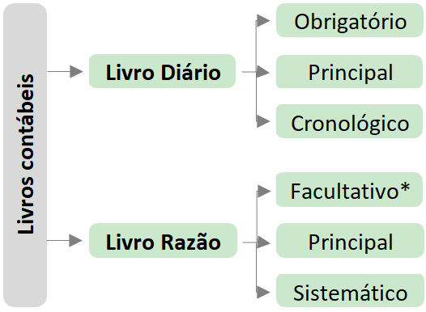
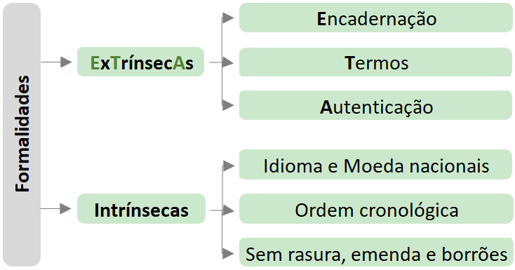

CONTABILIDADE

**1.Escrituração**

**1.1 Lançamentos**

1.1.1 Elementos Mínimos do Lançamento

- Data
- Conta Devedora
- Conta Credora
- Histórico
- Valor

1.1.2 Fórmula dos Lançamentos

| **Fórmula** | **Débitos** | **Créditos** |
|---|---|---|
| 1ª Fórmula | 1 | 1 |
| 2ª Fórmula | 1 | 2 + |
| 3ª Fórmula | 2 + | 1 |
| 4ª Fórmula | 2 + | 2 + |

**1.1.3 Retificação** de Lançamento

- **Estorno** → É o lançamento inverso àquele feito de forma errada.
- **Transferência** → É o lançamento que corrige a conta erroneamente debitada ou creditada, transpondo o registro para a conta correta.
- **Complementação** → É o lançamento que aumenta ou reduz o valor anteriormente lançado nas contas corretas, mas com valor incorreto.

**1.2 Livros**

   

- **Diário** irá registrar todas as operações da empresa, de forma **cronológica**.
- **Razão** irá detalhar os lançamentos efetuados no livro diário, especificados por conta.
    - \**É facultativo pela legislação comercial, mas obrigatório pela legislação do imposto de renda para as empresas obrigadas a declarar pelo lucro real.*

## 1. Escrituração – Balancete de Verificação

### 1.1 O que é o Balancete de Verificação?

O Balancete de Verificação é um **demonstrativo auxiliar** (ou seja, não obrigatório) utilizado para fins operacionais. Ele contém todas as contas e seus respectivos saldos, extraídos do **Livro Razão**.

### 1.2. Elementos mínimos do Balancete de Verificação:

✔️ Identificação da entidade; ✔️ Data de referência; ✔️ Abrangência; ✔️ Identificação das contas e seus grupos; ✔️ Indicação dos saldos (devedores ou credores); ✔️ Soma dos saldos devedores e credores.

### 1.3. Tipos de Balancetes:

Os balancetes podem ser classificados de acordo com o número de colunas:

- **2 colunas** – Estrutura mais comum, apresentando saldos devedores e credores;
- **4 colunas**;
- **6 colunas**;
- **8 colunas** – Quanto maior o número de colunas, mais detalhada será a informação.

### 1.4. Estrutura do Balancete de 2 colunas:

O modelo mais utilizado conta com:

- Uma coluna para os **saldos devedores**;
- Uma coluna para os **saldos credores**.
