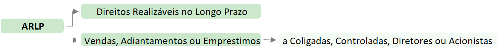
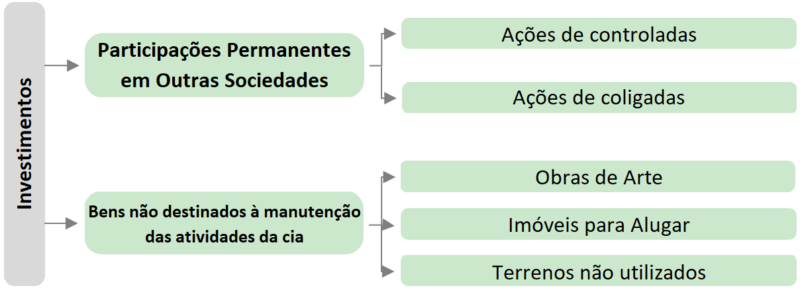
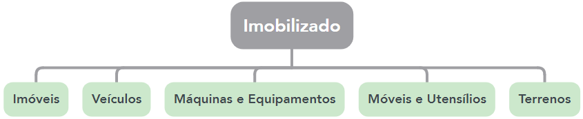
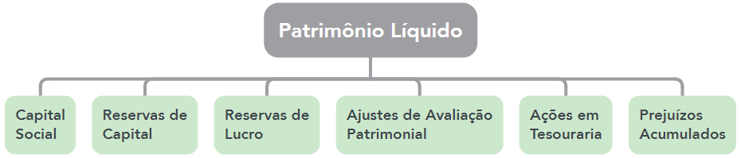

CONTABILIDADE

➡️ **Balanço Patrimonial (BP)**

- Finalidade exprimir a situação do patrimônio da entidade.
- É uma demonstração ESTÁTICA, apresentando a posição **patrimonial e financeira** da entidade EM DETERMINADO MOMENTO.
- ⚠️No **ATIVO**, as contas são elencadas por ordem do **grau de liquidez**, já no **PASSIVO** as contas são elencadas pelo **grau de exigibilidade.**

| **Ativo** | **Passivo** |
|---|---|
| Circulante Não Circulante | Circulante Não Circulante Patrimônio Líquido |

### 1. Ativo Circulante

- São os bens e direitos de curto prazo: 
    - **disponibilidades**, os **direitos realizáveis no curso do exercício social** subsequente e as **aplicações de recursos em despesas do exercício seguinte**.
- A entidade faz suas demonstrações contábeis ao fim do exercício e, por isso, para identificar se o ativo é circulante ou não, é avaliado se ele será realizado no exercício seguinte ou não.
    - ⚠️Porém, cuidado: se o **CICLO OPERACIONAL** da empresa tiver duração **MAIOR** que o exercício social, a **classificação** no circulante terá por base o **prazo desse ciclo**.

### 2. Ativo Não Circulante

- O ativo não circulante é divido em quatro classificações:
    - **ativo realizável a longo prazo**, **investimentos**, **imobilizado** e **intangível.**

**2.1. Ativo Realizável a Longo Prazo**

**2.2. Investimentos**

**2.3. Imobilizado**

Imobilizado é todo **bem corpóreo** (o que o diferencia do Intangível) destinado à **manutenção das atividades** (o que o diferencia de Investimento) da entidade.

**2.4. Intangível**

Ativo intangível é um ativo **não monetário** **identificável sem substância física**.

- ⚠️ Cuidado para não confundir **goodwill** com ativo intangível, pois **NÃO** são sinônimos. Goodwill é um item que **PODE** ser reconhecido como ativo intangível.
    - 🔥 Goodwill **gerado internamente** **NÃO é reconhecido** como ativo.
        - Já o **adquirido** é reconhecido como **ativo intangível**.  

**3. Passivo Circulante**

- São as obrigações **exigíveis Até o término do exercício seguinte**.

**4. Passivo Não Circulante**

- São as obrigações **exigíveis Após o término do exercício seguinte**.

➡️ **Balanço Patrimonial (BP)**

**1. Patrimônio Líquido**

- Representa o **capital próprio** da entidade. Veja abaixo as contas previstas na Lei nº 6.404/76.

- Obs.: a conta de **lucros acumulados continuará existindo**, mas apenas durante o exercício.
    - Ao final, seu saldo deverá ser **distribuído**, seja na forma de reserva, de dividendos.

**Patrimônio Líquido:** Nesse grupo estão incluídas **as contas representativas aos capitais próprios da entidade.** São recursos advindos dos proprietários (titular, sócios, acionistas) ou decorrentes da gestão do patrimônio (lucros/prejuízos apurados).

De acordo com o art. 178 da Lei 6.404/76, temos:

 *"Art. 178. No balanço, as contas serão classificadas segundo os elementos do patrimônio que registrem, e agrupadas de modo a facilitar o conhecimento e a análise da situação financeira da companhia.* *III – patrimônio líquido, dividido em capital social, reservas de capital, ajustes de avaliação patrimonial, reservas de lucros, ações em tesouraria e prejuízos acumulados."*

 São classificadas no PL as seguintes contas:

 **▪ Capital Social;** **▪ Reservas de Capital;** **▪ Ajustes de Avaliação Patrimonial;**

**▪ Ações em Tesouraria;** **▪ Reservas de Lucros;** **▪ Prejuízos Acumulados.**

 *O Manual FIPECAFI destaca que além dos itens previstos na Lei n. 6.404/76, o grupo Patrimônio Líquido pode apresentar outras contas para melhor evidenciar a situação patrimonial da companhia, bem como para atender a outras normatizações que estabeleçam a necessidade da divulgação. São exemplos de outras contas que podem ser encontradas no Patrimônio Líquido: Opções Outorgadas Reconhecidas, Gastos na Emissão de Ações, Ajustes Acumulados de Conversão, assim como contas extintas, mas possuidoras de saldos remanescentes (Reservas de Reavaliação e Reservas de Capital: Prêmio na Emissão de Debêntures e Doações e Subvenções para Investimentos).* 

**Ajustes de Avaliação Patrimonial:** Segundo o art. 182, §3º da Lei 6.404/76, **serão classificadas como ajustes de avaliação patrimonial, enquanto não computadas no resultado do exercício em obediência ao regime de competência, as contrapartidas de aumentos ou diminuições de valor atribuídos a elementos do ativo e do passivo, em decorrência da sua avaliação a valor justo.** Os ajustes de avaliação patrimonial têm como contrapartida o ajuste de determinados instrumentos financeiros e os valores de mercado dos ativos e passivos nas reorganizações societárias (incorporação, fusão e cisão).

**Ações em Tesouraria (Cuidado: é retificadora do PL)** Trata-se de uma conta do PL utilizada quando a empresa adquire as suas próprias ações, com o objetivo de elevar o preço delas e realizar no futuro uma nova venda, de forma a obter lucro na transação. 

A priori, importante destacar as diferenças entre debêntures e ações:

**Debêntures** são títulos de crédito negociados no mercado de capitais. Quem compra uma delas, na verdade, “empresta” dinheiro para uma empresa durante um período. Em troca disso, aceita receber uma remuneração – os juros. Pelas suas características, as debêntures são classificadas como investimentos de renda fixa, como os títulos públicos e os CDBs. 

**Ações, por outro lado, representam frações do capital de uma empresa.** Quem compra um punhado delas na bolsa de valores adquire um pequeno pedaço da companhia – em outras palavras, se torna “sócio” dela. Se a empresa tiver lucro e crescer, o investidor poderá receber dividendos e ganhar com a valorização das ações. *Se, por outro lado, a empresa tiver prejuízos, a tendência é de que os papéis se desvalorizem – e o investidor pode perder dinheiro também.*

**Desse modo:**

**DEBÊNTURESS** e prêmios envolvidos: são obrigações, logo **PASSIVO**

**AÇÕES**: lembre-se onde fica o capital social e outras coisas relacionadas aos sócios, logo está no **PATRIMÔNIO LÍQUIDO (PL).**

**Reservas de Lucros** As reservas de lucros são extraídas do lucro líquido do exercício. Possuem o objetivo de preservar o patrimônio líquido. Segundo a Lei n. 6.404/76 (art. 182, §4º), serão classificadas como reservas de lucros as contas constituídas pela apropriação de lucros da companhia.

 As reservas de lucros previstas na Lei n. 6.404/76 são as seguintes:

 **▪ Reserva Legal;** **▪ Reservas Estatutárias;** **▪ Reservas para Contingências;** **▪ Reserva de Incentivos Fiscais;** **▪ Reserva de Retenção de Lucros (de Lucros para Expansão);** **▪ Reserva de Lucros a Realizar;** **▪ Reserva Especial de Dividendo Obrigatório Não Distribuído;** **▪ Reserva Específica de Prêmio de Debêntures**

**Grave isto: A LUA RELUZ AO RELENTO (ordem de absorção de prejuízos):**  **LUA :** **LU**cros **A**cumulados **RELUZ:** **RE**serva de **LU**cros **RELENTO:** **RE**serva **LE**gal

***Lei 6404 - Art. 189 - Parágrafo único. o prejuízo do exercício será obrigatoriamente absorvido pelos lucros acumulados, pelas reservas de lucros e pela reserva legal, nessa ordem.***
