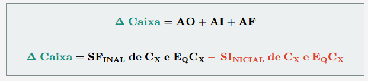

 ➡️ **Demonstração das Mutações do Patrimônio Líquido (DMPL)**

- **DMPL** Demonstra a **Variação** ocorrida em todo o **PL** da empresa → Já a **DLPA** demonstra apenas a Variação ocorrida em **Lucros ou Prejuízos Acumulados.**
- Em relação à **Obrigatoriedade**:
    - **Lei nº 6.404/76** → DMPL é **Facultativa** (inclusive com a inclusão da DLPA em sua estrutura, já que a DLPA é obrigatória pela Lei).
    - **CPC 26** → DMPL **integra o rol das DC's** (não menciona a DLPA).
- Segundo o CPC 26, a DMPL inclui as seguintes **informações:**
    - O **Resultado Abrangente** do Período, apresentando **separadamente:**
        - O montante total atribuível aos **proprietários da entidade controladora** e
        - O **montante** correspondente à **participação de não controladores**; *[Esse dado vem da DRA]*
    - Para cada componente do PL → Os **Efeitos da Aplicação Retrospectiva** ou da **Reapresentação Retrospectiva.**
    - Para cada componente do PL → A **Conciliação do Saldo no Início e no Final do Período,** demonstrando-se **separadamente** (no mínimo) **as mutações** decorrentes:
        - Do Resultado Líquido.
        - De cada item dos **Outros Resultados Abrangentes.**
        - De **Transações com os Proprietários realizadas na condição de proprietário, demonstrando** **separadamente** suas **integralizações** e as **distribuições** realizadas, bem como modificações nas participações em controladas que não implicaram perda do controle.

**1. Objetivo**

Requerer a prestação de informações acerca das **Alterações Históricas de Caixa e Equivalentes de Caixa** da entidade por meio de DFC que classifique os **Fluxos de Caixa (FCAIXA)** do período por:

- Atividades **Operacionais (AO).**
- Atividades de **Investimento (AI).**
- Atividades de **Financiamento (AF).**

⚠️ A **LSA** cita de que deve classificar **no mínimo** nestes 3 Fluxos.

**2. Alcance**

Elaboração e Publicação da DFC

- **Lei 6.404/76 (LSA)**
    - **Obrigatório** → Todas as Companhias **Abertas** e Companhias **Fechadas com PL ≥ 2 milhões.**
    - **Facultativo** → Companhias **Fechadas com PL < 2 milhões.**
- **CPC 03** ⇒ Requer que **todas as entidades** apresentem a DFC como parte integrante das suas DC's ao final de cada período.

**3. Definições**

📌 **Caixa** ⇒ Compreende **numerário em espécie e depósitos bancários disponíveis.**

📌 **Equivalentes de Caixa** ⇒ São **Aplicações Financeiras** de **Curto Prazo,** de **Alta Liquidez,** que são **Prontamente Conversíveis** em montante conhecido de caixa e que estão sujeitas a um **Insignificante Risco de Mudança de Valor.**

📌 **Fluxos de Caixa (FCAIXA)** ⇒ São as **entradas e saídas** de caixa e equivalentes de caixa.

 📌 **Atividades Operacionais (AO)** ⇒ São as **Principais** atividades **Geradoras de Receita** da entidade **e outras** atividades que **não são de investimento e tampouco de financiamento.**

 📌 **Atividades de Investimento (AI)** ⇒ São as referentes à aquisição e à venda de **Ativos de Longo Prazo** e de outros **Investimentos não incluídos nos equivalentes de caixa.**

 📌 **Atividades de Financiamento (AF)** ⇒ São aquelas que resultam em **Mudanças** no tamanho e na composição do **Capital Próprio e no Capital de Terceiros** da entidade.

**4. Caixa e Equivalentes de Caixa (CX e EQCX)**

**Equivalentes de Caixa** ⇒ Mantidos com a Finalidade de atender a Compromissos de Caixa de Curto Prazo e, Não, para Investimento ou outros propósitos

- Requisitos para que um **Investimento seja qualificado como EQCX:**
    - **Conversibilidade Imediata** em montante conhecido de Caixa
    - **Insignificante Risco de Mudança de Valor**
    - Vencimento de **Curto Prazo (até 3 meses da Aquisição).**
    - **Alta Liquidez.**

⚠️ **Investimentos em Instrumentos Patrimoniais (de PL):**

- Regra → **Não** são Equivalentes de Caixa.
- Exceção → **Substancialmente** **sejam** Equivalentes de Caixa.
    - Ex: **Ações Preferenciais Resgatáveis** que tenham prazo definido de resgate e cujo prazo atenda à definição de **Curto Prazo.**

> 🚨 **Saldos Bancários a Descoberto** (Negativo):
> Decorrem de **Empréstimos** que são liquidados em **Curto Lapso Temporal** ⇒ Compõem parte integral da **Gestão de Caixa** da entidade.
> Ex.: Cheques Especiais ou Contas Correntes Garantidas.
> Característica desses arranjos → Frequentemente os **saldos flutuam de devedor para credor.**
>  **Incluídos como CX e EQCX.**
> Ficam no Passivo Circulante, mas **Deduz do Saldo de Disponibilidades.**
> ⚡ **Questão FGV #1975684**

**5. Apresentação da DFC**

A DFC deve **Apresentar os Fluxos de Caixa** do período classificados **por Atividades Operacionais, de Investimento e de Financiamento.**

⚠️ Uma **Única Transação** pode incluir Fluxos de Caixa classificados em **Mais de uma Atividade.**

- Ex.: Desembolso de caixa para **Pagamento de Empréstimo** inclui tanto os juros como o principal:
    - A parte dos **Juros** → Atividade **Operacional.**
    - A parte do **Principal** → Atividade de **Financiamento.**

**5.1. Atividades Operacionais (AO)**

- Decorre das **Principais** Atividades **Geradoras de Receita.**
- Decorre de **Outras** Atividades que **Não** são de **Investimento** ou de **Financiamento** (Caráter Residual).
- Geralmente resultam de **Transações / Eventos** que entram na **Apuração do Lucro Líquido / Prejuízo.**
- **Indicador Chave** para saber se as Operações têm gerado suficientes FCAIXA.

**Exemplos** de Fluxo de Atividades Operacionais

**(+)** Recebimentos de caixa pela **venda** de mercadorias e pela **prestação** de serviços. **(+)** Recebimentos de caixa decorrentes de **royalties, honorários, comissões e outras receitas.** **(-)** Pagamentos de caixa a **fornecedores** de mercadorias e serviços. **(-)** Pagamentos de caixa a **empregados** ou por conta de empregados. **(-)** Pagamentos ou **(+)** Restituição de caixa de **IR** → **a menos que** possam ser especificamente identificados com **AF ou AI.** **(+)** Recebimentos e **(-)** Pagamentos de caixa de **Contratos Mantidos para Negociação** Imediata ou Disponíveis para Venda Futura.

> ⚠️ Algumas **Situações** Classificadas como **Fluxos de Caixa das Atividades Operacionais.**
>  **Ativos Mantidos para Aluguel a Terceiros** (que, em sequência, são vendidos)
> **(-)** Pagamento pela **Produção ou Aquisição.**
> **(+)** Recebimento de **Aluguel ou Venda.**
> **Títulos e Empréstimos para fins de Negociação Imediata ou Futura**
> São semelhantes a estoques adquiridos para revenda,
> **Antecipações de Caixa e os Empréstimos Feitos por Instituições Financeiras**
> Refere-se à Principal Atividade Geradora de Receita dessas Entidades.

**5.2. Atividades de Investimento (AI)**

- Aquisição e Venda de **Ativos de Longo Prazo** e de **Outros** **Investimentos (não incluídos nos EQCX).**
- **Desembolsos** que Resultam em **Ativo Reconhecido nas DC’s** → Passíveis de classificação como AI.

**Exemplos** de Fluxo de Atividades de Investimento

**(-)** Aquisição de Ativo **Imobilizado, Intangíveis e Ativos de Longo Prazo.**

**(-)** Incluem os custos de **desenvolvimento ativados** e aos ativos imobilizados de **construção própria.**

**(+)** Venda de Ativo **Imobilizado, Intangíveis e Ativos de Longo Prazo.** **(-)** Aquisição ou **(+)** Venda de **Instrumentos Patrimoniais e de Dívida** de Outras Entidades, e **Participações Societárias em** ***Joint Ventures*****.**

**Exceto** os **Títulos** considerados **EQCX** **ou Mantidos para Negociação** imediata ou futura.

**(-)** Adiantamentos e **(+)** Recebimentos em **Caixa e Empréstimos a Terceiros.**

**Exceto** os **Feitos por Instituições Financeiras** (AO).

**(-)** Pagamentos ou **(+)** Recebimentos em caixa por **Contratos Futuros, a Termo, de Opção e Swap.**

**Exceto** se **Mantidos para Negociação** imediata **ou** futura ou **Classificados como atividade de financiamento.**

💡 Apurar adequadamente o **valor contábil dos itens vendidos** → Se há **depreciação acumulada** e **se foi integralizado** capital com imobilizado.

> ⚠️ Contrato de Proteção **(*****Hedge*****) de Posição Identificável**
> Fluxos de Caixa do Contrato → **Mesma Classificação** dos Fluxos de Caixa **da Posição que estiver sendo Protegida.**

**5.3. Atividades de Financiamento (AF)**

- Resultam em **Mudanças no Tamanho e na Composição** do **Capital Próprio e no Capital de Terceiros** da Entidade.
- Útil na **Predição de Exigências de Fluxos Futuros de Caixa** por parte de **Fornecedores de Capital** à Entidade.

**Exemplos** de Fluxo de Atividades de Financiamento

**(+)** Caixa recebido pela **Emissão de Ações ou Outros Instrumentos Patrimoniais.** **(-)** **Pagamentos** em caixa a investidores para **Adquirir ou Resgatar Ações da Entidade.** **(+)** Caixa **Recebido** pela **Emissão de Debêntures, Empréstimos,** Notas promissórias, Outros Títulos de Dívida, Hipotecas e Outros Empréstimos de Curto e Longo Prazos. **(-)** **Amortização de Empréstimos e Financiamentos.** **(-)** Pagamentos em caixa pelo Arrendatário para **Redução do Passivo relativo a Arrendamento.**

💡 Somente os dividendos **efetivamente pagos entram no cálculo** *(lembre-se de que estamos falando de CAIXA)*. Se o dividendo foi **apenas provisionado** para pagamento posterior, **não entra no fluxo.**

💡 Analisar se os empréstimos anteriores foram pagos para apurar o **valor real das novas captações.**

**5.4. Fluxos de Caixa em Moeda Estrangeira**

- Devem ser registrados na **Moeda Funcional.**
- Aplica-se a **Taxa de Câmbio** na data da **Ocorrência do Fluxo de Caixa.**
- **Não são** Fluxos de Caixa → Ganhos e Perdas **não realizados resultantes de Mudanças nas Taxas de Câmbio** de moedas estrangeiras

**5.5. Algumas Situações e Classificações**

**5.5.1. Empréstimos**

- **Concedidos** → Atividade de **Investimento.**
- **Contratados** → Atividade de **Financiamento.**
- **Juros sobre Empréstimos** → Atividade **Operacional.**

**5.5.2. Ações**

- Instrumentos Patrimoniais **(Ações) de Terceiros** → Atividade de **Investimento.**
- **Ações Próprias** (em tesouraria) → Atividade de **Financiamento.**

**5.5.3. Integralização de Capital**

- **Em Dinheiro** → Atividade de **Financiamento.**
- **Com Bens** → **Não é Fluxo de Caixa.**

**5.5.4. Juros, Juros sobre Capital Próprio (JCP) e Dividendos**

|  |  | **CPC Encoraja** | **Alternativa** |
|---|---|---|---|
| **Juros** | Pagamento | Operacional | Financiamento |
|  | Recebimento | Operacional | Investimento |
| **Juros Sobre o Capital Próprio (JCP) e Dividendos** | Pagamento | Financiamento | Operacional |
|  | Recebimento | Operacional | Investimento |

**5.5.5. Imposto de Renda (IR) e Contribuição Social sobre o Lucro Líquido (CSLL)**

- Fluxos de Caixa do **IR / CSLL**
    - Devem ser **Divulgados Separadamente**
    - Classificados como **Atividade Operacional** (Regra)
        - **Exceto** se puderem ser **Identificados Especificamente** como **AF ou AI.**

**6. Transação que Não Envolve (CX e EQCX)**

Transações de **Investimento e Financiamento** **que Não envolvem** o uso de **CX e EQCX**

- Devem ser **Excluídas da DFC.**
- Divulgadas nas **Notas Explicativas.**
- **Exemplos** de Transações:
    - Aquisição de Ativos → Seja pela assunção direta de Passivo ou por meio de Arrendamento.
    - Aquisição de Entidade por meio de Emissão de Instrumentos Patrimoniais.
    - Conversão de Dívida em Instrumentos Patrimoniais.

**7. Métodos de Apresentação da DFC**

**7.1. Método Direto**

- As Principais Classes de **Recebimentos Brutos e Pagamentos Brutos** são divulgadas.
- Caso utilize o Método Direto (apurar Fluxo das AO) ⇒ Deve ser fornecida a **Conciliação entre o Lucro Líquido e o Fluxo de Caixa Líquido** das Atividades Operacionais

**-** Aumento do Ativo: **Aplicação** de recursos

**-** Diminuição do Ativo: **Origem** de recursos

**-** Aumento do Passivo: **Origem** de recursos

**-** Diminuição do Passivo: **Aplicação** de recursos

**1. Métodos de Apresentação da DFC**

**1.1. Método Indireto**

- O Fluxo de Caixa Líquido das Atividades Operacionais é determinado **Ajustando o Lucro Líquido ou Prejuízo** quanto **aos Efeitos de:**
    - Variações ocorridas nos **Estoques e nas Contas Operacionais a Receber e a Pagar.**
    - Itens que **Não Afetam o Caixa**
        - Depreciação
        - Provisões
        - Tributos diferidos
        - Ganhos e perdas cambiais não realizados
        - Resultado de equivalência patrimonial
    - Demais itens tratados como **Fluxos de Caixa de AI ou AF.**

⚠️ Método **Direto ou Indireto, só há diferença** no método de contabilização do **Fluxo Operacional.** Os Fluxos de AI e AF são iguais em ambos os Métodos.

**1.1.1. Fluxo Operacional no Método Indireto**

**1° Passo** \| **Ajustar o Lucro** com relação aos itens que **Não Afetam o Caixa ou são Fluxos de AI ou AF.** Exemplo:

Lucro Lucro Líquido do Exercício ( + ) Depreciação/Amortização/Exaustão (+ / -) Resultado de Equivalência Patrimonial (+ / -) Resultado da Venda de Investimentos, imobilizado e Intangível **( = ) Lucro Ajustado**

**2° Passo** \| Procurar as **Contas Operacionais**\* e fazer o ajuste:

**↑A e ↓P = ↓Caixa** (**Consumo** de Caixa - Aplicação)

**↓A e ↑P = ↑Caixa** (**Geração** de Caixa - Origem /  Fonte)

Exemplo:

**Lucro Ajustado** ( – ) **↑** Contas Operacionais do Ativo ( + ) **↓** Contas Operacionais do Ativo ( + ) **↑** Contas Operacionais do Passivo ( – ) **↓** Contas Operacionais do Passivo **( = ) Caixa Líquido (Gerado / Consumido) pelas Atividades Operacionais**
