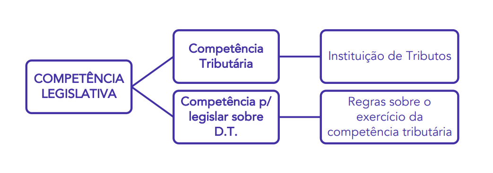

# Competência Tributária

## Conceito

- **Competência tributária** é a atribuída pela **CF** aos entes federativos para **criar, instituir, extinguir, majorar ou reduzir tributos**. Pressupõe **competência legislativa plena** para tal (lei ordinária, medida provisória ou lei complementar).
- **Não é transferida** para outra pessoa jurídica de direito público, mesmo que esta receba parte ou toda a receita do tributo (CTN, art. 6º, parágrafo único).
- A **CF não cria tributos**: apenas institui a competência para os entes o fazerem e para legislarem sobre eles.

## Competência tributária x competência para legislar sobre Direito Tributário

- A competência para **legislar sobre Direito Tributário** é **concorrente** entre **União, Estados e DF** (CF, art. 24, I):
  - a **União** limita-se a estabelecer **normas gerais**;
  - aos **Estados** cabe a legislação **suplementar**;
  - **inexistindo lei federal**, os Estados legislam de forma **plena**;
  - se a lei federal surgir, ela **suspende (não revoga)** a lei estadual **no que lhe for contrário** (art. 24, §§3º e 4º).
- Aos **Municípios** cabe suplementar o que não foi normatizado por União e Estados (CF, art. 30, II).
- **IPVA:** não previsto no CTN; o STF julgou que cabe aos Estados legislar sobre ele enquanto não houver lei federal de normas gerais.
- As **normas gerais** em matéria tributária devem ser veiculadas por **lei complementar** (CF, art. 146, III). O **CTN** é lei ordinária, **recepcionada com status de lei complementar** (inclusive na CF/67).

## Características

| Característica | Conteúdo |
|---|---|
| **Indelegabilidade** | Um ente não pode delegar a competência a outro. Pode atribuir as **funções de arrecadar ou fiscalizar** tributos, ou de **executar leis, serviços, atos ou decisões** em matéria tributária (**capacidade tributária ativa**) (CTN, art. 7º) |
| **Imprescritibilidade / incaducabilidade** | O não exercício **não autoriza** pessoa jurídica de direito público diversa a exercê-la (CTN, art. 8º); a competência pode ser exercida **a qualquer tempo**, ou não exercida |
| **Inalterabilidade** | O ente não pode alterar (aumentar, por exemplo) a competência definida pela CF, em respeito ao pacto federativo; só por **emenda constitucional** |
| **Irrenunciabilidade** | O ente não pode renunciar à competência prevista na CF |
| **Facultatividade** | O ente pode escolher **não exercer** a competência, mas, **uma vez instituído o tributo, sua cobrança é vinculada e obrigatória** |

### Delegação da capacidade tributária ativa

- Só **entre pessoas jurídicas de direito público**: não pode ser delegada a pessoa jurídica de direito privado, inclusive o **Sistema "S"** (SENAI, SENAC, SESC e SESI).
- Quem recebe a capacidade ativa fica com as **garantias e os privilégios processuais** da pessoa que a delegou (CTN, art. 7º, §1º).
- A pessoa que delegou pode **revogar a qualquer tempo, unilateralmente** (CTN, art. 7º, §2º).
- **Não constitui delegação** o cometimento, a pessoa jurídica de direito privado, do **encargo ou função de arrecadar** tributos (CTN, art. 7º, §3º): os bancos recebem os pagamentos dos contribuintes e apenas repassam o valor à pessoa de direito público devida.
- **Parafiscalidade:** ocorre quando o ente atribui a outro a **capacidade tributária ativa** **e** lhe **destina os recursos arrecadados**, que, de regra, iriam para ele mesmo. Exemplo: conselhos profissionais.

### Facultatividade e Lei de Responsabilidade Fiscal

- É requisito de responsabilidade na gestão fiscal a **instituição, previsão e efetiva arrecadação de todos os tributos** da competência do ente; no caso de **impostos**, é **vedada a realização de transferências voluntárias** ao ente que não o fizer (LC 101/2000, art. 11).
- Exemplo de competência não exercida: **IGF**, previsto, mas nunca instituído pela União.

## Classificação

| Classificação | Tributos | Entes federados |
|---|---|---|
| **Privativa** | Impostos, empréstimos compulsórios e contribuições especiais (com exceções) | União (empréstimos compulsórios e, em regra, contribuições especiais), Estados, DF e Municípios |
| **Comum** | Taxas e contribuições de melhoria | União, Estados, DF e Municípios |
| **Cumulativa** | Tributos (embora o art. 147 mencione impostos) | Apenas União e DF |
| **Residual** | Novos impostos e novas contribuições para a seguridade social | Apenas União |
| **Extraordinária** | IEG | União |
| **Compartilhada** | IBS | Estados, DF e Municípios |

### Privativa

- A instituição só pode ser feita por **determinado ente político**.
- **Impostos** são de competência privativa de entes específicos; **empréstimos compulsórios** são privativos da **União**, bem como as **contribuições especiais** (exceto as do regime próprio de previdência, que os entes podem instituir para seus servidores titulares de cargos efetivos; CF, art. 149, §1º). O **DF e os Municípios** têm competência para instituir a **COSIP** (CF, art. 149-A).
- Nota: a competência da União para instituir empréstimos compulsórios e contribuições especiais pode ser chamada de **competência especial**.

| Ente | Impostos |
|---|---|
| **União** | II, IE, IPI, IOF, IEG, IGF, IR, ITR e IS (imposto seletivo) |
| **Estados e DF** | IPVA, ICMS e ITCMD |
| **Municípios e DF** | ISS, ITBI e IPTU |

### Comum

- **Tributos vinculados**: taxas e contribuições de melhoria. Podem instituí-los os entes que fizerem jus à cobrança.

### Cumulativa

- Compete à **União, em Território Federal** (não é ente federado; fruto da descentralização territorial, sem autonomia política; inexistem atualmente no Brasil), os **impostos estaduais** e, se o Território não for dividido em Municípios, também os **municipais** (CF, art. 147).
- Ao **DF** (indivisível em Municípios) cabem os impostos estaduais e os municipais. Pelo CTN (art. 18, II), o mesmo vale para **Estados não divididos em Municípios** (inexistem no Brasil).
- Nota: embora a lei mencione "impostos", a doutrina entende "tributos".

### Residual

- **Criação de novos tributos**, exclusiva da **União**: **impostos** (CF, art. 154, I) e **contribuições para a seguridade social** residuais (art. 195, §4º), devendo:
  1. ser instituídos por **lei complementar**;
  2. obedecer ao critério da **não cumulatividade** (impede o efeito cascata);
  3. possuir **fato gerador e base de cálculo diferentes** dos de outro tributo **de mesma natureza** existente na CF.
- Doutrina: entende que os **Estados** têm competência residual para instituir **taxas e contribuições de melhoria**.

### Extraordinária

- Exclusiva da **União**, na **iminência ou no caso de guerra externa** (guerra civil não): pode instituir o **IEG** (por lei ordinária ou medida provisória), compreendido ou não em sua competência tributária (CF, art. 154, II).
- Ampla discricionariedade para definir o fato gerador, podendo usar o de imposto já existente ou de competência de outro ente.
- Deve ser **suprimido gradativamente**, cessadas as causas de sua criação (pelo CTN, art. 76, em até **5 anos** contados da celebração da paz).
- **Pode ser cumulativo**.

### Compartilhada

- Introduzida pela **EC 132/2023** com o **IBS** (substitui o ICMS e o ISS), por meio de **lei complementar nacional**: compete a **Estados, DF e Municípios**, cada ente podendo estabelecer **sua alíquota por lei específica** (CF, art. 156-A).
- Por meio do **Comitê Gestor do IBS** (CF, art. 156-B), deverão:
  1. **editar regulamento único** e uniformizar a interpretação e a aplicação da legislação do imposto;
  2. **arrecadar** o imposto, efetuar as **compensações** e **distribuir** o produto da arrecadação entre Estados, DF e Municípios;
  3. **decidir o contencioso administrativo**.

## Bis in idem e bitributação

| | Bis in idem | Bitributação |
|---|---|---|
| **Quem tributa** | O **mesmo ente** (mesma pessoa jurídica de direito público) | **Entes distintos** |
| **O quê** | O mesmo fato gerador, em mais de um tributo | O mesmo fato gerador |
| **Regra** | **Não há vedação expressa** na CF | **Vedada**, em regra: é **invasão de competência** tributária |

### Bis in idem

- Incidência de **mais de um tributo do mesmo ente sobre o mesmo fato gerador**. A CF **não o proíbe expressamente**; o limite está na **competência residual** da União, que não pode criar:
  - **imposto** novo com fato gerador ou base de cálculo **próprios dos impostos já discriminados** na CF (art. 154, I);
  - **contribuição** residual de seguridade com fato gerador ou base de cálculo de **outra contribuição** já prevista; ela **pode coincidir com a de um imposto** (art. 195, §4º; STF, RE 228.321).
- Exemplos, todos da **União**:
  1. **IRPJ e CSLL**: incidem sobre o **lucro** das empresas.
  2. **PIS/PASEP e COFINS**: incidem sobre a **receita ou o faturamento**. A COFINS financia a **seguridade social** (saúde, previdência e assistência social; art. 195, I, "b"); o PIS/PASEP, o seguro-desemprego, outras ações da previdência social e o abono salarial (art. 239). Serão substituídos pela **CBS** a partir de 2027.
  3. **PIS/PASEP-Importação e COFINS-Importação**: incidem sobre a **importação de bens e serviços** (art. 195, IV). Também serão substituídos pela **CBS**.

### Bitributação

- Incidência sobre o **mesmo fato gerador** por tributos de **entes distintos**; em regra, é **invasão de competência** tributária.
- **Exceções:**
  1. **Imposto extraordinário de guerra (IEG)** (CF, art. 154, II): na iminência ou no caso de guerra externa, a União pode instituir impostos extraordinários **compreendidos ou não em sua competência**, inclusive com fato gerador ou base de cálculo de imposto já existente de outro ente (ex.: **ICMS extraordinário**). Se o fato gerador for de competência da própria União, o caso é de **bis in idem** (ex.: **IR extraordinário**).
  2. **Dupla tributação internacional da renda**: o rendimento obtido no Brasil por pessoa com **residência fiscal no exterior** é tributado aqui (país da fonte) e, se a legislação do país de residência alcançar as rendas obtidas fora dele, também lá. Para reduzir essas situações, que desestimulam o investimento, o Brasil é signatário de diversos **tratados para evitar a dupla tributação**.

## Quadro geral da competência por espécie

<!-- colunas: 20 28 26 26 -->
| Espécie | União | Estados e DF | Municípios e DF |
|---|---|---|---|
| **Impostos** privativa · CF, arts. 153, 155 e 156 | II, IE, IR, IPI, IOF, ITR, IGF e **IS** (imposto seletivo) | ICMS, ITCMD e IPVA | ISS, ITBI e IPTU |
| **IBS** compartilhada · CF, art. 156-A | — | **IBS**, em conjunto com os Municípios | **IBS**, em conjunto com os Estados |
| **Impostos residuais** CF, art. 154, I | Novos impostos, por **lei complementar** | — | — |
| **Imposto extraordinário (IEG)** CF, art. 154, II | Na iminência ou no caso de **guerra externa** | — | — |
| **Taxas** comum · CF, art. 145, II | Exercício regular do **poder de polícia** Utilização de **serviços públicos específicos e divisíveis** | Exercício regular do **poder de polícia** Utilização de **serviços públicos específicos e divisíveis** | Exercício regular do **poder de polícia** Utilização de **serviços públicos específicos e divisíveis** |
| **Contribuição de melhoria** comum · CF, art. 145, III | Obras públicas **federais** que gerem valorização imobiliária | Obras públicas **estaduais/distritais** que gerem valorização imobiliária | Obras públicas **municipais/distritais** que gerem valorização imobiliária |
| **Empréstimos compulsórios** CF, art. 148 | Despesas extraordinárias de **calamidade pública** ou de **guerra externa ou sua iminência** (I) **Investimento público urgente** e de relevante interesse nacional (II) | — | — |
| **Contribuições sociais** CF, arts. 149 e 195 | Regra, incluindo a **CBS** (art. 195, V) e as **residuais** da seguridade, por lei complementar (art. 195, §4º) | Custeio do **regime próprio de previdência** dos servidores estaduais/distritais (art. 149, §1º) | Custeio do **regime próprio de previdência** dos servidores municipais/distritais (art. 149, §1º) |
| **CIDE** CF, art. 149 | Intervenção no domínio econômico | — | — |
| **Contribuições corporativas** CF, art. 149 | Interesse das **categorias profissionais ou econômicas** | — | — |
| **COSIP** CF, art. 149-A | — | — | Custeio, expansão e melhoria da **iluminação pública** e de **sistemas de monitoramento** para segurança e preservação de logradouros públicos |

- **DF** acumula os impostos estaduais e os municipais; em **Território Federal**, a União institui os estaduais e, se o Território não for dividido em Municípios, também os municipais (CF, art. 147).
- **Transição da Reforma:** o **ICMS** e o **ISS** deixam de existir em **2033**, substituídos pelo IBS (EC 132/2023, art. 22); o **IPI** tem as alíquotas reduzidas a zero a partir de **2027**, salvo para produtos com industrialização incentivada na Zona Franca de Manaus (ADCT, art. 126, III).

## Pegadinhas

- "A Constituição institui os tributos" → **ERRADO** (apenas outorga a competência).
- "O ente que recebe o produto da arrecadação de um tributo passa a ter competência para instituí-lo" → **ERRADO** (a competência não se transfere).
- "A superveniência de lei federal de normas gerais revoga a lei estadual" → **ERRADO** (suspende a eficácia no que lhe for contrário).
- "A delegação de arrecadação e fiscalização pode ser feita a pessoa jurídica de direito privado" → **ERRADO** (só entre pessoas de direito público; o encargo de arrecadar não é delegação).
- "Uma vez delegada, a capacidade tributária ativa só pode ser retomada por lei" → **ERRADO** (revogável a qualquer tempo, por ato unilateral).
- "Competência não exercida no prazo legal passa para outro ente" → **ERRADO** (é incaducável).
- "A LRF veda transferências voluntárias ao ente que não institua todas as taxas de sua competência" → **ERRADO** (a sanção é só quanto a impostos).
- "O IEG exige lei complementar" → **ERRADO** (lei ordinária ou MP; a residual é que exige LC).
- "O imposto extraordinário pode ser instituído em caso de guerra civil" → **ERRADO** (guerra externa ou sua iminência).
- "O imposto residual pode ter o fato gerador do ICMS" → **ERRADO** (deve ser diferente do de outro tributo de mesma natureza).
- "A Constituição veda expressamente o bis in idem" → **ERRADO** (não há vedação expressa; IRPJ e CSLL incidem sobre o lucro).
- "A bitributação é sempre inconstitucional" → **ERRADO** (o IEG pode ter o fato gerador de imposto de outro ente, como o ICMS).
- "O IR extraordinário instituído pela União em caso de guerra externa é exemplo de bitributação" → **ERRADO** (mesmo ente: bis in idem).
- "A taxa e a contribuição de melhoria são de competência privativa da União" → **ERRADO** (competência comum dos quatro entes).
- "A COSIP pode ser instituída pelos Estados" → **ERRADO** (só Municípios e DF; CF, art. 149-A).
- "Os Estados podem instituir contribuição de intervenção no domínio econômico" → **ERRADO** (CIDE é exclusiva da União; aos Estados cabe só a contribuição do regime próprio dos servidores).

## Base legal / referência

- CF, arts. 24, I e §§1º a 4º, 30, II, 145, II e III, 146, III, 147, 148, 149, 149-A, 153, 154, 155, 156, 156-A, 156-B, 195, IV, V e §4º, e 239; ADCT, art. 126, III; EC 132/2023, art. 22.
- CTN, arts. 6º a 8º, 18 e 76; LC 101/2000, art. 11.
- STF, RE 228.321 (contribuição residual pode ter a base de cálculo de um imposto).

## Relações com outros assuntos

- Imunidade como limitação da competência → `../04 - Limitações ao Poder de Tributar/imunidades-tributarias.md`
- Imunidades em espécie → `../04 - Limitações ao Poder de Tributar/imunidades-em-especie.md`
- Princípio da legalidade tributária → `../04 - Limitações ao Poder de Tributar/principio-da-legalidade-tributaria.md`
- Impostos e competência residual → `../03 - Espécies Tributárias/impostos.md`
- Contribuições residuais, PIS/COFINS e CBS → `../03 - Espécies Tributárias/contribuicoes-sociais-e-previdenciarias.md`
- Empréstimos compulsórios → `../03 - Espécies Tributárias/emprestimo-compulsorio.md`
- Contribuição de melhoria (competência comum) → `../03 - Espécies Tributárias/contribuicao-de-melhoria.md`
- Contribuições especiais (CIDE, corporativas e COSIP) → `../03 - Espécies Tributárias/contribuicoes-especiais.md`
- Taxas (competência comum) → `../03 - Espécies Tributárias/taxas.md`
- Territórios federais e descentralização territorial → `../../Direito Administrativo/03 - Organização Administrativa/centralizacao-descentralizacao-e-desconcentracao.md`

## Mapa mental

- Conceito
  - Criar, instituir, extinguir, majorar ou reduzir tributos
  - CF só outorga; não se transfere
- Legislar sobre Direito Tributário
  - Concorrente: União, Estados e DF
  - Lei federal superveniente suspende a estadual
  - Normas gerais por lei complementar
- Características
  - Indelegável, incaducável, inalterável, irrenunciável, facultativa
  - Capacidade ativa delegável entre pessoas de direito público
  - LRF: transferências voluntárias e impostos
- Classificação
  - Privativa e comum
  - Cumulativa: União e DF
  - Residual: LC, não cumulativa, fato gerador novo
  - Extraordinária: IEG, guerra externa
  - Compartilhada: IBS e Comitê Gestor
- Bis in idem e bitributação
  - Bis in idem: mesmo ente, sem vedação expressa
  - Exemplos: IRPJ e CSLL; PIS e COFINS
  - Bitributação: entes distintos, invasão de competência
  - Exceções: IEG e dupla tributação internacional
- Quadro por espécie
  - Impostos privativos; IBS compartilhado
  - Taxas e contribuição de melhoria: todos os entes
  - Empréstimos compulsórios, CIDE e corporativas: União
  - COSIP: Municípios e DF
