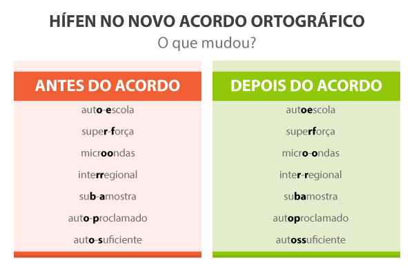

**PORTUGUÊS**

## **1\. SONS, LETRAS, FONEMAS E ACENTUAÇÃO**

### **1.1 Fonética e Fonologia**

Ao estudo dos sons da fala dá-se o nome de **Fonética**. Já a **Fonologia** preocupa-se com a função desses sons dentro do sistema da língua, ou seja, como eles se organizam para formar palavras e produzir sentidos.

### **1.2 Letra x Fonema**

* **Letra**: representação gráfica ***(aquilo que se escreve)***.  
* **Fonema**: unidade sonora ***(aquilo que se pronuncia)***.

A correspondência entre letra e fonema nem sempre é direta:

* Uma letra pode não representar som: ***h*** em “**hora**”.  
* Uma letra pode representar mais de um som: ***x*** em “**exame**”.  
* Um som pode ser representado por mais de uma letra: ***ch*** em “chuva”.

### **1.3 Classificação dos Fonemas**

* **Fonemas vocálicos**: sons das vogais (a, e, i, o, u).  
* **Fonemas consonantais**: sons das consoantes (b, c, d, f, g etc.).

Os fonemas são responsáveis por diferenciar palavras:

Ex.: ***pato*** **/ *bato*** → mudança de um único fonema altera o sentido.  
 

| Para saber mais clique no link: [FONÉTICA E FONOLOGIA](https://www.youtube.com/watch?v=bHb_tLQK7AA) |
| :---- |

   
 

## **2\. SÍLABA E ESTRUTURA DAS PALAVRAS**

### **2.1 Conceito de sílaba**

Sílaba é um conjunto de fonemas pronunciados em uma única emissão de voz.  
Regra fundamental: **não existe sílaba sem vogal**.

### **2.2 Classificação quanto ao número de sílabas**

* Monossílabas: uma sílaba (pé, sol)  
* Dissílabas: duas sílabas (ca-sa, por-ta)  
* Trissílabas: três sílabas (es-pe-ra)  
* Polissílabas: quatro ou mais sílabas (cho-co-la-te)

### **2.3 Vogais e Semivogais**

* **Vogal**: base da sílaba, pronunciada com maior intensidade.  
* **Semivogal**: som mais fraco, que acompanha uma vogal na mesma sílaba.

Exemplos:

* *Tou-ro* (o \= vogal / u \= semivogal)  
* *Cá-rie* (i \= semivogal / e \= vogal)

 

## **3\. ENCONTROS VOCÁLICOS**

Ocorrem quando há a junção de sons vocálicos.

### **3.1 Ditongo (DOIS sons na mesma sílaba)**

* Crescente: semivogal \+ vogal (história, cárie)  
* Decrescente: vogal \+ semivogal (touro, peixe)  
* Oral: som pela boca (pai)  
* Nasal: som pelo nariz (mãe, pão)

### **3.2 Tritongo (TRÊS sons na mesma sílaba)**

* Ex.: iguais, quão  
* Pode ser oral ou nasal.

### **3.3 Hiato (separação de vogais)**

Duas vogais em sílabas diferentes.  
Ex.: **sa-í-da, pre-ju-í-zo**  
   
 

| Para saber mais clique nos links: [Encontros Vocálicos (Ditongo, Tritongo e Hiato)](https://www.youtube.com/watch?v=0933HA-ZqdA)  [ENCONTROS VOCÁLICOS \- DITONGO, TRITONGO E HIATO](https://www.youtube.com/watch?v=ZQFnsxVkZdM) |
| :---: |

 

## **4\. DÍGRAFOS**

Ocorrem quando duas letras representam um único fonema.  
Principais exemplos:

* **consonantais**: **ch** (chuva), **nh** (ninho), **lh** (filho), **rr** (carro), **ss** (passo)  
* **vocálicos: am**, **an, em, en** (indicando nasalização)

Atenção: nem todo encontro de letras é dígrafo.  
Ex.: **“br”** em *branco* → dois sons (não é dígrafo).  
   
 

| Para saber mais clique nos links: [O que é DÍGRAFO?](https://www.youtube.com/watch?v=TPUYYgsz7A0) [Fonema, Letra e Dígrafo](https://www.youtube.com/watch?v=qyD-ag0Z0-0) |
| :---: |

 

## **5\. TONICIDADE DAS PALAVRAS**

### **5.1 Sílaba tônica**

É a sílaba pronunciada com maior intensidade.  
   
Imagine chamar alguém em voz alta: a sílaba que “se alonga” é a tônica.

Ex.: Fer-**NAN**\-do → ***“nan”*** é a sílaba mais forte.  
   
Regra: toda palavra tem apenas **uma sílaba tônica**.

### **5.2 Classificação quanto à tonicidade**

* **Oxítonas**: última sílaba forte (ca-**fé**)  
* **Paroxítonas:** penúltima sílaba forte (sa-**pa**\-to)  
* **Proparoxítonas:** antepenúltima sílaba forte (**pás**\-sa-ro)

##  

## **6\. REGRAS GERAIS DE ACENTUAÇÃO**

### **6.1 Oxítonas**

Acentuam-se quando terminadas em:

* A, E, O, EM, ENS  
* Ditongos abertos: **éu, éi, ói**

Ex.: sofá, você, avó, chapéu, papéis, heróis

### **6.2 Paroxítonas**

São acentuadas quando NÃO terminam em:  
**A, E, O, EM, ENS**  
   
Ex.: fácil, lápis, vírus, revólver  
   
Atenção: palavras como “problema” não são acentuadas porque seguem a regra.

### **6.3 Proparoxítonas**

Regra mais simples: **todas são acentuadas.**  
   
Ex.: **pássaro, médico, lâmpada**  
   
 

| A acentuação dos ditongos abertos (éi, éu, ói) mudou com o Novo Acordo Ortográfico. Atualmente, acentuam-se apenas os ditongos abertos em palavras oxítonas e monossílabos tônicos (ex: papéis, céu, herói). Ditongos abertos em palavras paroxítonas perderam o acento (ex: ideia, joia, plateia).  Regras Atuais: Acentuados (Oxítonas e Monossílabos): Os ditongos abertos tónicos éi(s), éu(s), ói(s) no final das palavras continuam acentuados. *Exemplos:* Céu, chapéu, herói, papéis, fiéis, dói, corrói, constrói, troféu, ilhéu. Não Acentuados (Paroxítonas): As paroxítonas (palavras com a penúltima sílaba forte) com ditongos abertos "ei" e "oi" perderam o acento. *Exemplos:* Ideia, plateia, jiboia, heroico, paranoico, androide, assembleia, apio, coringa, estreias. Casos Especiais/Proparoxítonas: Palavras proparoxítonas com ditongos abertos continuam acentuadas, pois a regra das proparoxítonas é absoluta.   |
| :---- |

## **7\. ACENTUAÇÃO DO HIATO**

   
O **hiato** é o **encontro de duas vogais, mas em sílabas diferentes**. A razão do acento, em alguns hiatos, é impedir que se leia como um ditongo (encontro de uma vogal com uma semivogal, ambos na mesma sílaba). Veja:

* **Ditongo**: "cai" (vogal \+ semivogal na mesma sílaba).  
* **Hiato**: "ca-í" (duas vogais em sílabas diferentes).

   
**Regra:** Devemos **acentuar** o **I e o U tônicos**, em hiato, quando:

1. Estão sozinhos na sílaba. Ex.: "sa-í-da", "a-ça-í".  
2. São seguidos de **S**. Ex.: "fa-ís-ca", "ba-la-ús-tre".

**Exemplos de palavras com hiato acentuado**:

* açaí  
* egoísta  
* faísca  
* saúde  
* viúva  
* Paraíba

   
Em sentido contrário, o I e o U tônicos **NÃO** são acentuadas quando formam sílaba com letra que não seja S. Veja:

* juiz  
* ruim  
* saiu  
* cair  
* amendoim  
* contribuiu

   
**Exceções:**

1. **Hiato antes de NH**: Não se acentua o **I** ou **U** tônico quando o hiato é seguido de **NH** na próxima sílaba. Exemplos:  
   * rainha  
   * bainha  
   * moinho  
2. **I ou U tônico após ditongo decrescente em paroxítonas**: Não se acentua o **I** ou **U** tônico quando ele vem após um ditongo decrescente em palavras paroxítonas. Exemplos:  
   * feiura  
   * baiuca  
   * bocaiuva  
   * sauipe

### **7.2 ACENTOS DIFERENCIAIS:**

Os **acentos diferenciais** são usados para distinguir palavras que têm a mesma grafia, mas significados ou funções diferentes. Após o **Acordo Ortográfico de 2009**, apenas alguns acentos diferenciais foram mantidos:

#### **Acentos Diferenciais Mantidos**

1. **por** (preposição) / **pôr** (verbo).  
2. **tem** (singular) / **têm** (plural).  
3. **vem** (singular) / **vêm** (plural) – do verbo **VIR**, não do verbo **VER**.  
4. **pode** (presente) / **pôde** (pretérito).  
5. **mantém** (singular) / **mantêm** (plural).

#### **Acentos Diferenciais Facultativos**

* **forma** (verbo) / **fôrma** (substantivo).  
* **demos** (presente) / **dêmos** (subjuntivo).

#### **Acentos Diferenciais Abolidos (NÃO USA\!\!\!)**

* **pela** (preposição \+ artigo) / **pela** (verbo pelar).  
* **polo** (esporte) / **polo** (antiga forma de "por o").  
* **pelo** (substantivo) / **pelo** (verbo pelar).  
* **pera** (fruta) / **pera** (preposição arcaica).

 

| Para saber mais clique nos links: [Acentuação Gráfica: Hiato](https://www.youtube.com/watch?v=ZCeq2l36jtk)  [Português \- Acentuação dos hiatos "I" e "U"](https://www.youtube.com/watch?v=7wdTEvWWYZA) |
| :---: |

 

## **8\. EMPREGO DO HÍFEN**

O hífen, em geral, é utilizado para:

* ligar os elementos de algumas palavras compostas: **azul-marinho, verde-claro, guarda-chuva**;  
* ligar pronomes átonos a verbos na ênclise ou na mesóclise: **compraram-na, amá-lo-ei**;  
* indicar a separação silábica e a translineação, isto é, a divisão de uma palavra no final da linha.

**NÃO SE USA HÍFEN PARA:**

* unir prefixo terminado em vogal a uma palavra iniciada por vogal diferente: **autoestrada, infraestrutura, semianalfabeto**;  
* unir prefixo terminado em consoante a uma palavra iniciada por consoante diferente: **superbactéria, intermunicipal, hipermercado**;  
* unir prefixo terminado em consoante a uma palavra iniciada por vogal: **hiperativo, interescolar, supereconômico**.

**Observação:** em **coautor**, não se usa hífen porque o prefixo **co-** geralmente se une à palavra seguinte, mesmo quando ela começa com a vogal **o**.  
   
**USA-SE HÍFEN PARA**:

* **separar vogais iguais**: anti-inflamatório, contra-ataque.  
* **separar consoantes iguais**: super-romântico, hiper-resistente.

